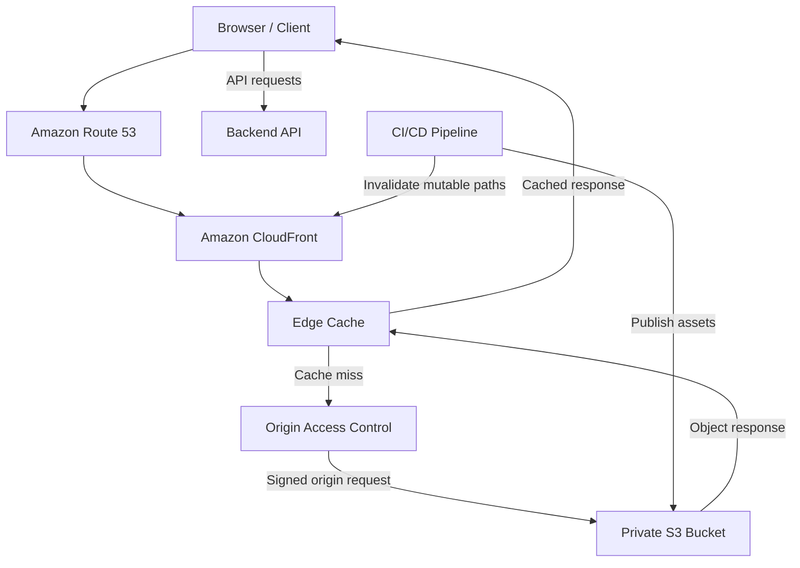
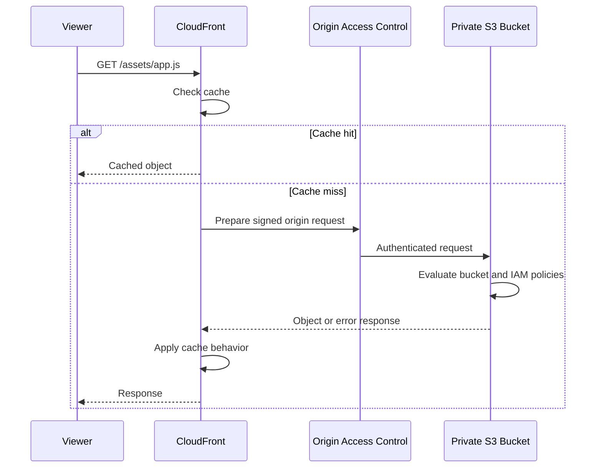
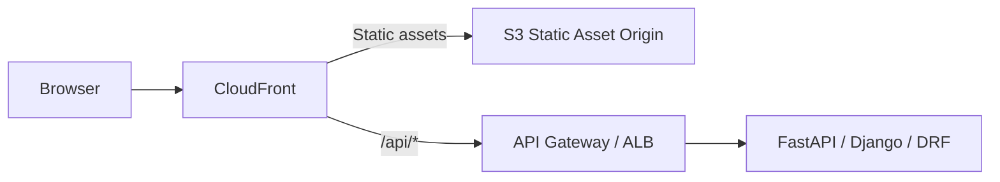

# 03- CloudFront Integration

## Overview

Amazon CloudFront is a content delivery network (CDN) that caches and delivers content through a globally distributed network of edge locations. When integrated with Amazon S3, CloudFront provides a scalable delivery layer for static websites, images, documents, downloads, application assets, and other object-storage workloads.

CloudFront reduces repeated requests to the S3 origin by serving cacheable content from edge locations. It also supports HTTPS, custom domains, access controls, request routing, response transformation, and integration with backend APIs.

A typical production architecture uses:

- **Amazon S3** as the origin that stores objects.
- **Amazon CloudFront** as the delivery layer that caches and serves content.
- **Origin Access Control (OAC)** to authenticate CloudFront requests to a private S3 origin.
- **Amazon Route 53** for custom-domain DNS when applicable.
- **AWS Certificate Manager (ACM)** for TLS certificates.
- **AWS WAF** when web application firewall protections are required.
- **CloudWatch and CloudFront logs** for monitoring and investigation.

The integration is useful for React, Vue, Angular, and other frontend applications, as well as media platforms, document delivery systems, public asset repositories, and private file distribution.

For most new production architectures, prefer a **private S3 REST origin protected by CloudFront OAC** instead of making the S3 bucket publicly accessible.

## Architecture and Request Flow

### Standard S3 and CloudFront Architecture



CloudFront handles viewer requests independently of the application's backend API. For cacheable objects, CloudFront can serve content without making an origin request for every viewer request.

A request typically follows this sequence:

1. A client requests an object through the CloudFront distribution.
2. CloudFront evaluates the request and finds the applicable cache behavior.
3. CloudFront checks its cache using the configured cache key.
4. If a usable cached response exists, CloudFront serves it.
5. On a cache miss or revalidation requirement, CloudFront sends a request to the S3 origin.
6. OAC signs the origin request using AWS Signature Version 4 when configured to always sign requests.
7. S3 evaluates the origin request against its permissions and returns the object or an error.
8. CloudFront caches the response according to the configured caching behavior.
9. CloudFront returns the response to the client.

CloudFront and S3 have separate security responsibilities. OAC controls CloudFront-to-S3 origin access; it does not independently authorize a viewer to access every object delivered through the distribution.

See the [CloudFront request and response behavior for S3 origins](https://docs.aws.amazon.com/AmazonCloudFront/latest/DeveloperGuide/RequestAndResponseBehaviorS3Origin.html).

## S3 REST Origin versus S3 Website Endpoint

CloudFront supports two distinct ways to use S3 for website delivery.

### S3 REST Origin

A regular S3 bucket's REST endpoint exposes S3 object APIs. CloudFront can use this endpoint with OAC to retrieve objects from a private bucket.

Example:

```text
https://company-assets-prod.s3.us-east-1.amazonaws.com/
```

Use this architecture when you need:

- A private S3 bucket.
- Authenticated CloudFront origin requests.
- Support for S3 objects encrypted with AWS KMS, subject to the required permissions.
- Secure static website delivery.
- Controlled origin access and a clear security boundary.

The bucket does not need static website hosting enabled when CloudFront uses the S3 REST endpoint.

### S3 Website Endpoint

An S3 website endpoint provides website-specific behavior, including index documents, error documents, and redirect rules.

Example:

```text
http://company-assets-prod.s3-website-us-east-1.amazonaws.com
```

CloudFront can use an S3 website endpoint as a custom origin, but OAC and the legacy Origin Access Identity (OAI) do not support this endpoint type. HTTPS communication between CloudFront and an S3 website endpoint is also not supported.

This approach generally requires the website content to be publicly accessible at the S3 website endpoint. It is therefore usually unsuitable when the architecture requires a private origin.

### Comparison

| Feature | S3 REST origin with OAC | S3 website endpoint |
|---|---|---|
| Private S3 bucket | Supported | Not for publicly served website content using the website endpoint |
| CloudFront OAC | Supported | Not supported |
| HTTPS from CloudFront to origin | Supported with appropriate OAC signing configuration | Not supported |
| Website index-document handling | Configure CloudFront behavior or rewriting | Supported by S3 website hosting |
| Website error-document handling | Configure CloudFront error behavior or application logic | Supported by S3 website hosting |
| Redirect rules | Implement through the appropriate delivery layer | Supported by the website endpoint |
| Recommended for private production origins | Yes | No |

For new production websites, the preferred design is generally a private S3 REST origin protected by OAC.

Official reference: [Restrict access to an S3 origin](https://docs.aws.amazon.com/AmazonCloudFront/latest/DeveloperGuide/private-content-restricting-access-to-s3.html).

## Origin Access Control (OAC)

Origin Access Control authenticates CloudFront requests to supported origins. For an S3 bucket origin, OAC allows CloudFront to retrieve objects without exposing the bucket directly to anonymous viewers.

OAC is the recommended replacement for legacy Origin Access Identity configurations.

### How OAC Works



OAC signs origin requests when configured with the recommended `always` signing behavior. The S3 bucket policy can restrict access to the CloudFront service principal and the specific distribution ARN.

OAC supports S3 buckets in supported AWS Regions, SSE-KMS encrypted objects with the appropriate KMS permissions, and authenticated dynamic S3 requests such as `PUT` and `DELETE` when explicitly configured and authorized.

### Required Configuration

For a private S3 origin:

1. Create the S3 bucket and keep Block Public Access enabled.
2. Create a CloudFront distribution with the bucket's REST endpoint as its origin.
3. Create an OAC configured for an S3 origin, SigV4 signing, and always-sign behavior.
4. Associate the OAC with the S3 origin.
5. Add a bucket policy that permits the intended CloudFront distribution to read objects.
6. Verify that direct anonymous S3 requests are denied while CloudFront requests succeed.

For new S3 buckets, Object Ownership is normally set to `Bucket owner enforced`. This disables ACLs and is the appropriate default for most OAC architectures.

### Example S3 Bucket Policy

The following policy allows one CloudFront distribution to read objects from a private bucket.

```json
{
  "Version": "2012-10-17",
  "Statement": [
    {
      "Sid": "AllowCloudFrontReadOnly",
      "Effect": "Allow",
      "Principal": {
        "Service": "cloudfront.amazonaws.com"
      },
      "Action": "s3:GetObject",
      "Resource": "arn:aws:s3:::company-assets-prod/*",
      "Condition": {
        "StringEquals": {
          "AWS:SourceArn": "arn:aws:cloudfront::123456789012:distribution/EXAMPLE123456"
        }
      }
    }
  ]
}
```

Replace the example bucket name, account ID, and distribution ID with the actual resource identifiers.

This grants CloudFront read access to objects through the specified distribution. It does not provide deployment write permissions and does not make the objects publicly accessible.

If the origin uses SSE-KMS with a customer-managed KMS key, ensure the appropriate KMS key policy and permissions also permit the required access. S3 authorization and KMS authorization are separate checks.

### Common OAC Mistakes

| Mistake | Consequence | Correction |
|---|---|---|
| Using a website endpoint with OAC | OAC cannot authenticate the website-origin request | Use the bucket's REST endpoint |
| Referencing the wrong distribution ARN | S3 denies origin access | Verify the exact distribution ID and account |
| Making the bucket public to resolve `403` errors | Exposes direct S3 access unnecessarily | Fix OAC and bucket-policy configuration |
| Forgetting KMS permissions | Encrypted objects remain inaccessible | Validate the KMS key policy and required permissions |
| Assuming OAC authorizes viewers | Application files may be exposed through the distribution if viewer access is unrestricted | Implement viewer-level authorization where required |

## CloudFront Distribution Configuration

A CloudFront distribution defines the origin, cache behaviors, viewer protocol settings, TLS configuration, logging, and other delivery policies.

For S3 integrations, the origin and cache behavior are especially important.

### Origin Configuration

An S3 origin typically includes:

- The bucket's regional REST endpoint.
- An origin identifier.
- An OAC identifier.
- Optional origin path settings.
- Appropriate origin access permissions.

An origin path is useful when the published site is stored under a prefix such as `releases/current`. CloudFront prepends that path to origin requests. It does not create or verify the prefix automatically.

Use environment-specific bucket names, prefixes, or distributions deliberately so that development deployments cannot overwrite production assets.

### Default Cache Behavior

For a read-only static site, a typical default cache behavior includes:

| Setting | Recommended configuration |
|---|---|
| Allowed HTTP methods | `GET`, `HEAD` |
| Cached HTTP methods | `GET`, `HEAD` |
| Viewer protocol policy | Redirect HTTP to HTTPS |
| Compression | Enabled where appropriate |
| Cache policy | Managed or custom policy aligned with the workload |
| Origin | Private S3 REST origin with OAC |
| Default root object | `index.html` when applicable |

Only enable additional methods when the architecture genuinely requires them. If CloudFront forwards `PUT`, `POST`, or `DELETE` operations to an S3 origin, the bucket policy must grant only the intended operations. OAC does not make such methods safe by itself.

CloudFront can forward all supported HTTP methods when configured to do so, but for ordinary website delivery, a read-only behavior is the safer default.

### Multiple Origins and Behaviors

CloudFront supports multiple origins and path-based cache behaviors.

For example:

| Path pattern | Origin | Typical purpose |
|---|---|---|
| `/assets/*` | S3 | Static JavaScript, CSS, fonts, and images |
| `/media/*` | S3 | Public or controlled media delivery |
| `/api/*` | API Gateway or a backend origin | Dynamic application requests |
| Default behavior | S3 | Frontend application and static files |

A distribution with an API origin must use a suitable cache policy for API requests. Do not apply the long-lived static asset cache policy to personalized API responses.

For private content, ensure that the API or delivery layer enforces viewer authorization and that cache behavior cannot expose one user's response to another.

## Cache Policies and Cache Keys

Caching is central to CloudFront performance, origin request volume, and content freshness.

CloudFront's cache key determines when requests can reuse a cached response. Depending on the policy, it can include selected query strings, headers, and cookies, in addition to the relevant object path and other cache dimensions.

Values that change the returned content must be represented appropriately in cache behavior or handled with a design that safely avoids caching personalized responses.

### Cache Policy Comparison

| Content type | Typical caching approach | Important consideration |
|---|---|---|
| Fingerprinted JavaScript and CSS | Long-lived TTL | Use content-hashed filenames |
| HTML entry document | Short TTL or revalidation | New releases must become visible predictably |
| Public images | Moderate or long TTL | Ensure object changes follow a clear invalidation or versioning process |
| Public documents | Based on update frequency | Consider cache freshness and download behavior |
| Private user-specific documents | Restrictive caching or carefully configured authorized caching | Do not allow cross-user cache reuse |
| Personalized API responses | Usually disabled or tightly controlled caching | Cache keys and authorization must prevent data leakage |

### Content Versioning

For immutable assets, use names containing a content hash:

```text
assets/app.1a9f4d2.js
assets/styles.57c2b8e.css
```

An updated asset receives a new URL. This allows a long cache lifetime without requiring every user to receive a cache invalidation after every frontend build.

For mutable files such as `index.html`, use a shorter TTL or revalidation-friendly response metadata.

Example:

```http
Cache-Control: no-cache, max-age=0, must-revalidate
```

For fingerprinted assets:

```http
Cache-Control: public, max-age=31536000, immutable
```

These values are common examples, not universal requirements. Select the headers and CloudFront TTL settings to match the application's deployment and caching model.

CloudFront cache policies can impose minimum, default, and maximum TTL values. The minimum TTL is particularly important because it can affect whether CloudFront honors origin directives intended to prevent caching. For sensitive content, configure the cache policy deliberately instead of relying solely on origin headers.

Official reference: [Manage how long content stays in the CloudFront cache](https://docs.aws.amazon.com/AmazonCloudFront/latest/DeveloperGuide/Expiration.html).

### Invalidation

CloudFront invalidation removes specified cached objects from CloudFront edge caches so that subsequent requests retrieve or revalidate the content according to the configuration.

Example:

```bash
aws cloudfront create-invalidation \
  --distribution-id EXAMPLE123456 \
  --paths "/index.html"
```

Use invalidations for mutable paths such as the HTML entry document or when a correction must become visible before a normal TTL expires.

Do not invalidate every asset on every deployment if fingerprinted filenames already provide safe versioning. Use invalidations selectively and monitor their completion.

## CloudFront and CORS

When browser JavaScript fetches content from a CloudFront URL using a different origin, browser CORS rules apply.

The relevant CORS response might be generated by S3, CloudFront through a response headers policy, or an application origin.

### CORS Through an S3 Origin

If CloudFront should respect S3's CORS configuration, it must forward the relevant request headers to the origin. The cache key must also be designed correctly when the origin response varies by request headers.

For example, if the response varies by the `Origin` request header, reusing a cached response without accounting for that variation may return the wrong CORS headers to another frontend origin.

### Response Headers Policy

CloudFront response headers policies can attach CORS and other HTTP response headers at the delivery layer.

This can simplify CORS management for static content and reduce the need to duplicate identical response-header behavior across objects.

However, a response headers policy does not grant S3 access and does not replace application authentication or resource authorization.

### Diagnostic Flow

When the browser reports a CORS failure:

1. Inspect the frontend's `Origin` header.
2. Inspect the CloudFront response headers.
3. Determine whether CloudFront or S3 should generate the CORS response.
4. Check whether the required headers are forwarded to the origin.
5. Verify that the cache key and response headers policy are compatible with the required origin-specific behavior.
6. Test the same request from the actual browser origin.

A successful `curl` request does not prove that browser JavaScript can access the response because `curl` does not enforce browser CORS restrictions.

See [CloudFront request and response behavior for S3 origins](https://docs.aws.amazon.com/AmazonCloudFront/latest/DeveloperGuide/RequestAndResponseBehaviorS3Origin.html).

## Secure Private Content Delivery

For private content, CloudFront can deliver objects without exposing the S3 bucket to public access. However, private origin access and private viewer access are separate security requirements.

### Private Origin Access

OAC ensures that CloudFront can access the S3 origin through the intended authenticated path. The bucket policy should not allow anonymous direct S3 access when private content is required.

### Viewer Authorization

For private downloads, use an appropriate viewer authorization strategy.

Common choices include:

- Backend-generated S3 presigned URLs.
- CloudFront signed URLs.
- CloudFront signed cookies.
- Application authorization before redirecting or granting access.
- An authenticated API or delivery service that mediates access.

CloudFront signed URLs and cookies can restrict viewer access to content served through the distribution. S3 presigned URLs instead grant temporary access to a signed S3 operation.

### Choosing a Delivery Mechanism

| Requirement | Suitable mechanism | Key consideration |
|---|---|---|
| Deliver public static assets | CloudFront with private S3 origin and OAC | Viewer content is intentionally public through CloudFront |
| Download one private S3 object | S3 presigned GET URL | URL is a temporary bearer capability |
| Deliver private content through CloudFront | Signed CloudFront URL or signed cookies | Viewer authorization is separate from OAC |
| Authorize access based on business rules | Backend authorization followed by an approved delivery mechanism | Validate tenant and object ownership first |
| Enforce application-specific response transformations | Backend or suitable edge processing | Ensure authorization and caching semantics remain correct |

Never assume that OAC prevents a viewer from retrieving content that CloudFront itself is configured to serve publicly. If objects are private to individual users or tenants, the viewer-facing access control must be enforced before the content is delivered.

For multi-tenant systems, review the [CloudFront private content documentation](https://docs.aws.amazon.com/AmazonCloudFront/latest/DeveloperGuide/PrivateContent.html).

## CloudFront and Backend APIs

Many applications use CloudFront for static assets while routing dynamic API requests to a separate backend.



This can provide a single public entry point for both static content and API requests.

### Path-Based Routing

A distribution can define different cache behaviors for `/assets/*` and `/api/*`.

For API traffic:

- Forward only required headers, cookies, and query strings.
- Use a cache policy that matches the API's response semantics.
- Avoid caching responses containing user-specific data unless the cache key and authorization design explicitly make it safe.
- Configure timeouts, allowed methods, and origin protocol settings to match the backend.
- Ensure the origin recognizes the expected `Host` and forwarding headers.

CloudFront is not a replacement for backend authentication or authorization.

### API Caching

Caching API responses is appropriate only when the response can safely be reused for subsequent requests with the same cache key.

For example, a public product catalog may be cacheable, while a `/api/me/documents` endpoint usually returns user-specific information and should not be shared across users.

If the response varies by authorization, cookie, header, or query parameter, ensure the cache key captures the relevant dimensions or disable caching where sharing responses would be unsafe.

### Health Checks and Failure Behavior

Consider how origin errors should be returned to API clients. Avoid converting every `403` or `404` into an HTML frontend page, because this can hide real API failures and break clients expecting JSON responses.

Use separate behaviors and error-handling policies for static website content and dynamic API traffic.

## Performance Optimization

### Cache Hit Ratio

CloudFront's cache hit ratio is a useful measure of how effectively requests are being served from the edge rather than the origin.

Improve caching through:

- Fingerprinted filenames for immutable assets.
- Appropriate TTL settings.
- Cache keys that avoid unnecessary variation.
- Compression for supported content types.
- Avoiding unnecessary query-string and cookie variations.
- Keeping origin responses cacheable when business and security requirements allow.

A low cache hit ratio is not always a problem. Frequently updated or personalized content may intentionally have a low ratio.

### Origin Shield

CloudFront Origin Shield adds a centralized caching layer between CloudFront edge locations and an origin. It can reduce repeated origin requests for suitable workloads.

Consider it when many edge locations request the same objects, origin request reduction matters, and the additional cost is justified.

Origin Shield does not remove the need for sensible cache policies or solve an application-level authorization problem.

### Large Files and Media Delivery

CloudFront is useful for large static downloads and media delivery because it can cache content near viewers and reduce repeated transfers from the S3 origin.

For large-file workloads:

- Use cache-friendly object URLs where the content is immutable.
- Avoid unnecessary invalidations.
- Configure byte-range request behavior appropriately for the workload.
- Evaluate expected viewer demand, cache behavior, and data transfer costs.
- Use suitable storage classes for the origin data and understand any retrieval constraints before choosing archival classes.

## CloudFront Functions and Lambda@Edge

CloudFront can run code at edge locations for certain request and response processing scenarios.

| Capability | CloudFront Functions | Lambda@Edge |
|---|---|---|
| Typical use | Lightweight request and response transformations | More complex event-driven edge processing |
| Common examples | URI rewriting, simple redirects, header transformations | Advanced authentication integration, request/response processing, and more complex logic |
| Operational profile | Lightweight and fast execution model | Broader execution capabilities with more deployment considerations |
| Use for simple SPA routing | Often suitable | Usually unnecessary unless requirements are more complex |

For example, a frontend SPA may require `/dashboard` to return `/index.html` instead of requesting an S3 key named `dashboard`.

An illustrative CloudFront Function can rewrite extensionless routes:

```javascript
function handler(event) {
    var request = event.request;
    var uri = request.uri;

    if (uri.includes(".")) {
        return request;
    }

    request.uri = "/index.html";
    return request;
}
```

This example assumes that extensionless static resources are not used. Production routing should explicitly distinguish frontend routes from API paths, static resources, and reserved endpoints.

CloudFront Functions and Lambda@Edge have different event, runtime, and configuration constraints. Select the mechanism based on the actual processing requirements.

## Observability and Troubleshooting

CloudFront integration should be monitored independently of the S3 origin and application backend.

### Useful Metrics and Logs

| Signal | Diagnostic purpose |
|---|---|
| Cache hit ratio | Measures edge-cache effectiveness |
| Origin latency | Helps identify slow origin responses |
| HTTP `4xx` response rate | Can indicate access-denied errors, missing content, or invalid requests |
| HTTP `5xx` response rate | Can indicate origin or delivery failures |
| Request count and data transfer | Supports capacity and cost analysis |
| CloudFront access logs | Provide request-level evidence, depending on logging configuration |
| S3 server access logs or CloudTrail data events | Support origin-side investigation when configured |
| AWS WAF metrics | Help identify blocked or suspicious traffic when WAF is enabled |

Use CloudWatch metrics and dashboards for operational alerting, and choose standard or real-time logging according to troubleshooting needs and cost requirements.

Do not assume S3 object-level CloudTrail data events or S3 server access logging are enabled automatically for every bucket.

### CloudFront Returns 403

**Possible causes**

- The bucket policy does not authorize the intended distribution.
- OAC is missing, incorrectly configured, or attached to the wrong origin.
- The origin endpoint is incorrect.
- The requested object is missing.
- The viewer is not authorized to access private content.
- A KMS permission is missing for an encrypted object.

**Diagnostic procedure**

1. Identify whether the failing request is a viewer request or an origin request.
2. Inspect the requested path and distribution cache behavior.
3. Confirm the S3 key exists.
4. Validate the OAC configuration and the bucket policy's distribution ARN.
5. If SSE-KMS is involved, validate key permissions.
6. Compare direct S3 and CloudFront behavior using appropriate authorized tests.
7. Correct the actual cause instead of making the bucket public.

### CloudFront Returns 404

**Possible causes**

- The object does not exist.
- The frontend build uses incorrect asset paths.
- A deployment omitted the required file.
- The distribution's SPA route behavior is incomplete.
- A stale HTML document references assets that are no longer present.

**Correction**

Verify the S3 key, the generated HTML, and the active distribution configuration. For an SPA, implement route-aware rewriting or a carefully designed error mapping.

### Stale Content After Deployment

**Possible causes**

- CloudFront has cached the previous object.
- The HTML entry document has a long TTL.
- An asset URL has not changed despite content being updated.
- The invalidation targets the wrong distribution or path.

**Correction**

Use fingerprinted assets, configure a suitable TTL for mutable documents, and invalidate the correct paths when necessary. Confirm that the invalidation has completed before treating it as effective.

### CloudFront Cannot Reach the S3 Origin

**Possible causes**

- Incorrect origin endpoint.
- Incorrect OAC attachment or signing behavior.
- Bucket policy denies the request.
- Missing KMS permissions.
- An incompatible website endpoint is configured with OAC.

**Correction**

Inspect the origin type and distribution configuration, verify permissions, and retest after the distribution reaches the deployed state.

## Deployment and Configuration Management

CloudFront changes can affect every request served by a distribution. Treat origin changes, cache policies, viewer access controls, and TLS configuration as production infrastructure changes.

Recommended deployment practices include:

- Manage distributions, OAC, S3 policies, and DNS using infrastructure as code.
- Validate configuration changes before applying them.
- Separate asset deployment permissions from infrastructure administration.
- Use short-lived CI/CD credentials, such as IAM OIDC federation, where applicable.
- Test invalidation, caching, custom-domain, and access behavior after deployment.
- Maintain a known-good distribution configuration and recoverable release artifacts.
- Use staged rollout strategies for changes that may affect a large amount of viewer traffic.

CloudFront continuous deployment can use a staging distribution and a policy to route a subset of production traffic to the staging configuration, allowing observation before promotion.

If continuous deployment is used with an S3 OAC origin, ensure the bucket policy also permits access from the staging distribution where required.

See [CloudFront continuous deployment](https://docs.aws.amazon.com/AmazonCloudFront/latest/DeveloperGuide/continuous-deployment.html).

## AWS CLI Verification

### Inspect the Distribution

```bash
aws cloudfront get-distribution \
  --id EXAMPLE123456
```

Review the distribution status, domain name, origin configuration, default root object, aliases, and cache behaviors.

### Inspect the Distribution Configuration

```bash
aws cloudfront get-distribution-config \
  --id EXAMPLE123456
```

This returns the current configuration and its ETag. The ETag is required for update operations, which should follow the CloudFront API's configuration update procedure.

### Inspect the Bucket Policy

```bash
aws s3api get-bucket-policy \
  --bucket company-assets-prod
```

Confirm that the intended distribution is authorized and that the policy does not unintentionally allow public access.

### Verify Public Access Block

```bash
aws s3api get-public-access-block \
  --bucket company-assets-prod
```

Check the bucket's Block Public Access settings. For a private S3 origin, public access should not be needed to serve objects through CloudFront OAC.

### Invalidate a Mutable Asset

```bash
aws cloudfront create-invalidation \
  --distribution-id EXAMPLE123456 \
  --paths "/index.html"
```

Inspect the invalidation status and verify the served response after completion.

### Test Viewer Responses

```bash
curl -I https://d123example.cloudfront.net/index.html
```

For a custom domain:

```bash
curl -I https://app.example.com/
```

Test an actual asset and, if applicable, an SPA route as well. A successful root request does not prove that nested frontend routes or private objects behave correctly.

## Cost Considerations

CloudFront and S3 costs depend on the workload's request volume, data transfer, caching behavior, logging, and origin configuration.

| Cost driver | Architectural influence | Optimization approach |
|---|---|---|
| Viewer data transfer | Volume and geographic distribution of delivered bytes | Compress assets, cache effectively, and optimize build output |
| CloudFront requests | Number and type of viewer requests | Reduce unnecessary requests and use appropriate asset bundling |
| S3 origin requests | Cache misses and revalidation behavior | Use sensible cache policies and immutable URLs where suitable |
| Invalidation activity | Frequency and number of invalidated paths | Invalidate selectively instead of flushing all content after every release |
| Origin Shield | Centralized origin caching | Enable only when the origin-request reduction justifies the additional cost |
| Logging | Request volume and retained log volume | Configure appropriate retention and logging detail |
| S3 storage and versions | Retained assets and historical objects | Define release retention and cleanup policies |

Do not optimize solely for a high cache hit ratio. Private-content security, acceptable data freshness, and predictable application behavior take precedence over maximizing cache reuse.

## Production Readiness Checklist

### Origin and Security

- [ ] The S3 origin uses the intended REST endpoint when OAC is required.
- [ ] The bucket remains private and Block Public Access is enabled where appropriate.
- [ ] OAC uses the intended signing behavior and is attached to the correct origin.
- [ ] The bucket policy allows only the required CloudFront distribution access.
- [ ] KMS permissions are validated when SSE-KMS is used.
- [ ] Private viewer content has an explicit authorization mechanism.

### Caching and Delivery

- [ ] Cache behaviors distinguish static assets, mutable HTML, and APIs.
- [ ] Cache keys account for request variations that affect responses.
- [ ] Fingerprinted asset names are used where appropriate.
- [ ] CORS response behavior is tested across the actual delivery path.
- [ ] SPA deep links and direct navigation work correctly.
- [ ] HTTP-to-HTTPS redirection and custom-domain TLS are validated.
- [ ] Invalidation and release rollback procedures are documented.

### Operations and Deployment

- [ ] Infrastructure is version-controlled.
- [ ] Deployment permissions are separate from routine application access.
- [ ] CloudFront and origin failures have actionable alarms or diagnostic procedures.
- [ ] Logging is enabled according to operational and compliance requirements.
- [ ] Cost drivers and retention policies are understood.
- [ ] Distribution changes are tested before broad production rollout.
- [ ] Smoke tests verify content, security, cache behavior, and backend routing.

## Further Reading

- [Restrict access to an S3 origin with CloudFront](https://docs.aws.amazon.com/AmazonCloudFront/latest/DeveloperGuide/private-content-restricting-access-to-s3.html)
- [Request and response behavior for S3 origins](https://docs.aws.amazon.com/AmazonCloudFront/latest/DeveloperGuide/RequestAndResponseBehaviorS3Origin.html)
- [CloudFront cache policies](https://docs.aws.amazon.com/AmazonCloudFront/latest/DeveloperGuide/controlling-the-cache-key.html)
- [Manage CloudFront cache expiration](https://docs.aws.amazon.com/AmazonCloudFront/latest/DeveloperGuide/Expiration.html)
- [CloudFront private content](https://docs.aws.amazon.com/AmazonCloudFront/latest/DeveloperGuide/PrivateContent.html)
- [CloudFront continuous deployment](https://docs.aws.amazon.com/AmazonCloudFront/latest/DeveloperGuide/continuous-deployment.html)
- [Invalidating CloudFront files](https://docs.aws.amazon.com/AmazonCloudFront/latest/DeveloperGuide/Invalidation.html)
- [S3 static website hosting](https://docs.aws.amazon.com/AmazonS3/latest/userguide/WebsiteHosting.html)

## Key Takeaways

- Use CloudFront with a private S3 REST origin and OAC for secure, scalable content delivery.
- Origin access control, viewer authorization, and cache behavior solve different problems and must be designed together.
- Cache keys, TTLs, fingerprinted assets, and selective invalidation determine content freshness, origin load, and delivery efficiency.
- Separate static asset behaviors from APIs and private content so that caching does not expose personalized responses.
- Validate distribution configuration, origin permissions, TLS, application routing, and recovery procedures through repeatable deployment and smoke tests.