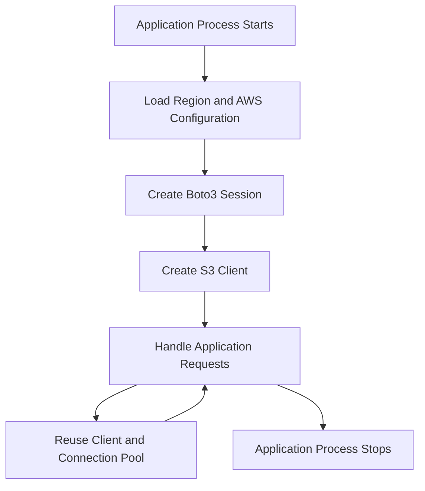

# 01- Boto3 Client and Resource Setup

## Overview

Boto3 is the AWS SDK for Python. It allows Python applications to interact with AWS services through service-specific APIs, credentials, request signing, retry handling, and HTTP connections.

For Amazon S3 integrations, Boto3 provides two primary interfaces:

- **Client:** A low-level interface that closely maps to S3 API operations.
- **Resource:** A higher-level, object-oriented interface that represents buckets, objects, and related S3 entities.

Both interfaces can perform common S3 operations, including uploads, downloads, object listing, and deletion. The choice depends on the required control, API coverage, and maintainability.

For production backend applications, prefer the **S3 client as the default interface**. It exposes the underlying S3 API more directly and supports service features without relying on the higher-level resource abstraction. Resources remain useful for existing codebases and simple object-oriented workflows.

## Installation and Dependencies

Install Boto3 in the Python environment used by your application.

```bash
python -m pip install boto3
```

For a project using `requirements.txt`:

```text
boto3>=1.43,<2
```

The version range is illustrative. Pin and update dependencies according to your application's compatibility and security-update policy.

Confirm the installed version:

```bash
python -c "import boto3; print(boto3.__version__)"
```

Boto3 depends on Botocore, which provides much of the underlying AWS API, request signing, credential resolution, and retry functionality. Let the package resolver select a compatible Botocore version rather than independently pinning incompatible versions.

## Client, Resource, and Session

### Boto3 Client

A client represents a low-level interface to an AWS service. Its methods and parameters closely correspond to the service API.

For S3, examples include:

- `create_bucket()`
- `head_bucket()`
- `put_object()`
- `get_object()`
- `list_objects_v2()`
- `delete_object()`
- `generate_presigned_url()`

Example:

```python
import boto3

s3_client = boto3.client("s3", region_name="ap-south-1")

response = s3_client.head_bucket(
    Bucket="company-documents-prod"
)

print(response["ResponseMetadata"]["HTTPStatusCode"])
```

The bucket must exist, and the configured identity must have the required permissions. `HeadBucket` can return limited diagnostic information for inaccessible buckets, so a failure does not necessarily prove that the bucket is absent.

#### Advantages

- Closely matches the S3 API.
- Supports service operations and parameters directly.
- Provides explicit control over requests, responses, pagination, waiters, retries, and errors.
- Works well for reusable service layers and production integrations.
- Is generally thread-safe when used according to Boto3's documented restrictions.

#### Limitations

- Requires working with API-oriented parameters and response dictionaries.
- Operations such as pagination and transfer orchestration may require additional code or helper abstractions.

### Boto3 Resource

A resource is a higher-level, object-oriented abstraction over AWS service operations. For S3, it provides objects such as `Bucket` and `Object`.

Example:

```python
import boto3

session = boto3.Session(region_name="ap-south-1")
s3_resource = session.resource("s3")

bucket = s3_resource.Bucket("company-documents-prod")

for obj in bucket.objects.filter(Prefix="reports/"):
    print(obj.key, obj.size)
```

The bucket collection handles pagination while iterating through matching objects.

#### Advantages

- Provides object-oriented access to buckets and objects.
- Reduces boilerplate for some common operations.
- Supports convenient collection-based workflows.

#### Limitations

- Does not expose every newer S3 capability through the resource abstraction.
- Some operations still require the underlying client.
- Resource instances are not thread-safe and should not be shared across threads or processes.

The Boto3 maintainers do not intend to add new features to the resource interface. Existing resource functionality remains supported, but the client interface is the safer default for access to newer service functionality.

### Session

A session groups configuration and credential-related state used to create clients and resources.

A session can determine:

- AWS credentials and their provider.
- AWS Region.
- AWS profile.
- Configuration inherited from the environment and AWS configuration files.

Example:

```python
import boto3

session = boto3.Session(
    region_name="ap-south-1",
)

s3_client = session.client("s3")
s3_resource = session.resource("s3")
```

Using a session explicitly makes configuration easier to test and avoids relying unnecessarily on global default-session behavior.

### Comparison

| Concern | Client | Resource | Session |
|---|---|---|---|
| Primary purpose | Execute service API operations | Represent AWS entities | Configure and create clients and resources |
| S3 examples | `get_object`, `put_object` | `Bucket`, `Object` | `Session.client`, `Session.resource` |
| API control | Direct and explicit | Higher-level abstraction | Not used directly for service operations |
| New service features | Preferred interface | May lack newer abstractions | Creates either interface |
| Thread safety | Generally thread-safe | Not thread-safe | Not thread-safe |
| Typical production use | Default service interface | Existing or convenient object-oriented code | Explicit application configuration |

## Credential Configuration

Boto3 uses a credential provider chain to locate AWS credentials. Avoid hardcoding access keys in source code, Docker images, notebooks, or deployment workflows.

### Credential Provider Chain

Depending on the environment and configuration, Boto3 can obtain credentials from sources such as:

- Explicit credentials passed into a session or client.
- Environment variables.
- Shared AWS credentials and configuration files.
- IAM Identity Center and configured profile-based authentication.
- Assume-role and other supported credential providers.
- Container credential providers.
- EC2 instance metadata credentials.

Credential providers are evaluated according to Boto3's documented chain and configuration. Do not assume that a particular source will always take precedence over every other configured source.

The preferred setup depends on the execution environment.

| Environment | Recommended credential source |
|---|---|
| Local development | AWS CLI profile or IAM Identity Center login |
| EC2 application | IAM role attached to the instance |
| ECS application | Task role |
| EKS workload | IAM Roles for Service Accounts or EKS Pod Identity, as appropriate |
| Lambda | Execution role |
| GitHub Actions deployment | IAM OIDC federation with an appropriately scoped role |
| Local integration tests | Explicit test configuration or a supported local AWS endpoint |

Use short-lived credentials and temporary role sessions wherever practical.

### Local Development

Configure a named AWS CLI profile instead of embedding access keys in Python code.

For example, after configuring the appropriate profile through the AWS CLI:

```bash
aws sts get-caller-identity --profile s3-dev
```

This confirms which identity the AWS CLI is using. It does not, by itself, prove that the identity has the required S3 permissions.

Use that profile in Boto3:

```python
import boto3

session = boto3.Session(
    profile_name="s3-dev",
    region_name="ap-south-1",
)

s3_client = session.client("s3")
```

For supported IAM Identity Center setups, sign in using the AWS CLI before running the application.

### Production Credentials

In production, normally omit `profile_name` and allow the configured environment's credential provider to supply credentials.

```python
import boto3

session = boto3.Session(region_name="ap-south-1")
s3_client = session.client("s3")
```

Do not pass static access keys to this constructor unless an explicitly justified use case requires credential overrides.

For a private S3 bucket, grant the application's identity only the actions and object resources it needs. For example, an upload service may need `s3:PutObject` for a specific prefix, while a download service may need `s3:GetObject`. Additional requirements depend on the APIs used, encryption settings, and workflow.

Credential acquisition and S3 authorization are separate concerns: successfully obtaining credentials does not mean that the identity can perform every S3 action.

## Region and Endpoint Configuration

### Specify the Region

The Region determines the default regional endpoint for service requests. Use the Region in which the target bucket resides unless the operation or architecture intentionally requires a different configuration.

```python
import boto3

session = boto3.Session(region_name="ap-south-1")
s3_client = session.client("s3")
```

A Region can also be configured through AWS configuration files or environment variables. Explicit session configuration is useful when an application has clear environment-specific settings.

For example:

```bash
export AWS_DEFAULT_REGION=ap-south-1
```

If a request is sent to the wrong regional endpoint, S3 may return a redirect or Region-related error. Correctly configure the client instead of repeatedly retrying an incorrectly addressed request.

### Custom Endpoints

A custom endpoint is useful for local S3-compatible development tools, emulators, and specialized network configurations.

```python
import boto3

session = boto3.Session(region_name="us-east-1")

s3_client = session.client(
    "s3",
    endpoint_url="http://localhost:4566",
)
```

This is an illustrative local endpoint configuration. Use the endpoint and credential settings required by the specific local service.

Do not leave a local endpoint enabled in production. An incorrect `endpoint_url` can send requests to the wrong destination or cause signing, networking, and S3 addressing problems.

## Production Client Configuration

Boto3 clients support advanced networking and retry settings through `botocore.config.Config`.

Important configuration options include:

| Option | Purpose | Engineering consideration |
|---|---|---|
| `connect_timeout` | Connection establishment timeout | Prevents connection attempts from waiting indefinitely |
| `read_timeout` | Response-read timeout | Must account for the workload and expected transfer behavior |
| `max_pool_connections` | Maximum connection pool size | Tune for expected concurrency and request patterns |
| `retries` | Retry behavior | Controls retry mode and total attempts |
| `tcp_keepalive` | Enables TCP keepalive behavior | May be useful for long-lived networking workloads |
| `user_agent_extra` | Adds application identification to the user agent | Helps distinguish requests from an application or component |
| `s3` | S3-specific configuration | Controls supported S3 addressing and transfer behaviors |

### Client Factory

A reusable factory centralizes client configuration and makes it easier to test or change application settings.

```python
from botocore.client import BaseClient
from botocore.config import Config
import boto3


def create_s3_client(
    region_name: str,
    profile_name: str | None = None,
) -> BaseClient:
    session = boto3.Session(
        region_name=region_name,
        profile_name=profile_name,
    )

    config = Config(
        connect_timeout=3,
        read_timeout=30,
        max_pool_connections=50,
        retries={
            "mode": "standard",
            "total_max_attempts": 4,
        },
        tcp_keepalive=True,
        user_agent_extra="document-service/1.0",
    )

    return session.client(
        "s3",
        config=config,
    )
```

Usage:

```python
s3_client = create_s3_client(
    region_name="ap-south-1",
)
```

The example uses a bounded connection timeout, a workload-specific read timeout, a larger connection pool, and standard retry behavior. Treat these numbers as starting points, not universal production defaults.

`total_max_attempts=4` represents four attempts in total, including the initial attempt. Keep the retry policy consistent with your application's overall timeout budget and retry strategy.

### Timeout and Retry Design

Retries help recover from transient connection problems, throttling, and selected service errors. They do not correct invalid bucket names, insufficient permissions, incorrect Regions, malformed requests, or other deterministic failures.

Production applications should account for the interaction between:

- SDK retries.
- HTTP connection and read timeouts.
- API request deadlines.
- Reverse-proxy timeouts.
- Background-job retry policies.
- Caller retries.

If each layer retries independently, a single logical operation can produce substantially more network attempts than expected.

For write operations, determine whether a retry is safe for the particular operation. Repeating an S3 object write to the same key may overwrite the previous object. If a workflow requires exactly-once business behavior, implement idempotency and state tracking at the application layer.

## Choosing a Client Lifetime

Clients maintain connection pools and other state required for service requests. Recreating clients for every API request adds unnecessary initialization overhead and can reduce connection reuse.

Prefer creating the S3 client once during application startup or process initialization and reusing it within that process.



### Threading and Multiprocessing

Boto3 concurrency rules differ by object type.

| Object | Concurrency guidance |
|---|---|
| Client | Generally safe to share between threads, subject to documented caveats |
| Resource | Do not share an instance across threads |
| Session | Do not share an instance across threads |
| Client across processes | Do not share the same client across processes |

Create sessions and resources as needed for individual threads when using those abstractions concurrently. When using multiprocessing or pre-fork servers such as Gunicorn, initialize clients within each worker process rather than sharing a client created before the fork.

For a typical multi-worker application, each worker maintains its own client and connection pool.

### Framework Integration

For FastAPI, create the client during application lifespan initialization and reuse it for requests handled by that process.

For Django or Django REST Framework, initialize the client in a dedicated infrastructure or service module and avoid rebuilding it inside every view or serializer operation.

For Celery, initialize the client within the worker process and account for worker concurrency, timeouts, and task retry behavior.

Boto3 is synchronous. In an asynchronous FastAPI endpoint, direct Boto3 calls block the event loop while network operations are in progress. Use a thread pool or an asynchronous-compatible AWS library when asynchronous request handling is necessary.

## Using the Client for S3 Operations

The client exposes API methods and returns service responses.

### Inspect an Object

```python
from botocore.exceptions import ClientError


def get_object_metadata(
    s3_client,
    bucket_name: str,
    object_key: str,
) -> dict:
    try:
        response = s3_client.head_object(
            Bucket=bucket_name,
            Key=object_key,
        )
    except ClientError as exc:
        error_code = exc.response.get("Error", {}).get("Code")
        raise RuntimeError(
            f"Unable to inspect S3 object: {error_code}"
        ) from exc

    return {
        "content_length": response["ContentLength"],
        "content_type": response.get("ContentType"),
        "etag": response.get("ETag"),
        "last_modified": response.get("LastModified"),
    }
```

For production code, translate expected errors into domain-specific exceptions such as `ObjectNotFound`, `StoragePermissionError`, or `StorageUnavailable` instead of converting every error into the same exception type.

Depending on the caller's IAM permissions and S3 behavior, the response to an inaccessible or missing object may not distinguish every possible cause.

### List Objects with a Paginator

`list_objects_v2()` returns a limited page of results. Use a paginator when the application needs to enumerate an entire prefix.

```python
def iter_object_keys(
    s3_client,
    bucket_name: str,
    prefix: str,
):
    paginator = s3_client.get_paginator("list_objects_v2")

    for page in paginator.paginate(
        Bucket=bucket_name,
        Prefix=prefix,
    ):
        for item in page.get("Contents", []):
            yield item["Key"]
```

The generator avoids accumulating every key in memory. However, a full listing may still generate many network requests and consume significant time for large prefixes.

For application-facing file listings, consider storing business metadata in a database and using S3 for object storage rather than scanning an entire bucket on every request.

## Using the Resource Interface

A resource can simplify small object-oriented workflows.

```python
import boto3

session = boto3.Session(region_name="ap-south-1")
s3_resource = session.resource("s3")

bucket = s3_resource.Bucket("company-documents-prod")

bucket.upload_file(
    Filename="/tmp/report.pdf",
    Key="reports/report.pdf",
    ExtraArgs={
        "ContentType": "application/pdf",
    },
)
```

The resource's `upload_file()` method uses Boto3's managed transfer functionality. For larger files, managed transfers can handle multipart uploads according to the transfer configuration.

When a feature or parameter is not available through the resource abstraction, use the underlying client directly:

```python
response = s3_resource.meta.client.head_bucket(
    Bucket="company-documents-prod",
)
```

Avoid mixing abstractions without a clear reason in a service layer. Consistency makes error handling, testing, pagination, and review easier.

## Testing and Dependency Injection

A storage service should accept its S3 client as a dependency. This avoids coupling application logic to the global default session and makes unit tests easier to write.

Example:

```python
class S3Storage:
    def __init__(self, s3_client):
        self._client = s3_client

    def object_exists(
        self,
        bucket_name: str,
        object_key: str,
    ) -> bool:
        from botocore.exceptions import ClientError

        try:
            self._client.head_object(
                Bucket=bucket_name,
                Key=object_key,
            )
            return True
        except ClientError as exc:
            error = exc.response.get("Error", {})
            status = exc.response.get("ResponseMetadata", {}).get(
                "HTTPStatusCode"
            )

            if error.get("Code") in {"404", "NoSuchKey", "NotFound"}:
                return False

            if status == 404:
                return False

            raise
```

The exact error interpretation depends on the S3 operation and permissions. Do not treat every `403` as a missing object, because doing so can hide authorization failures.

A unit test can provide a mock client:

```python
from unittest.mock import Mock


def test_object_exists():
    s3_client = Mock()
    s3_client.head_object.return_value = {
        "ContentLength": 128,
    }

    storage = S3Storage(s3_client)

    assert storage.object_exists(
        "company-documents-prod",
        "reports/report.pdf",
    )

    s3_client.head_object.assert_called_once_with(
        Bucket="company-documents-prod",
        Key="reports/report.pdf",
    )
```

Unit tests should validate the application's behavior without making real AWS requests. Complement them with integration tests against an appropriately isolated AWS test environment or a compatible local service when service-specific behavior must be verified.

Never use production buckets for destructive automated tests.

## Common Mistakes and Production Pitfalls

| Mistake | Why It Is a Problem | Recommended Approach |
|---|---|---|
| Hardcoding AWS access keys | Exposes long-lived credentials and increases rotation risk | Use profiles locally and IAM roles or federation in production |
| Creating a new client for every request | Adds overhead and reduces connection reuse | Reuse a client within each application process |
| Sharing a Session between threads | Sessions are not thread-safe | Create and manage sessions according to Boto3's concurrency guidance |
| Sharing resources between threads | Resource instances are not thread-safe | Use separate resources or prefer a suitably shared client |
| Sharing a client across processes | Can cause networking and response-ordering problems | Create clients independently within each worker process |
| Omitting the target Region | Requests may use an unintended or unavailable regional configuration | Configure the application Region explicitly |
| Using incorrect endpoint overrides | Can cause redirect, routing, and signature problems | Reserve custom endpoints for intentional use cases |
| Retrying all exceptions | Can amplify invalid requests and permission failures | Use SDK retry policies and handle deterministic errors separately |
| Treating every `403` as a missing object | Hides authorization and policy problems | Inspect the API response and authorization context |
| Using global default-session setup everywhere | Makes configuration implicit and tests harder to isolate | Prefer explicit sessions and dependency injection |
| Calling synchronous Boto3 directly in an async route | Blocks the event loop during network I/O | Use a thread pool or asynchronous-compatible library |

## Operational Verification

### Verify the AWS Identity

Use the AWS CLI to check which identity is active for a local profile:

```bash
aws sts get-caller-identity --profile s3-dev
```

Ensure that the application uses the expected profile or role in its own execution environment.

### Verify S3 Access

For a bucket that the configured identity is expected to inspect:

```bash
aws s3api head-bucket \
  --bucket company-documents-prod \
  --region ap-south-1 \
  --profile s3-dev
```

This verifies the CLI's access path, not necessarily the application's complete runtime configuration. Check the same identity, Region, and endpoint configuration used by the application.

### Troubleshoot Credential Resolution

If Boto3 cannot obtain credentials:

1. Confirm that the intended local profile or runtime role is configured.
2. Verify that temporary credentials have not expired.
3. Confirm that the application has access to the expected AWS configuration files when a profile is required.
4. Check environment variables for accidental credential overrides.
5. Validate the active identity using the AWS CLI or the applicable runtime credential mechanism.
6. Confirm that the identity has the required S3 and, where applicable, KMS permissions.

Avoid logging access keys, secret keys, session tokens, presigned URLs, or sensitive request payloads during diagnosis.

## Official References

- [Boto3 documentation](https://docs.aws.amazon.com/boto3/latest/guide/)
- [Boto3 credentials](https://docs.aws.amazon.com/boto3/latest/guide/credentials.html)
- [Boto3 configuration](https://docs.aws.amazon.com/boto3/latest/guide/configuration.html)
- [Boto3 sessions](https://docs.aws.amazon.com/boto3/latest/guide/session.html)
- [Boto3 clients](https://docs.aws.amazon.com/boto3/latest/guide/clients.html)
- [Boto3 resources](https://docs.aws.amazon.com/boto3/latest/guide/resources.html)
- [Boto3 retry behavior](https://docs.aws.amazon.com/boto3/latest/guide/retries.html)
- [Boto3 S3 examples](https://docs.aws.amazon.com/boto3/latest/guide/s3-examples.html)

## Key Takeaways

- Prefer Boto3 clients for production S3 integrations because they expose service operations directly and support newer API capabilities.
- Use explicit sessions and environment-appropriate credential providers; never hardcode production AWS credentials.
- Create and reuse clients within each application process, while respecting the different thread-safety rules for clients, sessions, and resources.
- Configure retries, timeouts, connection pools, and Regions according to the workload rather than relying on accidental defaults.
- Isolate S3 access behind a testable service layer and distinguish authorization failures from missing objects and transient service errors.