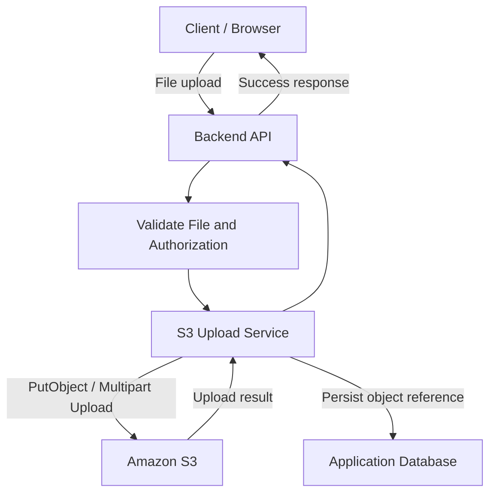
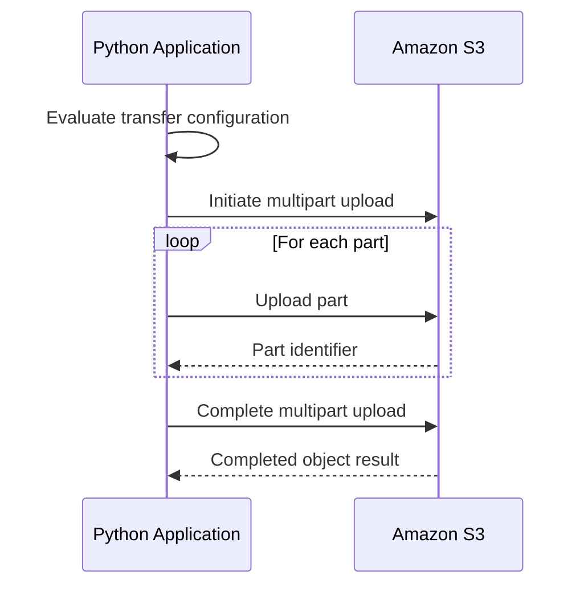

# 02- Upload Objects

## Overview

Uploading objects to Amazon S3 is a core operation in backend systems that manage documents, images, media, reports, backups, and application-generated files.

Boto3 provides multiple ways to upload data to S3. The appropriate method depends on the source of the data, object size, memory constraints, concurrency requirements, and whether the application needs fine-grained control over the underlying API request.

For most production applications, use **Boto3 managed transfers (`upload_file` or `upload_fileobj`)** for file uploads. They support automatic multipart transfers, parallelism, and retry handling. Use `put_object` when a direct S3 API operation is more appropriate, such as writing a small payload generated in memory.

This document covers upload methods, metadata, multipart transfers, progress tracking, error handling, backend integration, security, testing, and operational verification.

## Upload Architecture

A backend application can upload an object directly to S3 or issue a presigned URL that allows the client to upload directly.



The backend-mediated flow is appropriate when the application must inspect, transform, or process files before storage. However, sending large files through an API server increases its bandwidth usage, connection duration, and resource requirements.

For high-volume or large-file workloads, presigned URLs can allow clients to transfer data directly to S3 while the backend manages authorization and object metadata.

## Boto3 Upload Methods

### Method Comparison

| Method | Input | Multipart support | Best use case |
|---|---|---|---|
| `put_object()` | Bytes or a readable body | No automatic managed multipart transfer | Small payloads and direct API control |
| `upload_file()` | Local filesystem path | Yes, managed transfer | Files already available on disk |
| `upload_fileobj()` | Binary file-like object | Yes, managed transfer | Framework uploads, streams, and file-like objects |
| `Object.upload_file()` | Local filesystem path through a resource | Yes, managed transfer | Existing resource-based code |
| `Object.upload_fileobj()` | Binary file-like object through a resource | Yes, managed transfer | Existing resource-based workflows |

For large objects, the managed transfer methods are usually preferable because they can split the object into parts and upload those parts concurrently.

## Uploading with `put_object()`

The `put_object()` operation sends an S3 API request containing the object data and optional properties such as content type, metadata, tags, and encryption parameters.

It is useful for small payloads already available in memory or for use cases requiring direct access to the underlying API's request and response.

### Basic Example

```python
import boto3

s3_client = boto3.client("s3", region_name="ap-south-1")

response = s3_client.put_object(
    Bucket="company-documents-prod",
    Key="reports/monthly-report.txt",
    Body=b"Monthly report generated by the application.",
    ContentType="text/plain",
)

print(response["ETag"])
```

The response typically includes request metadata and an ETag. The ETag must not automatically be treated as an MD5 checksum, particularly for multipart uploads and certain encryption configurations.

### Uploading JSON Data

```python
import json

payload = {
    "job_id": "job-20261013-001",
    "status": "completed",
    "records_processed": 1250,
}

response = s3_client.put_object(
    Bucket="company-data-prod",
    Key="job-results/job-20261013-001.json",
    Body=json.dumps(payload).encode("utf-8"),
    ContentType="application/json",
)
```

Encoding the JSON string produces bytes, which can be passed directly as the request body.

### Advantages and Limitations

| Advantages | Limitations |
|---|---|
| Direct access to S3 request parameters and response data | Does not automatically orchestrate multipart uploads |
| Suitable for small in-memory objects | Reading a large file entirely into memory can exhaust application memory |
| Useful for explicit API conditions and object properties | Multipart retry and concurrency management must be implemented separately if needed |
| Simple for generated JSON, text, and small binary payloads | A single `PutObject` request has a maximum supported object size of 5 GB |

Prefer managed transfers for larger files and for workloads that need multipart upload behavior without implementing the multipart protocol manually.

## Uploading Files with `upload_file()`

`upload_file()` uploads a local file to an S3 object key. It accepts the source filename, destination bucket, and object key.

Boto3 manages the transfer and can automatically switch to multipart upload when the configured threshold is exceeded.

### Basic Example

```python
import boto3

s3_client = boto3.client("s3", region_name="ap-south-1")

s3_client.upload_file(
    Filename="/tmp/monthly-report.pdf",
    Bucket="company-documents-prod",
    Key="reports/monthly-report.pdf",
)
```

The object key is the complete key under which S3 stores the object. It is not a local filesystem path.

For example, uploading to `reports/monthly-report.pdf` does not create a real S3 directory. The slash is part of the object key.

### Upload with Metadata and Content Type

Managed transfers accept `ExtraArgs` for supported S3 upload properties.

```python
s3_client.upload_file(
    Filename="/tmp/monthly-report.pdf",
    Bucket="company-documents-prod",
    Key="reports/monthly-report.pdf",
    ExtraArgs={
        "ContentType": "application/pdf",
        "Metadata": {
            "document-type": "monthly-report",
            "source-service": "reporting",
        },
    },
)
```

S3 stores user-defined metadata as object metadata. Metadata keys should be chosen carefully because metadata is not a substitute for a database record or an authorization mechanism.

Keep metadata values non-sensitive. Do not store credentials, access tokens, or confidential business information in object metadata.

### Important Behavior

- The method returns `None` on successful completion rather than returning the underlying `PutObject` or multipart completion response.
- Exceptions must be handled to detect failed transfers.
- Uploading to an existing key can replace the current object, subject to bucket versioning and authorization settings.
- Boto3 may use multiple threads for multipart uploads.
- The default transfer settings are suitable for many workloads but may need adjustment for large files or constrained compute environments.

## Uploading File-Like Objects with `upload_fileobj()`

`upload_fileobj()` accepts a readable binary file-like object. This is particularly useful in Django, Django REST Framework, FastAPI, Flask, and other Python applications where files may arrive as streams or temporary files.

### Basic Example

```python
from pathlib import Path

with Path("/tmp/monthly-report.pdf").open("rb") as file_obj:
    s3_client.upload_fileobj(
        Fileobj=file_obj,
        Bucket="company-documents-prod",
        Key="reports/monthly-report.pdf",
        ExtraArgs={
            "ContentType": "application/pdf",
        },
    )
```

Open filesystem files in binary mode. Text-mode file objects can perform decoding or newline transformations and are not suitable for binary uploads.

### Why This Method Matters for Backend APIs

Consider a FastAPI endpoint receiving a file through `UploadFile`. The underlying file object can be passed to a storage service without first reading the entire file into a Python `bytes` object.

This reduces the risk of duplicating the whole payload in application memory. However, the framework may already buffer some data, and Boto3's managed transfer can use multipart buffers and worker threads. Memory and concurrency must still be considered under load.

For very large browser uploads, direct client-to-S3 uploads through presigned URLs are often more scalable than keeping API requests open while the backend transfers the data.

## Reusable Upload Service

Application views and route handlers should not own all S3 upload logic. A dedicated service layer makes it easier to enforce key-generation rules, validate inputs, centralize logging, configure transfer behavior, and write unit tests.

The following implementation supports uploads from local paths and readable binary file objects.

```python
from __future__ import annotations

import logging
import mimetypes
from pathlib import Path
from typing import BinaryIO

from botocore.config import Config
from botocore.exceptions import BotoCoreError, ClientError
from boto3.s3.transfer import TransferConfig
import boto3


logger = logging.getLogger(__name__)


class S3UploadError(RuntimeError):
    """Raised when an object upload fails."""


class S3Storage:
    def __init__(
        self,
        bucket_name: str,
        region_name: str,
        profile_name: str | None = None,
    ) -> None:
        if not bucket_name:
            raise ValueError("bucket_name is required")

        session = boto3.Session(
            region_name=region_name,
            profile_name=profile_name,
        )

        self.bucket_name = bucket_name
        self.client = session.client(
            "s3",
            config=Config(
                connect_timeout=3,
                read_timeout=60,
                retries={
                    "mode": "standard",
                    "total_max_attempts": 4,
                },
            ),
        )

        self.transfer_config = TransferConfig(
            multipart_threshold=16 * 1024 * 1024,
            multipart_chunksize=16 * 1024 * 1024,
            max_concurrency=4,
            use_threads=True,
        )

    @staticmethod
    def _content_type(
        filename: str,
        content_type: str | None,
    ) -> str:
        return (
            content_type
            or mimetypes.guess_type(filename)[0]
            or "application/octet-stream"
        )

    def upload_file(
        self,
        file_path: str | Path,
        object_key: str,
        content_type: str | None = None,
    ) -> None:
        path = Path(file_path)

        if not path.is_file():
            raise FileNotFoundError(path)

        if not object_key or object_key.startswith("/"):
            raise ValueError("A valid relative S3 object key is required")

        extra_args = {
            "ContentType": self._content_type(
                path.name,
                content_type,
            ),
        }

        try:
            self.client.upload_file(
                Filename=str(path),
                Bucket=self.bucket_name,
                Key=object_key,
                ExtraArgs=extra_args,
                Config=self.transfer_config,
            )
        except (ClientError, BotoCoreError) as exc:
            logger.exception(
                "S3 file upload failed",
                extra={
                    "s3_bucket": self.bucket_name,
                    "s3_operation": "upload_file",
                },
            )
            raise S3UploadError(
                "Unable to upload file to object storage"
            ) from exc

    def upload_fileobj(
        self,
        file_obj: BinaryIO,
        object_key: str,
        filename: str,
        content_type: str | None = None,
    ) -> None:
        if not object_key or object_key.startswith("/"):
            raise ValueError("A valid relative S3 object key is required")

        extra_args = {
            "ContentType": self._content_type(
                filename,
                content_type,
            ),
        }

        try:
            self.client.upload_fileobj(
                Fileobj=file_obj,
                Bucket=self.bucket_name,
                Key=object_key,
                ExtraArgs=extra_args,
                Config=self.transfer_config,
            )
        except (ClientError, BotoCoreError) as exc:
            logger.exception(
                "S3 stream upload failed",
                extra={
                    "s3_bucket": self.bucket_name,
                    "s3_operation": "upload_fileobj",
                },
            )
            raise S3UploadError(
                "Unable to upload file to object storage"
            ) from exc
```

### Configuration Considerations

The factory uses:

- Explicit Region configuration.
- The default credential provider chain when no profile is supplied.
- Standard SDK retry behavior.
- A bounded connection timeout and read timeout.
- A multipart threshold and chunk size of 16 MiB.
- Four concurrent transfer operations per managed transfer.

These settings are illustrative. Tune them to the workload, file sizes, application memory, available bandwidth, and overall request deadline.

The example deliberately does not set an object ACL or override server-side encryption. Prefer bucket-level security and encryption defaults unless the application has a well-defined reason to specify different settings for an individual upload.

The minimal key validation prevents an absolute-looking key but does not implement a complete tenant-isolation or naming policy. In a real application, generate object keys on the server and enforce authorization before calling the storage service.

## Uploading from FastAPI

FastAPI's `UploadFile` exposes a file-like object through its `.file` attribute.

A route can validate the request and delegate the upload to the storage service. The following is an illustrative endpoint; authentication, tenant authorization, dependency initialization, and application-specific error mapping must be supplied by the application.

```python
from typing import Annotated
from uuid import uuid4

from fastapi import APIRouter, File, HTTPException, UploadFile

router = APIRouter()

ALLOWED_CONTENT_TYPES = {
    "application/pdf",
    "image/jpeg",
    "image/png",
}


@router.post("/documents")
def upload_document(
    file: Annotated[UploadFile, File()],
):
    if file.content_type not in ALLOWED_CONTENT_TYPES:
        raise HTTPException(
            status_code=415,
            detail="Unsupported content type",
        )

    object_key = f"documents/{uuid4().hex}"

    try:
        storage.upload_fileobj(
            file_obj=file.file,
            object_key=object_key,
            filename=file.filename or "upload.bin",
            content_type=file.content_type,
        )
    except S3UploadError as exc:
        raise HTTPException(
            status_code=503,
            detail="Document storage is temporarily unavailable",
        ) from exc
    finally:
        file.file.close()

    return {
        "object_key": object_key,
        "status": "uploaded",
    }
```

`storage` represents an application-managed `S3Storage` instance initialized through the application's lifecycle or dependency injection.

This example checks the declared content type, but that value is supplied by the client and is not trustworthy on its own. A production upload workflow should also enforce size limits and, where needed, inspect file signatures or scan content before making the object available.

Do not accept a client-supplied S3 key without validating authorization and namespace boundaries. A UUID provides a convenient collision-resistant key component, but it does not itself enforce access control.

For Django or Django REST Framework, the same service can accept an `UploadedFile` object through its file interface, provided the object is readable in binary mode.

## Upload Properties and Metadata

The `ExtraArgs` parameter controls additional upload properties for managed transfers. Valid options are defined by the installed Boto3 transfer implementation, so verify support when upgrading dependencies.

| Property | Purpose | Example |
|---|---|---|
| `ContentType` | Describes the media type | `application/pdf` |
| `ContentDisposition` | Influences browser presentation or download behavior | `attachment; filename="report.pdf"` |
| `CacheControl` | Controls downstream caching behavior | `no-cache` |
| `Metadata` | Stores custom user-defined metadata | `{"source": "reporting"}` |
| `Tagging` | Assigns object tags | URL-encoded tag string |
| `StorageClass` | Selects a storage class when explicitly required | `STANDARD_IA` |
| `ServerSideEncryption` | Specifies a supported server-side encryption option | `AES256` |
| `SSEKMSKeyId` | Identifies a KMS key when using SSE-KMS | A key ARN or ID |
| `ChecksumAlgorithm` | Requests supported checksum handling | An SDK-supported checksum algorithm |

### Content Type

The content type tells consumers how to interpret the object. Setting it correctly is especially important for browser-delivered images, PDFs, JSON, CSS, and JavaScript.

Do not rely exclusively on filename extensions or client-provided headers when handling untrusted uploads. Validate the type according to the application's requirements.

### Custom Metadata

Metadata is useful for small, immutable attributes associated with the stored object, such as a processing origin or schema version.

```python
s3_client.upload_file(
    Filename="/tmp/data.json",
    Bucket="company-data-prod",
    Key="exports/data.json",
    ExtraArgs={
        "ContentType": "application/json",
        "Metadata": {
            "source-service": "analytics",
            "schema-version": "2",
        },
    },
)
```

S3 user-defined metadata is set during object creation or replacement. Updating it requires an appropriate object-copy operation rather than a simple metadata-only update.

Avoid placing large or frequently changing application metadata in S3 object metadata. Store business state, ownership, and relationships in a database.

### Storage Class

Choose storage classes according to access frequency, retrieval latency, minimum storage duration, retrieval charges, and workload requirements.

Do not select an archival or infrequently accessed class solely because its storage price is lower. Consider the end-to-end cost and availability requirements.

Detailed storage-class decisions belong in the dedicated S3 concepts and advanced-features documentation.

## Multipart Upload and Transfer Configuration

Multipart upload divides a large object into parts, uploads the parts independently, and completes the upload to create the final object.

Boto3's managed transfer methods can perform this process automatically.



The diagram illustrates the multipart workflow. Small uploads may instead use a single object-upload request.

### Why Multipart Upload Matters

Multipart uploads provide:

- Parallel transfer of independent parts.
- Retry of failed parts instead of restarting the entire transfer.
- Better throughput for large files.
- Support for objects larger than the maximum size of a single `PutObject` operation.

Multipart uploads also introduce more request activity, concurrency, and the need to consider abandoned uploads.

### TransferConfig

Configure managed-transfer behavior through `boto3.s3.transfer.TransferConfig`.

```python
from boto3.s3.transfer import TransferConfig

transfer_config = TransferConfig(
    multipart_threshold=64 * 1024 * 1024,
    multipart_chunksize=16 * 1024 * 1024,
    max_concurrency=4,
    use_threads=True,
)

s3_client.upload_file(
    Filename="/data/archive.tar",
    Bucket="company-backups-prod",
    Key="archives/archive.tar",
    Config=transfer_config,
)
```

Relevant options include:

| Setting | Effect | Trade-off |
|---|---|---|
| `multipart_threshold` | Size above which managed transfer uses multipart upload | Lower thresholds increase multipart use and request overhead |
| `multipart_chunksize` | Target part size | Larger parts can increase per-part buffering and memory pressure |
| `max_concurrency` | Maximum concurrent transfer operations | Higher values can increase throughput, threads, memory usage, and connection demand |
| `use_threads` | Controls managed-transfer thread use | Disabling threads prevents transfer concurrency |
| `max_io_queue` | Bounds queued I/O chunks in supported transfer paths | Affects buffering and transfer throughput |
| `io_chunksize` | Controls I/O chunk sizing in supported transfer paths | Must be considered alongside queue depth and memory |

The exact effective memory usage depends on the operation, part sizes, concurrency, buffering, and installed SDK implementation. Avoid increasing concurrency without measuring throughput and memory consumption.

### Multipart Constraints

For general-purpose S3 buckets, the standard multipart upload limits include:

- Maximum object size of 5 TiB.
- Maximum of 10,000 parts.
- Part sizes from 5 MiB to 5 GiB, except that the final part can be smaller than 5 MiB.
- A part number from 1 through 10,000.

Verify current S3 service limits for specialized bucket types or workload-specific configurations before relying on these values.

Incomplete multipart uploads can incur storage charges for uploaded parts. Configure an appropriate lifecycle rule to abort incomplete multipart uploads after a suitable period.

## Upload Progress Tracking

Managed transfers accept a `Callback` that reports byte-transfer progress.

The callback may be invoked repeatedly as data is transferred. When multipart transfers use multiple threads, protect shared progress counters against concurrent updates.

```python
import threading


class UploadProgress:
    def __init__(self, total_bytes: int) -> None:
        self.total_bytes = total_bytes
        self.transferred_bytes = 0
        self._lock = threading.Lock()

    def __call__(self, bytes_transferred: int) -> None:
        with self._lock:
            self.transferred_bytes += bytes_transferred

            percentage = (
                self.transferred_bytes / self.total_bytes * 100
                if self.total_bytes > 0
                else 100.0
            )

            print(
                f"Upload progress: "
                f"{self.transferred_bytes}/{self.total_bytes} "
                f"bytes ({percentage:.1f}%)"
            )
```

Usage:

```python
from pathlib import Path

path = Path("/data/archive.tar")
progress = UploadProgress(total_bytes=path.stat().st_size)

s3_client.upload_file(
    Filename=str(path),
    Bucket="company-backups-prod",
    Key="archives/archive.tar",
    Callback=progress,
)
```

For a production service, send progress information to an appropriate monitoring or user-progress mechanism rather than printing every callback. Progress callbacks provide transfer telemetry, not proof that the final multipart upload has completed successfully. Consider the upload complete only after the transfer method returns without an exception.

## Error Handling and Retry Behavior

Boto3 and Botocore perform retries for supported transient failures. Managed transfers also handle the orchestration required for multipart operations.

Application-level handling is still required because an upload may fail due to invalid requests, insufficient permissions, unavailable credentials, incorrect Regions, connectivity problems, or service-side errors.

### Error Categories

| Failure | Typical cause | Response |
|---|---|---|
| `AccessDenied` | IAM, bucket policy, access point, or KMS authorization problem | Validate each authorization layer |
| `NoSuchBucket` | Incorrect bucket name or missing bucket | Verify the bucket and configured Region |
| `InvalidAccessKeyId` or expired-token errors | Invalid credentials or expired temporary credentials | Fix the credential provider or renew the session |
| `SignatureDoesNotMatch` | Signing, endpoint, Region, or request-construction mismatch | Verify endpoint and signing configuration |
| Timeout or connection error | Network or service availability issue | Allow bounded SDK retries and apply application deadlines |
| `EntityTooSmall` or multipart errors | Incorrect multipart implementation or part configuration | Inspect transfer configuration and multipart requests |
| KMS access-denied error | Missing key permissions or incompatible key policy | Validate KMS authorization separately from S3 access |

### Preserve Error Context

Use `ClientError` to inspect service error codes and HTTP status metadata. Use `BotoCoreError` for other SDK-level failures.

Avoid swallowing exceptions and reporting success when an upload failed. Translate storage exceptions into application-specific errors while preserving the original exception through exception chaining.

Do not blindly retry every failure at the API layer. Coordinate SDK retries with job-level retries and request deadlines.

### Retry and Idempotency

Uploading repeatedly to the same key may replace the object or create another object version when versioning is enabled.

A retry-safe design should distinguish a logical upload from a particular transfer attempt. Consider:

- A server-generated object key for each intended new upload.
- A database record tracking upload status.
- Content checksums where integrity verification is required.
- Idempotency keys for API requests.
- Explicit object-version or conditional-write behavior where needed.
- Recovery for objects uploaded successfully before a database update failed.

S3 and a relational database do not share a distributed transaction. If an upload succeeds but persisting its metadata fails, the application needs a recovery strategy such as a pending state, reconciliation job, or orphan-object cleanup policy.

## Security Considerations

### Object Key Design

Treat object keys as identifiers, not filesystem paths. S3 does not provide directory-level access control simply because a key contains a slash.

Prefer server-generated keys:

```python
from uuid import uuid4

object_key = f"tenants/{tenant_id}/documents/{uuid4().hex}"
```

The example assumes `tenant_id` was obtained from an authenticated and authorized application context. Never trust a client-supplied tenant identifier without validating ownership.

Avoid incorporating raw filenames into keys without validation. Filenames may contain sensitive information, unexpected characters, path-like segments, or values that cause key collisions.

### Least-Privilege Access

The application's IAM role should permit only the required actions against the intended bucket and prefix. Uploading objects usually requires `s3:PutObject`; additional actions depend on the upload workflow.

Multipart upload operations may require permissions such as `s3:AbortMultipartUpload` or `s3:ListMultipartUploadParts` in addition to permissions used for normal object writes. Review the permissions for the selected APIs and managed-transfer implementation.

If SSE-KMS uses a customer-managed key, validate the relevant KMS key policy and permissions. An S3 write permission alone does not guarantee that encryption can succeed.

### Encryption and Public Access

- Keep the bucket private unless public access is explicitly required.
- Use S3 Block Public Access and appropriate bucket policies.
- Prefer bucket-level default encryption and explicitly configure SSE-KMS when required by the security design.
- Do not add public-read ACLs as a shortcut to make uploaded content available.
- Avoid logging credentials, presigned URLs, sensitive metadata, or file contents.
- Perform malware scanning or content inspection when the threat model requires it.

### File Validation

Content-type headers are not trustworthy merely because a client supplies them. A production upload workflow may need to validate file size, inspect file signatures, enforce an allowlist, scan content, and restrict accepted file formats.

Do not load arbitrarily large files into memory simply to validate them. Use streaming inspection or a staged upload and processing workflow where appropriate.

## Performance, Scalability, and Cost

### Performance Considerations

Upload throughput depends on network capacity, object size, transfer configuration, service limits, and application concurrency.

For effective performance:

- Use managed transfers for large files.
- Tune multipart chunk sizes and concurrency through benchmarks.
- Reuse Boto3 clients within each application process.
- Avoid reading complete large files into memory.
- Apply upload-size limits at the API and infrastructure layers.
- Prefer direct-to-S3 uploads for suitable high-volume browser workloads.
- Separate slow file transfers from latency-sensitive application processing when necessary.

### Backend Concurrency

If an API server processes many uploads simultaneously, each managed transfer may create several concurrent operations. Total request concurrency multiplied by per-transfer concurrency can substantially increase connection demand.

For example, twenty simultaneous uploads with a configured concurrency of four may allow a significant number of parallel transfer operations, subject to how the managed transfer implementation schedules work.

Benchmark under realistic conditions. Use bounded application concurrency, background workers, and queue-based processing when synchronous uploads place too much pressure on API workers.

### Cost Considerations

S3 uploads can incur request charges, storage costs, and related network or processing charges. Multipart transfers issue multiple requests, while incomplete multipart uploads can retain billable parts until aborted or removed by a lifecycle rule.

Track the trade-off between higher throughput, additional requests, worker resource consumption, and overall application latency.

## Testing Upload Logic

Separate unit tests from integration tests.

### Unit Tests

Mock the S3 client to verify that the service sends the expected bucket, key, metadata, content type, and transfer configuration. Simulate exceptions to test error translation.

```python
from unittest.mock import Mock

from botocore.exceptions import ClientError
import pytest


def test_upload_file_uses_expected_destination():
    storage = S3Storage(
        bucket_name="company-documents-test",
        region_name="ap-south-1",
    )

    storage.client = Mock()

    storage.upload_file(
        file_path="/tmp/report.pdf",
        object_key="reports/report.pdf",
        content_type="application/pdf",
    )

    storage.client.upload_file.assert_called_once()
    call_kwargs = storage.client.upload_file.call_args.kwargs

    assert call_kwargs["Bucket"] == "company-documents-test"
    assert call_kwargs["Key"] == "reports/report.pdf"
    assert call_kwargs["ExtraArgs"]["ContentType"] == "application/pdf"
```

This test requires `/tmp/report.pdf` to exist. In a normal test suite, use a temporary file fixture rather than relying on a fixed filesystem path.

### Failure Test

```python
def test_upload_failure_is_translated(tmp_path):
    file_path = tmp_path / "report.pdf"
    file_path.write_bytes(b"sample document")

    storage = S3Storage(
        bucket_name="company-documents-test",
        region_name="ap-south-1",
    )

    storage.client.upload_file = Mock(
        side_effect=ClientError(
            {
                "Error": {
                    "Code": "AccessDenied",
                    "Message": "Access denied",
                },
            },
            "PutObject",
        )
    )

    with pytest.raises(S3UploadError):
        storage.upload_file(
            file_path=file_path,
            object_key="reports/report.pdf",
            content_type="application/pdf",
        )
```

Unit tests should not contact real AWS services.

### Integration Tests

Use a dedicated test bucket or compatible local environment to verify behavior that mocks cannot prove, including:

- Actual object content and metadata.
- IAM and bucket-policy enforcement.
- Encryption behavior.
- Multipart upload completion.
- Presigned upload workflows.
- Object replacement and versioning behavior.
- Cleanup of test objects and incomplete uploads.

Do not run destructive integration tests against production data.

## Operational Verification

### Verify the Object Exists

```bash
aws s3api head-object \
  --bucket company-documents-prod \
  --key reports/monthly-report.pdf \
  --region ap-south-1
```

This returns object metadata if the caller has permission and the object can be retrieved through the requested operation.

### Download and Compare the Content

For an ordinary local-file upload, downloading the object and comparing its bytes or an independently computed checksum can help verify data integrity.

```bash
aws s3 cp \
  s3://company-documents-prod/reports/monthly-report.pdf \
  /tmp/monthly-report-downloaded.pdf
```

A successful upload command alone does not validate the application's metadata, business-state persistence, or access-control requirements.

### Inspect Multipart Uploads

```bash
aws s3api list-multipart-uploads \
  --bucket company-backups-prod \
  --region ap-south-1
```

Use this command to investigate incomplete multipart uploads. Avoid aborting uploads indiscriminately if active jobs may still depend on them.

### Troubleshooting Checklist

When an upload fails:

1. Confirm the correct bucket, Region, and object key.
2. Verify the active AWS identity.
3. Inspect the exception code and HTTP status.
4. Validate the required S3 and KMS permissions.
5. Review transfer configuration, object size, and multipart limits.
6. Inspect network timeouts and SDK retry behavior.
7. Confirm whether the object was created or replaced before retrying.
8. Check for partial application state or orphaned objects.
9. Verify object metadata and content after a successful transfer.
10. Add regression tests for the observed failure.

## Official References

- [Boto3: Uploading files](https://docs.aws.amazon.com/boto3/latest/guide/s3-uploading-files.html)
- [Boto3: S3 transfer configuration](https://docs.aws.amazon.com/boto3/latest/guide/s3.html)
- [Boto3 client `upload_file`](https://docs.aws.amazon.com/boto3/latest/reference/services/s3/client/upload_file.html)
- [Boto3 client `upload_fileobj`](https://docs.aws.amazon.com/boto3/latest/reference/services/s3/client/upload_fileobj.html)
- [Boto3 S3 `put_object`](https://docs.aws.amazon.com/boto3/latest/reference/services/s3/client/put_object.html)
- [Amazon S3 multipart upload overview](https://docs.aws.amazon.com/AmazonS3/latest/userguide/mpuoverview.html)
- [Amazon S3 object metadata](https://docs.aws.amazon.com/AmazonS3/latest/userguide/UsingMetadata.html)

## Key Takeaways

- Use `upload_file()` for local files and `upload_fileobj()` for binary file-like objects; use `put_object()` when direct API control or small in-memory payloads are appropriate.
- Managed transfers handle multipart uploads and retries, but concurrency, memory consumption, timeouts, and incomplete-upload cleanup still require deliberate configuration.
- Generate object keys on the server, validate untrusted uploads, use least-privilege IAM permissions, and rely on appropriate bucket-level security and encryption defaults.
- Separate upload logic from API routes through a reusable storage service, and coordinate SDK retries with application-level idempotency and database state management.
- Verify object content, metadata, permissions, and recovery behavior through integration tests and operational checks rather than assuming that a successful API response proves the entire workflow is correct.