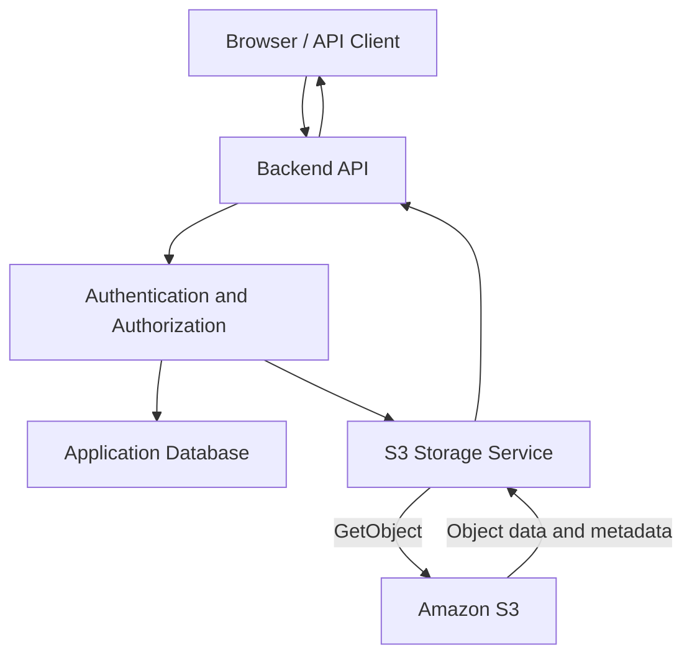

# 03- Download Objects

## Overview

Downloading objects from Amazon S3 is a common requirement in backend systems that serve documents, images, reports, media files, exports, and application-generated artifacts.

Boto3 provides three primary approaches for retrieving S3 objects:

- **`download_file()`** downloads an object to a local filesystem path using managed transfers.
- **`download_fileobj()`** downloads an object into a writable binary file-like object using managed transfers.
- **`get_object()`** exposes the low-level S3 API response, including a streaming response body and object metadata.

For most application workflows, use `download_file()` when the destination is a local file and `download_fileobj()` when the destination is a file-like object. Use `get_object()` when you need control over streaming, HTTP range requests, conditional reads, or response metadata.

Choosing the right method matters for memory consumption, request latency, transfer concurrency, failure recovery, and how efficiently a backend serves file downloads.

## Download Architecture

A backend system can retrieve an object from S3 and return it to the client, or provide a presigned URL that allows the client to download directly from S3.



In a backend-mediated download, the application validates the user's permissions, retrieves the requested object, and sends the content to the client. This provides direct control over authorization, auditing, and response transformation but consumes application network bandwidth and resources.

For large files or high-volume downloads, a backend can generate a presigned URL after authorization. The client then downloads the file directly from S3, reducing the amount of data passing through the application server.

## Boto3 Download Methods

### Method Comparison

| Method | Destination | Transfer behavior | Best use case |
|---|---|---|---|
| `download_file()` | Local filesystem path | Managed transfer with multipart support where applicable | Files stored temporarily or permanently on disk |
| `download_fileobj()` | Writable binary file-like object | Managed transfer with multipart support where applicable | Temporary files, binary streams, and file-processing pipelines |
| `get_object()` | Response body exposed as a `StreamingBody` | Direct API request; application controls body consumption | Streaming, range requests, conditional reads, and metadata access |
| `generate_presigned_url()` | Client downloads independently | Generates a temporary signed request URL | Browser and external client downloads |

Managed transfer methods simplify transfer orchestration and can download parts concurrently when necessary. `get_object()` offers greater control but requires the application to consume and close the response body correctly.

## Downloading Files with `download_file()`

The `download_file()` method downloads an S3 object to a local filesystem path.

### Basic Example

```python
import boto3

s3_client = boto3.client(
    "s3",
    region_name="ap-south-1",
)

s3_client.download_file(
    Bucket="company-documents-prod",
    Key="reports/monthly-report.pdf",
    Filename="/tmp/monthly-report.pdf",
)
```

The operation returns `None` on successful completion. Boto3 manages the transfer and raises an exception if the operation fails.

Important considerations:

- The destination directory must exist and be writable.
- The application must have permission to retrieve the object.
- The destination path is a local filesystem path, not an S3 key.
- An existing local file may be overwritten.
- Large transfers can use multipart downloads and concurrent requests.
- The managed transfer method does not return the downloaded content or the complete `GetObject` response.

### Downloading a Specific Object Version

When bucket versioning is enabled, an object can have multiple versions. Pass a version ID to retrieve a particular version.

```python
s3_client.download_file(
    Bucket="company-documents-prod",
    Key="reports/monthly-report.pdf",
    Filename="/tmp/monthly-report-v1.pdf",
    ExtraArgs={
        "VersionId": "EXAMPLE_VERSION_ID",
    },
)
```

Replace the example version ID with an actual version ID.

Retrieving a specific version requires the appropriate version-specific permissions, typically `s3:GetObjectVersion`. Retrieving the current version ordinarily uses `s3:GetObject`.

Version IDs should come from trusted application metadata or a verified S3 response rather than arbitrary client input.

### Downloading to a Temporary File

For production workflows that process downloaded content, avoid exposing an incomplete file to downstream consumers if a transfer fails.

One approach is to download into a temporary file and atomically replace the final destination only after successful completion.

```python
from pathlib import Path
import os
import tempfile

import boto3


def download_atomically(
    s3_client,
    bucket_name: str,
    object_key: str,
    destination: str | Path,
) -> Path:
    destination = Path(destination)
    destination.parent.mkdir(parents=True, exist_ok=True)

    fd, temporary_name = tempfile.mkstemp(
        prefix=f".{destination.name}.",
        suffix=".part",
        dir=destination.parent,
    )
    os.close(fd)

    temporary_path = Path(temporary_name)

    try:
        s3_client.download_file(
            Bucket=bucket_name,
            Key=object_key,
            Filename=str(temporary_path),
        )

        os.replace(temporary_path, destination)
        return destination

    except Exception:
        temporary_path.unlink(missing_ok=True)
        raise
```

The temporary file is created in the same directory as the destination so that `os.replace()` can perform an atomic replacement on the same filesystem.

This protects consumers from observing a partially downloaded replacement. It does not by itself guarantee crash durability, preserve the destination's permissions, or eliminate every filesystem-specific failure mode. Apply the appropriate file permissions and durability requirements for the application.

## Downloading into a File-Like Object

`download_fileobj()` accepts an object that implements a writable binary file interface.

Use it when a local path is unavailable or when the destination is an already-open file, temporary file, or other compatible binary destination.

### Basic Example

```python
with open("/tmp/monthly-report.pdf", "wb") as file_obj:
    s3_client.download_fileobj(
        Bucket="company-documents-prod",
        Key="reports/monthly-report.pdf",
        Fileobj=file_obj,
    )
```

Use binary mode (`wb`) because S3 object data can contain arbitrary bytes. Text mode may alter encoding or newline handling.

The managed transfer can perform multipart downloads using multiple threads. The destination object must support concurrent writes required by the transfer implementation when that behavior is enabled.

### Download into a Temporary File Object

```python
import tempfile


with tempfile.TemporaryFile(mode="w+b") as file_obj:
    s3_client.download_fileobj(
        Bucket="company-documents-prod",
        Key="reports/monthly-report.pdf",
        Fileobj=file_obj,
    )

    file_obj.seek(0)
    first_chunk = file_obj.read(1024)
```

This can be useful for processing files without creating a named file in a shared directory. However, `TemporaryFile` may consume disk-backed or memory-backed resources depending on the operating system and implementation.

Do not assume temporary-file handling eliminates disk usage for large downloads.

## Using `get_object()` for Streaming

The `get_object()` API returns object metadata and a response body represented by Botocore's `StreamingBody`.

Unlike a managed download, the application controls how the body is read and when it is closed.

### Basic Example

```python
response = s3_client.get_object(
    Bucket="company-documents-prod",
    Key="reports/monthly-report.pdf",
)

try:
    body = response["Body"]

    with open("/tmp/monthly-report.pdf", "wb") as file_obj:
        for chunk in body.iter_chunks(chunk_size=1024 * 1024):
            if chunk:
                file_obj.write(chunk)
finally:
    response["Body"].close()
```

This reads the object in chunks instead of loading the entire object into memory.

The `StreamingBody` should be consumed and closed promptly. Failing to close it can prevent the underlying HTTP connection from being returned to the connection pool efficiently.

### Reading Object Metadata

The `get_object()` response includes metadata such as content length, content type, ETag, last-modified time, and version ID when applicable.

```python
response = s3_client.get_object(
    Bucket="company-documents-prod",
    Key="reports/monthly-report.pdf",
)

try:
    metadata = {
        "content_length": response.get("ContentLength"),
        "content_type": response.get("ContentType"),
        "etag": response.get("ETag"),
        "last_modified": response.get("LastModified"),
        "version_id": response.get("VersionId"),
    }
finally:
    response["Body"].close()
```

The response body is closed even though the content was not read. If the application only needs object metadata, use `head_object()` instead of downloading an object body unnecessarily.

ETags are opaque identifiers and are not guaranteed to be MD5 checksums. For integrity verification, use the appropriate S3 checksum features or compare a separately calculated checksum under a well-defined algorithm.

### Memory Considerations

Avoid this pattern for large objects:

```python
response = s3_client.get_object(
    Bucket="company-documents-prod",
    Key="archives/large-file.zip",
)

try:
    content = response["Body"].read()
finally:
    response["Body"].close()
```

Calling `.read()` without a size limit can load the entire object into memory. Under concurrency, several large responses can exhaust application memory and cause worker termination.

Instead, use `iter_chunks()` or bounded reads:

```python
response = s3_client.get_object(
    Bucket="company-documents-prod",
    Key="archives/large-file.zip",
)

try:
    body = response["Body"]

    while chunk := body.read(1024 * 1024):
        process_chunk(chunk)
finally:
    response["Body"].close()
```

The `process_chunk()` function should process each chunk without retaining the entire file unless the workload explicitly requires that behavior.

## Choosing the Download Strategy

| Requirement | Recommended approach | Reason |
|---|---|---|
| Save a file on disk | `download_file()` | Simple API with managed transfer behavior |
| Write to an existing binary stream | `download_fileobj()` | Avoids requiring a local filename |
| Process large content incrementally | `get_object()` with chunked reads | Explicit control over memory and processing |
| Read object metadata without downloading content | `head_object()` | Avoids transferring the object body |
| Retrieve a byte range | `get_object()` with `Range` | Supports partial reads |
| Deliver a file directly to a browser | Presigned URL | Reduces backend data transfer |
| Retrieve an older object version | Managed download with `VersionId`, or `get_object()` with `VersionId` | Allows explicit version selection |

## Configuring Download Transfers

Managed transfers accept a `TransferConfig` to control multipart behavior and concurrency.

```python
from boto3.s3.transfer import TransferConfig


transfer_config = TransferConfig(
    multipart_threshold=64 * 1024 * 1024,
    multipart_chunksize=16 * 1024 * 1024,
    max_concurrency=4,
    use_threads=True,
)

s3_client.download_file(
    Bucket="company-backups-prod",
    Key="archives/archive.tar",
    Filename="/tmp/archive.tar",
    Config=transfer_config,
)
```

The settings above are illustrative. Tune the threshold, chunk size, and concurrency according to object sizes, network bandwidth, connection limits, worker memory, and expected application concurrency.

| Setting | Purpose | Trade-off |
|---|---|---|
| `multipart_threshold` | Controls when managed transfer uses multipart behavior | A lower threshold increases the use of concurrent range requests and request overhead |
| `multipart_chunksize` | Controls the target size of each part | Larger parts can affect memory usage and retry cost |
| `max_concurrency` | Limits concurrent transfer operations | Higher concurrency can improve throughput but increases resource demand |
| `use_threads` | Enables or disables managed-transfer threading | Disabling it reduces concurrency but may simplify constrained workloads |
| `max_io_queue` | Bounds queued I/O chunks in supported transfer paths | Affects buffering and throughput |
| `io_chunksize` | Controls I/O chunk size in supported transfer paths | Must be considered with queue depth and memory limits |

A managed multipart download may retrieve object ranges concurrently and write them into the destination. If the underlying object changes during a multi-request transfer, consistency of the retrieved content matters.

For workflows that require a specific immutable object, pin the version ID where applicable. A design that reads a mutable current key should account for concurrent overwrites.

## Download Progress Tracking

Managed download methods accept a `Callback` that is periodically called with the number of bytes transferred.

The callback can support progress reporting, transfer telemetry, and operational metrics. Since concurrent transfers may invoke callbacks from different threads, protect shared state when necessary.

```python
import threading


class DownloadProgress:
    def __init__(self, total_bytes: int) -> None:
        self.total_bytes = total_bytes
        self.downloaded_bytes = 0
        self._lock = threading.Lock()

    def __call__(self, bytes_transferred: int) -> None:
        with self._lock:
            self.downloaded_bytes += bytes_transferred

            percentage = (
                self.downloaded_bytes / self.total_bytes * 100
                if self.total_bytes > 0
                else 100.0
            )

            print(
                f"Downloaded {self.downloaded_bytes}/"
                f"{self.total_bytes} bytes ({percentage:.1f}%)"
            )
```

Usage:

```python
head = s3_client.head_object(
    Bucket="company-documents-prod",
    Key="reports/monthly-report.pdf",
)

progress = DownloadProgress(
    total_bytes=head["ContentLength"],
)

s3_client.download_file(
    Bucket="company-documents-prod",
    Key="reports/monthly-report.pdf",
    Filename="/tmp/monthly-report.pdf",
    Callback=progress,
)
```

This example performs a separate metadata request to obtain the total size. The object may change between the metadata request and the download if the key is overwritten. For strict consistency, use a version ID or another appropriate immutable-object strategy.

For production telemetry, prefer structured progress events or metrics rather than logging every callback invocation.

## Downloading Partial Content with Range Requests

A range request retrieves a specific byte range instead of the complete object. This can be useful for:

- Resuming interrupted downloads.
- Reading a file header or selected portion.
- Supporting byte-range delivery for media or large files.
- Processing a segment without retrieving the entire object.

Example:

```python
response = s3_client.get_object(
    Bucket="company-documents-prod",
    Key="archives/large-file.bin",
    Range="bytes=0-1048575",
)

try:
    content_range = response.get("ContentRange")

    with open("/tmp/first-megabyte.bin", "wb") as file_obj:
        for chunk in response["Body"].iter_chunks(
            chunk_size=256 * 1024
        ):
            if chunk:
                file_obj.write(chunk)

finally:
    response["Body"].close()
```

The range `bytes=0-1048575` requests the first 1 MiB of the object. S3 returns a partial-content response when the range is satisfiable.

S3 does not support retrieving multiple byte ranges in a single `GetObject` request. For resumable downloads, the application must coordinate byte ranges and ensure that the requested object has not changed between requests.

Use object version IDs, or another appropriate consistency strategy, when combining multiple range responses into one file.

## Presigned URLs for Direct Downloads

A presigned URL allows a client to download an S3 object without receiving AWS credentials directly. The application signs a request using its own AWS identity, and the client uses the URL until it expires or becomes unusable because of credential, policy, or resource changes.

This pattern is useful for large file downloads because the application authorizes the request without proxying the full payload.

### Generating a Presigned GET URL

```python
def create_download_url(
    s3_client,
    bucket_name: str,
    object_key: str,
    expires_in: int = 300,
) -> str:
    return s3_client.generate_presigned_url(
        ClientMethod="get_object",
        Params={
            "Bucket": bucket_name,
            "Key": object_key,
        },
        ExpiresIn=expires_in,
    )
```

Usage:

```python
url = create_download_url(
    s3_client,
    bucket_name="company-documents-prod",
    object_key="reports/monthly-report.pdf",
)

print(url)
```

Treat the URL as a bearer capability: anyone who possesses a valid URL may be able to use it within its permitted scope and lifetime. Do not write presigned URLs to application logs, analytics events, public error responses, or other uncontrolled destinations.

### Force Download Behavior

For some browser-download workflows, specify a content disposition override in the signed request.

```python
url = s3_client.generate_presigned_url(
    ClientMethod="get_object",
    Params={
        "Bucket": "company-documents-prod",
        "Key": "reports/monthly-report.pdf",
        "ResponseContentDisposition": (
            'attachment; filename="monthly-report.pdf"'
        ),
    },
    ExpiresIn=300,
)
```

If a response override is included in the signed request, clients must use the generated URL without altering its signed query parameters.

The effective lifetime cannot exceed the validity of the credentials used to sign the request. Bucket policies and other authorization controls can also restrict access.

### Authorization Requirements

Before generating a URL, the backend should:

1. Authenticate the requesting user.
2. Retrieve the object's authoritative identifier from application state.
3. Verify the user's permission to download the object.
4. Generate a URL for the specific bucket and key.
5. Use a short lifetime appropriate to the use case.
6. Avoid returning or logging the URL for unauthorized users.

A UUID or difficult-to-guess key is not a substitute for authorization. Direct-download URLs are best suited to workflows where the application can make an explicit authorization decision before issuing the URL.

## Streaming Downloads Through FastAPI

A backend may need to stream object content through its API to enforce policy, transform the response, or integrate with an existing client interface.

For large objects, avoid loading the entire body into memory. Use a generator that reads bounded chunks and closes the S3 response reliably.

```python
from collections.abc import Iterator

from fastapi import HTTPException
from fastapi.responses import StreamingResponse
from botocore.exceptions import BotoCoreError, ClientError


def iter_s3_body(body, chunk_size: int = 1024 * 1024) -> Iterator[bytes]:
    try:
        while chunk := body.read(chunk_size):
            yield chunk
    finally:
        body.close()


@router.get("/documents/{document_id}/download")
def download_document(document_id: str):
    document = repository.get_authorized_document(
        document_id=document_id,
        user=current_user,
    )

    if document is None:
        raise HTTPException(
            status_code=404,
            detail="Document not found",
        )

    try:
        response = storage.client.get_object(
            Bucket=storage.bucket_name,
            Key=document.object_key,
        )
    except ClientError as exc:
        error_code = exc.response.get("Error", {}).get("Code")

        if error_code in {"NoSuchKey", "NoSuchBucket"}:
            raise HTTPException(
                status_code=404,
                detail="Document not found",
            ) from exc

        raise HTTPException(
            status_code=503,
            detail="Document storage is unavailable",
        ) from exc
    except BotoCoreError as exc:
        raise HTTPException(
            status_code=503,
            detail="Document storage is unavailable",
        ) from exc

    body = response["Body"]

    return StreamingResponse(
        iter_s3_body(body),
        media_type=response.get(
            "ContentType",
            "application/octet-stream",
        ),
        headers={
            "Content-Length": str(response["ContentLength"]),
            "Content-Disposition": 'attachment; filename="document"',
        },
    )
```

This is an illustrative integration. `router`, `storage`, `repository`, and `current_user` represent application-specific components that must be supplied. A production implementation should also define explicit exception mapping for authorization failures, deleted objects, and upstream timeouts.

For streaming responses:

- Authenticate and authorize before reading the object.
- Avoid forwarding untrusted filenames directly into response headers.
- Set safe content-disposition behavior appropriate to the application.
- Ensure the body is closed when the client disconnects or streaming terminates.
- Configure the server and reverse proxy for long-lived responses when required.
- Apply download quotas, timeouts, and concurrency limits where appropriate.

Boto3 is synchronous. In an asynchronous application, blocking SDK calls can block the event loop. Use a thread pool or an asynchronous-compatible AWS SDK design for non-blocking request handling, and verify how your framework manages synchronous response iterators.

If the API does not need to inspect or transform the bytes, a short-lived presigned URL is often more scalable.

## Download Error Handling

Download failures can arise at credential resolution, authorization, request execution, data transfer, or local filesystem writing.

| Failure | Possible cause | Diagnostic approach |
|---|---|---|
| `NoSuchKey` | Incorrect key or absent object | Verify the exact key and object version |
| `NoSuchBucket` | Incorrect bucket name or missing bucket | Verify bucket identity and Region |
| `AccessDenied` | IAM, bucket, access point, or KMS permissions | Check the required authorization layers |
| Expired-token error | Temporary credentials expired | Inspect the runtime credential provider |
| `SignatureDoesNotMatch` | Region, endpoint, or signing configuration mismatch | Verify client configuration and signed request construction |
| Timeout or connection error | Network, endpoint, or transient service issue | Inspect timeouts, retry behavior, and service telemetry |
| Local `PermissionError` | Destination directory or file permissions | Check filesystem ownership and write access |
| Disk-full or I/O error | Insufficient disk space or storage failure | Inspect available capacity and filesystem errors |
| Corrupt or incomplete local output | Failed transfer or unsafe publication workflow | Download to a temporary destination and validate before publishing |

### Preserve Error Context

Use `ClientError` to inspect service error codes and `BotoCoreError` for other SDK failures. Filesystem exceptions may also occur during local downloads and should be handled separately where needed.

Do not translate every exception into "object not found". Authorization failures and missing objects are different conditions, even when the service intentionally limits diagnostic detail.

For retry behavior, distinguish transient network or service failures from deterministic failures such as invalid keys, access denial, and invalid Regions. Coordinate SDK retries with application-level retry policies and time budgets.

## Security and Permissions

### IAM Permissions

A normal read of the current object typically requires `s3:GetObject`. Retrieving a specific version generally requires `s3:GetObjectVersion`.

Additional permissions depend on the workflow:

- `s3:ListBucket` may be needed when the application lists keys or must distinguish certain missing-key cases.
- KMS permissions may be needed for SSE-KMS encrypted objects, depending on the key and request.
- Permissions for version listing or metadata operations may be required by administrative workflows.

Do not grant broad bucket access simply to make downloads work. Scope policies to the intended bucket and object prefixes, and keep tenant isolation in the application authorization layer.

### Sensitive Files

For confidential documents:

- Keep the bucket private.
- Verify user authorization before reading or generating a presigned URL.
- Use short-lived download URLs.
- Avoid logging object contents, sensitive metadata, and signed URLs.
- Apply retention and auditing policies appropriate to the data.
- Consider whether downloaded files should be cached by browsers or intermediary proxies.

A storage key should not be treated as a secret, and knowledge of an S3 object key must not grant application-level access by itself.

## Performance, Reliability, and Cost

### Performance

Download performance depends on object size, network bandwidth, concurrency, storage behavior, and the workload of the receiving system.

Recommended practices include:

- Reuse Boto3 clients within each process.
- Use managed transfers for large local downloads.
- Tune multipart thresholds and concurrency using representative tests.
- Stream objects in bounded chunks when the whole file is not needed in memory.
- Avoid transferring an object merely to inspect its metadata.
- Use presigned URLs for suitable high-volume direct-to-client downloads.
- Limit simultaneous large downloads when memory, bandwidth, or disk I/O is constrained.

### Reliability

For workflows that publish a downloaded file to another service or worker:

- Use a temporary destination until the transfer completes.
- Verify expected length or an appropriate checksum where required.
- Pin an object version when consistency across multiple reads matters.
- Make retries safe for downstream processing.
- Clean up temporary files after both success and failure.
- Track failed transfers and abandoned temporary artifacts.

S3's object durability does not guarantee that a local downloaded copy is complete, correctly persisted, or safely published by the application.

### Cost

Download workloads can incur S3 request costs, data transfer charges, and retrieval charges for certain storage classes. Proxying downloads through a backend also consumes application compute and network capacity.

Evaluate the total cost rather than comparing storage prices alone. For frequently downloaded content, CloudFront may reduce repeated origin requests and improve delivery performance, depending on cacheability and workload characteristics.

## Testing Download Logic

Separate unit tests from integration tests.

### Unit Tests

Mock the S3 client to verify that the service requests the correct object and handles expected error codes. For streaming logic, use a fake or mocked body that returns controlled byte chunks and records calls to `close()`.

```python
from unittest.mock import Mock


def test_download_file_uses_expected_destination(tmp_path):
    s3_client = Mock()
    s3_client.download_file.return_value = None

    destination = tmp_path / "report.pdf"

    s3_client.download_file(
        Bucket="company-documents-test",
        Key="reports/report.pdf",
        Filename=str(destination),
    )

    s3_client.download_file.assert_called_once_with(
        Bucket="company-documents-test",
        Key="reports/report.pdf",
        Filename=str(destination),
    )
```

This test verifies the interaction with the SDK client. It does not test AWS connectivity, actual file contents, IAM permissions, multipart behavior, or the S3 service.

### Integration Tests

Use an isolated test bucket or suitable local environment to verify:

- Downloaded bytes match the uploaded test fixture.
- Metadata and content types are returned as expected.
- Specific versions can be downloaded when versioning is enabled.
- Missing objects produce the intended application response.
- Restricted identities cannot retrieve unauthorized objects.
- Streaming responses close their underlying bodies.
- Partial-content requests return the expected range.
- Temporary files are removed after failed downloads.

Never use production data for destructive automated tests.

## Operational Verification

### Inspect Metadata Before Download

```bash
aws s3api head-object \
  --bucket company-documents-prod \
  --key reports/monthly-report.pdf \
  --region ap-south-1
```

This is useful for checking object existence, content length, metadata, and related response properties when the caller has sufficient permissions.

### Download an Object

```bash
aws s3 cp \
  s3://company-documents-prod/reports/monthly-report.pdf \
  /tmp/monthly-report.pdf \
  --region ap-south-1
```

### Download a Specific Version

```bash
aws s3api get-object \
  --bucket company-documents-prod \
  --key reports/monthly-report.pdf \
  --version-id EXAMPLE_VERSION_ID \
  --region ap-south-1 \
  /tmp/monthly-report-v1.pdf
```

Replace the example version ID with the actual version identifier. The caller must have the required version-specific permissions.

### Troubleshooting Checklist

When a download fails:

1. Verify the bucket, key, Region, and expected object version.
2. Confirm the active AWS identity and required permissions.
3. Inspect the exception code and HTTP status.
4. Check KMS permissions if the object uses SSE-KMS.
5. Verify local destination permissions and available storage.
6. Review transfer settings, connection timeouts, and retry behavior.
7. Confirm whether the object is retrieved as a complete body or a partial range.
8. Ensure the response body is closed when using `get_object()`.
9. Validate the resulting bytes before publishing or processing the file.
10. Add regression tests for the observed failure and recovery path.

## Official References

- [Boto3: Downloading files](https://docs.aws.amazon.com/boto3/latest/guide/s3-example-download-file.html)
- [Boto3 client `download_file`](https://docs.aws.amazon.com/boto3/latest/reference/services/s3/client/download_file.html)
- [Boto3 client `download_fileobj`](https://docs.aws.amazon.com/boto3/latest/reference/services/s3/client/download_fileobj.html)
- [Boto3 client `get_object`](https://docs.aws.amazon.com/boto3/latest/reference/services/s3/client/get_object.html)
- [Amazon S3 `GetObject` API](https://docs.aws.amazon.com/AmazonS3/latest/API/API_GetObject.html)
- [Boto3 retry behavior](https://docs.aws.amazon.com/boto3/latest/guide/retries.html)
- [Amazon S3 object integrity](https://docs.aws.amazon.com/AmazonS3/latest/userguide/checking-object-integrity.html)

## Key Takeaways

- Use `download_file()` for local files, `download_fileobj()` for writable binary streams, and `get_object()` when explicit streaming or range control is required.
- Consume and close `StreamingBody` responses reliably, and avoid loading large objects entirely into memory.
- Use temporary destinations, version-aware reads, and integrity checks when incomplete or inconsistent downloads could affect downstream processing.
- Enforce least-privilege access and application authorization before downloading private objects or generating presigned URLs.
- Tune transfer concurrency, retries, timeouts, and delivery architecture to balance throughput, reliability, resource consumption, and cost.