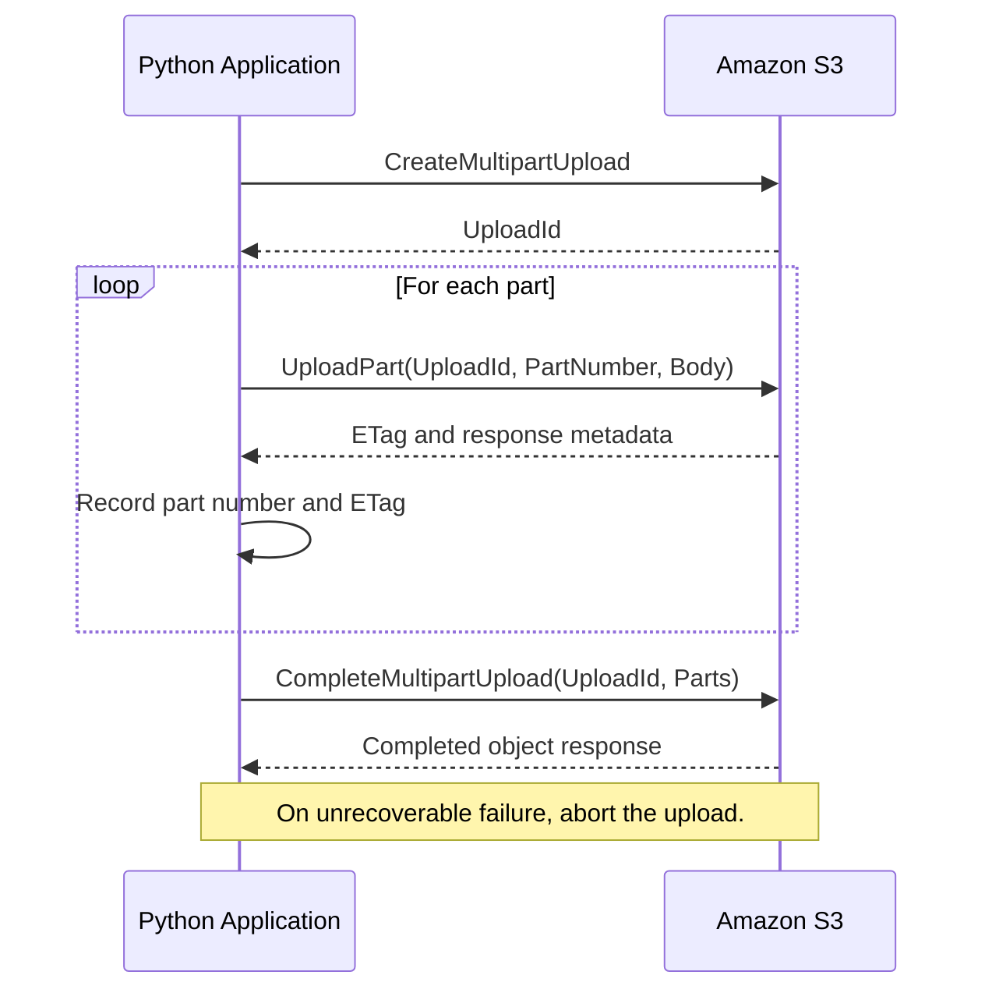
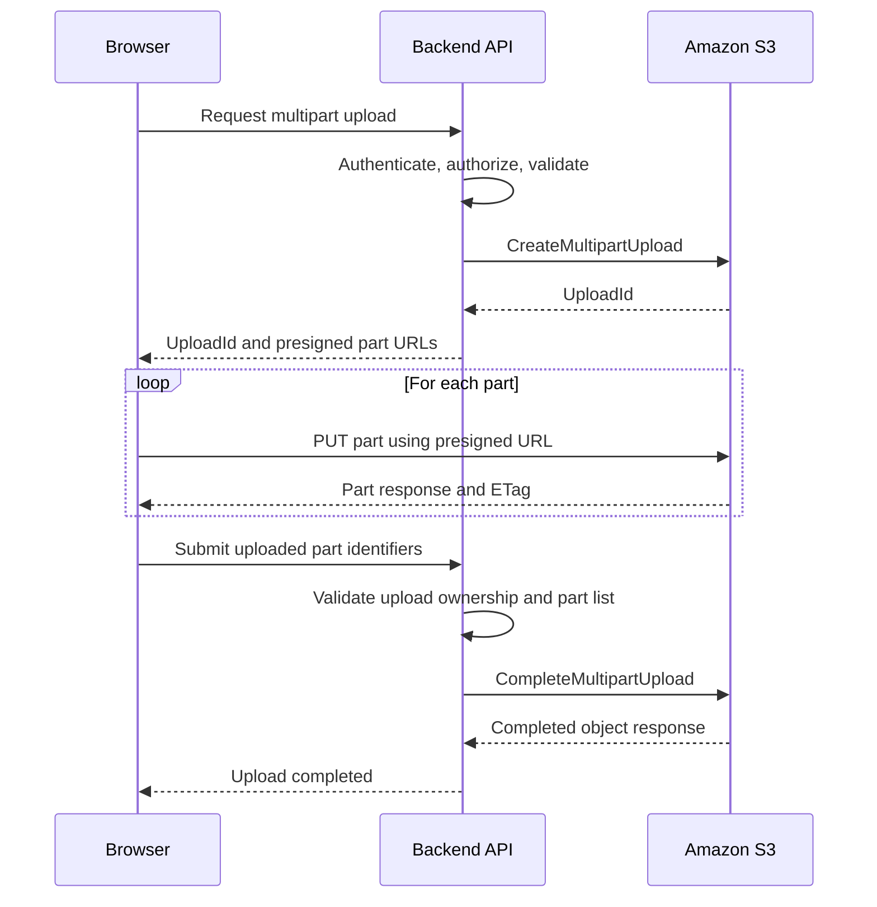

# 04- Multipart Upload with Boto3

## Overview

Amazon S3 multipart upload allows a single object to be uploaded as multiple independent parts and assembled into the final object after all required parts have been uploaded successfully.

Multipart upload is useful for large files, unreliable networks, high-throughput data pipelines, media processing, backups, and applications that need to upload large objects without loading the entire file into memory.

Boto3 supports multipart uploads through two approaches:

- **Managed transfers:** `upload_file()` and `upload_fileobj()` automatically select single-request or multipart transfer behavior based on the configured transfer threshold. They manage part uploads, concurrency, and retries.
- **Low-level multipart API:** `create_multipart_upload()`, `upload_part()`, `complete_multipart_upload()`, and `abort_multipart_upload()` provide explicit control over the upload lifecycle.

For most production applications, prefer **managed transfers**. Use the low-level API when the workflow requires explicit part tracking, resumable uploads, browser-to-S3 multipart uploads, or custom orchestration.

## Multipart Upload Architecture

A multipart upload has three principal phases:

1. Initiate an upload and receive an upload ID.
2. Upload individual parts identified by part numbers.
3. Complete the upload by submitting the uploaded parts in order.

If the workflow fails, abort the multipart upload to remove its unfinished parts.



S3 does not expose the final object as a completed object merely because some parts have been uploaded. The final object is assembled when the completion request succeeds.

Each part can be uploaded independently. If a part fails, that part can be retried without uploading the other parts again, provided the multipart upload remains valid.

## Multipart Upload Limits

For general-purpose S3 buckets, the documented multipart upload limits include the following.

| Property | Limit |
|---|---|
| Maximum object size | 48.8 TiB |
| Maximum number of parts | 10,000 |
| Part numbers | 1–10,000 |
| Normal part size | 5 MiB–5 GiB |
| Final part size | No minimum size |
| Maximum parts returned by one `ListParts` request | 1,000 |
| Maximum multipart uploads returned by one `ListMultipartUploads` request | 1,000 |

The minimum part-size requirement applies to every part except the final part. Verify the latest service limits for the bucket type and workload you operate.

As a practical guideline, consider multipart uploads when files approach or exceed 100 MB. The best threshold depends on latency, network conditions, transfer concurrency, and the overhead of additional S3 requests.

### Part Size and Maximum Object Size

The number of parts is determined by the object size and configured part size:

\[
\text{part count} =
\left\lceil
\frac{\text{object size}}{\text{part size}}
\right\rceil
\]

For example, a 1 GiB file uploaded using 64 MiB parts requires 16 parts.

Choose a part size that keeps the total number of parts within 10,000. A smaller part size can improve retry granularity but increases request count and orchestration overhead. A larger part size reduces the number of requests but can increase memory consumption and the amount of data retransmitted when a part fails.

Official reference: [Amazon S3 multipart upload limits](https://docs.aws.amazon.com/AmazonS3/latest/userguide/qfacts.html).

## Managed Multipart Upload with Boto3

### Configure Transfer Behavior

Boto3's `TransferConfig` controls when multipart transfer begins and how transfer operations use concurrency.

```python
from boto3.s3.transfer import TransferConfig


transfer_config = TransferConfig(
    multipart_threshold=64 * 1024 * 1024,
    multipart_chunksize=64 * 1024 * 1024,
    max_concurrency=4,
    use_threads=True,
)
```

This configuration uses a 64 MiB multipart threshold, 64 MiB target parts, and up to four concurrent transfer operations.

These values are illustrative. Boto3's defaults may differ by installed version and configuration. Benchmark representative workloads before tuning production settings.

| Setting | Purpose | Trade-off |
|---|---|---|
| `multipart_threshold` | File size at which the managed transfer switches to multipart behavior | A lower threshold increases multipart usage and request overhead |
| `multipart_chunksize` | Target size of each part | Larger parts can require more buffering and make individual retries more expensive |
| `max_concurrency` | Maximum number of concurrent transfer operations | Higher concurrency can improve throughput but increases connection and resource demand |
| `use_threads` | Enables or disables transfer threads | Disabling threads removes transfer concurrency |
| `max_io_queue` | Controls queued I/O chunks in supported transfer paths | Affects buffering and throughput |
| `io_chunksize` | Controls chunk size in supported I/O paths | Must be considered alongside queue depth and memory |

### Upload a Large File

```python
import boto3
from boto3.s3.transfer import TransferConfig
from botocore.config import Config


session = boto3.Session(region_name="ap-south-1")

s3_client = session.client(
    "s3",
    config=Config(
        connect_timeout=5,
        read_timeout=60,
        retries={
            "mode": "standard",
            "total_max_attempts": 4,
        },
    ),
)

transfer_config = TransferConfig(
    multipart_threshold=64 * 1024 * 1024,
    multipart_chunksize=64 * 1024 * 1024,
    max_concurrency=4,
    use_threads=True,
)

s3_client.upload_file(
    Filename="/data/archive.tar",
    Bucket="company-backups-prod",
    Key="archives/archive.tar",
    ExtraArgs={
        "ContentType": "application/x-tar",
    },
    Config=transfer_config,
)
```

Boto3 determines whether the object should use a single-request upload or multipart upload based on the configured threshold and the transfer implementation.

The managed transfer handles the multipart lifecycle, including part uploads and completion. The method returns `None` on success and raises an exception on failure.

### Upload a File-Like Object

For objects already available through a readable binary file-like interface, use `upload_fileobj()`.

```python
with open("/data/archive.tar", "rb") as file_obj:
    s3_client.upload_fileobj(
        Fileobj=file_obj,
        Bucket="company-backups-prod",
        Key="archives/archive.tar",
        ExtraArgs={
            "ContentType": "application/x-tar",
        },
        Config=transfer_config,
    )
```

This is useful for temporary files and framework upload objects. The file-like object must return bytes when read.

Avoid converting a large upload into a single `bytes` value merely to pass it to the SDK. Managed transfers can work with file-like objects without requiring the application to retain the entire object in memory, although transfer buffering and concurrency still consume resources.

Official reference: [Boto3 file transfer configuration](https://docs.aws.amazon.com/boto3/latest/guide/s3.html).

## Low-Level Multipart Upload

The low-level multipart API is appropriate when the application needs direct control over initiation, part tracking, completion, and cleanup.

### Multipart Upload Lifecycle

| Operation | Purpose |
|---|---|
| `create_multipart_upload()` | Initiates the upload and returns an upload ID |
| `upload_part()` | Uploads one part identified by the upload ID and part number |
| `list_parts()` | Lists uploaded parts for an existing multipart upload |
| `complete_multipart_upload()` | Assembles the final object from the specified uploaded parts |
| `abort_multipart_upload()` | Cancels the upload and removes unfinished part data |

The upload ID identifies a particular upload session for one bucket and object key. It must be supplied to subsequent part, completion, and abort requests.

Each part has a part number and an ETag returned by S3. Record these values during the upload and provide the parts in ascending part-number order when completing the operation.

### Complete Implementation for a Local File

The following example uses the low-level client API to upload a non-empty local file sequentially. Sequential part uploads keep the example easy to reason about and bound memory consumption to approximately one part at a time.

For high-throughput workloads, use managed transfers or introduce bounded concurrency into a carefully designed low-level implementation.

```python
from __future__ import annotations

import logging
import math
from pathlib import Path
from typing import Any

from botocore.client import BaseClient


logger = logging.getLogger(__name__)

MIN_PART_SIZE = 5 * 1024 * 1024
MAX_PART_SIZE = 5 * 1024 * 1024 * 1024
MAX_PARTS = 10_000


def multipart_upload_file(
    s3_client: BaseClient,
    bucket_name: str,
    object_key: str,
    file_path: str | Path,
    part_size: int = 64 * 1024 * 1024,
    content_type: str = "application/octet-stream",
) -> dict[str, Any]:
    """
    Upload a non-empty local file using the low-level S3 multipart API.

    The source file must remain unchanged throughout the transfer.
    """
    path = Path(file_path)

    if not path.is_file():
        raise FileNotFoundError(path)

    if not bucket_name or not object_key:
        raise ValueError("Bucket name and object key are required")

    if not MIN_PART_SIZE <= part_size <= MAX_PART_SIZE:
        raise ValueError(
            "part_size must be between 5 MiB and 5 GiB"
        )

    file_size = path.stat().st_size

    if file_size == 0:
        raise ValueError(
            "Use put_object() for an empty file"
        )

    expected_parts = math.ceil(file_size / part_size)

    if expected_parts > MAX_PARTS:
        raise ValueError(
            "The configured part size would exceed 10,000 parts"
        )

    initiation = s3_client.create_multipart_upload(
        Bucket=bucket_name,
        Key=object_key,
        ContentType=content_type,
    )
    upload_id = initiation["UploadId"]

    uploaded_parts: list[dict[str, Any]] = []

    try:
        with path.open("rb") as file_obj:
            part_number = 1

            while True:
                chunk = file_obj.read(part_size)

                if not chunk:
                    break

                if part_number > MAX_PARTS:
                    raise ValueError(
                        "The upload exceeds the maximum part count"
                    )

                response = s3_client.upload_part(
                    Bucket=bucket_name,
                    Key=object_key,
                    UploadId=upload_id,
                    PartNumber=part_number,
                    Body=chunk,
                )

                uploaded_parts.append(
                    {
                        "PartNumber": part_number,
                        "ETag": response["ETag"],
                    }
                )

                part_number += 1

        if not uploaded_parts:
            raise RuntimeError("No parts were uploaded")

        uploaded_parts.sort(
            key=lambda part: part["PartNumber"]
        )

        result = s3_client.complete_multipart_upload(
            Bucket=bucket_name,
            Key=object_key,
            UploadId=upload_id,
            MultipartUpload={
                "Parts": uploaded_parts,
            },
        )

        return result

    except BaseException:
        try:
            s3_client.abort_multipart_upload(
                Bucket=bucket_name,
                Key=object_key,
                UploadId=upload_id,
            )
        except Exception:
            logger.exception(
                "Failed to abort multipart upload",
                extra={
                    "s3_bucket": bucket_name,
                    "s3_operation": "abort_multipart_upload",
                },
            )

        raise
```

### Important Implementation Details

- The part size is validated against S3's minimum and maximum part-size limits.
- The expected part count is checked before the upload starts.
- The file must remain unchanged throughout the upload. A production implementation should not let another process modify the source while it is being transferred.
- Parts are numbered consecutively, beginning at 1.
- Each part's ETag is recorded for the completion request.
- The upload is aborted when an exception occurs, and the original exception is propagated.
- If aborting also fails, the application logs the cleanup failure rather than silently treating the upload as cleaned up.
- The function does not resume an interrupted upload after the process exits. Implementing durable resume requires persisting upload state and reconciling uploaded parts.

The example demonstrates the lifecycle rather than a universal production uploader. For strict integrity requirements, configure and verify S3 checksum support as appropriate. Do not assume the ETag is a full-object MD5 checksum.

## Part Uploads and Completion

### Uploading Parts

Each `upload_part()` call requires:

- Bucket name.
- Object key.
- Upload ID.
- Part number.
- Part data.

Part numbers range from 1 through 10,000. Reusing a part number in the same upload replaces the previously uploaded part with that number.

Parts can be uploaded independently and in parallel. However, parallel implementations must use bounded concurrency, store every successful part response, and ensure that completion uses the correct part list.

### Completing the Upload

The completion request includes an ordered list of uploaded parts.

```python
response = s3_client.complete_multipart_upload(
    Bucket="company-backups-prod",
    Key="archives/archive.tar",
    UploadId=upload_id,
    MultipartUpload={
        "Parts": [
            {
                "PartNumber": 1,
                "ETag": etag_part_1,
            },
            {
                "PartNumber": 2,
                "ETag": etag_part_2,
            },
        ],
    },
)
```

This example assumes that both parts were uploaded successfully under the same upload ID and that the ETags were captured from their responses.

The part list must describe the complete intended object in ascending order. With checksum-enabled multipart uploads, S3 has additional checksum constraints; in particular, part numbers must be consecutive and begin at 1.

A successful completion request is the point at which S3 assembles the object. Keep track of the final response and any version identifier returned when versioning is enabled.

## Retry Handling and Recovery

Multipart upload makes individual parts independently retryable, but the overall workflow still needs recovery logic.

### Failure Scenarios

| Failure | Recommended action |
|---|---|
| One part fails transiently | Retry the affected part under a bounded retry policy |
| A credential expires | Refresh credentials where possible, then retry only when the upload session remains valid |
| Network connection is lost | Inspect the upload state and retry or resume according to the workflow design |
| Completion request times out | Determine whether completion succeeded before starting a new upload |
| Process crashes | Recover the saved upload ID and part state, or abort and restart |
| Abort request fails | Log the failure, retain diagnostic identifiers, and reconcile or clean up the incomplete upload later |
| Source file changes | Stop the upload and restart from a stable source |
| A different upload overwrites the same key | Enforce object ownership, unique key generation, or conditional-write behavior where applicable |

### Completion Ambiguity

A timeout while completing an upload does not always prove that completion failed. The request may have reached S3 even if the client did not receive the response.

Before retrying the entire operation, check whether the object exists and validate its expected version, size, or checksum as required. Do not assume that repeating every step is safe.

If the workflow requires stronger guarantees around object replacement, investigate conditional writes and the relevant S3 API behavior.

### Durable Resume

A resumable multipart upload needs state beyond a local function call. Persist the following information in a durable store, such as PostgreSQL or DynamoDB:

- Application upload identifier.
- Bucket and object key.
- S3 upload ID.
- Expected file size and checksum when available.
- Part size and part-number mapping.
- Successful part numbers, ETags, and checksum values where used.
- Initiation time, expiration policy, and application status.
- Authorization context and ownership information.

For recovery, the application can use `list_parts()` to reconcile stored state with S3. The API returns at most 1,000 parts per request, so large uploads require pagination.

Durable resume is more complex than retrying a failed request. A correct implementation must handle duplicate requests, expired credentials, concurrent workers, abandoned sessions, and the possibility that completion succeeded before local state was updated.

## Multipart Upload Directly from a Browser

For large browser uploads, the backend can initiate a multipart upload and provide presigned URLs for the individual parts. The browser uploads parts directly to S3, reducing the data transferred through the API servers.



### Generate a Presigned Part URL

```python
def create_presigned_part_url(
    s3_client,
    bucket_name: str,
    object_key: str,
    upload_id: str,
    part_number: int,
    expires_in: int = 900,
) -> str:
    if not 1 <= part_number <= 10_000:
        raise ValueError("Invalid part number")

    return s3_client.generate_presigned_url(
        ClientMethod="upload_part",
        Params={
            "Bucket": bucket_name,
            "Key": object_key,
            "UploadId": upload_id,
            "PartNumber": part_number,
        },
        ExpiresIn=expires_in,
    )
```

The generated URL grants temporary access to upload the specified part under the specified multipart upload. It must not be treated as a general-purpose S3 credential.

### Browser-Side Considerations

The complete browser workflow should:

1. Authenticate and authorize the user before initiation.
2. Generate the object key on the backend.
3. Enforce file-size and upload constraints before or during transfer.
4. Use bounded part-upload concurrency.
5. Retry failed parts with valid URLs and the same part numbers.
6. Retain the ETag returned for each successful part.
7. Send the part-number and ETag list to the backend for completion.
8. Validate that the upload belongs to the requesting user or tenant.
9. Abort abandoned uploads when appropriate.
10. Verify the completed object before marking the application record as ready.

If the browser needs to read response headers such as ETag, configure S3 CORS to expose the relevant headers to the intended frontend origin.

Presigned URLs are temporary bearer capabilities. Protect them from logging and disclosure, and use short expirations appropriate to part size and expected network conditions.

## Security and IAM Permissions

A multipart upload normally requires `s3:PutObject` permission for the destination object. Aborting an upload requires `s3:AbortMultipartUpload`. Listing parts and listing in-progress multipart uploads require their corresponding list permissions when those operations are used.

For customer-managed SSE-KMS keys, multipart upload may require `kms:GenerateDataKey` and `kms:Decrypt` permissions, along with an appropriate KMS key policy. Review the precise requirements for the operations and encryption configuration used by the application.

Recommended controls include:

- Use IAM roles or other short-lived credentials.
- Restrict access to the required bucket and prefix.
- Generate object keys on the backend.
- Associate multipart upload IDs with authenticated application users.
- Validate all completion requests and submitted part identifiers.
- Prevent one tenant from completing or aborting another tenant's upload.
- Avoid storing presigned URLs in logs or persistent records longer than necessary.
- Apply bucket-level encryption and Block Public Access where appropriate.
- Configure a lifecycle rule to abort stale incomplete multipart uploads.

A presigned URL grants access to a specific signed operation; it does not replace application authorization when initiating or completing uploads.

## Performance and Memory Management

Multipart upload performance depends on the part size, network bandwidth, request latency, connection pool, and number of concurrent transfers.

A simplified capacity model is:

\[
\text{transfer concurrency}
\approx
\text{simultaneous uploads}
\times
\text{parts per upload in flight}
\]

This is a planning approximation rather than a guarantee of the SDK's exact scheduling behavior.

For example, increasing per-upload concurrency to 10 while allowing 100 simultaneous uploads may create substantial connection and resource demand.

Production tuning should consider:

- Part-size selection and the 10,000-part limit.
- Total transfer concurrency across the application.
- Memory consumed by buffered parts and queued I/O.
- Network bandwidth and connection limits.
- SDK and application retry budgets.
- API or job deadlines.
- Object size and expected retransmission cost.
- Local disk space when the workflow uses staging files.

For general large-file workloads, managed transfers are usually simpler and safer than implementing parallel part scheduling manually. Introduce a low-level implementation only when its additional control provides a measurable benefit.

## Cost and Incomplete Upload Cleanup

S3 retains uploaded parts until the multipart upload is completed or aborted. These unfinished parts can incur storage charges.

A failed worker, cancelled job, or abandoned browser session may leave an incomplete upload even if the application no longer has its upload ID.

### Abort a Known Upload

```python
s3_client.abort_multipart_upload(
    Bucket="company-backups-prod",
    Key="archives/archive.tar",
    UploadId=upload_id,
)
```

Aborting prevents additional parts from being uploaded under that upload ID and requests cleanup of its uploaded parts. If part uploads were still in progress, additional cleanup may be needed to ensure that all uploaded parts have been removed.

### List In-Progress Uploads

```python
response = s3_client.list_multipart_uploads(
    Bucket="company-backups-prod",
)

for upload in response.get("Uploads", []):
    print(
        upload["Key"],
        upload["UploadId"],
        upload["Initiated"],
    )
```

This example displays the first page only. The API returns at most 1,000 multipart uploads per request; large inventories require pagination.

Do not automatically abort every listed upload in a bucket without checking whether it is active. Use age thresholds, application state, and operational safeguards when designing cleanup jobs.

### Lifecycle Cleanup

Configure an S3 lifecycle rule using the `AbortIncompleteMultipartUpload` action to remove old incomplete uploads automatically. Choose an expiration interval appropriate to the maximum expected upload duration and retry window.

Lifecycle cleanup is a safety net, not a substitute for normal application cleanup and status tracking.

## Testing Multipart Uploads

### Unit Tests

Use a mocked S3 client to validate multipart orchestration without making network requests.

A useful test suite should verify:

- Initiation occurs before part uploads.
- Part numbers begin at 1 and increase in order.
- Each part's ETag is retained.
- Completion receives the correct ordered part list.
- A part-upload failure triggers an abort attempt.
- A completion failure triggers the configured recovery behavior.
- Abort failures do not silently hide the original error.
- Invalid part sizes and part counts fail validation before initiation.

### Integration Tests

Use a dedicated AWS test bucket or a suitable local service to verify:

- The completed object has the expected content and size.
- The configured metadata and encryption settings are applied.
- Multipart upload works for representative object sizes.
- Interrupted and aborted uploads are cleaned up.
- Upload and completion permissions are correctly restricted.
- Presigned part URLs work with the expected CORS and browser behavior.
- Object versioning and checksum behavior match the application's requirements.

Do not claim that multipart tests have passed unless they have actually been executed. Avoid running destructive test workflows against production objects.

## Operational Verification

### Inspect Multipart Uploads

```bash
aws s3api list-multipart-uploads \
  --bucket company-backups-prod \
  --region ap-south-1
```

Use pagination when investigating buckets with many in-progress uploads.

### Inspect the Parts of a Specific Upload

```bash
aws s3api list-parts \
  --bucket company-backups-prod \
  --key archives/archive.tar \
  --upload-id YOUR_UPLOAD_ID \
  --region ap-south-1
```

The API returns at most 1,000 parts per request, so use the appropriate pagination parameters for larger uploads.

### Abort an Incomplete Upload

```bash
aws s3api abort-multipart-upload \
  --bucket company-backups-prod \
  --key archives/archive.tar \
  --upload-id YOUR_UPLOAD_ID \
  --region ap-south-1
```

Verify cleanup when necessary, particularly when upload-part requests may still have been running.

### Troubleshooting Checklist

When a multipart upload fails:

1. Verify the bucket, key, Region, and active AWS identity.
2. Check the upload ID and confirm that the upload has not already been completed or aborted.
3. Inspect the failing part request and error code.
4. Validate the part size and total number of parts.
5. Confirm the ETags and part numbers submitted during completion.
6. Review SDK retries, connection timeouts, and concurrency settings.
7. Check S3 and KMS permissions as appropriate.
8. Determine whether completion may have succeeded before retrying the workflow.
9. Abort abandoned uploads and verify cleanup when required.
10. Add a regression test for the failure and recovery path.

## Official References

- [Amazon S3 multipart upload overview](https://docs.aws.amazon.com/AmazonS3/latest/userguide/mpuoverview.html)
- [Amazon S3 multipart upload limits](https://docs.aws.amazon.com/AmazonS3/latest/userguide/qfacts.html)
- [Boto3 file transfer configuration](https://docs.aws.amazon.com/boto3/latest/guide/s3.html)
- [Boto3 S3 transfer configuration reference](https://docs.aws.amazon.com/boto3/latest/reference/customizations/s3.html)
- [Boto3 `create_multipart_upload`](https://docs.aws.amazon.com/boto3/latest/reference/services/s3/client/create_multipart_upload.html)
- [Boto3 `upload_part`](https://docs.aws.amazon.com/boto3/latest/reference/services/s3/client/upload_part.html)
- [Boto3 `complete_multipart_upload`](https://docs.aws.amazon.com/boto3/latest/reference/services/s3/client/complete_multipart_upload.html)
- [Boto3 `abort_multipart_upload`](https://docs.aws.amazon.com/boto3/latest/reference/services/s3/client/abort_multipart_upload.html)
- [Abort incomplete multipart uploads using lifecycle configuration](https://docs.aws.amazon.com/AmazonS3/latest/userguide/mpu-abort-incomplete-mpu-lifecycle-config.html)

## Key Takeaways

- Prefer Boto3 managed transfers for ordinary large-file uploads; use the low-level multipart API when explicit lifecycle control or resumability is required.
- Choose part sizes that satisfy S3 limits and keep uploads within the 10,000-part maximum, while accounting for memory, concurrency, and retry costs.
- Record each part's number and ETag, complete only with the correct ordered part list, and distinguish ETags from full-object integrity checksums.
- Treat incomplete uploads, ambiguous completion results, retries, and abandoned browser sessions as explicit recovery scenarios.
- Enforce least-privilege permissions, protect presigned URLs, configure lifecycle cleanup, and verify multipart behavior with integration tests and operational checks.