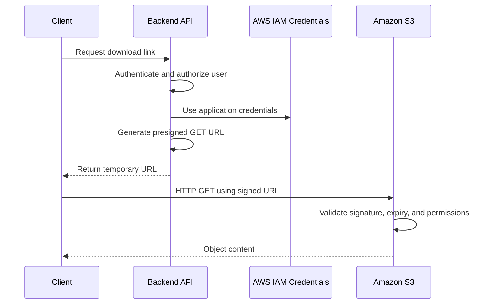
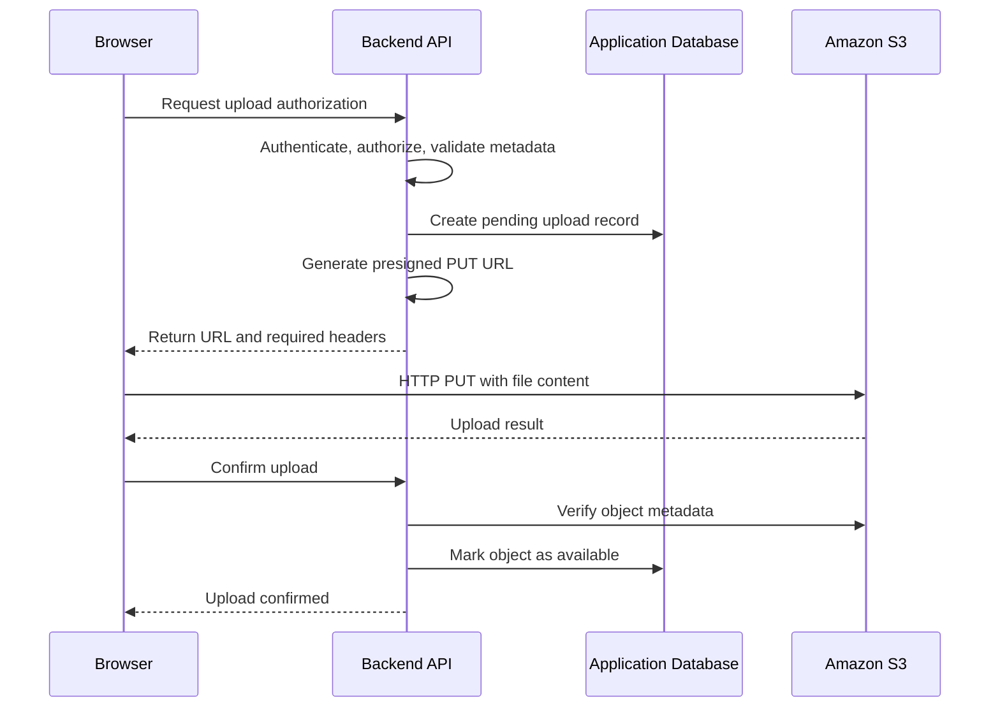

# 05- Generate Presigned URLs with Boto3

## Overview

Amazon S3 presigned URLs provide temporary access to specific S3 operations without requiring the recipient to possess AWS credentials. A backend application uses its AWS identity to generate a signed URL, which a browser, mobile application, or external service can then use to upload or download an object directly from S3.

Presigned URLs are particularly useful for backend applications that handle documents, images, media files, reports, and large user uploads. They reduce the need to proxy file content through Django, Django REST Framework, FastAPI, or Flask, lowering application bandwidth usage and improving scalability.

Boto3 supports generating presigned URLs through `generate_presigned_url()` and browser-oriented presigned POST requests through `generate_presigned_post()`.

Typical use cases include:

- Direct browser-to-S3 uploads.
- Temporary downloads of private documents.
- Secure delivery of generated reports.
- Multipart uploads for large files.
- Temporary access for external integrations.
- Download links for files that should not be publicly accessible.

A presigned URL is a **temporary bearer capability**: anyone who possesses a valid URL may be able to use it for the signed operation until it expires or another authorization constraint prevents access. Protect it like a secret.

## Architecture and Request Flow

### Presigned URL Download



The backend makes the authorization decision and generates the URL. The client then accesses S3 directly, so the backend does not need to download or stream the entire object.

### Presigned URL Upload



A robust upload workflow treats URL generation, successful object transfer, and application-level upload confirmation as separate stages. Generating a URL does not mean that an object exists, and receiving a client-side success response should not be the only verification before a file becomes available to other users.

## How Presigned URLs Work

A presigned URL contains the information required for S3 to validate a signed request. With Signature Version 4, this includes signing-related query parameters, a credential scope, an expiry interval, and a signature.

The signature binds the request to the AWS credentials used for signing and the signed request components, such as the HTTP method, canonical URI, query parameters, and applicable headers.

The URL is generated locally by Boto3. The client does not need the signing credentials because the authorization information is carried in the signed request.

### What a Presigned URL Grants

A presigned URL grants access to a particular signed operation, subject to the permissions of the signing identity and other applicable AWS authorization controls.

It does not grant unrestricted S3 access. For example, a URL signed for `GetObject` cannot simply be changed into a valid `PutObject` request.

The signing identity must have the permissions required for the intended operation. Bucket policies, KMS policies, explicit denies, credential expiration, and other applicable controls can still prevent access.

### Important Properties

| Property | Behavior |
|---|---|
| AWS credentials | The URL is signed using the credentials available to the generating application |
| Operation | The URL is tied to the signed API operation and request parameters |
| Object key | The URL targets the specific object key included in the signed request |
| Expiration | The URL is valid for a configured period, subject to credential lifetime and other restrictions |
| Reuse | A URL can generally be used repeatedly until it expires or becomes invalid |
| Object replacement | Repeated PUT requests to the same key can replace the current object |
| Revocation | There is no universal per-URL revoke operation; access can be restricted through credential, policy, or resource changes |
| Authorization | A valid signature does not override explicit denies or other applicable access restrictions |

## Configure the Boto3 S3 Client

Configure the client with the bucket's Region and Signature Version 4. This makes request-signing behavior explicit and avoids compatibility issues in environments where an older signing default might otherwise be selected.

```python
import boto3
from botocore.config import Config


def create_s3_client(region_name: str):
    session = boto3.Session(
        region_name=region_name,
    )

    return session.client(
        "s3",
        config=Config(
            signature_version="s3v4",
            s3={
                "addressing_style": "virtual",
            },
            connect_timeout=5,
            read_timeout=30,
            retries={
                "mode": "standard",
                "total_max_attempts": 4,
            },
        ),
    )


s3_client = create_s3_client("ap-south-1")
```

Use the default credential provider chain unless the application has a specific reason to override it. Local development may use a configured AWS profile, while applications deployed on Lambda, EC2, ECS, or EKS should generally use their supported IAM role-based credential mechanisms.

Never hardcode access keys or secret keys in the code that generates presigned URLs.

## Generate a Presigned GET URL

A presigned GET URL allows a client to download a particular object without requiring its own AWS credentials.

### Basic Implementation

```python
def generate_download_url(
    s3_client,
    bucket_name: str,
    object_key: str,
    expires_in: int = 300,
) -> str:
    if not 1 <= expires_in <= 604800:
        raise ValueError(
            "Expiration must be between 1 second and 7 days"
        )

    return s3_client.generate_presigned_url(
        ClientMethod="get_object",
        Params={
            "Bucket": bucket_name,
            "Key": object_key,
        },
        ExpiresIn=expires_in,
        HttpMethod="GET",
    )
```

Usage:

```python
url = generate_download_url(
    s3_client=s3_client,
    bucket_name="company-documents-prod",
    object_key="reports/monthly-report.pdf",
    expires_in=300,
)
```

The URL is configured to expire after five minutes, subject to the signing credentials' remaining lifetime and applicable policy restrictions.

The expiration limit of seven days applies to SigV4 presigned URLs generated through supported SDK or CLI mechanisms. Temporary credentials may expire earlier, making the URL unusable before the requested expiration time.

### Download with Python

```python
import requests


response = requests.get(
    url,
    timeout=(5, 120),
)
response.raise_for_status()

with open("/tmp/monthly-report.pdf", "wb") as file_obj:
    file_obj.write(response.content)
```

This example is suitable only for files small enough to buffer in memory. For large objects, use streamed HTTP responses and write bounded chunks to disk.

```python
with requests.get(
    url,
    stream=True,
    timeout=(5, 120),
) as response:
    response.raise_for_status()

    with open("/tmp/monthly-report.pdf", "wb") as file_obj:
        for chunk in response.iter_content(
            chunk_size=1024 * 1024
        ):
            if chunk:
                file_obj.write(chunk)
```

For an application serving downloads, generating the URL is usually cheaper than downloading the content into the backend and forwarding it to the client.

### Set Download Headers

For browser downloads, the backend may request a suitable content disposition through the signed `GetObject` response overrides.

```python
url = s3_client.generate_presigned_url(
    ClientMethod="get_object",
    Params={
        "Bucket": "company-documents-prod",
        "Key": "reports/monthly-report.pdf",
        "ResponseContentDisposition": (
            'attachment; filename="monthly-report.pdf"'
        ),
        "ResponseContentType": "application/pdf",
    },
    ExpiresIn=300,
)
```

These response overrides affect how S3 responds to the download request. They do not change the stored object's metadata.

Use safe filenames when generating response headers. Do not insert arbitrary user input into `Content-Disposition` without appropriate validation and encoding.

## Generate a Presigned PUT URL

A presigned PUT URL allows a client to upload an object directly to S3.

```python
def generate_upload_url(
    s3_client,
    bucket_name: str,
    object_key: str,
    content_type: str,
    expires_in: int = 300,
) -> dict[str, object]:
    if not 1 <= expires_in <= 604800:
        raise ValueError(
            "Expiration must be between 1 second and 7 days"
        )

    url = s3_client.generate_presigned_url(
        ClientMethod="put_object",
        Params={
            "Bucket": bucket_name,
            "Key": object_key,
            "ContentType": content_type,
        },
        ExpiresIn=expires_in,
        HttpMethod="PUT",
    )

    return {
        "url": url,
        "method": "PUT",
        "headers": {
            "Content-Type": content_type,
        },
        "expires_in": expires_in,
    }
```

Example response:

```json
{
  "url": "https://example-bucket.s3.ap-south-1.amazonaws.com/uploads/abc123?...",
  "method": "PUT",
  "headers": {
    "Content-Type": "application/pdf"
  },
  "expires_in": 300
}
```

The URL above is illustrative. A real URL contains signed query parameters and should never be fabricated or manually reconstructed.

### Upload with cURL

```bash
curl -X PUT \
  --upload-file ./report.pdf \
  -H "Content-Type: application/pdf" \
  "PRESIGNED_URL"
```

The HTTP method, object key, and signed headers must match the request used to generate the URL. If `Content-Type` was included in the signed request, send the same value when uploading.

A successful PUT response confirms that S3 accepted the request. The backend should still verify object properties and complete any application-level state transition before marking the upload as available.

### Existing Object Behavior

A presigned PUT URL does not inherently create a new immutable object. If the target key already exists, a successful PUT normally replaces the current object, subject to versioning and applicable write conditions.

For user uploads, generate server-controlled, unique keys rather than allowing arbitrary filenames to become the destination key. If overwrites are prohibited, implement suitable conditional-write controls or create unique immutable object keys and enforce that policy in the application.

## Presigned POST and Upload Policies

Boto3 also supports `generate_presigned_post()`. It returns a URL and form fields for a browser-based multipart/form-data POST upload.

Presigned POST is useful when S3 must enforce supported form conditions such as key constraints, content-length ranges, or specified form fields.

### Generate a Presigned POST

```python
post_data = s3_client.generate_presigned_post(
    Bucket="company-documents-prod",
    Key="uploads/abc123/report.pdf",
    Fields={
        "Content-Type": "application/pdf",
    },
    Conditions=[
        {
            "Content-Type": "application/pdf",
        },
        [
            "content-length-range",
            1,
            10 * 1024 * 1024,
        ],
    ],
    ExpiresIn=300,
)
```

The example restricts the form's declared content type and limits the uploaded content to a maximum of 10 MiB, with a non-zero minimum. These conditions are useful for enforcing upload constraints at S3, but the application should also validate file content and business rules.

The response contains a URL and form fields that must be submitted together.

### PUT versus POST

| Concern | Presigned PUT | Presigned POST |
|---|---|---|
| Request style | HTTP PUT with the object body | Multipart/form-data POST |
| Common use case | API-style direct upload | Browser form uploads with policy conditions |
| Content-type behavior | Can be bound to the signed request | Can be constrained through POST fields and policy conditions |
| Size restrictions | Enforce through application design and supported request conditions or upload mechanisms | Supports a `content-length-range` policy condition |
| Client implementation | Straightforward for `fetch`, `requests`, or cURL | Requires multipart form fields and file data |
| Large-file multipart upload | Can be combined with S3 multipart APIs when required | Not a replacement for S3's multipart upload lifecycle |

Select the mechanism according to the client, required constraints, and upload workflow. Neither method removes the need for authorization, file validation, and safe object-key generation.

## Secure Backend Integration

Presigned URL generation should be handled by a dedicated service layer. API routes should authenticate the user, authorize access to the requested resource, and delegate URL generation to that service.

A practical design includes:

- Authentication before URL generation.
- Tenant and resource ownership checks.
- Server-generated object keys.
- Explicit upload size and content-type constraints.
- Short expiration periods.
- Pending upload state in the database.
- Verification after the client completes the transfer.
- Cleanup or expiration of abandoned uploads.

### Reusable Service Example

```python
from __future__ import annotations

from uuid import uuid4

from botocore.client import BaseClient


class PresignedUrlService:
    def __init__(
        self,
        s3_client: BaseClient,
        bucket_name: str,
    ) -> None:
        self._s3_client = s3_client
        self._bucket_name = bucket_name

    def create_document_upload(
        self,
        tenant_id: str,
        content_type: str,
        expires_in: int = 300,
    ) -> dict[str, str]:
        if not tenant_id:
            raise ValueError("tenant_id is required")

        if content_type not in {
            "application/pdf",
            "image/jpeg",
            "image/png",
        }:
            raise ValueError("Unsupported content type")

        if not 1 <= expires_in <= 900:
            raise ValueError(
                "Upload URL lifetime must be 1–900 seconds"
            )

        object_key = (
            f"tenants/{tenant_id}/uploads/{uuid4().hex}"
        )

        url = self._s3_client.generate_presigned_url(
            ClientMethod="put_object",
            Params={
                "Bucket": self._bucket_name,
                "Key": object_key,
                "ContentType": content_type,
            },
            ExpiresIn=expires_in,
            HttpMethod="PUT",
        )

        return {
            "object_key": object_key,
            "upload_url": url,
            "content_type": content_type,
            "expires_in": str(expires_in),
        }
```

The example generates a unique key and restricts the requested content type. It assumes `tenant_id` was obtained from a trusted, authenticated application context, not accepted as an unvalidated client-controlled namespace.

The service does not persist application state or prove that an upload succeeded. A production workflow should create a pending-upload record before returning the URL and update that record after verifying the object.

The application should also enforce its upload-size limit. For strict size enforcement before storage, consider presigned POST conditions or an upload architecture with explicit size controls rather than relying only on a client-provided file size.

## Django, Django REST Framework, and FastAPI

The URL-generation logic should remain separate from framework code so it can be shared across APIs, background jobs, and other services.

### Suggested API Design

| Endpoint | Responsibility |
|---|---|
| `POST /documents/upload-url` | Authorize the upload and return a presigned upload URL |
| `POST /documents/{id}/complete` | Verify the object and mark the upload complete |
| `GET /documents/{id}/download-url` | Authorize access and return a presigned download URL |
| `GET /documents/{id}` | Return persisted document metadata |
| `DELETE /documents/{id}` | Apply the application's deletion and retention policy |

A typical upload request might contain:

```json
{
  "filename": "report.pdf",
  "content_type": "application/pdf",
  "size": 524288
}
```

The backend should validate the filename for display purposes, validate the declared type against an allowlist, enforce maximum size limits, and generate the actual S3 key itself.

Do not make client-submitted object keys authoritative. Store the generated key and tenant ownership in the database so subsequent download and deletion operations can be authorized against application records.

For Django REST Framework, integrate the service through a view or service module. For FastAPI, use application dependencies or lifespan-managed services. For Flask, initialize the client through the application factory or a dedicated storage module.

In all three cases, do not create a new Boto3 client for every request without a specific reason. Reuse the client within each application process.

## CORS for Browser Uploads

A browser uploading directly to S3 is making a cross-origin request when the frontend and S3 endpoint have different origins.

Configure bucket CORS to allow only the intended frontend origins, HTTP methods, and required request headers.

An illustrative configuration is:

```json
[
  {
    "AllowedOrigins": [
      "https://app.example.com"
    ],
    "AllowedMethods": [
      "PUT",
      "POST",
      "GET",
      "HEAD"
    ],
    "AllowedHeaders": [
      "content-type",
      "x-amz-checksum-sha256"
    ],
    "ExposeHeaders": [
      "ETag",
      "x-amz-checksum-sha256"
    ],
    "MaxAgeSeconds": 300
  }
]
```

Adapt the allowed headers to the headers actually sent by the client. For example, if the signed request includes additional encryption or checksum headers, they may need to be allowed by CORS.

`ExposeHeaders` is important when browser code needs to read response headers such as ETag. Without the appropriate exposure settings, JavaScript may not be able to read those headers even when the S3 request itself succeeds.

CORS is a browser-enforced cross-origin policy. It does not grant S3 permissions, validate the user, or make a private bucket safe by itself.

## Expiration and Revocation

The `ExpiresIn` argument specifies the requested validity period in seconds.

```python
url = s3_client.generate_presigned_url(
    ClientMethod="get_object",
    Params={
        "Bucket": "company-documents-prod",
        "Key": "private/report.pdf",
    },
    ExpiresIn=600,
)
```

This URL requests a ten-minute lifetime. Its effective lifetime can be shorter if the signing credentials expire sooner or an applicable policy prevents access.

### Practical Expiration Rules

- Use short expiration times for confidential documents.
- Select a duration that accommodates realistic client connection and transfer conditions.
- Do not assume that temporary IAM role credentials remain valid for the entire requested URL lifetime.
- Avoid placing long-lived presigned URLs into permanent database records.
- Generate a fresh URL when the user requests access again and remains authorized.

An ordinary presigned URL cannot be independently revoked through a dedicated per-URL API. Access can be interrupted through credential or policy changes, object deletion, or other applicable authorization changes, but these mechanisms may affect more than one URL and can have operational consequences.

For content requiring strong ongoing access enforcement, consider a mediated download service or a delivery architecture with explicit viewer authorization.

## Security Best Practices

### Treat URLs as Secrets

Presigned URLs contain signed query parameters that can authorize access. Avoid:

- Logging full URLs.
- Including URLs in analytics or telemetry events.
- Posting URLs into shared channels.
- Storing them indefinitely as if they were permanent file identifiers.
- Sending them to untrusted recipients.
- Returning URLs before the user has been authorized.

Use redaction for query strings in access logs and exception reporting where necessary.

### Prevent Unauthorized Overwrites

A presigned PUT URL grants the ability to write to its specified key. If the key points to an existing object, the request may overwrite that object.

Use unique, server-generated keys for uploads. Where required, add suitable conditional-write behavior and application state controls, and validate the final object before allowing it to be consumed.

### Validate Uploaded Content

A declared MIME type does not prove that the uploaded file actually has that format. For untrusted files, enforce appropriate validation and scanning before downstream use.

A safe workflow can upload into a quarantine prefix, verify the object's size and expected checksum, scan the content, and then mark it available or move/copy it to the application’s approved storage location.

### Encryption and IAM

Use least-privilege IAM permissions and keep Block Public Access enabled where appropriate. Presigned URLs do not require making the bucket public.

When using SSE-KMS, verify that the signing identity and KMS configuration support the intended operation. Access to an S3 object and permission to use its KMS key are separate authorization concerns.

For strict integrity requirements, use supported S3 checksum features and include the required checksum fields or headers in the signed request. Signature Version 4 supports additional checksum algorithms; the client must send the required matching request data.

## Multipart Upload with Presigned URLs

For large files, the backend can initiate an S3 multipart upload and generate a presigned URL for each part.

This lets a browser upload parts directly to S3 while the backend manages upload identity, authorization, and final completion.

A robust design should:

1. Authenticate and authorize the user.
2. Create the multipart upload through Boto3.
3. Persist the upload ID, generated object key, expected size, and application ownership.
4. Generate presigned URLs for the intended part numbers.
5. Upload the parts directly from the client.
6. Collect each part number and ETag.
7. Verify the submitted part list and upload ownership.
8. Complete the multipart upload on the backend.
9. Verify the completed object and update application state.
10. Abort abandoned multipart uploads through explicit cleanup and lifecycle rules.

Do not expose an unrestricted completion endpoint that accepts arbitrary bucket names, object keys, or upload IDs. Validate them against the persisted upload record.

Detailed implementation guidance belongs in the dedicated multipart-upload documentation.

## Error Handling and Troubleshooting

| Symptom | Likely cause | Diagnostic steps |
|---|---|---|
| `SignatureDoesNotMatch` | Signed method, headers, Region, endpoint, or request parameters do not match the actual request | Verify the client Region, signing version, content type, and unmodified URL |
| `AccessDenied` | Signing identity lacks permissions or another policy denies the operation | Review IAM, bucket policy, KMS access, and explicit denies |
| `ExpiredToken` | Temporary signing credentials expired | Refresh credentials and generate a new URL |
| URL expires earlier than expected | Signing credentials expire before the requested URL lifetime | Inspect the credential provider and remaining session lifetime |
| `Request has expired` | URL expiry elapsed or request signing time is outside accepted bounds | Generate a fresh URL and verify system clock synchronization |
| Browser upload fails with CORS error | Bucket CORS does not permit the origin, method, or required headers | Inspect browser preflight traffic and the S3 CORS configuration |
| Upload overwrites another object | The URL targets an existing object key | Use unique keys and appropriate conditional-write controls |
| PUT succeeds but application shows incomplete status | Application completion callback or database update failed | Check object state and reconcile the pending-upload record |
| Browser cannot read ETag | ETag is not exposed through bucket CORS | Add the required response header to `ExposeHeaders` |

### Diagnostic Procedure

When a presigned request fails:

1. Confirm the intended bucket, object key, and Region.
2. Verify the HTTP method and required headers match the signed request.
3. Ensure the URL has not expired and the signing credentials remain valid.
4. Confirm the system clock is synchronized.
5. Check permissions for the signing identity and relevant resource policies.
6. Check CORS if the request originates from a browser.
7. Determine whether the operation succeeded before retrying an upload or marking it complete.
8. Add regression tests for the failure mode.

Never paste production presigned URLs into public troubleshooting tools or logs.

## Testing Strategy

### Unit Tests

Mock the S3 client to verify that the correct operation, bucket, key, expiry, and signed parameters are passed to Boto3.

```python
from unittest.mock import Mock


def test_generates_presigned_download_url():
    s3_client = Mock()
    s3_client.generate_presigned_url.return_value = (
        "https://example.invalid/signed"
    )

    url = generate_download_url(
        s3_client=s3_client,
        bucket_name="company-documents-test",
        object_key="reports/report.pdf",
        expires_in=300,
    )

    assert url == "https://example.invalid/signed"

    s3_client.generate_presigned_url.assert_called_once_with(
        ClientMethod="get_object",
        Params={
            "Bucket": "company-documents-test",
            "Key": "reports/report.pdf",
        },
        ExpiresIn=300,
        HttpMethod="GET",
    )
```

Unit tests should validate application behavior without making real AWS requests.

### Integration Tests

Use a dedicated test bucket or a compatible local S3 environment to test:

- Successful presigned GET and PUT requests.
- Required signed headers.
- Expiration behavior.
- Access-denied behavior for unauthorized identities.
- Object replacement and versioning implications.
- Browser CORS behavior.
- Content size and checksum validation.
- Upload completion and recovery of pending application records.

Do not claim that a URL's expiration or policy behavior has been verified unless the corresponding test has actually run against an appropriate environment.

## Operational Considerations

Presigned URL workloads affect S3 request activity, object-storage usage, data transfer, and application behavior.

Monitor:

- Upload initiation and completion rates.
- Failed uploads and download failures.
- Pending upload records older than the expected completion window.
- Incomplete multipart uploads.
- Unexpected object replacements or repeated writes.
- S3 request errors and relevant access-denied events.
- Storage growth, transfer volume, and associated costs.

Presigned URLs reduce backend data transfer, but they do not eliminate S3 request costs or the need for object lifecycle management. For frequently accessed content, CloudFront may provide better delivery performance and caching, depending on whether the objects are public or protected through an appropriate viewer-authorization design.

## Official References

- [Boto3: Presigned URLs](https://docs.aws.amazon.com/boto3/latest/guide/s3-presigned-urls.html)
- [Boto3 `generate_presigned_url`](https://docs.aws.amazon.com/boto3/latest/reference/services/s3/client/generate_presigned_url.html)
- [Boto3 `generate_presigned_post`](https://docs.aws.amazon.com/boto3/latest/reference/services/s3/client/generate_presigned_post.html)
- [Amazon S3: Download and upload objects with presigned URLs](https://docs.aws.amazon.com/AmazonS3/latest/userguide/using-presigned-url.html)
- [Amazon S3: Uploading objects with presigned URLs](https://docs.aws.amazon.com/AmazonS3/latest/userguide/PresignedUrlUploadObject.html)
- [Amazon S3: Sharing objects with presigned URLs](https://docs.aws.amazon.com/AmazonS3/latest/userguide/ShareObjectPreSignedURL.html)
- [Amazon S3 CORS configuration](https://docs.aws.amazon.com/AmazonS3/latest/userguide/ManageCorsUsing.html)
- [Amazon S3 object integrity](https://docs.aws.amazon.com/AmazonS3/latest/userguide/checking-object-integrity.html)

## Key Takeaways

- Generate presigned URLs with Boto3 using SigV4 and the bucket's correct Region; select the HTTP method and expiration deliberately.
- Treat every presigned URL as a temporary bearer capability and authorize users before generating upload or download links.
- Use server-generated object keys, enforce file constraints, and verify uploaded objects before making them available to other users.
- Keep browser CORS settings separate from IAM authorization, and ensure signed request headers match the actual client request.
- For large files, use a managed upload workflow or presigned multipart architecture with durable state, retry handling, and incomplete-upload cleanup.