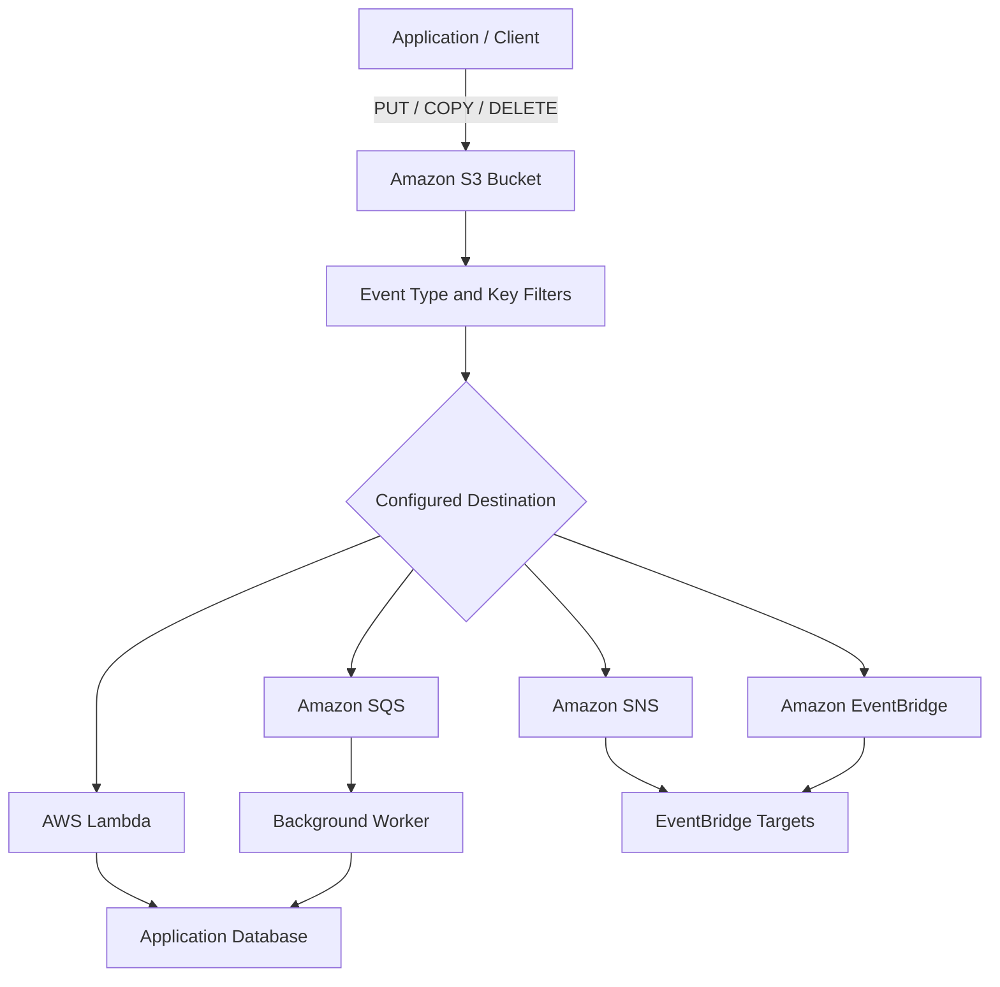
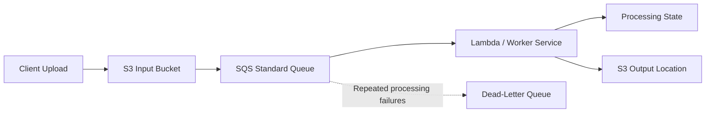
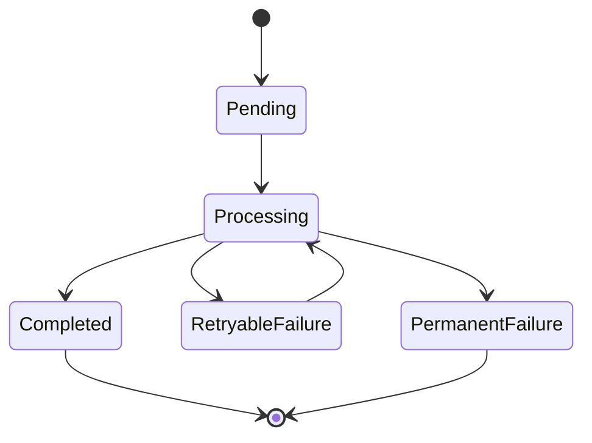

# 01- S3 Event Notifications

## Overview

Amazon S3 Event Notifications allow applications to react to object-level events, such as object creation, deletion, restoration, and replication activity. Instead of repeatedly polling a bucket to discover changes, an application can receive an event when a configured operation occurs.

This integration is useful for document-processing pipelines, image transformations, data ingestion, malware scanning, asynchronous workflows, audit-related automation, and event-driven microservices.

S3 can publish notifications to four destination types:

- **AWS Lambda:** Execute application logic in response to an event.
- **Amazon SQS:** Buffer events and decouple producers from consumers.
- **Amazon SNS:** Fan out notifications to multiple subscribers.
- **Amazon EventBridge:** Route events using rules, filters, and multiple targets.

S3 Event Notifications provide an event-driven mechanism, not a complete workflow-processing guarantee. Notifications are delivered at least once, can arrive out of order, and can occasionally be duplicated. Production consumers must therefore support idempotency, retries, failure recovery, and event validation.

## Event Notification Architecture

### Basic Event Flow



The bucket is the source of the event. S3 evaluates its notification configuration and sends matching events to the configured destination.

The destination then determines how the event is processed. A Lambda function may execute application code immediately, an SQS queue may buffer messages for workers, and EventBridge may apply additional routing rules.

A single S3 notification configuration entry specifies one destination. Multiple matching notification entries can route events to multiple destinations, while EventBridge can fan out matching events to multiple targets through rules.

## Supported Event Types

S3 event notifications support several event categories. Select only the events required by the application to avoid unnecessary processing and cost.

### Object Creation Events

Object creation events are among the most frequently used notifications.

| Event Type | Purpose |
|---|---|
| `s3:ObjectCreated:Put` | Object created through a PUT operation |
| `s3:ObjectCreated:Post` | Object created through a POST operation |
| `s3:ObjectCreated:Copy` | Object created through a copy operation |
| `s3:ObjectCreated:CompleteMultipartUpload` | Multipart upload completed and the object created |
| `s3:ObjectCreated:*` | Any supported object-creation operation |

Use `s3:ObjectCreated:*` when the consumer needs to process all supported object-creation methods. Select individual event types when the application needs a more specific trigger.

Multipart uploads require particular attention: uploading individual parts does not mean the final object has been created. Processing should normally begin on the completion event, not on each part upload.

### Object Removal Events

| Event Type | Purpose |
|---|---|
| `s3:ObjectRemoved:Delete` | Object deletion event |
| `s3:ObjectRemoved:DeleteMarkerCreated` | Delete marker created in a versioned bucket |
| `s3:ObjectRemoved:*` | Supported object-removal events |

Deletion notifications should be interpreted in the context of bucket versioning and application requirements.

In a versioned bucket, deleting an object without specifying a version ID can create a delete marker rather than permanently removing earlier versions. An application should not assume that every deletion event means the underlying data has been permanently erased.

### Other Event Categories

S3 also supports additional event types for certain storage and management operations, including object restoration from archival storage, replication activity, lifecycle transitions, Intelligent-Tiering activity, tagging, and Object Lock-related changes.

Available event types depend on the specific operation and destination. Confirm the supported types in the current S3 documentation before implementing a production dependency.

## Notification Destinations

### Destination Comparison

| Destination | Best Use Case | Delivery and Processing Model | Important Consideration |
|---|---|---|---|
| Lambda | Lightweight event-driven processing | S3 invokes a function when matching events occur | Processing failures, execution limits, and recursive invocation must be addressed |
| SQS Standard | Durable buffering and asynchronous workers | Consumers poll messages from a queue | Duplicate delivery is possible; consumers must be idempotent |
| SNS Standard | Fan-out notifications | SNS publishes messages to subscribers | Subscriber delivery and retry behavior depend on the subscription type |
| EventBridge | Advanced routing and multiple targets | Rules route events to configured targets | Additional configuration and service costs may apply |

### Region and Destination Constraints

For direct S3 event notifications, Lambda functions, SNS topics, and SQS queues must be in the same AWS Region as the source bucket.

S3 cannot directly publish event notifications to SQS FIFO queues or SNS FIFO topics. If FIFO processing is required, EventBridge can route matching events to an SQS FIFO queue where the downstream design supports the required ordering and grouping.

Enabling EventBridge delivery for a bucket sends supported S3 events to EventBridge, after which rules determine which events reach specific targets. This approach is useful when multiple consumers need different filters or when the destination architecture requires more advanced routing.

## Event Delivery Semantics

S3 Event Notifications are designed for **at-least-once delivery**. An event can be delivered more than once, and delivery order is not guaranteed.

Events usually arrive within seconds, but delivery can sometimes take a minute or longer.

### Duplicate Events

A notification may be delivered more than once for the same object event. If processing an event triggers a database write, sends a message, or charges a customer, duplicates can cause incorrect results unless the operation is idempotent.

For example, an image-processing worker should not create a new database record every time the same notification is received.

Recommended controls include:

- Use a durable application-level processing record.
- Assign a stable idempotency key to each logical event.
- Check processing state before applying irreversible side effects.
- Use database uniqueness constraints where appropriate.
- Make retries safe after partial failure.

The object key alone is not a sufficient idempotency key because the same key can be created or modified multiple times.

### Out-of-Order Events

S3 notifications can arrive in an order different from the order in which the underlying object operations occurred.

Consider the following sequence:

1. An application uploads version A of `documents/report.pdf`.
2. The application replaces it with version B.
3. The notification for version B arrives first.
4. The delayed notification for version A arrives afterward.

A consumer that blindly processes the current object key for each event may process version B twice or associate the wrong metadata with the event.

For workloads that require precise object-version processing, retrieve the object version identified in the event when available and appropriate. Alternatively, maintain per-object sequence tracking or design processing around immutable object keys.

### Sequencer

For supported object-created and object-removed events, S3 provides a `sequencer` value that can help compare the ordering of events for the same object key.

Sequencer values must not be compared across different object keys. They may have different string lengths, so normalize their lengths before a lexicographical hexadecimal comparison.

```python
def is_newer_sequencer(
    incoming: str,
    current: str,
) -> bool:
    width = max(len(incoming), len(current))

    return (
        incoming.upper().zfill(width)
        > current.upper().zfill(width)
    )
```

This helper compares hexadecimal sequencer strings for the same object key. A production implementation should perform the comparison atomically with updating stored state, so concurrent workers cannot overwrite a newer state with an older event.

The sequencer is not a global event sequence number and should not be used as a cross-object ordering mechanism.

## S3 Event Message Structure

S3 sends event notifications as JSON messages. The exact envelope depends on the destination.

For direct S3-to-Lambda delivery, the event typically contains a `Records` array. Each record includes details about the source bucket, object key, event name, event time, and related request information.

An illustrative record looks like this:

```json
{
  "eventVersion": "2.1",
  "eventSource": "aws:s3",
  "awsRegion": "ap-south-1",
  "eventTime": "2026-10-13T10:00:00.000Z",
  "eventName": "ObjectCreated:Put",
  "s3": {
    "bucket": {
      "name": "company-documents-prod"
    },
    "object": {
      "key": "uploads/report+2026.pdf",
      "size": 524288,
      "eTag": "example-etag",
      "sequencer": "0066A1B2C3D4E5F6"
    }
  }
}
```

This example is illustrative and omits fields that may appear in actual event records.

### URL-Encoded Object Keys

The object key in an S3 event notification is URL encoded using form-style encoding. Spaces may be represented as `+`, while other characters can appear as percent-encoded sequences.

Decode the key before using it in an S3 API operation.

```python
from urllib.parse import unquote_plus


def decode_s3_object_key(encoded_key: str) -> str:
    return unquote_plus(encoded_key)
```

For example:

```python
encoded_key = "uploads/report+2026.pdf"
decoded_key = decode_s3_object_key(encoded_key)

assert decoded_key == "uploads/report 2026.pdf"
```

Failure to decode the key correctly can cause `NoSuchKey` errors or incorrect object processing.

### Schema Compatibility

S3 event schemas can evolve. Consumers should validate the supported major event version and the presence of required fields while tolerating additional fields introduced in compatible schema revisions.

Do not assume every notification has exactly the same structure. A configuration test event, an ordinary S3 object event, an SQS-wrapped message, and an EventBridge event require different parsing paths.

The direct S3 test notification, `s3:TestEvent`, does not use the normal `Records` array structure. Consumers that accept raw S3 notification messages should handle it explicitly.

## Configure S3 Event Notifications with Boto3

Boto3 manages bucket notifications through `put_bucket_notification_configuration()`.

The notification configuration specifies the destination, supported events, and optional prefix or suffix filters.

### Example: Send Object-Creation Events to SQS

```python
import boto3


s3_client = boto3.client(
    "s3",
    region_name="ap-south-1",
)

bucket_name = "company-documents-prod"
queue_arn = (
    "arn:aws:sqs:ap-south-1:123456789012:"
    "document-processing-queue"
)

configuration = {
    "QueueConfigurations": [
        {
            "Id": "document-upload-events",
            "QueueArn": queue_arn,
            "Events": [
                "s3:ObjectCreated:*",
            ],
            "Filter": {
                "Key": {
                    "FilterRules": [
                        {
                            "Name": "prefix",
                            "Value": "uploads/",
                        },
                        {
                            "Name": "suffix",
                            "Value": ".pdf",
                        },
                    ],
                },
            },
        },
    ],
}

s3_client.put_bucket_notification_configuration(
    Bucket=bucket_name,
    NotificationConfiguration=configuration,
)
```

This configuration requests notifications when matching PDF objects are created under the `uploads/` prefix.

The example assumes that the destination queue exists, is in the same Region, and has an appropriate queue policy permitting S3 to send messages.

**Important:** `put_bucket_notification_configuration()` replaces the bucket's existing notification configuration. It is not an append-only operation. If the bucket already has Lambda, SNS, SQS, or EventBridge configurations, retrieve and merge the existing configuration before applying a change. Coordinate configuration changes through a single deployment owner to prevent concurrent updates from overwriting one another.

### Inspect the Existing Configuration

```python
response = s3_client.get_bucket_notification_configuration(
    Bucket="company-documents-prod",
)

print(response)
```

Review existing Lambda, queue, topic, and EventBridge configuration entries before changing them.

When maintaining the configuration programmatically, preserve every existing entry that should remain active. The response may contain server-generated fields such as response metadata that must not be copied into the configuration submitted for an update.

### Prefix and Suffix Filters

Prefix and suffix filters allow S3 to publish only matching notifications.

For example:

| Filter | Purpose |
|---|---|
| Prefix `uploads/` | Match objects whose keys start with `uploads/` |
| Suffix `.pdf` | Match objects whose keys end in `.pdf` |
| Prefix `incoming/` and suffix `.csv` | Match CSV objects created beneath the selected prefix |

S3 notification filters do not support the wildcard character `*` as a general pattern-matching operator. Overlapping prefix and suffix filter configurations are restricted and can make a notification configuration invalid. Design filters carefully and validate them before deploying.

Filter values containing spaces or special characters must follow S3's documented filter-encoding rules.

## Configure Permissions for Event Destinations

S3 must be permitted to publish notifications to the selected destination.

### Lambda Permission

The Lambda function's resource-based policy must allow the S3 service principal to invoke it, restricted to the expected bucket and account.

Example:

```bash
aws lambda add-permission \
  --function-name process-s3-document \
  --statement-id AllowS3Invoke \
  --action lambda:InvokeFunction \
  --principal s3.amazonaws.com \
  --source-arn arn:aws:s3:::company-documents-prod \
  --source-account 123456789012
```

Use a unique statement ID and the actual function, bucket, and account identifiers. Avoid creating duplicate policy statements with the same statement ID.

### SQS Permission

For SQS, the queue policy must permit the S3 service principal to send messages, ideally restricted by the source bucket ARN and account.

An illustrative policy statement is:

```json
{
  "Sid": "AllowS3EventNotifications",
  "Effect": "Allow",
  "Principal": {
    "Service": "s3.amazonaws.com"
  },
  "Action": "sqs:SendMessage",
  "Resource": "arn:aws:sqs:ap-south-1:123456789012:document-processing-queue",
  "Condition": {
    "ArnEquals": {
      "aws:SourceArn": "arn:aws:s3:::company-documents-prod"
    },
    "StringEquals": {
      "aws:SourceAccount": "123456789012"
    }
  }
}
```

Configure the queue policy for the actual S3 bucket and account. If the queue uses server-side encryption with a customer-managed KMS key, confirm that the required KMS permissions and key policy also allow the workflow.

### SNS Permission

For an SNS destination, the topic policy must permit S3 to publish messages. Use the same principle of restricting access to the intended bucket and account.

### Permission Responsibilities

| Component | Required Permission or Control |
|---|---|
| S3 to Lambda | Lambda resource-based permission for `lambda:InvokeFunction` |
| S3 to SQS | SQS queue policy allowing `sqs:SendMessage` |
| S3 to SNS | SNS topic policy allowing `sns:Publish` |
| Lambda processing an object | Lambda execution role with appropriate S3 permissions |
| Worker processing an SQS event | Worker role with appropriate SQS receive/delete permissions and S3 object access |
| Encrypted object access | Applicable KMS key policy and permissions |

S3's permission to publish an event and a consumer's permission to access the source object are different authorization requirements.

## Lambda Processing Pattern

A common design triggers a Lambda function when an object is created in S3. The function reads the object, performs processing, and stores the result in S3 or another system.

### Example: Event-Driven Object Inspection

```python
from urllib.parse import unquote_plus

import boto3


s3_client = boto3.client("s3")


def lambda_handler(event, context):
    if event.get("Event") == "s3:TestEvent":
        return {"status": "test-event"}

    results = []

    for record in event.get("Records", []):
        if record.get("eventSource") != "aws:s3":
            continue

        event_name = record.get("eventName", "")

        if not event_name.startswith("ObjectCreated:"):
            continue

        bucket_name = record["s3"]["bucket"]["name"]
        object_key = unquote_plus(
            record["s3"]["object"]["key"]
        )

        response = s3_client.head_object(
            Bucket=bucket_name,
            Key=object_key,
        )

        results.append(
            {
                "bucket": bucket_name,
                "key": object_key,
                "size": response["ContentLength"],
                "content_type": response.get("ContentType"),
                "event_name": event_name,
            }
        )

    return {
        "processed_records": len(results),
        "results": results,
    }
```

This example inspects newly created objects. It is not an idempotent processing pipeline and does not demonstrate a complete retry or failure-recovery implementation.

For production file processing, add application state tracking, idempotency, schema validation, and failure handling. If the event record refers to a particular object version, use its version ID when the workflow must process the exact version represented by the event.

### Avoid Recursive Invocation

A Lambda function can accidentally trigger itself if it writes results into the same bucket and prefix that triggers its execution.

For example:

1. A new image is uploaded to `uploads/`.
2. S3 invokes the image-processing Lambda.
3. The function writes a thumbnail to `uploads/`.
4. The new object triggers the same Lambda again.

Use separate input and output buckets, or configure filters so the function responds only to the intended input prefix or suffix.

A typical design uses:

```text
uploads/
processed/
```

Configure the notification to match only `uploads/` and ensure the function writes results under `processed/`.

## Event-Driven Processing with SQS

SQS is often preferable when processing must be buffered, controlled, or isolated from temporary consumer failures.

A queue allows producers to publish work independently of worker availability. Workers can poll messages at a controlled rate, apply bounded concurrency, and retry failed processing.

### Recommended Architecture



### Operational Considerations

- Configure visibility timeouts so a message is not made available again before the worker's processing window is expected to finish.
- Make consumers idempotent because SQS Standard queues can deliver duplicate messages.
- Use a dead-letter queue where justified to isolate messages that repeatedly fail processing.
- Monitor queue depth and the age of the oldest message.
- Ensure the worker has only the required S3 and database permissions.
- Design retries around the failure category and avoid endlessly retrying malformed events.

S3 event notifications delivered to an SQS queue provide buffering between event production and processing. The message is not a guarantee that the consumer can access the source object; object permissions, version state, lifecycle operations, and application authorization must still be considered.

## EventBridge Integration

EventBridge provides routing and filtering capabilities beyond direct S3 notification configurations. It is useful when multiple downstream systems consume different subsets of S3 events.

For example, object creation events can be routed to separate targets for document processing, auditing, and notifications without embedding all routing logic in one Lambda function.

EventBridge also provides a path to an SQS FIFO target where FIFO semantics are required by the downstream design. However, FIFO delivery does not automatically make the complete S3-to-processing workflow exactly once or globally ordered.

### When to Use EventBridge

Use EventBridge when you need:

- Advanced event-pattern filtering.
- Routing to multiple AWS services or HTTP endpoints.
- A centralized event-routing layer.
- Integration with SQS FIFO through an EventBridge rule.
- Separation between the event producer and downstream routing decisions.

Direct S3 notification filters are sufficient for straightforward bucket, event type, prefix, and suffix filtering. EventBridge adds capabilities, but also introduces additional configuration, monitoring, and potentially additional cost.

## Reliability and Idempotency

S3 event-driven processing is asynchronous. A robust consumer must account for duplicate messages, delays, out-of-order delivery, concurrent processing, and partial failure.

### Use Durable Processing State

For a document-processing pipeline, store an application record that tracks the object and its processing lifecycle.

An example state model is:



Persist state transitions atomically where possible. A worker should claim or conditionally update the processing record before performing irreversible side effects.

### Idempotency Key Design

A practical idempotency strategy can incorporate the source bucket, key, version ID, and event identity where available. Use the fields appropriate to the event type and workflow.

| Workload | Useful Idempotency Strategy |
|---|---|
| Image transformation | Source object version or stable processing identifier |
| Document extraction | Object version plus processing operation |
| Data ingestion | Source object identifier plus ingestion batch or version |
| Database synchronization | Per-object sequencer or version-aware conditional update |
| External API side effects | Persisted operation ID and downstream idempotency support |

An object key alone is insufficient if an object can be overwritten multiple times.

For source objects where versioning is enabled, process the intended version rather than blindly reading the latest value of a mutable key.

### Event Parsing Best Practices

- Validate the event source and required fields.
- Decode S3 object keys with `unquote_plus()`.
- Handle test events separately.
- Ignore unrecognized fields so compatible schema extensions do not break the consumer.
- Use the correct parser for direct S3 notifications, SQS message envelopes, SNS envelopes, and EventBridge events.
- Treat missing or malformed records as explicit failures rather than silently accepting incomplete input.
- Ensure logs include enough context to correlate failures without exposing sensitive data.

## Monitoring and Observability

Monitoring should cover both event delivery and downstream processing.

| Signal | Purpose |
|---|---|
| Lambda invocation count and errors | Detect processing failures |
| Lambda duration and throttles | Identify execution bottlenecks |
| SQS queue depth | Measure accumulated processing work |
| Age of oldest SQS message | Identify growing processing delays |
| DLQ message count | Detect repeated or permanent failures |
| EventBridge failed invocations | Identify target delivery problems where applicable |
| Application processing latency | Measure time from upload to completion |
| Pending processing records | Detect missed, failed, or stuck workflows |
| S3 and KMS access-denied errors | Identify permission problems |

Useful application metrics include total objects received, completed processing operations, retry counts, duplicate detections, and terminal failures.

For important workflows, use correlation identifiers such as the bucket, decoded object key, object version ID where available, and a stable application processing ID. Avoid logging full presigned URLs or sensitive content.

## Cost Considerations

S3 event-driven architectures can incur costs from several components:

- S3 requests and stored objects.
- Lambda invocations and execution duration.
- SQS requests and retained messages.
- SNS publications and delivery.
- EventBridge event ingestion and routing.
- CloudWatch logging and monitoring.
- Downstream processing, databases, and data transfer.

A queue-based architecture can reduce the impact of bursty ingestion on downstream workers, but excessive retries and unbounded queue retention can create additional cost.

Filter irrelevant events at the source where possible. Monitor repeated failures, processing duration, queue growth, and abandoned messages so the system does not continually process invalid or unprocessable objects.

## Common Mistakes and Troubleshooting

| Symptom | Likely Cause | Diagnostic Approach |
|---|---|---|
| No notification arrives | Incorrect event configuration or destination permission | Inspect the bucket notification configuration and destination policy |
| Lambda cannot be invoked | Missing Lambda resource-based permission | Verify the Lambda policy permits S3 invocation from the source bucket |
| SQS receives no messages | Incorrect queue ARN, Region, or queue policy | Validate the source bucket Region and `sqs:SendMessage` policy |
| Events are processed multiple times | At-least-once delivery | Check idempotency records and duplicate detection |
| Older event overwrites newer state | Out-of-order delivery | Implement version-aware or sequencer-aware state updates |
| Lambda runs repeatedly | Recursive output writes match the trigger | Separate input/output prefixes or buckets |
| `NoSuchKey` while processing | Incorrect key decoding or source object overwritten/deleted | Decode the event key and inspect object versioning and lifecycle behavior |
| Configuration update removes another consumer | `put_bucket_notification_configuration()` replaced the complete configuration | Retrieve, merge, and reapply the complete intended configuration |
| Browser or worker cannot process event | Incorrect envelope parser | Identify the delivery destination and parse the appropriate message schema |
| Queue backlog increases | Consumer throughput is insufficient or processing repeatedly fails | Inspect worker concurrency, error rates, message age, and DLQ activity |

### Recommended Diagnostic Sequence

1. Confirm the bucket's notification configuration and the intended event types.
2. Verify that the destination exists in the required Region.
3. Inspect the destination's resource policy or invocation permission.
4. Upload a controlled test object that matches the event filters.
5. Confirm delivery through destination metrics and logs.
6. Inspect the actual event message structure and decode the object key correctly.
7. Check application state, retries, and duplicate handling.
8. Verify object access and KMS permissions from the consumer's identity.
9. Test failure recovery and repeated delivery in a non-production environment.
10. Document the root cause and add a regression test.

S3's test notification can help verify that a destination is configured, but it does not prove that every object event is filtered and processed correctly. End-to-end testing must exercise the intended event type and consumer behavior.

## Production Readiness Checklist

### Configuration and Permissions

- [ ] Only required event types and prefixes or suffixes are configured.
- [ ] Destination services are in the required Region.
- [ ] S3 can publish to the destination through the appropriate resource policy or invocation permission.
- [ ] The consumer has only the S3, KMS, and downstream permissions it needs.
- [ ] Configuration changes preserve other required bucket notification entries.
- [ ] Recursive invocation is prevented.

### Processing and Reliability

- [ ] Duplicate events can be processed safely.
- [ ] Out-of-order events cannot overwrite newer application state.
- [ ] Object keys are decoded correctly.
- [ ] Object version IDs are used where exact-version processing is required.
- [ ] Retries and permanent failures are handled explicitly.
- [ ] Queue visibility timeouts and redrive policies are configured where SQS is used.
- [ ] Incomplete or stuck processing records can be detected and recovered.

### Operations and Testing

- [ ] Logs and metrics support tracing an event from delivery to completion.
- [ ] Queue backlog, Lambda errors, processing latency, and terminal failures are monitored.
- [ ] Test events and ordinary object events are handled correctly.
- [ ] Integration tests verify permissions, event parsing, retries, and idempotency.
- [ ] Cost and retention implications of queues, logs, and retries are understood.
- [ ] Runbooks document notification changes, failed processing, replay, and recovery.

## Official References

- [Amazon S3 Event Notifications](https://docs.aws.amazon.com/AmazonS3/latest/userguide/EventNotifications.html)
- [Event notification types and destinations](https://docs.aws.amazon.com/AmazonS3/latest/userguide/notification-how-to-event-types-and-destinations.html)
- [S3 event message structure](https://docs.aws.amazon.com/AmazonS3/latest/userguide/notification-content-structure.html)
- [Configuring event notifications using object key filters](https://docs.aws.amazon.com/AmazonS3/latest/userguide/notification-how-to-filtering.html)
- [Granting permissions to event notification destinations](https://docs.aws.amazon.com/AmazonS3/latest/userguide/grant-destinations-permissions-to-s3.html)
- [Using S3 Event Notifications with Lambda](https://docs.aws.amazon.com/lambda/latest/dg/with-s3.html)
- [Enabling Amazon EventBridge for S3](https://docs.aws.amazon.com/AmazonS3/latest/userguide/enable-event-notifications-eventbridge.html)
- [Boto3 S3 client reference](https://docs.aws.amazon.com/boto3/latest/reference/services/s3.html)

## Key Takeaways

- S3 Event Notifications connect object operations to Lambda, SQS, SNS, or EventBridge without requiring applications to poll the bucket continuously.
- Notifications are delivered at least once and may arrive out of order, so consumers must implement idempotency and appropriate version-aware processing.
- Decode URL-encoded object keys, validate message schemas, and configure destination permissions explicitly.
- Use SQS for buffering and controlled asynchronous processing, and EventBridge when advanced routing or multiple targets are required.
- Production readiness requires recursive-trigger prevention, failure recovery, monitoring, security controls, and repeatable end-to-end tests.