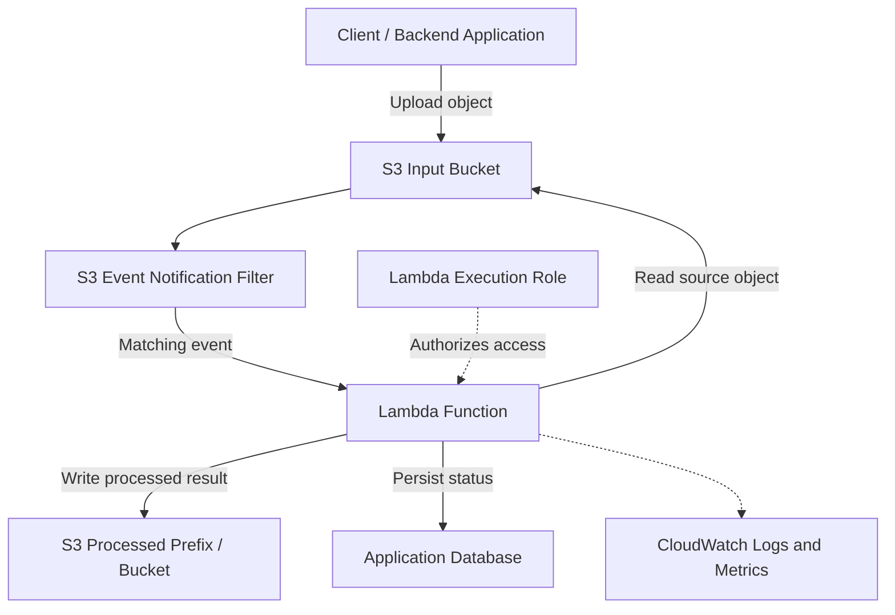

# 02- AWS Lambda Integration

## Overview

AWS Lambda integrates with Amazon S3 to execute code in response to object-related events without requiring a continuously running application server. When an S3 bucket receives a matching event, such as an object upload, S3 can invoke a Lambda function to process the event.

This integration is useful for document validation, image resizing, file-format conversion, metadata extraction, data ingestion, malware scanning, and event-driven backend workflows.

A typical implementation follows this flow:

1. A client or application uploads an object to S3.
2. S3 evaluates its event notification configuration.
3. S3 asynchronously invokes the configured Lambda function.
4. Lambda receives an event payload containing the source bucket, object key, event type, and related metadata.
5. The function retrieves or processes the object using its execution role.
6. The function writes results to another location or updates an application system.
7. Monitoring and failure-handling mechanisms track the result.

For simple workloads, S3 can invoke Lambda directly. For workflows that require stronger buffering, controlled consumption, or more explicit failure recovery, an S3-to-SQS-to-Lambda architecture can be more appropriate.

## Integration Architecture

### Direct S3-to-Lambda Processing



### Component Responsibilities

| Component | Responsibility |
|---|---|
| Amazon S3 | Stores objects and emits notifications for configured events. |
| Event notification configuration | Selects event types and optional object-key prefix/suffix filters. |
| AWS Lambda | Executes processing logic in response to delivered events. |
| Lambda resource-based policy | Allows S3 to invoke the function. |
| Lambda execution role | Grants the function permission to access S3, logs, and other required resources. |
| Output bucket or prefix | Stores transformed objects, reports, or other derived artifacts. |
| Application database | Tracks ownership, processing status, and business metadata when required. |
| Amazon CloudWatch | Stores Lambda logs and exposes operational metrics. |

S3 invocation permission and Lambda's permission to access objects are separate controls. A function can be invoked successfully but still fail when attempting to read an object or write its output.

## Direct Invocation versus SQS-Buffered Processing

| Concern | S3 → Lambda | S3 → SQS → Lambda |
|---|---|---|
| Architecture | Direct event notification | Notification is buffered in SQS before consumption |
| Operational complexity | Lower | Higher |
| Buffering during processing delays | No application-controlled SQS buffer | SQS retains messages according to queue configuration |
| Consumer concurrency | Managed through Lambda invocation and concurrency settings | Controlled through the event source mapping and concurrency settings |
| Retry mechanism | Lambda asynchronous invocation behavior applies after acceptance | SQS visibility timeout, redelivery, and Lambda event source mapping behavior apply |
| Failure recovery | Lambda asynchronous destinations or a dead-letter queue, as configured | SQS redrive policy and dead-letter queue |
| Suitable workloads | Lightweight, straightforward processing | Bursty workloads, controlled processing, and workflows requiring queue-based recovery |

Direct S3-to-Lambda invocation is appropriate when processing is relatively simple and the application's failure-handling requirements are manageable.

Prefer a queue-based architecture when the system must absorb bursts, decouple upload rates from processing capacity, support controlled redrive, or retain work while consumers are temporarily unavailable.

Neither architecture automatically provides exactly-once business processing. Duplicate events and repeated processing attempts must be handled explicitly.

## Supported S3 Events

Lambda can be configured to receive notifications for specific categories of S3 operations.

| Event Type | Typical Use Case |
|---|---|
| `s3:ObjectCreated:Put` | Process an object uploaded through a PUT operation |
| `s3:ObjectCreated:Post` | Process an object created through a POST operation |
| `s3:ObjectCreated:Copy` | Process an object created through a copy operation |
| `s3:ObjectCreated:CompleteMultipartUpload` | Process a large object after multipart upload completes |
| `s3:ObjectCreated:*` | Process supported object-creation operations |
| `s3:ObjectRemoved:Delete` | React to object removal |
| `s3:ObjectRemoved:DeleteMarkerCreated` | React to creation of a delete marker in a versioned bucket |

For ordinary file processing, object-created events are generally the most useful trigger.

A multipart upload creates the final object when its completion operation succeeds. Do not trigger processing for individual multipart parts; use an appropriate object-created event, commonly `s3:ObjectCreated:*` or `s3:ObjectCreated:CompleteMultipartUpload`.

The supported event types depend on the operation. Consult the current [S3 event notification types and destinations](https://docs.aws.amazon.com/AmazonS3/latest/userguide/notification-how-to-event-types-and-destinations.html) documentation when configuring a production trigger.

## Event Delivery and Execution Semantics

### Asynchronous Invocation

S3 invokes Lambda asynchronously. The function receives an event payload rather than a direct response being returned to the S3 upload operation.

Consequently, the client uploading the object does not wait for the Lambda processing result. A successful upload does not prove that the downstream workflow has completed.

An application that needs a reliable user-facing processing status should maintain explicit state, such as `PENDING`, `PROCESSING`, `COMPLETED`, or `FAILED`.

### Duplicate Events

S3 event notifications are delivered at least once, and duplicate events can occur. Lambda's asynchronous invocation mechanism can also retry failed executions.

A consumer should therefore assume that the same logical object event may be processed more than once.

Common safeguards include:

- Stable, application-level idempotency keys.
- Database uniqueness constraints.
- Conditional state updates.
- Deterministic output object keys.
- Version-aware processing.
- Safe retries for external API calls and database writes.

An object key alone is not a sufficient idempotency key when an object can be overwritten multiple times.

### Out-of-Order Events

Events can arrive in an order different from the order in which the corresponding object operations occurred.

For example, an older upload event can arrive after a newer upload event for the same object key. If the consumer retrieves the current object instead of the version associated with the event, it may process newer content while recording the older event's metadata.

For workflows that require exact-version processing:

1. Enable S3 bucket versioning when appropriate.
2. Read the event's `versionId` when available.
3. Use that version ID in `GetObject`.
4. Record the source version alongside the processing result.
5. Use conditional state changes to prevent stale events from replacing newer business state.

The S3 event `sequencer` can help compare events for the same object key, but it is not a global ordering mechanism and must not be compared across different keys.

## Configure the Integration with Boto3

Boto3 can create the S3 notification configuration and grant the S3 service permission to invoke Lambda.

The Lambda function must exist before its ARN can be referenced. The function must be in the same AWS Region as the source bucket for a direct S3 event notification.

### Create the Lambda Invocation Permission

The Lambda function requires a resource-based policy allowing the S3 service principal to invoke it.

```python
import boto3


region_name = "ap-south-1"
account_id = "123456789012"
bucket_name = "company-documents-prod"
function_name = "process-s3-document"

lambda_client = boto3.client(
    "lambda",
    region_name=region_name,
)

s3_client = boto3.client(
    "s3",
    region_name=region_name,
)

function = lambda_client.get_function(
    FunctionName=function_name,
)

function_arn = function["Configuration"]["FunctionArn"]

lambda_client.add_permission(
    FunctionName=function_name,
    StatementId="AllowS3DocumentBucketInvoke",
    Action="lambda:InvokeFunction",
    Principal="s3.amazonaws.com",
    SourceArn=f"arn:aws:s3:::{bucket_name}",
    SourceAccount=account_id,
)
```

Replace the example account ID, bucket name, and function name with actual resource identifiers.

Use a unique statement ID. If the permission already exists, inspect the existing policy rather than blindly adding another statement. The function's resource policy should restrict invocation to the intended bucket and account.

### Configure the S3 Notification

The following configuration triggers Lambda for newly created JSON files under `incoming/`.

```python
notification_configuration = {
    "LambdaFunctionConfigurations": [
        {
            "Id": "ProcessIncomingJson",
            "LambdaFunctionArn": function_arn,
            "Events": [
                "s3:ObjectCreated:*",
            ],
            "Filter": {
                "Key": {
                    "FilterRules": [
                        {
                            "Name": "prefix",
                            "Value": "incoming/",
                        },
                        {
                            "Name": "suffix",
                            "Value": ".json",
                        },
                    ],
                },
            },
        },
    ],
}

s3_client.put_bucket_notification_configuration(
    Bucket=bucket_name,
    NotificationConfiguration=notification_configuration,
)
```

The function permission must be established before S3 can successfully validate the notification destination.

**Important:** `put_bucket_notification_configuration()` replaces the bucket's complete notification configuration. If the bucket already has SQS, SNS, Lambda, or EventBridge notifications, retrieve and merge the existing configuration before updating it. A deployment that submits only the new Lambda entry can unintentionally remove other consumers.

Also ensure that notification filters do not create invalid overlapping configurations for the same event types.

### Inspect the Notification Configuration

```python
response = s3_client.get_bucket_notification_configuration(
    Bucket=bucket_name,
)

print(response)
```

Verify that the expected Lambda ARN, event types, and object-key filters are present. Configuration inspection alone does not prove end-to-end execution, so upload a test object and verify the resulting invocation and application behavior.

## Lambda Execution Role and Resource Permissions

A working integration needs two distinct permission layers.

### Lambda Resource-Based Policy

This policy authorizes S3 to invoke the Lambda function. It is configured on the function rather than being granted by the function's execution role.

The permission should restrict invocation to the expected source bucket and account.

### Lambda Execution Role

The execution role determines what the function can do after it starts running.

For a document-processing Lambda, the role might require:

- `s3:GetObject` on the input object prefix.
- `s3:PutObject` on the output object prefix.
- CloudWatch Logs permissions.
- Additional KMS permissions when customer-managed keys are used.
- Database or messaging permissions only if the function integrates with those systems.

An illustrative identity policy for a single bucket is:

```json
{
  "Version": "2012-10-17",
  "Statement": [
    {
      "Sid": "ReadIncomingDocuments",
      "Effect": "Allow",
      "Action": [
        "s3:GetObject"
      ],
      "Resource": [
        "arn:aws:s3:::company-documents-prod/incoming/*"
      ]
    },
    {
      "Sid": "WriteProcessedDocuments",
      "Effect": "Allow",
      "Action": [
        "s3:PutObject"
      ],
      "Resource": [
        "arn:aws:s3:::company-documents-prod/processed/*"
      ]
    }
  ]
}
```

This policy is an example of the S3 permissions only. Attach appropriate CloudWatch Logs permissions separately, and add KMS permissions if required.

Use a separate bucket when stricter isolation is needed between source and derived data. If both prefixes share a bucket, carefully scope access to the intended paths.

### Encryption Considerations

If the source object uses SSE-KMS with a customer-managed key, the function may need `kms:Decrypt` and the relevant KMS key policy authorization. Writing to an SSE-KMS-encrypted output may also require permissions such as `kms:GenerateDataKey`, depending on the operation and encryption configuration.

S3 authorization and KMS authorization are distinct. A valid `s3:GetObject` permission does not guarantee that the function can decrypt an object encrypted with a customer-managed KMS key.

Official reference: [Managing permissions in AWS Lambda](https://docs.aws.amazon.com/lambda/latest/dg/lambda-permissions.html).

## Implement an S3-Triggered Lambda Function

The following example validates small JSON files uploaded under `incoming/` and writes a deterministic processing result under `processed/`.

It assumes:

- The bucket has versioning enabled for exact-version processing of newly uploaded objects.
- The S3 event filter matches only `incoming/` keys ending in `.json`.
- The Lambda execution role can read objects in `incoming/` and write objects in `processed/`.
- The maximum JSON object size is limited to 5 MiB.
- The output is written to a prefix that does not match the trigger.

### Lambda Handler

```python
from __future__ import annotations

import hashlib
import json
import logging
from urllib.parse import unquote_plus

import boto3


logger = logging.getLogger()
logger.setLevel(logging.INFO)

s3_client = boto3.client("s3")

MAX_OBJECT_SIZE = 5 * 1024 * 1024


def process_record(record: dict) -> dict:
    if record.get("eventSource") != "aws:s3":
        raise ValueError("Unexpected event source")

    event_name = record.get("eventName", "")

    if not event_name.startswith("ObjectCreated:"):
        return {"status": "ignored"}

    s3_record = record["s3"]
    bucket_name = s3_record["bucket"]["name"]
    object_info = s3_record["object"]
    object_key = unquote_plus(object_info["key"])

    if not (
        object_key.startswith("incoming/")
        and object_key.endswith(".json")
    ):
        return {"status": "ignored"}

    version_id = object_info.get("versionId")

    if not version_id or version_id == "null":
        raise ValueError(
            "A non-null object version ID is required"
        )

    object_size = object_info.get("size")

    if object_size is not None and object_size > MAX_OBJECT_SIZE:
        raise ValueError("JSON object exceeds the allowed size")

    response = s3_client.get_object(
        Bucket=bucket_name,
        Key=object_key,
        VersionId=version_id,
    )

    try:
        body = response["Body"].read(MAX_OBJECT_SIZE + 1)
    finally:
        response["Body"].close()

    if len(body) > MAX_OBJECT_SIZE:
        raise ValueError("JSON object exceeds the allowed size")

    payload = json.loads(body)

    source_identity = (
        f"{bucket_name}\0{object_key}\0{version_id}"
    )

    output_id = hashlib.sha256(
        source_identity.encode("utf-8")
    ).hexdigest()

    result = {
        "source_bucket": bucket_name,
        "source_key": object_key,
        "source_version_id": version_id,
        "validation_status": "valid",
        "top_level_type": type(payload).__name__,
    }

    output_key = f"processed/{output_id}.json"

    s3_client.put_object(
        Bucket=bucket_name,
        Key=output_key,
        Body=json.dumps(result).encode("utf-8"),
        ContentType="application/json",
    )

    logger.info(
        "S3 object processing completed",
        extra={
            "event_name": event_name,
            "source_bucket": bucket_name,
            "source_version_id": version_id,
            "processing_result": "valid",
        },
    )

    return {
        "status": "completed",
        "output_key": output_key,
    }


def lambda_handler(event: dict, context) -> dict:
    if event.get("Event") == "s3:TestEvent":
        return {"status": "test-event"}

    records = event.get("Records")

    if not isinstance(records, list):
        raise ValueError("S3 event must contain a Records list")

    results = []

    for record in records:
        results.append(process_record(record))

    return {
        "processed_records": len(results),
        "results": results,
    }
```

### Implementation Notes

- The handler decodes the URL-encoded S3 object key using `unquote_plus()`.
- It retrieves the exact source version rather than blindly reading the latest version of a mutable key.
- It enforces a bounded input size before parsing JSON.
- It writes a deterministic output key, so duplicate processing of the same source version can overwrite the same result rather than creating a new output for each retry.
- It writes under `processed/`, which is excluded by the notification filter for `incoming/`.
- It raises errors for malformed JSON, missing versions, and other processing failures rather than incorrectly reporting completion.

The deterministic output key provides idempotent behavior for this particular output write. It does not make every possible side effect exactly once. If the function also updates a database or calls an external API, that operation must have its own idempotency control.

This example requires versioning because it rejects null or absent version IDs. If versioning is not enabled, use an appropriate strategy to identify and retrieve the source content associated with the event, and account for concurrent overwrites.

The code is a complete illustrative handler, but it does not implement a database processing ledger, external API retries, malware scanning, or a DLQ workflow. Add those components when the actual application requires them.

## Prevent Recursive Lambda Invocation

A frequent production mistake is configuring a Lambda function to process every object created in a bucket and then having the function write its output back to that same bucket.

This creates a loop:

1. An input file is uploaded.
2. S3 invokes Lambda.
3. Lambda writes a derived object.
4. S3 detects another matching object creation.
5. Lambda runs again.

Prevent recursion with one of the following patterns:

| Pattern | Design | Trade-off |
|---|---|---|
| Separate buckets | Input objects and outputs use different buckets | Stronger isolation but more resources to manage |
| Separate prefixes | Trigger only on `incoming/` and write to `processed/` | Simpler, but IAM and notification filtering must remain correct |
| Separate processing stages | Each stage has a deliberately scoped source and destination | Useful for complex pipelines but requires more orchestration |

Prefix filtering is not an authorization boundary. The function's execution role and bucket policies should also prevent unintended reads and writes.

Do not assume that application code alone can stop recursion. Enforce the intended event scope in the S3 notification configuration.

## Lambda Retries and Failure Handling

Since S3 invokes Lambda asynchronously, Lambda's asynchronous invocation configuration applies after an event is accepted for invocation. Retry behavior differs from the S3-to-SQS-to-Lambda architecture.

### Direct S3-to-Lambda Failure Modes

| Failure | Handling |
|---|---|
| Function raises an exception | Lambda retries according to its asynchronous invocation configuration |
| Function times out | Treat as a failed execution; retry may run the same event again |
| Duplicate S3 notification | Idempotency controls prevent duplicate business effects |
| Invalid input file | Record the failure and route it to an appropriate remediation workflow |
| Temporary S3 or KMS failure | Allow bounded SDK retries and appropriate Lambda retries |
| Output write succeeds but later state update fails | Reconcile or retry safely using application processing state |
| Invocation cannot be delivered to the function | Diagnose destination permission and delivery configuration; use suitable monitoring and recovery procedures |

For asynchronous invocations, Lambda's default behavior includes retries for function errors, while system errors use a separate backoff mechanism. Configure the maximum retry attempts and event age to match the workload's recovery requirements. Failed-event destinations or dead-letter queues can preserve information about unprocessed events.

Do not assume every event will be processed successfully merely because the notification was configured. Monitor delivery and execution failures, and provide a recovery path for important workflows.

See [Lambda asynchronous invocation error handling](https://docs.aws.amazon.com/lambda/latest/dg/invocation-async-error-handling.html).

### Configure an On-Failure Destination

For example, an asynchronous Lambda function can route failed invocation records to an SQS queue.

```bash
aws lambda update-function-event-invoke-config \
  --function-name process-s3-document \
  --maximum-retry-attempts 2 \
  --maximum-event-age-in-seconds 3600 \
  --destination-config '{
    "OnFailure": {
      "Destination": "arn:aws:sqs:ap-south-1:123456789012:lambda-failures"
    }
  }'
```

Replace the example function, Region, account, and queue values with the actual resources.

The SQS destination must be configured and authorized appropriately. The function's asynchronous failure destination is not the same as using SQS as the original event source.

For more demanding workflows, S3 can publish directly to SQS and a Lambda event source mapping can consume queue messages. In that design, SQS visibility timeout, redrive policy, queue retention, and message deletion behavior are central to recovery.

## Observability and Monitoring

An event-driven integration should make it possible to determine whether a source event was received, whether processing succeeded, and why a failure occurred.

### CloudWatch Signals

| Signal | Diagnostic Purpose |
|---|---|
| Lambda invocation count | Confirms function execution activity |
| Lambda error count | Detects failed executions |
| Lambda duration | Identifies slow processing |
| Lambda throttles | Identifies concurrency or capacity pressure |
| Asynchronous event age | Reveals delayed processing |
| Asynchronous destination delivery failures | Indicates issues delivering success/failure records |
| Application processing status | Distinguishes pending, completed, and failed work |
| SQS queue depth and oldest message age | Detects backlog in queue-based architectures |
| DLQ depth | Reveals messages requiring investigation or replay |

Use structured logs with the object key, source bucket, version ID where appropriate, and an application processing ID. Avoid logging file contents, credentials, presigned URLs, or sensitive metadata.

Application-level metrics should include processed object counts, duplicate detection, invalid input counts, processing duration, and terminal failure counts.

### Diagnostic Logging

An S3 event includes information about the event source, object, request, and time. Capture enough context to investigate failures but avoid recording unnecessary sensitive data.

Use a consistent correlation identifier when moving work between Lambda, SQS, databases, and other services. Object key, version ID, and application processing ID are useful identifiers when available.

## Deployment and Configuration Practices

Treat the Lambda function, its execution role, the resource-based invocation permission, and the S3 notification configuration as related deployment resources.

Recommended practices:

- Deploy the Lambda function before configuring the bucket notification.
- Grant invocation permission before enabling the notification.
- Use infrastructure as code for repeatable configuration.
- Manage the complete bucket notification configuration rather than overwriting it unintentionally.
- Separate development, staging, and production buckets or environments.
- Use least-privilege execution roles.
- Keep environment-specific configuration out of hardcoded source code.
- Verify the function's Region, runtime, handler, and memory/timeout settings.
- Test both the S3 notification and the function's object-access permissions.
- Use controlled deployments and rollback procedures for trigger changes.

### Deployment Verification Checklist

After deploying the integration:

1. Inspect the Lambda function's resource-based policy.
2. Verify the execution role and required S3/KMS permissions.
3. Inspect the bucket's event notification configuration.
4. Upload a test object matching the configured prefix and suffix.
5. Confirm that Lambda was invoked.
6. Verify the expected logs and output object.
7. Upload an object outside the configured filter and confirm that it does not trigger the intended processing path.
8. Test duplicate delivery and a processing failure in a non-production environment.
9. Confirm that output writes do not recursively invoke the function.
10. Verify the failure destination or queue recovery workflow if configured.

## Common Mistakes and Troubleshooting

| Symptom | Likely Cause | Corrective Action |
|---|---|---|
| S3 event does not invoke Lambda | Missing resource-based invocation permission | Verify the Lambda policy permits invocation from the intended bucket |
| Notification configuration fails to deploy | Function permission, ARN, or Region is incorrect | Verify the function and bucket Region and resource identifiers |
| `AccessDenied` during object retrieval | Execution role or bucket policy lacks required access | Grant only the required object access and inspect explicit denies |
| SSE-KMS object cannot be read | KMS key policy or execution-role permissions are insufficient | Check KMS authorization separately from S3 access |
| Function never processes multipart-uploaded files | Trigger listens only for `ObjectCreated:Put` | Include the relevant multipart completion event or use `ObjectCreated:*` |
| Lambda repeatedly processes its own output | Input filter matches output objects | Separate input/output prefixes or buckets |
| `NoSuchKey` occurs for keys containing spaces | Event object key was not decoded correctly | Decode using `unquote_plus()` |
| Same object produces repeated side effects | Event delivery is duplicated or invocation is retried | Add idempotency controls and durable processing state |
| Older output replaces newer output | Events are processed out of order | Use version-aware processing and conditional updates |
| Function times out | Object is too large or processing exceeds the execution budget | Stream content, adjust resources, or move work to a queue/worker workflow |
| Function succeeds but business status remains pending | Object write and database update are separate operations | Add reconciliation and safe retry handling |
| Failed events disappear from the application workflow | Retry exhaustion or asynchronous event expiration | Configure an appropriate failure destination and monitor it |

### Recommended Diagnostic Sequence

1. Verify the bucket notification configuration.
2. Verify that the expected event type and key filters match the uploaded object.
3. Confirm that the Lambda resource policy allows the source bucket to invoke the function.
4. Check whether Lambda received the invocation and inspect its logs.
5. Verify the execution role's S3 and KMS permissions.
6. Inspect the event payload, decode the object key, and verify object version handling.
7. Check timeouts, throttling, retry behavior, and output-write failures.
8. Confirm that duplicate events and out-of-order processing cannot corrupt business state.
9. Verify that failed events can be inspected, recovered, or replayed where required.
10. Add regression tests for the root cause.

## Security Considerations

- Keep source and destination buckets private unless public access is explicitly required.
- Scope the Lambda execution role to the intended object prefixes and downstream resources.
- Restrict Lambda invocation permission to the intended S3 bucket and account.
- Validate event records before using them to access resources.
- Avoid accepting arbitrary bucket names, object keys, or upload identifiers from untrusted event-derived input.
- Use object version IDs when the processing workflow must operate on the exact version represented by an event.
- Apply encryption defaults and configure KMS permissions when customer-managed keys are used.
- Use separate buckets or prefixes to isolate raw uploads, quarantined objects, and approved outputs.
- Treat event content as input requiring validation rather than trusted application state.
- Avoid logging sensitive file content, credentials, presigned URLs, or confidential metadata.

S3 event notifications and Lambda invocation permissions provide integration wiring. They do not replace application-level ownership checks, data validation, or authorization for downstream business operations.

## Cost and Performance Considerations

The principal costs and performance constraints depend on file size, event volume, function duration, downstream operations, and the chosen delivery architecture.

| Factor | Engineering Consideration |
|---|---|
| Lambda duration | Large downloads, transformations, and downstream requests increase execution time |
| Memory and CPU | More memory also provides more CPU capacity; benchmark workloads before tuning |
| Invocation volume | High-frequency object creation can increase function and logging costs |
| S3 requests | Reading source files and writing outputs incur request activity |
| Concurrency | Bursty uploads may cause throttling if concurrency is constrained |
| Retries | Repeated failures can increase execution cost and downstream load |
| SQS buffering | Improves workload decoupling but introduces queue and request costs |
| Logging | Excessive per-record logs increase ingestion and retention costs |
| Output storage | Derived files may accumulate and require lifecycle and retention policies |

For small files and simple transformations, direct Lambda invocation is often sufficient. For large documents, CPU-intensive transformations, long-running processes, or workloads that need controlled throughput, consider an architecture with SQS, Step Functions, ECS, or another appropriate processing service.

Do not assume that increasing Lambda memory alone solves a workflow that should use streaming, a queue, or a different execution model.

## Official References

- [Process Amazon S3 event notifications with Lambda](https://docs.aws.amazon.com/lambda/latest/dg/with-s3.html)
- [Using an S3 trigger to invoke Lambda](https://docs.aws.amazon.com/lambda/latest/dg/with-s3-example.html)
- [S3 event notifications](https://docs.aws.amazon.com/AmazonS3/latest/userguide/EventNotifications.html)
- [S3 event notification types and destinations](https://docs.aws.amazon.com/AmazonS3/latest/userguide/notification-how-to-event-types-and-destinations.html)
- [S3 object-key filtering](https://docs.aws.amazon.com/AmazonS3/latest/userguide/notification-how-to-filtering.html)
- [Grant permissions to event notification destinations](https://docs.aws.amazon.com/AmazonS3/latest/userguide/grant-destinations-permissions-to-s3.html)
- [Lambda asynchronous invocation error handling](https://docs.aws.amazon.com/lambda/latest/dg/invocation-async-error-handling.html)
- [Lambda asynchronous invocation configuration](https://docs.aws.amazon.com/lambda/latest/dg/invocation-async-configuring.html)
- [Managing permissions in AWS Lambda](https://docs.aws.amazon.com/lambda/latest/dg/lambda-permissions.html)

## Key Takeaways

- S3 invokes Lambda asynchronously in response to configured events, making it suitable for object-driven processing without continuously running workers.
- Configure both the Lambda resource-based invocation permission and the function's execution role; they control different access paths.
- Design for duplicate and out-of-order events using idempotency, version-aware reads, and durable application state.
- Prevent recursive triggers by filtering input prefixes or separating input and output buckets.
- Production integrations require explicit retry and failure recovery, observability, least-privilege permissions, and end-to-end deployment verification.