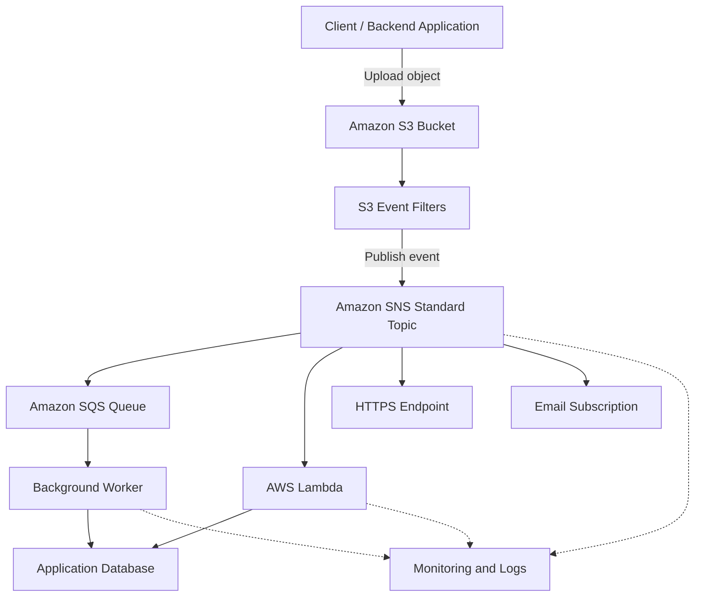
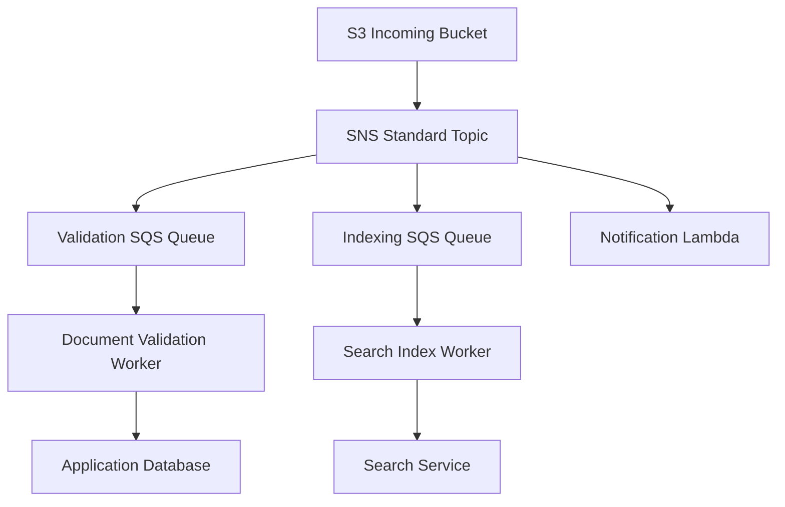

# 03- Amazon SNS Integration

## Overview

Amazon Simple Notification Service (SNS) integrates with Amazon S3 to distribute object-event notifications to multiple downstream consumers. When a configured S3 event occurs, S3 publishes a notification to an SNS topic, and SNS delivers the message to its subscribed endpoints.

This integration is useful when multiple systems must react independently to the same S3 event. For example, a document uploaded to S3 may trigger document processing, send an operational notification, update an application workflow, and initiate an analytics pipeline.

Amazon SNS provides a publish-subscribe messaging model that separates event production from event consumption. S3 does not need to know the implementation details of every downstream consumer.

Typical subscribers include:

- Amazon SQS queues for asynchronous processing.
- AWS Lambda functions for event-driven execution.
- HTTPS endpoints for external integrations.
- Email subscriptions for operational notifications.
- Other supported SNS subscription protocols.

**Use SNS when one S3 event must be distributed to multiple subscribers.** If the primary requirement is buffering work for a single worker system, SQS may be sufficient. If the architecture requires advanced event filtering and routing across multiple services, consider Amazon EventBridge.

## Architecture and Event Flow

### S3-to-SNS Fan-Out Architecture



### Component Responsibilities

| Component | Responsibility |
|---|---|
| Amazon S3 | Stores objects and emits notifications for configured events. |
| S3 event notification configuration | Selects event types and optional object-key prefix/suffix filters. |
| SNS topic | Distributes published messages to subscribed endpoints. |
| SQS subscription | Buffers messages for independent, asynchronous consumers. |
| Lambda subscription | Executes a function in response to published messages. |
| HTTPS subscription | Sends notifications to an external HTTP or HTTPS endpoint. |
| Application database | Maintains business metadata and processing state where required. |
| CloudWatch | Provides monitoring and diagnostic information for supported services and application workflows. |

The S3 bucket and SNS topic form the event-production path. Each SNS subscriber then follows its own delivery and processing path.

An SNS topic does not automatically make downstream processing exactly once, ordered, or transactional. Subscribers must implement appropriate retry handling, idempotency, and failure recovery.

## Why Use SNS with S3?

Without an intermediate notification topic, an S3 bucket might require separate event notification configurations for multiple consumers. SNS provides a single publishing destination with independent subscribers.

For example, when a PDF is uploaded, one SNS topic can distribute the notification to:

- An SQS queue consumed by document-processing workers.
- A Lambda function that validates object metadata.
- An HTTPS endpoint that updates an external system.
- An operational notification subscriber.

This design reduces direct coupling between S3 and individual consumers.

### Benefits and Limitations

| Benefit | Limitation or Trade-Off |
|---|---|
| Fan-out to multiple subscribers | Each subscriber needs its own configuration and access controls. |
| Producers and consumers are loosely coupled | SNS does not maintain the business processing state of consumers. |
| Managed message delivery | Delivery retries and recovery depend on the subscription protocol. |
| Independent subscriber scaling | A slow or failing consumer requires its own backlog and recovery strategy where applicable. |
| Integration with AWS and external systems | Additional messaging, logging, and downstream processing can increase cost. |
| Centralized message distribution | SNS Standard does not provide strict message ordering or exactly-once business processing. |

## Supported Destinations and Constraints

For direct S3 event notifications, the SNS topic must be an **SNS Standard topic** in the same AWS Region as the S3 bucket. SNS FIFO topics are not supported as direct S3 event-notification destinations.

| Requirement | Recommended Approach |
|---|---|
| Distribute S3 events to several consumers | S3 → SNS Standard topic → multiple subscribers |
| Buffer messages for a worker | SNS → SQS Standard queue → worker |
| Trigger a Lambda function alongside other consumers | SNS topic with a Lambda subscription and other required subscriptions |
| Notify an external application | SNS HTTPS subscription |
| Require downstream FIFO processing | Use EventBridge to route events to an appropriate SQS FIFO queue |
| Use complex event routing | Consider enabling S3 EventBridge integration |
| Process large files | Publish the object event and let consumers retrieve the object directly from S3 |

S3 event messages contain object metadata and references, not the complete file content. Subscribers should retrieve the object separately when processing its contents.

Official reference: [S3 event notification types and destinations](https://docs.aws.amazon.com/AmazonS3/latest/userguide/notification-how-to-event-types-and-destinations.html).

## Supported S3 Event Types

S3 supports notifications for several object and storage-related operations. Select the event types required by the application.

| Event Type | Typical Use Case |
|---|---|
| `s3:ObjectCreated:Put` | Process objects created through a PUT operation. |
| `s3:ObjectCreated:Post` | Process objects created through a POST operation. |
| `s3:ObjectCreated:Copy` | Process objects created through an S3 copy operation. |
| `s3:ObjectCreated:CompleteMultipartUpload` | Process an object after its multipart upload completes. |
| `s3:ObjectCreated:*` | Process supported object-creation operations. |
| `s3:ObjectRemoved:Delete` | React to object-removal events. |
| `s3:ObjectRemoved:DeleteMarkerCreated` | React to a delete marker being created in a versioned bucket. |

Other supported categories include certain replication, restoration, lifecycle, tagging, and archival-related events.

For ordinary file-ingestion pipelines, object-created notifications are usually the most relevant.

Multipart uploads should trigger processing after the final object is completed. Do not treat an uploaded multipart part as a completed S3 object.

The availability and semantics of individual event types depend on the operation. Verify the current AWS documentation when a workflow depends on a specialized event.

## SNS Message Delivery Semantics

### S3-to-SNS Publishing

S3 sends notifications to SNS when configured events occur and the destination is authorized. S3 notifications are delivered at least once and may be duplicated or arrive out of order.

SNS then delivers the published message to its subscribers according to their subscription protocol.

The publishing and delivery stages have distinct responsibilities:

1. S3 detects a configured event.
2. S3 publishes the notification to SNS.
3. SNS accepts the published message.
4. SNS attempts to deliver the message to its subscribers.
5. Each subscriber processes the message and applies its business logic.

A successfully published notification does not necessarily mean that every subscriber has completed processing.

### Duplicate Messages

Duplicate delivery may occur at the S3 notification stage, the SNS delivery stage, or during downstream processing and retries.

Consumers should be idempotent. Reprocessing the same object event should not create duplicate business records, repeated charges, or unnecessary external side effects.

Use an idempotency key appropriate to the operation. For S3 object processing, a key can include the bucket, object key, version ID when available, and processing operation.

The object key alone is insufficient if the same key can be overwritten multiple times.

### Ordering

SNS Standard topics do not provide strict ordering guarantees. S3 notifications can also arrive out of order.

If the business process depends on object versions or event sequence, use version-aware processing and conditional application-state updates.

For workflows that require FIFO processing, use an architecture that supports FIFO semantics downstream, such as EventBridge routing to SQS FIFO with an appropriate message-grouping strategy. FIFO delivery does not by itself guarantee exactly-once business outcomes across S3, databases, and external APIs.

### Subscriber Retry Behavior

SNS delivery retries depend on the subscription protocol. AWS-managed endpoints, such as SQS and Lambda, follow their applicable delivery behavior, while HTTPS endpoints can use configurable delivery policies.

When delivery retries are exhausted, a configured subscription dead-letter queue can retain messages that could not be delivered to the endpoint.

For SNS-to-Lambda delivery, distinguish between SNS failing to deliver to the Lambda endpoint and Lambda accepting the asynchronous invocation but subsequently failing during execution. These are separate failure stages with different retry and recovery controls.

Official references:

- [Amazon SNS message delivery](https://docs.aws.amazon.com/sns/latest/dg/message-delivery.html)
- [Amazon SNS message delivery retries](https://docs.aws.amazon.com/sns/latest/dg/sns-message-delivery-retries.html)

## Configure the SNS Topic with Boto3

Use Boto3 to create a topic, subscribe endpoints, and configure the topic's access policy. In infrastructure-managed environments, prefer Terraform, CloudFormation, or CDK to maintain these resources consistently.

### Create an SNS Standard Topic

```python
import boto3


region_name = "ap-south-1"

sns_client = boto3.client(
    "sns",
    region_name=region_name,
)

response = sns_client.create_topic(
    Name="s3-document-events",
    Attributes={
        "DisplayName": "S3 Document Events",
    },
)

topic_arn = response["TopicArn"]

print(topic_arn)
```

This creates or returns the SNS topic with the specified name in the configured account and Region. Use the returned ARN in the S3 notification configuration.

The application identity must have the required SNS permissions to create and configure the topic.

### Subscribe an SQS Queue

An SQS subscription is useful when the consumer needs durable buffering and controlled asynchronous processing.

```python
sqs_client = boto3.client(
    "sqs",
    region_name=region_name,
)

queue_response = sqs_client.get_queue_url(
    QueueName="document-processing-queue",
)

queue_attributes = sqs_client.get_queue_attributes(
    QueueUrl=queue_response["QueueUrl"],
    AttributeNames=["QueueArn"],
)

queue_arn = queue_attributes["Attributes"]["QueueArn"]

sns_client.subscribe(
    TopicArn=topic_arn,
    Protocol="sqs",
    Endpoint=queue_arn,
)
```

Before subscribing, configure the SQS queue policy to allow the SNS topic to send messages. For cross-account subscriptions, additional identity and resource-policy permissions are required.

For operational workloads, retain the returned subscription ARN and manage subscription attributes explicitly. Do not repeatedly create subscriptions as an untracked side effect of application startup.

### Configure the SNS Topic Policy

The SNS topic policy must allow S3 to publish event notifications. The example below restricts access to the intended bucket and account.

```python
import json


account_id = "123456789012"
bucket_name = "company-documents-prod"

topic_policy = {
    "Version": "2012-10-17",
    "Statement": [
        {
            "Sid": "AllowS3Publish",
            "Effect": "Allow",
            "Principal": {
                "Service": "s3.amazonaws.com",
            },
            "Action": "sns:Publish",
            "Resource": topic_arn,
            "Condition": {
                "ArnEquals": {
                    "aws:SourceArn": (
                        f"arn:aws:s3:::{bucket_name}"
                    ),
                },
                "StringEquals": {
                    "aws:SourceAccount": account_id,
                },
            },
        },
    ],
}

sns_client.set_topic_attributes(
    TopicArn=topic_arn,
    AttributeName="Policy",
    AttributeValue=json.dumps(topic_policy),
)
```

This example sets the topic policy to the supplied policy. If other principals or statements already need access, preserve them when updating the policy instead of replacing the complete policy blindly.

Restricting the source bucket and account helps prevent unintended principals from publishing messages to the topic.

## Configure S3 Event Notifications

After creating the topic and configuring its access policy, configure the bucket to publish matching events to SNS.

```python
import boto3


s3_client = boto3.client(
    "s3",
    region_name="ap-south-1",
)

bucket_name = "company-documents-prod"

notification_configuration = {
    "TopicConfigurations": [
        {
            "Id": "S3DocumentCreationEvents",
            "TopicArn": topic_arn,
            "Events": [
                "s3:ObjectCreated:*",
            ],
            "Filter": {
                "Key": {
                    "FilterRules": [
                        {
                            "Name": "prefix",
                            "Value": "incoming/",
                        },
                        {
                            "Name": "suffix",
                            "Value": ".pdf",
                        },
                    ],
                },
            },
        },
    ],
}

s3_client.put_bucket_notification_configuration(
    Bucket=bucket_name,
    NotificationConfiguration=notification_configuration,
)
```

This configuration publishes matching object-created notifications for PDF objects under the `incoming/` prefix.

### Important Configuration Considerations

- The SNS topic and source bucket must be in the same Region.
- The destination must be an SNS Standard topic.
- S3 must have permission to publish to the topic.
- The topic ARN must be valid and refer to the intended topic.
- Prefix and suffix filters must follow S3's notification-filter rules.
- Filter values containing special characters must use the documented encoding rules.
- The notification configuration must be managed as a complete configuration.

**Important:** `put_bucket_notification_configuration()` replaces the bucket's complete notification configuration. If existing Lambda, SQS, SNS, or EventBridge entries must be preserved, retrieve the existing configuration, merge the required changes, and apply the complete intended configuration.

Inspect the current configuration before modifying it:

```python
response = s3_client.get_bucket_notification_configuration(
    Bucket=bucket_name,
)

print(response)
```

Do not copy response-only metadata fields into the configuration submitted for an update. Coordinate changes so that separate deployments do not overwrite one another's notification settings.

Official reference: [Granting permissions to publish S3 event notifications](https://docs.aws.amazon.com/AmazonS3/latest/userguide/grant-destinations-permissions-to-s3.html).

## SNS Message Format

S3 publishes an event notification as a JSON message. SNS then sends that message to subscribers according to the subscription protocol and its configuration.

For an SNS-to-SQS subscription with raw message delivery disabled, the SQS message body contains an SNS notification envelope. The envelope's `Message` field contains the original S3 event JSON as a string.

An illustrative SNS notification envelope is:

```json
{
  "Type": "Notification",
  "MessageId": "example-message-id",
  "TopicArn": "arn:aws:sns:ap-south-1:123456789012:s3-document-events",
  "Message": "{\"Records\":[{\"eventSource\":\"aws:s3\",\"eventName\":\"ObjectCreated:Put\"}]}",
  "Timestamp": "2026-10-13T10:00:00.000Z"
}
```

The `Message` value above is simplified and does not represent a complete S3 event record.

For a direct Lambda subscription, the function normally receives an event structure with a `Records` array, where each entry contains an `Sns` object and its `Message` field.

Therefore, a consumer must understand whether it receives:

- A direct S3 event.
- An SNS notification envelope.
- An SQS event containing an SNS envelope.
- An SQS event containing the original message because raw message delivery is enabled.
- An EventBridge event.

Do not assume every payload has the same structure.

### Decode an S3 Event Inside an SNS Message

```python
import json


def extract_s3_event_from_sns(message: str) -> dict:
    event = json.loads(message)

    if event.get("Event") == "s3:TestEvent":
        return event

    if not isinstance(event.get("Records"), list):
        raise ValueError("SNS message does not contain S3 records")

    return event
```

For a direct Lambda subscription to SNS:

```python
import json


def lambda_handler(event, context):
    results = []

    for record in event.get("Records", []):
        sns_record = record.get("Sns")

        if sns_record is None:
            continue

        s3_event = extract_s3_event_from_sns(
            sns_record["Message"]
        )

        results.append(
            {
                "sns_message_id": sns_record["MessageId"],
                "s3_record_count": len(
                    s3_event.get("Records", [])
                ),
            }
        )

    return {"results": results}
```

This example assumes the SNS message is an S3 notification. If the topic carries multiple message types, validate the message source and schema before processing.

The direct S3 test event uses a different structure from ordinary object event notifications. Handle it explicitly where the consumer receives raw S3 notification messages.

### Object Key Decoding

S3 event object keys are URL encoded. Decode the key before passing it to an S3 API operation.

```python
from urllib.parse import unquote_plus


def decode_object_key(encoded_key: str) -> str:
    return unquote_plus(encoded_key)
```

Without the correct decoding, object keys containing spaces or special characters can result in `NoSuchKey` errors.

## Fan-Out to Multiple Consumers

SNS is particularly useful when one event must be delivered to independent processing systems.

For example, consider a document-management application where each uploaded PDF requires validation, indexing, and an operational notification.



Each queue provides an independent buffer. The consumers can operate at different speeds without forcing the S3 producer to coordinate their work directly.

If validation fails, the indexing worker may still receive and process the event. That can be desirable for independent workflows, but it may be incorrect if indexing must happen only after validation succeeds.

When processing stages have dependencies, use explicit workflow orchestration or state-driven transitions rather than assuming SNS delivery establishes processing order.

## SNS-to-SQS Integration

SNS and SQS solve different problems:

- SNS distributes messages to subscribers.
- SQS stores messages until consumers process and delete them.

Combining the services provides both fan-out and consumer-side buffering.

### Message Envelope

By default, an SNS subscription to SQS wraps the published message in an SNS notification envelope. The SQS consumer must parse the envelope before parsing the inner S3 event.

Example:

```python
import json


def extract_s3_event_from_sqs(message_body: str) -> dict:
    sns_envelope = json.loads(message_body)

    if sns_envelope.get("Type") != "Notification":
        raise ValueError("Unexpected SNS message envelope")

    return extract_s3_event_from_sns(
        sns_envelope["Message"]
    )
```

If raw message delivery is enabled for the subscription, the SNS envelope is removed and the SQS body contains the original published message. Adjust the consumer according to the actual subscription configuration.

### Queue Policy

An SQS queue subscribed to SNS needs a resource policy allowing the SNS topic to send messages.

An illustrative statement is:

```json
{
  "Sid": "AllowSpecificSnsTopic",
  "Effect": "Allow",
  "Principal": {
    "Service": "sns.amazonaws.com"
  },
  "Action": "sqs:SendMessage",
  "Resource": "arn:aws:sqs:ap-south-1:123456789012:document-processing-queue",
  "Condition": {
    "ArnEquals": {
      "aws:SourceArn": "arn:aws:sns:ap-south-1:123456789012:s3-document-events"
    }
  }
}
```

Restrict the statement to the intended topic and preserve any other required queue-policy statements.

For cross-account integrations, review the SNS topic policy, SQS queue policy, subscription configuration, and the applicable account-level permissions.

### Reliability Considerations

- Configure an appropriate SQS visibility timeout for the worker's expected processing duration.
- Use a dead-letter queue for messages that repeatedly fail processing.
- Monitor queue depth and the age of the oldest message.
- Ensure consumers are idempotent.
- Keep the source object available for as long as delayed processing may require it.
- Define a recovery procedure for failed or poison messages.

An SQS subscription gives each consumer a buffer, but it does not automatically establish an end-to-end transaction between S3, SNS, SQS, and the database.

## Error Handling and Dead-Letter Queues

Failure handling must consider both SNS delivery and downstream execution.

### Failure Categories

| Failure | Detection | Recovery |
|---|---|---|
| S3 cannot publish to SNS | Notification configuration or permission errors | Fix the destination ARN, topic policy, Region, or related configuration |
| SNS cannot deliver to a subscriber | Subscription delivery metrics and service logs where available | Correct the endpoint, permissions, or delivery configuration |
| Lambda accepts a message but processing fails | Lambda error metrics and logs | Configure appropriate asynchronous failure handling and application retries |
| SQS consumer repeatedly fails | Queue age, redrive metrics, and DLQ messages | Inspect the message, correct the root cause, and replay safely |
| HTTPS endpoint is unavailable | SNS delivery-failure signals | Restore the endpoint or configure an appropriate delivery policy and DLQ |
| Subscriber is misconfigured | Subscription state and delivery diagnostics | Validate the endpoint and subscription attributes |
| Consumer receives duplicate messages | Application idempotency records | Ignore already completed logical operations |
| Object is missing during processing | S3 access errors and application logs | Validate the event key, source version, and retention or deletion behavior |

A dead-letter queue should preserve enough context to diagnose the failure while avoiding the unnecessary storage of sensitive object data.

### DLQ Design

Dead-letter queues apply to supported delivery or processing stages:

- **SNS subscription DLQ:** Captures messages that SNS cannot deliver to the subscriber after exhausting the applicable delivery retries.
- **Lambda asynchronous failure destination or DLQ:** Preserves information about failed asynchronous Lambda processing, depending on configuration.
- **SQS consumer DLQ:** Receives messages that have exceeded the queue's configured receive threshold.

These mechanisms solve different failure problems. Configuring a DLQ at one stage does not automatically capture failures at every other stage.

For important workloads, document how messages are inspected, corrected, and replayed. Avoid blindly replaying a message if the associated business operation may already have succeeded.

## Security and Encryption

### SNS Topic Policy

The topic policy should permit S3 to publish only from the intended source bucket and account.

Avoid unrestricted publishing permissions unless the architecture explicitly requires them. Review cross-account access and preserve required statements when updating the topic policy.

### Subscriber Permissions

Each subscriber requires its own appropriate access controls.

| Component | Security Requirement |
|---|---|
| S3 → SNS | Topic policy authorizes `sns:Publish` from the intended S3 bucket |
| SNS → SQS | Queue policy authorizes delivery from the intended SNS topic |
| SNS → Lambda | Lambda resource policy authorizes SNS invocation |
| SQS → worker | Consumer identity can receive and delete messages and access required resources |
| Lambda consumer → S3 | Lambda execution role has the required S3 permissions |
| Encrypted SNS topic | KMS key policy and required KMS permissions support the publishing service |
| Encrypted SQS queue | KMS key policy and permissions support the applicable message producer and consumer |

SNS publishing permission and consumer permission to read the original S3 object are different concerns. A message can reach a worker even if the worker cannot access the referenced object.

### SNS Server-Side Encryption

If an SNS topic uses a customer-managed KMS key, the KMS key policy must permit S3 to use the key for the event-notification publishing workflow.

For S3 event notifications to an encrypted SNS topic, AWS documents the need to allow the S3 service principal the required KMS actions, including `kms:GenerateDataKey` and `kms:Decrypt`, subject to the service's documented configuration requirements.

Where supported, restrict the key policy using source-account and source-resource conditions to reduce unintended use. Validate encryption behavior with an actual event in a controlled environment.

S3 authorization to publish and KMS authorization to use the encryption key are separate permission checks.

Official references:

- [Granting permissions to publish S3 event notifications](https://docs.aws.amazon.com/AmazonS3/latest/userguide/grant-destinations-permissions-to-s3.html)
- [Managing Amazon SNS encryption keys and costs](https://docs.aws.amazon.com/sns/latest/dg/sns-key-management.html)

## Monitoring and Observability

Monitor the S3-to-SNS publishing path and subscriber processing separately.

| Signal | Purpose |
|---|---|
| SNS published message count | Indicates messages accepted for publication |
| SNS delivery-failure metrics | Detects subscriber delivery problems where supported |
| SQS queue depth | Measures buffered processing work |
| Age of oldest SQS message | Detects growing backlogs |
| DLQ message count | Identifies messages requiring investigation |
| Lambda invocation and error metrics | Measures downstream function execution |
| Application processing state | Identifies missing, delayed, or failed work |
| End-to-end processing latency | Measures time from upload to business completion |

Use structured logs that include the SNS message ID and relevant S3 object identifiers. For version-aware processing, include the object version ID when available.

Do not log full presigned URLs, credentials, or sensitive object content. Preserve sufficient event context for tracing and diagnosis without exposing protected data.

SNS metrics alone cannot prove that all business processing completed successfully. Application-level state and consumer metrics are needed for meaningful end-to-end observability.

## Cost and Performance Considerations

SNS-based architectures introduce messaging costs in addition to S3 and downstream processing costs.

| Cost or Performance Factor | Engineering Consideration |
|---|---|
| SNS publications | Event volume affects messaging costs |
| Subscriber count | Fan-out increases downstream deliveries and related request activity |
| SQS usage | Queue requests, retained messages, and DLQ traffic contribute to cost |
| Lambda processing | Invocation count, memory allocation, and execution duration affect compute cost |
| HTTPS subscriptions | Endpoint availability and delivery retries influence latency and operational load |
| Logging | High-volume message and application logs increase ingestion and retention costs |
| Object retention | Delayed consumers may require source objects to remain available for longer |
| Duplicate processing | Uncontrolled retries may repeat expensive transformations or external operations |

Apply event filters at the S3 source when possible. If subscribers need different subsets of events, consider separate filters or EventBridge routing rather than sending every event to every consumer.

For large files, distribute metadata and object references rather than embedding object contents in notifications. Consumers can retrieve the required objects directly from S3.

## Testing Strategy

Test the publishing configuration, subscriber delivery, event parsing, and downstream processing independently and together.

### Unit Tests

Unit tests should validate:

- The expected topic ARN and S3 notification configuration.
- Event-type and prefix/suffix filters.
- SNS envelope parsing.
- URL decoding of S3 object keys.
- Idempotency behavior.
- Error classification and retry decisions.
- Correct handling of duplicate and out-of-order events.

Use mocked AWS clients for unit tests so that routine test execution does not require real AWS resources.

### Integration Tests

Use an isolated AWS test environment to verify:

- The topic exists in the same Region as the bucket.
- The topic policy permits the intended S3 bucket to publish.
- A matching S3 event reaches SNS.
- Subscribed endpoints receive and parse the expected message structure.
- Nonmatching object keys do not trigger the intended notification path.
- Encrypted topics can receive events when customer-managed KMS keys are used.
- Duplicate events do not create duplicate business outcomes.
- Subscriber failures and DLQ recovery behave as expected.

An SNS test publication proves that SNS can deliver a message under the tested conditions; it does not prove that S3 notification filters and permissions are correct. Perform end-to-end tests using actual S3 object operations.

## Troubleshooting Checklist

When S3 notifications do not reach an SNS subscriber:

1. Inspect the bucket notification configuration and confirm the topic ARN, event types, and filters.
2. Confirm that the SNS topic is Standard and is in the same Region as the bucket.
3. Verify that the topic policy allows S3 to publish from the intended bucket and account.
4. Check the KMS key policy if the topic is encrypted with a customer-managed key.
5. Confirm that a real test object matches the configured filters.
6. Check whether SNS accepted the message and inspect relevant delivery metrics.
7. Verify that the intended subscription exists and is confirmed where applicable.
8. Inspect subscriber permissions, logs, and delivery configuration.
9. Validate whether the consumer expects an SNS envelope or raw message delivery.
10. Test idempotency, retries, and dead-letter recovery.

### Common Failure Scenarios

| Symptom | Likely Cause | Corrective Action |
|---|---|---|
| S3 configuration is rejected | Invalid ARN, Region mismatch, or insufficient permissions | Verify topic configuration and destination permissions |
| No SNS messages appear | Event filter mismatch or S3 cannot publish | Inspect bucket notification settings and topic policy |
| SNS receives messages but a subscriber does not | Missing subscription, endpoint failure, or permission problem | Inspect subscription state and delivery diagnostics |
| Consumer fails to parse an event | Incorrectly assumed message envelope | Match parsing logic to the configured subscription protocol |
| S3 returns `AccessDenied` to the consumer | Consumer's S3 permissions are insufficient | Fix the consumer's identity or resource policy |
| Duplicate business records appear | Processing is not idempotent | Add stable operation identifiers and state constraints |
| An encrypted topic receives no notifications | Required KMS permissions are missing | Verify the customer-managed key policy and required KMS actions |
| Configuration changes remove another destination | The entire S3 notification configuration was overwritten | Merge and redeploy the complete intended configuration |

## Production Readiness Checklist

### Configuration and Access

- [ ] The SNS topic is Standard and in the source bucket's Region.
- [ ] The topic policy restricts publishing to the intended bucket and account.
- [ ] All required subscriber endpoints are configured correctly.
- [ ] Queue and Lambda resource policies permit only the intended integrations.
- [ ] KMS permissions are configured where customer-managed encryption is used.
- [ ] Bucket notification updates preserve other required destinations.

### Reliability

- [ ] Consumers handle duplicate messages safely.
- [ ] Ordering-sensitive workflows use version-aware processing or suitable state controls.
- [ ] Retry policies match the subscriber protocol.
- [ ] DLQs or failure destinations are configured where justified.
- [ ] Failed messages can be inspected and replayed safely.
- [ ] Source objects remain available for the required processing window.
- [ ] SNS publication is not treated as proof of business completion.

### Operations

- [ ] SNS delivery failures and downstream processing failures are monitored separately.
- [ ] Queue backlogs and oldest-message age are monitored where SQS is used.
- [ ] Logs contain useful correlation identifiers without sensitive data.
- [ ] End-to-end tests cover the actual S3 event path.
- [ ] Cost implications of fan-out, retries, and logging are understood.
- [ ] Notification changes and failure recovery procedures are documented.

## Official References

- [Amazon S3 Event Notifications](https://docs.aws.amazon.com/AmazonS3/latest/userguide/EventNotifications.html)
- [S3 event notification types and destinations](https://docs.aws.amazon.com/AmazonS3/latest/userguide/notification-how-to-event-types-and-destinations.html)
- [Granting permissions to publish S3 event notifications](https://docs.aws.amazon.com/AmazonS3/latest/userguide/grant-destinations-permissions-to-s3.html)
- [Walkthrough: Configuring S3 notifications with SNS and SQS](https://docs.aws.amazon.com/AmazonS3/latest/userguide/ways-to-add-notification-config-to-bucket.html)
- [Amazon SNS message delivery](https://docs.aws.amazon.com/sns/latest/dg/message-delivery.html)
- [Amazon SNS message delivery retries](https://docs.aws.amazon.com/sns/latest/dg/sns-message-delivery-retries.html)
- [SNS-to-SQS fan-out](https://docs.aws.amazon.com/sns/latest/dg/sns-sqs-as-subscriber.html)
- [Amazon SNS message formats](https://docs.aws.amazon.com/sns/latest/dg/sns-message-and-json-formats.html)
- [Managing Amazon SNS encryption keys](https://docs.aws.amazon.com/sns/latest/dg/sns-key-management.html)

## Key Takeaways

- SNS enables S3 event fan-out to multiple independent subscribers without coupling the bucket directly to every downstream system.
- Direct S3 notifications require an SNS Standard topic in the same Region as the bucket, and the topic policy must permit the intended S3 publishing path.
- S3 and SNS delivery can produce duplicate or out-of-order messages, so subscribers must implement idempotency and version-aware processing where required.
- SNS-to-SQS is useful for buffering and controlled asynchronous processing, while direct subscriptions suit simpler delivery requirements.
- Production integrations require explicit permissions, correct message-envelope handling, monitoring, failure recovery, and end-to-end tests.