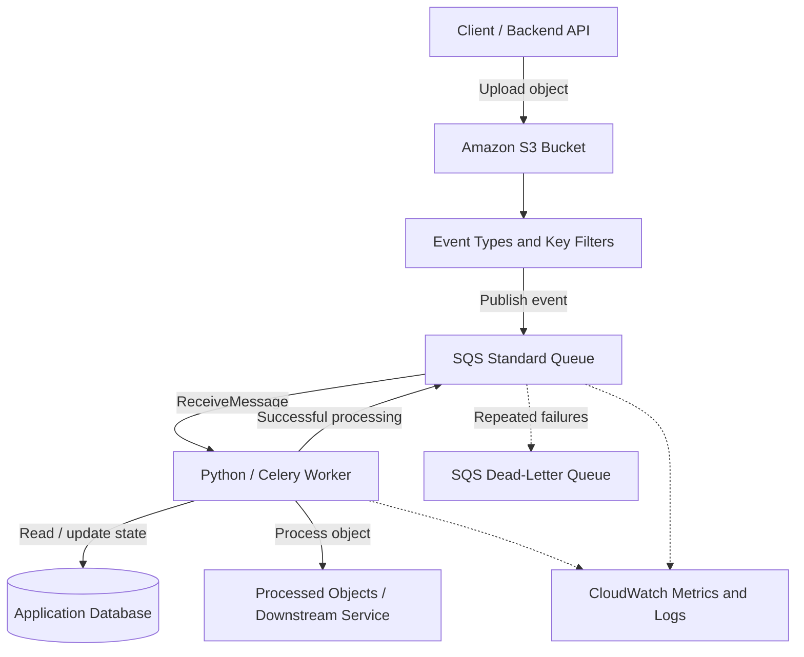
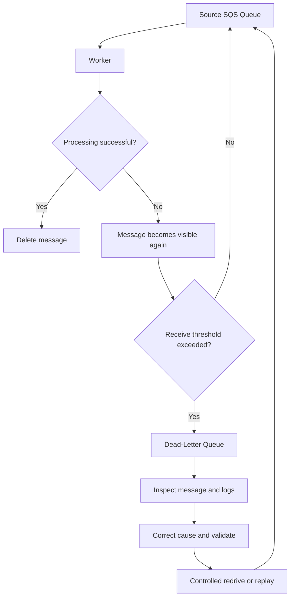
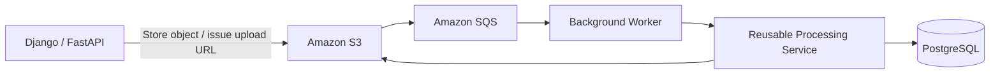

# 04- Amazon SQS Integration

## Overview

Amazon Simple Queue Service (SQS) integrates with Amazon S3 to decouple object storage operations from asynchronous processing. When an S3 object event occurs, S3 publishes an event notification to a configured SQS queue. Consumers retrieve the message, process the referenced object, and delete the message after successful processing.

This integration is useful when backend applications must process uploaded files without blocking the original upload request. Typical workloads include document processing, image transformation, antivirus scanning, data ingestion, metadata extraction, and asynchronous workflow execution.

S3 and SQS have distinct responsibilities:

- **Amazon S3** stores objects and generates event notifications.
- **Amazon SQS** buffers notifications until consumers process them.
- **Backend workers** retrieve messages and execute business logic.
- **Application databases** maintain processing state and business metadata.
- **CloudWatch** provides operational metrics and monitoring.

SQS absorbs traffic spikes, allows processing to recover from temporary consumer outages, and enables independent worker scaling. However, it does not guarantee exactly-once business processing or strict event ordering when using a Standard queue.

## Architecture and Event Flow

### Direct S3-to-SQS Integration



### Request and Processing Lifecycle

1. A client uploads an object to an S3 bucket.
2. S3 evaluates its event notification configuration.
3. If the operation matches a configured event type and object-key filter, S3 sends an event notification to SQS.
4. SQS stores the message until a consumer retrieves it.
5. The worker parses the S3 event, validates the message, and retrieves the referenced object when required.
6. The worker executes the business operation and records the result.
7. After successful processing, the worker deletes the SQS message.
8. If processing fails and the message is not deleted, it becomes available again after its visibility timeout.
9. After the configured receive threshold is exceeded, SQS can move the message to a dead-letter queue (DLQ).

A successful S3 upload does not mean that downstream processing has completed. If clients need to know whether a file has been validated, indexed, or transformed, expose processing status through the application API or an equivalent state store.

## When to Use S3 with SQS

| Requirement | Suitability |
|---|---|
| Process uploaded files asynchronously | Excellent |
| Absorb upload traffic spikes | Excellent |
| Retry processing after temporary worker failures | Excellent |
| Scale workers independently of API traffic | Excellent |
| Buffer work while consumers are unavailable | Excellent |
| Distribute every event to multiple independent consumers | Use SNS or EventBridge to route events to separate destinations |
| Require strict queue ordering | Direct S3 notifications to SQS FIFO are not supported; consider EventBridge with FIFO-compatible downstream routing |
| Ensure business processing occurs exactly once | Requires application-level idempotency and state management |
| Implement complex conditional event routing | Consider Amazon EventBridge |
| Coordinate multiple dependent processing stages | Consider an explicit workflow or state-driven architecture |

### Standard Queue Limitation

Amazon S3 does not directly support SQS FIFO queues as event-notification destinations. Direct S3 event notifications require a supported SQS destination in the same AWS Region as the source bucket.

If a workflow requires FIFO queue delivery, S3 events can be routed through Amazon EventBridge to an SQS FIFO queue. The design must still define message-group IDs, ordering semantics, deduplication, and recovery behavior.

FIFO delivery does not automatically provide exactly-once business outcomes across S3, databases, and external services.

Official references:

- [Amazon S3 Event Notifications](https://docs.aws.amazon.com/AmazonS3/latest/userguide/EventNotifications.html)
- [Enabling Amazon EventBridge for S3 events](https://docs.aws.amazon.com/AmazonS3/latest/userguide/enable-event-notifications-eventbridge.html)

## S3 Event Notification Semantics

### Supported Event Types

S3 can generate notifications for several object and storage operations.

| Event Type | Example Use Case |
|---|---|
| `s3:ObjectCreated:Put` | Process an object created through a PUT request |
| `s3:ObjectCreated:Post` | Process an object created through a POST request |
| `s3:ObjectCreated:Copy` | Process an object created by copying another object |
| `s3:ObjectCreated:CompleteMultipartUpload` | Process a large object after multipart upload completion |
| `s3:ObjectCreated:*` | Receive supported object-creation notifications |
| `s3:ObjectRemoved:Delete` | Update application state after object deletion |
| `s3:ObjectRemoved:DeleteMarkerCreated` | React to a delete marker in a versioned bucket |

Choose event types that reflect actual processing requirements. An ingestion workflow often needs object-created events but should not process deletion events as if they were new uploads.

For multipart uploads, trigger processing after the multipart upload completes, not for individual uploaded parts.

### At-Least-Once Delivery

S3 event notifications are designed for at-least-once delivery. Notifications can be duplicated or arrive out of order. SQS Standard queues also provide at-least-once delivery, so consumers must tolerate repeated messages.

For example, the same logical event might be processed more than once because of duplicate notification delivery or a worker failure after the business operation completes but before the queue message is deleted.

Design consumers around idempotent operations rather than assuming that each event is delivered exactly once.

### Eventual Processing and Ordering

S3 notifications typically arrive quickly, but delivery can take longer. An SQS message does not guarantee that the object will remain unchanged until the worker processes it.

If the same key is overwritten multiple times, a delayed consumer might retrieve a newer version than the one associated with the original event unless the object version is specified.

For version-aware processing:

- Enable S3 bucket versioning when the workflow requires immutable references to individual object versions.
- Read `versionId` from the event and use it in the `GetObject` request when available.
- Track processing state using a stable event or object-version identity.
- Use S3 event sequencers only for ordering comparisons applicable to the same object key.
- Avoid assuming ordering across different keys.

When a workflow must prevent stale processing results from overwriting newer results, compare the event identity or sequence with persisted application state before committing the result.

Official references:

- [S3 notification message structure](https://docs.aws.amazon.com/AmazonS3/latest/userguide/notification-content-structure.html)
- [S3 event ordering and duplicate events](https://docs.aws.amazon.com/AmazonS3/latest/userguide/notification-how-to-event-types-and-destinations.html)

## Configure SQS Using Boto3

Use Boto3 to create the queues, configure redrive behavior, and apply the resource policy that permits S3 to publish notifications.

In production, prefer Terraform, CloudFormation, or CDK for resource lifecycle management. Runtime application code should generally consume messages rather than create or modify infrastructure during application startup.

### Create the Queues

Create the dead-letter queue first, followed by the processing queue.

```python
import json

import boto3


REGION = "ap-south-1"

sqs_client = boto3.client(
    "sqs",
    region_name=REGION,
)

# Create the DLQ before configuring the source queue.
dlq_response = sqs_client.create_queue(
    QueueName="document-processing-dlq",
    Attributes={
        "MessageRetentionPeriod": "1209600",  # 14 days
        "ReceiveMessageWaitTimeSeconds": "20",
        "MaximumMessageSize": "262144",  # 256 KiB
    },
)

dlq_url = dlq_response["QueueUrl"]

dlq_attributes = sqs_client.get_queue_attributes(
    QueueUrl=dlq_url,
    AttributeNames=["QueueArn"],
)

dlq_arn = dlq_attributes["Attributes"]["QueueArn"]

# Configure the source queue and its redrive policy.
queue_response = sqs_client.create_queue(
    QueueName="s3-document-processing",
    Attributes={
        "VisibilityTimeout": "180",
        "MessageRetentionPeriod": "345600",  # 4 days
        "ReceiveMessageWaitTimeSeconds": "20",
        "MaximumMessageSize": "262144",
        "RedrivePolicy": json.dumps(
            {
                "deadLetterTargetArn": dlq_arn,
                "maxReceiveCount": 5,
            }
        ),
    },
)

queue_url = queue_response["QueueUrl"]

queue_attributes = sqs_client.get_queue_attributes(
    QueueUrl=queue_url,
    AttributeNames=["QueueArn"],
)

queue_arn = queue_attributes["Attributes"]["QueueArn"]

print(
    {
        "queue_url": queue_url,
        "queue_arn": queue_arn,
        "dlq_arn": dlq_arn,
    }
)
```

The values are examples and should be selected according to the expected workload.

The source queue has a 180-second visibility timeout. This is appropriate only if normal processing completes comfortably within that interval. Adjust the timeout to the actual processing duration, and use visibility-timeout extensions for longer-running work where necessary.

S3 event notification messages can be up to 64 KB. The example sets SQS `MaximumMessageSize` to 256 KiB, comfortably above that requirement. AWS currently supports SQS messages up to 1 MiB, but the S3 notification payload limit remains the relevant constraint for this integration.

The DLQ retention period should be long enough for investigation and recovery. For Standard queues, consider setting the DLQ retention period longer than the source queue's retention period.

Official references:

- [S3 event notification types, destinations, and message size](https://docs.aws.amazon.com/AmazonS3/latest/userguide/notification-how-to-event-types-and-destinations.html)
- [SQS queue configuration](https://docs.aws.amazon.com/AWSSimpleQueueService/latest/SQSDeveloperGuide/sqs-configure-queue-parameters.html)

## Configure S3 Publishing Permissions

The SQS queue policy must allow the S3 service principal to send messages to the destination queue.

Attach a policy that restricts publishing to the intended bucket and account.

```python
import json


ACCOUNT_ID = "123456789012"
BUCKET_NAME = "company-documents-prod"

bucket_arn = f"arn:aws:s3:::{BUCKET_NAME}"

queue_policy = {
    "Version": "2012-10-17",
    "Statement": [
        {
            "Sid": "AllowS3BucketNotifications",
            "Effect": "Allow",
            "Principal": {
                "Service": "s3.amazonaws.com",
            },
            "Action": "sqs:SendMessage",
            "Resource": queue_arn,
            "Condition": {
                "ArnEquals": {
                    "aws:SourceArn": bucket_arn,
                },
                "StringEquals": {
                    "aws:SourceAccount": ACCOUNT_ID,
                },
            },
        },
    ],
}

sqs_client.set_queue_attributes(
    QueueUrl=queue_url,
    Attributes={
        "Policy": json.dumps(queue_policy),
    },
)
```

The example uses the bucket owner's account ID. Replace the account ID, bucket name, and queue ARN with the correct values for the deployment.

**Important:** The SQS `Policy` attribute is a resource policy. Setting it to a new policy replaces the queue's existing policy. If the queue already has other required statements, merge the new statement with them instead of removing existing access unintentionally.

### SQS and KMS Permissions

SQS server-side encryption and authorization to publish messages are separate concerns.

If the queue uses a customer-managed AWS KMS key, the KMS key policy must also permit the S3 service principal to use the key for the notification workflow. AWS documents these required KMS actions for this integration:

```json
{
  "Sid": "AllowS3EventNotifications",
  "Effect": "Allow",
  "Principal": {
    "Service": "s3.amazonaws.com"
  },
  "Action": [
    "kms:GenerateDataKey",
    "kms:Decrypt"
  ],
  "Resource": "*"
}
```

This is an illustrative key-policy statement, not a complete KMS key policy. Integrate it with the intended key policy and other required permissions. Restrict access appropriately and verify the complete encrypted publishing path with an actual S3 event.

The SQS queue policy and the KMS key policy authorize different operations. Allowing `sqs:SendMessage` alone does not resolve a missing KMS permission.

Official references:

- [Granting S3 permissions to publish event notifications](https://docs.aws.amazon.com/AmazonS3/latest/userguide/grant-destinations-permissions-to-s3.html)
- [Amazon SQS encryption at rest](https://docs.aws.amazon.com/AWSSimpleQueueService/latest/SQSDeveloperGuide/sqs-server-side-encryption.html)

## Configure S3 Event Notifications

After creating the processing queue and applying its resource policy, configure the S3 bucket to publish the required events.

```python
import boto3


s3_client = boto3.client(
    "s3",
    region_name=REGION,
)

notification_configuration = {
    "QueueConfigurations": [
        {
            "Id": "incoming-pdf-notifications",
            "QueueArn": queue_arn,
            "Events": [
                "s3:ObjectCreated:*",
            ],
            "Filter": {
                "Key": {
                    "FilterRules": [
                        {
                            "Name": "prefix",
                            "Value": "incoming/",
                        },
                        {
                            "Name": "suffix",
                            "Value": ".pdf",
                        },
                    ],
                },
            },
        },
    ],
}

s3_client.put_bucket_notification_configuration(
    Bucket=BUCKET_NAME,
    NotificationConfiguration=notification_configuration,
)

print("S3 event notification configuration applied.")
```

This configuration publishes object-created events for PDF files stored under the `incoming/` prefix.

### Configuration Requirements

- The SQS queue and S3 bucket must be in the same AWS Region.
- The queue must be a supported SQS destination.
- The queue policy must permit S3 to send messages.
- The event types must match the operations the application performs.
- The queue message-size limit must accommodate the S3 notification.
- Prefix and suffix filters must match the actual object-key structure.

**Important:** `put_bucket_notification_configuration()` replaces the bucket's complete notification configuration. If the bucket already uses SQS, SNS, Lambda, or EventBridge notification settings, retrieve and preserve all required entries before applying an updated configuration.

Inspect the existing configuration before changing it:

```python
existing_configuration = (
    s3_client.get_bucket_notification_configuration(
        Bucket=BUCKET_NAME,
    )
)

print(existing_configuration)
```

Avoid sending response-only metadata fields back in an update. Manage notification configurations centrally or through infrastructure as code to prevent concurrent deployments from overwriting each other's settings.

### Verify the Configuration

```python
notification_configuration = (
    s3_client.get_bucket_notification_configuration(
        Bucket=BUCKET_NAME,
    )
)

queue_notifications = notification_configuration.get(
    "QueueConfigurations",
    [],
)

for configuration in queue_notifications:
    print(
        {
            "id": configuration.get("Id"),
            "queue_arn": configuration.get("QueueArn"),
            "events": configuration.get("Events"),
        }
    )
```

You can also inspect the notification configuration with the AWS CLI:

```bash
aws s3api get-bucket-notification-configuration \
  --bucket company-documents-prod \
  --region ap-south-1
```

Configuration inspection verifies the saved settings, but it does not prove end-to-end delivery. Upload a controlled test object that matches the configured filters and verify that the queue receives a message.

## Understanding the S3 Event Message

When S3 publishes directly to SQS, the queue message body contains the S3 event notification JSON. Unlike an SNS-to-SQS integration, there is no additional SNS envelope around the original event.

A simplified object-created event looks like this:

```json
{
  "Records": [
    {
      "eventSource": "aws:s3",
      "eventName": "ObjectCreated:Put",
      "awsRegion": "ap-south-1",
      "s3": {
        "bucket": {
          "name": "company-documents-prod"
        },
        "object": {
          "key": "incoming/report.pdf",
          "size": 2048,
          "versionId": "example-version-id",
          "sequencer": "0067AABBCCDD"
        }
      }
    }
  ]
}
```

The example is illustrative. Real messages contain additional fields, and some fields depend on the event type and bucket configuration.

Important fields include:

| Field | Purpose |
|---|---|
| `eventSource` | Identifies the event source, normally `aws:s3` |
| `eventName` | Identifies the operation that triggered the notification |
| `awsRegion` | Identifies the relevant AWS Region |
| `s3.bucket.name` | Identifies the source bucket |
| `s3.object.key` | Identifies the URL-encoded object key |
| `s3.object.versionId` | Identifies a particular object version when available |
| `s3.object.sequencer` | Supports ordering comparisons for events on the same object key |

The S3 console or service may send a test event with a different structure, including an `Event` field set to `s3:TestEvent`. Consumers should account for test events rather than assuming every body contains a `Records` array.

### Decode S3 Object Keys

S3 event object keys are URL encoded. Decode them before using them in S3 requests.

```python
from urllib.parse import unquote_plus


def decode_s3_object_key(encoded_key: str) -> str:
    return unquote_plus(encoded_key)
```

This matters for object names that contain spaces or special characters. Passing the encoded key directly to `GetObject` can produce `NoSuchKey` errors.

## Implement a Python SQS Worker

A worker should receive messages, validate each event, process the referenced objects, and delete the queue message only after successful processing.

The following example demonstrates a basic polling worker with long polling and explicit failure handling.

```python
import json
import logging
import os
import time
from urllib.parse import unquote_plus

import boto3
from botocore.exceptions import BotoCoreError, ClientError


REGION = os.getenv("AWS_REGION", "ap-south-1")
QUEUE_URL = os.environ["SQS_QUEUE_URL"]
EXPECTED_BUCKET = os.environ["EXPECTED_S3_BUCKET"]

logging.basicConfig(level=logging.INFO)
logger = logging.getLogger(__name__)

sqs_client = boto3.client(
    "sqs",
    region_name=REGION,
)

s3_client = boto3.client(
    "s3",
    region_name=REGION,
)


def process_s3_record(record: dict) -> None:
    """Read an object referenced by a supported S3 creation event."""
    if record.get("eventSource") != "aws:s3":
        raise ValueError("Unsupported event source")

    event_name = record.get("eventName", "")

    if not event_name.startswith("ObjectCreated:"):
        logger.info(
            "Skipping unsupported event type",
            extra={"event_name": event_name},
        )
        return

    bucket = record["s3"]["bucket"]["name"]

    if bucket != EXPECTED_BUCKET:
        raise ValueError("Unexpected source bucket")

    encoded_key = record["s3"]["object"]["key"]
    object_key = unquote_plus(encoded_key)

    object_metadata = record["s3"]["object"]
    version_id = object_metadata.get("versionId")

    request = {
        "Bucket": bucket,
        "Key": object_key,
    }

    if version_id:
        request["VersionId"] = version_id

    response = s3_client.get_object(**request)

    total_bytes = 0

    with response["Body"] as body:
        while True:
            chunk = body.read(1024 * 1024)

            if not chunk:
                break

            # Pass each chunk to the actual processing pipeline.
            # Avoid loading large objects entirely into memory.
            total_bytes += len(chunk)

    logger.info(
        "Object read completed",
        extra={
            "bucket": bucket,
            "object_key": object_key,
            "version_id": version_id,
            "bytes_read": total_bytes,
        },
    )


def process_sqs_message(message: dict) -> None:
    """Process all S3 records contained in one SQS message."""
    message_id = message["MessageId"]
    event = json.loads(message["Body"])

    if event.get("Event") == "s3:TestEvent":
        logger.info(
            "Received S3 test event",
            extra={"message_id": message_id},
        )
        return

    records = event.get("Records")

    if not isinstance(records, list):
        raise ValueError("SQS message does not contain S3 records")

    for record in records:
        process_s3_record(record)


def poll_forever() -> None:
    """Poll the queue and delete messages after successful processing."""
    while True:
        try:
            response = sqs_client.receive_message(
                QueueUrl=QUEUE_URL,
                MaxNumberOfMessages=10,
                WaitTimeSeconds=20,
                VisibilityTimeout=180,
                MessageSystemAttributeNames=[
                    "ApproximateReceiveCount",
                ],
            )

            messages = response.get("Messages", [])

            for message in messages:
                message_id = message["MessageId"]

                try:
                    process_sqs_message(message)

                    sqs_client.delete_message(
                        QueueUrl=QUEUE_URL,
                        ReceiptHandle=message["ReceiptHandle"],
                    )

                    logger.info(
                        "Message processed and deleted",
                        extra={"message_id": message_id},
                    )

                except (
                    ValueError,
                    KeyError,
                    ClientError,
                    BotoCoreError,
                ):
                    logger.exception(
                        "Message processing failed",
                        extra={"message_id": message_id},
                    )
                    # Do not delete the message.
                    # SQS makes it available again after the timeout.

        except (ClientError, BotoCoreError):
            logger.exception("Failed to poll SQS")
            time.sleep(5)


if __name__ == "__main__":
    poll_forever()
```

This is a worker foundation, not a complete document-processing application. Add a business processing service, persistent idempotency tracking, resource-specific access controls, health checks, graceful shutdown, and tests before using it in production.

The example deliberately deletes a message only after all records in that message have been processed. If one record fails, previously processed records may be processed again on retry; the processing layer must make those operations idempotent.

Also ensure that the worker's visibility timeout is consistent with its execution duration. For processing that can exceed the configured timeout, extend the visibility timeout while the message is being processed or use a suitable managed consumer configuration.

## Idempotency and Duplicate Processing

Idempotency is a core requirement for an S3-to-SQS processing pipeline.

Consider a worker that writes extracted document metadata to PostgreSQL:

1. The worker retrieves an S3 event.
2. It extracts document metadata.
3. It commits the metadata to the database.
4. The worker crashes before deleting the SQS message.
5. SQS makes the message visible again.
6. Another worker processes the same event.

Without idempotency, the second execution may insert duplicate records or repeat external side effects.

### Stable Processing Identity

Construct a processing identity from the object and operation being processed.

For versioned objects, a suitable identity can include:

```text
bucket + decoded_object_key + version_id + processing_operation
```

For non-versioned objects, include an appropriate event identity or sequencer in addition to the bucket and key. Using only the object key is insufficient when objects can be overwritten.

If processing is triggered by an S3 event but represents a distinct business operation, include that operation in the identity as well. For example, extracting metadata and generating a thumbnail should not necessarily share the same idempotency key.

### Database-Based Idempotency

For business-critical operations, persist processing state under a unique constraint.

An illustrative PostgreSQL schema:

```sql
CREATE TABLE s3_processing_jobs (
    idempotency_key TEXT PRIMARY KEY,
    bucket_name TEXT NOT NULL,
    object_key TEXT NOT NULL,
    version_id TEXT,
    status TEXT NOT NULL,
    created_at TIMESTAMPTZ NOT NULL DEFAULT NOW(),
    updated_at TIMESTAMPTZ NOT NULL DEFAULT NOW()
);
```

A worker can use an atomic insert or an appropriate transactional claim to establish processing ownership. Exact state transitions depend on whether jobs are processed synchronously or can remain in progress for an extended period.

Recommended states include:

- `PENDING`
- `PROCESSING`
- `COMPLETED`
- `FAILED`

Use transactions for database state changes. When an external side effect cannot be included in the same transaction, use idempotency keys or an outbox/workflow pattern to prevent duplicate outcomes.

Do not mark an event `COMPLETED` before the business operation has actually succeeded.

### Handling Object Overwrites

If a key such as `incoming/report.pdf` is overwritten several times, each event may represent a different object state.

For versioned buckets, retrieve the object using the event's `versionId` where available. Without version-aware retrieval, a worker can process the newest object rather than the version associated with the notification.

If the business requirement is to process only the newest version, explicitly implement that policy and protect application state against stale or out-of-order processing.

## Visibility Timeout and Retry Behavior

### Visibility Timeout

When a worker receives a message, SQS temporarily hides it from other consumers. This is the visibility timeout.

If the worker does not delete the message before the timeout expires, SQS can make it visible again. Another worker may then process the same message while the original operation is still executing.

| Consideration | Recommendation |
|---|---|
| Processing duration is predictable | Set visibility timeout above normal processing duration, with operational margin |
| Processing duration varies | Extend visibility timeout while the worker is active |
| Worker crashes before processing | Allow SQS to redeliver the message |
| Processing succeeds but deletion fails | Expect possible duplicate processing |
| Processing repeatedly fails | Use a redrive policy and DLQ |
| Queue backlog grows continuously | Diagnose capacity and bottlenecks before scaling workers |

The visibility timeout should be considered alongside the SDK read timeout, polling strategy, maximum execution duration, and shutdown behavior.

Reference: [Configuring SQS visibility timeouts](https://docs.aws.amazon.com/AWSSimpleQueueService/latest/SQSDeveloperGuide/working-with-visibility-timeouts.html).

### Retry Strategy

SQS retry behavior is driven by message visibility, receive count, and the redrive policy. A consumer typically does not need to manually republish a failed message to the same queue.

For transient failures, allowing the message to become visible again may be sufficient. For deterministic failures, repeated retrying can waste compute and delay healthy messages.

Examples of transient failures include:

- Temporary network issues.
- Throttling or temporary service errors.
- Short-lived database unavailability.
- Temporary downstream service failures.

Examples of persistent failures include:

- Unsupported or malformed payloads.
- Invalid object references.
- Missing required metadata.
- Application bugs triggered by specific inputs.
- Permanent authorization failures.

Use bounded retries, structured diagnostics, and a DLQ to isolate repeatedly failing messages. Correct the underlying cause before replaying failed work.

Avoid manually deleting a failed message simply to clear a backlog. Deleting it discards the queue's retry and recovery mechanism.

## Dead-Letter Queue Design

A dead-letter queue isolates messages that repeatedly fail processing.

The redrive policy defines the target DLQ and the maximum receive count before a message is moved out of the source queue.

### Operational Workflow



A DLQ does not repair failed processing automatically. It provides a controlled place to investigate failed messages and decide whether they can be safely replayed.

Recommended practices:

- Set `maxReceiveCount` high enough to tolerate expected transient errors.
- Alert on visible DLQ messages.
- Preserve enough retention time for investigation and recovery.
- Record error causes in application logs without exposing secrets.
- Define a controlled replay procedure.
- Ensure replayed messages cannot duplicate completed business operations.

For Standard queues, the original enqueue timestamp is retained when a message moves to the DLQ. Set DLQ retention long enough to support operational investigation.

Official reference: [Using Amazon SQS dead-letter queues](https://docs.aws.amazon.com/AWSSimpleQueueService/latest/SQSDeveloperGuide/sqs-dead-letter-queues.html).

## Scaling Consumers and Controlling Backlogs

SQS allows the consumer fleet to scale independently of S3 upload traffic.

A queue can accumulate work when uploads temporarily exceed processing capacity or when workers are unavailable. The queue buffers this backlog, subject to message-retention settings and service limits.

### Scaling Strategies

| Strategy | Use Case | Trade-Off |
|---|---|---|
| Long-running Python workers | Continuous processing with predictable concurrency | Requires deployment, health management, and capacity planning |
| Celery workers with an appropriate SQS transport | Integrating queue processing into an existing task-processing architecture | Transport configuration and acknowledgement behavior require careful validation |
| Lambda with an SQS event source mapping | Event-driven processing without managing worker servers | Concurrency, batch failures, timeout limits, and scaling behavior need configuration |
| Container workers on ECS or Kubernetes | Controlled CPU, memory, and worker concurrency | Requires orchestration and autoscaling configuration |

### Queue Backlog Indicators

Monitor these signals:

- `ApproximateNumberOfMessagesVisible`: Approximate messages waiting for processing.
- `ApproximateNumberOfMessagesNotVisible`: Approximate messages currently in flight.
- `ApproximateNumberOfMessagesDelayed`: Approximate messages that are delayed.
- `ApproximateAgeOfOldestMessage`: Approximate age of the oldest unprocessed message.
- `NumberOfMessagesSent`: Messages sent to the queue.
- `NumberOfMessagesReceived`: Messages returned by receive operations, including redeliveries.
- `NumberOfMessagesDeleted`: Successful delete operations, not necessarily unique business messages.
- DLQ visible message count: Messages requiring investigation.

SQS metrics are approximate because of the distributed architecture. Interpret them together with application processing duration, error rate, worker concurrency, and database latency.

A growing queue does not automatically mean that more workers are required. The bottleneck may be S3 download throughput, a constrained database, downstream API rate limits, repeated retries, or a processing bug.

### Long Polling

Configure `ReceiveMessageWaitTimeSeconds` to a nonzero value, commonly 20 seconds, to enable long polling.

Long polling reduces empty receive requests and can lower unnecessary API activity when a queue is quiet.

When using Boto3, set `WaitTimeSeconds` appropriately on `receive_message()` and ensure the HTTP read timeout exceeds the long-poll wait interval with adequate margin.

Official references:

- [SQS long polling](https://docs.aws.amazon.com/AWSSimpleQueueService/latest/SQSDeveloperGuide/sqs-short-and-long-polling.html)
- [SQS CloudWatch metrics](https://docs.aws.amazon.com/AWSSimpleQueueService/latest/SQSDeveloperGuide/sqs-available-cloudwatch-metrics.html)

## Integrating SQS with Django, FastAPI, and Celery

SQS processing should normally be performed outside the HTTP request lifecycle.

A file-upload endpoint should validate the request and store the object or issue a presigned URL. S3 then produces the event that triggers the asynchronous workflow.

### Recommended Separation of Responsibilities



Avoid implementing long-running document processing inside the upload request. Doing so ties request latency to file size and downstream availability and creates unnecessary client retries when processing takes too long.

A typical application flow is:

1. An API receives the upload request and authenticates the caller.
2. The API stores object metadata and generates a controlled S3 object key.
3. The client uploads the file to S3.
4. S3 emits an event to SQS.
5. A worker processes the uploaded object.
6. The application records completion or failure.
7. The client queries an application endpoint for the processing status.

### Example Celery Architecture

An existing Celery deployment can use an SQS-compatible transport where appropriate. However, Celery tasks and S3 event messages are separate concerns.

One approach is to run a dedicated SQS consumer that validates S3 messages and dispatches a Celery task. In that design, acknowledge and delete the SQS message only after the handoff has been durably accepted, or implement a transactional handoff and idempotency strategy.

If a Celery task is responsible for processing an S3 event, the task should still be idempotent. Dispatching a task successfully does not establish exactly-once processing.

Do not configure multiple independent consumers to perform the same business operation unintentionally. If several consumers need each event, use explicit fan-out through SNS or EventBridge and assign each consumer an appropriate destination.

## Security Best Practices

### Least-Privilege Access

Separate permissions by responsibility.

| Identity | Required Access |
|---|---|
| S3 notification publishing service | `sqs:SendMessage` to the intended queue through the queue resource policy |
| Python worker | `sqs:ReceiveMessage`, `sqs:DeleteMessage`, `sqs:GetQueueAttributes`, and required S3 object access |
| Infrastructure deployment identity | Permissions needed to manage the relevant S3, SQS, IAM, and related resources |
| DLQ investigator or replay service | Access limited to inspection and controlled recovery operations |

A worker that only processes uploaded PDFs should not automatically receive unrestricted access to every S3 bucket or queue in the account.

Use IAM roles and environment-appropriate temporary credentials. Do not hardcode AWS access keys in application source code, Docker images, or repository configuration.

### Protect the Queue

- Keep the queue private and require authenticated access.
- Restrict the SQS resource policy to the expected producer.
- Use encryption appropriate to the data classification.
- Avoid embedding sensitive document contents in the queue message.
- Do not log credentials, presigned URLs, or sensitive object contents.
- Restrict DLQ access because failed messages may contain operational metadata.
- Review cross-account permissions explicitly.

The notification should generally contain object references and event metadata. A worker can retrieve the actual data from S3 using its own least-privilege permissions.

### Validate Messages

Treat message contents as input that must be validated.

Check the event source, supported event type, expected bucket, object-key prefix, and application-specific constraints before processing the object.

Do not trust an object key or event payload as proof that a caller is authorized to access a business resource. Application-level tenant authorization must still be enforced.

## Testing Strategy

A production-ready integration needs unit, infrastructure, and end-to-end tests.

### Unit Tests

Use mocked AWS clients to validate:

- Parsing of the expected S3 notification structure.
- Handling of `s3:TestEvent`.
- Decoding of object keys.
- Supported event-type filtering.
- Version-aware object retrieval.
- Failure handling and retry decisions.
- Idempotency behavior.
- Message deletion only after successful processing.

Test the failure path explicitly. A worker must not delete a message when parsing, object retrieval, or business processing fails.

### Integration Tests

In an isolated AWS environment, verify:

1. The S3 notification configuration points to the expected queue.
2. The SQS resource policy permits the intended bucket.
3. A matching object upload produces a queue message.
4. Objects outside the configured prefix or suffix do not trigger the intended notification.
5. The worker can retrieve the referenced object.
6. Duplicate notifications do not produce duplicate business outcomes.
7. Failed messages are retried and eventually reach the DLQ according to the configuration.
8. Encrypted queue publishing works when customer-managed KMS keys are used.
9. The processing result and failure state are observable.
10. The infrastructure can be safely removed after testing.

An isolated end-to-end test is essential because a successfully created queue or saved bucket notification configuration does not prove that permissions and delivery work together.

## Troubleshooting Workflow

### No Messages Reach SQS

1. Inspect the saved S3 notification configuration.
2. Confirm the queue ARN and Region.
3. Verify the queue's resource policy.
4. Confirm that the test object matches the event-type and key filters.
5. Check whether the queue's message-size limit accommodates the notification.
6. Verify the customer-managed KMS key policy if applicable.
7. Inspect relevant S3 and SQS metrics.

Useful commands:

```bash
aws s3api get-bucket-notification-configuration \
  --bucket company-documents-prod \
  --region ap-south-1
```

```bash
aws sqs get-queue-attributes \
  --queue-url "$SQS_QUEUE_URL" \
  --attribute-names All \
  --region ap-south-1
```

### Messages Arrive but Processing Fails

Inspect the message body and worker logs to determine whether the problem is caused by parsing, object access, downstream dependencies, or application logic.

Verify that the consumer decodes object keys correctly and uses the object version when the workflow requires version-specific processing.

For `AccessDenied`, distinguish queue permission failures from S3 object-access failures and KMS authorization failures. Each occurs at a different resource boundary and requires the relevant policy to be corrected.

### Messages Are Processed Repeatedly

Check whether the worker deletes messages only after successful processing. Compare processing duration with the visibility timeout and inspect `ApproximateReceiveCount`.

Repeated processing may be expected when a worker crashes, an acknowledgement fails, or a visibility timeout expires before the work is complete. Add or correct idempotency safeguards instead of assuming that increasing the visibility timeout alone eliminates duplicates.

### The Queue Backlog Continues to Grow

Compare incoming message volume with processing throughput, examine the age of the oldest message, and inspect downstream latency and failure rates.

If processing is healthy but under-capacity, increase worker concurrency or adopt a suitable autoscaling approach. If the database or an external service is the bottleneck, adding workers can increase contention rather than improve throughput.

## Cost and Operational Considerations

The integration adds queue requests and consumer compute to the cost of storing and processing objects.

| Cost Driver | Engineering Consideration |
|---|---|
| SQS API requests | Polling behavior, message receives, and deletes contribute to request usage |
| Empty polling | Long polling reduces unnecessary empty receives |
| Worker compute | Processing duration and concurrency affect compute cost |
| S3 reads | Object retrieval contributes to request activity and potentially data transfer costs |
| DLQ retention | Failed messages consume storage and require operational attention |
| Logging and monitoring | High-volume diagnostics can increase monitoring costs |
| Repeated processing | Duplicate execution can increase request, compute, and downstream costs |
| KMS usage | Customer-managed key operations can introduce additional charges |

Use event filters to avoid queuing unnecessary work. For large objects, stream data when possible instead of loading the entire object into memory. Monitor queue depth and processing latency so that capacity decisions are based on observable behavior.

### Production Readiness Checklist

- [ ] The SQS queue is in the same Region as the source S3 bucket.
- [ ] The queue's resource policy restricts publishing to the intended source bucket and account.
- [ ] The notification configuration preserves all existing required destinations.
- [ ] Event types and prefix/suffix filters match the intended workload.
- [ ] The queue's maximum message size accommodates S3 notifications.
- [ ] The visibility timeout is appropriate for worker processing duration.
- [ ] Messages are deleted only after successful processing or durable handoff.
- [ ] Consumers implement idempotency and appropriate version handling.
- [ ] A DLQ and controlled recovery process are configured where justified.
- [ ] Queue backlog, message age, worker failures, and DLQ messages are monitored.
- [ ] Application logging preserves diagnostic context without exposing sensitive information.
- [ ] Integration tests verify actual S3-to-SQS delivery and downstream processing.
- [ ] Cleanup procedures remove test objects and resources without affecting production data.

## Official References

- [Amazon S3 Event Notifications](https://docs.aws.amazon.com/AmazonS3/latest/userguide/EventNotifications.html)
- [S3 event notification types and destinations](https://docs.aws.amazon.com/AmazonS3/latest/userguide/notification-how-to-event-types-and-destinations.html)
- [S3 notification message structure](https://docs.aws.amazon.com/AmazonS3/latest/userguide/notification-content-structure.html)
- [Granting permissions to publish S3 event notifications](https://docs.aws.amazon.com/AmazonS3/latest/userguide/grant-destinations-permissions-to-s3.html)
- [SQS queue parameters](https://docs.aws.amazon.com/AWSSimpleQueueService/latest/SQSDeveloperGuide/sqs-configure-queue-parameters.html)
- [Configuring SQS visibility timeouts](https://docs.aws.amazon.com/AWSSimpleQueueService/latest/SQSDeveloperGuide/working-with-visibility-timeouts.html)
- [Using SQS dead-letter queues](https://docs.aws.amazon.com/AWSSimpleQueueService/latest/SQSDeveloperGuide/sqs-dead-letter-queues.html)
- [Amazon SQS CloudWatch metrics](https://docs.aws.amazon.com/AWSSimpleQueueService/latest/SQSDeveloperGuide/sqs-available-cloudwatch-metrics.html)
- [Enabling Amazon EventBridge for S3](https://docs.aws.amazon.com/AmazonS3/latest/userguide/enable-event-notifications-eventbridge.html)

## Key Takeaways

- S3-to-SQS decouples object uploads from downstream processing, allowing workers to buffer, retry, and process events asynchronously.
- Direct S3 event notifications require a supported SQS destination in the same Region, with a resource policy that authorizes the intended bucket.
- S3 notifications and SQS Standard delivery can produce duplicates and out-of-order events; consumers need idempotency and version-aware handling where appropriate.
- Visibility timeouts, redrive policies, dead-letter queues, and long polling must be configured around real processing behavior.
- Production reliability depends on least-privilege access, end-to-end delivery tests, actionable monitoring, and safe recovery procedures.