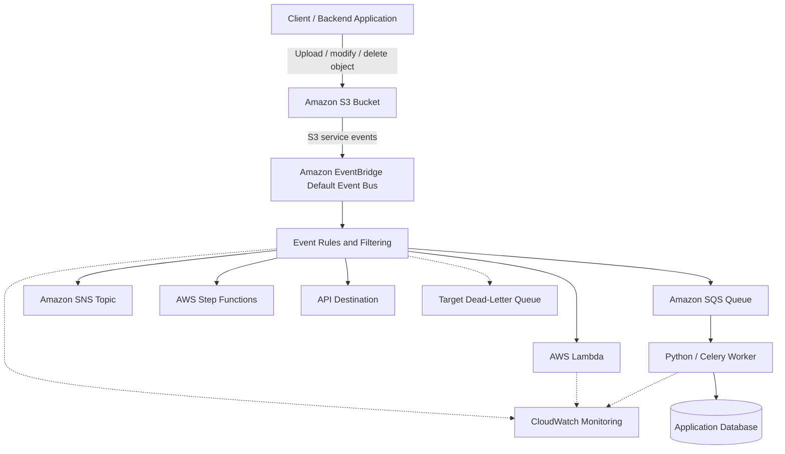
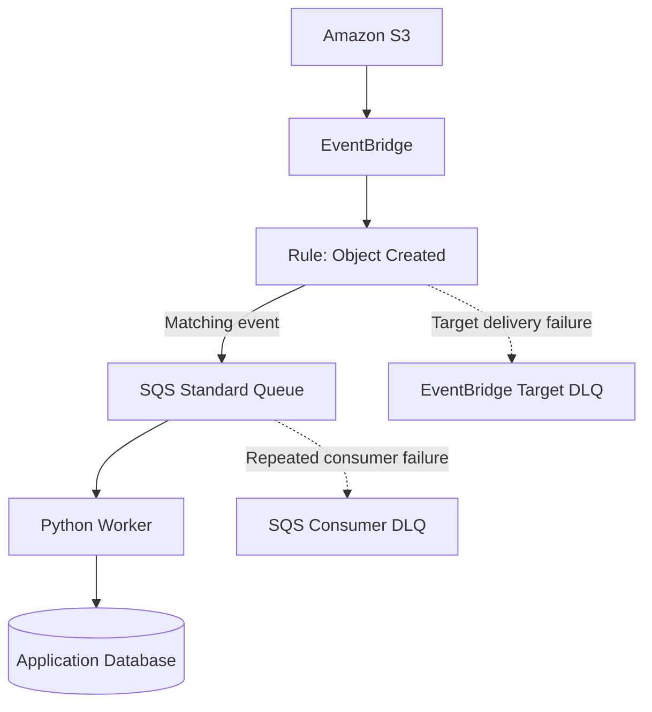
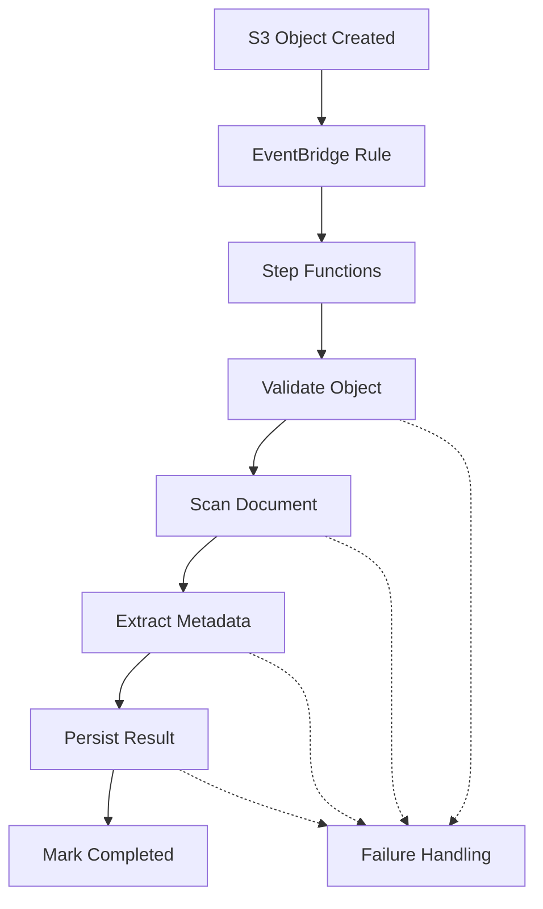

# 05- Amazon EventBridge Integration

## Overview

Amazon EventBridge integrates with Amazon S3 to route object events to downstream AWS services and applications. When an S3 event occurs, S3 sends an event to EventBridge, where rules evaluate the event against configured patterns and route matching events to one or more targets.

Unlike direct S3-to-SQS or S3-to-Lambda notification configurations, EventBridge provides a centralized event-routing layer. It supports more expressive event filtering, multiple targets, retry policies, dead-letter queues, and integration with services such as AWS Lambda, Amazon SQS, Amazon SNS, AWS Step Functions, and API destinations.

Typical use cases include:

- Processing uploaded documents or images.
- Routing object-created events to different processing pipelines based on bucket, prefix, or event type.
- Sending events to SQS FIFO queues for ordered processing within message groups.
- Orchestrating multi-step workflows using Step Functions.
- Handling object deletion, restoration, tagging, and storage-class changes.
- Connecting S3 activity to other AWS services and external applications.

EventBridge is particularly useful when S3 events must be routed to multiple independent workflows or when event filtering and downstream orchestration require more flexibility than direct S3 notifications provide.

## Architecture and Event Flow

### S3-to-EventBridge Architecture



### Component Responsibilities

| Component | Responsibility |
|---|---|
| Amazon S3 | Stores objects and emits configured event notifications. |
| EventBridge event bus | Receives events and makes them available for rule evaluation. |
| EventBridge rule | Matches event patterns and selects destination targets. |
| Lambda | Executes event-driven application code. |
| SQS | Buffers events for asynchronous consumers and supports controlled processing retries. |
| SNS | Distributes events to multiple subscribers. |
| Step Functions | Coordinates multi-step processing workflows. |
| API destinations | Deliver events to supported external HTTP endpoints. |
| EventBridge target DLQ | Retains eligible events that EventBridge could not successfully deliver to a target. |
| CloudWatch | Exposes EventBridge metrics and supports operational monitoring. |

S3 produces the event, EventBridge decides where it should go, and the target performs the downstream operation. These responsibilities should remain separate so each component can scale and fail independently.

## S3 EventBridge Events vs. Direct S3 Notifications

S3 supports both traditional event notification destinations and EventBridge integration.

| Capability | Direct S3 Notifications | S3 with EventBridge |
|---|---|---|
| Event filtering | Event types and object-key prefix/suffix filters | Structured event patterns with more flexible filtering |
| Destinations | Supported SQS Standard queues, SNS Standard topics, Lambda | Supported EventBridge targets, including SQS FIFO queues |
| Multiple downstream workflows | Multiple notification configurations, subject to S3 configuration constraints | Multiple rules and targets |
| Complex event routing | Limited | Strong |
| Target delivery retry policies | Depends on destination and protocol | Configurable EventBridge target retry policy |
| Target dead-letter queues | Depends on the destination or subscription | Supported for eligible rule targets |
| Multi-service orchestration | Requires additional integration logic | Integrates with services such as Step Functions |
| Additional configuration layer | Relatively simple | Requires EventBridge rules, targets, and permissions |

### When to Choose Each Approach

Use direct S3 notifications when the requirement is simple, such as sending object-created events to a single SQS Standard queue.

Prefer EventBridge when you need:

- Multiple independent routing rules.
- Filtering based on several event attributes.
- Routing to FIFO queues or workflow orchestration services.
- Centralized target delivery monitoring and failure handling.
- Integration with other AWS service events.

EventBridge introduces additional configuration, permissions, and potentially additional cost. Use it when the routing and orchestration capabilities justify that complexity.

## S3 Service Events and CloudTrail Events

Amazon S3 integrates with EventBridge through two distinct event mechanisms.

### Native S3 Service Events

Native S3 service events describe changes in S3 resources and objects. Examples include:

- `Object Created`
- `Object Deleted`
- `Object Restore Initiated`
- `Object Restore Completed`
- `Object Tags Added`
- `Object Tags Deleted`
- `Object ACL Updated`
- `Object Storage Class Changed`
- `Object Access Tier Changed`

These events are suitable for processing uploaded objects and responding to changes in object state.

S3 delivers these service events directly to EventBridge after the integration is enabled on the bucket. AWS documents this delivery category as durable.

### S3 Events Delivered Through CloudTrail

CloudTrail records API activity. EventBridge can route CloudTrail events that describe S3 API calls, such as API operations used to inspect or modify bucket configuration or access objects.

These events use a different event structure, commonly identified by:

```json
{
  "source": ["aws.s3"],
  "detail-type": ["AWS API Call via CloudTrail"],
  "detail": {
    "eventSource": ["s3.amazonaws.com"]
  }
}
```

For object-level S3 API activity, the relevant CloudTrail data events must be enabled for the intended resources. CloudTrail data-event logging can incur additional charges.

Do not confuse an S3 service event that indicates an object was created with a CloudTrail event that records an API call. They have different schemas, configuration requirements, and delivery guarantees.

| Requirement | Recommended Event Type |
|---|---|
| Process an uploaded object | Native S3 `Object Created` event |
| Detect an object deletion | Native S3 `Object Deleted` event |
| React to object restoration | Native S3 restore events |
| Audit an S3 API operation | CloudTrail event |
| Investigate API activity and access behavior | CloudTrail events with appropriate logging enabled |

Official references:

- [Amazon S3 events in EventBridge](https://docs.aws.amazon.com/eventbridge/latest/ref/events-ref-s3.html)
- [S3 EventBridge message structure](https://docs.aws.amazon.com/AmazonS3/latest/userguide/ev-events.html)
- [AWS service events delivered through CloudTrail](https://docs.aws.amazon.com/eventbridge/latest/userguide/eb-service-event-cloudtrail.html)

## Enable EventBridge for an S3 Bucket

Before creating EventBridge rules, enable the EventBridge destination on the S3 bucket.

This setting allows S3 to send supported bucket events to EventBridge. It does not automatically create rules or subscribe downstream services.

### Enable EventBridge Using the AWS CLI

```bash
aws s3api put-bucket-notification-configuration \
  --bucket company-documents-prod \
  --notification-configuration '{"EventBridgeConfiguration": {}}' \
  --region ap-south-1
```

After enabling the integration, allow approximately five minutes for the configuration change to take effect.

**Important:** `put-bucket-notification-configuration` replaces the bucket's entire notification configuration. The example is safe only when the supplied configuration represents all destinations that should remain configured. Preserve existing SQS, SNS, Lambda, and EventBridge entries when updating a bucket that already uses notifications.

### Enable EventBridge Using Boto3

The following example preserves existing notification destinations while enabling EventBridge.

```python
import boto3


REGION = "ap-south-1"
BUCKET_NAME = "company-documents-prod"

s3_client = boto3.client(
    "s3",
    region_name=REGION,
)

existing = s3_client.get_bucket_notification_configuration(
    Bucket=BUCKET_NAME,
)

# Keep only supported notification configuration fields.
configuration = {
    key: existing[key]
    for key in (
        "TopicConfigurations",
        "QueueConfigurations",
        "LambdaFunctionConfigurations",
        "EventBridgeConfiguration",
    )
    if key in existing
}

configuration["EventBridgeConfiguration"] = {}

s3_client.put_bucket_notification_configuration(
    Bucket=BUCKET_NAME,
    NotificationConfiguration=configuration,
)
```

This implementation preserves notification destinations returned by the initial read. In production, centralize ownership of bucket notification configuration because concurrent updates can overwrite one another.

Do not include response-only metadata such as `ResponseMetadata` in the notification configuration.

Verify the saved configuration:

```python
result = s3_client.get_bucket_notification_configuration(
    Bucket=BUCKET_NAME,
)

print(result.get("EventBridgeConfiguration"))
```

An enabled EventBridge configuration should be present in the response.

Official reference: [Enabling Amazon EventBridge for S3](https://docs.aws.amazon.com/AmazonS3/latest/userguide/enable-event-notifications-eventbridge.html).

## EventBridge Event Structure

EventBridge wraps the S3 event details in a standard event envelope. The most important fields include:

| Field | Purpose |
|---|---|
| `version` | EventBridge envelope version |
| `id` | Identifier assigned to the event |
| `source` | Event producer, such as `aws.s3` |
| `detail-type` | Specific event category, such as `Object Created` |
| `account` | AWS account ID associated with the event |
| `time` | Event timestamp |
| `region` | AWS Region associated with the event |
| `resources` | Resource identifiers associated with the event |
| `detail.bucket.name` | Source bucket name |
| `detail.object.key` | Object key |
| `detail.object.version-id` | Object version identifier when available |
| `detail.object.sequencer` | Sequencer useful for comparing events for the same object key |
| `detail.reason` | Operation responsible for the event, where provided |

Example object-created event:

```json
{
  "version": "0",
  "id": "17793124-05d4-b198-2fde-7ededc63b103",
  "detail-type": "Object Created",
  "source": "aws.s3",
  "account": "123456789012",
  "time": "2026-10-13T10:00:00Z",
  "region": "ap-south-1",
  "resources": [
    "arn:aws:s3:::company-documents-prod"
  ],
  "detail": {
    "version": "0",
    "event-version": "1.2",
    "bucket": {
      "name": "company-documents-prod"
    },
    "object": {
      "key": "incoming/report.pdf",
      "size": 2048,
      "etag": "example-etag",
      "version-id": "example-version-id",
      "sequencer": "617f08299329d189"
    },
    "reason": "PutObject"
  }
}
```

The example is illustrative. Real events can include additional fields or omit fields that do not apply to the operation.

Use the schema for the event type being consumed. In particular, EventBridge S3 events use `detail.object.version-id`, whereas traditional S3 notification records use `s3.object.versionId`.

Do not assume that every EventBridge event has an identical `detail` structure. Validate required fields and tolerate additional fields so that schema evolution does not unnecessarily break consumers.

## Create an EventBridge Rule

An EventBridge rule defines which events should be routed to a target.

Rules evaluate matching fields in the event JSON. For S3 object-processing pipelines, common filters include:

- Event source.
- Event type.
- Bucket name.
- Object-key prefix.
- Operation reason, where provided.
- Account or Region when relevant.

### Example Event Pattern

Suppose the requirement is to process newly created PDF files under `incoming/` in the `company-documents-prod` bucket.

```json
{
  "source": ["aws.s3"],
  "detail-type": ["Object Created"],
  "detail": {
    "bucket": {
      "name": ["company-documents-prod"]
    },
    "object": {
      "key": [
        {
          "prefix": "incoming/"
        }
      ]
    }
  }
}
```

This rule matches object-created events from the specified bucket when the key begins with `incoming/`.

The pattern above does not restrict events to PDF files. If the extension matters, apply a supported suffix filter or use an explicit event pattern that matches the required key naming convention. Test the pattern against representative events before deploying it.

### Why Event Filtering Matters

Suppose a bucket contains these objects:

```text
incoming/report.pdf
incoming/invoice.pdf
incoming/photo.jpg
processed/report.pdf
archive/old-report.pdf
```

A rule matching `incoming/` avoids invoking the processing workflow for objects stored under unrelated prefixes. This reduces unnecessary downstream processing and simplifies operational monitoring.

However, an object-key prefix is a routing rule, not a security boundary. Consumers must still enforce authorization and validate event details before accessing sensitive resources.

## Configure an EventBridge Rule Using Boto3

The following example creates an EventBridge rule that matches object-created events for the designated bucket and prefix.

```python
import json

import boto3


REGION = "ap-south-1"
RULE_NAME = "process-incoming-s3-objects"

events_client = boto3.client(
    "events",
    region_name=REGION,
)

event_pattern = {
    "source": ["aws.s3"],
    "detail-type": ["Object Created"],
    "detail": {
        "bucket": {
            "name": ["company-documents-prod"],
        },
        "object": {
            "key": [
                {
                    "prefix": "incoming/",
                },
            ],
        },
    },
}

response = events_client.put_rule(
    Name=RULE_NAME,
    Description=(
        "Route S3 object-created events for incoming objects."
    ),
    EventPattern=json.dumps(event_pattern),
    State="ENABLED",
)

rule_arn = response["RuleArn"]

print(rule_arn)
```

The rule uses the account's default event bus. Create the rule in the Region where the S3 event is delivered to EventBridge.

Creating a rule does not, by itself, configure a target. Add one or more targets and the appropriate permissions before relying on the rule in production.

### Validate Event Patterns

EventBridge provides an API for testing event patterns against representative event JSON.

```python
import json

import boto3


events_client = boto3.client(
    "events",
    region_name="ap-south-1",
)

with open("sample-s3-event.json", encoding="utf-8") as file:
    event = json.load(file)

response = events_client.test_event_pattern(
    EventPattern=json.dumps(event_pattern),
    Event=json.dumps(event),
)

print(response["Result"])
```

Use realistic fixtures covering matching and nonmatching bucket names, prefixes, event types, and object keys.

A successful pattern test verifies matching behavior for the supplied example. It does not prove that the bucket is configured correctly or that EventBridge can deliver the event to a target.

## Route Events to Amazon SQS

SQS is a useful target when object processing should be buffered and performed asynchronously.



There are two separate failure boundaries:

- EventBridge might fail to deliver an event to SQS.
- SQS might successfully receive the event, but the consumer might fail to process it.

The EventBridge target DLQ handles eligible target-delivery failures. The SQS consumer DLQ handles messages that are repeatedly received but not successfully processed according to the queue's redrive policy.

These mechanisms complement one another; neither replaces the other.

### Configure an SQS Queue Policy

When using a resource-based policy for an SQS target, permit EventBridge to send messages from the intended rule.

```json
{
  "Version": "2012-10-17",
  "Statement": [
    {
      "Sid": "AllowEventBridgeRule",
      "Effect": "Allow",
      "Principal": {
        "Service": "events.amazonaws.com"
      },
      "Action": "sqs:SendMessage",
      "Resource": "arn:aws:sqs:ap-south-1:123456789012:s3-object-events",
      "Condition": {
        "ArnEquals": {
          "aws:SourceArn": "arn:aws:events:ap-south-1:123456789012:rule/process-incoming-s3-objects"
        }
      }
    }
  ]
}
```

Replace the resource and rule ARNs with the values from your deployment. Preserve other required queue-policy statements when applying the change.

If the queue uses a customer-managed KMS key, review the relevant key policy and EventBridge encryption requirements as well.

### Attach the SQS Target

```python
import boto3


REGION = "ap-south-1"
RULE_NAME = "process-incoming-s3-objects"
QUEUE_ARN = (
    "arn:aws:sqs:ap-south-1:123456789012:"
    "s3-object-events"
)

events_client = boto3.client(
    "events",
    region_name=REGION,
)

response = events_client.put_targets(
    Rule=RULE_NAME,
    Targets=[
        {
            "Id": "s3-object-processing-queue",
            "Arn": QUEUE_ARN,
        },
    ],
)

if response.get("FailedEntryCount", 0):
    raise RuntimeError(
        f"Failed to configure EventBridge targets: {response}"
    )

print("SQS target configured.")
```

Configure the queue policy before expecting target delivery to succeed. Also verify that the rule and queue are in compatible Regions and that the queue supports the selected target configuration.

## Routing Events to SQS FIFO

A direct S3 event notification cannot target an SQS FIFO queue. EventBridge provides an alternative when FIFO processing is required.

Use an EventBridge target with the FIFO queue's message-group configuration.

Conceptually, the target configuration includes:

```python
target = {
    "Id": "ordered-s3-processing",
    "Arn": (
        "arn:aws:sqs:ap-south-1:123456789012:"
        "s3-object-processing.fifo"
    ),
    "SqsParameters": {
        "MessageGroupId": "s3-object-processing",
    },
}
```

Use this configuration with `put_targets()` for a FIFO queue. The queue must be a FIFO queue, and the group identifier must comply with SQS requirements.

### Ordering Limitations

FIFO queues preserve ordering within a message group according to the messages accepted by SQS. This does not guarantee that S3 operations are delivered to EventBridge in the same order in which the operations occurred.

For example, an upload and a subsequent overwrite can produce events that arrive at a downstream queue in an unexpected order.

For workflows that require correctness across object versions:

- Use the object version identifier where available.
- Maintain application state that records the version or event sequence already processed.
- Prevent stale processing results from overwriting newer results.
- Choose message-group IDs that align with the business ordering requirement.

A single global message group simplifies ordering but limits concurrency. Per-object groups can permit more parallelism, but consumers must still implement version-aware state transitions.

## Integrate EventBridge with AWS Lambda

Lambda is useful when an S3 event should trigger a bounded, event-driven computation, such as metadata validation or scheduling an image-processing job.

EventBridge invokes Lambda through the configured rule target. The Lambda resource policy must allow EventBridge to invoke the function.

Example permission:

```python
import boto3


REGION = "ap-south-1"
FUNCTION_NAME = "process-s3-object"
RULE_ARN = (
    "arn:aws:events:ap-south-1:123456789012:"
    "rule/process-incoming-s3-objects"
)

lambda_client = boto3.client(
    "lambda",
    region_name=REGION,
)

lambda_client.add_permission(
    FunctionName=FUNCTION_NAME,
    StatementId="AllowEventBridgeS3Rule",
    Action="lambda:InvokeFunction",
    Principal="events.amazonaws.com",
    SourceArn=RULE_ARN,
)
```

After granting permission, attach the Lambda function as a target using `events.put_targets()`.

If a statement with the same identifier already exists, manage the existing permission instead of blindly repeating the operation.

### Lambda Event Handler

```python
import logging


logger = logging.getLogger()
logger.setLevel(logging.INFO)


def lambda_handler(event, context):
    detail = event.get("detail", {})
    bucket = detail.get("bucket", {}).get("name")
    object_detail = detail.get("object", {})
    object_key = object_detail.get("key")
    event_type = event.get("detail-type")
    event_id = event.get("id")

    if event_type != "Object Created":
        logger.info(
            "Skipping unsupported event type",
            extra={
                "event_id": event_id,
                "event_type": event_type,
            },
        )
        return {"status": "skipped"}

    if not bucket or not object_key:
        raise ValueError("Event is missing required object details")

    logger.info(
        "Received S3 object event",
        extra={
            "event_id": event_id,
            "bucket": bucket,
            "object_key": object_key,
        },
    )

    # Validate the bucket, key, and operation before processing.
    # Implement idempotent processing or dispatch to a durable queue.

    return {"status": "accepted"}
```

This example illustrates event parsing rather than completing the file-processing operation. Production code should validate the source account and bucket, enforce application-specific restrictions, and implement idempotency.

### Avoid Recursive Event Processing

If Lambda creates an output object in the same bucket that triggers the function, the output write can generate another event and invoke the function again.

Avoid this loop by:

- Restricting the rule to a dedicated input prefix, such as `incoming/`.
- Writing output objects under a different prefix, such as `processed/`.
- Using separate buckets when stronger isolation is appropriate.
- Ensuring that retries and duplicate events do not produce duplicate business outcomes.

Do not rely exclusively on event-type filtering to prevent recursion. A generated output object can itself be an object-created event.

## EventBridge with Step Functions

Use Step Functions when an object event must initiate a multi-step process with explicit state management, branching, and failure recovery.

A document-processing workflow might:

1. Validate the object and its metadata.
2. Start a malware scan.
3. Extract document contents.
4. Persist the processing result.
5. Update the application status.
6. Notify an external system after completion.

EventBridge can route the matching S3 event to a Step Functions state machine. The state machine then coordinates the processing steps.



Keep the event-to-workflow interface stable and pass object references rather than the complete object contents. Each step should have bounded retries and a defined failure path.

The workflow must still account for duplicate events. EventBridge delivery, state machine execution, and downstream side effects are distinct stages; a successful workflow launch does not guarantee that the entire business operation will occur exactly once.

## EventBridge Retry and Dead-Letter Queues

EventBridge retries eligible target-delivery failures according to the configured retry policy.

The default rule-target retry policy is up to 24 hours and 185 attempts, subject to the service's retry behavior. The retry policy can be customized using a maximum event age and maximum retry attempts.

### Configure a Target DLQ

For important processing workflows, configure an SQS dead-letter queue for the EventBridge target. This queue captures eligible events that EventBridge could not deliver successfully after its retry behavior is exhausted or when a non-retriable target-delivery error occurs.

A DLQ is especially useful for diagnosing:

- Missing target permissions.
- Deleted or misconfigured target resources.
- Target throttling or availability problems.
- Persistent delivery errors.
- Encryption or configuration failures.

The DLQ needs appropriate permissions for EventBridge to send failed events. If the queue uses customer-managed encryption, validate the related key policy too.

### Understand the Failure Boundaries

| Failure Stage | Recommended Mechanism |
|---|---|
| S3 event configuration is incorrect | Validate bucket configuration and EventBridge integration |
| An EventBridge rule does not match | Test and correct the event pattern |
| EventBridge cannot deliver to a target | Configure target retries and an EventBridge target DLQ |
| SQS accepts the event but a worker fails | Use SQS visibility timeout, redrive policy, and consumer DLQ |
| Lambda accepts an invocation but processing fails | Configure Lambda error handling and appropriate retry or failure-destination behavior |
| A workflow starts but a processing step fails | Configure Step Functions retries, catches, and execution monitoring |
| The consumer completes work but crashes before acknowledging it | Make the business operation idempotent |

A target DLQ does not capture every possible downstream processing failure. For example, if EventBridge successfully puts a message into SQS but a worker subsequently fails, the SQS consumer's failure-handling configuration is responsible for that condition.

Official references:

- [Monitoring EventBridge event delivery](https://docs.aws.amazon.com/eventbridge/latest/userguide/eb-monitoring-events-best-practices.html)
- [Using dead-letter queues in EventBridge](https://docs.aws.amazon.com/eventbridge/latest/userguide/eb-rule-dlq.html)

## Security and Permissions

The integration crosses multiple resource and identity boundaries. Each component must have permission to perform its specific operation.

| Component | Required Access |
|---|---|
| S3 bucket | EventBridge integration enabled for the intended bucket |
| EventBridge rule | Permission to evaluate matching events on the intended event bus |
| EventBridge to SQS | Queue resource policy or appropriate target authorization |
| EventBridge to Lambda | Lambda resource policy allowing the intended rule to invoke the function |
| Lambda to S3 | Execution-role permissions for required object access |
| EventBridge to Step Functions | Appropriate target permissions and execution role |
| Consumer worker | Queue receive/delete permissions and required object access |
| Customer-managed KMS key | Key policy and required permissions for the relevant encrypted operations |

### Least-Privilege Design

- Scope rules to the intended source bucket and event types.
- Use narrow event filters to avoid routing unrelated events.
- Restrict target permissions to the intended rule ARN where supported.
- Use IAM roles and temporary credentials rather than hardcoded access keys.
- Validate the bucket, account, and key before processing an event.
- Encrypt queues and other destinations according to the workload's data classification.
- Preserve sufficient event context for auditing without logging sensitive content.

Event filtering reduces unnecessary processing; it does not replace authorization. A consumer that retrieves a protected S3 object must have its own appropriate access permissions.

### Cross-Account Integration

EventBridge supports cross-account event routing when the relevant event bus policies, resource permissions, and target authorization are configured.

Cross-account designs should define explicitly:

- Which account owns the S3 bucket.
- Which account owns the event bus or target.
- Which principal may publish or forward events.
- Which rule controls the routing.
- Which identity may access the original object.

Do not assume that permission to receive an event grants permission to read the referenced S3 object.

## Monitoring and Observability

Monitor EventBridge routing separately from target processing.

| Signal | Purpose |
|---|---|
| EventBridge `MatchedEvents` | Indicates events matched by a rule |
| EventBridge `Invocations` | Indicates target invocation attempts |
| EventBridge `FailedInvocations` | Indicates target delivery failures |
| EventBridge `InvocationsSentToDlq` | Indicates failures sent to a configured target DLQ |
| EventBridge `InvocationsFailedToBeSentToDlq` | Indicates failure to deliver eligible failed events to the DLQ |
| EventBridge `IngestionToInvocationSuccessLatency` | Helps assess event ingestion-to-target delivery latency |
| SQS queue depth | Measures buffered downstream work |
| SQS oldest-message age | Identifies delayed consumer processing |
| Lambda errors and duration | Measures function-level processing behavior |
| Step Functions execution failures | Identifies workflow-level processing problems |
| Application processing state | Measures actual business completion and failure |

Metric availability and dimensions depend on the service and integration.

### Correlation and Logging

Log the following where applicable:

- EventBridge event ID.
- Event type and source.
- S3 bucket and object key.
- Object version ID.
- Rule and target identifiers.
- Application processing or idempotency key.
- Processing status and failure category.

Do not treat EventBridge's successful target delivery as proof that the associated business operation completed. Track application-level processing state to measure the full workflow.

### Suggested Alerts

Configure actionable alerts for:

- Repeated target delivery failures.
- Events entering a target DLQ.
- SQS queue depth or oldest-message age exceeding workload thresholds.
- Increasing Lambda errors or timeouts.
- Step Functions execution failures.
- Excessive processing latency.
- Stalled application-level processing.

Thresholds should reflect business service-level objectives rather than arbitrary universal values.

## Performance and Cost Considerations

EventBridge adds routing and delivery capabilities but also introduces an additional service into the event path.

| Factor | Engineering Consideration |
|---|---|
| Event volume | More events and rule evaluations can increase cost |
| Number of rules and targets | Additional routing paths increase operational complexity and potentially delivery costs |
| Filtering quality | Narrow patterns reduce unnecessary target invocations |
| SQS buffering | Decouples event delivery from consumer capacity but adds queue operations |
| Lambda processing | Execution duration and concurrency affect cost |
| Workflow orchestration | Step Functions provides state management but adds workflow execution costs |
| CloudTrail data events | Auditing S3 API activity can introduce additional logging costs |
| Retries | Repeated target delivery or processing can add cost |
| Logging and monitoring | High event volume increases diagnostic data and monitoring activity |

Use the simplest routing architecture that satisfies the workload's requirements.

For high-volume workloads, avoid sending every event to expensive processing targets when only a subset of object events is relevant. EventBridge rules should express the actual routing requirements.

Review current pricing for the intended Region and configuration before estimating production costs.

## Testing Strategy

Testing should cover event generation, rule matching, target delivery, and business processing separately.

### Unit Tests

Test:

- EventBridge envelope parsing.
- Event-type validation.
- Bucket and prefix filtering assumptions.
- Required-field validation.
- Object-version handling.
- Idempotency behavior.
- Error classification.
- Correct handling of unknown or unsupported event types.

Use representative EventBridge event fixtures rather than assuming the payload is identical to a traditional S3 notification record.

### Integration Tests

In an isolated AWS environment, verify:

1. EventBridge is enabled on the intended bucket.
2. The rule is deployed with the correct event pattern.
3. A matching object upload generates an event that reaches the intended target.
4. Events that do not match the pattern are excluded from the workflow.
5. Target permissions permit delivery.
6. Encrypted targets can receive events where customer-managed KMS keys are used.
7. Target delivery failures follow the configured retry policy and DLQ behavior.
8. The consumer handles duplicate events without duplicate business outcomes.
9. Object retrieval uses the correct key and version where required.
10. The application exposes a successful or failed processing state.
11. The infrastructure can be safely removed after testing.

Allow for EventBridge enablement propagation and asynchronous delivery when designing integration-test timeouts.

A test that successfully invokes a Lambda function directly does not verify the S3-to-EventBridge-to-Lambda integration. Validate the complete path with an actual S3 operation.

## Troubleshooting Workflow

### S3 Events Do Not Reach EventBridge

**Symptoms:** No matching events arrive at the configured target.

**Diagnosis:**

1. Inspect the bucket's EventBridge notification configuration.
2. Confirm that the setting is enabled.
3. Allow for configuration propagation.
4. Confirm the rule is enabled on the appropriate event bus and Region.
5. Generate a controlled event by uploading an object.
6. Validate that the emitted event matches the expected EventBridge schema.
7. Test the rule's event pattern against that event.
8. Check relevant EventBridge metrics.

Inspect the bucket configuration:

```bash
aws s3api get-bucket-notification-configuration \
  --bucket company-documents-prod \
  --region ap-south-1
```

A saved bucket setting alone does not prove that a rule matches the emitted events.

### Events Reach EventBridge but the Rule Does Not Match

**Likely causes:**

- Incorrect `source`.
- Incorrect `detail-type`.
- Wrong bucket name or Region assumptions.
- Object prefix mismatch.
- Incorrect field path in the pattern.
- Confusion between native S3 service events and CloudTrail events.

Compare the actual event JSON with the configured pattern. Remember that `Object Created` is the native S3 EventBridge detail type, while `AWS API Call via CloudTrail` identifies CloudTrail-delivered events.

Use `test_event_pattern` with real or representative event JSON.

### The Rule Matches but the Target Does Not Receive Events

**Diagnosis:**

1. Inspect the configured targets.
2. Verify the target resource still exists.
3. Check SQS queue policies or Lambda resource permissions.
4. Verify cross-account permissions if applicable.
5. Review KMS configuration for encrypted targets.
6. Inspect `FailedInvocations` and other available delivery metrics.
7. Check the configured target DLQ for failed deliveries.

Do not troubleshoot S3 object permissions first if the event itself never reaches the consumer. Distinguish event-routing failure from downstream object-access failure.

### The Target Receives Events but Processing Fails

Check application logs and confirm that the consumer expects the EventBridge event schema.

For S3 object reads, verify the bucket, key, Region, and object version. Confirm that the consumer's execution role permits the required S3 operations.

If the workflow creates output objects, ensure the rule does not select those output objects and trigger an unintended processing loop.

### Events Are Processed More Than Once

Repeated delivery can occur across distributed event processing and retry boundaries. Inspect event IDs, object versions, processing records, and downstream side effects.

Use persistent idempotency controls and ensure that the business operation cannot be repeated accidentally. Do not rely solely on the EventBridge event ID when the same logical operation might be represented by different events.

## Production Readiness Checklist

### Event Configuration

- [ ] EventBridge is enabled on the intended S3 bucket.
- [ ] Existing bucket notification configurations are preserved.
- [ ] Rules use the correct source, detail type, bucket, and event filters.
- [ ] EventBridge rules are deployed in the intended Region.
- [ ] Targets are configured and their permissions are validated.

### Reliability

- [ ] Target retry policies suit the workload.
- [ ] An EventBridge target DLQ is configured where justified.
- [ ] Downstream consumers have their own retry and failure-recovery strategy.
- [ ] Processing is idempotent.
- [ ] Version-aware processing is implemented when required.
- [ ] FIFO routing does not assume that event arrival order equals original S3 operation order.
- [ ] Recursive events are prevented by filters or resource boundaries.

### Security and Operations

- [ ] IAM permissions follow least privilege.
- [ ] Target resource policies restrict access to the intended EventBridge rule.
- [ ] Customer-managed KMS permissions are verified where applicable.
- [ ] Event and application logs preserve useful correlation identifiers.
- [ ] Delivery failures and downstream processing failures are monitored separately.
- [ ] Integration tests exercise the complete S3-to-EventBridge-to-target path.
- [ ] Deployment and rollback procedures preserve existing routing configuration.
- [ ] Test resources and data can be removed safely.

## Official References

- [Enabling EventBridge for Amazon S3](https://docs.aws.amazon.com/AmazonS3/latest/userguide/enable-event-notifications-eventbridge.html)
- [Amazon S3 events in EventBridge](https://docs.aws.amazon.com/eventbridge/latest/ref/events-ref-s3.html)
- [S3 EventBridge message structure](https://docs.aws.amazon.com/AmazonS3/latest/userguide/ev-events.html)
- [Creating EventBridge event patterns](https://docs.aws.amazon.com/eventbridge/latest/userguide/eb-event-patterns.html)
- [EventBridge targets](https://docs.aws.amazon.com/eventbridge/latest/userguide/eb-targets.html)
- [EventBridge retry policies](https://docs.aws.amazon.com/eventbridge/latest/userguide/eb-rule-retry-policy.html)
- [EventBridge dead-letter queues](https://docs.aws.amazon.com/eventbridge/latest/userguide/eb-rule-dlq.html)
- [Monitoring EventBridge event delivery](https://docs.aws.amazon.com/eventbridge/latest/userguide/eb-monitoring-events-best-practices.html)
- [S3 events delivered through CloudTrail](https://docs.aws.amazon.com/eventbridge/latest/userguide/eb-service-event-cloudtrail.html)

## Key Takeaways

- EventBridge provides flexible routing and filtering for S3 events, making it suitable for multi-target workflows and more complex event-driven architectures.
- Native S3 service events and CloudTrail-delivered S3 API events use different event structures and serve different purposes.
- Enabling EventBridge on a bucket does not automatically configure rules, targets, or permissions.
- Target retries and dead-letter queues handle delivery failures, while downstream consumers must independently implement idempotency and processing recovery.
- Reliable production integrations require least-privilege permissions, representative end-to-end tests, actionable monitoring, and protection against recursive or stale event processing.