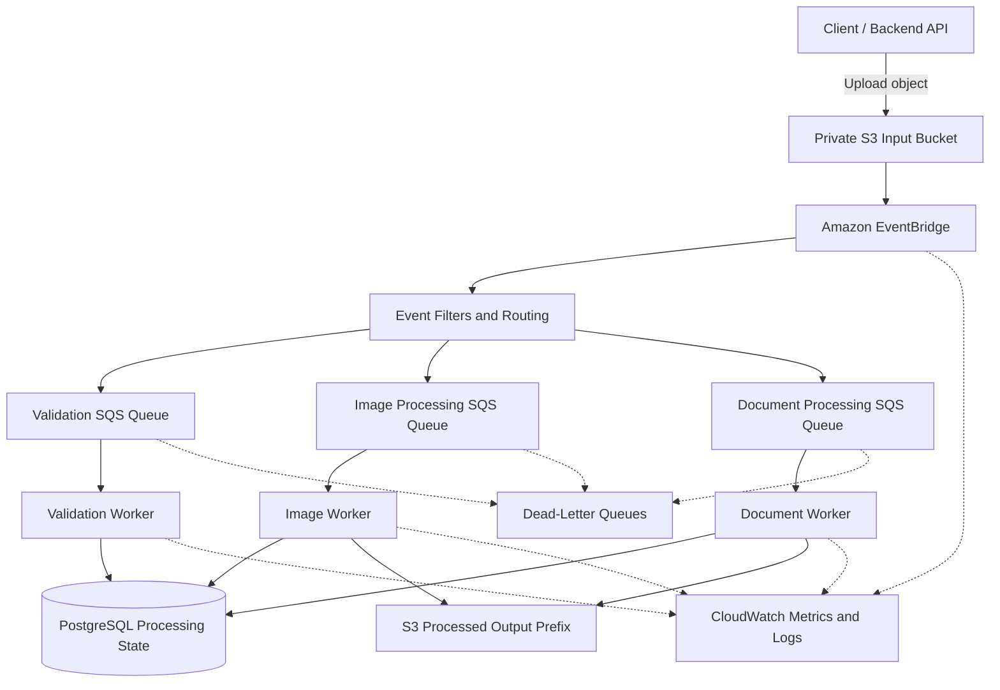
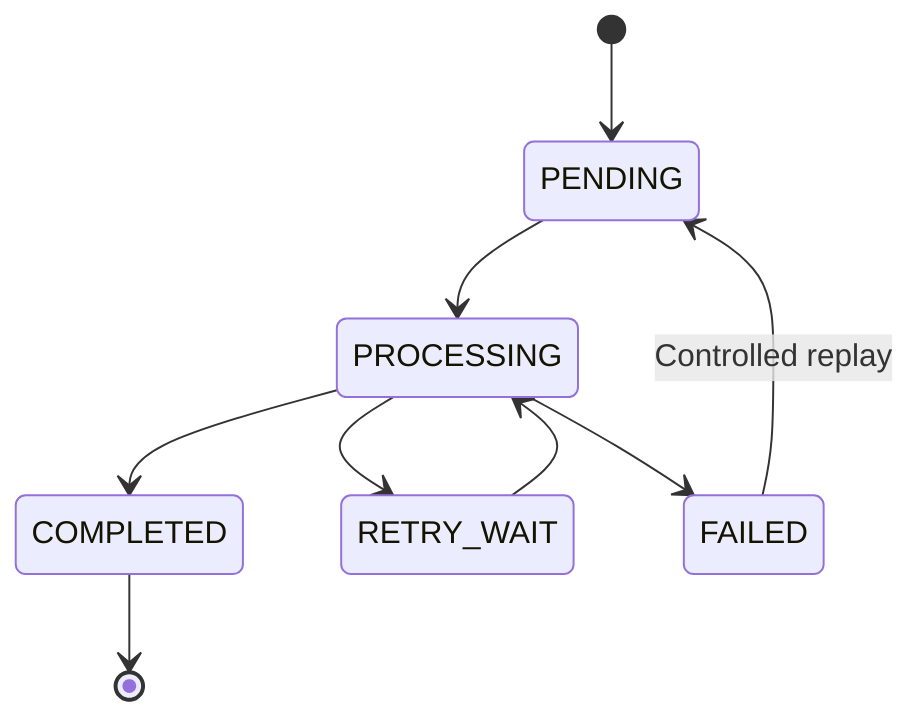
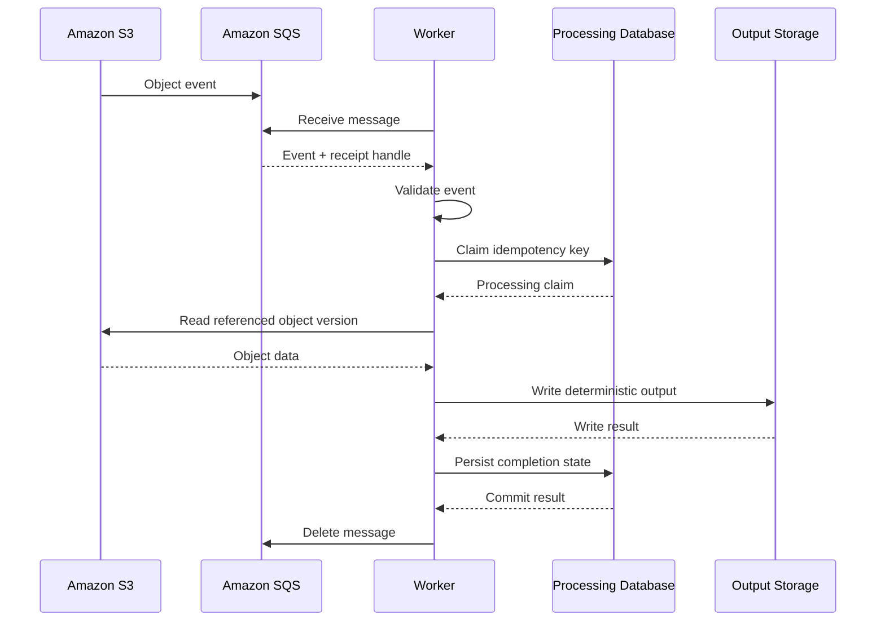
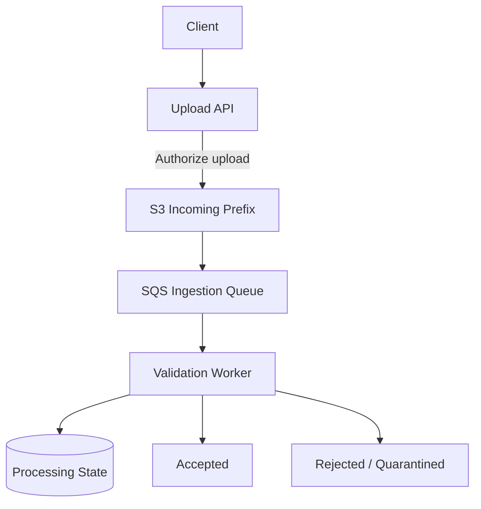

# 06- Event-Driven Processing Workflows

## Overview

Amazon S3 event-driven processing enables backend systems to react to object operations without coupling file uploads to downstream computation. When an object is created, deleted, restored, or otherwise changed through a supported operation, S3 can publish an event that initiates an asynchronous workflow.

A production implementation typically combines S3 with an event-routing service, a durable queue, one or more processing components, and a persistent store for business processing state.

Typical workloads include:

- Document validation, malware scanning, and metadata extraction.
- Image resizing, media transcoding, and thumbnail generation.
- CSV ingestion, data normalization, and analytics preparation.
- Search indexing and downstream data synchronization.
- Document classification and AI inference.
- Archival, retention, and application-state synchronization.

The key engineering challenge is not triggering a function when a file arrives. It is ensuring that the correct object version is processed, failures are recoverable, repeated events do not create duplicate outcomes, and the application can determine whether processing has actually completed.

## Core Architecture

### Reference Production Architecture



This architecture separates object storage, event routing, message buffering, processing, and business state.

An upload endpoint can return quickly after accepting or authorizing the upload. Processing happens independently, and the application exposes its status through an API or another state-access mechanism.

### Component Responsibilities

| Component | Responsibility |
|---|---|
| Amazon S3 | Stores source objects and emits supported events. |
| EventBridge | Filters and routes events to appropriate targets. |
| Amazon SQS | Buffers work and decouples delivery from consumer availability. |
| AWS Lambda | Executes bounded event-driven computation. |
| ECS or Kubernetes workers | Handle long-running, resource-intensive, or continuously consumed workloads. |
| Step Functions | Coordinates dependent processing steps, retries, and explicit workflow state. |
| PostgreSQL or DynamoDB | Tracks jobs, idempotency, processing status, and business metadata. |
| Amazon SNS | Distributes events to multiple independent subscribers. |
| CloudWatch | Provides operational metrics, logs, and alarms. |

Each component solves a different problem. EventBridge does not replace durable consumer processing, SQS does not store business workflow state, and a Lambda execution does not automatically guarantee an exactly-once business result.

## Choosing an Event-Driven Pattern

The simplest suitable architecture is generally preferable. Introduce additional services when they provide a concrete reliability, routing, or operational benefit.

| Pattern | Suitable Workloads | Primary Trade-Off |
|---|---|---|
| S3 → Lambda | Small, bounded object transformations | Function execution limits and processing retries must be considered |
| S3 → SQS → Worker | Asynchronous ingestion, long-running processing, burst absorption | Requires queue consumers and recovery procedures |
| S3 → SNS → Subscribers | One event must reach multiple independent consumers | Each subscriber has separate delivery and failure semantics |
| S3 → EventBridge → Multiple Targets | Complex event filtering and routing | Adds routing configuration and another operational boundary |
| S3 → EventBridge → SQS FIFO | Ordered downstream processing within message groups | Original S3 operation order is not automatically guaranteed |
| S3 → EventBridge → Step Functions | Multi-stage processing with explicit state and branching | Adds workflow execution costs and orchestration complexity |
| S3 → EventBridge → Lambda → SQS | Event validation or lightweight routing followed by durable processing | Adds an extra invocation and component to operate |

### Selection Rules

Use direct S3-to-Lambda integration for straightforward, bounded processing when a separate queue is unnecessary.

Use SQS when processing duration varies, workloads can spike, consumers need independent scaling, or messages must remain available while workers are unavailable.

Use SNS or EventBridge when multiple consumers need independent copies of an event. A single SQS message consumed by competing workers is not fan-out: only one consumer normally receives a particular delivery at a time.

Use Step Functions when the workload contains dependent steps, branching, explicit timeouts, compensation, or workflow-level recovery.

Do not introduce Lambda solely because the workflow is event-driven. Containers or persistent workers may be more appropriate when processing is long-running, CPU-intensive, memory-intensive, or requires specialized dependencies.

## Event Delivery and Processing Semantics

### At-Least-Once Delivery

S3 event notifications are designed for at-least-once delivery. Events can be duplicated and may arrive out of order.

EventBridge and downstream messaging services have their own delivery and retry behavior. Combining them does not establish end-to-end exactly-once processing.

Consider this sequence:

1. S3 emits an object-created event.
2. A worker downloads the object and commits a database transaction.
3. The worker crashes before acknowledging the message.
4. The message is delivered again.
5. The worker repeats the operation.

Without idempotency, the second execution can create duplicate database records, repeated charges, duplicate notifications, or overwritten outputs.

**Design business operations to be idempotent rather than assuming each event is processed once.**

### Duplicate Events vs. Duplicate Business Operations

These are related but different conditions:

- **Duplicate event delivery:** The consumer receives the same event more than once.
- **Duplicate execution:** The consumer attempts the same processing operation repeatedly.
- **Duplicate business outcome:** Repeated execution produces multiple records, payments, notifications, or other externally visible effects.

A system can tolerate duplicate delivery and execution if it prevents duplicate business outcomes.

### Ordering

S3 event delivery does not guarantee that events arrive in the original operation order. SQS Standard and typical EventBridge processing also do not provide a global ordering guarantee.

For example, an object key might be overwritten twice:

```text
incoming/customer-42/report.pdf
```

The event for the second upload might be processed before the event for the first upload. A slower worker could then overwrite a newer processing result with an older one.

Possible controls include:

- Process immutable object versions.
- Maintain a current-version pointer in application state.
- Reject results from stale processing attempts.
- Compare S3 sequencers when events relate to the same object key.
- Use SQS FIFO where ordered queue processing is required and the event-routing path supports it.

S3 event sequencers are suitable for comparisons involving the same object key, not for establishing a global order across unrelated objects.

## Understand the Event Payload

S3 supports more than one event-delivery mechanism. Consumers must know which event schema they receive.

### Traditional S3 Notification

A traditional notification delivered directly to SQS or Lambda contains a `Records` array.

A simplified record:

```json
{
  "eventSource": "aws:s3",
  "eventName": "ObjectCreated:Put",
  "awsRegion": "ap-south-1",
  "s3": {
    "bucket": {
      "name": "company-documents-prod"
    },
    "object": {
      "key": "incoming/report.pdf",
      "versionId": "example-version-id",
      "sequencer": "0067AABBCCDD"
    }
  }
}
```

Traditional S3 notification object keys use URL encoding. Decode the key according to the notification format before using it in an S3 request.

```python
from urllib.parse import unquote_plus


def decode_s3_notification_key(encoded_key: str) -> str:
    return unquote_plus(encoded_key)
```

### EventBridge S3 Event

An EventBridge event uses a common envelope and places S3-specific information inside `detail`.

```json
{
  "version": "0",
  "id": "example-event-id",
  "source": "aws.s3",
  "detail-type": "Object Created",
  "account": "123456789012",
  "region": "ap-south-1",
  "time": "2026-10-13T10:00:00Z",
  "resources": [
    "arn:aws:s3:::company-documents-prod"
  ],
  "detail": {
    "bucket": {
      "name": "company-documents-prod"
    },
    "object": {
      "key": "incoming/report.pdf",
      "version-id": "example-version-id",
      "sequencer": "0067AABBCCDD"
    },
    "reason": "PutObject"
  }
}
```

The example is illustrative; actual fields depend on the event type.

The schemas differ in field paths and naming conventions. Traditional notifications use `s3.object.versionId`, whereas EventBridge uses `detail.object.version-id`.

Do not build a single parser that assumes these formats are interchangeable. Create explicit adapters and test special-character object keys against representative payloads.

### Event Validation

Before processing an event, validate:

- Expected event source and event type.
- Expected AWS account and Region.
- Allowed bucket and object-key prefix.
- Required object key and version fields.
- Processing operation supported by the consumer.
- Any business-level tenant or resource authorization requirements.

An event's presence in a queue is not sufficient authorization to access every referenced resource. Consumers should use least-privilege roles and enforce their own business access controls.

## Object Identity and Version-Aware Processing

### Why an Object Key Is Not Always Enough

An S3 object key identifies the logical object name, not necessarily an immutable object version.

If a key is overwritten, a worker that retrieves the object using only the key may read a newer version than the event originally referenced.

For workflows where historical consistency matters, enable S3 versioning and use the version identifier from the event when retrieving the object.

```python
import boto3


s3_client = boto3.client("s3")


def get_event_object(
    bucket: str,
    object_key: str,
    version_id: str | None,
):
    request = {
        "Bucket": bucket,
        "Key": object_key,
    }

    if version_id:
        request["VersionId"] = version_id

    return s3_client.get_object(**request)
```

If version-specific processing is required, do not silently fall back to reading the latest object when the event lacks the expected version ID. Reject the event or use an explicit fallback policy.

### Recommended Idempotency Key

A useful idempotency key for a version-aware workflow can be derived from:

```text
bucket + object_key + version_id + processing_operation
```

For example, generating a thumbnail and extracting document metadata are different operations, even when both operate on the same object version.

For workflows without versioning, choose a stable event identity and persist the processing result. If the business operation is defined in terms of the latest object state, use explicit state reconciliation rather than assuming the event order reflects the current state.

## Model Processing as a State Machine

Event-driven processing benefits from explicit, persistent job states. A queue tells the system what work is available; it is not a substitute for business status.

### Example Processing States



A typical state model includes:

| State | Meaning |
|---|---|
| `PENDING` | The job has been recorded but processing has not started. |
| `PROCESSING` | A worker currently owns or is attempting the operation. |
| `RETRY_WAIT` | A recoverable failure requires another attempt. |
| `COMPLETED` | Processing and required result persistence have succeeded. |
| `FAILED` | Processing cannot continue without intervention or a policy change. |

Keep state transitions consistent. For example, do not mark a job `COMPLETED` merely because a Lambda function started or a queue message was received.

### Example PostgreSQL Schema

```sql
CREATE TABLE s3_processing_jobs (
    idempotency_key TEXT PRIMARY KEY,
    bucket_name TEXT NOT NULL,
    object_key TEXT NOT NULL,
    version_id TEXT,
    processing_operation TEXT NOT NULL,
    status TEXT NOT NULL,
    attempt_count INTEGER NOT NULL DEFAULT 0,
    error_code TEXT,
    created_at TIMESTAMPTZ NOT NULL DEFAULT NOW(),
    updated_at TIMESTAMPTZ NOT NULL DEFAULT NOW(),
    completed_at TIMESTAMPTZ
);

CREATE INDEX idx_s3_processing_jobs_status_updated
    ON s3_processing_jobs (status, updated_at);
```

Enforce uniqueness through a database constraint or an atomic insert. A read-then-insert sequence without concurrency control can allow two workers to claim the same job simultaneously.

For long-running tasks, use a lease or claim timeout so that jobs left in `PROCESSING` by a crashed worker can be recovered safely. Do not reset a live worker's state solely because the job has been running longer than an arbitrary threshold.

## A Reliable Processing Lifecycle

A robust object-processing lifecycle separates event receipt, processing ownership, output persistence, and acknowledgement.



The intended sequence is:

1. Validate the event and its allowed resource identifiers.
2. Compute the idempotency key.
3. Claim processing ownership using a concurrency-safe state transition.
4. Retrieve the correct object version.
5. Perform the operation.
6. Persist outputs and business metadata.
7. Mark the operation complete.
8. Acknowledge or delete the event message.

There is no automatic transaction spanning SQS, S3, and PostgreSQL. A failure between these steps can produce partial progress.

### Handle Partial Progress

For example, the worker might write the processed object to S3 but crash before recording completion in PostgreSQL. A retry should not blindly duplicate the result or assume the database is correct.

Use deterministic output keys, conditional writes where appropriate, a persisted operation identity, and reconciliation logic to discover and repair incomplete jobs.

For external side effects that cannot participate in the database transaction, use downstream idempotency keys, an outbox pattern, or an explicit workflow with compensating actions where appropriate.

## Design Workflow Patterns

### File Ingestion and Validation

Use this pattern when an uploaded file must be validated before entering downstream business processing.



Recommended controls include:

- Validate authentication and authorization before issuing upload permissions.
- Generate object keys on the server rather than trusting arbitrary client paths.
- Validate actual file properties rather than relying only on the declared content type.
- Apply size limits and format-specific validation.
- Store validation results and the exact object version being validated.
- Keep untrusted uploads separated from trusted processing outputs.
- Quarantine files that fail validation or security scanning.

An upload completing successfully means that S3 accepted the object. It does not mean that the content has passed business validation or malware scanning.

### Image and Media Processing

An image-processing workflow usually reads an original object and writes derived assets.

Recommended architecture:

- Store original files in a private input bucket or prefix.
- Trigger a processing workflow for supported file types.
- Retrieve the event's object version when required.
- Transform the object using bounded Lambda execution or a suitable worker fleet.
- Write deterministic output keys to a different output prefix or bucket.
- Persist processing metadata and the source version.
- Record errors and support safe retries.

Separate input and output locations to avoid recursive event triggering.

For memory-intensive transformations or large media files, evaluate worker containers instead of trying to fit every workload into a Lambda function.

### Document Processing

Document processing may require validation, text extraction, classification, indexing, and notification.

Use SQS to buffer incoming events, then a worker or Step Functions workflow to coordinate processing. Persist each stage's status so that a failed indexing operation does not force the system to repeat successful extraction unnecessarily.

For workflows with dependent stages, do not assume that multiple independent event subscribers automatically provide ordering. Represent dependencies explicitly through the workflow state machine or application state.

### Data Ingestion and Analytics

For data pipelines, S3 often acts as the landing and storage layer.

A typical flow is:

1. Upload raw datasets to a controlled prefix.
2. Validate file format, schema, and expected partition information.
3. Record an ingestion job and source version.
4. Transform or normalize the dataset.
5. Write results to a separate curated prefix.
6. Update catalog or application metadata.
7. Make successful outputs available to analytics consumers.

AWS Glue and Amazon Athena can support cataloging and querying when appropriate. Event-driven ingestion should not be confused with a guarantee that a dataset is complete: multi-file datasets may require a manifest, explicit completion marker, or a workflow that records all expected objects before processing begins.

## Reliability, Retries, and Dead-Letter Queues

### Classify Failures

Not every failure should be handled the same way.

| Failure Type | Example | Recommended Handling |
|---|---|---|
| Transient infrastructure failure | Temporary S3 or database service error | Retry with bounded backoff |
| Throttling | Downstream API rate limit | Retry within an agreed budget and respect service limits |
| Invalid input | Unsupported document format | Record a permanent failure or quarantine the object |
| Authorization failure | Worker lacks S3 or KMS permission | Alert and correct the policy; avoid uncontrolled repeated retries |
| Missing object | Incorrect key, deletion, or version mismatch | Verify the event and object lifecycle before retrying |
| Processing timeout | Transformation exceeds expected duration | Tune execution limits or use an appropriate worker architecture |
| Partial side effect | Output written but job state not committed | Reconcile state and retry idempotently |
| Poison message | Repeatable consumer exception for one event | Isolate after bounded attempts and investigate |

Retries should be bounded. Repeatedly retrying an invalid payload or permanently denied request consumes capacity and delays healthy work.

### SQS Retry and Visibility Timeout

For SQS consumers, a received message becomes temporarily invisible to other consumers. If processing fails and the message is not deleted, it can become visible again after the visibility timeout.

Set the visibility timeout according to actual processing duration. For variable-duration processing, extend visibility while the worker continues to own the message.

A visibility timeout that is too short can cause concurrent duplicate execution. A timeout that is excessively long can delay recovery after a worker crashes.

### Dead-Letter Queues

A dead-letter queue (DLQ) captures messages that repeatedly fail according to the source queue's redrive policy or another configured delivery mechanism.

A production recovery procedure should:

1. Inspect the failed message and error context.
2. Identify whether the failure is transient, permanent, or caused by misconfiguration.
3. Correct the root cause.
4. Determine whether the business operation already partially succeeded.
5. Replay the event through a controlled, idempotent mechanism.
6. Verify the processing state and result.
7. Retain an audit trail of the recovery operation.

A DLQ is not an automatic fix. It is a place to retain eligible failed messages for investigation and recovery.

### EventBridge Target Delivery

EventBridge has a distinct retry lifecycle for target delivery. Configure target retry policies and an SQS target DLQ where appropriate.

If EventBridge delivers an event to SQS successfully but a worker later fails, the SQS consumer's retry and DLQ configuration handles the processing failure. These are separate recovery boundaries.

Official references:

- [SQS dead-letter queues](https://docs.aws.amazon.com/AWSSimpleQueueService/latest/SQSDeveloperGuide/sqs-dead-letter-queues.html)
- [SQS visibility timeout](https://docs.aws.amazon.com/AWSSimpleQueueService/latest/SQSDeveloperGuide/working-with-visibility-timeouts.html)
- [EventBridge retry policies and dead-letter queues](https://docs.aws.amazon.com/eventbridge/latest/userguide/eb-rule-dlq.html)

## Python Implementation Practices

### Keep Event Parsing Separate from Business Logic

Avoid embedding event schema interpretation, S3 API calls, database writes, and business processing into a single Lambda handler or worker loop.

Prefer a structure such as:

```text
application/
    events/
        s3_notification.py
        eventbridge_s3.py
    services/
        ingestion_service.py
        processing_service.py
    repositories/
        processing_job_repository.py
    storage/
        s3_client.py
    workers/
        sqs_consumer.py
    tests/
        test_event_parsing.py
        test_idempotency.py
        test_processing_failures.py
```

The exact package structure can vary. The important separation is between event adapters, storage access, processing logic, persistence, and orchestration.

### Use Environment-Appropriate Credentials

Initialize Boto3 clients through the standard credential provider chain and use IAM roles or temporary credentials in deployed environments.

```python
import boto3


def create_s3_client(region: str):
    return boto3.client(
        "s3",
        region_name=region,
    )


def create_sqs_client(region: str):
    return boto3.client(
        "sqs",
        region_name=region,
    )
```

Avoid hardcoded credentials. Limit worker permissions to the required source prefixes, output resources, queues, and persistence operations.

### Configure Retries Deliberately

Boto3 and Botocore provide SDK retry behavior for supported transient AWS API errors. SDK retries do not replace application-level workflow retries.

Distinguish between:

- Retrying an individual AWS API request.
- Retrying the entire business processing operation.
- Redelivering the queue message.
- Replaying a failed event from a DLQ.

These layers can compound one another. Define a clear retry budget so that a temporary failure does not multiply into excessive API requests and compute.

## Large Objects and Processing Efficiency

S3 event messages should normally contain object references and metadata, not file contents. The worker retrieves the object when processing starts.

For larger objects:

- Stream data instead of loading the entire file into memory.
- Use multipart uploads for appropriate large-output workloads.
- Select worker memory and concurrency based on observed processing requirements.
- Avoid processing the same large object repeatedly because of avoidable acknowledgement or state-management failures.
- Write results to deterministic destinations when possible.
- Keep enough source retention for the maximum expected processing and recovery window.

For workloads with expensive transformations, record intermediate progress where it materially reduces recovery cost. Do not introduce intermediate state for every tiny operation if recomputation is cheaper and safer.

## Security and Trust Boundaries

Event-driven workflows cross several security boundaries: client upload authorization, S3 access, event publishing, queue delivery, worker execution, and output persistence.

### Least-Privilege Controls

| Boundary | Key Control |
|---|---|
| Client → S3 | Use server-generated object keys and appropriately scoped upload authorization |
| S3 → Event destination | Configure the required destination permissions |
| EventBridge → Target | Use the correct target authorization and resource policies |
| Worker → SQS | Permit only required message and queue operations |
| Worker → S3 | Restrict reads to required source resources and writes to intended output resources |
| Worker → Database | Restrict database roles and transactional operations |
| Worker → KMS | Grant required encryption permissions for the intended keys |
| Operator → DLQ | Restrict inspection and replay permissions |

### Validate the Event Before Accessing Objects

An event can initiate processing, but the consumer should still validate the intended bucket, account, prefix, event type, and resource identity.

Do not let an event payload select an unrestricted bucket or arbitrary external resource. Use a controlled allowlist of supported buckets and operations.

When encryption uses a customer-managed KMS key, remember that S3 authorization and KMS authorization are separate checks. A role may have permission to access an object but still lack permission to decrypt it.

### Prevent Recursive and Unintended Triggers

If a processor writes to the same triggering bucket, its output may generate another event.

Use one or more of the following:

- Separate input and output buckets.
- Narrow input prefixes.
- Distinct output prefixes excluded by the event filter.
- Explicit event-type restrictions.
- Application-level idempotency.

Filtering helps control routing but is not a substitute for access control.

## Observability and Operational Readiness

Monitor the whole pipeline rather than only the function or queue.

### Core Signals

| Signal | What It Reveals |
|---|---|
| EventBridge matched-event metrics | Whether rules are matching expected events |
| EventBridge failed-delivery metrics | Whether target delivery is failing |
| SQS visible message count | How much work is waiting |
| SQS oldest-message age | How long work has remained unprocessed |
| SQS in-flight message count | How much work is currently being handled |
| DLQ message count | Whether recovery intervention is needed |
| Lambda errors and duration | Function-level failures and performance |
| Worker processing duration | Actual business processing latency |
| Job-state counts | Distribution of pending, processing, completed, and failed work |
| End-to-end latency | Time from upload to business completion |

SQS metrics are approximate. Interpret them alongside application metrics, processing logs, database latency, and downstream error rates.

### Structured Logging

Record useful identifiers in structured logs:

- Event ID.
- Source bucket and object key.
- Object version ID where available.
- Processing operation and idempotency key.
- Queue message ID.
- Attempt number.
- State transition.
- Error category and retry decision.
- Processing duration and output reference.

Avoid logging credentials, presigned URLs, or sensitive document contents.

### Useful Alerts

Alert on conditions that require an action, including:

- A continuously increasing queue backlog.
- Oldest-message age exceeding the service-level objective.
- Sustained processing error rates.
- DLQ messages requiring investigation.
- Events that remain in `PROCESSING` beyond the permitted duration.
- Missing completion state for expected ingestion jobs.
- Increased end-to-end processing latency.

An event delivered successfully does not guarantee that the business operation succeeded. Application-level state is required to identify this condition.

## Testing Strategy

Testing should cover event handling, business processing, infrastructure configuration, and failure recovery.

### Unit Tests

Test:

- Traditional S3 notification parsing.
- EventBridge S3 event parsing.
- Object-key handling, including special characters.
- Validation of account, bucket, prefix, and event type.
- Version-aware object retrieval.
- Duplicate event handling.
- Atomic idempotency claims.
- Retry classification.
- State transitions after success or failure.
- Deterministic output-key generation.

Use mocked S3 and SQS clients for most unit tests. Test the business logic independently of the AWS event adapter.

### Integration Tests

In an isolated AWS environment, verify:

1. A matching S3 operation generates the expected event.
2. The event reaches the configured destination.
3. The consumer retrieves the intended object.
4. The correct object version is processed where required.
5. Outputs and database state are consistent.
6. Duplicate events do not create duplicate business outcomes.
7. Temporary failures result in appropriate retries.
8. Poison messages reach the intended failure-recovery path.
9. DLQ messages can be investigated and replayed safely.
10. Event filters exclude unintended output objects.
11. Processing metrics and logs are emitted as expected.
12. Test infrastructure can be removed without deleting production data.

A direct Lambda invocation test does not prove that the S3 event configuration, routing rule, target permissions, and consumer processing all work together. Include an end-to-end test using an actual S3 operation.

## Deployment and Change Management

Event-driven systems depend on the coordinated configuration of buckets, notifications, event rules, queues, permissions, workers, and state stores.

### Recommended Deployment Sequence

1. Provision the S3 bucket and required security configuration.
2. Provision queues, DLQs, roles, policies, and encryption resources.
3. Deploy the consumer and verify its dependencies.
4. Configure the event notification destination or EventBridge integration.
5. Deploy and enable event-routing rules.
6. Upload a controlled test object.
7. Verify delivery, processing state, result generation, and failure recovery.
8. Enable production traffic after the verification checks succeed.

The exact resource ordering depends on the integration. Ensure that permissions and targets exist before enabling event generation where practical.

### Infrastructure as Code

Manage the complete integration through Terraform, CloudFormation, or CDK where possible.

Include:

- Bucket notification configuration.
- EventBridge rules and targets.
- Queue redrive policies and DLQs.
- IAM roles and resource policies.
- KMS permissions where applicable.
- Worker configuration and environment variables.
- Monitoring and alarms.
- Test and cleanup procedures.

S3 notification configuration is a single bucket-level configuration document. A deployment that replaces it can unintentionally remove existing destinations. Assign ownership of this configuration to one controlled deployment process or ensure changes merge all required entries.

### Rollback

Application and infrastructure rollback are not identical. Reverting a Lambda package does not automatically restore a modified event rule or queue policy.

A rollback procedure should define how to:

- Restore the previous event pattern or target configuration.
- Pause or limit new work if processing is unsafe.
- Preserve queued messages.
- Revert application code or worker configuration.
- Reconcile jobs interrupted during deployment.
- Replay or reprocess work after recovery.
- Verify that the new configuration is no longer producing incorrect outcomes.

Never delete queues or state stores as a routine application rollback step when they contain unprocessed work.

## Cost and Scalability Considerations

Event-driven processing shifts work away from synchronous request handling, but introduces costs for events, queues, compute, storage operations, logging, and recovery.

| Cost Driver | Engineering Consideration |
|---|---|
| Event routing | Event volume and routing configuration influence cost |
| SQS requests | Receives, deletes, retries, and polling contribute to request volume |
| Lambda or container processing | Runtime, concurrency, memory, and CPU affect compute cost |
| S3 reads and writes | Repeated object retrieval and output generation increase request activity |
| Duplicate processing | Unnecessary repeated work increases processing and storage costs |
| DLQ retention | Failed messages consume resources while requiring attention |
| Logs and metrics | Excessive diagnostic volume can increase monitoring cost |
| Object retention | Source data must remain available for processing and recovery |

Scale consumers based on queue backlog, oldest-message age, processing duration, and downstream capacity.

Adding workers when PostgreSQL or an external API is already the bottleneck can increase contention without improving throughput. Apply concurrency limits when downstream systems have rate or resource constraints.

Use lifecycle policies and retention controls carefully so that source objects remain available for the entire expected processing and recovery period.

## Production Readiness Checklist

### Event and Object Handling

- [ ] Event schemas are explicitly identified and tested.
- [ ] Bucket, account, prefix, and event type are validated.
- [ ] Version-aware reads are used where historical object consistency matters.
- [ ] Output objects cannot recursively trigger the same processing path.
- [ ] Event payloads contain references and metadata rather than unnecessary object contents.

### Reliability

- [ ] Consumers are idempotent.
- [ ] Processing state is persisted where the business workflow requires it.
- [ ] State claims are concurrency-safe.
- [ ] Retry budgets and visibility timeouts reflect real processing behavior.
- [ ] DLQs or failure destinations are configured where justified.
- [ ] Partial writes and interrupted transactions can be reconciled.
- [ ] Recovery and replay procedures are documented and tested.
- [ ] Source-object retention supports the recovery objective.

### Security and Operations

- [ ] IAM roles follow least-privilege principles.
- [ ] S3 and KMS permission failures can be distinguished.
- [ ] Processing outputs and source objects have appropriate access controls.
- [ ] Queue backlogs, processing errors, DLQs, and end-to-end latency are monitored.
- [ ] Logs provide useful correlation information without exposing secrets.
- [ ] Integration tests verify the full event path.
- [ ] Infrastructure changes preserve existing notification configuration.
- [ ] Rollback and resource cleanup procedures protect unprocessed work.

## Official References

- [Amazon S3 Event Notifications](https://docs.aws.amazon.com/AmazonS3/latest/userguide/EventNotifications.html)
- [S3 notification types, destinations, duplicates, and ordering](https://docs.aws.amazon.com/AmazonS3/latest/userguide/notification-how-to-event-types-and-destinations.html)
- [S3 notification message structure](https://docs.aws.amazon.com/AmazonS3/latest/userguide/notification-content-structure.html)
- [Enabling EventBridge for S3](https://docs.aws.amazon.com/AmazonS3/latest/userguide/enable-event-notifications-eventbridge.html)
- [Amazon S3 events in EventBridge](https://docs.aws.amazon.com/eventbridge/latest/ref/events-ref-s3.html)
- [EventBridge targets](https://docs.aws.amazon.com/eventbridge/latest/userguide/eb-targets.html)
- [EventBridge retry policies and dead-letter queues](https://docs.aws.amazon.com/eventbridge/latest/userguide/eb-rule-dlq.html)
- [SQS visibility timeout](https://docs.aws.amazon.com/AWSSimpleQueueService/latest/SQSDeveloperGuide/working-with-visibility-timeouts.html)
- [SQS dead-letter queues](https://docs.aws.amazon.com/AWSSimpleQueueService/latest/SQSDeveloperGuide/sqs-dead-letter-queues.html)
- [AWS Lambda with Amazon S3](https://docs.aws.amazon.com/lambda/latest/dg/with-s3.html)
- [AWS Step Functions](https://docs.aws.amazon.com/step-functions/latest/dg/welcome.html)

## Key Takeaways

- Build S3 event-driven workflows as separate stages for event generation, routing, buffering, processing, and persistent business state.
- Design consumers for duplicate and out-of-order delivery; use idempotency, concurrency-safe state transitions, and version-aware object retrieval where required.
- Separate target-delivery failures from downstream processing failures, and configure retries, DLQs, and controlled replay at the relevant boundaries.
- Use SQS for durable buffering, EventBridge for flexible routing, and Step Functions for dependent multi-stage workflows.
- Production reliability requires least-privilege permissions, end-to-end testing, actionable observability, and recovery procedures that account for partial progress.