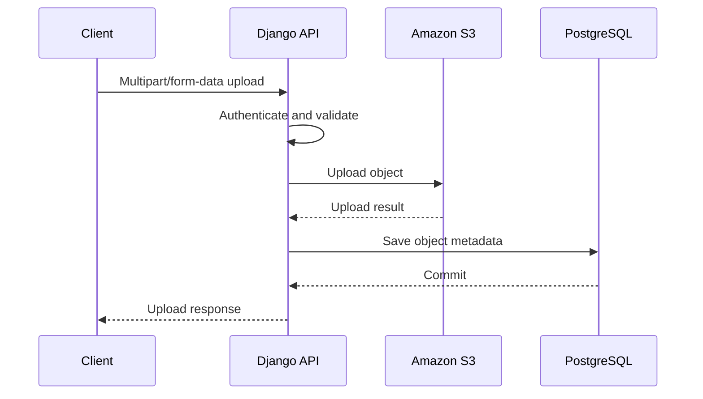
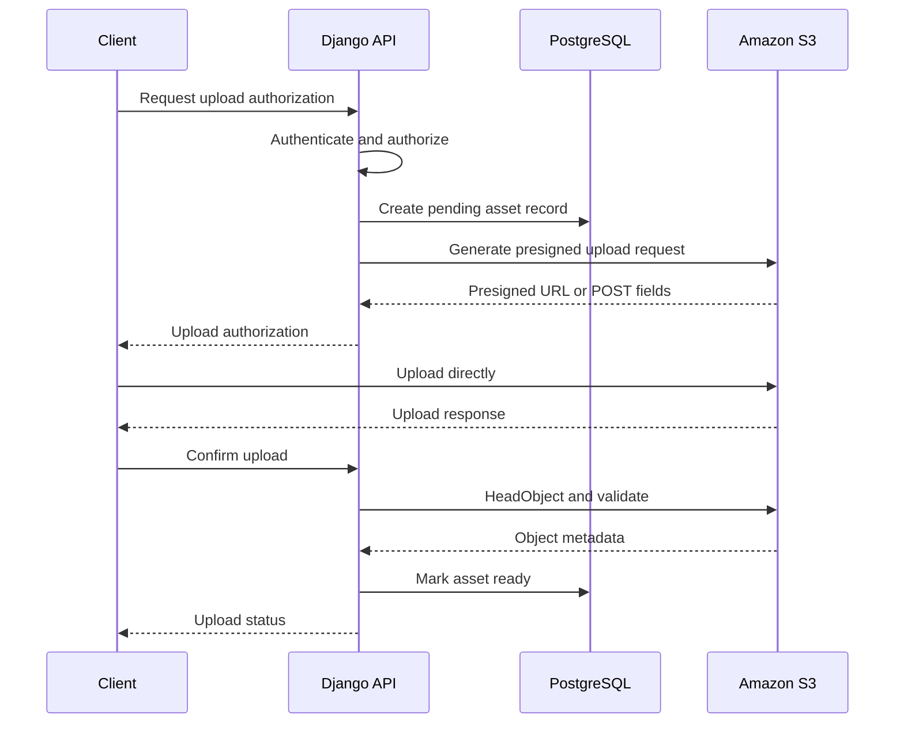

# 01- Django Integration

## Overview

Amazon S3 integrates with Django to provide durable object storage for uploaded files, documents, images, exports, reports, and other application-managed content.

Django's built-in file-handling APIs provide a storage abstraction, while Boto3 exposes direct control over S3 operations. These approaches are complementary:

- **Django storage API:** Integrates S3 with `FileField`, `ImageField`, forms, and Django's file-storage abstraction.
- **Boto3 service layer:** Provides explicit control over uploads, downloads, metadata, multipart transfers, object operations, and presigned URLs.
- **Presigned URLs:** Allow clients to upload or download objects directly through S3 without routing the file contents through Django.
- **Asynchronous processing:** Connects uploads to SQS, Lambda, Celery, or EventBridge workflows without blocking the HTTP request.

The appropriate design depends on file size, access requirements, processing duration, and expected traffic.

For a production Django application, keep the S3 bucket private, use IAM roles or other temporary credentials, generate controlled object keys, and isolate storage operations from views and serializers.

## Architecture and Request Flow

### Server-Mediated Upload

In a server-mediated upload, the browser sends the file to Django, and Django forwards it to S3.



This approach is suitable for small-to-medium files when Django must inspect or transform the uploaded content before storing it.

The main limitation is that Django handles the file transfer. Large uploads consume application bandwidth, worker connections, memory or temporary disk, and processing capacity.

### Direct Client-to-S3 Upload

For larger files or high upload volumes, Django can authorize an upload by generating a presigned URL or presigned POST.



This architecture reduces the amount of file data passing through Django. The application still controls authorization, the allowed object key, expected file properties, and processing state.

A presigned URL is a temporary bearer capability. Anyone holding a valid URL can perform the permitted operation until it expires or the underlying authorization becomes invalid. Treat URLs and signed POST fields as secrets.

## Choose the Integration Approach

| Requirement | Recommended Approach |
|---|---|
| Store uploaded files through Django models | `FileField` or `ImageField` with an S3 storage backend |
| Save and retrieve objects with explicit AWS API control | Boto3 service layer |
| Allow browsers to upload large files directly to S3 | Presigned URL or presigned POST |
| Allow controlled temporary downloads | Presigned GET URL after application authorization |
| Serve public static assets | S3 with CloudFront, preferably using a private origin |
| Process uploads asynchronously | S3 events routed to SQS, Lambda, or EventBridge |
| Support complex upload validation | Upload to a quarantine area, then validate before making the object available |
| Handle large transformations or long-running jobs | Queue-backed workers or an appropriate processing service |

Do not mix these approaches without a clear responsibility boundary. For example, a Django `FileField` that uses S3 storage is not the same as a browser uploading directly to S3 using a presigned URL.

## Install Dependencies

For Django's S3 storage backend, use `django-storages` with its S3 extra. Boto3 is installed as a dependency of that extra.

```bash
pip install "django-storages[s3]" boto3
```

Pin compatible versions in the project's dependency-management files. Test framework, Python, Boto3, and `django-storages` upgrades in CI before deployment.

For example, a project can maintain these dependencies in `requirements.txt`:

```text
Django>=5.2,<6.2
django-storages[s3]>=1.14.6
boto3
```

These are illustrative compatibility ranges, not a lockfile. Pin exact versions or generate a lockfile according to the project's dependency-management strategy.

Add `storages` to `INSTALLED_APPS`:

```python
INSTALLED_APPS = [
    # Existing Django applications
    "django.contrib.auth",
    "django.contrib.contenttypes",
    "django.contrib.sessions",
    "django.contrib.messages",
    "django.contrib.staticfiles",
    "storages",
]
```

## Configure AWS Credentials

Boto3 uses the AWS credential provider chain. In deployed environments, prefer temporary credentials from the environment's IAM role rather than storing long-lived access keys in Django settings.

Typical credential sources include:

| Environment | Recommended Authentication |
|---|---|
| Local development | AWS CLI profile or another approved local credential provider |
| Amazon EC2 | Instance profile role |
| Amazon ECS | Task IAM role |
| AWS Lambda | Execution role |
| EKS | EKS workload identity mechanism, such as EKS Pod Identity or IRSA where applicable |
| GitHub Actions | IAM OIDC federation and short-lived credentials |
| Other external workloads | An approved identity federation or temporary-credential mechanism |

For local development, an AWS CLI profile can be configured with the appropriate permissions.

```bash
aws configure --profile django-dev
```

Use the profile for the local process:

```bash
export AWS_PROFILE=django-dev
export AWS_REGION=ap-south-1
export AWS_STORAGE_BUCKET_NAME=company-private-media-dev
```

On PowerShell:

```powershell
$env:AWS_PROFILE = "django-dev"
$env:AWS_REGION = "ap-south-1"
$env:AWS_STORAGE_BUCKET_NAME = "company-private-media-dev"
```

Do not rely on local profile configuration in a production container or Lambda function. The deployed environment should obtain credentials from its configured identity provider.

The application identity should have only the permissions required for its operations, such as access to a specific bucket or prefix.

## Configure Django S3 Storage

Django supports configurable storage backends through the `STORAGES` setting. The `django-storages` S3 backend implements Django's file-storage interface using Boto3.

This is generally the best starting point when application models use `FileField` or `ImageField`.

### Settings Configuration

```python
# settings.py
import os

AWS_REGION = os.getenv("AWS_REGION", "ap-south-1")
AWS_STORAGE_BUCKET_NAME = os.environ["AWS_STORAGE_BUCKET_NAME"]

STORAGES = {
    "default": {
        "BACKEND": "storages.backends.s3.S3Storage",
        "OPTIONS": {
            "bucket_name": AWS_STORAGE_BUCKET_NAME,
            "region_name": AWS_REGION,
            "signature_version": "s3v4",
            "addressing_style": "virtual",
            "querystring_auth": True,
            "querystring_expire": 300,
            "file_overwrite": False,
            "default_acl": None,
        },
    },
    "staticfiles": {
        "BACKEND": (
            "django.contrib.staticfiles.storage.StaticFilesStorage"
        ),
    },
}
```

This configuration stores media through S3 while keeping static-file collection local. Static assets can be configured separately for S3 and CloudFront if that matches the deployment architecture.

Important settings:

| Setting | Purpose |
|---|---|
| `bucket_name` | Specifies the media bucket. |
| `region_name` | Configures the S3 Region. |
| `signature_version` | Uses AWS Signature Version 4. |
| `addressing_style` | Uses virtual-hosted-style addressing. |
| `querystring_auth` | Generates authenticated URLs for private objects. |
| `querystring_expire` | Controls the requested lifetime of generated signed URLs. |
| `file_overwrite` | Prevents the backend's default naming behavior from blindly overwriting an existing name. |
| `default_acl` | Leaves ACLs unset; private access should be managed through bucket configuration and policies. |

The effective lifetime of a presigned URL also depends on the underlying credentials and permissions. A URL signed with temporary credentials cannot remain usable beyond the relevant credential lifetime.

**Do not enable `public-read` merely to make media URLs work.** Keep private files private and use authenticated downloads or presigned URLs.

### Encryption Configuration

S3 provides default server-side encryption for new objects. If the application requires a specific customer-managed KMS key, configure encryption deliberately.

For example, `django-storages` supports object parameters:

```python
STORAGES = {
    "default": {
        "BACKEND": "storages.backends.s3.S3Storage",
        "OPTIONS": {
            "bucket_name": AWS_STORAGE_BUCKET_NAME,
            "region_name": AWS_REGION,
            "querystring_auth": True,
            "object_parameters": {
                "ServerSideEncryption": "aws:kms",
                "SSEKMSKeyId": os.environ["S3_KMS_KEY_ARN"],
            },
        },
    },
    "staticfiles": {
        "BACKEND": (
            "django.contrib.staticfiles.storage.StaticFilesStorage"
        ),
    },
}
```

Use this form only when the application is intentionally configured to write with the specified KMS key. Verify the bucket policy, IAM permissions, and KMS key policy together. S3 authorization failures and KMS authorization failures are separate conditions.

Avoid maintaining conflicting encryption defaults between the application and infrastructure configuration.

## Store Files Through Django Models

### Define an Asset Model

A Django `FileField` stores the object name in the database and delegates file operations to the configured storage backend.

```python
# models.py
import uuid
from pathlib import Path

from django.conf import settings
from django.db import models


def asset_upload_to(instance, filename: str) -> str:
    suffix = Path(filename).suffix.lower()
    return f"users/{instance.owner_id}/{uuid.uuid4().hex}{suffix}"


class MediaAsset(models.Model):
    class Status(models.TextChoices):
        PENDING = "pending", "Pending"
        READY = "ready", "Ready"
        FAILED = "failed", "Failed"

    owner = models.ForeignKey(
        settings.AUTH_USER_MODEL,
        on_delete=models.CASCADE,
        related_name="media_assets",
    )
    file = models.FileField(
        upload_to=asset_upload_to,
        max_length=1024,
    )
    original_filename = models.CharField(max_length=255)
    content_type = models.CharField(max_length=150)
    size_bytes = models.PositiveBigIntegerField(default=0)
    status = models.CharField(
        max_length=16,
        choices=Status.choices,
        default=Status.PENDING,
    )
    created_at = models.DateTimeField(auto_now_add=True)

    def __str__(self):
        return f"MediaAsset({self.pk}, {self.status})"
```

The generated key uses the owner ID and a random UUID rather than relying on the user-provided filename as a path. This helps avoid accidental collisions and unsafe key construction.

The extension is retained only as a naming hint. It does not validate the actual file type.

Apply the migration:

```bash
python manage.py makemigrations
python manage.py migrate
```

### Understand the Storage Boundary

When a model saves a file through its `FileField`, Django calls the configured storage backend. With `django-storages`, Boto3 handles the interaction with S3.

The database does not store the file's contents. It stores the file name or key and associated metadata.

This creates two separate persistence operations:

1. S3 stores the binary object.
2. The database stores the application record.

There is no distributed transaction spanning both resources. If one operation succeeds and the other fails, the application needs a cleanup or reconciliation strategy.

## Validate Uploaded Files

Django provides `request.FILES` and upload handlers for processing multipart form uploads. Validation should include request-level limits, allowed formats, actual content inspection, and application authorization.

A basic form can enforce filename extension and size constraints:

```python
# forms.py
from pathlib import Path

from django import forms


MAX_UPLOAD_BYTES = 10 * 1024 * 1024
ALLOWED_EXTENSIONS = {".pdf", ".png", ".jpg", ".jpeg"}


class MediaAssetUploadForm(forms.Form):
    file = forms.FileField()

    def clean_file(self):
        uploaded_file = self.cleaned_data["file"]

        suffix = Path(uploaded_file.name).suffix.lower()

        if suffix not in ALLOWED_EXTENSIONS:
            raise forms.ValidationError("Unsupported file extension.")

        if uploaded_file.size > MAX_UPLOAD_BYTES:
            raise forms.ValidationError("File exceeds the allowed size.")

        return uploaded_file
```

Extension validation is only one check. The client controls both the original filename and the declared content type.

For stronger validation:

- Inspect file signatures or parse the content using a suitable library.
- Use format-specific validation, such as Pillow for supported image types.
- Apply malware scanning where required.
- Restrict maximum request body size at the reverse proxy, gateway, or load balancer.
- Keep untrusted uploads quarantined until validation completes.
- Avoid serving user uploads as executable content.

Django's `FILE_UPLOAD_MAX_MEMORY_SIZE` controls when uploads roll over from memory to temporary disk; it is not a complete request-size enforcement mechanism.

Official reference: [Django user-uploaded content security](https://docs.djangoproject.com/en/6.0/topics/security/#user-uploaded-content).

## Implement a Reusable Upload Service

Keep S3 storage orchestration out of Django views. A service layer can validate business rules, save the file, and persist application metadata.

```python
# services/media_assets.py
from django.core.exceptions import ValidationError
from django.db import transaction

from .forms import MAX_UPLOAD_BYTES, ALLOWED_EXTENSIONS
from .models import MediaAsset


@transaction.atomic
def create_media_asset(*, owner, uploaded_file, content_type):
    if uploaded_file.size <= 0:
        raise ValidationError("Empty files are not accepted.")

    if uploaded_file.size > MAX_UPLOAD_BYTES:
        raise ValidationError("File exceeds the allowed size.")

    from pathlib import Path

    suffix = Path(uploaded_file.name).suffix.lower()

    if suffix not in ALLOWED_EXTENSIONS:
        raise ValidationError("Unsupported file extension.")

    asset = MediaAsset(
        owner=owner,
        original_filename=uploaded_file.name[:255],
        content_type=content_type or "application/octet-stream",
        size_bytes=uploaded_file.size,
        status=MediaAsset.Status.PENDING,
    )

    asset.file.save(
        uploaded_file.name,
        uploaded_file,
        save=False,
    )

    asset.size_bytes = uploaded_file.size
    asset.status = MediaAsset.Status.READY
    asset.save()

    return asset
```

This demonstrates the service boundary and Django storage integration. For production workloads that require malware scanning, content inspection, or event-driven processing, do not mark the asset `READY` immediately after upload. Persist a pending state and transition it to `READY` only after the required validation and processing stages have succeeded.

The `transaction.atomic` block protects database operations; it does **not** make S3 writes transactional. If the S3 upload succeeds but the database commit fails, an orphaned object can remain. Plan for orphan cleanup or use a workflow with explicit pending states and reconciliation.

### Django View

```python
# views.py
from django.contrib.auth.decorators import login_required
from django.http import JsonResponse
from django.views.decorators.http import require_POST

from .forms import MediaAssetUploadForm
from .services.media_assets import create_media_asset


@login_required
@require_POST
def upload_media(request):
    form = MediaAssetUploadForm(request.POST, request.FILES)

    if not form.is_valid():
        return JsonResponse(
            {"errors": form.errors.get_json_data()},
            status=400,
        )

    uploaded_file = form.cleaned_data["file"]

    asset = create_media_asset(
        owner=request.user,
        uploaded_file=uploaded_file,
        content_type=getattr(
            uploaded_file,
            "content_type",
            "application/octet-stream",
        ),
    )

    return JsonResponse(
        {
            "id": asset.pk,
            "status": asset.status,
            "size_bytes": asset.size_bytes,
        },
        status=201,
    )
```

For APIs implemented with Django REST Framework, apply the same responsibility split using serializers, permissions, and service methods. Avoid duplicating S3 operations across views and serializers.

The example assumes authentication is enabled and the form performs the shown validation. Production endpoints should also enforce request limits, tenant ownership, format-specific content validation, and appropriate error handling for S3 or database failures.

## Direct Boto3 Integration

Use Boto3 directly when Django needs explicit control over object operations that go beyond the standard file-storage interface.

Typical examples include:

- Direct presigned uploads and downloads.
- Object metadata inspection with `HeadObject`.
- Version-aware object retrieval.
- Object tagging and conditional operations.
- Multipart upload configuration.
- Integration with SQS, Lambda, or EventBridge processing workflows.

### Initialize a Reusable S3 Client

```python
# storage/s3_client.py
import os
from functools import lru_cache

import boto3
from botocore.config import Config


@lru_cache(maxsize=1)
def get_s3_client():
    region = os.getenv("AWS_REGION", "ap-south-1")

    return boto3.client(
        "s3",
        region_name=region,
        config=Config(
            signature_version="s3v4",
            retries={
                "mode": "standard",
                "max_attempts": 5,
            },
            max_pool_connections=50,
        ),
    )
```

This client is cached within the application process. Do not share a Boto3 client across processes created by process forking; initialize process-specific clients in the relevant worker.

The retry configuration addresses eligible SDK-level transient failures. It does not replace application-level idempotency or retry handling.

### Upload an Object

```python
# storage/s3_service.py
import os

from botocore.exceptions import BotoCoreError, ClientError

from .s3_client import get_s3_client


BUCKET_NAME = os.environ["AWS_STORAGE_BUCKET_NAME"]


class ObjectStorageError(Exception):
    """Application-level storage operation failure."""


def upload_object(
    *,
    file_obj,
    object_key: str,
    content_type: str,
) -> None:
    try:
        get_s3_client().upload_fileobj(
            file_obj,
            BUCKET_NAME,
            object_key,
            ExtraArgs={
                "ContentType": content_type,
            },
        )
    except (BotoCoreError, ClientError) as exc:
        raise ObjectStorageError("S3 upload failed") from exc
```

`upload_fileobj()` expects a binary file-like object and uses managed transfers, including multipart uploads when appropriate.

Choose the object key on the server. Do not concatenate raw user input into an S3 key without validation.

The example does not explicitly configure ACLs, avoiding the need for object-level ACL permissions in buckets that use bucket-owner-enforced Object Ownership.

Official reference: [Uploading files with Boto3](https://docs.aws.amazon.com/boto3/latest/guide/s3-uploading-files.html).

### Download an Object

```python
from contextlib import contextmanager

from botocore.exceptions import BotoCoreError, ClientError

from .s3_client import get_s3_client


@contextmanager
def open_s3_object(
    bucket: str,
    object_key: str,
    version_id: str | None = None,
):
    request = {
        "Bucket": bucket,
        "Key": object_key,
    }

    if version_id:
        request["VersionId"] = version_id

    try:
        response = get_s3_client().get_object(**request)

        with response["Body"] as body:
            yield response, body

    except (BotoCoreError, ClientError) as exc:
        raise ObjectStorageError("S3 download failed") from exc
```

The response body is a streaming object. Use it as a context manager and avoid reading large files completely into memory.

For HTTP downloads, consider whether Django should stream the content, redirect to a short-lived presigned URL, or use CloudFront. A redirect often reduces application bandwidth when the client can safely retrieve the object directly.

## Generate Presigned Download URLs

A presigned GET URL allows an authorized user to download a private object for a limited period.

```python
import os

from botocore.exceptions import BotoCoreError, ClientError

from .s3_client import get_s3_client


BUCKET_NAME = os.environ["AWS_STORAGE_BUCKET_NAME"]


def create_download_url(
    *,
    object_key: str,
    expires_in: int = 300,
) -> str:
    if not 1 <= expires_in <= 900:
        raise ValueError("Download URL expiry must be 1–900 seconds.")

    try:
        return get_s3_client().generate_presigned_url(
            "get_object",
            Params={
                "Bucket": BUCKET_NAME,
                "Key": object_key,
            },
            ExpiresIn=expires_in,
        )
    except (BotoCoreError, ClientError) as exc:
        raise ObjectStorageError(
            "Could not generate download URL"
        ) from exc
```

A presigned URL is generated using the permissions of the AWS identity that signs it. The URL does not grant permanent access, and its effective lifetime is limited by the credential lifetime and applicable authorization constraints.

Before generating a URL, verify that the authenticated user owns the asset or is otherwise authorized to access it.

Example download endpoint:

```python
from django.contrib.auth.decorators import login_required
from django.http import JsonResponse
from django.shortcuts import get_object_or_404
from django.views.decorators.http import require_GET

from .models import MediaAsset
from .storage.s3_service import create_download_url


@login_required
@require_GET
def download_media(request, asset_id):
    asset = get_object_or_404(
        MediaAsset,
        pk=asset_id,
        owner=request.user,
        status=MediaAsset.Status.READY,
    )

    url = create_download_url(
        object_key=asset.file.name,
        expires_in=300,
    )

    return JsonResponse(
        {
            "download_url": url,
            "expires_in": 300,
        }
    )
```

In this example, `asset.file.name` must correspond to the key stored by the configured storage backend. If the application uses a different object-key convention or direct Boto3 uploads, persist that exact key explicitly.

Do not expose presigned URLs through long-lived caches or logs. Restrict API responses and use HTTPS.

Official reference: [Boto3 presigned URLs](https://docs.aws.amazon.com/boto3/latest/guide/s3-presigned-urls.html).

## Direct Browser Uploads with Presigned POST

For larger files, a browser can upload directly to S3 rather than sending the file bytes through Django.

A presigned POST is useful because its policy can constrain conditions such as the permitted content type and content-length range.

### Generate a Presigned POST

```python
import os
import uuid

from botocore.exceptions import BotoCoreError, ClientError

from .s3_client import get_s3_client


BUCKET_NAME = os.environ["AWS_STORAGE_BUCKET_NAME"]
MAX_UPLOAD_BYTES = 20 * 1024 * 1024


def create_upload_post(
    *,
    user_id: int,
    content_type: str,
) -> dict:
    allowed_content_types = {
        "application/pdf",
        "image/jpeg",
        "image/png",
    }

    if content_type not in allowed_content_types:
        raise ValueError("Unsupported content type")

    object_key = (
        f"quarantine/users/{user_id}/{uuid.uuid4().hex}"
    )

    try:
        result = get_s3_client().generate_presigned_post(
            Bucket=BUCKET_NAME,
            Key=object_key,
            Fields={
                "Content-Type": content_type,
            },
            Conditions=[
                {"Content-Type": content_type},
                ["content-length-range", 1, MAX_UPLOAD_BYTES],
            ],
            ExpiresIn=300,
        )
    except (BotoCoreError, ClientError) as exc:
        raise ObjectStorageError(
            "Could not create upload authorization"
        ) from exc

    return {
        "object_key": object_key,
        "url": result["url"],
        "fields": result["fields"],
        "expires_in": 300,
    }
```

The key is generated server-side and uses a quarantine prefix. The content-type condition constrains the declared type, but the declaration is not proof of the actual file format. Inspect the content after upload.

The application should create a pending asset record tied to the authenticated user before returning the upload authorization. The record should retain the expected object key, file-size limit, and validation state.

### Browser Upload

The client submits the fields and file returned by Django:

```javascript
async function uploadToS3(uploadAuthorization, file) {
  const formData = new FormData();

  for (const [name, value] of Object.entries(
    uploadAuthorization.fields
  )) {
    formData.append(name, value);
  }

  formData.append("file", file);

  const response = await fetch(uploadAuthorization.url, {
    method: "POST",
    body: formData,
  });

  if (!response.ok) {
    throw new Error(`S3 upload failed: ${response.status}`);
  }
}
```

Do not manually set the browser request's `Content-Type` header for `FormData`; the browser must generate the multipart boundary.

Configure the S3 bucket's CORS rules to allow only the required application origins, methods, and headers. CORS controls browser behavior; it does not grant AWS permissions or make a private bucket public.

### Complete and Verify the Upload

After the browser uploads the file, the client calls a completion endpoint. Django should verify the object with `HeadObject` and validate that it matches the pending upload record.

Example verification service:

```python
import os

from botocore.exceptions import BotoCoreError, ClientError

from .s3_client import get_s3_client


BUCKET_NAME = os.environ["AWS_STORAGE_BUCKET_NAME"]
MAX_UPLOAD_BYTES = 20 * 1024 * 1024


def verify_uploaded_object(object_key: str) -> dict:
    try:
        response = get_s3_client().head_object(
            Bucket=BUCKET_NAME,
            Key=object_key,
        )
    except (BotoCoreError, ClientError) as exc:
        raise ObjectStorageError(
            "Uploaded object could not be verified"
        ) from exc

    size_bytes = response["ContentLength"]

    if not 1 <= size_bytes <= MAX_UPLOAD_BYTES:
        raise ValueError("Uploaded object size is outside allowed limits")

    return {
        "size_bytes": size_bytes,
        "content_type": response.get(
            "ContentType",
            "application/octet-stream",
        ),
        "etag": response.get("ETag"),
        "version_id": response.get("VersionId"),
    }
```

This verifies basic object metadata, not file-content integrity or malware safety. Do not mark the asset ready until required content validation and security scanning have completed.

Also verify that the requested key belongs to a pending upload record owned by the authenticated user. Never accept an arbitrary bucket or key from the client as proof of ownership.

Presigned requests can be reused until they expire, subject to the signed operation and authorization. Unique keys, short expirations, versioning where required, and state validation reduce the impact of repeated uploads.

## File Access and Deletion

### Private Download Strategies

| Strategy | Advantages | Considerations |
|---|---|---|
| Django streams the object | Centralized authorization and auditing | Consumes application bandwidth and worker resources |
| Redirect to a presigned GET URL | Reduces application bandwidth | URL is a bearer capability and can be shared until expiry |
| CloudFront signed URL or cookie | Suitable for controlled content delivery at scale | Requires CloudFront authorization and cache configuration |

For confidential content, perform application-level authorization before issuing a signed download URL. Avoid making a private media bucket publicly readable simply to simplify URL handling.

### Delete Objects Safely

S3 deletion and database deletion are not one atomic transaction. A deletion workflow should define what happens if S3 succeeds but the database update fails, or vice versa.

For business-critical assets, a common approach is:

1. Mark the asset as pending deletion.
2. Remove or revoke application access.
3. Schedule the S3 deletion.
4. Record the result.
5. Retry failures and reconcile inconsistent states.

With versioning enabled, a normal delete may create a delete marker instead of permanently erasing historical object versions. Permanent deletion requires the appropriate version-specific operation and permissions.

Do not delete a database record before preserving enough information to identify and clean up its associated object.

## Static Assets and Media Storage

Keep static assets and user-uploaded media conceptually separate.

| Concern | Static Assets | User-Uploaded Media |
|---|---|---|
| Lifecycle | Updated through deployments | Created and deleted through application workflows |
| Access | Often delivered through CloudFront | Often private and subject to application authorization |
| Cache policy | Long caching for fingerprinted assets | Depends on confidentiality and mutability |
| Upload path | Deployment-controlled | Server-generated key or controlled upload prefix |
| Validation | Build-time checks | Runtime validation and potentially malware scanning |
| Typical ownership | Application release pipeline | User or tenant |

Use Django's `STORAGES` aliases to configure separate storage backends where appropriate. For a production static website or application frontend, CloudFront with a private S3 origin is generally preferable to making an entire storage bucket public.

Static files should be collected and deployed through a controlled release process; user media should follow the application's upload authorization, retention, and deletion rules.

## Performance and Scalability

### Large Uploads

Django's default upload handlers can keep smaller files in memory and spool larger uploads to temporary disk. The application server still handles the inbound transfer.

For larger or more frequent uploads:

- Prefer direct client-to-S3 uploads.
- Apply request-size limits at the reverse proxy or gateway.
- Use presigned POST policies or other supported controls for upload constraints.
- Process files asynchronously when validation or transformation is expensive.
- Use multipart upload when required by file size or transfer-performance goals.
- Monitor temporary disk usage and worker saturation.

### Memory and Worker Capacity

Avoid reading a complete file into memory just to upload it:

```python
# Avoid for large objects:
content = uploaded_file.read()
s3_client.put_object(
    Bucket=bucket_name,
    Key=object_key,
    Body=content,
)
```

Prefer Django's file object with `upload_fileobj()` or the configured Django storage backend. For downloads, stream S3 response bodies or redirect clients to temporary download URLs.

### Concurrency

S3 supports high request concurrency, but a Django application's capacity is also limited by its web workers, database pool, network throughput, and downstream services.

Direct uploads reduce transfer pressure on Django. Queues and background workers isolate expensive processing from the API request lifecycle. Scale each component based on measured saturation and latency rather than object storage throughput alone.

## Configuration and Deployment

### Environment Configuration

Use environment-specific bucket names and Regions.

Example `.env.example`:

```dotenv
AWS_REGION=ap-south-1
AWS_STORAGE_BUCKET_NAME=company-private-media-dev
```

Do not store real access keys in this file. For production, obtain AWS credentials from the runtime identity provider.

Keep development, staging, and production buckets separate where practical. Do not let local tests or automated cleanup commands target production resources accidentally.

### Deployment Sequence

1. Provision the S3 bucket and security configuration.
2. Configure encryption, versioning, CORS where needed, and lifecycle policies.
3. Create the IAM role or identity used by Django.
4. Configure the S3 storage backend and environment variables.
5. Run migrations for asset metadata models.
6. Deploy application code and upload/download endpoints.
7. Verify object creation, metadata persistence, authorization, and signed URLs.
8. Validate logging, monitoring, and recovery behavior.
9. Test cleanup and rollback procedures in a non-production environment.

Use Terraform, CloudFormation, or CDK to manage infrastructure. Avoid creating buckets, changing bucket policies, or mutating notification configurations during Django application startup.

## Error Handling and Troubleshooting

### Common Failure Categories

| Symptom | Likely Cause | Diagnostic Approach |
|---|---|---|
| `AccessDenied` during upload | Missing IAM permissions, bucket-policy restrictions, explicit deny, or KMS permissions | Inspect the failing API action and evaluate identity, resource, and KMS policies separately |
| `NoSuchBucket` | Wrong bucket name, account, or endpoint configuration | Verify the bucket identifier and Region |
| `NoSuchKey` | Incorrect key, missing object, or improperly handled key encoding | Compare the stored object key with the S3 key and event format |
| Presigned URL returns `403` | Expired URL, wrong method or signed headers, invalid signature, or permission failure | Check expiry, request method, headers, Region, and signing identity |
| File exists in S3 but no database record exists | Upload succeeded before a database failure | Run orphan-object reconciliation |
| Database record exists but file is missing | Partial failure, deletion, or invalid object reference | Verify the S3 key and reconcile application state |
| Upload fails for large files | Request limits, worker pressure, network failure, or transfer constraints | Check proxy limits, request duration, disk usage, and S3 errors |
| Uploaded HTML or malformed file is accepted | Validation relies only on extension or declared content type | Validate actual content and use quarantine or scanning |
| Private object URL cannot be opened anonymously | Expected behavior for a private object | Authorize the user and provide a valid signed URL or controlled proxy |

### Distinguish S3 and KMS Failures

When SSE-KMS is used, object access can require both S3 permissions and KMS key permissions.

Do not assume that granting `s3:GetObject` or `s3:PutObject` resolves every access failure. Review the relevant identity policy, bucket policy, key policy, and any applicable permissions boundary or organization policy.

For presigned requests, remember that signing a request does not bypass explicit denies or the underlying permissions of the signing identity.

## Testing Strategy

Testing should cover application behavior and AWS integration independently.

### Unit Tests

Test:

- Upload validation and permitted formats.
- Server-generated object keys.
- Owner and tenant authorization.
- S3 error translation.
- Upload status transitions.
- Idempotency and deletion state management.
- Presigned URL parameters and expiry.
- Handling of missing objects and malformed metadata.

Mock Boto3 or isolate the storage layer behind an interface so that business logic can be tested without real AWS resources.

### Integration Tests

In an isolated AWS test environment, verify:

- Django can upload and retrieve an object.
- Object metadata matches the intended application record.
- Presigned requests work with the expected HTTP method and headers.
- Private objects are inaccessible without authorized access.
- Incorrect keys and unauthorized users are rejected.
- Large-file and multipart behaviors work as expected.
- Database and storage partial failures can be recovered.
- Direct uploads are verified before assets become ready.
- Object deletion follows the intended retention and versioning policy.

Use a test bucket and unique object prefixes. Clean up uploaded test objects explicitly and avoid destructive test operations against production data.

## Best Practices Checklist

- [ ] Keep user-uploaded objects private by default.
- [ ] Use IAM roles or temporary credentials rather than hardcoded keys.
- [ ] Separate S3 operations into a reusable service layer.
- [ ] Generate object keys on the server.
- [ ] Validate actual content, file size, and permitted formats.
- [ ] Apply request-body limits at the web server or gateway.
- [ ] Prefer direct uploads when Django should not carry large file payloads.
- [ ] Authorize users before generating download URLs.
- [ ] Keep presigned URL lifetimes short and prevent them from leaking into logs.
- [ ] Track processing and upload state separately from object existence.
- [ ] Make storage and database failures recoverable.
- [ ] Use queues or workflow orchestration for expensive processing.
- [ ] Monitor S3 failures, upload latency, orphaned objects, and processing errors.
- [ ] Test the complete integration in an isolated environment.
- [ ] Manage bucket security and infrastructure through controlled deployments.

## Official References

- [Django file handling](https://docs.djangoproject.com/en/6.0/topics/files/)
- [Django file uploads](https://docs.djangoproject.com/en/6.0/topics/http/file-uploads/)
- [Django storage settings](https://docs.djangoproject.com/en/6.0/ref/settings/#storages)
- [Django user-uploaded content security](https://docs.djangoproject.com/en/6.0/topics/security/#user-uploaded-content)
- [django-storages Amazon S3 backend](https://django-storages.readthedocs.io/en/latest/backends/amazon-S3.html)
- [Boto3 S3 uploads](https://docs.aws.amazon.com/boto3/latest/guide/s3-uploading-files.html)
- [Boto3 presigned URLs](https://docs.aws.amazon.com/boto3/latest/guide/s3-presigned-urls.html)
- [S3 event notifications](https://docs.aws.amazon.com/AmazonS3/latest/userguide/EventNotifications.html)
- [Amazon S3 security best practices](https://docs.aws.amazon.com/AmazonS3/latest/userguide/security-best-practices.html)

## Key Takeaways

- Django integrates with S3 through `django-storages` and `FileField` for standard storage workflows, or through a dedicated Boto3 service layer for explicit object operations.
- Presigned URLs allow direct client-to-S3 transfers, but Django must still authorize the user, constrain the object key, and verify the uploaded object before marking it ready.
- Private buckets, least-privilege IAM, server-generated keys, actual content validation, and short-lived signed URLs are essential controls for user-uploaded media.
- S3 writes and Django database transactions are not atomic; production systems need idempotency, persistent processing state, and recovery for partial failures.
- Large or expensive file operations should be streamed, uploaded directly where appropriate, and processed asynchronously when they exceed the request lifecycle.