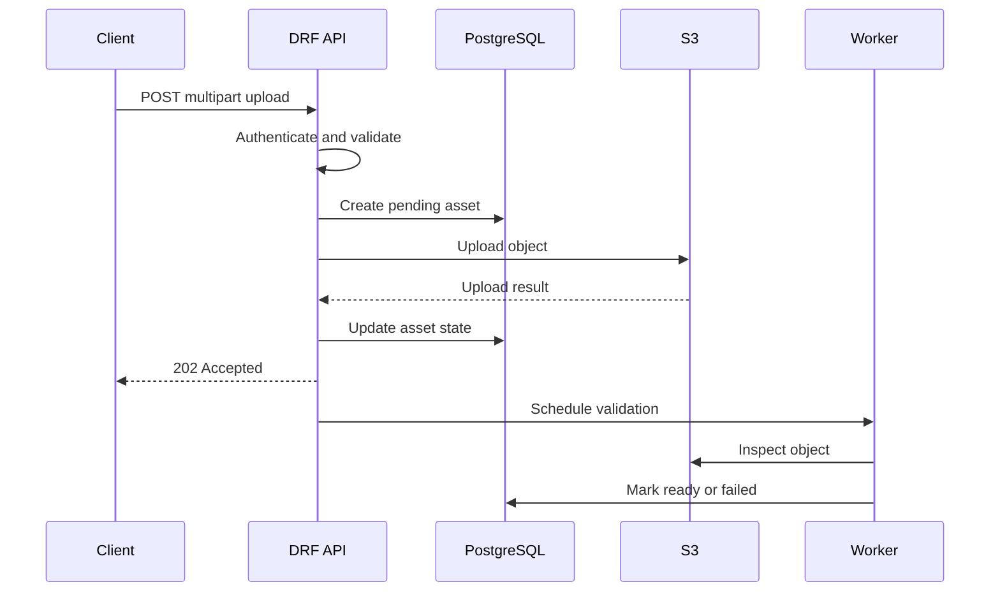
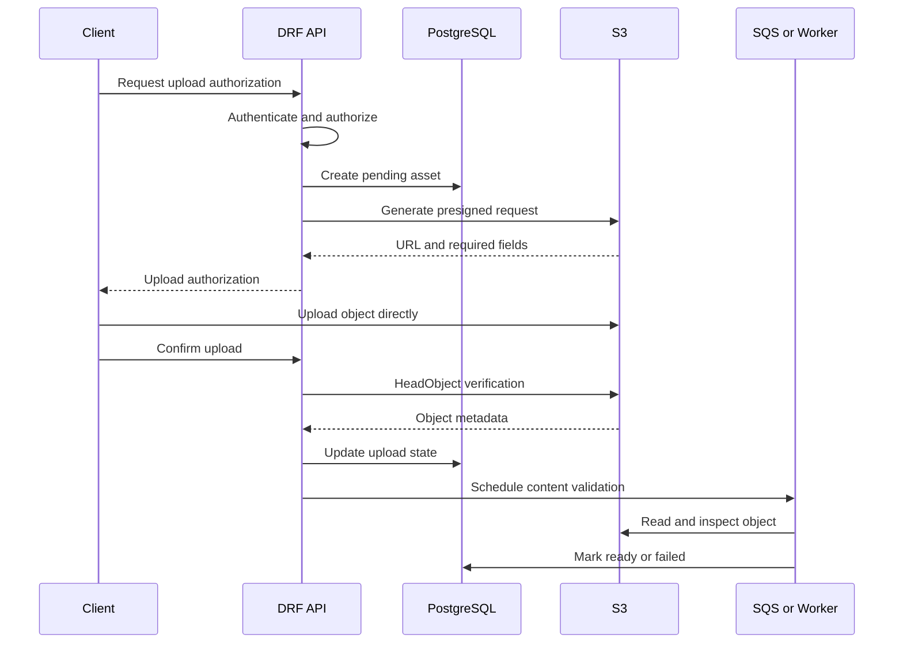

# Django REST Framework Integration

## Overview

Django REST Framework (DRF) integrates with Amazon S3 to provide secure APIs for uploading, retrieving, managing, and processing files. Common use cases include document management, profile images, reports, media assets, tenant-specific attachments, and asynchronous file-processing pipelines.

A production implementation should separate four responsibilities:

- **API layer:** Handles authentication, authorization, serializers, request parsing, and HTTP responses.
- **Application service layer:** Enforces business rules, generates object keys, coordinates storage operations, and manages asset state.
- **Storage layer:** Encapsulates Boto3 operations, S3 client configuration, retries, and AWS exceptions.
- **Persistence and processing layer:** Stores asset metadata in a database and manages validation, scanning, and processing workflows.

For small uploads, DRF can receive a multipart request and stream the uploaded file to S3. For larger uploads or high-throughput systems, DRF can authorize a direct client-to-S3 upload using presigned URLs or presigned POST requests.

The S3 bucket should normally remain private. Users should access assets through application authorization and short-lived download URLs rather than receiving broad S3 permissions.

## Architecture

### Server-Mediated Upload

The client sends the file to DRF, which validates the request and uploads the object to S3.



This approach is appropriate when the application must inspect the file before storage, handle relatively small uploads, or centralize data transfer through the backend.

The limitation is that the API infrastructure handles the upload bandwidth and request lifecycle. Large uploads can increase request duration, worker occupancy, temporary-disk usage, and infrastructure costs.

### Direct Client-to-S3 Upload

For larger files, DRF can issue temporary upload authorization while keeping the file contents out of the application server's data path.



DRF remains responsible for authorization, key generation, upload constraints, metadata persistence, and final asset availability. A successful HTTP response from S3 does not prove that the file is safe or suitable for application use.

Presigned URLs are bearer capabilities. Anyone holding a valid URL or signed POST fields can perform the permitted operation until the authorization expires or becomes invalid. Treat them as secrets.

## Install Dependencies

Install Django, Django REST Framework, and Boto3:

```bash
pip install django djangorestframework boto3
```

Boto3 is used directly in the service layer. If the application also uses Django's `FileField` abstraction with an S3 storage backend, install `django-storages` separately:

```bash
pip install "django-storages[s3]"
```

Pin compatible versions in the project dependency file and validate upgrades in CI.

Add DRF to the application configuration:

```python
# settings.py

INSTALLED_APPS = [
    # Existing Django applications
    "rest_framework",
    "assets",
]
```

Configure authentication globally or at the relevant view level. For example, a JWT-based API can use its existing authentication backend; the S3 integration should not introduce a separate, weaker authorization mechanism.

## Configure AWS Credentials

Use the AWS credential provider chain so the application obtains credentials from its execution environment.

| Environment | Recommended Credential Source |
|---|---|
| Local development | AWS CLI profile or approved local credential provider |
| Amazon EC2 | Instance profile role |
| Amazon ECS | Task IAM role |
| AWS Lambda | Execution role |
| Amazon EKS | EKS Pod Identity or IRSA where applicable |
| GitHub Actions | IAM OIDC federation with temporary credentials |

Do not hardcode AWS access keys in source code, container images, or `.env.example` files.

For local development, configure a profile:

```bash
aws configure --profile drf-s3-dev
```

Set the relevant environment variables.

Linux or macOS:

```bash
export AWS_PROFILE=drf-s3-dev
export AWS_REGION=ap-south-1
export AWS_STORAGE_BUCKET_NAME=company-private-assets-dev
export S3_UPLOAD_MAX_BYTES=20971520
```

PowerShell:

```powershell
$env:AWS_PROFILE = "drf-s3-dev"
$env:AWS_REGION = "ap-south-1"
$env:AWS_STORAGE_BUCKET_NAME = "company-private-assets-dev"
$env:S3_UPLOAD_MAX_BYTES = "20971520"
```

The examples use a 20 MiB upload limit. Adjust it to the application's requirements and enforce appropriate limits at the API gateway, reverse proxy, or load balancer as well.

Use different buckets or controlled prefixes for development, staging, and production. Never let local development or automated cleanup scripts default to a production bucket.

## Configure DRF Request Parsing

DRF selects a parser based on the incoming request's `Content-Type` header.

For multipart file uploads, use `MultiPartParser`. `FormParser` can be included when the endpoint also accepts form-encoded fields.

```python
from rest_framework.parsers import FormParser, MultiPartParser
from rest_framework.views import APIView


class AssetUploadView(APIView):
    parser_classes = [MultiPartParser, FormParser]
```

For browser-based multipart uploads, the client should use `multipart/form-data`. When using browser `FormData`, allow the browser to generate the multipart boundary.

Do not use `FileUploadParser` for a normal browser multipart workflow. It accepts raw file content and has a media type of `*/*`, so it is generally best used as the only parser on an endpoint specifically designed for raw uploads.

See the official [DRF parser documentation](https://www.django-rest-framework.org/api-guide/parsers/).

## Define the Asset Model

A file-management API needs persistent metadata independently of the object's binary contents.

The following model stores the S3 object key and application state in the database.

```python
# assets/models.py

from django.conf import settings
from django.db import models


class Asset(models.Model):
    class Status(models.TextChoices):
        PENDING = "pending", "Pending upload"
        UPLOADED = "uploaded", "Uploaded"
        READY = "ready", "Ready"
        FAILED = "failed", "Failed"
        DELETING = "deleting", "Deleting"

    owner = models.ForeignKey(
        settings.AUTH_USER_MODEL,
        on_delete=models.PROTECT,
        related_name="assets",
    )
    object_key = models.CharField(
        max_length=1024,
        unique=True,
    )
    original_filename = models.CharField(max_length=255)
    content_type = models.CharField(max_length=150)
    size_bytes = models.PositiveBigIntegerField(
        null=True,
        blank=True,
    )
    status = models.CharField(
        max_length=16,
        choices=Status.choices,
        default=Status.PENDING,
        db_index=True,
    )
    created_at = models.DateTimeField(auto_now_add=True)
    updated_at = models.DateTimeField(auto_now=True)

    class Meta:
        indexes = [
            models.Index(fields=["owner", "status"]),
        ]

    def __str__(self):
        return f"Asset(id={self.pk}, status={self.status})"
```

The model intentionally does not contain a `FileField`. The application stores the S3 key explicitly and uses Boto3 through a service layer. This is useful when the API must manage direct uploads, asset states, and S3 operations independently.

If the application primarily requires ordinary Django file handling, a `FileField` backed by `django-storages` may be simpler.

Generate and apply migrations:

```bash
python manage.py makemigrations assets
python manage.py migrate
```

### Asset Lifecycle

The database status should express application readiness, not merely object existence.

| State | Meaning |
|---|---|
| `PENDING` | The application has created an upload record, but completion has not been verified. |
| `UPLOADED` | The object exists and basic storage metadata has been verified. |
| `READY` | Required content validation and processing have succeeded. |
| `FAILED` | An unrecoverable or terminal processing failure has been recorded. |
| `DELETING` | Deletion has started but may require retry or reconciliation. |

A transition from `UPLOADED` to `READY` should occur only after the application's required validation, scanning, and processing steps have completed. The exact workflow depends on the asset's sensitivity and business purpose.

## Generate Safe Object Keys

Never use an untrusted filename directly as an S3 key or permit a client to choose an arbitrary bucket and object key.

Generate unpredictable object names on the server and store the original filename separately for display purposes.

```python
# assets/key_generation.py

import uuid


def generate_object_key(*, owner_id: int) -> str:
    return f"quarantine/users/{owner_id}/{uuid.uuid4().hex}"
```

A controlled prefix can simplify access policies, lifecycle rules, processing workflows, and cleanup.

For multi-tenant systems, derive the tenant or owner identifier from the authenticated user's authorized database context. Do not trust a tenant ID supplied solely by the request body.

The prefix is an organizational convention, not a substitute for IAM or application authorization.

## Build the Serializer Layer

Serializers should validate request input and shape API responses. They should not contain the complete S3 integration.

The examples use a conservative file allowlist. Extension and declared content-type checks are preliminary validation; they do not establish the true file format.

```python
# assets/serializers.py

from pathlib import PurePosixPath

from rest_framework import serializers

from .models import Asset


MAX_UPLOAD_BYTES = 20 * 1024 * 1024

ALLOWED_TYPES = {
    ".pdf": "application/pdf",
    ".png": "image/png",
    ".jpg": "image/jpeg",
    ".jpeg": "image/jpeg",
}


class AssetUploadSerializer(serializers.Serializer):
    file = serializers.FileField()

    def validate_file(self, uploaded_file):
        filename = uploaded_file.name.replace("\\", "/")
        suffix = PurePosixPath(filename).suffix.lower()

        if suffix not in ALLOWED_TYPES:
            raise serializers.ValidationError(
                "Unsupported file extension."
            )

        if uploaded_file.size <= 0:
            raise serializers.ValidationError(
                "Empty files are not accepted."
            )

        if uploaded_file.size > MAX_UPLOAD_BYTES:
            raise serializers.ValidationError(
                "File exceeds the maximum allowed size."
            )

        declared_type = getattr(
            uploaded_file,
            "content_type",
            None,
        )

        if declared_type != ALLOWED_TYPES[suffix]:
            raise serializers.ValidationError(
                "File extension and declared content type do not match."
            )

        return uploaded_file


class AssetUploadInitiationSerializer(serializers.Serializer):
    filename = serializers.CharField(max_length=255)
    content_type = serializers.ChoiceField(
        choices=sorted(set(ALLOWED_TYPES.values()))
    )

    def validate_filename(self, value):
        normalized = value.replace("\\", "/")
        filename = PurePosixPath(normalized).name

        if not filename or filename in {".", ".."}:
            raise serializers.ValidationError(
                "Invalid filename."
            )

        return filename


class AssetSerializer(serializers.ModelSerializer):
    class Meta:
        model = Asset
        fields = [
            "id",
            "original_filename",
            "content_type",
            "size_bytes",
            "status",
            "created_at",
        ]
        read_only_fields = fields
```

Additional production validation should inspect actual file content and apply format-specific checks. Depending on the use case, this can include file-signature detection, image decoding, PDF parsing, archive inspection, malware scanning, and restrictions on embedded active content.

Do not treat the `Content-Type` supplied by a browser as proof of file safety.

## Implement the S3 Service Layer

Centralize S3 operations in a module that the API views and background tasks can reuse.

### Configure a Reusable Client

```python
# assets/storage.py

import os
from functools import lru_cache

import boto3
from botocore.config import Config


@lru_cache(maxsize=1)
def get_s3_client():
    return boto3.client(
        "s3",
        region_name=os.getenv("AWS_REGION", "ap-south-1"),
        config=Config(
            signature_version="s3v4",
            retries={
                "mode": "standard",
                "max_attempts": 5,
            },
            max_pool_connections=50,
            s3={
                "addressing_style": "virtual",
            },
        ),
    )


def get_bucket_name() -> str:
    bucket_name = os.getenv("AWS_STORAGE_BUCKET_NAME")

    if not bucket_name:
        raise RuntimeError(
            "AWS_STORAGE_BUCKET_NAME is not configured."
        )

    return bucket_name
```

Caching avoids repeatedly constructing clients within a process. If the deployment uses process forking, create clients in the worker process instead of sharing inherited client connections.

Standard SDK retries handle eligible transient errors. They do not replace application-level recovery, idempotency, or reconciliation.

### Define Storage Exceptions and Operations

```python
# assets/storage.py

import logging

from botocore.exceptions import BotoCoreError, ClientError


logger = logging.getLogger(__name__)


class StorageOperationError(Exception):
    """An S3 operation failed."""


def upload_fileobj(
    *,
    file_obj,
    object_key: str,
    content_type: str,
) -> None:
    try:
        get_s3_client().upload_fileobj(
            file_obj,
            get_bucket_name(),
            object_key,
            ExtraArgs={
                "ContentType": content_type,
            },
        )
    except (BotoCoreError, ClientError) as exc:
        logger.exception(
            "S3 upload failed",
            extra={"object_key": object_key},
        )
        raise StorageOperationError(
            "Unable to upload the file."
        ) from exc


def create_presigned_post(
    *,
    object_key: str,
    content_type: str,
    max_bytes: int,
    expires_in: int = 300,
) -> dict:
    try:
        return get_s3_client().generate_presigned_post(
            Bucket=get_bucket_name(),
            Key=object_key,
            Fields={
                "Content-Type": content_type,
            },
            Conditions=[
                {"Content-Type": content_type},
                [
                    "content-length-range",
                    1,
                    max_bytes,
                ],
            ],
            ExpiresIn=expires_in,
        )
    except (BotoCoreError, ClientError) as exc:
        logger.exception(
            "Could not create S3 upload authorization",
            extra={"object_key": object_key},
        )
        raise StorageOperationError(
            "Unable to create upload authorization."
        ) from exc


def head_object(object_key: str) -> dict:
    try:
        return get_s3_client().head_object(
            Bucket=get_bucket_name(),
            Key=object_key,
        )
    except (BotoCoreError, ClientError) as exc:
        logger.exception(
            "S3 object verification failed",
            extra={"object_key": object_key},
        )
        raise StorageOperationError(
            "Unable to verify the uploaded object."
        ) from exc


def create_download_url(
    *,
    object_key: str,
    expires_in: int = 300,
) -> str:
    try:
        return get_s3_client().generate_presigned_url(
            "get_object",
            Params={
                "Bucket": get_bucket_name(),
                "Key": object_key,
            },
            ExpiresIn=expires_in,
        )
    except (BotoCoreError, ClientError) as exc:
        logger.exception(
            "Could not generate S3 download URL",
            extra={"object_key": object_key},
        )
        raise StorageOperationError(
            "Unable to create download authorization."
        ) from exc


def delete_object(object_key: str) -> None:
    try:
        get_s3_client().delete_object(
            Bucket=get_bucket_name(),
            Key=object_key,
        )
    except (BotoCoreError, ClientError) as exc:
        logger.exception(
            "S3 object deletion failed",
            extra={"object_key": object_key},
        )
        raise StorageOperationError(
            "Unable to delete the stored object."
        ) from exc
```

The service layer deliberately exposes only the required operations. API code does not need to know the structure of Boto3 requests or handle AWS SDK exceptions directly.

For buckets with versioning enabled, `DeleteObject` can create a delete marker instead of permanently removing earlier versions. Permanent deletion and retention handling require additional version-aware logic.

## Implement Server-Mediated Uploads

The first API path accepts multipart uploads through DRF.

Create a service that persists the pending asset, transfers the file, and records the result.

```python
# assets/services.py

import logging

from django.db import transaction

from .key_generation import generate_object_key
from .models import Asset
from .storage import StorageOperationError, upload_fileobj


logger = logging.getLogger(__name__)


def create_server_uploaded_asset(
    *,
    owner,
    uploaded_file,
) -> Asset:
    object_key = generate_object_key(
        owner_id=owner.pk,
    )

    with transaction.atomic():
        asset = Asset.objects.create(
            owner=owner,
            object_key=object_key,
            original_filename=uploaded_file.name[:255],
            content_type=uploaded_file.content_type,
            status=Asset.Status.PENDING,
        )

    try:
        upload_fileobj(
            file_obj=uploaded_file,
            object_key=object_key,
            content_type=asset.content_type,
        )
    except StorageOperationError:
        Asset.objects.filter(
            pk=asset.pk,
            status=Asset.Status.PENDING,
        ).update(status=Asset.Status.FAILED)
        raise

    asset.status = Asset.Status.UPLOADED
    asset.size_bytes = uploaded_file.size
    asset.save(
        update_fields=[
            "status",
            "size_bytes",
            "updated_at",
        ]
    )

    return asset
```

The database transaction intentionally ends before the S3 request. Holding a database transaction open across a network transfer can increase lock duration and reduce database throughput.

This implementation illustrates the basic flow. Production code should also handle a database failure after a successful S3 upload, potentially leaving an orphaned object. Track such failures with structured logs and a reconciliation process. For important workloads, use a more explicit upload state machine and retry strategy.

### Create the Upload View

```python
# assets/views.py

from rest_framework import status
from rest_framework.parsers import FormParser, MultiPartParser
from rest_framework.permissions import IsAuthenticated
from rest_framework.response import Response
from rest_framework.views import APIView

from .serializers import AssetSerializer, AssetUploadSerializer
from .services import create_server_uploaded_asset
from .storage import StorageOperationError


class AssetUploadView(APIView):
    parser_classes = [MultiPartParser, FormParser]
    permission_classes = [IsAuthenticated]

    def post(self, request):
        serializer = AssetUploadSerializer(
            data=request.data,
        )
        serializer.is_valid(raise_exception=True)

        try:
            asset = create_server_uploaded_asset(
                owner=request.user,
                uploaded_file=serializer.validated_data["file"],
            )
        except StorageOperationError:
            return Response(
                {"detail": "File storage is temporarily unavailable."},
                status=status.HTTP_503_SERVICE_UNAVAILABLE,
            )

        return Response(
            AssetSerializer(asset).data,
            status=status.HTTP_202_ACCEPTED,
        )
```

A `202 Accepted` response indicates that the upload has been stored and awaits subsequent processing. A production application should enqueue validation or processing and transition the asset to `READY` only when those operations succeed.

### Example Request

```bash
curl -X POST \
  http://localhost:8000/api/assets/ \
  -H "Authorization: Bearer YOUR_ACCESS_TOKEN" \
  -F "file=@report.pdf"
```

Example response:

```json
{
  "id": 42,
  "original_filename": "report.pdf",
  "content_type": "application/pdf",
  "size_bytes": 48213,
  "status": "uploaded",
  "created_at": "2026-10-13T12:00:00Z"
}
```

The response is illustrative; actual identifiers and timestamps depend on the application.

## Implement Direct Uploads with Presigned POST

Direct uploads allow the browser or another client to transfer the file to S3 without sending its contents through DRF.

Use presigned POST when the upload policy needs to enforce constraints such as the permitted content type and a content-length range. A presigned PUT URL can also be appropriate, but it does not provide the same POST policy mechanism for enforcing a content-length range.

### Initiate an Upload

```python
# assets/services.py

from .models import Asset
from .storage import create_presigned_post
from .key_generation import generate_object_key


MAX_UPLOAD_BYTES = 20 * 1024 * 1024


def initiate_direct_upload(
    *,
    owner,
    filename: str,
    content_type: str,
) -> tuple[Asset, dict]:
    object_key = generate_object_key(
        owner_id=owner.pk,
    )

    asset = Asset.objects.create(
        owner=owner,
        object_key=object_key,
        original_filename=filename[:255],
        content_type=content_type,
        status=Asset.Status.PENDING,
    )

    authorization = create_presigned_post(
        object_key=object_key,
        content_type=content_type,
        max_bytes=MAX_UPLOAD_BYTES,
        expires_in=300,
    )

    return asset, authorization
```

The record is created before authorization is returned, allowing the application to associate the upload with the authenticated owner and a server-generated object key.

If presigned authorization generation fails, the pending record should be marked failed or reconciled. Avoid leaving large numbers of abandoned pending records indefinitely.

### Expose the Initiation Endpoint

```python
# assets/views.py

from rest_framework import status
from rest_framework.permissions import IsAuthenticated
from rest_framework.response import Response
from rest_framework.views import APIView

from .serializers import AssetUploadInitiationSerializer
from .services import initiate_direct_upload
from .storage import StorageOperationError


class AssetUploadInitiationView(APIView):
    permission_classes = [IsAuthenticated]

    def post(self, request):
        serializer = AssetUploadInitiationSerializer(
            data=request.data,
        )
        serializer.is_valid(raise_exception=True)

        try:
            asset, authorization = initiate_direct_upload(
                owner=request.user,
                filename=serializer.validated_data["filename"],
                content_type=serializer.validated_data["content_type"],
            )
        except StorageOperationError:
            return Response(
                {"detail": "Could not initialize the upload."},
                status=status.HTTP_503_SERVICE_UNAVAILABLE,
            )

        return Response(
            {
                "asset_id": asset.pk,
                "upload_url": authorization["url"],
                "fields": authorization["fields"],
                "expires_in": 300,
            },
            status=status.HTTP_201_CREATED,
        )
```

Example request:

```http
POST /api/assets/upload-init/
Authorization: Bearer YOUR_ACCESS_TOKEN
Content-Type: application/json
```

```json
{
  "filename": "invoice.pdf",
  "content_type": "application/pdf"
}
```

Example response:

```json
{
  "asset_id": 43,
  "upload_url": "https://example-bucket.s3.amazonaws.com/",
  "fields": {
    "Content-Type": "application/pdf",
    "key": "quarantine/users/7/example-generated-key",
    "policy": "EXAMPLE_POLICY",
    "x-amz-algorithm": "AWS4-HMAC-SHA256",
    "x-amz-credential": "EXAMPLE_CREDENTIAL",
    "x-amz-date": "20261013T120000Z",
    "x-amz-signature": "EXAMPLE_SIGNATURE"
  },
  "expires_in": 300
}
```

The URL and form fields are illustrative. Boto3 generates the actual values and may return additional required fields.

### Upload from the Client

The client submits the URL and every returned form field to S3.

```javascript
async function uploadAsset(uploadAuthorization, file) {
  const formData = new FormData();

  for (const [name, value] of Object.entries(
    uploadAuthorization.fields
  )) {
    formData.append(name, value);
  }

  formData.append("file", file);

  const response = await fetch(
    uploadAuthorization.upload_url,
    {
      method: "POST",
      body: formData,
    }
  );

  if (!response.ok) {
    throw new Error(
      `S3 upload failed with HTTP ${response.status}`
    );
  }
}
```

Do not manually set the multipart `Content-Type` header for the `FormData` request. The browser must generate a valid multipart boundary.

The bucket needs a CORS configuration that permits the actual application origins, request method, and required headers. CORS determines whether browsers may make cross-origin requests; it does not grant authorization to access S3 objects.

AWS reference: [S3 CORS configuration](https://docs.aws.amazon.com/AmazonS3/latest/userguide/cors.html).

### Complete and Verify the Upload

After uploading, the client calls a completion endpoint. DRF must verify that the record belongs to the current user and that the expected object exists in S3.

```python
# assets/services.py

from .models import Asset
from .storage import StorageOperationError, head_object


def complete_direct_upload(
    *,
    asset: Asset,
    owner,
) -> Asset:
    if asset.owner_id != owner.pk:
        raise PermissionError("Asset ownership validation failed.")

    if asset.status != Asset.Status.PENDING:
        raise ValueError("Asset is not awaiting upload completion.")

    metadata = head_object(asset.object_key)
    size_bytes = metadata["ContentLength"]

    if not 1 <= size_bytes <= MAX_UPLOAD_BYTES:
        raise ValueError("Uploaded object size is outside allowed limits.")

    if metadata.get("ContentType") != asset.content_type:
        raise ValueError("Uploaded content type does not match the request.")

    asset.size_bytes = size_bytes
    asset.status = Asset.Status.UPLOADED
    asset.save(
        update_fields=[
            "size_bytes",
            "status",
            "updated_at",
        ]
    )

    return asset
```

`HeadObject` verifies basic object metadata, not the true contents of the file. A caller can supply misleading content-type information, and an upload policy does not replace content scanning.

In production, handle completion races, repeated requests, and object replacement. A presigned POST can be reused until expiry, and uploading again to the same key can replace the object. Use short expirations, unique keys, suitable bucket versioning where required, and a workflow that verifies which object version is approved. Where supported by the chosen architecture, enforce stronger conditional-write or immutability requirements.

After successful verification, schedule content validation and processing. A separate processing service should mark the asset `READY` only after the required checks succeed.

## Generate Download URLs

Keep objects private and grant access through application-level authorization.

```python
# assets/views.py

from django.shortcuts import get_object_or_404

from rest_framework import status
from rest_framework.permissions import IsAuthenticated
from rest_framework.response import Response
from rest_framework.views import APIView

from .models import Asset
from .storage import StorageOperationError, create_download_url


class AssetDownloadView(APIView):
    permission_classes = [IsAuthenticated]

    def get(self, request, asset_id):
        asset = get_object_or_404(
            Asset,
            pk=asset_id,
            owner=request.user,
            status=Asset.Status.READY,
        )

        try:
            url = create_download_url(
                object_key=asset.object_key,
                expires_in=300,
            )
        except StorageOperationError:
            return Response(
                {"detail": "Download authorization is unavailable."},
                status=status.HTTP_503_SERVICE_UNAVAILABLE,
            )

        return Response(
            {
                "download_url": url,
                "expires_in": 300,
            },
            status=status.HTTP_200_OK,
        )
```

The ownership filter prevents users from requesting another user's asset by guessing its identifier. Systems with organization-level or role-based sharing should replace this simple ownership rule with the application's complete object-level authorization policy.

The URL grants temporary access using the signing identity's permissions. Its effective lifetime also depends on credential expiration and authorization constraints. Avoid logging full presigned URLs because the query string contains sensitive signature material.

AWS reference: [Boto3 presigned URLs](https://docs.aws.amazon.com/boto3/latest/guide/s3-presigned-urls.html).

## Implement Object Deletion

Deletion involves both the metadata database and S3. Neither system participates in a shared transaction.

A safer pattern is to mark an asset as `DELETING`, remove the object, and remove the metadata record only after the storage operation succeeds.

```python
# assets/services.py

from .models import Asset
from .storage import StorageOperationError, delete_object


def delete_asset(*, asset: Asset, owner) -> None:
    if asset.owner_id != owner.pk:
        raise PermissionError("Asset ownership validation failed.")

    asset.status = Asset.Status.DELETING
    asset.save(update_fields=["status", "updated_at"])

    delete_object(asset.object_key)

    asset.delete()
```

The operation is deliberately explicit. If deletion fails, the record remains in the `DELETING` state and can be retried or reconciled.

Expose deletion through an authenticated endpoint:

```python
# assets/views.py

from django.shortcuts import get_object_or_404

from rest_framework import status
from rest_framework.permissions import IsAuthenticated
from rest_framework.response import Response
from rest_framework.views import APIView

from .models import Asset
from .services import delete_asset
from .storage import StorageOperationError


class AssetDeleteView(APIView):
    permission_classes = [IsAuthenticated]

    def delete(self, request, asset_id):
        asset = get_object_or_404(
            Asset,
            pk=asset_id,
            owner=request.user,
        )

        try:
            delete_asset(
                asset=asset,
                owner=request.user,
            )
        except StorageOperationError:
            return Response(
                {"detail": "Deletion is pending retry."},
                status=status.HTTP_503_SERVICE_UNAVAILABLE,
            )

        return Response(
            status=status.HTTP_204_NO_CONTENT,
        )
```

A production implementation should make deletion retries idempotent, prevent concurrent delete requests from producing inconsistent state, and use a background cleanup workflow for prolonged failures. The example assumes a hard-delete database policy after a successful S3 deletion; soft deletion may be preferable for auditability and recovery.

For versioned buckets, deleting the current object key may create a delete marker while earlier versions remain stored. Retention policies and permanent deletion should be handled separately.

## Configure URL Routing

Define the API routes:

```python
# assets/urls.py

from django.urls import path

from .views import (
    AssetDeleteView,
    AssetDownloadView,
    AssetUploadInitiationView,
    AssetUploadView,
)


urlpatterns = [
    path(
        "",
        AssetUploadView.as_view(),
        name="asset-upload",
    ),
    path(
        "upload-init/",
        AssetUploadInitiationView.as_view(),
        name="asset-upload-init",
    ),
    path(
        "<int:asset_id>/download/",
        AssetDownloadView.as_view(),
        name="asset-download",
    ),
    path(
        "<int:asset_id>/",
        AssetDeleteView.as_view(),
        name="asset-delete",
    ),
]
```

Include the routes in the project URL configuration:

```python
# project/urls.py

from django.urls import include, path


urlpatterns = [
    path("api/assets/", include("assets.urls")),
]
```

An asset-metadata endpoint can be added to return `AssetSerializer` data after applying the same object-level authorization rules. Avoid returning the S3 object key, bucket name, or internal storage metadata unless a particular consumer requires them.

## Processing Uploaded Files Asynchronously

Upload and processing should be separate operations when the application performs expensive or security-sensitive work.

An upload request should not remain open while the application runs OCR, image transformations, document extraction, malware scanning, or large-data processing.

A typical processing pipeline is:

1. DRF creates the asset record and authorizes the upload.
2. The client or backend uploads the object.
3. DRF verifies basic object existence and metadata.
4. The asset transitions to `UPLOADED`.
5. A task or S3 event triggers processing.
6. A worker validates the actual content and performs required transformations.
7. The worker transitions the record to `READY` or `FAILED`.
8. The application exposes downloads only for authorized assets in the `READY` state.

Use an S3 event routed through SQS, Lambda, or EventBridge when object creation should trigger independently managed processing. A Celery worker can also process a task published after upload completion.

A reliable design must account for duplicate events, retry behavior, processing timeouts, and partial failures. S3 event notifications are not a substitute for application-level idempotency.

### Idempotency and State Transitions

Make processing safe to retry. A worker should verify the asset state and identify the object version or other stable processing input before applying transformations.

For example, the worker should not mark an asset `READY` if the object being scanned differs from the object that was uploaded and recorded. Versioning, unique immutable keys, and persisted processing metadata can help enforce this invariant.

If Django and a queue are both involved in scheduling work, consider a transactional outbox or another durable dispatch mechanism when losing a task between database commit and queue publication would leave assets permanently unprocessed.

## Security and IAM

Use private objects and least-privilege permissions.

A Django execution role that uploads, verifies, downloads through presigned URLs, and deletes objects may need permissions such as:

| Action | IAM Permission |
|---|---|
| Upload object | `s3:PutObject` |
| Generate a signed download URL | `s3:GetObject` |
| Verify object metadata | `s3:GetObject` |
| Delete an object | `s3:DeleteObject` |
| List objects, if the application explicitly requires it | `s3:ListBucket` |

Scope these permissions to the required bucket and object prefixes. Avoid granting bucket-wide access merely because it simplifies the initial implementation. If the application uses SSE-KMS with a customer-managed key, evaluate the necessary KMS permissions and key policy separately.

Additional controls:

- Keep S3 Block Public Access enabled unless an explicitly reviewed design requires otherwise.
- Avoid ACL-based access where bucket-owner-enforced Object Ownership is appropriate.
- Use HTTPS for application and S3 traffic.
- Set short expiration times for presigned URLs.
- Do not accept arbitrary S3 keys, bucket names, or unverified asset IDs from clients.
- Apply request-size limits at multiple infrastructure layers.
- Scan or quarantine untrusted uploads before they become available.
- Restrict downloads to the authenticated user's authorized assets.
- Do not expose presigned URLs in application logs, analytics events, or exception traces.

An S3 access-denied error can result from identity policies, bucket policies, explicit denies, organization policies, or KMS permissions. Diagnose the failing layer instead of assuming one permission change will fix every authorization failure.

## Performance and Scalability

### Choose the Right Transfer Path

| Concern | Server-Mediated Upload | Direct Client-to-S3 Upload |
|---|---|---|
| Application data transfer | Passes through Django | Bypasses Django for file bytes |
| Validation before storage | Straightforward | Usually requires post-upload validation or quarantine |
| API worker consumption | Higher for large uploads | Lower during file transfer |
| Upload policy | DRF and infrastructure controls | Presigned request constraints plus infrastructure controls |
| Client complexity | Lower | Higher; client handles a separate S3 request |
| Best fit | Smaller files and server-side preprocessing | Large files and high upload volume |

### Avoid Excessive Memory Consumption

Do not read the entire file into memory just to upload it.

```python
# Avoid for large objects:
contents = uploaded_file.read()
```

Use the file-like object directly with Boto3's managed transfer API or the configured Django storage backend. Django may use memory or temporary disk according to its upload handlers, so monitor temporary storage and worker capacity.

For very large objects, multipart uploads can improve transfer resilience and throughput. Managed Boto3 transfers can use multipart behavior automatically, with their thresholds and concurrency configurable according to workload requirements.

### Handle Retries Carefully

SDK retries address eligible transient service or network errors. Application workflows need additional safeguards for failed database updates, duplicate completion requests, and ambiguous outcomes after a timeout.

For example, an upload timeout does not necessarily prove that S3 failed to store the object. Before retrying with a different key, check the persistent asset state and verify the expected object. Reusing a controlled key with carefully designed state transitions avoids accumulating unnecessary objects.

## Error Handling and Troubleshooting

| Symptom | Likely Cause | Diagnostic Approach |
|---|---|---|
| `AccessDenied` | IAM, bucket policy, permissions boundary, or explicit deny | Verify the operation, signing identity, bucket policy, and relevant authorization layers |
| `NoSuchBucket` | Incorrect bucket name or Region configuration | Inspect environment variables and confirm the bucket's Region |
| `NoSuchKey` | Incorrect key, failed upload, or stale database reference | Compare the stored key with the S3 object and upload state |
| `SignatureDoesNotMatch` | Region, signing configuration, URL modification, or mismatched signed headers | Verify Signature Version 4, the bucket Region, and the exact signed request |
| Presigned POST fails | Missing form fields, incorrect policy values, expiry, or CORS | Submit all returned fields and inspect the S3 response |
| Browser upload fails but command-line upload works | CORS configuration or browser request construction | Inspect preflight requests, allowed origins, methods, and headers |
| Object exists but the asset is not ready | Processing has not completed or the worker failed | Inspect asset state, queue depth, task retries, and processing logs |
| Database record exists but object is missing | Partial upload failure, deletion, or incorrect key | Verify S3 state and reconcile the record |
| Object exists without a database record | Database persistence failed after upload | Find orphaned objects through controlled reconciliation |
| Upload succeeds with malicious content | Validation trusts the filename or declared MIME type | Inspect the actual file and apply scanning or format-specific validation |

For failed uploads, keep logs structured and include the asset ID, operation, and sanitized object-key context. Do not include AWS secrets, authorization headers, or signed URLs.

## Testing Strategy

Test the API, application services, and S3 integration at separate layers.

### Unit Tests

Cover:

- Serializer validation for unsupported extensions, content types, and file sizes.
- Server-generated object keys.
- Authentication and object-level authorization.
- Upload state transitions.
- Storage exception handling.
- Presigned request parameters and expiry.
- Repeated completion and deletion requests.
- Retry and reconciliation behavior.

Mock Boto3 at the storage boundary for unit tests. Test business rules without requiring an AWS account.

### API Tests

Using DRF's test client, verify the API contract and authorization behavior.

```python
# assets/tests/test_api.py

from django.contrib.auth import get_user_model
from django.core.files.uploadedfile import SimpleUploadedFile
from django.urls import reverse

from rest_framework import status
from rest_framework.test import APITestCase
from unittest.mock import patch

from assets.models import Asset


User = get_user_model()


class AssetUploadAPITests(APITestCase):
    def setUp(self):
        self.user = User.objects.create_user(
            username="test-user",
            password="test-password",
        )
        self.client.force_authenticate(self.user)

    @patch("assets.services.upload_fileobj")
    def test_upload_creates_asset(self, upload_fileobj):
        upload_fileobj.return_value = None

        uploaded_file = SimpleUploadedFile(
            "report.pdf",
            b"%PDF-1.7 test content",
            content_type="application/pdf",
        )

        response = self.client.post(
            reverse("asset-upload"),
            {"file": uploaded_file},
            format="multipart",
        )

        self.assertEqual(
            response.status_code,
            status.HTTP_202_ACCEPTED,
        )

        asset = Asset.objects.get(pk=response.data["id"])

        self.assertEqual(asset.owner, self.user)
        self.assertEqual(asset.status, Asset.Status.UPLOADED)
        self.assertTrue(
            asset.object_key.startswith(
                f"quarantine/users/{self.user.pk}/"
            )
        )
        upload_fileobj.assert_called_once()
```

This test verifies the API and service boundary using a mocked S3 upload. The sample file content is not a valid PDF, so a production integration with real content validation would reject it unless the test fixture contained a valid PDF.

Add tests for unauthenticated requests, unsupported file types, oversized files, cross-user access, failed S3 writes, metadata verification errors, and duplicate requests. When API processing is asynchronous, test that an asset does not become `READY` before validation completes.

### Integration Tests

In a separate AWS test environment, verify:

- Uploads reach the intended bucket and prefix.
- Presigned POST constraints behave as expected.
- Presigned GET URLs grant only temporary access.
- Bucket privacy and authorization behave correctly.
- Object metadata and asset records remain consistent.
- Failed uploads and processing tasks can be retried.
- Cleanup handles incomplete uploads and orphaned objects.
- Versioning and deletion behavior match the retention policy.

Use unique test keys and clean up created resources safely. A mocked API test does not prove that the actual IAM policies, CORS configuration, or S3 bucket configuration are correct.

## Deployment and Operations

Keep S3 infrastructure outside Django application startup. Provision buckets, policies, encryption configuration, CORS, lifecycle rules, and IAM roles through infrastructure as code.

Example `.env.example`:

```dotenv
AWS_REGION=ap-south-1
AWS_STORAGE_BUCKET_NAME=company-private-assets-dev
S3_UPLOAD_MAX_BYTES=20971520
```

This file contains configuration placeholders, not credentials.

Before production release:

- Verify the runtime role and least-privilege policies.
- Confirm the bucket is private and encryption is configured correctly.
- Validate upload limits at DRF and the infrastructure boundary.
- Test upload, completion, download, and deletion workflows.
- Verify queue processing, retry handling, and failed-job recovery where applicable.
- Monitor S3 errors, API latency, processing failures, orphaned objects, and pending asset counts.
- Define retention rules for temporary objects and incomplete multipart uploads.
- Test recovery and cleanup against a non-production environment.

S3 object storage and database metadata should be monitored as separate resources because a successful operation in one system does not guarantee success in the other.

## Common Mistakes

**Putting all S3 logic in serializers or views:** This tightly couples request handling to AWS behavior. Use a reusable storage service and application services for business rules.

**Trusting client-provided filenames or content types:** These values can be manipulated. Generate object keys on the server and inspect actual content before making an upload available.

**Making the bucket public to simplify downloads:** Public access bypasses application authorization. Use presigned URLs or a controlled delivery layer.

**Assuming a database transaction protects an S3 write:** There is no shared transaction. Persist state, handle partial failure, and reconcile inconsistencies.

**Marking assets ready immediately after upload:** Object existence does not establish that the content is valid or safe. Separate upload completion from processing readiness.

**Returning presigned URLs indefinitely:** Signed URLs are bearer capabilities. Use short expirations and prevent their leakage through logs and caches.

**Ignoring direct-upload overwrite behavior:** A signed upload request may be reusable until it expires. Use unique keys, short-lived authorization, state checks, and appropriate version-aware controls.

**Retrying every error identically:** Authorization errors and invalid requests generally need configuration or input correction, while transient errors may justify retries. Distinguish these categories and use bounded retry policies.

**Deleting database records before handling S3 deletion:** Partial deletion can leave untracked objects. Use explicit deletion state and recovery procedures.

## Official References

- [Django REST Framework parsers](https://www.django-rest-framework.org/api-guide/parsers/)
- [DRF serializers](https://www.django-rest-framework.org/api-guide/serializers/)
- [DRF authentication](https://www.django-rest-framework.org/api-guide/authentication/)
- [DRF permissions](https://www.django-rest-framework.org/api-guide/permissions/)
- [DRF testing](https://www.django-rest-framework.org/api-guide/testing/)
- [Boto3 S3 uploads](https://docs.aws.amazon.com/boto3/latest/guide/s3-uploading-files.html)
- [Boto3 presigned URLs](https://docs.aws.amazon.com/boto3/latest/guide/s3-presigned-urls.html)
- [Boto3 `generate_presigned_post`](https://docs.aws.amazon.com/boto3/latest/reference/services/s3/client/generate_presigned_post.html)
- [S3 presigned upload guidance](https://docs.aws.amazon.com/AmazonS3/latest/userguide/PresignedUrlUploadObject.html)
- [S3 CORS configuration](https://docs.aws.amazon.com/AmazonS3/latest/userguide/cors.html)
- [Amazon S3 security best practices](https://docs.aws.amazon.com/AmazonS3/latest/userguide/security-best-practices.html)

## Key Takeaways

- Keep DRF views focused on HTTP behavior, use serializers for request validation, and encapsulate Boto3 operations in a reusable storage service.
- Use server-mediated uploads for suitable small files and presigned POST or URL-based uploads when direct client-to-S3 transfer reduces application-server load.
- Keep objects private, use short-lived signed authorization, generate keys on the server, and validate actual content rather than trusting client metadata.
- S3 and database writes are not atomic; persistent asset states, idempotent processing, retries, and reconciliation are essential for production reliability.
- Make asset readiness, downloading, and deletion explicit workflows, with appropriate authentication, authorization, monitoring, and failure recovery.