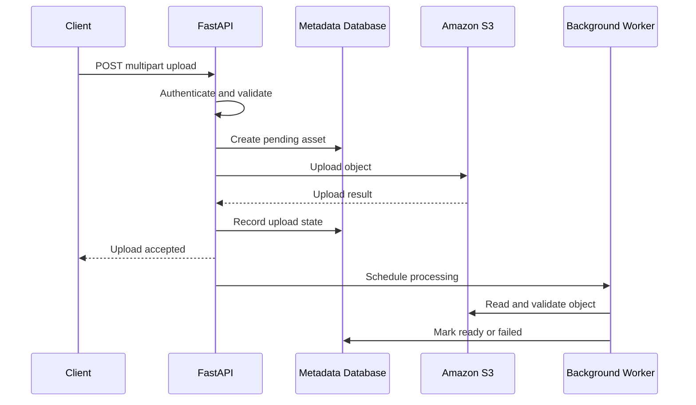
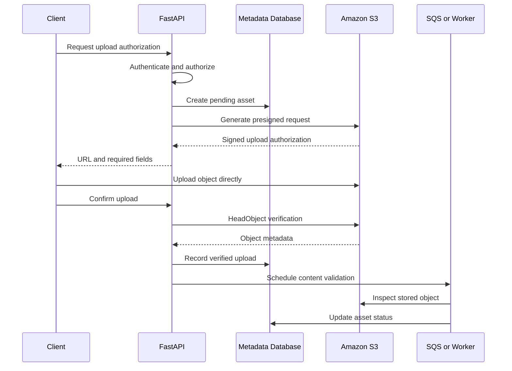
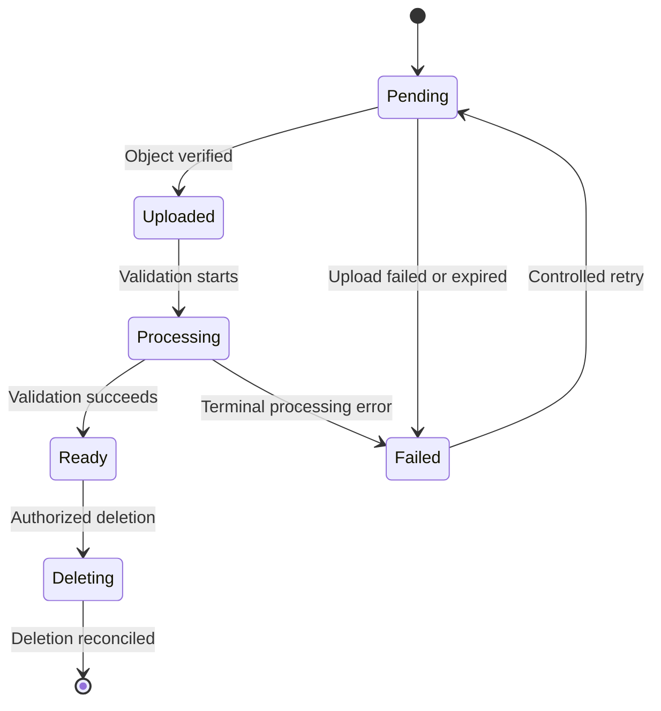

# 03- FastAPI Integration

## Overview

FastAPI integrates with Amazon S3 through Boto3 to support file uploads, downloads, object metadata management, presigned URLs, and event-driven processing. Typical use cases include document management, user-generated media, report storage, data ingestion, and file-processing microservices.

A production implementation should separate the HTTP API from storage operations and application business rules.

- **API layer:** Handles request validation, authentication, authorization, and HTTP responses.
- **Service layer:** Coordinates asset creation, object-key generation, state transitions, and business rules.
- **Storage layer:** Encapsulates Boto3 client configuration, uploads, downloads, object inspection, and deletion.
- **Metadata layer:** Stores asset ownership, object keys, processing status, and audit information in a database.
- **Processing layer:** Validates uploaded content, performs transformations, and manages background work.

FastAPI is asynchronous, but Boto3 is a synchronous SDK. Calling Boto3 directly inside an `async def` endpoint can block the event loop. Use a synchronous endpoint, a thread pool, or another suitable execution strategy when performing blocking S3 operations.

For high-throughput uploads, prefer direct client-to-S3 transfers using short-lived presigned URLs. This avoids routing the complete file through the FastAPI application server.

## Architecture

### Server-Mediated Upload

The client uploads a file to FastAPI. The service validates the request and transfers the file to S3.



This architecture is useful when the backend must inspect incoming data before storing it, perform synchronous preprocessing, or enforce a centralized transfer path.

Its main limitation is that application infrastructure handles the file-transfer bandwidth. Large uploads increase network traffic, request duration, worker usage, and temporary-storage requirements.

### Direct Client-to-S3 Upload

FastAPI creates an upload authorization and returns it to the client. The client uploads the file directly to S3.



FastAPI remains responsible for ownership, object-key generation, upload limits, metadata, and asset readiness. The backend does not need to handle the file bytes during a direct upload.

Presigned URLs and POST fields are bearer capabilities. Anyone possessing valid authorization can perform the allowed operation until it expires or becomes invalid. Protect signed URLs and never log them in full.

## Install Dependencies

Install FastAPI, Uvicorn, Boto3, and Pydantic Settings:

```bash
pip install fastapi "uvicorn[standard]" boto3 pydantic-settings python-multipart
```

`python-multipart` is required when FastAPI parses multipart form uploads.

For development and testing, add:

```bash
pip install pytest httpx
```

Pin compatible versions in the application's dependency manager and validate upgrades in CI.

A maintainable project structure might look like this:

```text
app/
    __init__.py
    main.py
    config.py
    dependencies.py
    schemas.py
    api/
        __init__.py
        assets.py
    services/
        __init__.py
        asset_service.py
    storage/
        __init__.py
        s3.py
    repositories/
        __init__.py
        assets.py
tests/
    test_assets_api.py
    test_s3_service.py
.env.example
requirements.txt
```

Keep S3 operations out of route handlers. The API layer should depend on application services rather than constructing arbitrary AWS requests.

## Configure AWS Credentials

Use the AWS SDK credential provider chain. It supports different credential sources without putting secrets in application code.

| Environment | Recommended Credential Source |
|---|---|
| Local development | AWS CLI profile or an approved local credential provider |
| Amazon EC2 | Instance profile role |
| Amazon ECS | Task IAM role |
| AWS Lambda | Execution role |
| Amazon EKS | EKS Pod Identity or IRSA where applicable |
| GitHub Actions | IAM OIDC federation with temporary credentials |

For local development:

```bash
aws configure --profile fastapi-s3-dev
```

Set environment variables in the shell.

Linux or macOS:

```bash
export AWS_PROFILE=fastapi-s3-dev
export AWS_REGION=ap-south-1
export AWS_STORAGE_BUCKET_NAME=company-assets-dev
export S3_UPLOAD_MAX_BYTES=20971520
```

PowerShell:

```powershell
$env:AWS_PROFILE = "fastapi-s3-dev"
$env:AWS_REGION = "ap-south-1"
$env:AWS_STORAGE_BUCKET_NAME = "company-assets-dev"
$env:S3_UPLOAD_MAX_BYTES = "20971520"
```

The examples use a 20 MiB application upload limit. Adjust it to the workload and enforce corresponding limits at the reverse proxy or API gateway.

Do not place access keys in source code, container images, committed environment files, or CI/CD workflow definitions. Prefer temporary role credentials in deployed environments.

## Application Configuration

Use `pydantic-settings` to centralize application configuration.

```python
# app/config.py

from functools import lru_cache

from pydantic import Field
from pydantic_settings import BaseSettings, SettingsConfigDict


class Settings(BaseSettings):
    aws_region: str = "ap-south-1"
    aws_storage_bucket_name: str
    s3_upload_max_bytes: int = Field(
        default=20 * 1024 * 1024,
        gt=0,
    )
    s3_presigned_url_expiry_seconds: int = Field(
        default=300,
        ge=60,
        le=900,
    )

    model_config = SettingsConfigDict(
        env_file=".env",
        env_file_encoding="utf-8",
        extra="ignore",
    )


@lru_cache
def get_settings() -> Settings:
    return Settings()
```

Use `.env` for local development only where appropriate. In production, inject configuration through the runtime environment or an approved configuration service.

Example `.env.example`:

```dotenv
AWS_REGION=ap-south-1
AWS_STORAGE_BUCKET_NAME=company-assets-dev
S3_UPLOAD_MAX_BYTES=20971520
S3_PRESIGNED_URL_EXPIRY_SECONDS=300
```

The example contains no credentials. Add `.env` to `.gitignore`.

Validate required configuration during application startup rather than discovering missing bucket configuration after processing a user request.

## Configure the S3 Client

A reusable Boto3 client encapsulates signing, networking, retries, and connection-pool configuration.

```python
# app/storage/s3.py

import boto3

from botocore.config import Config


def create_s3_client(*, region_name: str):
    return boto3.client(
        "s3",
        region_name=region_name,
        config=Config(
            signature_version="s3v4",
            retries={
                "mode": "standard",
                "max_attempts": 5,
            },
            max_pool_connections=50,
            s3={
                "addressing_style": "virtual",
            },
        ),
    )
```

The retry policy handles eligible transient errors. It does not replace application-level recovery for partial failures, database inconsistencies, or non-idempotent workflows.

The connection-pool size should reflect expected concurrency and workload characteristics. Increasing it without controlling concurrency can increase resource consumption.

### Initialize the Client with Lifespan

FastAPI's lifespan mechanism is a suitable place to initialize shared resources once per application process.

```python
# app/main.py

from contextlib import asynccontextmanager

from fastapi import FastAPI

from app.config import get_settings
from app.storage.s3 import create_s3_client


@asynccontextmanager
async def lifespan(app: FastAPI):
    settings = get_settings()

    app.state.s3_client = create_s3_client(
        region_name=settings.aws_region,
    )

    app.state.settings = settings

    try:
        yield
    finally:
        app.state.s3_client.close()


app = FastAPI(lifespan=lifespan)
```

A synchronous Boto3 client can be reused across requests within its application process. Do not create a new client for every API call without a specific reason.

The example initializes the client for every FastAPI worker process. Each worker therefore has its own client and connection pool.

## Define the Storage Service

Create a storage service that accepts a configured client and exposes application-level operations.

```python
# app/storage/s3.py

import logging

from botocore.exceptions import BotoCoreError, ClientError
from botocore.exceptions import ParamValidationError


logger = logging.getLogger(__name__)


class StorageOperationError(Exception):
    """An S3 operation failed."""


def upload_fileobj(
    *,
    s3_client,
    bucket_name: str,
    file_obj,
    object_key: str,
    content_type: str,
) -> None:
    try:
        s3_client.upload_fileobj(
            file_obj,
            bucket_name,
            object_key,
            ExtraArgs={
                "ContentType": content_type,
            },
        )
    except (BotoCoreError, ClientError, ParamValidationError) as exc:
        logger.exception(
            "S3 upload failed",
            extra={"object_key": object_key},
        )
        raise StorageOperationError(
            "Unable to upload the file."
        ) from exc


def head_object(
    *,
    s3_client,
    bucket_name: str,
    object_key: str,
) -> dict:
    try:
        return s3_client.head_object(
            Bucket=bucket_name,
            Key=object_key,
        )
    except (BotoCoreError, ClientError, ParamValidationError) as exc:
        logger.exception(
            "S3 object inspection failed",
            extra={"object_key": object_key},
        )
        raise StorageOperationError(
            "Unable to verify the stored object."
        ) from exc


def generate_presigned_put_url(
    *,
    s3_client,
    bucket_name: str,
    object_key: str,
    content_type: str,
    expires_in: int,
) -> str:
    try:
        return s3_client.generate_presigned_url(
            "put_object",
            Params={
                "Bucket": bucket_name,
                "Key": object_key,
                "ContentType": content_type,
            },
            ExpiresIn=expires_in,
            HttpMethod="PUT",
        )
    except (BotoCoreError, ClientError, ParamValidationError) as exc:
        logger.exception(
            "S3 presigned URL generation failed",
            extra={"object_key": object_key},
        )
        raise StorageOperationError(
            "Unable to create upload authorization."
        ) from exc


def generate_presigned_get_url(
    *,
    s3_client,
    bucket_name: str,
    object_key: str,
    expires_in: int,
) -> str:
    try:
        return s3_client.generate_presigned_url(
            "get_object",
            Params={
                "Bucket": bucket_name,
                "Key": object_key,
            },
            ExpiresIn=expires_in,
            HttpMethod="GET",
        )
    except (BotoCoreError, ClientError, ParamValidationError) as exc:
        logger.exception(
            "S3 download URL generation failed",
            extra={"object_key": object_key},
        )
        raise StorageOperationError(
            "Unable to create download authorization."
        ) from exc


def delete_object(
    *,
    s3_client,
    bucket_name: str,
    object_key: str,
) -> None:
    try:
        s3_client.delete_object(
            Bucket=bucket_name,
            Key=object_key,
        )
    except (BotoCoreError, ClientError, ParamValidationError) as exc:
        logger.exception(
            "S3 object deletion failed",
            extra={"object_key": object_key},
        )
        raise StorageOperationError(
            "Unable to delete the stored object."
        ) from exc
```

The `upload_fileobj` managed transfer API accepts a binary file-like object and can use multipart uploads when required. This avoids manually reading the entire object into memory.

Presigned PUT is appropriate when the client can comply with the signed request's headers. Use presigned POST when policy-based restrictions, such as a content-length range, are required.

Do not treat all exceptions as equivalent. The HTTP API should distinguish client validation errors, authorization failures, and transient storage errors without exposing raw AWS error details.

## Manage Blocking I/O

Boto3 is synchronous. FastAPI's asynchronous endpoints should not call synchronous S3 operations directly on the event-loop thread.

For a file-upload endpoint, use `run_in_threadpool` from Starlette or implement the endpoint as a normal `def` route when its blocking dependencies are synchronous.

```python
from starlette.concurrency import run_in_threadpool

from app.storage.s3 import upload_fileobj


await run_in_threadpool(
    upload_fileobj,
    s3_client=s3_client,
    bucket_name=bucket_name,
    file_obj=uploaded_file.file,
    object_key=object_key,
    content_type=uploaded_file.content_type,
)
```

Do not assume that declaring a route `async def` makes every operation inside it non-blocking.

Also consider transfer concurrency. Boto3 managed transfers can create their own concurrent work. Bound the number of simultaneous uploads and tune transfer settings based on observed CPU, memory, network, and thread usage.

## Define the Asset Model

S3 stores object data, while an application database stores ownership, business metadata, and workflow state.

A persistent asset record might contain these fields:

| Field | Purpose |
|---|---|
| `id` | Stable application identifier |
| `owner_id` | Authorized owner or tenant |
| `object_key` | Server-generated S3 key |
| `original_filename` | User-facing filename |
| `content_type` | Declared or verified media type |
| `size_bytes` | Verified object size |
| `status` | Upload and processing lifecycle |
| `created_at` | Creation timestamp |
| `updated_at` | Last state change |

Use a database such as PostgreSQL for authoritative asset metadata. The examples below show the storage and request boundaries; connect them to the application's repository implementation rather than keeping production state only in process memory.

### Asset Lifecycle



The application's `READY` state should indicate that required validation and processing have succeeded, not merely that S3 returned a successful upload response.

Use explicit transitions and prevent concurrent requests from moving an asset into an invalid state.

## Generate Safe Object Keys

Never use a client-provided filename as the complete S3 key. Generate an unpredictable key and store the original filename separately.

```python
# app/services/asset_service.py

import uuid


def generate_object_key(*, owner_id: int) -> str:
    return (
        f"quarantine/users/{owner_id}/"
        f"{uuid.uuid4().hex}"
    )
```

A stable prefix can help organize objects by tenant, processing stage, or retention policy. A prefix is an organizational convention, not an authorization boundary by itself.

For multi-tenant applications, derive the owner or tenant identifier from the authenticated principal and enforce ownership through the metadata repository. Do not trust an arbitrary tenant identifier from the request body.

## Implement a Server-Mediated Upload Endpoint

### Define Request and Response Schemas

```python
# app/schemas.py

from datetime import datetime

from pydantic import BaseModel, ConfigDict, Field


class AssetUploadResponse(BaseModel):
    id: int
    original_filename: str
    content_type: str
    size_bytes: int
    status: str
    created_at: datetime


class UploadInitiationRequest(BaseModel):
    filename: str = Field(min_length=1, max_length=255)
    content_type: str


class UploadInitiationResponse(BaseModel):
    asset_id: int
    upload_url: str
    expires_in: int


class DownloadResponse(BaseModel):
    download_url: str
    expires_in: int
```

The response schemas describe the API contract. The repository must persist the asset's metadata and lifecycle state.

### Validate the File

```python
# app/services/asset_service.py

from pathlib import PurePosixPath

from fastapi import HTTPException, UploadFile


ALLOWED_TYPES = {
    ".pdf": "application/pdf",
    ".png": "image/png",
    ".jpg": "image/jpeg",
    ".jpeg": "image/jpeg",
}


async def validate_upload(
    uploaded_file: UploadFile,
    *,
    max_bytes: int,
) -> str:
    filename = uploaded_file.filename or ""
    normalized_filename = filename.replace("\\", "/")
    suffix = PurePosixPath(normalized_filename).suffix.lower()

    if suffix not in ALLOWED_TYPES:
        raise HTTPException(
            status_code=415,
            detail="Unsupported file extension.",
        )

    expected_type = ALLOWED_TYPES[suffix]

    if uploaded_file.content_type != expected_type:
        raise HTTPException(
            status_code=415,
            detail="File extension and content type do not match.",
        )

    size = 0

    while True:
        chunk = await uploaded_file.read(1024 * 1024)
        if not chunk:
            break

        size += len(chunk)

        if size > max_bytes:
            raise HTTPException(
                status_code=413,
                detail="File exceeds the maximum allowed size.",
            )

    await uploaded_file.seek(0)

    if size == 0:
        raise HTTPException(
            status_code=400,
            detail="Empty files are not accepted.",
        )

    return expected_type
```

This example counts bytes while reading in chunks, avoiding a separate full-file buffer. It then rewinds the spooled upload so the storage layer can read it.

It is not a complete content-validation pipeline. The filename and declared MIME type are client-controlled. Inspect the actual file signature and apply format-specific validation or malware scanning before making the object available.

FastAPI's `UploadFile` uses a spooled temporary file and is preferable to declaring a large file as `bytes`, which requires loading the file contents into memory. Multipart parsing and temporary storage still consume resources, so enforce limits at multiple layers.

### Wire the Endpoint

The endpoint below demonstrates the storage boundary. `asset_repository` represents the application's persistent metadata repository and should implement the stated create and update operations transactionally.

```python
# app/api/assets.py

from fastapi import (
    APIRouter,
    File,
    HTTPException,
    Request,
    UploadFile,
    status,
)
from starlette.concurrency import run_in_threadpool

from app.config import get_settings
from app.services.asset_service import (
    generate_object_key,
    validate_upload,
)
from app.storage.s3 import (
    StorageOperationError,
    upload_fileobj,
)


router = APIRouter(prefix="/assets", tags=["assets"])


@router.post(
    "/",
    status_code=status.HTTP_202_ACCEPTED,
)
async def upload_asset(
    request: Request,
    file: UploadFile = File(...),
):
    settings = get_settings()

    content_type = await validate_upload(
        file,
        max_bytes=settings.s3_upload_max_bytes,
    )

    # Replace with the authenticated principal's ID.
    # This example assumes authentication middleware is configured.
    current_user = request.state.current_user
    owner_id = current_user.id

    object_key = generate_object_key(
        owner_id=owner_id,
    )

    # The repository should persist a PENDING asset before upload.
    asset = await request.app.state.asset_repository.create_pending(
        owner_id=owner_id,
        object_key=object_key,
        original_filename=file.filename or "upload",
        content_type=content_type,
    )

    try:
        await run_in_threadpool(
            upload_fileobj,
            s3_client=request.app.state.s3_client,
            bucket_name=settings.aws_storage_bucket_name,
            file_obj=file.file,
            object_key=object_key,
            content_type=content_type,
        )
    except StorageOperationError as exc:
        await request.app.state.asset_repository.mark_failed(
            asset.id
        )
        raise HTTPException(
            status_code=status.HTTP_503_SERVICE_UNAVAILABLE,
            detail="File storage is temporarily unavailable.",
        ) from exc
    finally:
        await file.close()

    await request.app.state.asset_repository.mark_uploaded(
        asset.id,
        size_bytes=asset.size_bytes,
    )

    return {
        "id": asset.id,
        "original_filename": asset.original_filename,
        "content_type": content_type,
        "status": "uploaded",
    }
```

The example assumes an application authentication layer has attached `current_user` to the request and that the repository exposes asynchronous operations. Those components must be implemented by the application; `request.state.current_user` is not populated automatically by FastAPI.

The repository's `mark_uploaded` call should use the actual verified byte count. In a complete implementation, capture the validated size and store it with the asset. For large or adversarial workloads, also configure request-body limits before multipart parsing so a client cannot force excessive temporary-disk usage.

A successful S3 upload followed by a database error can leave an object without matching metadata. Use explicit asset states and a reconciliation job to find and clean up orphaned objects.

## Implement Direct Uploads with Presigned URLs

For larger files, a direct upload avoids consuming FastAPI's transfer bandwidth and request workers for the duration of the file transfer.

### Create the Upload Authorization

Use a presigned PUT URL when the client can send the required signed headers.

```python
# app/api/assets.py

from fastapi import Depends, HTTPException, Request, status

from app.config import get_settings
from app.schemas import (
    UploadInitiationRequest,
    UploadInitiationResponse,
)
from app.services.asset_service import generate_object_key
from app.storage.s3 import StorageOperationError, generate_presigned_put_url


ALLOWED_CONTENT_TYPES = {
    "application/pdf",
    "image/png",
    "image/jpeg",
}


@router.post(
    "/upload-init/",
    response_model=UploadInitiationResponse,
    status_code=status.HTTP_201_CREATED,
)
async def initiate_upload(
    payload: UploadInitiationRequest,
    request: Request,
):
    settings = get_settings()

    if payload.content_type not in ALLOWED_CONTENT_TYPES:
        raise HTTPException(
            status_code=status.HTTP_415_UNSUPPORTED_MEDIA_TYPE,
            detail="Unsupported content type.",
        )

    # Authentication must be enforced by the application.
    current_user = request.state.current_user
    owner_id = current_user.id

    object_key = generate_object_key(
        owner_id=owner_id,
    )

    asset = await request.app.state.asset_repository.create_pending(
        owner_id=owner_id,
        object_key=object_key,
        original_filename=payload.filename,
        content_type=payload.content_type,
    )

    try:
        upload_url = await run_in_threadpool(
            generate_presigned_put_url,
            s3_client=request.app.state.s3_client,
            bucket_name=settings.aws_storage_bucket_name,
            object_key=object_key,
            content_type=payload.content_type,
            expires_in=settings.s3_presigned_url_expiry_seconds,
        )
    except StorageOperationError as exc:
        await request.app.state.asset_repository.mark_failed(
            asset.id
        )
        raise HTTPException(
            status_code=status.HTTP_503_SERVICE_UNAVAILABLE,
            detail="Unable to create upload authorization.",
        ) from exc

    return UploadInitiationResponse(
        asset_id=asset.id,
        upload_url=upload_url,
        expires_in=settings.s3_presigned_url_expiry_seconds,
    )
```

A presigned PUT URL signs the selected bucket, object key, HTTP method, expiration, and configured request parameters. The client must send the `Content-Type` header exactly as required by the signature.

A presigned PUT URL does not by itself enforce the same content-length-range policy available to a presigned POST. For strict upload-size enforcement, use a suitable presigned POST policy or an architecture that performs stronger validation before accepting the object.

### Upload from the Client

```bash
curl -X PUT \
  -T ./report.pdf \
  -H "Content-Type: application/pdf" \
  "PRESIGNED_UPLOAD_URL"
```

The URL is illustrative and must be replaced by the actual URL returned by FastAPI.

Never modify the generated URL or signed headers. URL encoding, proxy behavior, incorrect Regions, expired credentials, or mismatched content types can cause signature failures.

### Verify Upload Completion

After the client uploads the object, it should call a completion endpoint. The backend must verify ownership and inspect the expected object before advancing the asset state.

```python
# app/services/asset_service.py

from app.storage.s3 import StorageOperationError, head_object


async def verify_uploaded_asset(
    *,
    s3_client,
    bucket_name: str,
    asset,
    owner_id: int,
    max_bytes: int,
) -> int:
    if asset.owner_id != owner_id:
        raise PermissionError("Asset ownership validation failed.")

    if asset.status != "pending":
        raise ValueError("Asset is not awaiting upload completion.")

    metadata = head_object(
        s3_client=s3_client,
        bucket_name=bucket_name,
        object_key=asset.object_key,
    )

    size_bytes = metadata["ContentLength"]

    if not 1 <= size_bytes <= max_bytes:
        raise ValueError("Uploaded object size is outside allowed limits.")

    if metadata.get("ContentType") != asset.content_type:
        raise ValueError("Uploaded content type does not match.")

    return size_bytes
```

The endpoint that invokes this function should map missing-object errors and invalid states to appropriate HTTP responses. It must not expose raw S3 exception messages.

`HeadObject` verifies existence and metadata, not the safety or true format of the file. After verification, schedule content scanning or processing and transition the asset to `READY` only after the required checks succeed.

### Presigned POST Alternative

Use `generate_presigned_post` when the upload policy needs to enforce a content-length range and conditions on form fields.

```python
authorization = s3_client.generate_presigned_post(
    Bucket=bucket_name,
    Key=object_key,
    Fields={
        "Content-Type": content_type,
    },
    Conditions=[
        {"Content-Type": content_type},
        [
            "content-length-range",
            1,
            max_bytes,
        ],
    ],
    ExpiresIn=300,
)
```

The API returns an upload URL and the required form fields. The client submits every returned field in a multipart POST request to S3.

Presigned authorization should expire quickly. A signed upload may be reused until it expires, and a subsequent upload to the same object key can overwrite an existing object. Use unpredictable keys, short expirations, appropriate state transitions, and version-aware controls where required.

## Generate Download URLs

Keep S3 objects private and authorize downloads through application metadata.

```python
# app/api/assets.py

from fastapi import HTTPException, Request, status

from app.schemas import DownloadResponse
from app.storage.s3 import (
    StorageOperationError,
    generate_presigned_get_url,
)


@router.get(
    "/{asset_id}/download/",
    response_model=DownloadResponse,
)
async def get_download_url(
    asset_id: int,
    request: Request,
):
    settings = get_settings()
    current_user = request.state.current_user

    asset = await request.app.state.asset_repository.get_owned_asset(
        asset_id=asset_id,
        owner_id=current_user.id,
    )

    if asset is None:
        # Avoid confirming that another user's asset exists.
        raise HTTPException(
            status_code=status.HTTP_404_NOT_FOUND,
            detail="Asset not found.",
        )

    if asset.status != "ready":
        raise HTTPException(
            status_code=status.HTTP_409_CONFLICT,
            detail="Asset is not available for download.",
        )

    try:
        download_url = await run_in_threadpool(
            generate_presigned_get_url,
            s3_client=request.app.state.s3_client,
            bucket_name=settings.aws_storage_bucket_name,
            object_key=asset.object_key,
            expires_in=settings.s3_presigned_url_expiry_seconds,
        )
    except StorageOperationError as exc:
        raise HTTPException(
            status_code=status.HTTP_503_SERVICE_UNAVAILABLE,
            detail="Unable to create download authorization.",
        ) from exc

    return DownloadResponse(
        download_url=download_url,
        expires_in=settings.s3_presigned_url_expiry_seconds,
    )
```

This endpoint assumes the repository's `get_owned_asset` method implements an ownership-filtered database lookup.

The URL grants access using the signing identity's S3 permissions. It remains valid only while its configured expiry and the underlying credentials and authorization permit it.

Avoid logging complete presigned URLs. Their query strings contain signed authorization data.

## Implement Deletion and Reconciliation

S3 and the metadata database do not share a transaction. A deletion workflow should therefore record intent and be recoverable.

A safer sequence is:

1. Verify the caller's ownership or tenant-level authorization.
2. Transition the asset to `DELETING`.
3. Delete the object through the storage service.
4. Remove or soft-delete the metadata only after storage deletion succeeds.
5. Retry failed deletions and reconcile unresolved records.

```python
async def delete_asset(
    *,
    repository,
    s3_client,
    bucket_name: str,
    asset,
    owner_id: int,
) -> None:
    if asset.owner_id != owner_id:
        raise PermissionError("Asset ownership validation failed.")

    await repository.mark_deleting(asset.id)

    await run_in_threadpool(
        delete_object,
        s3_client=s3_client,
        bucket_name=bucket_name,
        object_key=asset.object_key,
    )

    await repository.mark_deleted(asset.id)
```

The function assumes `delete_object` is the storage operation defined in the service layer and that the repository methods provide suitable concurrency controls.

For production use, make deletion retries idempotent and prevent concurrent operations from advancing the same asset inconsistently. A background reconciliation process should handle prolonged failures.

If bucket versioning is enabled, deleting an object key may create a delete marker rather than permanently removing prior versions. Retention and permanent deletion require explicit version-aware handling.

## Security and IAM

Keep S3 objects private and grant each application component only the permissions it needs.

| Operation | Typical S3 Permission |
|---|---|
| Upload an object | `s3:PutObject` |
| Download an object | `s3:GetObject` |
| Generate a presigned GET URL | `s3:GetObject` |
| Verify object metadata | `s3:GetObject` |
| Delete an object | `s3:DeleteObject` |
| List bucket contents when explicitly required | `s3:ListBucket` |

Restrict resources to the relevant bucket and object prefixes. Avoid granting broad bucket access merely to simplify development.

Additional controls include:

- Keep Block Public Access enabled unless an explicitly reviewed design requires otherwise.
- Prefer bucket-owner-enforced Object Ownership when ACLs are unnecessary.
- Use HTTPS for application and object transfers.
- Validate actual file content before making an upload available.
- Enforce both request-size limits and application-specific file limits.
- Avoid accepting arbitrary object keys or bucket names from clients.
- Use short-lived presigned URLs and treat them as secrets.
- Do not log credentials, authorization headers, or signed query strings.
- Configure SSE-S3 or SSE-KMS according to data sensitivity and compliance requirements.
- Diagnose S3 access-denied errors and KMS authorization failures as separate permission layers.

A prefix such as `users/123/` helps organize data but does not automatically isolate tenants. Application authorization and IAM policies must enforce the intended access boundaries.

## Multipart Uploads and Large Files

Boto3's managed transfer interface can use multipart uploads and multiple threads when appropriate. For server-mediated uploads, it can transfer a file-like object directly to S3.

For very large uploads, direct multipart upload can provide better control over throughput, retries, and resumability.

A multipart workflow typically includes:

1. FastAPI authorizes the upload and creates an upload record.
2. The service initiates a multipart upload.
3. The client uploads individual parts using presigned URLs.
4. The backend validates the submitted part information.
5. The backend completes the multipart upload.
6. The resulting object is verified and the asset is processed.

Do not allow a client to complete arbitrary multipart uploads using uncontrolled bucket or object identifiers. Persist the relevant upload ID and expected object key, and authorize every operation against the asset record.

Configure lifecycle rules to abort incomplete multipart uploads after an appropriate period. This prevents abandoned parts from accumulating storage charges.

For integrity-sensitive uploads, use supported checksum mechanisms and verify the integrity requirements independently of a successful HTTP response.

## Asynchronous Processing and Event-Driven Workflows

File ingestion frequently includes operations that should not execute inside the HTTP request:

- Malware scanning.
- PDF extraction or OCR.
- Image resizing and transformations.
- Document conversion.
- Metadata extraction.
- Data ingestion and indexing.

A typical workflow is:

1. Upload the file to a quarantine location.
2. Verify the object and update the metadata record.
3. Publish a processing task or consume an S3 event.
4. Run validation and processing in a worker.
5. Store generated objects separately from untrusted inputs.
6. Mark the asset `READY` only after processing succeeds.
7. Record failures and expose a retry or recovery mechanism.

FastAPI can publish work to Celery, SQS, or another job system. Avoid making S3 event delivery and database state changes depend on an unprotected sequence of independent network calls. Use idempotency and a durable dispatch mechanism such as a transactional outbox when lost task publication would be unacceptable.

S3 notifications and distributed workers can produce duplicate or repeated work. Use stable event identifiers, object keys, versions, or persisted processing records to make operations safe to retry.

## Performance and Scalability

### Choosing the Transfer Architecture

| Concern | Server-Mediated Upload | Direct Client-to-S3 Upload |
|---|---|---|
| File bytes pass through FastAPI | Yes | No |
| Backend can inspect content before initial storage | Yes | Usually requires post-upload validation |
| API worker occupancy | Higher | Lower during transfer |
| Infrastructure complexity | Lower | Higher |
| Upload constraints | API and infrastructure limits | Signed request policy and infrastructure controls |
| Recommended use | Smaller files or synchronous preprocessing | Large files and high upload volume |

### Avoid Unbounded Concurrency

Do not assume that increasing the number of FastAPI workers always increases throughput. Each worker consumes memory and maintains its own client pools. Managed S3 transfers may also create concurrent work.

Set explicit limits for:

- Simultaneous transfers.
- Incoming request sizes.
- Temporary disk consumption.
- Processing queue depth.
- Worker concurrency.
- API and storage timeouts.

Use measured latency, memory, CPU, thread count, and S3 request metrics to tune capacity.

### Use Streaming Appropriately

For server-mediated downloads, return a `StreamingResponse` rather than loading an entire object into memory. For large objects, redirecting the client to an authorized presigned GET URL can reduce application bandwidth and simplify range-based downloading.

When streaming through the application, account for network backpressure, cancellation, client disconnects, and resource cleanup. A stream does not automatically make every upstream operation asynchronous.

## Error Handling and Troubleshooting

| Symptom | Possible Cause | Diagnostic Approach |
|---|---|---|
| `AccessDenied` | IAM, bucket policy, explicit deny, or missing KMS permission | Verify the signing identity, policy evaluation, bucket policy, and encryption configuration |
| `NoSuchBucket` | Incorrect bucket name or configuration | Inspect configured bucket and account/Region |
| `NoSuchKey` | Wrong object key or failed upload | Compare the database key with the stored object |
| `SignatureDoesNotMatch` | Incorrect Region, signed-header mismatch, modified URL, or clock skew | Use the URL unchanged and verify headers, Region, and clock synchronization |
| Expired presigned URL | URL or underlying temporary credentials expired | Generate fresh authorization and inspect the credential source |
| Slow API response | Synchronous Boto3 call on event loop or excessive request concurrency | Inspect event-loop latency, worker utilization, and S3 transfer duration |
| Upload runs out of disk space | Multipart parsing or temporary upload files consume disk | Inspect temporary storage and enforce request-body limits |
| Upload works with `curl` but not a browser | CORS or browser request construction | Inspect preflight requests and required request headers |
| Asset remains pending | Client did not complete upload or processing dispatch failed | Inspect asset state, S3 object metadata, and task queue |
| Object exists without metadata | Database operation failed after S3 upload | Reconcile orphaned objects and record failures |
| Object is deleted but still consumes storage | Versioning retains earlier object versions | Inspect versions and delete markers |

Use structured logging with the asset ID, operation, duration, and sanitized object-key context. Never expose raw AWS SDK exceptions to API consumers.

## Testing Strategy

Test application business logic independently from real AWS requests, then add targeted integration tests against a dedicated test bucket.

### Unit Tests

Cover:

- Object-key generation and tenant boundaries.
- Filename, extension, size, and content-type validation.
- Upload state transitions.
- Storage exception mapping.
- Presigned URL method, parameters, and expiry.
- Ownership enforcement on reads and deletes.
- Duplicate upload-completion requests.
- Retry handling and orphan reconciliation.

Mock Boto3 calls at the storage boundary. Avoid relying on live AWS credentials in unit tests.

### API Tests

FastAPI's `TestClient` can exercise endpoints using dependency overrides or test application state. A test for an authenticated endpoint should provide the relevant authentication fixture and metadata repository.

```python
# tests/test_s3_service.py

from unittest.mock import MagicMock

import pytest
from botocore.exceptions import ClientError

from app.storage.s3 import (
    StorageOperationError,
    head_object,
)


def test_head_object_returns_metadata():
    client = MagicMock()
    client.head_object.return_value = {
        "ContentLength": 1024,
        "ContentType": "application/pdf",
    }

    result = head_object(
        s3_client=client,
        bucket_name="company-assets-test",
        object_key="quarantine/test/document.pdf",
    )

    assert result["ContentLength"] == 1024

    client.head_object.assert_called_once_with(
        Bucket="company-assets-test",
        Key="quarantine/test/document.pdf",
    )


def test_head_object_maps_client_error():
    client = MagicMock()
    client.head_object.side_effect = ClientError(
        {
            "Error": {
                "Code": "AccessDenied",
                "Message": "Access denied",
            }
        },
        "HeadObject",
    )

    with pytest.raises(StorageOperationError):
        head_object(
            s3_client=client,
            bucket_name="company-assets-test",
            object_key="quarantine/test/document.pdf",
        )
```

These tests verify the service boundary and error mapping. They do not prove that the real bucket permissions or presigned URLs work.

### Integration Tests

Against an isolated AWS test environment, verify:

- Upload and download authorization.
- Presigned URL expiry and required headers.
- Bucket privacy and IAM restrictions.
- Actual upload-size enforcement.
- Correct object metadata and asset state transitions.
- Incomplete multipart-upload cleanup.
- Retry and reconciliation behavior.
- Versioning and deletion semantics where enabled.

Use unique test keys and ensure cleanup cannot target production resources. Never claim deployment verification based solely on mocked tests.

## Deployment and Observability

Provision buckets, encryption, IAM roles, CORS, lifecycle rules, and related infrastructure using infrastructure as code. Keep the application deployment separate from resource provisioning where possible.

Monitor both API and storage behavior:

| Signal | Why It Matters |
|---|---|
| Upload success and failure rates | Identifies storage integration problems |
| S3 request latency and errors | Shows storage-side reliability |
| API event-loop latency and worker utilization | Detects blocking or over-concurrent workloads |
| Pending asset count and age | Identifies stalled upload or processing workflows |
| Processing failure and retry counts | Reveals downstream instability |
| Orphaned object count | Detects database/S3 inconsistencies |
| Incomplete multipart uploads | Identifies abandoned transfers and potential costs |
| Storage bytes and request charges | Supports cost management |

For production, also define operational procedures for failed deployments, credential rotation, object recovery, lifecycle changes, and accidental deletion. Use CloudTrail for audit requirements and appropriate CloudWatch metrics or alarms for operational visibility.

AWS reference: [Amazon S3 monitoring and metrics](https://docs.aws.amazon.com/AmazonS3/latest/userguide/monitoring-overview.html).

## Common Mistakes

**Calling Boto3 directly inside an asynchronous endpoint:** Synchronous I/O can block the event loop. Use a thread pool or a synchronous route and measure concurrency.

**Reading entire uploads into memory:** This increases memory consumption as file size grows. Use `UploadFile`, bounded reads, and direct transfers where appropriate.

**Trusting declared content types:** A browser can supply misleading metadata. Inspect the actual file and apply required scanning before making it available.

**Using predictable client-controlled object keys:** This can cause overwrites, collisions, and cross-tenant access mistakes. Generate keys on the server and authorize against persistent metadata.

**Treating presigned URLs as ordinary URLs:** A signed URL is temporary authorization, and uploads can overwrite the signed object's key. Protect the URL and use short expirations.

**Assuming database and S3 writes are atomic:** They are independent systems. Persist states, handle partial failure, and run reconciliation.

**Marking objects ready immediately after upload:** Object existence alone does not establish that a file is safe. Make readiness dependent on required validation and processing.

**Increasing concurrency without limits:** FastAPI workers, thread pools, managed transfers, and temporary files consume resources. Apply limits and measure actual workload behavior.

**Using `DeleteObject` as permanent erasure:** Versioned buckets may retain previous versions. Respect retention requirements and explicitly handle version-aware deletion.

## Official References

- [FastAPI request files](https://fastapi.tiangolo.com/tutorial/request-files/)
- [FastAPI lifespan events](https://fastapi.tiangolo.com/advanced/events/)
- [FastAPI testing](https://fastapi.tiangolo.com/tutorial/testing/)
- [FastAPI concurrency and async behavior](https://fastapi.tiangolo.com/async/)
- [Boto3 S3 uploads](https://docs.aws.amazon.com/boto3/latest/guide/s3-uploading-files.html)
- [Boto3 presigned URLs](https://docs.aws.amazon.com/boto3/latest/guide/s3-presigned-urls.html)
- [Boto3 `generate_presigned_post`](https://docs.aws.amazon.com/boto3/latest/reference/services/s3/client/generate_presigned_post.html)
- [S3 presigned URL behavior](https://docs.aws.amazon.com/AmazonS3/latest/userguide/using-presigned-url.html)
- [Amazon S3 CORS](https://docs.aws.amazon.com/AmazonS3/latest/userguide/cors.html)
- [Amazon S3 security best practices](https://docs.aws.amazon.com/AmazonS3/latest/userguide/security-best-practices.html)

## Key Takeaways

- Separate FastAPI routes, application services, S3 operations, and persistent asset metadata so each layer can be tested and maintained independently.
- Boto3 is synchronous; manage blocking work explicitly to protect FastAPI's event loop and control upload concurrency.
- Use private S3 objects, least-privilege IAM roles, server-generated object keys, and short-lived presigned URLs for secure file transfers.
- Treat upload completion, validation, processing, and deletion as explicit state transitions because S3 and the metadata database do not share a transaction.
- Build production reliability around idempotent processing, bounded retries, reconciliation, integration tests, observability, and cost-aware lifecycle management.