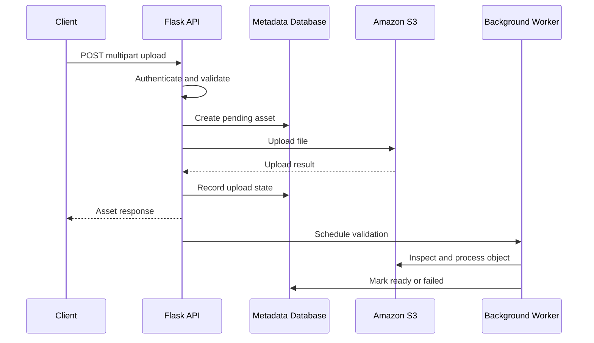
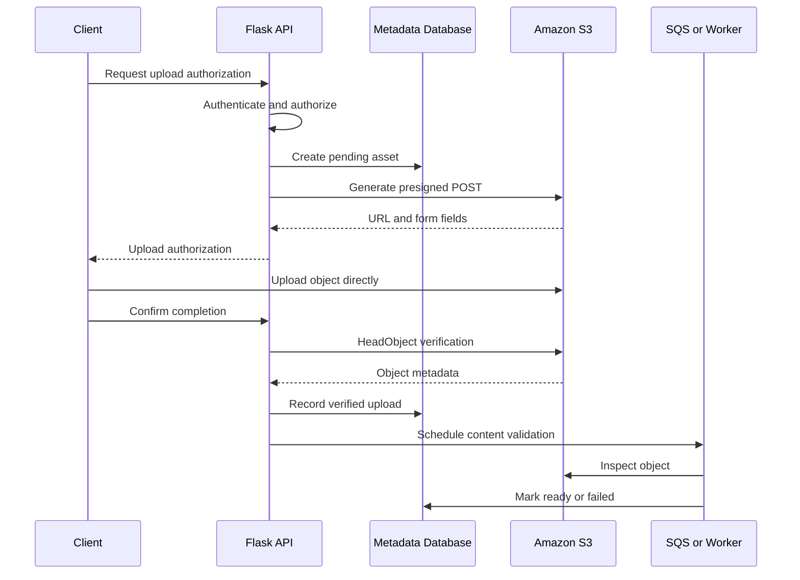

# Flask Integration

## Overview

Flask integrates with Amazon S3 through Boto3 to support file uploads, downloads, metadata management, deletion, and presigned URL workflows. Common use cases include document management, user-generated media, report storage, data ingestion, and file-processing services.

A production implementation should separate HTTP request handling from business rules, storage operations, and persistence.

| Layer | Responsibility |
|---|---|
| API layer | Authentication, authorization, request validation, and HTTP responses |
| Service layer | Business rules, asset lifecycle, and object-key generation |
| Storage layer | Boto3 configuration, uploads, downloads, and S3 error handling |
| Persistence layer | Asset ownership, object keys, file metadata, and processing status |
| Processing layer | Content validation, malware scanning, transformations, and background jobs |

Flask is a synchronous WSGI framework by default, which works naturally with Boto3's synchronous APIs. However, long-running uploads can occupy application workers, while concurrent uploads can consume significant network bandwidth and temporary disk space.

For large files or high-throughput workloads, use Flask to authorize the operation and generate a short-lived presigned request. The client then uploads directly to S3, reducing the data-transfer burden on the application server.

## Architecture

### Server-Mediated Upload

The client uploads a file to Flask, which validates the request and transfers the object to S3.



This design is appropriate when the application must inspect incoming files before making them available, perform synchronous preprocessing, or centralize file transfers through the backend.

Its primary limitation is resource consumption. Upload bandwidth, request duration, temporary storage, and worker occupancy increase with file size and concurrency.

### Direct Client-to-S3 Upload

Flask creates temporary upload authorization while the client transfers the file directly to S3.



Flask remains responsible for authentication, ownership, object-key generation, upload constraints, metadata, and asset readiness. S3 handles the file transfer.

Presigned URLs and form fields are bearer capabilities: anyone possessing valid authorization can perform the permitted operation until it expires or becomes invalid. Protect them like credentials and never log their complete values.

## Install Dependencies

Install Flask, Flask-SQLAlchemy, Flask-Login, Boto3, and local environment configuration support.

```bash
pip install Flask Flask-SQLAlchemy Flask-Login boto3 python-dotenv
```

For testing, install:

```bash
pip install pytest
```

Pin compatible versions in the dependency manager and validate upgrades through CI.

A maintainable project structure might look like this:

```text
app/
    __init__.py
    extensions.py
    models.py
    storage/
        __init__.py
        s3.py
    api/
        __init__.py
        assets.py
tests/
    test_s3_service.py
    test_assets_api.py
.env.example
requirements.txt
```

Flask Blueprints organize API routes, while an application factory centralizes configuration, extension initialization, and resource creation.

## Configure AWS Credentials

Use the AWS SDK credential provider chain rather than embedding access keys in application code.

| Environment | Recommended Credential Source |
|---|---|
| Local development | AWS CLI profile or approved local credential provider |
| Amazon EC2 | Instance profile role |
| Amazon ECS | Task IAM role |
| AWS Lambda | Execution role |
| Amazon EKS | EKS Pod Identity or IRSA, where applicable |
| GitHub Actions | IAM OIDC federation with temporary credentials |

For local development, configure an AWS CLI profile:

```bash
aws configure --profile flask-s3-dev
```

Set environment variables in your shell.

Linux or macOS:

```bash
export AWS_PROFILE=flask-s3-dev
export AWS_REGION=ap-south-1
export S3_BUCKET_NAME=company-assets-dev
export S3_MAX_UPLOAD_BYTES=20971520
export S3_PRESIGNED_URL_EXPIRY_SECONDS=300
export FLASK_SECRET_KEY="replace-with-a-secure-local-secret"
```

PowerShell:

```powershell
$env:AWS_PROFILE = "flask-s3-dev"
$env:AWS_REGION = "ap-south-1"
$env:S3_BUCKET_NAME = "company-assets-dev"
$env:S3_MAX_UPLOAD_BYTES = "20971520"
$env:S3_PRESIGNED_URL_EXPIRY_SECONDS = "300"
$env:FLASK_SECRET_KEY = "replace-with-a-secure-local-secret"
```

The examples use a 20 MiB upload limit and a five-minute presigned authorization lifetime. Adjust these values for the workload and enforce compatible limits at the reverse proxy or load balancer.

Use separate buckets or controlled storage boundaries for development, staging, and production. Never let development scripts or cleanup jobs default to a production bucket.

## Configure the Flask Application

Use an application factory to support separate configurations for development, testing, and production.

### Initialize Extensions

```python
# app/extensions.py

from flask_login import LoginManager
from flask_sqlalchemy import SQLAlchemy

db = SQLAlchemy()
login_manager = LoginManager()
```

This example uses Flask-Login for session-based authentication. The application must register a user loader that retrieves users from its authentication repository.

For REST APIs using JWTs or another authentication mechanism, use the application's existing authentication middleware instead. S3 authorization should not introduce a separate or weaker authentication system.

### Create the Application Factory

```python
# app/__init__.py

import os

import boto3
from botocore.config import Config
from flask import Flask, jsonify
from werkzeug.exceptions import RequestEntityTooLarge

from app.extensions import db, login_manager
from app.storage.s3 import S3Storage


@login_manager.unauthorized_handler
def unauthorized():
    return jsonify({"detail": "Authentication required."}), 401


def create_app(test_config=None):
    app = Flask(__name__)

    app.config.from_mapping(
        SECRET_KEY=os.getenv("FLASK_SECRET_KEY"),
        SQLALCHEMY_DATABASE_URI=os.getenv(
            "DATABASE_URL",
            "sqlite:///assets.db",
        ),
        SQLALCHEMY_TRACK_MODIFICATIONS=False,
        AWS_REGION=os.getenv("AWS_REGION", "ap-south-1"),
        S3_BUCKET_NAME=os.getenv("S3_BUCKET_NAME"),
        S3_MAX_UPLOAD_BYTES=int(
            os.getenv("S3_MAX_UPLOAD_BYTES", str(20 * 1024 * 1024))
        ),
        S3_PRESIGNED_URL_EXPIRY_SECONDS=int(
            os.getenv("S3_PRESIGNED_URL_EXPIRY_SECONDS", "300")
        ),
        # Includes multipart overhead above the per-file limit.
        MAX_CONTENT_LENGTH=22 * 1024 * 1024,
    )

    if test_config:
        app.config.update(test_config)

    if not app.config.get("SECRET_KEY"):
        raise RuntimeError("FLASK_SECRET_KEY is required.")

    if not app.config.get("S3_BUCKET_NAME"):
        raise RuntimeError("S3_BUCKET_NAME is required.")

    if app.config["S3_MAX_UPLOAD_BYTES"] <= 0:
        raise RuntimeError("S3_MAX_UPLOAD_BYTES must be positive.")

    if not 60 <= app.config["S3_PRESIGNED_URL_EXPIRY_SECONDS"] <= 900:
        raise RuntimeError("Presigned URL expiry is outside the allowed range.")

    db.init_app(app)
    login_manager.init_app(app)

    s3_client = boto3.client(
        "s3",
        region_name=app.config["AWS_REGION"],
        config=Config(
            signature_version="s3v4",
            retries={
                "mode": "standard",
                "max_attempts": 5,
            },
            max_pool_connections=50,
            s3={
                "addressing_style": "virtual",
            },
        ),
    )

    app.extensions["s3_storage"] = S3Storage(
        client=s3_client,
        bucket_name=app.config["S3_BUCKET_NAME"],
    )

    from app.api.assets import assets_bp

    app.register_blueprint(
        assets_bp,
        url_prefix="/api/assets",
    )

    @app.errorhandler(RequestEntityTooLarge)
    def handle_request_too_large(_error):
        return jsonify(
            {"detail": "Request exceeds the maximum allowed size."}
        ), 413

    return app
```

The S3 client is initialized once per application instance and reused across requests. Multiple WSGI worker processes normally have separate application instances and clients.

The example uses SQLite for local development. Production deployments should configure a persistent database, such as PostgreSQL, and use schema migrations instead of calling `db.create_all()` during application startup.

The test configuration must provide a suitable bucket name or replace the storage service with a mock before the factory validates configuration. Unit tests should not require live AWS credentials.

Reference: [Flask application factories](https://flask.palletsprojects.com/en/stable/patterns/appfactories/).

## Define the Asset Model

S3 stores the binary object, while the database stores ownership, business metadata, and processing state.

```python
# app/models.py

from datetime import datetime, timezone

from app.extensions import db


class Asset(db.Model):
    class Status:
        PENDING = "pending"
        UPLOADED = "uploaded"
        READY = "ready"
        FAILED = "failed"
        DELETING = "deleting"

    id = db.Column(db.Integer, primary_key=True)
    owner_id = db.Column(
        db.String(255),
        nullable=False,
        index=True,
    )
    object_key = db.Column(
        db.String(1024),
        nullable=False,
        unique=True,
    )
    original_filename = db.Column(
        db.String(255),
        nullable=False,
    )
    content_type = db.Column(
        db.String(150),
        nullable=False,
    )
    size_bytes = db.Column(
        db.BigInteger,
        nullable=True,
    )
    status = db.Column(
        db.String(16),
        nullable=False,
        default=Status.PENDING,
        index=True,
    )
    created_at = db.Column(
        db.DateTime(timezone=True),
        nullable=False,
        default=lambda: datetime.now(timezone.utc),
    )
    updated_at = db.Column(
        db.DateTime(timezone=True),
        nullable=False,
        default=lambda: datetime.now(timezone.utc),
        onupdate=lambda: datetime.now(timezone.utc),
    )

    __table_args__ = (
        db.Index("ix_assets_owner_status", "owner_id", "status"),
    )
```

The model stores an S3 key rather than the binary contents. This supports ownership checks, metadata queries, processing workflows, and storage reconciliation without transferring file contents through the database.

### Asset Lifecycle

| State | Meaning |
|---|---|
| `PENDING` | The asset record exists, but upload completion has not been verified. |
| `UPLOADED` | The object exists and basic storage metadata has been checked. |
| `READY` | Required content validation and processing have succeeded. |
| `FAILED` | An upload or processing operation encountered a terminal failure. |
| `DELETING` | Deletion has started but may require a retry or reconciliation. |

The application should expose an asset for normal downloads only when it has reached the required readiness state.

## Implement the S3 Storage Service

Keep Boto3 operations in a reusable storage service rather than embedding AWS-specific logic in route handlers.

### Storage Operations

```python
# app/storage/s3.py

import logging

from botocore.exceptions import BotoCoreError, ClientError


logger = logging.getLogger(__name__)


class StorageOperationError(Exception):
    """An S3 operation failed."""


class S3ObjectNotFound(StorageOperationError):
    """The requested object could not be found."""


class S3Storage:
    def __init__(self, *, client, bucket_name: str):
        self.client = client
        self.bucket_name = bucket_name

    def upload_fileobj(
        self,
        file_obj,
        *,
        object_key: str,
        content_type: str,
    ) -> None:
        try:
            self.client.upload_fileobj(
                file_obj,
                self.bucket_name,
                object_key,
                ExtraArgs={
                    "ContentType": content_type,
                },
            )
        except (BotoCoreError, ClientError) as exc:
            logger.exception(
                "S3 upload failed",
                extra={"object_key": object_key},
            )
            raise StorageOperationError(
                "Unable to upload the file."
            ) from exc

    def head_object(self, *, object_key: str) -> dict:
        try:
            return self.client.head_object(
                Bucket=self.bucket_name,
                Key=object_key,
            )
        except ClientError as exc:
            code = exc.response.get("Error", {}).get("Code")

            if code in {"404", "NoSuchKey", "NotFound"}:
                raise S3ObjectNotFound(
                    "S3 object does not exist."
                ) from exc

            logger.exception(
                "S3 object verification failed",
                extra={"object_key": object_key},
            )
            raise StorageOperationError(
                "Unable to verify the stored object."
            ) from exc
        except BotoCoreError as exc:
            logger.exception(
                "S3 object verification failed",
                extra={"object_key": object_key},
            )
            raise StorageOperationError(
                "Unable to verify the stored object."
            ) from exc

    def create_presigned_post(
        self,
        *,
        object_key: str,
        content_type: str,
        max_bytes: int,
        expires_in: int,
    ) -> dict:
        try:
            return self.client.generate_presigned_post(
                Bucket=self.bucket_name,
                Key=object_key,
                Fields={
                    "Content-Type": content_type,
                },
                Conditions=[
                    {"Content-Type": content_type},
                    [
                        "content-length-range",
                        1,
                        max_bytes,
                    ],
                ],
                ExpiresIn=expires_in,
            )
        except (BotoCoreError, ClientError) as exc:
            logger.exception(
                "S3 presigned POST generation failed",
                extra={"object_key": object_key},
            )
            raise StorageOperationError(
                "Unable to create upload authorization."
            ) from exc

    def create_presigned_get_url(
        self,
        *,
        object_key: str,
        expires_in: int,
    ) -> str:
        try:
            return self.client.generate_presigned_url(
                "get_object",
                Params={
                    "Bucket": self.bucket_name,
                    "Key": object_key,
                },
                ExpiresIn=expires_in,
            )
        except (BotoCoreError, ClientError) as exc:
            logger.exception(
                "S3 download URL generation failed",
                extra={"object_key": object_key},
            )
            raise StorageOperationError(
                "Unable to create download authorization."
            ) from exc

    def delete_object(self, *, object_key: str) -> None:
        try:
            self.client.delete_object(
                Bucket=self.bucket_name,
                Key=object_key,
            )
        except (BotoCoreError, ClientError) as exc:
            logger.exception(
                "S3 object deletion failed",
                extra={"object_key": object_key},
            )
            raise StorageOperationError(
                "Unable to delete the stored object."
            ) from exc
```

Boto3's managed `upload_fileobj` interface accepts file-like objects and can use multipart transfers when appropriate. Avoid reading the complete file into a Python byte string before uploading it.

The service maps AWS errors to application-level exceptions, allowing routes to return controlled responses without exposing raw SDK details. Standard SDK retries handle eligible transient failures, but they do not solve database inconsistencies or every ambiguous network failure.

## Validate Incoming Files

Flask and Werkzeug parse multipart requests and expose uploaded files through `request.files`. The uploaded `FileStorage` object provides a stream that Boto3 can consume.

```python
# app/api/assets.py

import os
from pathlib import PurePosixPath
from uuid import uuid4

from flask import (
    Blueprint,
    current_app,
    jsonify,
    request,
)
from flask_login import current_user, login_required

from app.extensions import db
from app.models import Asset
from app.storage.s3 import (
    S3ObjectNotFound,
    StorageOperationError,
)


assets_bp = Blueprint("assets", __name__)

ALLOWED_FILE_TYPES = {
    ".pdf": "application/pdf",
    ".png": "image/png",
    ".jpg": "image/jpeg",
    ".jpeg": "image/jpeg",
}


def get_storage():
    return current_app.extensions["s3_storage"]


def get_owned_asset(asset_id: int):
    return Asset.query.filter_by(
        id=asset_id,
        owner_id=str(current_user.get_id()),
    ).first()


def validate_uploaded_file(uploaded_file):
    raw_filename = uploaded_file.filename or ""
    normalized_filename = raw_filename.replace("\\", "/")
    filename = PurePosixPath(normalized_filename).name

    if not filename or filename in {".", ".."}:
        return None, "A valid filename is required."

    suffix = PurePosixPath(filename).suffix.lower()
    expected_type = ALLOWED_FILE_TYPES.get(suffix)

    if expected_type is None:
        return None, "Unsupported file extension."

    if uploaded_file.mimetype != expected_type:
        return None, "File extension and declared content type do not match."

    try:
        uploaded_file.stream.seek(0, os.SEEK_END)
        size_bytes = uploaded_file.stream.tell()
        uploaded_file.stream.seek(0)
    except (AttributeError, OSError):
        return None, "Unable to inspect the uploaded file."

    if size_bytes <= 0:
        return None, "Empty files are not accepted."

    if size_bytes > current_app.config["S3_MAX_UPLOAD_BYTES"]:
        return None, "File exceeds the maximum allowed size."

    return {
        "filename": filename[:255],
        "content_type": expected_type,
        "size_bytes": size_bytes,
    }, None
```

The extension and declared content-type checks are preliminary validation only. Both values are client-controlled, and neither proves that the object contains valid or safe content.

Production systems should inspect the actual file signature, use format-specific parsing where appropriate, and run malware scanning when required. The size check assumes the normal Werkzeug spooled upload stream supports seeking. Since multipart parsing may already consume memory and temporary disk, enforce request-body limits at the application and infrastructure layers.

## Implement Server-Mediated Uploads

The endpoint creates a pending asset, uploads the file, and records the storage result.

```python
# app/api/assets.py

@assets_bp.post("/")
@login_required
def upload_asset():
    uploaded_file = request.files.get("file")

    if uploaded_file is None:
        return jsonify(
            {"detail": "A file field is required."}
        ), 400

    validated, error = validate_uploaded_file(uploaded_file)

    if error:
        return jsonify({"detail": error}), 400

    object_key = f"quarantine/{uuid4().hex}"

    asset = Asset(
        owner_id=str(current_user.get_id()),
        object_key=object_key,
        original_filename=validated["filename"],
        content_type=validated["content_type"],
        size_bytes=validated["size_bytes"],
        status=Asset.Status.PENDING,
    )

    db.session.add(asset)
    db.session.commit()

    try:
        get_storage().upload_fileobj(
            uploaded_file.stream,
            object_key=asset.object_key,
            content_type=asset.content_type,
        )
    except StorageOperationError:
        current_app.logger.exception(
            "Asset upload failed",
            extra={"asset_id": asset.id},
        )
        asset.status = Asset.Status.FAILED
        db.session.commit()

        return jsonify(
            {"detail": "File storage is temporarily unavailable."}
        ), 503
    finally:
        uploaded_file.close()

    asset.status = Asset.Status.UPLOADED
    db.session.commit()

    return jsonify(
        {
            "id": asset.id,
            "original_filename": asset.original_filename,
            "content_type": asset.content_type,
            "size_bytes": asset.size_bytes,
            "status": asset.status,
        }
    ), 201
```

The example assumes Flask-Login is configured and the user has a persistent identifier. Adapt the ownership check to the application's actual user and tenant model.

The database record is committed before the S3 transfer, allowing failed uploads to be recorded. However, S3 and the database do not share a transaction. If S3 accepts the upload but the subsequent database update fails, an orphaned object can remain. A reconciliation workflow should detect and clean up such inconsistencies.

The endpoint stops at `UPLOADED`. A background worker should validate and process the file before transitioning it to `READY`.

### Example Request

```bash
curl -X POST \
  http://localhost:5000/api/assets/ \
  -b cookies.txt \
  -F "file=@report.pdf"
```

For a bearer-token API, replace the cookie authentication mechanism with the application's configured authentication scheme.

Example response:

```json
{
  "id": 42,
  "original_filename": "report.pdf",
  "content_type": "application/pdf",
  "size_bytes": 48213,
  "status": "uploaded"
}
```

The identifier, size, and filename are illustrative.

## Implement Direct Uploads with Presigned POST

For larger files, let Flask authorize the transfer rather than forwarding the entire file through the application server.

### Create Upload Authorization

```python
# app/api/assets.py

@assets_bp.post("/upload-init/")
@login_required
def initiate_upload():
    payload = request.get_json(silent=True) or {}

    raw_filename = str(payload.get("filename") or "")
    normalized_filename = raw_filename.replace("\\", "/")
    filename = PurePosixPath(normalized_filename).name[:255]
    content_type = payload.get("content_type")

    if not filename:
        return jsonify(
            {"detail": "A valid filename is required."}
        ), 400

    if content_type not in set(ALLOWED_FILE_TYPES.values()):
        return jsonify(
            {"detail": "Unsupported content type."}
        ), 415

    object_key = f"quarantine/{uuid4().hex}"

    asset = Asset(
        owner_id=str(current_user.get_id()),
        object_key=object_key,
        original_filename=filename,
        content_type=content_type,
        status=Asset.Status.PENDING,
    )

    db.session.add(asset)
    db.session.commit()

    expiry = current_app.config[
        "S3_PRESIGNED_URL_EXPIRY_SECONDS"
    ]

    try:
        authorization = get_storage().create_presigned_post(
            object_key=asset.object_key,
            content_type=asset.content_type,
            max_bytes=current_app.config["S3_MAX_UPLOAD_BYTES"],
            expires_in=expiry,
        )
    except StorageOperationError:
        current_app.logger.exception(
            "Direct upload initialization failed",
            extra={"asset_id": asset.id},
        )
        asset.status = Asset.Status.FAILED
        db.session.commit()

        return jsonify(
            {"detail": "Unable to create upload authorization."}
        ), 503

    return jsonify(
        {
            "asset_id": asset.id,
            "upload_url": authorization["url"],
            "fields": authorization["fields"],
            "expires_in": expiry,
        }
    ), 201
```

The object key is generated by the server. A client cannot select an arbitrary bucket or storage path.

Presigned POST policies can constrain the declared content type and enforce a content-length range. These conditions do not establish the actual file format or safety.

Example request:

```http
POST /api/assets/upload-init/
Content-Type: application/json
```

```json
{
  "filename": "invoice.pdf",
  "content_type": "application/pdf"
}
```

Example response:

```json
{
  "asset_id": 43,
  "upload_url": "https://example-bucket.s3.amazonaws.com/",
  "fields": {
    "key": "quarantine/example-generated-key",
    "Content-Type": "application/pdf",
    "policy": "EXAMPLE_POLICY",
    "x-amz-algorithm": "AWS4-HMAC-SHA256",
    "x-amz-credential": "EXAMPLE_CREDENTIAL",
    "x-amz-date": "20261015T120000Z",
    "x-amz-signature": "EXAMPLE_SIGNATURE"
  },
  "expires_in": 300
}
```

These values are illustrative; Boto3 generates the actual URL, policy, and signed fields.

### Upload from the Client

The client submits the returned fields and the file to S3.

```javascript
async function uploadAsset(authorization, file) {
  const formData = new FormData();

  for (const [key, value] of Object.entries(authorization.fields)) {
    formData.append(key, value);
  }

  formData.append("file", file);

  const response = await fetch(authorization.upload_url, {
    method: "POST",
    body: formData
  });

  if (!response.ok) {
    throw new Error(`S3 upload failed: HTTP ${response.status}`);
  }
}
```

Do not manually set the multipart `Content-Type` header when submitting browser `FormData`; the browser must generate the multipart boundary.

Configure S3 CORS for the required frontend origins, methods, and headers. CORS controls browser cross-origin behavior; it does not grant IAM permissions.

Reference: [Amazon S3 CORS](https://docs.aws.amazon.com/AmazonS3/latest/userguide/cors.html).

### Verify Upload Completion

After the client uploads the object, it calls a completion endpoint. Flask verifies ownership, inspects the expected object, and updates the asset state.

```python
# app/api/assets.py

@assets_bp.post("/<int:asset_id>/complete/")
@login_required
def complete_upload(asset_id: int):
    asset = get_owned_asset(asset_id)

    if asset is None:
        return jsonify({"detail": "Asset not found."}), 404

    if asset.status != Asset.Status.PENDING:
        if asset.status in {
            Asset.Status.UPLOADED,
            Asset.Status.READY,
        }:
            return jsonify(
                {
                    "id": asset.id,
                    "status": asset.status,
                }
            ), 200

        return jsonify(
            {"detail": "Asset is not awaiting upload completion."}
        ), 409

    try:
        metadata = get_storage().head_object(
            object_key=asset.object_key,
        )
    except S3ObjectNotFound:
        return jsonify(
            {"detail": "The uploaded object was not found."}
        ), 409
    except StorageOperationError:
        current_app.logger.exception(
            "Upload verification failed",
            extra={"asset_id": asset.id},
        )
        return jsonify(
            {"detail": "Unable to verify the uploaded object."}
        ), 503

    size_bytes = metadata["ContentLength"]

    if not 1 <= size_bytes <= current_app.config["S3_MAX_UPLOAD_BYTES"]:
        asset.status = Asset.Status.FAILED
        db.session.commit()

        return jsonify(
            {"detail": "Uploaded object size is invalid."}
        ), 400

    if metadata.get("ContentType") != asset.content_type:
        asset.status = Asset.Status.FAILED
        db.session.commit()

        return jsonify(
            {"detail": "Uploaded content type does not match."}
        ), 400

    asset.size_bytes = size_bytes
    asset.status = Asset.Status.UPLOADED
    db.session.commit()

    return jsonify(
        {
            "id": asset.id,
            "status": asset.status,
            "size_bytes": asset.size_bytes,
        }
    ), 200
```

`HeadObject` verifies object existence and basic metadata. It does not validate the file's actual content. Schedule the required scanning and processing before marking the asset `READY`.

Production code should also protect against concurrent completion requests with appropriate database state checks or locking.

Presigned POST authorization can be reused until expiry, and a repeated upload to the same key can replace the object. Use unique keys and short expirations. When a workflow must scan and publish exactly the same bytes, consider S3 versioning and persist the verified object version, or copy the validated content to a separate controlled destination key.

## Generate Download URLs

Keep S3 objects private and issue download authorization only after verifying ownership and readiness.

```python
# app/api/assets.py

@assets_bp.get("/<int:asset_id>/download/")
@login_required
def create_download_url(asset_id: int):
    asset = get_owned_asset(asset_id)

    if asset is None:
        return jsonify({"detail": "Asset not found."}), 404

    if asset.status != Asset.Status.READY:
        return jsonify(
            {"detail": "Asset is not available for download."}
        ), 409

    try:
        url = get_storage().create_presigned_get_url(
            object_key=asset.object_key,
            expires_in=current_app.config[
                "S3_PRESIGNED_URL_EXPIRY_SECONDS"
            ],
        )
    except StorageOperationError:
        current_app.logger.exception(
            "Download authorization failed",
            extra={"asset_id": asset.id},
        )
        return jsonify(
            {"detail": "Download authorization is temporarily unavailable."}
        ), 503

    return jsonify(
        {
            "download_url": url,
            "expires_in": current_app.config[
                "S3_PRESIGNED_URL_EXPIRY_SECONDS"
            ],
        }
    ), 200
```

A processing worker must transition the asset to `READY` only after the required validation succeeds.

The URL grants temporary access using the signing identity's permissions. Its effective lifetime also depends on the credentials and applicable authorization policies. Do not log the complete URL because its query parameters contain signed authorization data.

Reference: [S3 presigned URL behavior](https://docs.aws.amazon.com/AmazonS3/latest/userguide/using-presigned-url.html).

## Retrieve Asset Metadata

Expose application metadata without revealing internal storage paths or bucket details.

```python
# app/api/assets.py

@assets_bp.get("/<int:asset_id>/")
@login_required
def get_asset_metadata(asset_id: int):
    asset = get_owned_asset(asset_id)

    if asset is None:
        return jsonify({"detail": "Asset not found."}), 404

    return jsonify(
        {
            "id": asset.id,
            "original_filename": asset.original_filename,
            "content_type": asset.content_type,
            "size_bytes": asset.size_bytes,
            "status": asset.status,
            "created_at": asset.created_at.isoformat(),
            "updated_at": asset.updated_at.isoformat(),
        }
    ), 200
```

Filtering by both asset ID and owner ID prevents users from retrieving another user's asset by guessing an identifier. Replace this ownership filter with the application's full authorization policy when organization-level sharing or role-based access is required.

Do not rely on unpredictable identifiers alone as an authorization mechanism.

## Implement Deletion

S3 and the metadata database do not share a transaction. An explicit deletion state allows failed operations to be retried.

```python
# app/api/assets.py

@assets_bp.delete("/<int:asset_id>/")
@login_required
def delete_asset(asset_id: int):
    asset = get_owned_asset(asset_id)

    if asset is None:
        return jsonify({"detail": "Asset not found."}), 404

    if asset.status != Asset.Status.DELETING:
        asset.status = Asset.Status.DELETING
        db.session.commit()

    try:
        get_storage().delete_object(
            object_key=asset.object_key,
        )
    except StorageOperationError:
        current_app.logger.exception(
            "Asset deletion failed",
            extra={"asset_id": asset.id},
        )
        return jsonify(
            {"detail": "Deletion is pending retry."}
        ), 503

    db.session.delete(asset)
    db.session.commit()

    return "", 204
```

This example hard-deletes the metadata record after the S3 operation succeeds. Soft deletion may be preferable when auditability, recovery, or regulatory retention is required.

Production code should make deletion idempotent, control concurrent operations, and reconcile assets that remain in `DELETING` too long. If bucket versioning is enabled, `DeleteObject` can create a delete marker rather than permanently removing earlier object versions. Handle retention and version-aware deletion explicitly.

## Background Processing and Event-Driven Workflows

File ingestion often involves work that should not run inside the HTTP request:

- Malware scanning.
- PDF parsing and OCR.
- Image conversion and resizing.
- Document extraction.
- Metadata extraction and indexing.

A typical workflow is:

1. Upload the object to a quarantine prefix.
2. Verify object existence and basic metadata.
3. Record the asset as `UPLOADED`.
4. Publish a durable processing task or consume an S3 event.
5. Validate actual file content and perform transformations.
6. Store generated outputs separately from untrusted inputs.
7. Mark the asset `READY` only after required checks succeed.
8. Record terminal failures and expose controlled retry procedures.

Flask can dispatch work through Celery, SQS, or another job system. Long-running processing should use background workers instead of holding an HTTP request open.

S3 notifications and distributed workers can deliver repeated work. Use idempotency keys, object versions, stable input identifiers, and persisted processing states to make retries safe.

If task publication must not be lost between the database commit and queue submission, consider a transactional outbox or another durable dispatch mechanism. Two independent network operations are not atomic.

## Security and IAM

Keep buckets private and grant each application component only the permissions it requires.

| Operation | Typical S3 Permission |
|---|---|
| Server-mediated upload | `s3:PutObject` |
| Presigned POST upload | `s3:PutObject` |
| Generate a download URL | `s3:GetObject` |
| Verify object metadata | `s3:GetObject` |
| Delete an object | `s3:DeleteObject` |
| List objects, when explicitly required | `s3:ListBucket` |

Restrict permissions to the relevant bucket and object prefixes. Avoid granting broad listing or administrative permissions simply to simplify development.

Additional controls include:

- Keep Block Public Access enabled unless an explicitly reviewed architecture requires otherwise.
- Prefer bucket-owner-enforced Object Ownership when ACLs are unnecessary.
- Use HTTPS for application and object transfers.
- Generate object keys on the server and validate actual file contents.
- Enforce request-size limits at both application and infrastructure layers.
- Authorize every metadata, download, and deletion operation.
- Use short-lived presigned authorization and never log complete signed values.
- Configure encryption and retention according to data sensitivity.
- Evaluate KMS permissions and key policies separately when using SSE-KMS.

A prefix such as `users/123/` helps organize storage but does not independently enforce tenant isolation. Application authorization and appropriate IAM policies must enforce the intended boundaries.

## Performance and Scalability

### Choose the Right Transfer Path

| Concern | Server-Mediated Upload | Direct Client-to-S3 Upload |
|---|---|---|
| File bytes pass through Flask | Yes | No |
| Backend can inspect the file during initial upload | Possible | Usually requires post-upload inspection |
| Application worker consumption | Higher for large transfers | Lower during file transfer |
| Upload-policy complexity | Application and infrastructure limits | Presigned policy and infrastructure limits |
| Client complexity | Lower | Higher |
| Best fit | Smaller uploads and synchronous processing | Large files and high upload volume |

### Control Concurrency and Memory

Avoid reading an entire file into memory before uploading it.

```python
# Avoid for large objects:
contents = uploaded_file.read()
```

Pass the file-like stream to Boto3's managed transfer interface. Werkzeug's spooled upload mechanism can use memory and temporary disk, so monitor temporary storage and tune request limits.

Set explicit limits for simultaneous transfers, request size, application workers, processing queue depth, and background-task concurrency. Increasing WSGI workers without measuring CPU, network, memory, and temporary-disk usage can simply move the bottleneck.

### Multipart Uploads for Large Objects

Boto3's managed transfer interface can use multipart uploads and multiple transfer threads when appropriate. For very large files, direct multipart upload can provide greater control over retries, throughput, and resumability.

A typical multipart workflow is:

1. Flask authorizes the upload and persists the upload state.
2. The service initiates the multipart upload.
3. The client uploads parts using presigned URLs.
4. The backend validates the upload ID and part information.
5. The backend completes the multipart upload.
6. The resulting object is verified and passed to content processing.

Do not allow clients to complete arbitrary multipart uploads using uncontrolled object keys or upload IDs. Associate each operation with a persistent, authorized asset record.

Configure lifecycle rules to abort incomplete multipart uploads after an appropriate interval to prevent charges for abandoned parts.

### Retry Handling

SDK retries address eligible transient errors, but they do not guarantee every retry is safe.

An upload timeout does not necessarily mean S3 failed to store the object. Before retrying with a different key, inspect the asset state and verify the expected object. Use controlled state transitions and reconciliation to reduce duplicate objects and inconsistent metadata.

## Error Handling and Troubleshooting

| Symptom | Likely Cause | Diagnostic Approach |
|---|---|---|
| `AccessDenied` | IAM, bucket policy, explicit deny, or missing KMS permission | Verify the signing identity, requested operation, policies, and encryption configuration |
| `NoSuchBucket` | Incorrect bucket name or configuration | Inspect the configured bucket and AWS Region |
| `NoSuchKey` | Incorrect key or failed upload | Compare the database record with the expected S3 object |
| `SignatureDoesNotMatch` | Region mismatch, modified URL, incorrect signed headers, or clock skew | Use the URL unchanged and verify request headers and Region |
| Expired presigned authorization | URL or underlying credentials expired | Generate new authorization and inspect the credential source |
| Browser upload fails but `curl` works | CORS or browser request construction | Inspect preflight requests, origins, methods, and required headers |
| HTTP 413 | Flask or reverse-proxy request-size limit | Compare request size with configured limits |
| Object exists but asset remains pending | Completion was not called or database update failed | Inspect asset state and verify S3 metadata |
| Asset is uploaded but never ready | Processing task was not dispatched or failed | Inspect queue depth, worker logs, and retry state |
| Metadata exists but object is missing | Partial upload failure, incorrect key, or deletion | Verify storage state and reconcile the record |
| Deleted object still consumes storage | Versioning retains previous versions | Inspect object versions and delete markers |

Distinguish authorization failures from missing objects carefully. S3 may return `403 AccessDenied` instead of confirming that an object is absent when the caller lacks the relevant listing permission.

Use structured logs containing the asset ID, operation, duration, and sanitized error context. Never return raw AWS exceptions or signed URLs to API consumers.

## Testing Strategy

Test the storage layer independently from API behavior, then run targeted integration tests against a dedicated AWS test environment.

### Unit Tests

Cover:

- Safe object-key generation.
- Extension, declared media-type, and size validation.
- Asset lifecycle transitions.
- Storage exception mapping.
- Presigned POST fields, constraints, and expiration.
- Ownership checks for metadata, downloads, and deletion.
- Duplicate completion and deletion requests.
- Retry and reconciliation behavior.

Mock Boto3 at the storage boundary so unit tests do not require live AWS credentials.

```python
# tests/test_s3_service.py

from unittest.mock import MagicMock

import pytest
from botocore.exceptions import ClientError

from app.storage.s3 import (
    S3ObjectNotFound,
    S3Storage,
    StorageOperationError,
)


def test_head_object_returns_metadata():
    client = MagicMock()
    client.head_object.return_value = {
        "ContentLength": 1024,
        "ContentType": "application/pdf",
    }

    storage = S3Storage(
        client=client,
        bucket_name="company-assets-test",
    )

    result = storage.head_object(
        object_key="quarantine/test-object",
    )

    assert result["ContentLength"] == 1024

    client.head_object.assert_called_once_with(
        Bucket="company-assets-test",
        Key="quarantine/test-object",
    )


def test_head_object_maps_missing_key():
    client = MagicMock()
    client.head_object.side_effect = ClientError(
        {
            "Error": {
                "Code": "NoSuchKey",
                "Message": "Object not found",
            }
        },
        "HeadObject",
    )

    storage = S3Storage(
        client=client,
        bucket_name="company-assets-test",
    )

    with pytest.raises(S3ObjectNotFound):
        storage.head_object(
            object_key="quarantine/missing-object",
        )


def test_head_object_maps_other_client_errors():
    client = MagicMock()
    client.head_object.side_effect = ClientError(
        {
            "Error": {
                "Code": "AccessDenied",
                "Message": "Access denied",
            }
        },
        "HeadObject",
    )

    storage = S3Storage(
        client=client,
        bucket_name="company-assets-test",
    )

    with pytest.raises(StorageOperationError) as error:
        storage.head_object(
            object_key="quarantine/private-object",
        )

    assert not isinstance(error.value, S3ObjectNotFound)
```

These tests verify the storage-service boundary. They do not prove that the real bucket policies, IAM configuration, CORS rules, or signed URLs work correctly.

### Integration Tests

Use a dedicated AWS test environment to verify:

- Server-mediated and direct uploads.
- Presigned POST size constraints and required fields.
- Presigned GET access and expiry.
- Bucket privacy, encryption, and IAM restrictions.
- Cross-user or cross-tenant authorization.
- Asset-state consistency and failed-upload recovery.
- Incomplete multipart-upload cleanup.
- Version-aware deletion where applicable.

Use unique test keys and ensure cleanup cannot target production resources. Do not report mocked tests as proof of a successful cloud deployment.

## Deployment and Operations

Provision buckets, encryption, IAM roles, CORS, and lifecycle configuration through infrastructure as code.

Example `.env.example`:

```dotenv
AWS_REGION=ap-south-1
S3_BUCKET_NAME=company-assets-dev
S3_MAX_UPLOAD_BYTES=20971520
S3_PRESIGNED_URL_EXPIRY_SECONDS=300
FLASK_SECRET_KEY=
DATABASE_URL=sqlite:///assets.db
```

This file contains configuration placeholders, not credentials. Add `.env` to `.gitignore` and inject production secrets through an approved secret-management mechanism.

Monitor application and storage behavior.

| Signal | Operational Value |
|---|---|
| Upload success and failure rates | Detects storage integration failures |
| S3 request latency and errors | Measures storage-side reliability |
| Flask worker utilization and request latency | Detects application saturation |
| Count and age of pending assets | Reveals stalled uploads or dispatch failures |
| Processing failures and retries | Identifies downstream instability |
| Orphaned objects and unresolved deletions | Reveals database/S3 inconsistencies |
| Incomplete multipart uploads | Identifies abandoned transfers and potential charges |
| Storage usage and request costs | Supports cost allocation and optimization |

Production readiness should include credential-rotation procedures, retention policies, failed-operation recovery, object reconciliation, and safe deployment workflows. Use CloudTrail for auditing and suitable CloudWatch metrics or alarms for operational monitoring.

## Common Mistakes

**Putting all S3 logic inside route handlers:** This couples HTTP behavior to AWS implementation details and makes testing harder. Use a reusable storage service.

**Trusting filenames and declared MIME types:** These values are client-controlled. Generate keys on the server and validate actual file content.

**Reading large files into memory:** Concurrent uploads can exhaust worker memory. Use file streams, managed transfers, and explicit concurrency limits.

**Making the bucket public to simplify downloads:** Public access bypasses application authorization. Keep objects private and issue temporary access after verifying ownership.

**Assuming S3 and the database are atomic:** A partial failure can leave an orphaned object or stale metadata. Track asset states and reconcile inconsistencies.

**Marking assets ready immediately after uploading:** Object existence does not prove that a file is safe. Separate upload completion from content validation and processing.

**Ignoring presigned-upload overwrite behavior:** A signed upload can be reused until expiry and may replace the object at its authorized key. Use unique keys, short expirations, and version-aware controls when necessary.

**Retrying every failure identically:** Authorization errors, invalid parameters, and transient failures need different handling. Apply bounded retries and investigate non-retryable errors.

**Treating `DeleteObject` as permanent erasure:** Versioned buckets can retain earlier object versions. Design deletion and retention workflows explicitly.

## Official References

- [Flask application factories](https://flask.palletsprojects.com/en/stable/patterns/appfactories/)
- [Flask file uploads](https://flask.palletsprojects.com/en/stable/patterns/fileuploads/)
- [Flask error handling](https://flask.palletsprojects.com/en/stable/errorhandling/)
- [Flask testing](https://flask.palletsprojects.com/en/stable/testing/)
- [Boto3 S3 uploads](https://docs.aws.amazon.com/boto3/latest/guide/s3-uploading-files.html)
- [Boto3 `generate_presigned_post`](https://docs.aws.amazon.com/boto3/latest/reference/services/s3/client/generate_presigned_post.html)
- [S3 presigned uploads](https://docs.aws.amazon.com/AmazonS3/latest/userguide/PresignedUrlUploadObject.html)
- [S3 presigned URL behavior](https://docs.aws.amazon.com/AmazonS3/latest/userguide/using-presigned-url.html)
- [Amazon S3 CORS](https://docs.aws.amazon.com/AmazonS3/latest/userguide/cors.html)
- [Amazon S3 security best practices](https://docs.aws.amazon.com/AmazonS3/latest/userguide/security-best-practices.html)

## Key Takeaways

- Keep Flask routes focused on HTTP behavior and encapsulate Boto3 operations in a reusable storage service.
- Use server-mediated uploads for appropriate smaller files and presigned POST requests for direct client-to-S3 transfers with policy-based size constraints.
- Keep buckets private, use least-privilege IAM roles, generate object keys on the server, and validate actual file content before making assets available.
- Treat uploading, validation, processing, and deletion as explicit state transitions because S3 and the metadata database do not share a transaction.
- Build production reliability around bounded retries, idempotent processing, reconciliation, integration testing, structured logging, and cost-aware lifecycle management.