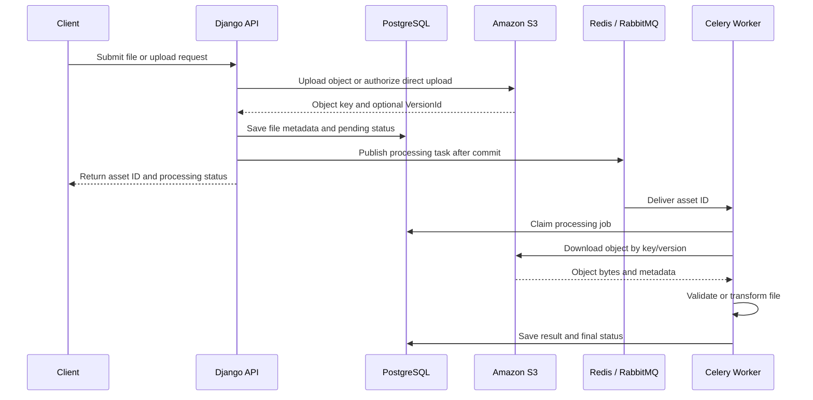
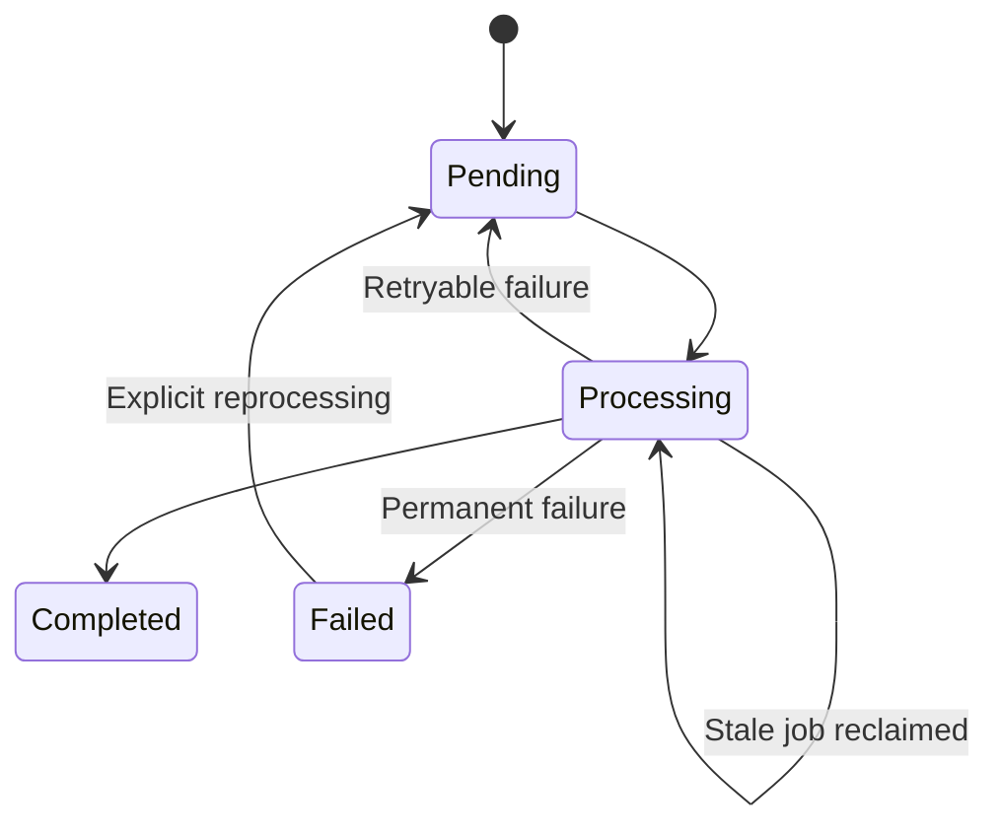
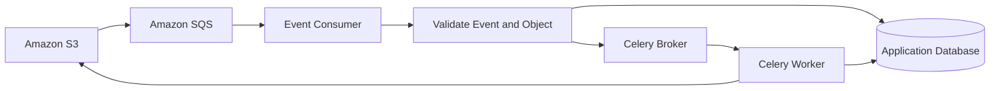

# 05- Celery Integration

## Overview

Celery integrates Amazon S3 with asynchronous backend processing by allowing applications to move long-running file operations out of HTTP request handlers and into background workers.

S3 stores the objects, while Celery coordinates background execution through a message broker such as Redis or RabbitMQ. A Django, Django REST Framework, FastAPI, or Flask application can submit a processing task without waiting for the file to be downloaded, validated, transformed, or analyzed.

Typical use cases include:

- Validating uploaded documents and images.
- Extracting metadata from files.
- Generating thumbnails and document previews.
- Computing checksums and verifying file integrity.
- Running antivirus scans or invoking document-processing services.
- Building asynchronous import and export pipelines.
- Processing large files without blocking API requests.

Celery does not replace S3, and S3 does not act as a Celery task broker. Each component has a distinct responsibility.

| Component | Responsibility |
|---|---|
| Backend API | Authenticates requests, validates inputs, records metadata, and schedules work |
| Amazon S3 | Stores original files and processed artifacts |
| Relational database | Tracks file metadata, processing status, ownership, and errors |
| Celery | Executes and retries background tasks |
| Message broker | Delivers task messages to workers |
| Celery worker | Downloads and processes objects, then updates application state |
| CloudWatch | Provides AWS-side metrics, logs, and operational visibility |

The central design principle is to pass object identifiers to Celery, not file contents. Workers retrieve objects from S3 using their own AWS credentials.

## Architecture

### Request and processing lifecycle

A common architecture separates file upload, task scheduling, and object processing.



This design allows the API to respond quickly while workers process files independently.

### Data flow and trust boundaries

The worker should receive a small, serializable payload such as:

```json
{
  "asset_id": 4812
}
```

The worker loads the corresponding database record to obtain the bucket, object key, expected content type, and optional S3 version ID.

Avoid sending file contents, open file handles, boto3 clients, database model instances, or AWS credentials through Celery messages. Such payloads increase broker load, introduce serialization problems, and complicate retries.

The database record is the application-level source of truth. A Celery message is only a request to perform work; it is not proof that the work completed.

### Choosing a processing architecture

| Architecture | Appropriate use case | Main consideration |
|---|---|---|
| API → Celery → S3 | Processing explicitly initiated by a backend request | The application controls task creation |
| Client → S3 → API → Celery | Clients upload directly to S3 using presigned URLs | Verify the uploaded object before processing |
| S3 → SQS → consumer → Celery | Processing files created by external systems | The consumer must translate S3 events into application tasks |
| S3 → SQS → dedicated workers | Event-driven processing without the Celery abstraction | A dedicated SQS consumer may be simpler |
| S3 → Lambda | Short-lived event-driven processing suitable for Lambda limits | Execution limits and event semantics determine suitability |

Choose the simplest architecture that satisfies the workload's reliability, latency, and operational requirements.

## Dependencies and Configuration

### Install dependencies

For a Django application using Celery, Redis, and boto3:

```bash
pip install "celery[redis]" boto3 Django
```

For production, pin and test compatible dependency versions in the project's dependency manager.

Redis is one supported broker option. RabbitMQ is also common. Amazon SQS can be used with Celery through its SQS transport, subject to the transport's feature and operational limitations.

The broker and the S3 bucket are separate resources with separate permissions and failure modes.

### Configure AWS credentials

Use the AWS SDK credential provider chain rather than embedding long-lived access keys in source code.

For local development, configure a named AWS CLI profile:

```bash
aws configure --profile s3-development
aws sts get-caller-identity --profile s3-development
```

The AWS CLI profile is resolved by SDKs when configured appropriately:

```bash
export AWS_PROFILE=s3-development
export AWS_DEFAULT_REGION=ap-south-1
```

On Windows PowerShell:

```powershell
$env:AWS_PROFILE = "s3-development"
$env:AWS_DEFAULT_REGION = "ap-south-1"
```

In deployed environments, prefer environment-appropriate temporary credentials, such as an EC2 instance profile, ECS task role, EKS workload identity, or an assumed IAM role.

Do not use the AWS account root user for application workloads.

### Configure Celery in Django

Assume the Django project package is named `config` and the application is named `assets`.

`config/celery.py`:

```python
import os

from celery import Celery

os.environ.setdefault("DJANGO_SETTINGS_MODULE", "config.settings")

app = Celery("config")
app.config_from_object("django.conf:settings", namespace="CELERY")
app.autodiscover_tasks()
```

`config/__init__.py`:

```python
from .celery import app as celery_app

__all__ = ("celery_app",)
```

Configure the broker and task behavior in Django settings:

```python
import os

CELERY_BROKER_URL = os.environ["CELERY_BROKER_URL"]

CELERY_TASK_SERIALIZER = "json"
CELERY_ACCEPT_CONTENT = ["json"]
CELERY_RESULT_SERIALIZER = "json"

CELERY_TASK_TRACK_STARTED = True
CELERY_TASK_ACKS_LATE = True
CELERY_WORKER_PREFETCH_MULTIPLIER = 1

CELERY_TASK_ROUTES = {
    "assets.tasks.process_asset": {"queue": "s3-processing"},
}
```

For a Redis broker, `CELERY_BROKER_URL` might be a Redis connection URL supplied through the deployment environment. Do not commit production broker credentials or URLs containing secrets.

Use task result storage only when the application needs it. A persistent application database should generally own business-level processing status instead of relying exclusively on Celery result records.

Late acknowledgment can improve redelivery behavior after worker failures, but it does not provide exactly-once execution. Acknowledgment timing, worker-loss handling, broker visibility timeouts, and task idempotency must be designed together.

### Start workers

Start a worker for the configured queue:

```bash
celery -A config worker \
  --loglevel=INFO \
  --queues=s3-processing
```

Run a separate worker process from the API service. In containerized deployments, scale API instances and worker instances independently.

Celery workers execute application code and need network access to the broker, database, and S3 endpoint. Their runtime identity must have only the permissions required for their assigned tasks.

## Model the Processing State

A persistent processing record lets clients inspect progress, operators investigate failures, and workers recover from interrupted execution.

Example Django model:

```python
# assets/models.py

from django.db import models


class Asset(models.Model):
    class Status(models.TextChoices):
        PENDING = "pending", "Pending"
        PROCESSING = "processing", "Processing"
        COMPLETED = "completed", "Completed"
        FAILED = "failed", "Failed"

    bucket_name = models.CharField(max_length=255)
    object_key = models.CharField(max_length=1024)
    object_version_id = models.CharField(
        max_length=1024,
        blank=True,
    )

    content_type = models.CharField(max_length=255)
    size_bytes = models.BigIntegerField()
    sha256 = models.CharField(max_length=64, blank=True)

    status = models.CharField(
        max_length=20,
        choices=Status.choices,
        default=Status.PENDING,
        db_index=True,
    )
    processing_started_at = models.DateTimeField(
        null=True,
        blank=True,
    )
    error_code = models.CharField(max_length=100, blank=True)

    created_at = models.DateTimeField(auto_now_add=True)
    updated_at = models.DateTimeField(auto_now=True)
```

Run migrations after adding the model.

The model intentionally stores S3 references rather than object bytes. For larger systems, additional fields may include tenant ID, owner ID, processing attempt count, detected media type, output key, and completion timestamp.

### State transitions



Keep retryable failures distinct from permanent validation errors. A transient S3 timeout may succeed on retry, while an unsupported file format should normally fail without repeated downloads.

Never mark a file as completed until all required work and durable metadata updates have succeeded.

## Create a Reusable S3 Service

Keep AWS operations in a dedicated service module rather than spreading boto3 calls across API views and Celery tasks.

`assets/storage.py`:

```python
from functools import lru_cache

import boto3
from botocore.config import Config


@lru_cache(maxsize=1)
def get_s3_client():
    return boto3.client(
        "s3",
        config=Config(
            connect_timeout=5,
            read_timeout=60,
            retries={
                "mode": "standard",
                "total_max_attempts": 4,
            },
        ),
    )


def get_object_stream(
    bucket_name: str,
    object_key: str,
    version_id: str | None = None,
):
    params = {
        "Bucket": bucket_name,
        "Key": object_key,
    }

    if version_id:
        params["VersionId"] = version_id

    return get_s3_client().get_object(**params)
```

The SDK obtains credentials from its configured credential chain and resolves the Region using the standard SDK configuration.

The client is created lazily and cached per Python process. Avoid sharing initialized SDK clients across process forks. In environments using worker preloading or custom process management, ensure clients are initialized safely within worker processes.

Use explicit bucket and key values from trusted application metadata. Do not accept an arbitrary bucket name from an untrusted task payload and treat it as authorized.

## Schedule Tasks Safely

### Publish after the database transaction commits

A task should not read a database record before the transaction creating that record becomes visible.

For example:

```python
from django.db import transaction

from assets.models import Asset
from assets.tasks import process_asset


def register_asset(
    *,
    bucket_name: str,
    object_key: str,
    content_type: str,
    size_bytes: int,
    object_version_id: str = "",
) -> Asset:
    with transaction.atomic():
        asset = Asset.objects.create(
            bucket_name=bucket_name,
            object_key=object_key,
            content_type=content_type,
            size_bytes=size_bytes,
            object_version_id=object_version_id,
        )

        transaction.on_commit(
            lambda asset_id=asset.pk: process_asset.delay(asset_id)
        )

    return asset
```

`transaction.on_commit()` avoids publishing the task before the surrounding transaction commits.

However, it does not guarantee delivery if the database commits successfully and the process crashes before publishing to the broker. For workflows where losing a task is unacceptable, use a transactional outbox: write the asset and an outbox event in the same database transaction, then publish pending outbox events with a retryable dispatcher.

The dispatcher should mark events as published only after a successful broker publication and should tolerate duplicate publication.

### Direct uploads require a separate verification step

When a client uploads directly to S3 using a presigned URL, the backend should not assume the object exists merely because the upload was authorized.

A safer flow is:

1. Authenticate and authorize the user.
2. Allocate a unique object key and create a pending database record.
3. Issue a narrowly scoped presigned upload URL.
4. Let the client upload the object.
5. Verify the expected object key, size, checksum where available, and version.
6. Schedule processing only after successful verification.

Use server-generated object keys rather than user-provided filesystem paths. Validate file contents independently of the client's declared MIME type.

## Implement an Idempotent Processing Task

The following example validates an uploaded PDF, PNG, or JPEG and computes its SHA-256 checksum. It demonstrates a common S3 processing task while keeping the application-specific validation rules explicit.

The sample assumes a maximum supported object size of 25 MiB. Adjust this limit to the actual workload and enforce it during upload as well as processing.

`assets/tasks.py`:

```python
import hashlib
import logging
from datetime import timedelta

from botocore.exceptions import (
    BotoCoreError,
    ClientError,
    ConnectionClosedError,
    ConnectTimeoutError,
    EndpointConnectionError,
    ReadTimeoutError,
)
from celery import shared_task
from django.db import transaction
from django.utils import timezone

from assets.models import Asset
from assets.storage import get_object_stream

logger = logging.getLogger(__name__)

MAX_FILE_SIZE = 25 * 1024 * 1024
STALE_PROCESSING_AFTER = timedelta(minutes=30)

ALLOWED_SIGNATURES = {
    "application/pdf": (b"%PDF-",),
    "image/png": (b"\x89PNG\r\n\x1a\n",),
    "image/jpeg": (b"\xff\xd8\xff",),
}

RETRYABLE_S3_CODES = {
    "InternalError",
    "RequestTimeout",
    "ServiceUnavailable",
    "SlowDown",
}


class InvalidAssetError(Exception):
    """The stored object does not satisfy application validation."""


class RetryableStorageError(Exception):
    """The object operation failed for a potentially transient reason."""


def validate_signature(content_type: str, header: bytes) -> None:
    signatures = ALLOWED_SIGNATURES.get(content_type)

    if not signatures:
        raise InvalidAssetError("unsupported_content_type")

    if not any(header.startswith(item) for item in signatures):
        raise InvalidAssetError("invalid_file_signature")


def download_and_validate(asset: Asset) -> str:
    response = get_object_stream(
        bucket_name=asset.bucket_name,
        object_key=asset.object_key,
        version_id=asset.object_version_id or None,
    )

    body = response["Body"]
    digest = hashlib.sha256()
    header = bytearray()
    total_bytes = 0

    try:
        content_length = response.get("ContentLength")

        if content_length is None or content_length > MAX_FILE_SIZE:
            raise InvalidAssetError("file_size_not_allowed")

        while True:
            chunk = body.read(1024 * 1024)

            if not chunk:
                break

            total_bytes += len(chunk)

            if total_bytes > MAX_FILE_SIZE:
                raise InvalidAssetError("file_size_not_allowed")

            digest.update(chunk)

            if len(header) < 16:
                header.extend(chunk[: 16 - len(header)])

    finally:
        body.close()

    if total_bytes == 0:
        raise InvalidAssetError("empty_file")

    validate_signature(asset.content_type, bytes(header))

    return digest.hexdigest()


@shared_task(
    bind=True,
    name="assets.tasks.process_asset",
    acks_late=True,
    max_retries=5,
)
def process_asset(self, asset_id: int) -> dict:
    now = timezone.now()

    # Claim the work in a short transaction. Never keep a database
    # transaction open while downloading or processing an S3 object.
    with transaction.atomic():
        try:
            asset = Asset.objects.select_for_update().get(pk=asset_id)
        except Asset.DoesNotExist:
            logger.warning("Asset does not exist", extra={"asset_id": asset_id})
            return {"status": "missing"}

        if asset.status == Asset.Status.COMPLETED:
            return {"status": "already_completed"}

        if asset.status == Asset.Status.FAILED:
            return {"status": "permanently_failed"}

        if asset.status == Asset.Status.PROCESSING:
            started_at = asset.processing_started_at

            if started_at and now - started_at < STALE_PROCESSING_AFTER:
                return {"status": "already_processing"}

        asset.status = Asset.Status.PROCESSING
        asset.processing_started_at = now
        asset.error_code = ""
        asset.save(
            update_fields=[
                "status",
                "processing_started_at",
                "error_code",
                "updated_at",
            ]
        )

    try:
        checksum = download_and_validate(asset)

    except InvalidAssetError as exc:
        asset.status = Asset.Status.FAILED
        asset.error_code = str(exc)
        asset.processing_started_at = None
        asset.save(
            update_fields=[
                "status",
                "error_code",
                "processing_started_at",
                "updated_at",
            ]
        )

        logger.warning(
            "Asset validation failed",
            extra={"asset_id": asset_id, "error_code": str(exc)},
        )
        return {"status": "failed", "error_code": str(exc)}

    except ClientError as exc:
        error_code = exc.response.get("Error", {}).get("Code", "Unknown")
        response_status = (
            exc.response.get("ResponseMetadata", {}).get("HTTPStatusCode", 0)
        )

        retryable = (
            error_code in RETRYABLE_S3_CODES
            or response_status >= 500
        )

        if not retryable:
            # AccessDenied, NoSuchKey, and other unexpected permanent
            # failures must not be retried indefinitely.
            asset.status = Asset.Status.FAILED
            asset.error_code = error_code[:100]
            asset.processing_started_at = None
            asset.save(
                update_fields=[
                    "status",
                    "error_code",
                    "processing_started_at",
                    "updated_at",
                ]
            )
            logger.exception(
                "Non-retryable S3 error",
                extra={"asset_id": asset_id, "error_code": error_code},
            )
            return {"status": "failed", "error_code": error_code}

        asset.status = Asset.Status.PENDING
        asset.error_code = error_code[:100]
        asset.processing_started_at = None
        asset.save(
            update_fields=[
                "status",
                "error_code",
                "processing_started_at",
                "updated_at",
            ]
        )

        raise self.retry(exc=exc, countdown=60)

    except (
        EndpointConnectionError,
        ConnectTimeoutError,
        ReadTimeoutError,
        ConnectionClosedError,
        BotoCoreError,
    ) as exc:
        asset.status = Asset.Status.PENDING
        asset.error_code = "storage_transport_error"
        asset.processing_started_at = None
        asset.save(
            update_fields=[
                "status",
                "error_code",
                "processing_started_at",
                "updated_at",
            ]
        )

        raise self.retry(exc=exc, countdown=60)

    except Exception:
        # Leave a recoverable state before propagating an unexpected error.
        asset.status = Asset.Status.PENDING
        asset.error_code = "unexpected_processing_error"
        asset.processing_started_at = None
        asset.save(
            update_fields=[
                "status",
                "error_code",
                "processing_started_at",
                "updated_at",
            ]
        )
        logger.exception(
            "Unexpected asset processing failure",
            extra={"asset_id": asset_id},
        )
        raise

    asset.status = Asset.Status.COMPLETED
    asset.sha256 = checksum
    asset.error_code = ""
    asset.processing_started_at = None
    asset.save(
        update_fields=[
            "status",
            "sha256",
            "error_code",
            "processing_started_at",
            "updated_at",
        ]
    )

    logger.info(
        "Asset processing completed",
        extra={"asset_id": asset_id, "sha256": checksum},
    )

    return {"status": "completed", "asset_id": asset_id}
```

### Important implementation boundaries

This example is a starting point, not a universal file-processing implementation.

- **Content type is untrusted.** File signatures help with validation, but a production parser, antivirus scanner, or content inspection service may still be necessary.
- **Processing attempts are not exactly once.** A worker may finish a side effect and fail before acknowledging its message. Make every externally visible operation repeatable or deduplicated.
- **Stale processing must be recovered.** A scheduled recovery job should locate records left in `PROCESSING` beyond the lease threshold and safely enqueue them again. The threshold must reflect expected processing duration. For long-running tasks, use a suitable lease extension or heartbeat mechanism.
- **Concurrent processing needs control.** Database row locks protect the claim operation, but they do not lock the S3 object. Use immutable object keys, version-aware reads, or an application-level conditional update strategy when multiple workers can target the same asset.
- **The sample uses a declared media type.** Production systems should persist the detected media type separately when it matters for downstream security or rendering.
- **Retry limits matter.** Celery's retry count is bounded here, but retry exhaustion should be monitored and reconciled. The task's broad unexpected-error branch deliberately propagates the exception rather than swallowing it.

## Object Identity and Idempotency

S3 object keys can be overwritten. A task that reads only a bucket and key may process a different object from the one that triggered the task if another upload replaces the key before the worker reads it.

For versioned buckets, capture and persist the S3 `VersionId` during upload verification and use it when downloading. This binds processing to a specific stored object version.

If versioning is not enabled, generate unique, immutable object keys for uploaded assets. Avoid reusing a single key such as `uploads/current.pdf` for unrelated uploads.

Idempotency should cover both database state and external side effects.

| Operation | Recommended protection |
|---|---|
| Database status update | Conditional transitions and row locking |
| S3 download | Stable key and, when applicable, `VersionId` |
| Thumbnail or transformed output | Deterministic output key derived from input identity |
| External API call | Idempotency key or deduplication record |
| Notification | Persist delivery intent and deduplicate event processing |
| Task scheduling | Transactional outbox for critical publication |

Do not use Celery task IDs as the only business-level idempotency key. Redelivery may happen under the same task ID or through a separately submitted task, and task IDs do not inherently prevent duplicate side effects.

## Integrating S3 Event Notifications

S3 can publish object-created notifications to supported destinations, including SQS, SNS, Lambda, and EventBridge. These events are separate from Celery's message format.

A common architecture is:



The consumer should validate the bucket, key, event type, and expected object identity before scheduling work. S3 notifications can be delivered more than once and can arrive out of order, so the consumer and task must be idempotent.

Two common choices are available:

- Consume SQS directly and perform processing in the consumer or worker implementation.
- Consume SQS with a dedicated bridge that validates messages and submits Celery tasks.

Use Celery when its task routing, retries, scheduling, and ecosystem provide meaningful value. Do not introduce a Celery broker and bridge solely to forward messages if direct SQS processing meets the same requirements more simply.

For SQS consumers, delete a message only after its work has been durably accepted or completed, depending on the consumer design. Configure visibility timeouts, redrive policies, and dead-letter queues according to the expected processing duration and recovery procedure.

## Retries and Failure Recovery

Failures can originate from S3, the broker, the database, downstream services, or the file itself. Each failure category needs an appropriate response.

| Failure | Typical handling |
|---|---|
| Temporary network timeout | Retry with bounded exponential backoff and jitter |
| S3 throttling or transient service error | Retry using SDK and task-level policies without excessive amplification |
| `NoSuchKey` | Check object creation, key encoding, version selection, and event ordering; do not blindly retry forever |
| `AccessDenied` | Investigate IAM policy, bucket policy, permissions boundary, organization policy, and KMS permissions |
| Invalid file or unsupported format | Mark as permanently failed and record a safe error code |
| Broker unavailable | Retry task publication or allow a durable outbox dispatcher to recover |
| Worker termination | Use appropriate acknowledgment behavior and stale-job recovery |
| Database unavailable | Propagate the failure and recover through broker redelivery or an explicit reconciliation process |
| Retry limit exhausted | Record the final failure, alert when appropriate, and support controlled reprocessing |

### Avoid retry amplification

Retries exist at more than one layer: the AWS SDK, Celery, an SQS consumer, and possibly an external service. Uncoordinated retries can multiply request volume during an outage.

Set bounded retry policies at each layer. Use exponential backoff and jitter for transient failures, and classify permanent errors early.

Do not retry every `ClientError` indiscriminately. Authentication errors, malformed requests, missing objects, and unsupported operations require diagnosis rather than repeated execution.

### Transactional outbox

For business-critical processing, write the asset and an outbox record within the same database transaction. A dispatcher publishes unpublished outbox records and marks them as published only after broker publication succeeds.

This reduces the risk of losing work between database commit and task publication. The dispatcher may publish duplicates if it crashes after publication but before recording success, so consumers and tasks must remain idempotent.

An outbox provides durable task intent; it does not independently guarantee successful processing or exactly-once execution.

## Performance and Cost

### Download and processing efficiency

The task example streams the object in chunks instead of loading the entire file into memory. For CPU-intensive parsing or transformations, use temporary files or a streaming library where appropriate.

For high-volume workloads:

- Tune worker concurrency according to CPU, memory, and network bandwidth.
- Separate CPU-intensive processing from I/O-intensive downloads when different worker profiles are useful.
- Set sensible SDK connection and read timeouts.
- Use bounded retries and appropriate connection pooling.
- Avoid downloading the same object repeatedly when durable intermediate results can be reused safely.
- Use multipart transfer tools for large transfers where they improve throughput and reliability.
- Limit the number of simultaneous downloads to avoid resource exhaustion.

Boto3's high-level transfer utilities can simplify large uploads and downloads, but their concurrency and memory behavior should be configured and measured against worker capacity.

### Queue isolation and worker scaling

Keep expensive tasks off queues used for short, latency-sensitive jobs.

Example:

```python
CELERY_TASK_ROUTES = {
    "assets.tasks.process_asset": {"queue": "s3-processing"},
    "notifications.tasks.send_notification": {"queue": "notifications"},
}
```

Start workers independently:

```bash
celery -A config worker \
  --loglevel=INFO \
  --queues=s3-processing \
  --concurrency=4
```

```bash
celery -A config worker \
  --loglevel=INFO \
  --queues=notifications \
  --concurrency=8
```

These concurrency values are illustrative. Choose them from workload measurements, worker resource limits, database connection capacity, and broker behavior.

Monitor queue depth, oldest-message age, execution duration, memory use, retry counts, and worker health. Scale workers based on sustained demand rather than a single short-lived queue spike.

### Cost drivers

S3 processing costs can include storage, request charges, retrieval charges for certain storage classes, data transfer, and KMS requests where applicable. The broker, worker compute, logs, and downstream processing services introduce additional costs.

Downloading the same object for repeated processing can increase request and transfer costs. Consider storing processing results, using lifecycle policies for retained inputs, and selecting storage classes based on access patterns rather than assuming the lowest storage rate is always the lowest total cost.

## Security and Permissions

Grant API services and workers only the permissions they need.

A typical separation is:

| Component | Permission scope |
|---|---|
| Upload API | Write objects to a controlled prefix, or issue narrowly scoped presigned URLs |
| Processing worker | Read the required objects and versions |
| Output processor | Write only to its designated output prefix |
| Event consumer | Receive and delete messages from its queue and publish approved task messages |
| Infrastructure deployment role | Manage only the infrastructure required by the deployment |

For S3 reads, IAM permissions commonly include `s3:GetObject`; version-specific reads also require the applicable version permission, such as `s3:GetObjectVersion`. Object writes commonly require `s3:PutObject`. Exact permissions depend on the operation and whether encryption, tagging, access points, or other features are involved.

For SSE-KMS objects, ensure the workload has the relevant KMS permissions and that the KMS key policy permits the operation. S3 authorization and KMS authorization are separate checks.

Apply the following controls:

- Keep buckets private and enable S3 Block Public Access unless public access is explicitly required.
- Use IAM roles and temporary credentials.
- Encrypt stored objects using the required encryption policy.
- Use TLS for S3 API calls.
- Restrict access by bucket, prefix, and supported resource conditions.
- Never store AWS secrets in task arguments, source code, logs, or task results.
- Avoid logging presigned URLs, credentials, sensitive object metadata, or document contents.
- Validate event sources and object ownership before acting on externally generated notifications.
- Apply retention and deletion policies appropriate to the data.

Celery's broker is also a security boundary. Restrict network access, authenticate broker clients, encrypt connections where supported, and treat task messages as untrusted inputs that still require application-level validation.

## Testing Strategy

Testing should cover the task's business behavior, retry decisions, duplicate execution, and interactions with S3.

### Unit tests

Use mocked storage responses to test:

- Valid and invalid file signatures.
- Empty files and files exceeding the size limit.
- Hash calculation.
- Missing object errors.
- Permanent versus transient error classification.
- Already-completed and already-processing records.
- Recovery of stale processing records.
- Task retry behavior.
- Output metadata and final status transitions.

Example using `pytest` and `unittest.mock`:

```python
from unittest.mock import Mock, patch

from assets.models import Asset
from assets.tasks import process_asset


@patch("assets.tasks.download_and_validate", return_value="a" * 64)
def test_process_asset_completes(mock_validate, db, django_user_model):
    asset = Asset.objects.create(
        bucket_name="example-private-bucket",
        object_key="incoming/asset-4812.pdf",
        content_type="application/pdf",
        size_bytes=1024,
        status=Asset.Status.PENDING,
    )

    result = process_asset.apply(args=[asset.pk], throw=True).get()

    asset.refresh_from_db()

    assert result["status"] == "completed"
    assert asset.status == Asset.Status.COMPLETED
    assert asset.sha256 == "a" * 64
    mock_validate.assert_called_once()
```

Adapt fixtures and imports to the project's test framework. Keep tests independent of real AWS credentials.

### Integration tests

Use a dedicated test bucket and isolated AWS resources to verify:

- Upload and download permissions.
- Version-aware object retrieval when versioning is enabled.
- Encryption and KMS access.
- Broker delivery and task execution.
- Duplicate notifications and repeated task delivery.
- Retry behavior under controlled transient failures.
- Cleanup and lifecycle behavior where applicable.

Local S3-compatible emulators can support some integration tests, but they may not reproduce all AWS IAM, KMS, event-delivery, versioning, or service behavior. Keep a small set of real-AWS tests for capabilities that need genuine AWS semantics.

Never claim that cloud integration tests passed unless they were actually executed.

## Deployment and Operations

Before production deployment, verify:

- [ ] AWS credentials are supplied through the environment's identity mechanism.
- [ ] Worker IAM permissions are least-privilege and scoped to required resources.
- [ ] The S3 bucket is private and encryption settings satisfy requirements.
- [ ] Object size limits and input validation are enforced.
- [ ] Database migrations have been applied.
- [ ] Broker connectivity and queue routing work.
- [ ] Task retries are bounded and permanent errors are classified.
- [ ] Processing state can be recovered after worker termination.
- [ ] Critical task publication uses an outbox or equivalent durable mechanism.
- [ ] Logs contain correlation IDs and useful error codes but no secrets.
- [ ] Metrics and alerts cover queue age, task failures, and processing latency.
- [ ] Reprocessing and cleanup procedures are documented.

### Operational verification

Use Celery's inspection commands to review workers and registered tasks:

```bash
celery -A config inspect ping
celery -A config inspect active
celery -A config inspect registered
```

Verify AWS identity and S3 access independently of task execution:

```bash
aws sts get-caller-identity

aws s3api head-object \
  --bucket example-private-bucket \
  --key incoming/asset-4812.pdf
```

For versioned objects, inspect the relevant version identifiers:

```bash
aws s3api list-object-versions \
  --bucket example-private-bucket \
  --prefix incoming/asset-4812.pdf
```

Ensure the selected AWS CLI identity matches the intended environment. These commands validate specific AWS-side access and object state; they do not prove that the Celery pipeline is healthy end to end.

### Monitoring

Track both infrastructure metrics and business outcomes.

| Signal | What it reveals |
|---|---|
| Queue depth and oldest task age | Workers cannot keep up or the broker is stalled |
| Task duration by task type | Processing regressions or unusually large objects |
| Retry and failure rates | S3, broker, database, or input-quality problems |
| Number of stale `PROCESSING` records | Interrupted workers or missing recovery behavior |
| S3 request errors and throttling | Permission issues or request pressure |
| Processing completion latency | Whether business-level service targets are met |
| Orphaned S3 objects or database records | Incomplete workflows or cleanup gaps |
| Output integrity checks | Corruption or incorrect transformation behavior |

Use structured logging with asset IDs, task IDs, and correlation IDs. Treat object keys and tenant identifiers as potentially sensitive data and avoid exposing them unnecessarily.

## Common Mistakes

### Passing the file itself through Celery

Large binary payloads make broker messages expensive and slow. Pass an asset ID or object reference and let the worker retrieve the file from S3.

### Publishing before a transaction commits

The worker can run before the asset record becomes visible. Use `transaction.on_commit()` for ordinary workflows and a transactional outbox when reliable publication is required.

### Assuming tasks execute exactly once

Retries, redelivery, worker crashes, and duplicate events can repeat work. Design state transitions and side effects for idempotency.

### Using mutable object keys without version tracking

An object may be replaced between task submission and download. Prefer unique keys or persist and retrieve the expected `VersionId`.

### Treating every exception as transient

Retrying invalid input, missing objects, or authorization failures can waste resources and increase costs. Classify errors and bound retries.

### Trusting client-supplied content types

A declared MIME type does not establish the actual content of an uploaded file. Validate signatures and apply format-specific scanning or parsing as appropriate.

### Keeping database transactions open during downloads

Long-running network I/O inside a transaction holds locks and database connections. Claim work and update state in short transactions around the external operation.

### Relying exclusively on Celery results

Celery results are execution metadata, not a durable substitute for business state. Store processing status and output references in the application's database.

### Ignoring stale jobs and orphaned files

Workers can die after claiming a task, and uploads can succeed without their associated database workflow completing. Implement reconciliation for stale records and, where necessary, unreferenced objects.

## Official References

- [Celery documentation](https://docs.celeryq.dev/en/stable/)
- [Celery task documentation](https://docs.celeryq.dev/en/stable/userguide/tasks.html)
- [Celery Django integration](https://docs.celeryq.dev/en/stable/django/first-steps-with-django.html)
- [Boto3 documentation](https://boto3.amazonaws.com/v1/documentation/api/latest/index.html)
- [Amazon S3 API Reference](https://docs.aws.amazon.com/AmazonS3/latest/API/Welcome.html)
- [Amazon S3 event notifications](https://docs.aws.amazon.com/AmazonS3/latest/userguide/EventNotifications.html)
- [AWS IAM best practices](https://docs.aws.amazon.com/IAM/latest/UserGuide/best-practices.html)

## Key Takeaways

- Use Celery to move S3 file processing out of HTTP request handlers; pass small object references rather than file contents.
- Persist application processing state in the database and publish tasks after commit; use a transactional outbox when task publication must be durable.
- Assume at-least-once execution, duplicate events, and worker failures. Make tasks idempotent and implement stale-job recovery.
- Use stable object keys or S3 version identifiers, least-privilege IAM roles, bounded retries, and independent validation of uploaded content.
- Monitor queue age, processing latency, retries, permanent failures, and stale records to keep the pipeline reliable and cost-effective.