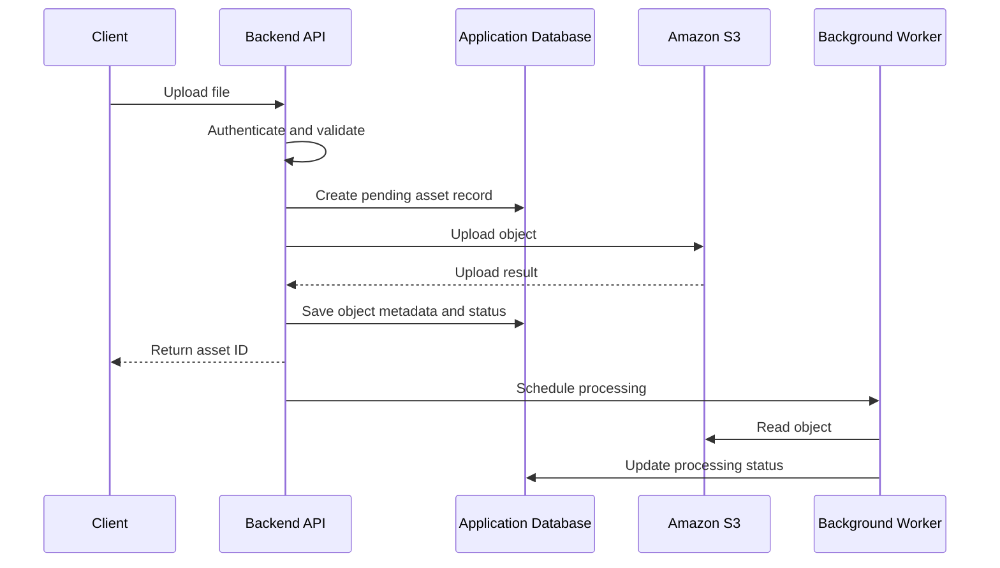
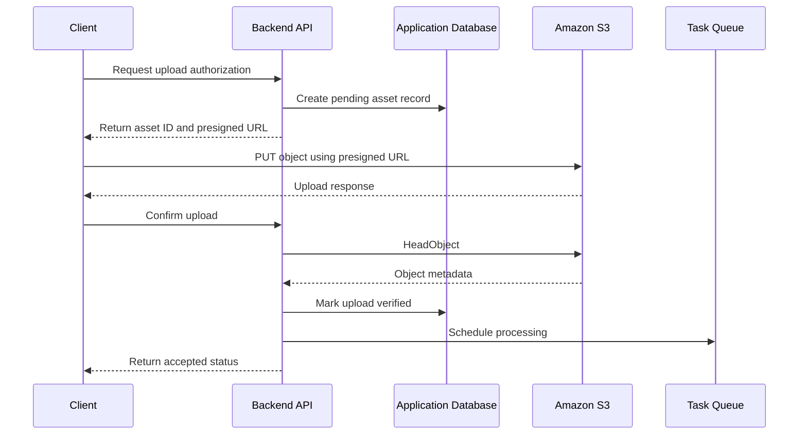
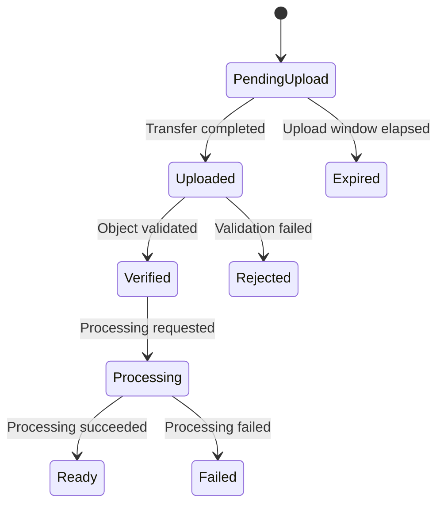
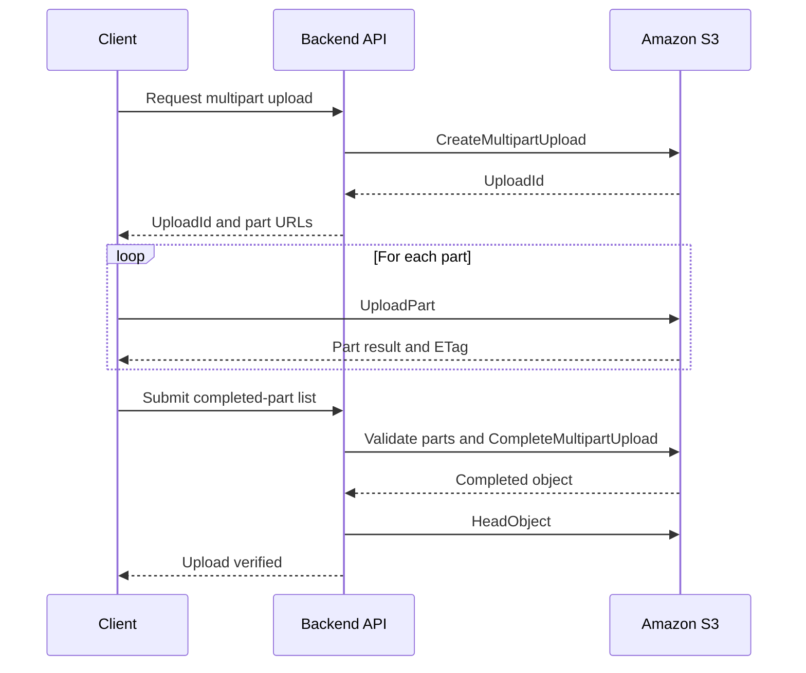

# 06- Backend File Upload and Download Workflows

## Overview

Amazon S3 is a common storage layer for backend applications that manage documents, images, videos, reports, archives, and other binary assets. A well-designed upload and download workflow separates file transfer, authorization, metadata management, object storage, and post-upload processing.

The backend is responsible for deciding who can upload or download an object, which object key is permitted, what validation is required, and how application state changes. Amazon S3 stores the object and provides APIs for transferring and retrieving it.

There are two primary approaches to file transfer:

- **Backend-proxied transfer:** The client sends the file to the backend, and the backend transfers it to S3. Downloads follow the reverse path.
- **Direct client-to-S3 transfer:** The backend authorizes the operation and issues a presigned URL. The client transfers the file directly to S3.

A production system can use both approaches depending on file size, client capabilities, security requirements, and network constraints.

### Responsibilities

| Component | Responsibility |
|---|---|
| Client application | Selects files, uploads or downloads data, and displays transfer status |
| Backend API | Authentication, authorization, validation, upload initiation, and workflow coordination |
| Amazon S3 | Object storage, object retrieval, and supported transfer operations |
| Relational database | Asset ownership, object references, processing status, and audit metadata |
| Celery or another worker system | Asynchronous scanning, document processing, and transformations |
| IAM | Controls which AWS operations application identities may perform |
| CloudWatch and CloudTrail | Operational monitoring and auditing |

The database should generally store object references and application metadata, not file contents. S3 objects should remain private unless public access is an explicit architectural requirement.

## Architecture and Data Flow

### Backend-proxied uploads



In this architecture, file bytes pass through the application infrastructure. The backend can validate data before uploading it, but large transfers consume application bandwidth, worker threads, connections, and potentially temporary disk space.

The application must also handle partial failures. For example, an S3 upload may succeed while the subsequent database update fails. A cleanup or reconciliation process is needed to identify inconsistencies.

### Direct client-to-S3 uploads



Direct uploads reduce backend bandwidth consumption and improve scalability. However, the backend must verify that the object exists and meets the application's requirements before marking the asset as accepted.

The client must not be allowed to choose arbitrary bucket names or unrestricted object keys. The backend should allocate a unique key and authorize the operation against the authenticated user's permissions.

## Choose the Transfer Pattern

| Pattern | Suitable workloads | Advantages | Limitations |
|---|---|---|---|
| Backend-proxied upload | Small documents, strict inline validation, internal systems | Centralized request handling and validation | Backend bandwidth and connection costs |
| Presigned single-part upload | Images, documents, browser and mobile uploads | Scales without routing file bytes through the backend | Requires upload verification and careful URL controls |
| Presigned multipart upload | Large files, unreliable networks, resumable transfers | Parallel transfer and retry of individual parts | Requires multipart state management and cleanup |
| Backend-proxied download | Sensitive files requiring application-side checks or transformations | Centralized access decisions and response handling | Consumes backend bandwidth |
| Presigned GET download | Private documents, media, exports | Efficient transfer directly from S3 | URL acts as a bearer credential until it expires |
| CloudFront signed access | Frequently accessed private content | CDN delivery and reduced origin load | Additional distribution and authorization configuration |

Choose based on actual workload constraints. Presigned URLs are not inherently less secure than proxying; their safety depends on how they are scoped, distributed, and validated.

## Object Keys and Asset Metadata

### Design object keys deliberately

S3 object keys identify objects inside a bucket. They are not ordinary filesystem paths, and apparent directory structures are based on key prefixes.

A useful layout is:

```text
private-assets/
    tenant-123/
        2026/
            10/
                8a16ef7d-2ef6-4eba-93ea-8e5f849d5cb3.pdf
```

Prefer generated object keys over filenames supplied by clients.

```python
from uuid import uuid4


def generate_object_key(
    *,
    tenant_id: str,
    extension: str,
) -> str:
    normalized_extension = extension.lower().lstrip(".")

    if not normalized_extension.isalnum():
        raise ValueError("Invalid file extension")

    return (
        f"tenant-{tenant_id}/"
        f"{uuid4().hex}.{normalized_extension}"
    )
```

This example assumes `tenant_id` has already been validated and authorized by the application. In a multi-tenant system, obtain tenant identity from trusted authentication context, not from an unchecked request field.

Object keys should not embed passwords, access tokens, personal data, or other sensitive information. Avoid relying on an unguessable key as the sole authorization mechanism.

### Store metadata in the database

A typical asset record contains:

| Field | Purpose |
|---|---|
| `id` | Stable application identifier |
| `tenant_id` or `owner_id` | Ownership and authorization |
| `bucket_name` | Storage location |
| `object_key` | S3 object identifier |
| `version_id` | Specific object version when versioning is enabled |
| `original_filename` | User-facing filename, after safe handling |
| `content_type` | Declared or verified media type |
| `size_bytes` | Recorded object size |
| `checksum` | Content-integrity verification where required |
| `status` | Upload and processing lifecycle |
| `created_at` | Audit and operational history |

A useful state model is:



Keep transfer state separate from asynchronous processing state when their lifecycles differ. A successfully uploaded file is not necessarily a safe or usable application asset.

## Upload Limits and Transfer Selection

S3 supports several upload mechanisms. The following are documented general-purpose bucket limits; verify the current AWS documentation when implementing a specific transfer client.

| Operation | Limit or recommendation |
|---|---|
| Single `PutObject` upload | Up to 5 GB |
| Multipart upload object size | Up to 50 TB |
| Maximum multipart parts | 10,000 |
| Multipart part size | 5 MiB to 5 GiB, except the last part, which can be smaller |
| General multipart guidance | Consider multipart upload at approximately 100 MB and above |
| Backend request size | Determined by application, reverse proxy, and infrastructure limits |

The maximum S3 object size is not a recommendation to support that size through a normal synchronous API request. Application-level limits should reflect the workload and available infrastructure.

### Single-part versus multipart upload

Use a simple PUT-based flow when files are small enough for one upload request. Use multipart upload when large files, improved throughput, or recovery from failed transfers justify the extra complexity.

Multipart upload proceeds through three stages:

1. Initiate a multipart upload and obtain an upload ID.
2. Upload parts and record the required part numbers and response values.
3. Complete the upload using the recorded part information.

If the operation is abandoned, its uploaded parts can continue to consume storage until the multipart upload is aborted or removed through lifecycle configuration.

Do not use `ETag` as a universal content checksum. Multipart uploads and different encryption or upload mechanisms can produce ETags that are not the MD5 digest of the complete object.

References:
- [Amazon S3 upload options](https://docs.aws.amazon.com/AmazonS3/latest/userguide/upload-objects.html)
- [Multipart upload limits](https://docs.aws.amazon.com/AmazonS3/latest/userguide/qfacts.html)

## Configure a Reusable Boto3 Client

Keep S3 operations in a dedicated storage service instead of implementing AWS calls independently in every route or view.

Install the dependencies:

```bash
pip install boto3 botocore
```

Configure credentials using the standard AWS SDK credential provider chain. In production, prefer temporary credentials obtained through an IAM role or workload identity rather than static access keys.

Example service module:

```python
# app/storage.py

import boto3
from botocore.config import Config
from boto3.s3.transfer import TransferConfig


s3_client = boto3.client(
    "s3",
    config=Config(
        connect_timeout=5,
        read_timeout=60,
        retries={
            "mode": "standard",
            "total_max_attempts": 4,
        },
    ),
)

TRANSFER_CONFIG = TransferConfig(
    multipart_threshold=64 * 1024 * 1024,
    multipart_chunksize=16 * 1024 * 1024,
    max_concurrency=4,
    use_threads=True,
)
```

These transfer settings are illustrative. Tune chunk size and concurrency based on file sizes, memory limits, network throughput, and worker capacity.

For applications using multiple AWS accounts or Regions, configure the appropriate session and Region explicitly. Initialize clients safely for the application's process model, especially when workers are forked or preloaded.

## Implement Backend-Proxied Uploads

### Upload through a service layer

Use `upload_fileobj()` to transfer a file-like object without first reading the entire file into a Python `bytes` object.

```python
# app/storage.py

from typing import BinaryIO

from boto3.s3.transfer import TransferConfig

from app.storage_client import s3_client, TRANSFER_CONFIG


def upload_fileobj(
    *,
    fileobj: BinaryIO,
    bucket_name: str,
    object_key: str,
    content_type: str,
    metadata: dict[str, str] | None = None,
) -> None:
    extra_args = {
        "ContentType": content_type,
        "Metadata": metadata or {},
    }

    s3_client.upload_fileobj(
        Fileobj=fileobj,
        Bucket=bucket_name,
        Key=object_key,
        ExtraArgs=extra_args,
        Config=TRANSFER_CONFIG,
    )
```

The metadata values must be strings. Store only non-sensitive metadata in S3 user-defined metadata because it is returned by object metadata APIs and is not a suitable location for confidential application data.

The transfer manager can use multipart upload for sufficiently large files based on its configuration. Do not assume that every file upload is a single `PutObject` request.

### Validate input before storage

Validation should include:

- Authentication and authorization.
- Maximum permitted file size.
- Allowed file types and content formats.
- Business-specific constraints.
- Safe object key allocation.
- Malware scanning or format-specific inspection where required.

The request's `Content-Type` header is client-supplied and cannot prove that the file contains the declared format. Validate signatures and, when appropriate, parse the file using a trusted library.

For example, checking a PDF signature can reject some invalid inputs, but it does not guarantee that a PDF is safe to render or process.

Enforce request size limits at the reverse proxy or ingress layer as well as in application code. A request might otherwise consume bandwidth or temporary disk space before application-level validation executes.

### Handle partial failures

Backend-proxied upload is a multi-system operation. Consider this failure:

1. The database record is created.
2. S3 upload succeeds.
3. The database update fails.

The object exists, but the application may still consider the upload pending.

A robust implementation should record enough information to recover and periodically reconcile stale uploads. Depending on the business requirement, it may use a durable workflow record, transactional outbox, or compensation process.

Avoid keeping a database transaction open while transferring a large file over the network.

## Implement Presigned Uploads

A presigned URL grants temporary access to a specific S3 operation using the permissions of the identity that generated it. Anyone possessing the URL can generally use it until its validity ends, subject to the operation's signature and applicable policies.

### Generate a presigned PUT URL

```python
# app/presigned.py

from app.storage_client import s3_client


def create_upload_url(
    *,
    bucket_name: str,
    object_key: str,
    content_type: str,
    expires_in: int = 300,
) -> str:
    if not 1 <= expires_in <= 3600:
        raise ValueError("Invalid URL expiration")

    return s3_client.generate_presigned_url(
        ClientMethod="put_object",
        Params={
            "Bucket": bucket_name,
            "Key": object_key,
            "ContentType": content_type,
        },
        ExpiresIn=expires_in,
    )
```

The sample limits URL validity to one hour. In sensitive workloads, use a shorter period appropriate to the expected upload duration.

The object key must be generated and authorized by the backend. If the URL signs a `Content-Type` header, the client must send the same value when uploading.

Example client request:

```bash
curl -X PUT \
  -H "Content-Type: application/pdf" \
  --upload-file report.pdf \
  "PRESIGNED_UPLOAD_URL"
```

Replace `PRESIGNED_UPLOAD_URL` with the actual URL returned by the API. Do not place real presigned URLs in logs, source control, or support tickets.

### Use an explicit upload state machine

The backend should track the upload independently of the URL.

```text
PENDING_UPLOAD
    |
    | Client sends bytes to S3
    v
UPLOAD_UNVERIFIED
    |
    | Backend verifies object metadata and policy
    v
VERIFIED
    |
    | Optional scanning or asynchronous processing
    v
READY
```

An upload initiation endpoint should:

1. Authenticate and authorize the user.
2. Validate the requested file category and expected size.
3. Generate a unique S3 object key.
4. Create a pending database record.
5. Generate a presigned URL for that exact key and operation.
6. Return the asset ID, upload URL, required headers, and expiration.

The confirmation endpoint should verify that the object exists and belongs to the expected upload workflow. A `HeadObject` request can check metadata and size, but it does not validate the complete contents of the file.

For higher-risk content, the asset should remain unavailable to downstream consumers until content inspection or scanning succeeds.

### Protect against replay and overwrite

A presigned PUT URL may be used repeatedly until it expires. Uploading to the same key can replace the object, so a successful initial upload does not prevent a subsequent overwrite.

Use unique object keys and short expiration periods. Where strong object identity is required, enable versioning and bind verification and processing to the exact object version. Do not treat URL expiration as a substitute for authorization or object-integrity controls.

For constrained size requirements, design the upload flow around mechanisms that enforce or verify those requirements rather than trusting the client's declared size.

### CORS configuration

Browser clients uploading directly to S3 may require an appropriate bucket CORS configuration.

Allow only the application origins, HTTP methods, and request headers required by the frontend. CORS is a browser-enforced cross-origin policy, not an authorization mechanism; non-browser clients can still issue requests if they possess a valid presigned URL.

References:
- [Presigned URL overview](https://docs.aws.amazon.com/AmazonS3/latest/userguide/using-presigned-url.html)
- [Uploading with presigned URLs](https://docs.aws.amazon.com/AmazonS3/latest/userguide/PresignedUrlUploadObject.html)

## Handle Large and Resumable Uploads

Large uploads require a transfer protocol that can recover from interrupted connections without restarting the entire file.

### Multipart upload workflow

For direct browser uploads, the backend can initiate a multipart upload and generate presigned URLs for individual parts.



A production implementation must:

- Persist the upload ID and associated application asset.
- Bound the number of concurrent part uploads.
- Record part numbers and returned ETags.
- Validate the submitted part manifest before completion.
- Verify the completed object before changing application state.
- Handle repeated completion requests safely.
- Abort abandoned multipart uploads.
- Restrict access to initiate, upload, list, complete, and abort operations.

The backend should own the authoritative multipart upload state. Do not allow a client to finalize an arbitrary upload ID or write into another user's keyspace.

For checksum-enabled multipart uploads, follow S3's requirements for consecutive part numbers and the selected checksum algorithm. Do not assume that ETags from multipart parts represent a full-file content hash.

### Cleanup of abandoned uploads

Configure an S3 lifecycle rule to abort incomplete multipart uploads after a period appropriate to the workload. Also maintain application-level expiration for uploads that were initiated but never completed.

Lifecycle cleanup is a backstop, not an immediate workflow guarantee. The application should still handle expired upload sessions and report a clear status to clients.

Reference: [Multipart upload overview](https://docs.aws.amazon.com/AmazonS3/latest/userguide/mpuoverview.html).

## Implement Backend-Proxied Downloads

A backend download endpoint must authorize access before retrieving an object. Knowing an asset ID or object key must not be sufficient to download a file.

A common pattern is:

1. Retrieve the asset record using its application ID.
2. Verify ownership, tenant membership, and access policy.
3. Retrieve the object from its trusted bucket and key.
4. Stream data to the client without buffering the whole file.
5. Return the appropriate media type and safe download filename.

Example streaming response using FastAPI:

```python
from urllib.parse import quote

from fastapi import APIRouter, Depends, HTTPException
from fastapi.responses import StreamingResponse
from starlette.background import BackgroundTask

from app.auth import get_current_user
from app.models import get_authorized_asset
from app.storage_client import s3_client

router = APIRouter()


def iter_s3_body(body, chunk_size: int = 1024 * 1024):
    try:
        for chunk in body.iter_chunks(chunk_size=chunk_size):
            if chunk:
                yield chunk
    finally:
        body.close()


@router.get("/assets/{asset_id}/download")
def download_asset(
    asset_id: int,
    current_user=Depends(get_current_user),
):
    # This application-specific query must enforce ownership or
    # tenant authorization before returning the asset.
    asset = get_authorized_asset(
        asset_id=asset_id,
        user=current_user,
    )

    try:
        params = {
            "Bucket": asset.bucket_name,
            "Key": asset.object_key,
        }

        if asset.version_id:
            params["VersionId"] = asset.version_id

        response = s3_client.get_object(**params)

    except s3_client.exceptions.NoSuchKey:
        raise HTTPException(
            status_code=404,
            detail="Asset not found",
        ) from None

    filename = asset.original_filename or "download"
    disposition = (
        f"attachment; filename*=UTF-8''{quote(filename, safe='')}"
    )

    return StreamingResponse(
        iter_s3_body(response["Body"]),
        media_type=asset.content_type or "application/octet-stream",
        headers={
            "Content-Disposition": disposition,
            "X-Content-Type-Options": "nosniff",
        },
        background=BackgroundTask(lambda: None),
    )
```

The example illustrates the response lifecycle, but the application-specific query and model must be implemented to match the project's database schema and authorization rules. In a production endpoint, normalize missing-object and storage failures into controlled API errors, and ensure the response iterator always closes the S3 body.

For errors raised after streaming starts, the server may no longer be able to replace the response with a different HTTP status. Record the failure through application logging and metrics.

The `background` callback above is unnecessary for resource cleanup because the iterator closes the body in `finally`; it can be omitted. For real deployments, test behavior when the client disconnects and when S3 fails midway through a response.

### Why stream downloads?

Avoid this pattern for large objects:

```python
body = s3_client.get_object(
    Bucket=bucket_name,
    Key=object_key,
)["Body"]

data = body.read()
```

`read()` without a size can load the entire object into memory, causing memory pressure or out-of-memory failures under concurrency.

Stream chunks instead. If a workload requires HTTP range requests, implement range validation and correct `206 Partial Content` behavior, or use a presigned URL that allows the client to access S3 directly.

## Implement Presigned Downloads

When backend bandwidth is a constraint, authorize the request in the backend and issue a presigned GET URL.

```python
from urllib.parse import quote

from app.storage_client import s3_client


def create_download_url(
    *,
    bucket_name: str,
    object_key: str,
    filename: str,
    expires_in: int = 300,
) -> str:
    safe_filename = filename.replace("\r", "").replace("\n", "")

    return s3_client.generate_presigned_url(
        ClientMethod="get_object",
        Params={
            "Bucket": bucket_name,
            "Key": object_key,
            "ResponseContentDisposition": (
                "attachment; filename*=UTF-8''"
                + quote(safe_filename, safe="")
            ),
        },
        ExpiresIn=expires_in,
    )
```

Use the same authorization process as for a proxied download. The presigned URL should reference the object selected by the backend after checking access rights.

A URL expiration value is subject to the lifetime and permissions of the credentials used to generate it. Temporary role credentials may expire before the requested URL expiration time.

### Choose presigned URLs versus proxying

Prefer presigned downloads when:

- Objects are large or frequent.
- S3 should serve file content without consuming backend bandwidth.
- A short-lived access grant is sufficient.
- Application logic can authorize the request before issuing the URL.

Prefer proxying when:

- The backend must transform or redact content on the fly.
- The response needs application-side auditing or content controls that cannot be implemented by the direct-access path alone.
- Access must be checked continuously as part of a custom streaming protocol.
- The workload requires backend-specific response behavior.

A presigned URL is a bearer credential. Anyone obtaining it can use it until it expires or becomes invalid. Avoid logging it, returning it to unauthorized users, or using unnecessarily long expiration periods.

## Security and Access Control

### IAM permissions

Separate permissions for upload, download, verification, and administrative work whenever practical.

| Workflow | Common permission requirement |
|---|---|
| Direct single-part upload | `s3:PutObject` on the approved object prefix |
| Object metadata verification | `s3:GetObject` or the appropriate metadata-read access |
| Object download | `s3:GetObject` on permitted objects |
| Version-specific retrieval | `s3:GetObjectVersion` |
| Multipart initiation and completion | Usually `s3:PutObject` with operation-appropriate access |
| Multipart part listing and abort | Relevant multipart operations and required permissions |
| Object deletion | `s3:DeleteObject`, scoped to permitted keys |
| Version deletion | `s3:DeleteObjectVersion`, when permanent deletion of versions is required |

The precise permissions depend on the API, bucket configuration, encryption configuration, and whether versioning or other capabilities are used.

Use separate IAM roles for API servers, background workers, and deployment systems when this materially limits the impact of compromised components. SSE-KMS objects may require additional KMS permissions; S3 and KMS authorization are separate checks.

### Bucket and network controls

- Keep buckets private and use S3 Block Public Access.
- Use short-lived credentials and presigned URLs.
- Enforce HTTPS for client and AWS API traffic.
- Generate object keys server-side.
- Validate object ownership and tenant association.
- Use bucket-level encryption configuration and required KMS controls.
- Prevent unauthorized users from overwriting another user's object.
- Limit accepted content size and formats.
- Avoid serving untrusted active content inline on the application's primary origin.
- Apply retention, deletion, and audit requirements to sensitive data.

Application authorization must be applied before issuing download URLs. A random-looking object key is not an access-control mechanism.

## Reliability and Failure Handling

File transfer involves multiple systems. Do not assume a single successful network call makes the entire business workflow successful.

| Failure | Expected handling |
|---|---|
| Upload interrupted | Retry the transfer or resume multipart upload when supported |
| Presigned URL expired | Authorize the upload again and issue a new URL |
| S3 upload succeeded but database update failed | Reconcile object and asset state |
| Database record created but upload never started | Expire pending upload and release associated workflow state |
| Object verification fails | Reject the asset and prevent downstream access |
| Worker processing fails | Keep the object stored but mark processing state appropriately |
| Download object missing | Return a controlled not-found response and investigate metadata consistency |
| Access denied | Investigate IAM, bucket policy, tenant authorization, and KMS access separately |
| Client disconnects during download | Release resources and record interrupted transfer when useful |
| Multipart upload abandoned | Abort it explicitly or use lifecycle cleanup |

### Retry strategy

Retry transient network and service failures with bounded attempts and exponential backoff where appropriate. Avoid retrying permanent validation errors or authorization failures without a corrective action.

For an upload retry, ensure the operation cannot silently overwrite another asset. Use unique object keys or version-aware workflows and verify the final object before declaring success.

For background processing, pass the stable asset ID or object reference to the task queue instead of sending the file bytes. Persist application state in the database, and use durable task publication mechanisms when losing a scheduled task would violate a business requirement.

### Idempotency and reconciliation

Upload initiation, upload confirmation, processing, and deletion should be designed to tolerate duplicate requests.

Use an idempotency key or unique workflow identifier when clients might repeat requests after timeouts. Enforce uniqueness through the database rather than relying only on application checks.

Run reconciliation for:

- Pending uploads that never complete.
- S3 objects without expected database records.
- Database records whose objects are missing.
- Stale processing states.
- Multipart uploads that remain incomplete.
- Failed deletions that leave inconsistent state.

The appropriate cleanup policy depends on whether the asset is temporary, user-owned, regulated, or part of a financial or audit workflow. Do not automatically delete data before confirming the retention and recovery requirements.

## Performance and Scalability

### Keep file transfer separate from API capacity

For backend-proxied uploads and downloads, throughput is constrained by application ingress, egress, available connections, storage I/O, and worker capacity.

Direct S3 transfers move most file bytes outside the backend application, allowing API capacity to focus on authorization and workflow coordination.

Use reverse proxy and load balancer limits that match the chosen upload strategy. Large synchronous transfers require timeouts and connection settings consistent with expected duration; asynchronous processing is usually better for expensive file analysis.

### Configure transfer concurrency

Multipart uploads can improve throughput by transferring parts independently, but each concurrent transfer consumes additional connections and resources. Too much concurrency can increase memory usage, throttle downstream systems, and degrade other API workloads.

Measure:

- Upload and download throughput.
- Failed and retried parts.
- Transfer duration by object size.
- Worker memory and CPU use.
- API request latency.
- Incomplete multipart uploads.
- Total request and data-transfer costs.

Tune concurrency using observed workloads rather than choosing the highest possible setting.

### Large-file processing

Use streaming I/O for large downloads and transfers. Avoid reading whole files into memory unless size limits make that safe.

If the application needs previews, thumbnails, extracted text, or malware scanning, consider an asynchronous worker pipeline. Keep the original object private and expose it only after the required validation and authorization steps.

## API Design

A clean API separates upload authorization, transfer confirmation, asset metadata, and downloading.

Example endpoints:

| Method | Endpoint | Purpose |
|---|---|---|
| `POST` | `/assets/uploads` | Create an upload record and return a presigned URL |
| `POST` | `/assets/{asset_id}/complete` | Verify a completed direct upload |
| `GET` | `/assets/{asset_id}` | Return asset metadata and status |
| `GET` | `/assets/{asset_id}/download` | Return a download URL or proxy the object |
| `DELETE` | `/assets/{asset_id}` | Initiate or perform authorized deletion |

The exact routes are application-specific. Every operation must verify that the authenticated user can access the asset, and the API should not expose internal bucket credentials or raw storage configuration.

### Example upload initiation response

```json
{
  "asset_id": "4812",
  "status": "pending_upload",
  "upload": {
    "method": "PUT",
    "url": "PRESIGNED_UPLOAD_URL",
    "required_headers": {
      "Content-Type": "application/pdf"
    },
    "expires_in_seconds": 300
  }
}
```

The URL shown is a placeholder. A real response contains a temporary URL and must be handled as sensitive data.

### Example completion response

```json
{
  "asset_id": "4812",
  "status": "verified",
  "size_bytes": 245760,
  "processing_status": "pending"
}
```

Only return `verified` after the backend has completed the required verification checks. If scanning or other asynchronous work remains, expose that state separately rather than reporting the asset as fully ready.

## Testing Strategy

Test application workflows independently from the AWS service where possible, then run integration tests against AWS for behavior that mocks cannot verify.

### Unit tests

Cover:

- Object key generation and extension validation.
- Authorization and tenant isolation.
- Upload-size enforcement.
- Content-type and file-signature validation.
- Presigned URL parameters and expiration.
- Missing object and storage error handling.
- Database state transitions.
- Duplicate upload-confirmation requests.
- Failed and repeated deletions.
- Safe content-disposition headers.

Mock the storage client for unit tests, and avoid requiring real credentials for ordinary application tests.

### Integration tests

Use a dedicated test bucket and scoped IAM identity to verify:

- Upload and retrieval.
- Metadata and checksum handling.
- Version-aware reads where versioning is enabled.
- Presigned URL headers and expiration.
- Multipart initiation, completion, and abort.
- Encryption and KMS permissions.
- Access-denied behavior.
- Cleanup and reconciliation logic.

S3-compatible emulators can support local development, but they may not reproduce all AWS IAM, KMS, presigned URL, lifecycle, and multipart semantics. Use real-AWS integration tests when actual service behavior matters.

### End-to-end verification

A successful HTTP upload response does not prove that the complete application workflow is correct.

Verify that:

1. The uploaded object exists at the expected key.
2. Its size and relevant metadata match the accepted workflow.
3. The database record references the correct object or version.
4. A user without access cannot retrieve it.
5. Download behavior works for both successful and missing-object cases.
6. Background processing completes or records a recoverable failure.
7. Cleanup removes only authorized objects and preserves retained versions where required.

Do not describe cloud operations as verified unless the relevant tests were executed.

## Monitoring and Operational Readiness

Monitor the transfer pipeline at both the API and storage levels.

| Metric or signal | Why it matters |
|---|---|
| Upload success rate | Indicates client, network, and storage reliability |
| Upload and download duration | Reveals slow transfers or capacity constraints |
| API request latency | Detects transfer-related pressure on the backend |
| Presigned URL failures | Indicates expiration, signature, CORS, or permission problems |
| Incomplete multipart uploads | Identifies abandoned transfers and possible storage waste |
| Pending upload age | Reveals clients that never completed uploads |
| S3 request errors | Helps identify access and service failures |
| Orphaned objects | Indicates incomplete application workflows |
| Worker queue age and failure rate | Shows asynchronous processing backlog |
| Storage and data-transfer costs | Detects unexpected usage growth |

Correlate API logs, application asset IDs, S3 request identifiers where available, and background task IDs. Do not log authorization headers, AWS credentials, file contents, or full presigned URLs.

Use CloudTrail for applicable API auditing and CloudWatch for relevant metrics, logs, alarms, and dashboards. Select the appropriate audit and data-event configuration for the required S3 operations.

## Common Mistakes

### Buffering entire files in memory

Reading every file into a single `bytes` object creates memory spikes under concurrent load. Prefer file-like streaming, bounded chunks, and direct S3 transfers when possible.

### Trusting the filename or MIME type

Client-provided filenames and content types are untrusted. Generate storage keys independently and validate content through signatures and suitable parsers or scanners.

### Assuming a presigned URL is single-use

A presigned URL may be reused until it expires, and a PUT to the same key can replace an existing object. Use unique keys, short expirations, and version-aware verification where required.

### Returning download URLs without authorization

An asset ID or object key must not bypass application-level access control. Authorize the caller before issuing a URL or retrieving the object.

### Treating upload success as processing success

An object may be stored successfully but fail scanning, parsing, or transformation. Keep upload status, verification status, and processing status distinct.

### Ignoring partial failures

S3 and the database do not share a transaction. Build explicit recovery and reconciliation processes for objects that exist without matching application records and for records whose objects are missing.

### Using public buckets to simplify file delivery

Private buckets with presigned access or CloudFront with an appropriate private-origin configuration provide better control than granting public access by default.

### Treating CORS as security authorization

CORS controls browser cross-origin behavior. It does not replace IAM, bucket policies, presigned URL controls, or backend authorization.

### Ignoring cleanup and retention

Abandoned multipart uploads, stale pending records, unreferenced objects, and retained versions can generate costs and inconsistent state. Implement cleanup policies that respect recovery and compliance requirements.

## Production Checklist

- [ ] S3 buckets are private with appropriate encryption and public-access controls.
- [ ] IAM access is scoped to the required buckets, prefixes, and operations.
- [ ] Upload and download paths enforce authentication and authorization.
- [ ] Object keys are generated by the backend rather than taken directly from user input.
- [ ] File size, format, and business validation are enforced.
- [ ] Direct uploads use short-lived, narrowly scoped presigned URLs.
- [ ] Upload completion is verified before processing or serving files.
- [ ] Large files use a suitable multipart or streaming strategy.
- [ ] Database records and S3 objects can be reconciled after partial failures.
- [ ] Deletion and retention behavior is defined, including versioning implications.
- [ ] Unit tests, integration tests, and end-to-end tests cover failure cases.
- [ ] Monitoring covers transfer failures, latency, abandoned uploads, and storage costs.
- [ ] Presigned URLs, credentials, and sensitive metadata are excluded from logs.
- [ ] Recovery, retry, and cleanup procedures are documented and tested.

## Official References

- [Amazon S3 upload objects](https://docs.aws.amazon.com/AmazonS3/latest/userguide/upload-objects.html)
- [Uploading with presigned URLs](https://docs.aws.amazon.com/AmazonS3/latest/userguide/PresignedUrlUploadObject.html)
- [Download and upload objects with presigned URLs](https://docs.aws.amazon.com/AmazonS3/latest/userguide/using-presigned-url.html)
- [Amazon S3 multipart upload limits](https://docs.aws.amazon.com/AmazonS3/latest/userguide/qfacts.html)
- [Multipart upload overview](https://docs.aws.amazon.com/AmazonS3/latest/userguide/mpuoverview.html)
- [Boto3 S3 client reference](https://boto3.amazonaws.com/v1/documentation/api/latest/reference/services/s3.html)

## Key Takeaways

- Select backend-proxied, presigned, or multipart workflows according to file size, security requirements, and infrastructure constraints.
- Keep buckets private, generate object keys server-side, and authorize every upload, confirmation, download, and deletion.
- Verify uploaded objects before marking assets ready; client-provided names, MIME types, and successful transfer responses are not sufficient validation.
- Stream large transfers, use multipart upload when appropriate, and account for partial failures between S3 and the application database.
- Build idempotent workflows, cleanup abandoned transfers, and monitor latency, failures, orphaned objects, and storage costs.