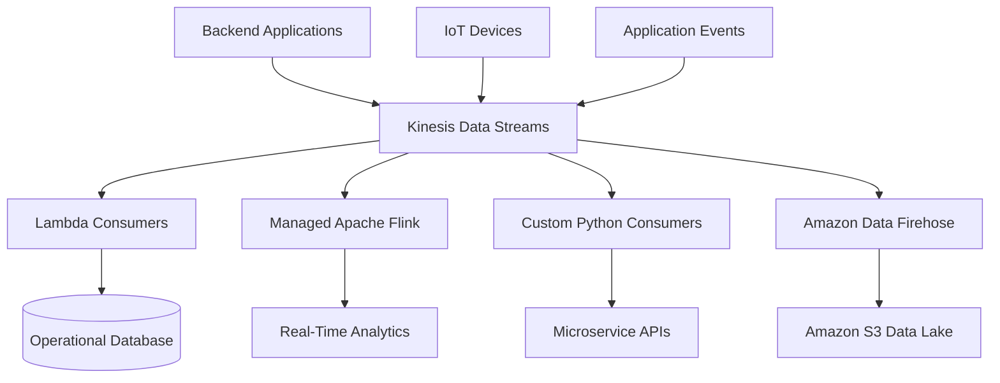
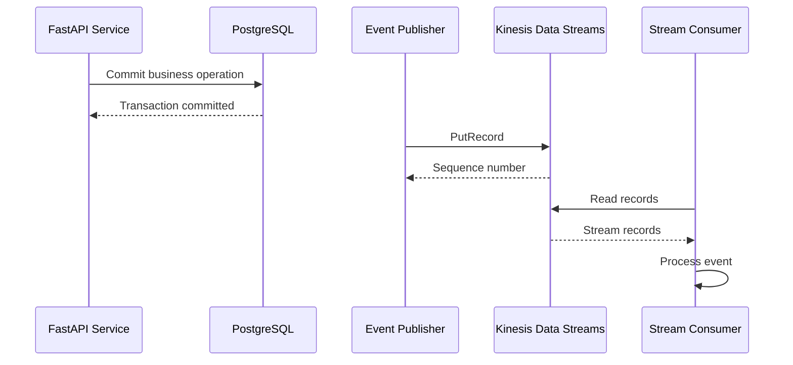
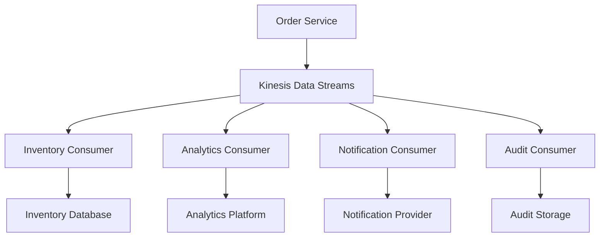
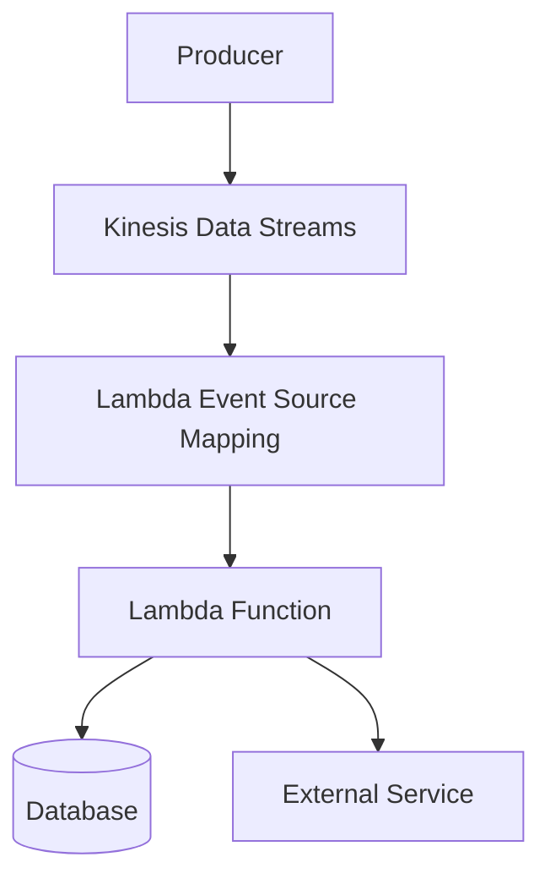
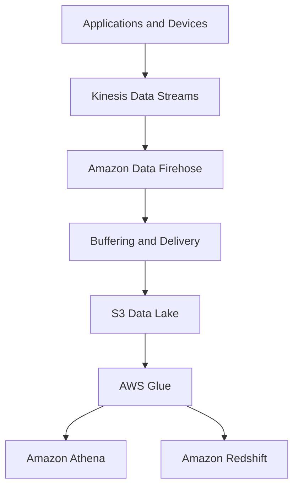
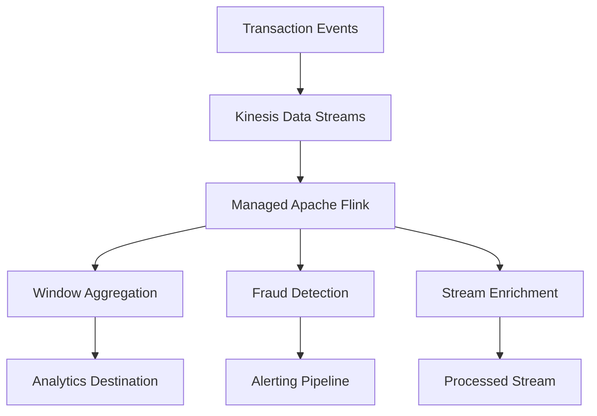

# 01- Integration Overview

## Overview

Amazon Kinesis is a collection of AWS services for collecting, processing, and delivering streaming data. It enables backend applications and distributed systems to process continuous event streams without requiring producers and consumers to communicate synchronously.

Kinesis is useful when applications need to process high-volume event data with low latency, retain records for replay, distribute streams to multiple consumers, or deliver streaming data into analytics and data lake platforms.

Typical integration scenarios include:

- Real-time application activity tracking.
- Clickstream and user behavior analytics.
- IoT telemetry ingestion.
- Financial transaction monitoring.
- Operational log aggregation.
- Streaming ETL pipelines.
- Real-time fraud detection.
- Data lake ingestion.
- Event-driven microservice integration.

Kinesis integrates with services such as Amazon S3, AWS Lambda, Amazon Managed Service for Apache Flink, Amazon Redshift, Amazon OpenSearch Service, and Amazon Data Firehose.

The integration architecture depends on whether the application needs a retained event stream, managed stream processing, or asynchronous delivery to a destination.

## Amazon Kinesis Service Components

Amazon Kinesis includes several services with different responsibilities.

| Service | Primary responsibility | Typical integration |
|---|---|---|
| Kinesis Data Streams | Collect and retain streaming records | Producers, consumers, Lambda, Flink |
| Amazon Data Firehose | Managed delivery of streaming data | S3, Redshift, OpenSearch, supported HTTP endpoints |
| Amazon Managed Service for Apache Flink | Stateful stream processing | Data Streams, Data Firehose |
| Kinesis Video Streams | Ingest and process video streams | Video analytics and media processing |

These services are related but not interchangeable.

### Kinesis Data Streams

Kinesis Data Streams is a managed streaming data service.

Producers write records to a stream. Consumers read records independently and process them according to application requirements.

Key capabilities:

- Retained streaming records.
- Multiple independent consumers.
- Ordering within a shard.
- Replay within the configured retention period.
- Provisioned and on-demand capacity modes.
- Enhanced fan-out for dedicated consumer read throughput.

Use Data Streams when applications need retained events, replay, independent consumers, or custom stream-processing logic.

### Amazon Data Firehose

Amazon Data Firehose is a managed service for delivering streaming data to supported destinations.

It handles buffering, batching, and delivery without requiring applications to operate their own consumer fleet.

Typical destinations include:

- Amazon S3.
- Amazon Redshift.
- Amazon OpenSearch Service.
- Supported HTTP endpoints.
- Other supported AWS destinations.

Use Data Firehose when the primary requirement is managed delivery rather than application-controlled stream consumption.

Data Firehose is not a general-purpose retained event log. Use Data Streams when consumers need independent replay and stream-position management.

### Amazon Managed Service for Apache Flink

Amazon Managed Service for Apache Flink runs Apache Flink applications for stateful stream processing.

It supports:

- Event-time processing.
- Windowed aggregations.
- Stateful computations.
- Checkpointing.
- Savepoints.
- Complex event processing.
- Continuous data transformations.

Use it when processing requires state, event-time semantics, or complex streaming transformations.

Exactly-once guarantees depend on the source, connector, checkpointing, and sink capabilities. Arbitrary external side effects can still execute more than once.

### Kinesis Video Streams

Kinesis Video Streams is designed for ingesting and processing video streams.

It supports applications such as:

- Video surveillance.
- Industrial monitoring.
- Smart camera systems.
- Video analytics.
- Media processing.

It has different ingestion and processing semantics from Kinesis Data Streams and should be evaluated separately.

## Kinesis Integration Architecture

A typical streaming architecture separates ingestion, processing, and delivery.



### Integration Layers

| Layer | Responsibility | AWS services |
|---|---|---|
| Producers | Generate and publish events | Backend applications, IoT devices |
| Ingestion | Accept and retain records | Kinesis Data Streams |
| Processing | Transform and analyze events | Lambda, Managed Service for Apache Flink |
| Delivery | Deliver data to destinations | Amazon Data Firehose |
| Storage | Persist processed data | S3, Redshift |
| Monitoring | Observe throughput and failures | CloudWatch |

Separating these responsibilities allows ingestion capacity, processing capacity, and storage destinations to evolve independently.

## Integrating Kinesis With Backend Applications

Backend applications commonly publish events when business operations occur.

For example, an e-commerce application may publish:

- Order created.
- Payment completed.
- Product viewed.
- Inventory updated.
- Customer activity recorded.

A typical integration looks like this:



For business-critical events, use a transactional outbox to avoid losing publication intent when the database commit succeeds but Kinesis publishing fails.

### Event Contract

A stable event contract should contain:

```json
{
  "event_id": "evt-1001",
  "event_type": "ORDER_CREATED",
  "version": 1,
  "occurred_at": "2026-11-20T08:30:00Z",
  "producer": "order-service",
  "correlation_id": "corr-1001",
  "data": {
    "order_id": "ORD-1001",
    "customer_id": "CUS-2001",
    "total_amount": 2499.00
  }
}
```

Recommended contract fields:

| Field | Purpose |
|---|---|
| `event_id` | Stable event identity |
| `event_type` | Business event classification |
| `version` | Schema evolution |
| `occurred_at` | Event creation timestamp |
| `producer` | Originating application |
| `correlation_id` | Request and workflow tracing |
| `data` | Business payload |

Avoid publishing database-specific objects or internal ORM representations. Streaming contracts should be stable across service deployments.

## Python Integration With Kinesis Data Streams

Python applications can publish records using Boto3.

Install the SDK:

```bash
pip install boto3
```

### Publishing a Record

```python
import json
import boto3

kinesis = boto3.client("kinesis", region_name="ap-south-1")

def publish_order_event(event: dict) -> dict:
    response = kinesis.put_record(
        StreamName="orders-stream",
        Data=json.dumps(event).encode("utf-8"),
        PartitionKey=event["data"]["customer_id"],
    )

    return {
        "shard_id": response["ShardId"],
        "sequence_number": response["SequenceNumber"],
    }
```

The partition key determines the shard to which the record is routed through hash-based partitioning.

Choosing a partition key requires understanding the application's distribution characteristics.

For example, using a customer ID can preserve ordering for records belonging to the same customer, but a highly active customer can create a hot shard.

### Publishing Multiple Records

For higher throughput, use `PutRecords`.

```python
import json
import boto3

kinesis = boto3.client("kinesis", region_name="ap-south-1")

def publish_batch(events: list[dict]) -> None:
    records = [
        {
            "Data": json.dumps(event).encode("utf-8"),
            "PartitionKey": event["data"]["customer_id"],
        }
        for event in events
    ]

    response = kinesis.put_records(
        StreamName="orders-stream",
        Records=records,
    )

    failed_count = response["FailedRecordCount"]

    if failed_count:
        failed_records = [
            record
            for record, result in zip(records, response["Records"])
            if "ErrorCode" in result
        ]

        handle_failed_records(failed_records)
```

`PutRecords` supports up to 500 records per request.

A batch can partially succeed. Inspect individual record results and retry only failed entries.

Retries can change the relative ordering of records, so use `PutRecord` when strict per-key ordering is required and the application needs to control sequential publication.

For ambiguous network failures, a record may have been accepted even if the producer did not receive the response. Use stable event IDs and consumer idempotency.

## Integrating Kinesis With Microservices

Kinesis can distribute event streams to multiple independent consumers.



Each consumer maintains its own processing position.

This enables independent processing and replay within the stream's retention period.

### Kinesis Versus SQS for Microservices

| Requirement | Kinesis Data Streams | Amazon SQS |
|---|---|---|
| Retained event stream | Yes | No general stream replay model |
| Multiple independent consumers | Yes | Requires separate queues and fan-out |
| Ordering | Within a shard | FIFO ordering within a message group |
| Consumer checkpointing | Application or consumer framework | Message deletion |
| Replay | Within retention | Requires republishing or other recovery mechanisms |
| Work distribution | Consumer-specific stream reads | Competing consumers |
| Typical use | Event streaming and analytics | Asynchronous task processing |

Use Kinesis when multiple consumers need to independently read and replay a continuous stream.

Use SQS when work items should be distributed among competing workers and acknowledged after processing.

Do not replace a task queue with a streaming platform unless retained event-stream semantics are actually required.

## Integrating Kinesis With AWS Lambda

Lambda can consume Kinesis Data Streams through an event source mapping.

AWS polls the stream and invokes the function with batches of records.



Typical use cases:

- Event validation.
- Lightweight enrichment.
- Real-time routing.
- Small transformations.
- Triggering downstream asynchronous workflows.

Important considerations:

- Lambda processes records in batches.
- Records are ordered within a shard.
- A failed batch can affect subsequent processing for the relevant shard.
- Configure retry and record-age behavior deliberately.
- Use partial batch failure reporting where supported.
- Design processing to be idempotent.

For partial batch failures, configure the event source mapping with the appropriate response type and return failed record sequence numbers in the expected response format.

Do not treat Lambda invocation success as proof that every business side effect occurred exactly once.

## Integrating Kinesis With Amazon S3

Amazon S3 is commonly used as the long-term storage destination for streaming data.

A common architecture uses Data Streams for ingestion and Data Firehose for managed delivery.



This separates real-time ingestion from analytical storage.

Typical use cases:

- Event archival.
- Data lake ingestion.
- Historical analytics.
- Machine learning datasets.
- Audit and compliance records.

Use partitioned S3 prefixes based on relevant dimensions such as date, event type, or tenant where appropriate.

Example:

```text
s3://company-data-lake/
    events/
        year=2026/
            month=11/
                day=20/
                    events.parquet
```

Choose partitioning carefully. Excessively granular partitions can create many small files and increase query planning overhead.

## Integrating Kinesis With Managed Apache Flink

Managed Service for Apache Flink supports continuous stateful processing.

Example architecture:



Typical use cases:

- Real-time aggregation.
- Event-time window processing.
- Fraud detection.
- Stateful session analysis.
- Stream enrichment.
- Continuous ETL.

Flink applications need careful management of:

- Checkpoint intervals.
- State size.
- Watermarks.
- Late events.
- Backpressure.
- Sink delivery guarantees.
- Savepoint-based deployments.

Exactly-once processing depends on the complete source-to-sink pipeline. External REST calls, email delivery, and other non-transactional side effects can repeat.

## Integrating Kinesis With Databases

Streaming consumers often persist processed records into PostgreSQL, DynamoDB, or analytical databases.

A common pattern is:

1. Read a record.
2. Validate the event.
3. Apply business transformations.
4. Persist the result.
5. Checkpoint the processing position.

The durable business operation must complete before the consumer advances its checkpoint.

If the consumer checkpoints before committing the database transaction, a crash can cause data loss.

If it commits the database transaction and crashes before checkpointing, the record may be processed again.

Use idempotent database operations to handle this safely.

For PostgreSQL, stable event IDs and unique constraints are common approaches.

## Reliability and Delivery Semantics

Kinesis integrations must account for retries, duplicate processing, and checkpoint recovery.

### At-Least-Once Processing

Many consumer designs provide at-least-once processing.

A record may be processed more than once if:

- The consumer crashes before checkpointing.
- The database commits but checkpointing fails.
- A batch is retried.
- A network timeout creates an ambiguous operation result.

Consumers should use stable event identifiers and idempotent writes.

### Ordering

Kinesis preserves record ordering within a shard.

It does not provide global ordering across all shards.

Partition key selection determines how records are distributed.

For business workflows requiring per-entity ordering, use a stable partition key based on the entity identifier.

### Retention and Replay

Kinesis Data Streams retains records for a configurable period.

The default retention period is 24 hours and can be extended up to 365 days.

Consumers can replay records within the configured retention period by changing their starting position or checkpoint strategy.

For long-term archival, deliver records to S3.

### Consumer Checkpointing

A consumer checkpoint records its progress through a shard.

Frameworks such as the Kinesis Client Library coordinate shard processing and checkpoint management.

Checkpoint only after the corresponding processing work is durable.

A checkpoint is not a substitute for application-level idempotency.

## Scalability and Performance

### Shard Capacity

In provisioned mode, shards determine stream capacity.

Common provisioned shard limits include:

| Operation | Per-shard capacity |
|---|---:|
| Write throughput | Up to 1 MB/s or 1,000 records/s |
| Shared consumer read throughput | Up to 2 MB/s |
| Shared consumer read transactions | Up to 5 `GetRecords` calls/s |

These are common service limits; verify current regional quotas and stream-mode behavior before capacity planning.

Enhanced fan-out provides dedicated read throughput of up to 2 MB/s per shard per registered consumer.

### Hot Partition Keys

A poorly distributed partition key can overload a shard.

For example, using a constant partition key sends all records to the same shard.

Prefer keys that distribute traffic across the stream while preserving required ordering.

Potential keys include:

- Customer ID.
- Device ID.
- Account ID.
- Order ID.

The correct choice depends on the business ordering boundary and traffic distribution.

### Consumer Scaling

Consumers should scale according to:

- Incoming record rate.
- Iterator age.
- Processing latency.
- Shard count.
- Consumer read throughput.
- Downstream dependency capacity.

Scaling consumer instances beyond the available shard parallelism may not increase useful throughput unless the application uses a suitable processing model.

## Security Considerations

Kinesis integrations should use least-privilege access and encrypted data paths.

Recommended practices:

- Use IAM roles for AWS workloads.
- Restrict `PutRecord` and `PutRecords` to required streams.
- Restrict consumer permissions to required stream and shard operations.
- Use KMS encryption where required.
- Review KMS key policies.
- Use VPC endpoints where supported and appropriate.
- Avoid embedding credentials in event payloads.
- Apply data classification before publishing sensitive records.
- Protect S3 destinations with bucket policies and encryption.
- Use CloudTrail for relevant control-plane auditing.

For cross-account integrations, explicitly configure trust relationships and resource policies.

## Monitoring and Observability

Kinesis integrations should monitor ingestion, consumption, processing, and delivery.

### Kinesis Data Streams Metrics

| Metric | Purpose |
|---|---|
| `IncomingBytes` | Measures incoming data volume |
| `IncomingRecords` | Measures record ingestion rate |
| `GetRecords.IteratorAgeMilliseconds` | Measures consumer lag |
| `ReadProvisionedThroughputExceeded` | Detects read throttling |
| `WriteProvisionedThroughputExceeded` | Detects write throttling |
| `PutRecord.Success` | Measures successful single-record writes |
| `PutRecords.Success` | Measures successful batch record writes |

Metric names and dimensions vary by API and monitoring configuration.

### Application Metrics

Track:

- Event publication failures.
- Per-record batch failures.
- Consumer processing duration.
- Checkpoint lag.
- Duplicate event detection.
- Database write failures.
- Downstream API latency.
- Data Firehose delivery failures.
- Flink checkpoint duration and failures.
- End-to-end event latency.

Use correlation IDs and stable event IDs to trace records across producers, streams, consumers, and destinations.

## High Availability and Disaster Recovery

Kinesis Data Streams is a regional service.

A production design should account for:

- Multi-AZ service operation.
- Consumer recovery.
- Checkpoint durability.
- Stream retention.
- S3 archival.
- Cross-Region recovery.
- Infrastructure recreation.
- Downstream database recovery.

For regional disaster recovery, define whether the application will:

- Recreate streams and consumers.
- Republish from an authoritative event source.
- Restore archived data from S3.
- Replicate events into a secondary Region.
- Rebuild consumer state from retained records.

Do not assume Kinesis streams automatically replicate to another Region.

For important event streams, S3 archival provides a separate recovery source for historical data.

## Cost Considerations

Kinesis integration costs depend on ingestion volume, stream capacity mode, consumer configuration, processing duration, and destination delivery.

| Component | Cost drivers |
|---|---|
| Kinesis Data Streams | Provisioned capacity or on-demand usage, retention, enhanced fan-out |
| Amazon Data Firehose | Data ingestion and supported transformation or delivery features |
| Managed Apache Flink | Application compute and running resources |
| Lambda | Invocations and execution duration |
| S3 | Storage, requests, retrieval, and transfer |
| CloudWatch | Metrics, alarms, and logs |
| KMS | Key usage and API requests |

Optimization practices:

- Choose an appropriate capacity mode.
- Avoid hot partition keys.
- Use batching where appropriate.
- Monitor consumer lag.
- Use enhanced fan-out only when dedicated read throughput is needed.
- Archive data to S3 for long-term retention.
- Select suitable S3 formats and partitioning.
- Control logging volume.
- Remove unused consumers and processing applications.

## Deployment and Integration Best Practices

Manage Kinesis resources through Terraform, CloudFormation, or AWS CDK.

A production deployment should include:

- Stream definitions.
- Capacity configuration.
- Retention settings.
- IAM roles and policies.
- KMS encryption.
- Consumer deployment.
- Checkpoint storage where required.
- S3 delivery configuration.
- CloudWatch alarms.
- Disaster recovery procedures.

Recommended deployment practices:

- Use separate streams for independent workloads where isolation is needed.
- Keep event schemas versioned.
- Deploy consumers with backward compatibility.
- Use stable partition keys.
- Test partial failures.
- Validate replay and checkpoint recovery.
- Monitor consumer lag during deployments.
- Avoid changing partitioning assumptions without a migration plan.
- Test failure recovery in a dedicated AWS environment.

## Common Integration Mistakes

### Treating Kinesis as a Task Queue

Kinesis is a retained event stream, not a competing-consumer task queue.

Use SQS when work should be distributed among workers and acknowledged after completion.

### Assuming Global Ordering

Kinesis ordering is limited to records within a shard.

Use a stable partition key for records that require per-entity ordering.

### Ignoring Partial `PutRecords` Failures

A successful API request does not mean every record succeeded.

Inspect individual record responses and retry only failed records.

### Using a Poor Partition Key

A constant or highly skewed key can create hot shards.

Analyze key distribution before production deployment.

### Checkpointing Before Durable Processing

Advancing the checkpoint before committing the business operation can lose work.

Commit first, then checkpoint.

### Assuming Exactly-Once Business Processing

Checkpointing and stream-level capabilities do not guarantee exactly-once external side effects.

Use idempotency and reconciliation.

### Treating Data Firehose as a Replayable Stream

Data Firehose is designed for managed delivery.

Use Kinesis Data Streams when independent consumers require retained records and replay.

### Ignoring Consumer Lag

A consumer can continue running while falling progressively behind.

Monitor iterator age and processing throughput, not only consumer availability.

## Key Takeaways

- Kinesis Data Streams provides retained event streaming, while Data Firehose provides managed delivery and Managed Service for Apache Flink provides stateful stream processing.
- Choose Kinesis integrations according to ingestion, processing, replay, and delivery requirements rather than treating all Kinesis services as interchangeable.
- Use stable partition keys, idempotent consumers, and durable checkpointing to preserve correctness under retries and failures.
- Monitor ingestion throughput, consumer lag, throttling, processing failures, and destination delivery health.
- Design security, archival, infrastructure deployment, and cross-Region recovery as part of the integration architecture.