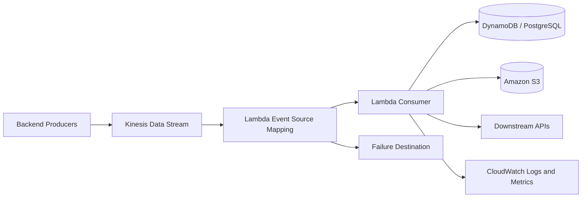
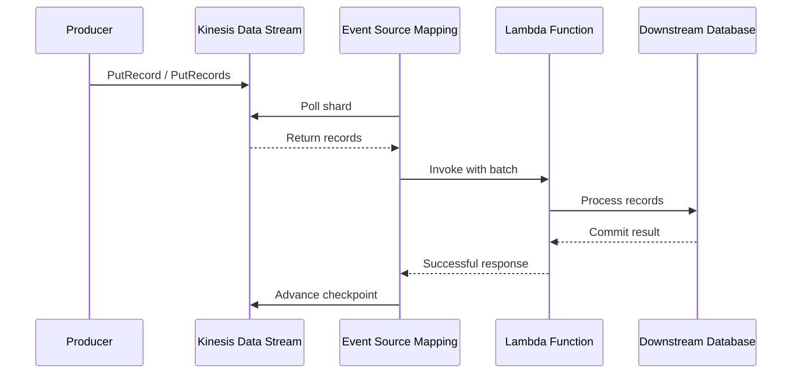

# 02- AWS Lambda Integration

## Overview

AWS Lambda integrates with Amazon Kinesis Data Streams to process streaming records without requiring applications to manage consumer instances, polling loops, shard leases, or checkpoint infrastructure.

Lambda uses an **event source mapping (ESM)** to poll a Kinesis stream, retrieve records, and invoke a function with batches of records. The function processes each batch and returns control to the event source mapping, which manages checkpoints and subsequent reads.

This integration is suitable for event-driven backend workloads such as:

- Real-time event transformation and enrichment.
- Processing application activity and audit events.
- Updating search indexes and analytical stores.
- Processing IoT telemetry.
- Triggering downstream workflows from domain events.
- Building serverless streaming pipelines.

Lambda simplifies consumer operations, but it does not remove the need to design for retries, duplicate processing, ordering, backpressure, and downstream failures.

## Architecture

### Core Components

| Component | Responsibility |
|---|---|
| Kinesis Data Stream | Retains ordered records within shards |
| Lambda function | Processes records delivered in batches |
| Event source mapping | Polls the stream, invokes Lambda, and manages checkpoints |
| IAM execution role | Grants the function access to downstream resources |
| CloudWatch Logs | Stores function execution logs |
| CloudWatch Metrics | Exposes invocation, error, throttling, and stream-processing metrics |
| Dead-letter destination | Receives records that cannot be processed after configured retry attempts or age limits |

### High-Level Architecture



The event source mapping is the integration layer between Kinesis and Lambda. Kinesis does not directly invoke the function for each record.

### Processing Lifecycle



The checkpoint represents the position from which the event source mapping continues reading. A failed invocation can cause records to be processed again, so application-level idempotency remains essential.

## Event Source Mapping

### What It Does

An event source mapping is a Lambda-managed resource that connects a supported event source to a Lambda function.

For Kinesis, it manages:

- Reading records from stream shards.
- Polling and batching records.
- Invoking the configured Lambda function.
- Managing processing progress and checkpoints.
- Applying retry and failure-handling policies.
- Scaling polling and invocation concurrency according to stream activity and configuration.

The mapping is configured independently of the function code.

### Important Configuration Properties

| Property | Purpose | Engineering Consideration |
|---|---|---|
| `EventSourceArn` | Identifies the Kinesis stream | Must reference the intended stream |
| `FunctionName` | Identifies the Lambda consumer | Use a version or alias for controlled deployments |
| `StartingPosition` | Determines where processing begins | Choose based on replay and deployment requirements |
| `BatchSize` | Maximum records in an invocation batch | Balance throughput, latency, and memory |
| `MaximumBatchingWindowInSeconds` | Maximum time to collect records | Higher values can improve batching efficiency |
| `ParallelizationFactor` | Concurrent batches per shard | Increase carefully when processing capacity is insufficient |
| `MaximumRetryAttempts` | Limits retries for failed batches | Prevents indefinitely retrying poison records |
| `MaximumRecordAgeInSeconds` | Limits how long records remain eligible for processing | Align with business recovery requirements |
| `BisectBatchOnFunctionError` | Splits failed batches to isolate problematic records | Useful when failures are caused by individual records |
| `DestinationConfig` | Configures failure destinations | Supports operational recovery and investigation |
| `FunctionResponseTypes` | Enables partial batch failure reporting | Use `ReportBatchItemFailures` when supported by the integration |

### Starting Position

The starting position determines where Lambda begins reading when the event source mapping is first created.

| Position | Behavior | Typical Use |
|---|---|---|
| `TRIM_HORIZON` | Starts from the oldest record still retained | Initial processing or replay |
| `LATEST` | Starts from records arriving after the mapping begins reading | Forward-only processing |
| `AT_TIMESTAMP` | Starts from records at or after a specified timestamp | Targeted replay and recovery |

Example configuration:

```python
import boto3

lambda_client = boto3.client("lambda")

response = lambda_client.create_event_source_mapping(
    EventSourceArn="arn:aws:kinesis:ap-south-1:123456789012:stream/orders",
    FunctionName="orders-stream-processor",
    StartingPosition="TRIM_HORIZON",
    BatchSize=100,
    MaximumBatchingWindowInSeconds=5,
    ParallelizationFactor=1,
    Enabled=True,
    FunctionResponseTypes=[
        "ReportBatchItemFailures"
    ],
)
```

Important considerations:

- `LATEST` can miss records written between mapping creation and the point at which polling begins. Use it only when that behavior is acceptable.
- `TRIM_HORIZON` can cause a substantial initial backlog.
- `AT_TIMESTAMP` is useful for targeted recovery, but the requested timestamp must still fall within the stream's retention window.
- Starting position is primarily relevant when creating a mapping. Updating an existing mapping does not automatically replay records from a new starting position.

## Batch Processing

### How Batching Works

Lambda retrieves multiple Kinesis records and delivers them to the function in a single invocation.

Batching reduces invocation overhead and can improve throughput, but it also affects latency, memory consumption, processing duration, and failure recovery.

Example event structure:

```json
{
  "Records": [
    {
      "kinesis": {
        "sequenceNumber": "496...",
        "partitionKey": "customer-123",
        "data": "eyJvcmRlcl9pZCI6ICJvcmQtMTAwMSJ9",
        "approximateArrivalTimestamp": 1795000000.0
      },
      "eventSource": "aws:kinesis",
      "eventName": "aws:kinesis:record",
      "eventSourceARN": "arn:aws:kinesis:ap-south-1:123456789012:stream/orders",
      "eventID": "shardId-000000000000:496..."
    }
  ]
}
```

The `data` field is Base64 encoded. Decode it before parsing the application payload.

### Batch Size

The batch size determines the maximum number of records Lambda retrieves for one invocation.

For Kinesis event source mappings:

- Maximum batch size is 10,000 records.
- The configured batch size must respect the applicable payload and service constraints.
- The maximum Lambda synchronous invocation payload is 6 MB.
- A batch can be delivered before reaching the configured record count when the batching window expires or payload limits are reached.

Example:

```python
response = lambda_client.create_event_source_mapping(
    EventSourceArn="arn:aws:kinesis:ap-south-1:123456789012:stream/orders",
    FunctionName="orders-stream-processor",
    StartingPosition="LATEST",
    BatchSize=500,
    MaximumBatchingWindowInSeconds=3,
    Enabled=True,
)
```

A large batch is not automatically more efficient. If processing takes too long, the function can approach its timeout and cause repeated processing of records.

### Batching Window

`MaximumBatchingWindowInSeconds` controls how long Lambda waits to collect records before invoking the function.

Use a shorter window when:

- Processing latency is important.
- The stream has relatively low traffic.
- Records must be processed promptly.

Use a longer window when:

- Throughput is more important than individual-record latency.
- The stream receives records in bursts.
- Batch processing significantly reduces downstream request overhead.

The configured window is a maximum collection period, not a guaranteed invocation interval.

## Building a Python Lambda Consumer

### Project Structure

A production-oriented consumer should separate event parsing, business logic, persistence, and error handling.

```text
kinesis-lambda-consumer/
├── src/
│   ├── __init__.py
│   ├── handler.py
│   ├── event_parser.py
│   ├── processor.py
│   ├── repository.py
│   └── settings.py
├── tests/
│   ├── test_event_parser.py
│   ├── test_processor.py
│   └── test_handler.py
├── requirements.txt
└── template.yaml
```

### Event Parser

Kinesis records contain Base64-encoded data. Decode and validate the payload at the application boundary.

```python
import base64
import json
from typing import Any


def decode_kinesis_record(record: dict[str, Any]) -> dict[str, Any]:
    encoded_data = record["kinesis"]["data"]

    decoded_data = base64.b64decode(
        encoded_data,
        validate=True,
    )

    payload = json.loads(decoded_data)

    if not isinstance(payload, dict):
        raise ValueError("Kinesis payload must be a JSON object")

    return payload
```

The parser should reject malformed payloads rather than silently converting them into empty objects.

### Business Logic

Keep processing logic independent of the Lambda event format.

```python
from typing import Any


def process_order_event(
    event: dict[str, Any],
    repository,
) -> None:
    event_id = event.get("event_id")
    order_id = event.get("order_id")
    status = event.get("status")

    if not event_id or not order_id or not status:
        raise ValueError("Missing required order event fields")

    repository.apply_order_event(
        event_id=event_id,
        order_id=order_id,
        status=status,
    )
```

The repository should implement an atomic idempotency strategy. A database transaction should record the event ID and apply the business update together.

### Lambda Handler

```python
from src.event_parser import decode_kinesis_record
from src.processor import process_order_event
from src.repository import OrderRepository


def lambda_handler(event, context):
    repository = OrderRepository()

    for record in event.get("Records", []):
        payload = decode_kinesis_record(record)

        process_order_event(
            event=payload,
            repository=repository,
        )

    return {
        "statusCode": 200,
        "processedRecords": len(event.get("Records", [])),
    }
```

This basic handler uses whole-batch failure semantics. If any record raises an exception, the invocation fails and the batch can be retried.

For production workloads with independently processable records, partial batch failure reporting can reduce unnecessary reprocessing.

## Partial Batch Failure Handling

### Why It Matters

Consider a batch containing 100 records:

- 99 records process successfully.
- 1 record contains invalid data.
- The function raises an exception.

Without partial batch responses, the failed invocation can cause all 100 records to be retried.

This increases processing cost and creates unnecessary duplicate work.

Kinesis event source mappings support partial batch failure reporting through `ReportBatchItemFailures`.

### Response Format

The function returns failed record identifiers in `batchItemFailures`.

For Kinesis, the identifier must be the record's sequence number.

```json
{
  "batchItemFailures": [
    {
      "itemIdentifier": "496..."
    }
  ]
}
```

### Implementation

```python
import logging

from src.event_parser import decode_kinesis_record
from src.processor import process_order_event
from src.repository import OrderRepository

logger = logging.getLogger(__name__)


def lambda_handler(event, context):
    repository = OrderRepository()
    failures = []

    for record in event.get("Records", []):
        sequence_number = record["kinesis"]["sequenceNumber"]

        try:
            payload = decode_kinesis_record(record)

            process_order_event(
                event=payload,
                repository=repository,
            )

        except Exception:
            logger.exception(
                "Failed to process Kinesis record",
                extra={
                    "sequence_number": sequence_number,
                    "event_id": record.get("eventID"),
                },
            )

            failures.append({
                "itemIdentifier": sequence_number,
            })

    return {
        "batchItemFailures": failures,
    }
```

Enable the feature on the event source mapping:

```python
response = lambda_client.update_event_source_mapping(
    UUID="EVENT_SOURCE_MAPPING_UUID",
    FunctionResponseTypes=[
        "ReportBatchItemFailures"
    ],
)
```

### Important Ordering Behavior

Kinesis records are ordered within a shard. Partial batch failure behavior must account for this ordering.

For a standard Kinesis event source mapping:

- Lambda uses the lowest failed sequence number as the checkpoint boundary.
- Records at and after that failure can be retried.
- Records before the failure can be checkpointed as successfully processed.
- Returning multiple failed sequence numbers does not mean Lambda independently retries every failed record without regard to ordering.

For order-sensitive processing, stop processing after the first failure and report that sequence number. This avoids applying later records while an earlier record remains unresolved.

Example:

```python
def lambda_handler(event, context):
    repository = OrderRepository()

    for record in event.get("Records", []):
        sequence_number = record["kinesis"]["sequenceNumber"]

        try:
            payload = decode_kinesis_record(record)
            process_order_event(payload, repository)

        except Exception:
            logger.exception(
                "Record processing failed",
                extra={"sequence_number": sequence_number},
            )

            return {
                "batchItemFailures": [
                    {
                        "itemIdentifier": sequence_number,
                    }
                ]
            }

    return {
        "batchItemFailures": [],
    }
```

This approach preserves sequential processing within the delivered batch but can block later records behind a persistent poison record. Configure retry limits and failure destinations to prevent indefinite blockage.

## Idempotency and Duplicate Processing

### Why Duplicates Occur

Kinesis and Lambda provide reliable delivery and retry behavior, but they do not guarantee exactly-once execution of arbitrary business logic.

A duplicate can occur when:

1. Lambda processes a record successfully.
2. The downstream database commits the transaction.
3. The invocation fails before the event source mapping advances its checkpoint.
4. Lambda retries the record.

The business operation must therefore tolerate repeated delivery.

### Stable Event Identifiers

Use a producer-generated event ID that remains unchanged across retries.

Example event:

```json
{
  "event_id": "evt-7a4d1b2e",
  "event_type": "order.status_changed",
  "event_version": 1,
  "occurred_at": "2026-11-20T10:30:00Z",
  "data": {
    "order_id": "ord-1001",
    "status": "confirmed"
  }
}
```

Avoid generating a new event ID inside the Lambda consumer. The identifier must represent the original business event.

### PostgreSQL Idempotency

A database uniqueness constraint can prevent duplicate application of an event.

```sql
CREATE TABLE processed_events (
    event_id VARCHAR(128) PRIMARY KEY,
    processed_at TIMESTAMPTZ NOT NULL DEFAULT NOW()
);
```

The event marker and business update must be committed in the same transaction.

```python
def apply_order_event(connection, event):
    with connection.transaction():
        inserted = connection.execute(
            """
            INSERT INTO processed_events (event_id)
            VALUES (%s)
            ON CONFLICT (event_id) DO NOTHING
            RETURNING event_id
            """,
            (event["event_id"],),
        ).fetchone()

        if inserted is None:
            return

        connection.execute(
            """
            UPDATE orders
            SET status = %s,
                updated_at = NOW()
            WHERE order_id = %s
            """,
            (
                event["data"]["status"],
                event["data"]["order_id"],
            ),
        )
```

If the transaction fails, both the idempotency marker and business update roll back.

For external APIs, use provider-supported idempotency keys where available. Otherwise, maintain a durable operation record and reconciliation process.

## Concurrency and Parallelization

### Default Processing Model

Kinesis processing is organized around shards.

A shard is a logical partition that provides an ordered sequence of records. Lambda uses the event source mapping to retrieve records from each shard and invoke the consumer.

By default, Lambda processes one batch at a time per shard.

This preserves the shard's processing order but can limit throughput when record processing is slow.

### Parallelization Factor

The `ParallelizationFactor` setting allows multiple batches from a shard to be processed concurrently.

The supported range is 1–10.

Example:

```python
response = lambda_client.update_event_source_mapping(
    UUID="EVENT_SOURCE_MAPPING_UUID",
    ParallelizationFactor=3,
)
```

Parallelization can increase throughput, but it changes the processing model:

- Multiple batches from a shard can be in flight.
- Records can be processed concurrently.
- Completion order may differ from arrival order.
- The application must protect operations that depend on strict ordering.

Use parallelization when records are independent or when the business logic has an explicit ordering strategy.

### Partition Key Design

The producer's partition key determines how records are distributed across shards.

For example:

```python
kinesis_client.put_record(
    StreamName="orders",
    PartitionKey="customer-123",
    Data=json.dumps(order_event).encode("utf-8"),
)
```

All records with the same partition key are routed to the same shard while the shard mapping remains unchanged.

This provides per-key ordering, but a heavily used key can create a hot shard.

A useful design principle is to choose a partition key that:

- Preserves required ordering.
- Distributes traffic across shards.
- Avoids a small number of disproportionately active keys.

Parallelization does not remove hot-shard limitations or create additional shard read throughput.

## Scaling and Throughput

### Scaling Model

Lambda event source mappings scale polling and processing according to shard count, available read throughput, function concurrency, and configuration.

Important factors include:

- Number of stream shards.
- `ParallelizationFactor`.
- Lambda reserved concurrency.
- Function duration.
- Batch size.
- Downstream processing capacity.
- Kinesis read throughput limits.

A useful approximation for processing capacity is:

\[
\text{Processing Capacity}
\approx
\frac{\text{Concurrent Invocations} \times \text{Records per Batch}}
{\text{Average Processing Duration}}
\]

This is an estimate, not a guaranteed throughput figure. Actual throughput is constrained by stream capacity, payload sizes, polling behavior, invocation limits, and downstream services.

### Capacity Planning

For a stream with 20 shards and a parallelization factor of 2, the mapping can process multiple batches concurrently across shards.

However, Lambda concurrency is not independent of downstream capacity.

For example:

```text
20 shards
× 2 parallel batches per shard
= 40 potential concurrent batches
```

This is a planning estimate, not a promise that 40 invocations will always be active. Actual concurrency depends on available records, service limits, and mapping behavior.

If each invocation opens multiple PostgreSQL connections, uncontrolled concurrency can exhaust the database connection pool.

### Reserved Concurrency

Use Lambda reserved concurrency to protect downstream systems and guarantee capacity for critical functions.

```bash
aws lambda put-function-concurrency \
    --function-name orders-stream-processor \
    --reserved-concurrent-executions 40
```

Do not configure reserved concurrency below the level required for the expected stream workload without understanding the resulting backlog and retry behavior.

### Backpressure

Lambda can scale faster than a database or external API can handle.

Protect downstream systems with:

- Reserved concurrency.
- Bounded database connection pools.
- Connection reuse where supported.
- Batch writes.
- API rate limiting.
- Retry budgets.
- Circuit breakers.
- Separate streams for workloads with different processing requirements.

Scaling the consumer without scaling or protecting downstream dependencies can move the bottleneck rather than eliminate it.

## Error Handling and Failure Recovery

### Retry Behavior

When a Lambda invocation fails, the event source mapping retries records according to its configured failure policy.

Important configuration options include:

| Setting | Purpose |
|---|---|
| `MaximumRetryAttempts` | Limits how many times a failed batch is retried |
| `MaximumRecordAgeInSeconds` | Limits the maximum record age eligible for processing |
| `BisectBatchOnFunctionError` | Splits a failed batch to isolate problematic records |
| `DestinationConfig` | Configures where discarded records are sent |

A retry policy should distinguish between:

- Transient infrastructure failures.
- Temporary database or API unavailability.
- Invalid payloads.
- Unsupported event versions.
- Permanent business validation failures.

Not all failures should be retried indefinitely.

### Poison Records

A poison record consistently fails because of malformed data, unsupported schema, or a deterministic business error.

Without a bounded retry strategy, one poison record can block progress for its shard.

Recommended handling:

1. Log the failure with the event ID and sequence number.
2. Capture sufficient metadata for investigation.
3. Apply bounded retry attempts.
4. Configure a failure destination.
5. Alert the owning team.
6. Repair and replay the event through a controlled recovery workflow.

### Failure Destinations

For Kinesis event source mappings, a failure destination can be configured for records discarded after retry or record-age limits are reached.

Supported destination types include:

- Amazon SQS.
- Amazon SNS.

Example:

```python
response = lambda_client.create_event_source_mapping(
    EventSourceArn="arn:aws:kinesis:ap-south-1:123456789012:stream/orders",
    FunctionName="orders-stream-processor",
    StartingPosition="LATEST",
    MaximumRetryAttempts=5,
    MaximumRecordAgeInSeconds=3600,
    BisectBatchOnFunctionError=True,
    DestinationConfig={
        "OnFailure": {
            "Destination": (
                "arn:aws:sqs:ap-south-1:123456789012:"
                "orders-processing-failures"
            )
        }
    },
    Enabled=True,
)
```

Failure destinations are not equivalent to a transactional dead-letter queue. They are used when records are discarded according to the event source mapping's failure policy.

The failure destination must have the correct permissions, and the operational workflow must support investigation and replay.

## Filtering Records

### Event Filtering

Lambda event source mappings support filter criteria to discard records that do not match configured patterns before invoking the function.

Filtering is useful when:

- A stream contains multiple event types.
- A consumer processes only a subset of events.
- Invocation costs should be reduced.
- Unrelated records should not reach a function.

Example filter criteria:

```json
{
  "Filters": [
    {
      "Pattern": "{\"data\":{\"event_type\":[\"order.created\"]}}"
    }
  ]
}
```

The filter pattern must match the actual event structure delivered by the source. For Kinesis, filtering operates on the event data representation and requires the appropriate filter pattern structure.

Filtering should not replace authorization or business validation. A consumer must still validate records it receives.

Important considerations:

- Filtered records are not delivered to the function.
- Filtering is not a replay or archival mechanism.
- Filter changes do not recover records that were previously filtered.
- Test patterns against representative event payloads before deployment.

## Security and IAM

### Lambda Execution Role

The Lambda execution role should follow least-privilege principles.

For Kinesis consumption, the role generally needs permissions to read the stream and retrieve records.

Typical actions include:

- `kinesis:DescribeStream`
- `kinesis:DescribeStreamSummary`
- `kinesis:GetRecords`
- `kinesis:GetShardIterator`
- `kinesis:ListShards`

The exact permissions depend on the event source mapping configuration and AWS service behavior.

Example IAM policy:

```json
{
  "Version": "2012-10-17",
  "Statement": [
    {
      "Sid": "ReadOrdersStream",
      "Effect": "Allow",
      "Action": [
        "kinesis:DescribeStream",
        "kinesis:DescribeStreamSummary",
        "kinesis:GetRecords",
        "kinesis:GetShardIterator",
        "kinesis:ListShards"
      ],
      "Resource": "arn:aws:kinesis:ap-south-1:123456789012:stream/orders"
    },
    {
      "Sid": "WriteFailureRecords",
      "Effect": "Allow",
      "Action": [
        "sqs:SendMessage"
      ],
      "Resource": "arn:aws:sqs:ap-south-1:123456789012:orders-processing-failures"
    }
  ]
}
```

The event source mapping may also require permissions to manage or describe its event source, depending on how it is created and managed. Keep deployment permissions separate from runtime permissions where practical.

### Encryption

Kinesis Data Streams supports server-side encryption using AWS-managed or customer-managed KMS keys.

For customer-managed keys, verify that the required principals have the appropriate KMS permissions.

Consider:

- Restricting KMS key policies.
- Encrypting downstream databases and S3 buckets.
- Protecting sensitive data in CloudWatch Logs.
- Avoiding secrets in environment variables when a secrets manager is appropriate.
- Using VPC endpoints for private access to supported AWS services.

### Network Access

Lambda does not need to run inside a VPC merely because it consumes Kinesis.

Attach the function to a VPC when it must access private resources such as:

- Private PostgreSQL or MySQL databases.
- Internal services.
- Private Redis clusters.
- Resources reachable only through private subnets.

When using a VPC, configure routing, security groups, and required VPC endpoints or NAT access for downstream dependencies.

## Monitoring and Observability

Monitoring must cover the stream, event source mapping, Lambda execution, and downstream systems.

### Important Metrics

| Metric | Source | Purpose |
|---|---|---|
| `GetRecords.IteratorAgeMilliseconds` | Kinesis | Measures how far consumer processing is behind the stream |
| `IncomingRecords` | Kinesis | Tracks incoming record volume |
| `IncomingBytes` | Kinesis | Tracks incoming data volume |
| `ReadProvisionedThroughputExceeded` | Kinesis | Indicates read throughput throttling |
| `Invocations` | Lambda | Tracks function invocation volume |
| `Errors` | Lambda | Tracks failed invocations |
| `Throttles` | Lambda | Tracks concurrency-related throttling |
| `Duration` | Lambda | Tracks execution duration |
| `ConcurrentExecutions` | Lambda | Tracks concurrent execution |
| `DeadLetterErrors` | Lambda event source mapping | Indicates failure-destination delivery problems |
| `PolledEventCount` | Lambda event source mapping | Tracks records polled from the event source |
| `InvokedEventCount` | Lambda event source mapping | Tracks records delivered to the function |
| `FailedInvokeEventCount` | Lambda event source mapping | Tracks records associated with failed invocations |

Metric availability and dimensions vary by integration and configuration. Use the Lambda event source mapping metrics and Kinesis metrics together rather than relying on a single indicator.

### Iterator Age

`IteratorAgeMilliseconds` is particularly important for Kinesis consumers.

It indicates the age of the last record received by the consumer relative to its arrival in the stream.

A rising iterator age can indicate:

- Insufficient Lambda processing capacity.
- Function errors and retries.
- Lambda throttling.
- Kinesis read throughput throttling.
- Slow downstream dependencies.
- An unexpected increase in producer traffic.

Set alarms based on business latency requirements rather than arbitrary thresholds.

### Structured Logging

Log identifiers that help correlate processing across systems.

```python
import json
import logging

logger = logging.getLogger()
logger.setLevel(logging.INFO)


def log_record_processed(
    event_id: str,
    sequence_number: str,
    shard_id: str,
) -> None:
    logger.info(
        json.dumps({
            "message": "kinesis_record_processed",
            "event_id": event_id,
            "sequence_number": sequence_number,
            "shard_id": shard_id,
        })
    )
```

Avoid logging entire payloads when they contain personal information, credentials, payment data, or other sensitive fields.

### Distributed Tracing

Propagate correlation and trace identifiers through the event payload.

A Kinesis record is asynchronous, so an HTTP request trace does not automatically continue through the consumer.

Include fields such as:

```json
{
  "event_id": "evt-7a4d1b2e",
  "correlation_id": "req-2c8e1f",
  "traceparent": "00-...",
  "event_type": "order.created"
}
```

Use these identifiers to correlate producer logs, stream processing logs, and downstream operations.

## Infrastructure as Code

### AWS SAM Example

AWS SAM can define the Lambda function and Kinesis event source mapping in one deployment template.

```yaml
AWSTemplateFormatVersion: "2010-09-09"
Transform: AWS::Serverless-2016-10-31

Resources:
  OrdersStream:
    Type: AWS::Kinesis::Stream
    Properties:
      Name: orders
      ShardCount: 2
      RetentionPeriodHours: 24

  OrdersProcessor:
    Type: AWS::Serverless::Function
    Properties:
      FunctionName: orders-stream-processor
      Runtime: python3.12
      Handler: src.handler.lambda_handler
      CodeUri: .
      Timeout: 60
      MemorySize: 512
      ReservedConcurrentExecutions: 10
      Policies:
        - Statement:
            - Effect: Allow
              Action:
                - kinesis:DescribeStream
                - kinesis:DescribeStreamSummary
                - kinesis:GetRecords
                - kinesis:GetShardIterator
                - kinesis:ListShards
              Resource: !GetAtt OrdersStream.Arn
      Events:
        OrdersStreamEvent:
          Type: Kinesis
          Properties:
            Stream: !GetAtt OrdersStream.Arn
            StartingPosition: TRIM_HORIZON
            BatchSize: 100
            MaximumBatchingWindowInSeconds: 5
            ParallelizationFactor: 1
            MaximumRetryAttempts: 5
            MaximumRecordAgeInSeconds: 3600
            BisectBatchOnFunctionError: true
            FunctionResponseTypes:
              - ReportBatchItemFailures
```

This is a starting point. A production deployment should also define:

- A failure destination and its permissions.
- KMS encryption and key policies where required.
- Log retention and alarms.
- Deployment aliases and controlled traffic shifting.
- Appropriate scaling limits.
- Explicit resource policies and environment-specific configuration.
- A recovery and replay process.

### Deployment Commands

Build the application:

```bash
sam build
```

Deploy interactively:

```bash
sam deploy --guided
```

Deploy using a saved configuration:

```bash
sam deploy --config-env production
```

Inspect the event source mapping:

```bash
aws lambda list-event-source-mappings \
    --function-name orders-stream-processor
```

Enable or disable a mapping:

```bash
aws lambda update-event-source-mapping \
    --uuid EVENT_SOURCE_MAPPING_UUID \
    --enabled
```

```bash
aws lambda update-event-source-mapping \
    --uuid EVENT_SOURCE_MAPPING_UUID \
    --no-enabled
```

Disabling a mapping stops new polling and invocation through that mapping. It does not delete the stream or its retained records.

## Testing Strategy

Testing should cover both application behavior and the AWS integration configuration.

### Unit Tests

Test payload decoding and business logic independently.

```python
import base64
import json

from src.event_parser import decode_kinesis_record


def test_decode_kinesis_record():
    payload = {
        "event_id": "evt-1001",
        "order_id": "ord-1001",
    }

    encoded = base64.b64encode(
        json.dumps(payload).encode("utf-8")
    ).decode("utf-8")

    record = {
        "kinesis": {
            "data": encoded,
        }
    }

    result = decode_kinesis_record(record)

    assert result == payload
```

### Failure Tests

Verify:

- Invalid Base64 data.
- Invalid JSON.
- Missing required fields.
- Database connection failures.
- Duplicate event IDs.
- Downstream API timeouts.
- Partial batch failure responses.
- Poison record behavior.
- Records arriving out of order across different shards.

### Integration Tests

Use an AWS test environment to verify:

- Event source mapping creation.
- IAM permissions.
- Starting position behavior.
- Batch delivery.
- Retry behavior.
- Partial batch failure handling.
- Failure destination delivery.
- Iterator age under load.
- Function concurrency limits.

Local emulation can help with fast feedback, but it should not replace testing actual event source mapping behavior in AWS.

## Deployment and Operational Best Practices

### Versioning and Rollouts

Use Lambda aliases and published versions to separate deployment from traffic management.

A controlled rollout can reduce the risk of deploying a consumer that cannot process existing records.

Before deployment:

1. Verify backward compatibility with current event schemas.
2. Run unit and integration tests.
3. Deploy a new immutable function version.
4. Shift traffic through an alias or controlled deployment mechanism.
5. Monitor errors and iterator age.
6. Roll back if processing behavior degrades.

### Schema Evolution

Kinesis streams can contain records produced by multiple application versions.

Consumers should tolerate supported historical event versions.

Recommended practices:

- Include `event_type` and `event_version`.
- Avoid removing fields without a migration strategy.
- Define optional fields explicitly.
- Validate payloads at the consumer boundary.
- Keep compatibility tests using historical event samples.

### Retention and Replay

Kinesis retention determines how long records remain available for consumers and recovery.

The default retention period is 24 hours, configurable up to 365 days.

Plan retention around:

- Maximum expected outage duration.
- Recovery and replay requirements.
- Consumer deployment windows.
- Incident response procedures.
- Cost constraints.

For longer-term retention, archive stream data to Amazon S3 using an appropriate delivery pipeline.

A Lambda failure destination is not a replacement for retaining the original stream data or maintaining a replay strategy.

## Cost Considerations

The integration has costs across multiple services.

| Component | Cost Driver |
|---|---|
| Kinesis Data Streams | Provisioned shard capacity or on-demand stream usage, retention, and enhanced fan-out where applicable |
| Lambda | Requests, execution duration, and allocated memory |
| CloudWatch Logs | Ingestion, storage, and retention |
| CloudWatch Metrics | Custom metrics and monitoring configuration |
| KMS | Key usage and API requests |
| SQS/SNS failure destination | Requests and data transfer where applicable |
| Downstream services | Database, storage, API, and network usage |

Cost optimization techniques:

- Choose batch sizes based on measured workload behavior.
- Avoid unnecessarily long-running invocations.
- Use efficient database writes and connection reuse.
- Filter irrelevant records before invocation when appropriate.
- Set log retention policies.
- Avoid excessive custom metric dimensions.
- Choose stream capacity based on observed throughput.
- Use failure destinations and bounded retries to prevent repeated expensive processing.

Do not optimize Lambda invocation count at the expense of unacceptable event-processing latency or recovery complexity.

## High Availability and Disaster Recovery

Lambda and Kinesis are regional services. A Kinesis stream does not automatically replicate its records to another Region.

For workloads requiring regional recovery, design an explicit strategy.

Possible approaches include:

- Replicating events to a second Region.
- Writing durable event archives to Amazon S3.
- Replaying archived events into a recovery stream.
- Deploying the Lambda consumer and its dependencies in the recovery Region.
- Maintaining infrastructure definitions and deployment artifacts across Regions.

A recovery design must also address:

- Duplicate processing during failover.
- Event ordering across replicated streams.
- Database consistency.
- Encryption keys and IAM permissions.
- Recovery point objective (RPO).
- Recovery time objective (RTO).

Test the recovery procedure periodically. A replicated stream without a tested consumer and downstream recovery process is not a complete disaster recovery solution.

## Common Mistakes and Production Pitfalls

| Mistake | Why It Is a Problem | Recommended Approach |
|---|---|---|
| Assuming Lambda processes each record exactly once | Failed invocations can cause duplicate processing | Implement durable idempotency |
| Ignoring Base64 decoding | Application payload parsing fails | Decode before JSON parsing |
| Returning no partial batch failures | One failed record can cause unnecessary batch retries | Enable and implement `ReportBatchItemFailures` |
| Reporting the wrong failure identifier | Lambda cannot identify the failed Kinesis record correctly | Return the sequence number |
| Increasing parallelization without reviewing ordering | Concurrent batches can complete out of order | Use only when records are independent or ordering is explicitly managed |
| Using `LATEST` without understanding its behavior | Records arriving before polling begins may be missed | Select a starting position based on recovery requirements |
| Setting excessive reserved concurrency | Downstream databases and APIs can be overloaded | Align concurrency with downstream capacity |
| Ignoring iterator age | Consumer lag can grow unnoticed | Monitor iterator age and establish latency alarms |
| Retrying poison records indefinitely | A shard can remain blocked | Configure bounded retries and failure destinations |
| Treating failure destinations as replay systems | Failed records do not automatically resume normal processing | Implement controlled investigation and replay |
| Logging complete event payloads | Sensitive data can leak into logs | Log identifiers and sanitized metadata |
| Using one hot partition key | Traffic concentrates on a limited number of shards | Design partition keys for workload distribution |
| Treating a successful invocation as business completion | Downstream side effects may not be durable or reconciled | Commit durable state before returning success |

## Key Takeaways

- Lambda consumes Kinesis through an event source mapping that polls shards, batches records, invokes the function, and manages checkpoints.
- Kinesis and Lambda processing can result in duplicate execution; durable idempotency is required for business correctness.
- Partial batch failure reporting reduces unnecessary retries, but Kinesis sequence ordering must be considered when reporting failures.
- Batch size, parallelization factor, reserved concurrency, and downstream capacity must be tuned together.
- Production reliability requires iterator-age monitoring, bounded retries, failure destinations, schema compatibility, and a tested replay and disaster recovery strategy.