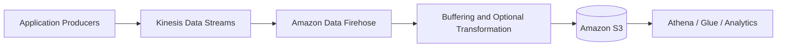
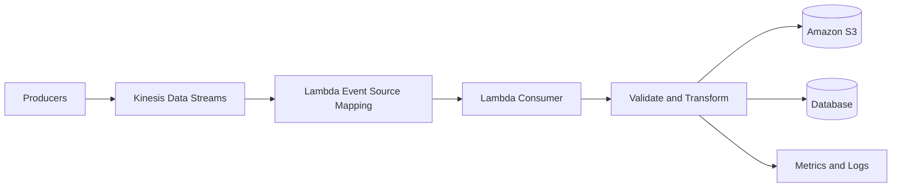
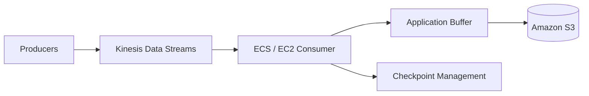
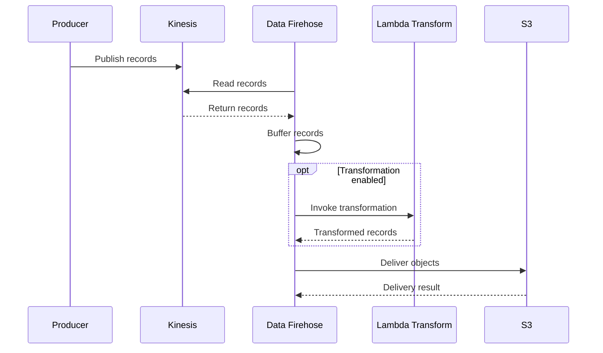
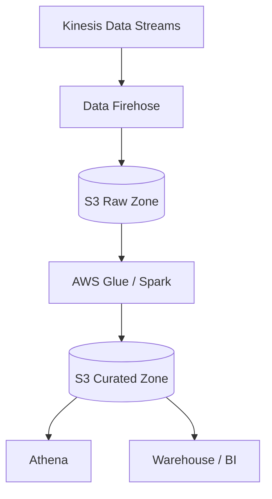

# 03- Amazon S3 Integration

## Overview

Amazon Kinesis Data Streams and Amazon S3 serve complementary roles in event-driven and streaming architectures.

Kinesis Data Streams provides a real-time, ordered event stream with configurable retention. Amazon S3 provides durable, highly scalable object storage for long-term retention, analytics, data exchange, and recovery.

Integrating Kinesis with S3 allows backend systems to process events in real time while preserving raw or transformed data for downstream workloads.

Common use cases include:

- Archiving streaming events for long-term retention.
- Building data lakes from application events.
- Persisting IoT telemetry and operational logs.
- Creating replayable datasets for recovery and reprocessing.
- Exporting event data for Athena, Glue, and analytics workloads.
- Storing enriched records generated by streaming consumers.

There are several ways to integrate Kinesis with S3. The appropriate architecture depends on latency requirements, transformation complexity, operational ownership, and replay requirements.

## Integration Architecture Options

### Amazon Data Firehose

Amazon Data Firehose provides managed delivery of streaming data to Amazon S3.

It can receive records from Kinesis Data Streams, buffer them, optionally transform them using Lambda, and deliver them to S3.

Use this approach when the primary requirement is managed delivery rather than custom per-record processing.



Advantages:

- Managed buffering and delivery.
- Minimal consumer infrastructure.
- Optional Lambda transformation.
- Configurable S3 prefixes and error output.
- Supports delivery to other destinations as well.

Limitations:

- Delivery is asynchronous.
- Buffer size and interval are delivery hints, not strict delivery guarantees.
- It is not a retained, replayable streaming log.
- Transformation logic is constrained by the Firehose processing model.

### Lambda-Based S3 Integration

A Lambda function consumes Kinesis records and writes processed objects to S3.

Use this approach when processing requires custom business logic, conditional routing, validation, enrichment, or integration with other backend services.



Advantages:

- Full control over processing logic.
- Integration with databases and external APIs.
- Conditional object creation and routing.
- Custom object naming and metadata.

Limitations:

- Application owns processing correctness.
- Duplicate delivery requires idempotency.
- Lambda execution and payload limits affect batch design.
- Large or frequent object writes require careful batching.

### Kinesis Consumer on ECS or EC2

A continuously running consumer reads Kinesis records and writes objects to S3.

Use this approach when workloads require long-running processing, specialized libraries, custom buffering, or more control over consumer lifecycle.



The consumer must manage shard discovery, leases or checkpoints, retries, and graceful shutdown. Kinesis Client Library (KCL) is useful when implementing a distributed consumer with shard coordination.

### Architecture Comparison

| Architecture | Best Fit | Operational Ownership | Processing Flexibility |
|---|---|---|---|
| Data Firehose | Managed delivery and archival | Low | Moderate |
| Lambda consumer | Custom event processing | Moderate | High |
| ECS/EC2 consumer | Long-running or specialized processing | High | High |

## Data Firehose Integration

### How It Works

Amazon Data Firehose can use a Kinesis Data Stream as its source.

The delivery pipeline performs the following operations:

1. Reads records from the configured Kinesis stream.
2. Buffers records according to configured delivery hints.
3. Optionally invokes a Lambda transformation function.
4. Delivers the resulting records to S3.
5. Routes failed transformation or delivery data according to configured backup and error-output behavior.

Data Firehose manages the delivery process. Applications do not need to implement their own S3 upload loop.

### Delivery Lifecycle



### Buffering Configuration

Firehose buffers incoming data before delivery.

Important configuration properties include:

| Property | Purpose | Consideration |
|---|---|---|
| Buffering interval | Maximum time-based buffering hint | Lower values generally reduce delivery latency |
| Buffering size | Size-based buffering hint | Larger values can reduce the number of S3 objects |
| Compression format | Compresses delivered objects | Reduces storage and data transfer costs |
| S3 prefix | Determines object key organization | Design for partition pruning and lifecycle management |
| Error output prefix | Organizes failed delivery output | Supports investigation and recovery |
| Lambda processor | Transforms records before delivery | Must handle partial record failures correctly |

Buffering settings are hints. Actual delivery timing and object sizes can vary because of service behavior, traffic volume, and internal delivery operations.

Do not assume that setting a 60-second interval guarantees that every object becomes available in S3 exactly 60 seconds after ingestion.

### Creating a Firehose Delivery Stream

A Firehose delivery stream can use an existing Kinesis stream as its source and an S3 bucket as its destination.

Example using Boto3:

```python
import boto3

firehose_client = boto3.client("firehose")

response = firehose_client.create_delivery_stream(
    DeliveryStreamName="orders-to-s3",
    DeliveryStreamType="KinesisStreamAsSource",
    KinesisStreamSourceConfiguration={
        "KinesisStreamARN": (
            "arn:aws:kinesis:ap-south-1:123456789012:stream/orders"
        ),
        "RoleARN": (
            "arn:aws:iam::123456789012:role/firehose-kinesis-source"
        ),
    },
    ExtendedS3DestinationConfiguration={
        "BucketARN": (
            "arn:aws:s3:::company-data-lake"
        ),
        "RoleARN": (
            "arn:aws:iam::123456789012:role/firehose-s3-delivery"
        ),
        "Prefix": "raw/orders/year=!{timestamp:yyyy}/month=!{timestamp:MM}/day=!{timestamp:dd}/",
        "ErrorOutputPrefix": (
            "errors/orders/!{firehose:error-output-type}/"
            "year=!{timestamp:yyyy}/month=!{timestamp:MM}/day=!{timestamp:dd}/"
        ),
        "BufferingHints": {
            "SizeInMBs": 5,
            "IntervalInSeconds": 60,
        },
        "CompressionFormat": "GZIP",
    },
)
```

The source and destination roles are assumed by Firehose and must have the required permissions.

For production deployments, use separate IAM roles and narrowly scoped policies for source access and destination delivery.

### Lambda Transformation

Firehose can invoke Lambda to transform records before delivering them to S3.

The transformation function receives a batch of records and must return a response for each record.

Example:

```python
import base64
import json


def lambda_handler(event, context):
    output = []

    for record in event["records"]:
        try:
            raw_data = base64.b64decode(
                record["data"],
                validate=True,
            )

            payload = json.loads(raw_data)

            transformed = {
                "event_id": payload["event_id"],
                "event_type": payload["event_type"],
                "processed": True,
            }

            encoded_data = base64.b64encode(
                json.dumps(transformed).encode("utf-8")
            ).decode("utf-8")

            output.append({
                "recordId": record["recordId"],
                "result": "Ok",
                "data": encoded_data,
            })

        except Exception:
            output.append({
                "recordId": record["recordId"],
                "result": "ProcessingFailed",
                "data": record["data"],
            })

    return {
        "records": output,
    }
```

Firehose transformation responses support:

| Result | Meaning |
|---|---|
| `Ok` | Transformation succeeded |
| `Dropped` | Record was intentionally discarded |
| `ProcessingFailed` | Transformation failed |

Important considerations:

- Return the original `recordId` for every input record.
- Return Base64-encoded output data.
- Handle each record independently where possible.
- Do not silently discard records when transformation fails.
- Configure backup and error output for recovery.
- Make transformation logic safe to execute more than once.

Firehose transformation is not a general transaction boundary. A successful transformation response does not prove that the final S3 object has been durably delivered.

## Lambda-Based S3 Integration

### Processing Architecture

A Lambda consumer is appropriate when records require application-specific processing before being stored.

Example workload:

- Receive order events from Kinesis.
- Validate the event contract.
- Enrich the event with reference data.
- Store normalized JSON records in S3.
- Update operational metadata in a database.

The function should separate event parsing, transformation, object storage, and failure handling.

### S3 Object Organization

A data lake should use predictable object key structures.

Example:

```text
s3://company-data-lake/
└── raw/
    └── orders/
        └── year=2026/
            └── month=11/
                └── day=20/
                    └── hour=10/
                        └── shard-000001/
                            └── batch-496-500.jsonl
```

A common partitioning strategy uses:

- Dataset name.
- Event date.
- Event type, when appropriate.
- Tenant or region, when required by access and query patterns.

Avoid excessive partition cardinality. Partitioning by unique customer IDs or event IDs can produce too many small partitions and inefficient analytical queries.

### Object Naming Strategy

Object keys should be deterministic where practical.

A key can incorporate:

- Stream name.
- Shard ID.
- Sequence number range.
- Processing date.
- Stable batch identifier.

Example:

```text
raw/orders/year=2026/month=11/day=20/shard-000001/seq-496-500.jsonl
```

Do not rely on a Lambda request ID as the only object identity. A retried invocation receives a different request ID and could create duplicate objects.

### Writing JSON Lines to S3

JSON Lines is useful for streaming data because each line represents an independent JSON object.

Example:

```json
{"event_id":"evt-1001","order_id":"ord-1001","status":"created"}
{"event_id":"evt-1002","order_id":"ord-1002","status":"confirmed"}
```

A Python implementation:

```python
import json
import boto3

s3_client = boto3.client("s3")


def write_jsonl(
    bucket: str,
    key: str,
    records: list[dict],
) -> None:
    body = "\n".join(
        json.dumps(record, separators=(",", ":"))
        for record in records
    ) + "\n"

    s3_client.put_object(
        Bucket=bucket,
        Key=key,
        Body=body.encode("utf-8"),
        ContentType="application/x-ndjson",
        ServerSideEncryption="aws:kms",
    )
```

For a customer-managed KMS key, specify the appropriate key configuration and ensure the writer has permission to use it.

### Kinesis Record Decoding

Kinesis record data is Base64 encoded.

```python
import base64
import json


def decode_record(record: dict) -> dict:
    encoded = record["kinesis"]["data"]

    decoded = base64.b64decode(
        encoded,
        validate=True,
    )

    payload = json.loads(decoded)

    if not isinstance(payload, dict):
        raise ValueError("Expected a JSON object")

    return payload
```

Validate the payload before storing it. Invalid data should be routed to a failure workflow rather than silently omitted.

### Batch-Oriented Lambda Consumer

Writing one S3 object per Kinesis record can generate excessive small objects.

A better approach is to group records into batches and write a consolidated object.

```python
import base64
import json
import logging
import os

import boto3

logger = logging.getLogger()
logger.setLevel(logging.INFO)

s3_client = boto3.client("s3")

BUCKET_NAME = os.environ["DATA_LAKE_BUCKET"]


def decode_record(record):
    raw_data = base64.b64decode(
        record["kinesis"]["data"],
        validate=True,
    )

    payload = json.loads(raw_data)

    if not isinstance(payload, dict):
        raise ValueError("Record payload must be a JSON object")

    return payload


def lambda_handler(event, context):
    records = event.get("Records", [])

    if not records:
        return {"batchItemFailures": []}

    shard_id = records[0]["eventID"].split(":")[0]

    first_sequence = records[0]["kinesis"]["sequenceNumber"]
    last_sequence = records[-1]["kinesis"]["sequenceNumber"]

    try:
        payloads = [
            decode_record(record)
            for record in records
        ]

        body = "\n".join(
            json.dumps(payload, separators=(",", ":"))
            for payload in payloads
        ) + "\n"

        key = (
            f"raw/orders/shard={shard_id}/"
            f"{first_sequence}-{last_sequence}.jsonl"
        )

        s3_client.put_object(
            Bucket=BUCKET_NAME,
            Key=key,
            Body=body.encode("utf-8"),
            ContentType="application/x-ndjson",
        )

        return {"batchItemFailures": []}

    except Exception:
        logger.exception(
            "Failed to persist Kinesis batch",
            extra={
                "shard_id": shard_id,
                "first_sequence": first_sequence,
                "last_sequence": last_sequence,
            },
        )

        return {
            "batchItemFailures": [
                {
                    "itemIdentifier": first_sequence,
                }
            ]
        }
```

Enable `ReportBatchItemFailures` on the event source mapping.

This example uses deterministic object naming based on the shard and sequence range. If the same batch is retried, the same key is written again rather than creating a new object for each invocation.

However, the example assumes the batch contains records from one shard, as expected for a shard-specific event source mapping invocation. Production implementations should also validate batch boundaries and handle any unexpected event structure.

### Idempotent S3 Writes

S3 object writes are not a substitute for application-level idempotency.

A retry can overwrite an object with the same key. This may be acceptable when the object content is deterministic and the entire batch is rewritten.

For stronger recovery guarantees, consider:

- Deterministic object keys.
- S3 versioning.
- Conditional writes where appropriate.
- Durable batch manifests.
- Database-backed processing state.
- Reconciliation between stream records and archived objects.

Do not assume that a successful `PutObject` followed by a failed Lambda response means the record was not processed. The object may already exist and will be written again on retry.

## S3 Data Lake Design

### Raw, Curated, and Analytics Zones

A production data lake should separate original data from transformed datasets.

| Zone | Purpose | Typical Format |
|---|---|---|
| Raw | Preserves source events with minimal transformation | JSON Lines, compressed JSON |
| Curated | Contains validated and normalized datasets | Parquet, Avro |
| Analytics | Contains query-oriented datasets and aggregates | Parquet, Iceberg tables |

Example:

```text
s3://company-data-lake/
├── raw/
│   ├── orders/
│   ├── customers/
│   └── payments/
├── curated/
│   ├── orders/
│   ├── customers/
│   └── payments/
└── analytics/
    ├── daily-order-summary/
    └── customer-metrics/
```

The raw zone should preserve enough information to support future transformations and reprocessing.

Curated datasets should have explicit schemas, data-quality checks, and documented partitioning rules.

### Choosing a File Format

| Format | Characteristics | Suitable Workloads |
|---|---|---|
| JSON Lines | Human-readable, flexible schema | Raw event archival |
| CSV | Simple tabular representation | Data exchange and basic reporting |
| Parquet | Columnar, compressed, query-efficient | Analytics and Athena |
| Avro | Schema-oriented row format | Data exchange and schema evolution |

For analytical workloads, Parquet is usually preferable to repeatedly querying large JSON datasets.

A common architecture is to retain raw JSON events and transform them into partitioned Parquet datasets using AWS Glue, Amazon EMR, or Apache Spark.

### Partitioning Strategy

Partition based on common query filters.

For example:

```text
curated/orders/
    event_date=2026-11-20/
        region=ap-south-1/
            part-0001.parquet
```

Good partitioning reduces the amount of data scanned by Athena and other analytical engines.

Avoid:

- Excessively granular time partitions.
- High-cardinality partition keys.
- Large numbers of tiny files.
- Inconsistent timestamp time zones.
- Partition values that do not match the actual event timestamp.

Use event time for business-oriented analytics when it is available and trustworthy. Ingestion time is useful for operational monitoring and pipeline diagnostics.

## Integrating S3 with Analytics Services

### AWS Glue

AWS Glue can catalog datasets stored in S3 and make their schemas available to analytical services.

Typical workflow:

1. Deliver raw Kinesis records to S3.
2. Run a Glue crawler or define tables explicitly.
3. Validate and transform raw datasets.
4. Write curated Parquet output.
5. Register curated tables in the Glue Data Catalog.
6. Query datasets using Athena.

For production datasets, explicit schema management is generally more predictable than relying entirely on crawlers.

### Amazon Athena

Athena queries data directly from S3 using SQL.

Example:

```sql
SELECT
    order_id,
    status,
    event_timestamp
FROM curated_orders
WHERE event_date = '2026-11-20'
  AND status = 'confirmed'
LIMIT 100;
```

Athena performance depends on file format, compression, partitioning, and file size.

Use partition projection or managed partition registration where appropriate for large partitioned datasets.

### Downstream Data Processing

S3 can act as a durable boundary between real-time ingestion and batch analytics.



This architecture separates ingestion from analytical processing and allows multiple downstream consumers to use the same archived dataset.

## Reliability and Recovery

### Delivery Guarantees

The Kinesis-to-S3 integration must account for retries and duplicate delivery.

| Integration | Delivery Characteristics | Application Responsibility |
|---|---|---|
| Data Firehose | Managed asynchronous delivery with retry and buffering behavior | Configure backups, error output, and downstream reconciliation |
| Lambda consumer | Kinesis records can be retried when invocation or checkpointing fails | Implement idempotent processing and deterministic writes |
| ECS/EC2 consumer | Depends on consumer checkpoint and retry implementation | Manage durable checkpoints and replay |

A successful producer write to Kinesis does not prove that the corresponding object has reached S3.

Likewise, a successful Lambda invocation does not prove that all downstream business operations completed unless the function waits for and verifies those operations.

### S3 Delivery Failures

S3 delivery can fail because of:

- IAM permission errors.
- KMS authorization failures.
- Bucket policy restrictions.
- Network or service availability issues.
- Invalid object metadata or request configuration.
- Incorrect destination configuration.

For Firehose, configure S3 backup and error-output behavior where supported by the selected destination configuration.

For Lambda consumers, ensure failed writes cause the invocation to fail or return the appropriate partial batch response.

Do not acknowledge a Kinesis record before its required S3 write is durable.

### Reconciliation

A robust archival pipeline should periodically verify that expected data has reached S3.

Possible reconciliation mechanisms include:

- Tracking processed sequence ranges.
- Maintaining batch manifests.
- Comparing producer event counts with archived event counts.
- Comparing stream ingestion metrics with delivered object counts.
- Using S3 Inventory to inspect stored objects.
- Reprocessing missing ranges from retained Kinesis records or archived source data.

A reconciliation process is particularly important when the S3 archive is a compliance, audit, or recovery dependency.

### Replay Strategy

Kinesis retention is finite, with a default of 24 hours and a configurable maximum of 365 days.

For long-term recovery:

1. Preserve raw records in S3.
2. Retain event IDs and original event timestamps.
3. Store schema version information.
4. Build a controlled replay process.
5. Write replayed data to a separate prefix or recovery dataset.
6. Validate record counts and processing results.
7. Promote recovered datasets only after validation.

Do not replay directly into production object keys without understanding overwrite and duplicate consequences.

## Security Considerations

### IAM Permissions

Use separate IAM roles for each integration component.

| Principal | Required Access |
|---|---|
| Kinesis producer | Write to the stream |
| Firehose source role | Read from Kinesis |
| Firehose delivery role | Write to the target S3 bucket |
| Lambda execution role | Read stream records and write required S3 objects |
| Glue role | Read and write configured data lake locations |
| Athena query role | Read datasets and write query results |

Example S3 write policy for a Lambda consumer:

```json
{
  "Version": "2012-10-17",
  "Statement": [
    {
      "Sid": "WriteOrdersArchive",
      "Effect": "Allow",
      "Action": [
        "s3:PutObject"
      ],
      "Resource": "arn:aws:s3:::company-data-lake/raw/orders/*"
    }
  ]
}
```

Add KMS permissions when using a customer-managed key.

Avoid granting broad permissions such as `s3:*` on all buckets.

### Bucket Security

Recommended controls:

- Enable S3 Block Public Access.
- Enable bucket versioning where recovery requirements justify it.
- Use server-side encryption.
- Enforce TLS for requests.
- Restrict access using bucket policies.
- Enable CloudTrail data events for sensitive buckets where required.
- Apply lifecycle policies to manage retention and cost.
- Use separate buckets or prefixes for raw, curated, and error data.

### Encryption

S3 supports server-side encryption with:

- SSE-S3.
- SSE-KMS.
- Dual-layer server-side encryption with AWS KMS keys where supported.

For sensitive data, SSE-KMS provides control over key policies, access auditing, and key lifecycle.

Ensure the delivery role or Lambda execution role has the necessary KMS permissions.

## Monitoring and Observability

Monitoring should cover ingestion, processing, delivery, and storage.

### Important Metrics

| Metric | Source | Purpose |
|---|---|---|
| `IncomingRecords` | Kinesis | Tracks records entering the stream |
| `IncomingBytes` | Kinesis | Tracks incoming data volume |
| `IteratorAgeMilliseconds` | Kinesis consumer | Measures consumer lag |
| `DeliveryToS3.Success` | Data Firehose | Tracks successful S3 delivery |
| `DeliveryToS3.DataFreshness` | Data Firehose | Measures delivery freshness |
| `DeliveryToS3.Records` | Data Firehose | Tracks delivered record volume |
| `DeliveryToS3.Bytes` | Data Firehose | Tracks delivered data volume |
| Lambda `Errors` | Lambda | Tracks failed invocations |
| Lambda `Duration` | Lambda | Tracks execution duration |
| Lambda `Throttles` | Lambda | Tracks throttled invocations |
| S3 object count and size | S3 Inventory or storage metrics | Tracks archival volume and storage growth |

Metric names and availability can vary with the delivery stream configuration. Use the relevant service metrics and dimensions for the deployed destination.

### Operational Alarms

Useful alarms include:

- Increasing Kinesis iterator age.
- Firehose delivery failures.
- Increasing S3 delivery freshness.
- Lambda invocation errors.
- Lambda throttling.
- Failure destination delivery errors.
- Unexpected drops in incoming or delivered record counts.
- Abnormal growth in S3 error prefixes.

### Data Quality Monitoring

Operational metrics alone cannot detect every data-quality issue.

Track:

- Invalid payload count.
- Missing required fields.
- Unsupported schema versions.
- Duplicate event IDs.
- Unexpected event types.
- Delayed events.
- Missing partitions.
- Failed transformations.

Use structured logs and metrics with bounded-cardinality dimensions. Avoid using event IDs, customer IDs, or other high-cardinality values as metric dimensions.

## Scalability and Performance

### Avoid Small Objects

Writing one S3 object per event is usually inefficient for high-volume streams.

It increases:

- S3 request volume.
- Metadata overhead.
- Object listing complexity.
- Athena query overhead.
- Data processing costs.

Prefer buffering and writing larger objects.

Firehose handles managed buffering. Lambda and ECS consumers should implement batching appropriate to their execution model.

### Compression

Compression reduces storage and transfer costs.

Common formats include:

- GZIP.
- Snappy.
- Zstandard, where supported by the processing and query tools.

For analytical workloads, compressed Parquet is often more efficient than compressed JSON because it combines columnar storage with compression.

### Concurrency and S3 Request Volume

A highly concurrent Lambda consumer can produce many simultaneous S3 writes.

Consider:

- Batch size.
- Invocation concurrency.
- Object size.
- S3 request patterns.
- Downstream query behavior.
- KMS request volume.
- Retry behavior.

Use deterministic object keys and controlled batching to reduce duplicate objects and unnecessary requests.

### Large Payloads

Kinesis Data Streams has record-size constraints, and S3 is better suited to large objects.

For large payloads:

1. Upload the object to S3.
2. Publish an event containing the bucket and key.
3. Let consumers retrieve the object when needed.
4. Validate the object identity and access permissions.

Example event:

```json
{
  "event_id": "evt-2001",
  "event_type": "document.uploaded",
  "data": {
    "bucket": "company-documents",
    "key": "uploads/2026/11/document-2001.pdf",
    "version_id": "3HL4kqtJlcpXroDTDmjVBH40Nrjfkd"
  }
}
```

Use S3 version IDs when consumers must retrieve the exact object version associated with the event.

Do not assume an object key always refers to the same content. A later upload can replace the current object at that key.

## High Availability and Disaster Recovery

Kinesis Data Streams, Data Firehose, and S3 are regional services.

A regional failure strategy must account for the complete ingestion and archival pipeline.

Possible approaches include:

- Replicating source events to a secondary Region.
- Using S3 Cross-Region Replication for eligible objects.
- Maintaining a recovery stream and delivery pipeline.
- Deploying transformation functions in the recovery Region.
- Replicating required KMS keys and IAM configuration.
- Maintaining infrastructure as code for recovery resources.

S3 Cross-Region Replication applies to eligible objects after replication is configured. It does not replicate Kinesis records or reconstruct an entire streaming pipeline.

Define and test:

- Recovery point objective (RPO).
- Recovery time objective (RTO).
- Replication lag expectations.
- Duplicate handling during failover.
- Recovery of failed or incomplete deliveries.
- Validation of archived datasets.

For compliance-sensitive workloads, validate retention, versioning, lifecycle, and replication settings against the actual regulatory requirements.

## Cost Considerations

| Service | Main Cost Drivers |
|---|---|
| Kinesis Data Streams | Stream capacity, retention, enhanced fan-out where used |
| Amazon Data Firehose | Data ingestion and transformation processing, where applicable |
| Lambda | Requests, duration, and allocated memory |
| S3 | Storage, requests, retrieval, and data transfer |
| AWS Glue | Crawler and ETL execution |
| Athena | Amount of data scanned |
| KMS | Key usage and API requests |
| CloudWatch | Logs, metrics, alarms, and retention |

Cost optimization practices:

- Use Firehose buffering to reduce small-object creation.
- Compress archived data.
- Use Parquet for analytical datasets.
- Partition data according to actual query patterns.
- Apply S3 lifecycle policies.
- Avoid unnecessary Glue crawler executions.
- Configure CloudWatch log retention.
- Monitor Athena scanned bytes.
- Avoid excessive KMS calls caused by overly granular object writes.

The lowest storage cost is not necessarily the lowest total pipeline cost. Include query efficiency, operational overhead, and recovery requirements in the design.

## Production Best Practices

- Use Data Firehose for managed delivery and Lambda or ECS consumers for custom processing.
- Preserve raw events before applying transformations when replay and audit requirements justify it.
- Use deterministic object keys for retry-safe writes.
- Store event IDs, event timestamps, schema versions, and source metadata.
- Use JSON Lines for raw event archival and Parquet for analytical datasets where appropriate.
- Design S3 prefixes around common query and lifecycle requirements.
- Avoid creating one object per event at high throughput.
- Configure encryption, least-privilege IAM, and bucket-level access controls.
- Monitor delivery freshness and consumer lag, not only invocation success.
- Implement reconciliation and replay procedures for missing or failed data.
- Test recovery and regional failover rather than relying only on configuration checks.

## Common Mistakes and Production Pitfalls

| Mistake | Why It Is a Problem | Recommended Approach |
|---|---|---|
| Treating Firehose as a replayable event stream | Firehose is a managed delivery service, not a retained event log | Retain source events in Kinesis or archive them in S3 |
| Assuming buffering intervals are exact | Delivery timing is asynchronous and based on hints | Design around measured delivery freshness |
| Writing one S3 object per record | Creates excessive small objects and request overhead | Batch records before delivery |
| Using random object keys for retries | Duplicate invocations create duplicate objects | Use deterministic keys or durable manifests |
| Assuming S3 writes and database updates are atomic | The two systems do not share a transaction | Use idempotency and reconciliation |
| Ignoring event schema versions | Historical records can become incompatible with newer consumers | Version event contracts and preserve raw data |
| Partitioning by high-cardinality values | Creates too many partitions and inefficient queries | Partition using common analytical filters |
| Assuming an S3 key identifies immutable content | A later write can replace the current object | Use versioning and object version IDs where required |
| Ignoring Firehose error output | Transformation and delivery failures become difficult to investigate | Configure error prefixes and monitoring |
| Treating successful producer publication as successful archival | Delivery may still be pending or fail | Monitor end-to-end delivery and reconcile |
| Granting broad S3 permissions | Increases the impact of compromised credentials | Scope permissions to required prefixes and actions |
| Assuming Cross-Region Replication covers Kinesis | S3 replication does not replicate stream records | Design stream replication separately |

## Key Takeaways

- Kinesis integrates with S3 through Data Firehose, Lambda consumers, or managed application workers; choose based on delivery requirements and processing complexity.
- Data Firehose provides managed buffering and delivery, while Lambda and ECS consumers provide greater control over business processing.
- Use deterministic object keys, durable idempotency, and reconciliation to handle retries and duplicate delivery safely.
- Organize S3 data into raw, curated, and analytics zones with appropriate formats, compression, and query-oriented partitioning.
- Production pipelines require least-privilege IAM, encryption, delivery monitoring, replay capabilities, lifecycle management, and tested disaster recovery.