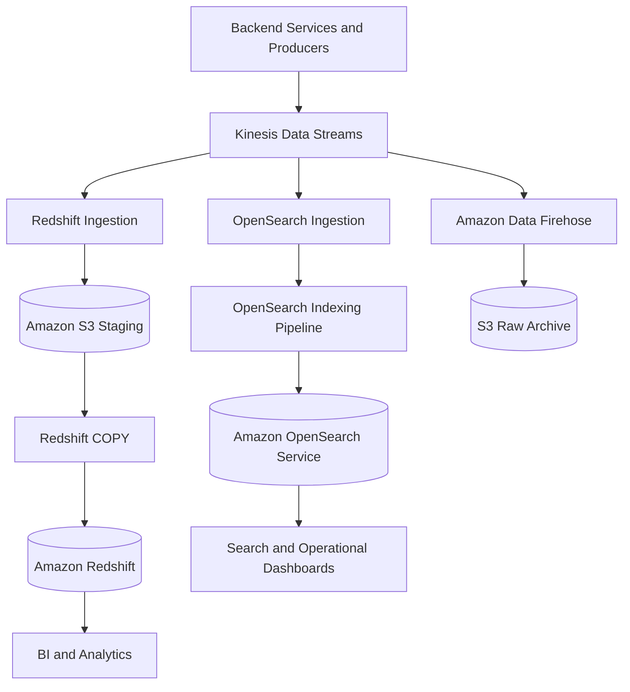
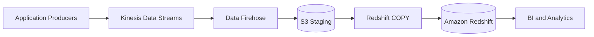
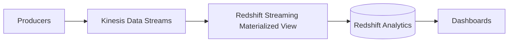
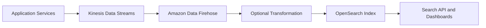
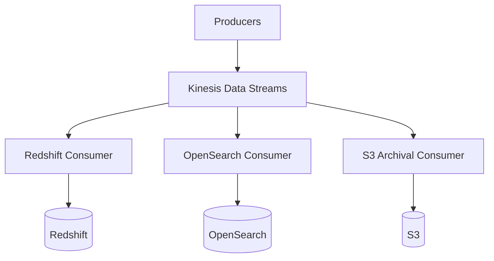

# 04- Amazon Redshift and OpenSearch Integration

## Overview

Amazon Kinesis Data Streams can distribute streaming events to analytical databases and search platforms. Amazon Redshift and Amazon OpenSearch Service serve different downstream purposes:

- **Amazon Redshift** is a cloud data warehouse optimized for analytical queries, aggregations, reporting, and business intelligence.
- **Amazon OpenSearch Service** provides search and analytics capabilities for operational data, application logs, events, and documents.

Kinesis acts as the streaming ingestion layer between producers and these downstream systems.

A common architecture uses one stream with independent consumers:

- A Redshift ingestion pipeline processes events for analytical workloads.
- An OpenSearch ingestion pipeline indexes events for search and operational investigation.
- Amazon S3 can preserve raw events and provide a durable recovery source.

This separates event production from downstream storage and allows each consumer to scale and evolve independently.

## Architecture Overview

### Reference Architecture



The architecture can use different ingestion mechanisms depending on the workload.

| Integration | Typical Ingestion Mechanism | Primary Use |
|---|---|---|
| Kinesis to Redshift | S3 staging followed by Redshift `COPY`, or a supported managed streaming ingestion path | Analytical workloads |
| Kinesis to OpenSearch | Amazon Data Firehose or a custom consumer | Search and operational analytics |
| Kinesis to S3 | Amazon Data Firehose | Raw archival and replay |
| Kinesis to multiple destinations | Independent consumers or managed delivery pipelines | Workload isolation |

A critical design principle is that Redshift and OpenSearch should not be treated as interchangeable storage systems.

Redshift is designed for analytical queries over structured datasets. OpenSearch is designed for indexed search and near-real-time retrieval.

## Kinesis to Amazon Redshift

### Why Integrate Kinesis with Redshift?

Streaming events often need to be aggregated and analyzed across large datasets.

Examples include:

- Order volume and revenue analytics.
- Customer activity reporting.
- Financial transaction analysis.
- Product usage metrics.
- Operational performance reporting.
- Real-time or near-real-time business dashboards.

Kinesis provides the event ingestion layer, while Redshift stores and analyzes structured data.

### Integration Architecture

A common architecture uses Amazon S3 as an intermediate staging layer.



The pipeline works as follows:

1. Backend services publish events to Kinesis.
2. Data Firehose consumes the stream.
3. Firehose buffers records and delivers them to S3.
4. A Redshift ingestion process loads staged files.
5. Redshift stores the data in analytical tables.
6. BI tools and analytical applications query the warehouse.

The S3 staging layer provides durable files that can be inspected, reloaded, and used for recovery.

### Why Use S3 Staging?

S3 staging separates streaming ingestion from warehouse loading.

Advantages include:

- Durable intermediate storage.
- Efficient bulk loading.
- Reduced dependence on individual insert operations.
- Easier recovery and reprocessing.
- Separation between ingestion and analytical storage.
- Support for data transformation before loading.

For many workloads, bulk loading from S3 is more efficient than inserting individual events into Redshift.

### Redshift Data Loading with COPY

Redshift's `COPY` command loads data from S3 into a target table.

Example table:

```sql
CREATE TABLE orders (
    order_id VARCHAR(64) NOT NULL,
    customer_id VARCHAR(64) NOT NULL,
    status VARCHAR(32),
    amount DECIMAL(12, 2),
    event_timestamp TIMESTAMP,
    event_id VARCHAR(128)
)
DISTKEY(customer_id)
SORTKEY(event_timestamp);
```

Example loading command:

```sql
COPY orders
FROM 's3://company-data-lake/curated/orders/'
IAM_ROLE 'arn:aws:iam::123456789012:role/redshift-s3-read-role'
FORMAT AS JSON 'auto'
TIMEFORMAT 'auto'
GZIP;
```

The exact format and compression options must match the files delivered to S3.

For production workloads:

- Prefer columnar formats such as Parquet when the ingestion workflow supports them.
- Use appropriate distribution and sort strategies.
- Load sufficiently large files rather than many tiny files.
- Validate schema compatibility before loading.
- Track load operations and rejected records.
- Use manifests when loading a precise set of objects.

### Redshift Streaming Ingestion

Redshift also supports streaming ingestion from Kinesis Data Streams through supported streaming ingestion capabilities.

This can reduce the need for an intermediate S3 loading pipeline when the primary requirement is lower-latency ingestion into materialized views.

Conceptually:



A streaming ingestion materialized view can reference a Kinesis stream and expose records for SQL-based processing.

Example conceptual SQL:

```sql
CREATE MATERIALIZED VIEW orders_stream_view
AUTO REFRESH YES
AS
SELECT
    approximate_arrival_timestamp,
    partition_key,
    shard_id,
    sequence_number,
    JSON_PARSE(from_varbyte(kinesis_data, 'utf-8')) AS payload
FROM KINESIS_SCHEMA.orders_stream;
```

The exact stream schema and SQL syntax depend on the Redshift streaming ingestion configuration and the stream's registered external schema.

Use streaming ingestion when:

- Lower ingestion latency is important.
- The workload fits Redshift's streaming ingestion model.
- SQL-based transformation is sufficient.
- The stream's throughput and retention requirements are compatible with the design.

Use S3 staging and `COPY` when:

- Durable file-based ingestion is required.
- Data transformation is substantial.
- Large analytical batches are acceptable.
- Replay and historical reload workflows are important.

### Redshift Table Design

A streaming pipeline should use a table design that matches analytical query patterns.

Important considerations include:

| Design Element | Purpose | Recommendation |
|---|---|---|
| Distribution key | Controls how rows are distributed across compute nodes | Choose based on join and data distribution patterns |
| Sort key | Organizes data for efficient filtering | Consider event timestamps for time-based queries |
| Data types | Defines storage and query behavior | Use precise types and avoid unnecessary wide columns |
| Constraints | Documents logical data rules | Do not assume informational constraints enforce uniqueness |
| Materialized views | Stores precomputed query results | Use for repeated analytical transformations |

Redshift is optimized for analytical workloads rather than high-volume transactional updates.

Avoid designing the warehouse as a replacement for the application's operational PostgreSQL database.

### Deduplication and Idempotent Loading

Kinesis records can be delivered or processed more than once. Redshift ingestion must account for duplicate events.

Include a stable `event_id` in every event.

A common ingestion pattern is:

1. Load incoming data into a staging table.
2. Validate records.
3. Deduplicate by event ID.
4. Merge valid records into the target table.
5. Record the ingestion batch as completed.

Example staging table:

```sql
CREATE TABLE orders_staging (
    order_id VARCHAR(64),
    customer_id VARCHAR(64),
    status VARCHAR(32),
    amount DECIMAL(12, 2),
    event_timestamp TIMESTAMP,
    event_id VARCHAR(128)
);
```

Deduplicated insertion:

```sql
INSERT INTO orders (
    order_id,
    customer_id,
    status,
    amount,
    event_timestamp,
    event_id
)
SELECT
    s.order_id,
    s.customer_id,
    s.status,
    s.amount,
    s.event_timestamp,
    s.event_id
FROM (
    SELECT
        *,
        ROW_NUMBER() OVER (
            PARTITION BY event_id
            ORDER BY event_timestamp DESC
        ) AS row_number
    FROM orders_staging
) AS s
WHERE s.row_number = 1
  AND NOT EXISTS (
      SELECT 1
      FROM orders AS existing
      WHERE existing.event_id = s.event_id
  );
```

For production ingestion, use a controlled batch transaction and a reliable ingestion manifest or batch ledger.

Redshift primary key and unique constraints are generally informational rather than enforced. Do not rely on them alone to prevent duplicate business events.

## Kinesis to Amazon OpenSearch Service

### Why Integrate Kinesis with OpenSearch?

OpenSearch is useful when applications need fast retrieval, full-text search, filtering, aggregations, or operational investigation over event data.

Typical workloads include:

- Application log search.
- Order and transaction lookup.
- Customer activity search.
- Security event investigation.
- Device telemetry exploration.
- Operational dashboards.
- Searchable audit records.

Kinesis decouples event producers from OpenSearch indexing.

### Integration Architecture



Data Firehose can consume records from Kinesis and deliver them to an OpenSearch destination.

It manages buffering, delivery, and configured transformation processing.

For custom indexing logic, use a Lambda consumer or an application-managed worker.

### Data Firehose to OpenSearch

A typical pipeline:

1. Producers publish events to Kinesis.
2. Firehose reads records from the stream.
3. Firehose buffers records.
4. Optional Lambda transformation normalizes the payload.
5. Firehose sends records to OpenSearch.
6. OpenSearch indexes the documents.

Example Firehose delivery stream configuration:

```python
import boto3

firehose_client = boto3.client("firehose")

response = firehose_client.create_delivery_stream(
    DeliveryStreamName="orders-to-opensearch",
    DeliveryStreamType="KinesisStreamAsSource",
    KinesisStreamSourceConfiguration={
        "KinesisStreamARN": (
            "arn:aws:kinesis:ap-south-1:123456789012:stream/orders"
        ),
        "RoleARN": (
            "arn:aws:iam::123456789012:role/firehose-kinesis-role"
        ),
    },
    AmazonOpenSearchServiceDestinationConfiguration={
        "DomainARN": (
            "arn:aws:es:ap-south-1:123456789012:"
            "domain/orders-search"
        ),
        "RoleARN": (
            "arn:aws:iam::123456789012:role/firehose-opensearch-role"
        ),
        "IndexName": "orders",
        "TypeName": "_doc",
        "S3Configuration": {
            "RoleARN": (
                "arn:aws:iam::123456789012:role/firehose-s3-backup-role"
            ),
            "BucketARN": (
                "arn:aws:s3:::company-data-lake"
            ),
            "Prefix": "opensearch-backup/orders/",
        },
        "BufferingHints": {
            "IntervalInSeconds": 60,
            "SizeInMBs": 5,
        },
        "RetryOptions": {
            "DurationInSeconds": 300,
        },
    },
)
```

This is an illustrative configuration. The selected destination configuration must match the OpenSearch domain type, supported Firehose features, and required IAM permissions.

For production, configure the relevant S3 backup mode, CloudWatch logging, VPC access where required, and failure monitoring.

### OpenSearch Document Design

OpenSearch stores data as JSON documents.

Example document:

```json
{
  "event_id": "evt-1001",
  "event_type": "order.created",
  "order_id": "ord-1001",
  "customer_id": "customer-123",
  "status": "created",
  "amount": 1250.50,
  "event_timestamp": "2026-11-20T10:30:00Z"
}
```

Design documents around search and retrieval requirements.

Consider:

- Stable document IDs.
- Explicit field mappings.
- Appropriate date and numeric types.
- Text versus keyword fields.
- Nested versus flattened structures.
- Index lifecycle and retention requirements.
- Expected query patterns.

Avoid mapping every field dynamically without constraints. Uncontrolled dynamic mappings can produce mapping explosion and operational problems.

### Index Mapping

Explicit mappings prevent unexpected type inference.

Example:

```json
{
  "mappings": {
    "properties": {
      "event_id": {
        "type": "keyword"
      },
      "event_type": {
        "type": "keyword"
      },
      "order_id": {
        "type": "keyword"
      },
      "customer_id": {
        "type": "keyword"
      },
      "status": {
        "type": "keyword"
      },
      "amount": {
        "type": "double"
      },
      "event_timestamp": {
        "type": "date"
      }
    }
  }
}
```

Use:

- `keyword` for exact matching, filtering, and aggregations.
- `text` for analyzed full-text search.
- `date` for time-based filtering and sorting.
- Numeric types for numeric range queries and aggregations.

For financial values, define precision requirements carefully. Do not assume binary floating-point types provide exact decimal arithmetic.

### Stable Document IDs

Use a stable event or entity identifier as the OpenSearch document ID.

For example:

```text
_id = event_id
```

This allows repeated indexing of the same event to target the same document.

However, stable IDs alone do not guarantee correct event ordering. An older event can arrive after a newer event and overwrite it.

For mutable entity documents, consider:

- Version numbers.
- Event sequence numbers.
- Optimistic concurrency controls.
- Update scripts with monotonic version checks.
- Separate immutable event indices and current-state indices.

For append-only audit events, use the event ID as the document ID and avoid updating historical records unnecessarily.

## Custom OpenSearch Consumer

A custom consumer is appropriate when the indexing workflow requires more control than Firehose provides.

Examples:

- Conditional routing to multiple indices.
- Custom document IDs.
- Complex enrichment.
- Tenant-specific index routing.
- Validation and rejection policies.
- Advanced bulk indexing behavior.

### Python Implementation

Install the required dependencies:

```bash
pip install boto3 opensearch-py
```

Use the OpenSearch Python client with AWS SigV4 authentication for supported AWS OpenSearch deployments.

```python
import os

import boto3
from opensearchpy import OpenSearch, RequestsHttpConnection
from opensearchpy import AWSV4SignerAuth


region = os.environ["AWS_REGION"]
host = os.environ["OPENSEARCH_HOST"]

credentials = boto3.Session().get_credentials()

auth = AWSV4SignerAuth(
    credentials,
    region,
    "es",
)

client = OpenSearch(
    hosts=[{"host": host, "port": 443}],
    http_auth=auth,
    use_ssl=True,
    verify_certs=True,
    connection_class=RequestsHttpConnection,
    timeout=10,
    max_retries=3,
    retry_on_timeout=True,
)
```

For Amazon OpenSearch Serverless, the SigV4 service name is `aoss`, rather than `es`.

### Bulk Indexing

Avoid issuing one HTTP request per event at high volume.

OpenSearch bulk APIs reduce request overhead by indexing multiple documents in one request.

```python
from opensearchpy.helpers import bulk


def index_orders(records: list[dict]) -> None:
    actions = []

    for record in records:
        actions.append({
            "_op_type": "index",
            "_index": "orders",
            "_id": record["event_id"],
            "_source": record,
        })

    success_count, errors = bulk(
        client,
        actions,
        chunk_size=500,
        max_chunk_bytes=5 * 1024 * 1024,
        request_timeout=30,
        raise_on_error=False,
    )

    if errors:
        raise RuntimeError(
            f"OpenSearch indexing failed for {len(errors)} items"
        )
```

A production implementation must inspect individual bulk item results. A successful bulk HTTP response does not mean every document was indexed successfully.

Retry only failed items where possible. Retrying an entire successful batch can create unnecessary work and can overwrite newer document state.

### Bulk Indexing Failure Handling

Bulk API responses contain an item-level result for each operation.

Common failure categories include:

| Failure | Handling |
|---|---|
| Mapping error | Reject or route to a dead-letter workflow |
| Invalid document | Capture the event and validation failure |
| HTTP 429 | Apply bounded backoff and retry |
| Temporary cluster unavailability | Retry with backoff |
| Authentication failure | Correct IAM or security configuration |
| Version conflict | Apply the intended concurrency policy |

Do not retry permanent mapping or validation errors indefinitely.

Use bounded exponential backoff with jitter for transient failures.

## Data Modeling Across Redshift and OpenSearch

The same Kinesis event can feed both Redshift and OpenSearch, but each destination should use a data model optimized for its access patterns.

Example source event:

```json
{
  "event_id": "evt-1001",
  "event_type": "order.created",
  "event_version": 1,
  "occurred_at": "2026-11-20T10:30:00Z",
  "data": {
    "order_id": "ord-1001",
    "customer_id": "customer-123",
    "status": "created",
    "amount": 1250.50
  }
}
```

Redshift representation:

- Flattened analytical columns.
- Numeric and timestamp types.
- Distribution and sort keys.
- Batch-oriented ingestion.

OpenSearch representation:

- Search-oriented document fields.
- Explicit mappings.
- Stable document identifiers.
- Index lifecycle and query-oriented structures.

Do not force both destinations to share identical physical schemas merely because they consume the same event contract.

## Event Fan-Out and Consumer Isolation

A single Kinesis stream can support multiple independent consumers.

For example:



Each consumer maintains its own processing progress.

This provides independent scaling and failure isolation, but all consumers share the stream's underlying retention and shard capacity constraints.

### Consumer Coordination

For application-managed consumers, use KCL or another appropriate checkpointing strategy.

For Lambda event source mappings, each mapping manages its own polling and checkpointing.

For Data Firehose, the delivery stream manages its source consumption and delivery behavior.

Do not assume that multiple consumers automatically receive independent read throughput. Shared-throughput Kinesis consumers compete for the shard's shared read capacity.

Enhanced fan-out provides dedicated read throughput for registered consumers.

### Workload Isolation

Redshift and OpenSearch have different performance characteristics.

A large Redshift backfill should not unintentionally delay latency-sensitive OpenSearch indexing.

Consider:

- Enhanced fan-out for independent high-throughput consumers.
- Separate streams for workloads with different retention or capacity requirements.
- S3 as a durable replay source.
- Independent consumer concurrency limits.
- Separate failure destinations and monitoring.

## Reliability and Delivery Semantics

### At-Least-Once Processing

Kinesis consumers must be designed for duplicate processing.

Duplicates can occur when:

- A consumer commits downstream data but fails before checkpointing.
- A Lambda invocation is retried.
- A worker restarts during processing.
- A downstream timeout leaves the result ambiguous.

Use stable event IDs and destination-specific idempotency.

### Redshift Reliability

For Redshift ingestion:

- Track batch IDs and source sequence ranges.
- Load through staging tables.
- Deduplicate before merging.
- Record completed batches.
- Preserve source files in S3.
- Reconcile failed and incomplete loads.

A successful S3 upload does not guarantee that Redshift has loaded the data.

### OpenSearch Reliability

For OpenSearch indexing:

- Use stable document IDs.
- Inspect item-level bulk failures.
- Retry transient errors only.
- Route permanent failures for investigation.
- Use version checks for mutable documents.
- Monitor indexing latency and rejected writes.

A successful indexing request does not guarantee that a document is immediately visible to search. OpenSearch refresh behavior controls search visibility.

### Replay and Recovery

A durable recovery strategy should use S3 as a long-term source when stream retention is insufficient.

A typical recovery process:

1. Identify the affected event range.
2. Locate the corresponding raw or curated S3 objects.
3. Validate the event schema and record counts.
4. Replay into a recovery pipeline.
5. Apply destination-specific idempotency.
6. Verify data completeness.
7. Reconcile the recovery result with the live dataset.

Use separate replay prefixes, indices, or staging tables where appropriate to avoid accidental overwrites.

## Security and IAM

### Kinesis Permissions

Consumers need permissions to read from the stream.

Typical permissions include:

```json
{
  "Version": "2012-10-17",
  "Statement": [
    {
      "Effect": "Allow",
      "Action": [
        "kinesis:DescribeStream",
        "kinesis:DescribeStreamSummary",
        "kinesis:GetRecords",
        "kinesis:GetShardIterator",
        "kinesis:ListShards"
      ],
      "Resource": "arn:aws:kinesis:ap-south-1:123456789012:stream/orders"
    }
  ]
}
```

Use the permissions required by the selected consumer mechanism and avoid broad account-wide access.

### Redshift Security

For Redshift:

- Use IAM roles for S3 access.
- Restrict access to required bucket prefixes.
- Encrypt data at rest and in transit.
- Use private connectivity where appropriate.
- Apply database-level access controls.
- Avoid embedding database passwords in application code.

The Redshift cluster or serverless workgroup should use an appropriately scoped IAM role for S3 loading.

### OpenSearch Security

For OpenSearch:

- Use IAM authentication and SigV4 where supported.
- Restrict domain access policies.
- Apply fine-grained access control where appropriate.
- Use TLS for client connections.
- Keep the domain in private networking where required.
- Restrict index-level permissions.
- Avoid hardcoded credentials.

The Firehose delivery role and custom consumer role should have only the permissions needed to write to the target domain or collection.

### Secrets Management

If a downstream service requires credentials that cannot be replaced with IAM authentication, store them in AWS Secrets Manager or an equivalent secrets system.

Rotate credentials and avoid logging authentication headers or connection details containing secrets.

## Monitoring and Observability

Monitor the full pipeline rather than only the Kinesis stream.

### Kinesis Metrics

| Metric | Purpose |
|---|---|
| `IncomingRecords` | Tracks event volume |
| `IncomingBytes` | Tracks ingestion throughput |
| `IteratorAgeMilliseconds` | Measures consumer lag |
| `ReadProvisionedThroughputExceeded` | Indicates shared read throttling |
| `WriteProvisionedThroughputExceeded` | Indicates write capacity throttling |

### Redshift Metrics

Monitor:

- Query execution duration.
- Load failures.
- Rejected rows.
- Queue wait time.
- Concurrency scaling activity.
- Storage utilization.
- CPU and memory utilization.
- Streaming ingestion lag where applicable.

Use Redshift system views and load error tables to investigate failed ingestion.

### OpenSearch Metrics

Monitor:

- Indexing latency.
- Indexing rate.
- Rejected requests.
- JVM memory pressure.
- CPU utilization.
- Storage utilization.
- Cluster health.
- Shard allocation.
- Search latency.
- Bulk request failures.

A cluster can accept some indexing requests while still experiencing resource pressure. Monitor rejections and cluster health together.

### End-to-End Pipeline Metrics

Useful application-level metrics include:

- Events produced.
- Events consumed.
- Events successfully persisted.
- Events rejected.
- Duplicate events.
- Processing latency.
- End-to-end ingestion delay.
- Replay volume.
- Backlog age.

Use event IDs and correlation IDs in logs to trace individual events across services.

Avoid using high-cardinality identifiers as CloudWatch metric dimensions.

## Scalability and Performance

### Kinesis Capacity

Kinesis throughput is constrained by shard capacity and stream mode.

For provisioned streams, a shard commonly supports up to:

- 1 MB/s or 1,000 records/s for writes.
- 2 MB/s shared read throughput for consumers using shared throughput.

These are common provisioned-mode limits; verify current regional quotas and the selected stream mode before capacity planning.

Enhanced fan-out provides dedicated read throughput per registered consumer.

### Redshift Scaling

Redshift ingestion performance depends on:

- File size and format.
- Number of concurrent loads.
- Table distribution.
- Sort key design.
- Query workload.
- Warehouse compute capacity.

Prefer controlled batch loading over excessive concurrent small loads.

For streaming ingestion, evaluate ingestion lag, materialized view refresh behavior, and downstream query performance.

### OpenSearch Scaling

OpenSearch indexing performance depends on:

- Number of data nodes.
- Shard count and shard size.
- Bulk request size.
- Refresh interval.
- Replica configuration.
- Document size.
- Mapping complexity.
- Indexing and search workload contention.

Avoid creating too many small shards. Shard count should reflect expected data volume, query patterns, and cluster capacity.

For write-heavy workloads, tune bulk sizes and refresh intervals based on measured performance.

### Backpressure

A downstream system can become slower than the Kinesis ingestion rate.

For example:

- OpenSearch rejects indexing requests under memory pressure.
- Redshift load operations take longer during heavy analytical workloads.
- Lambda consumers are throttled by reserved concurrency.
- Firehose delivery freshness increases during destination delays.

Use bounded concurrency, retry budgets, and independent consumers to prevent one downstream bottleneck from affecting unrelated workloads.

## High Availability and Disaster Recovery

Kinesis, Redshift, and OpenSearch are regional services. Their data and configuration do not automatically become a complete cross-Region recovery solution.

A regional recovery architecture may include:

- A secondary Kinesis stream.
- Replication or re-ingestion of source events.
- A secondary Redshift deployment.
- A secondary OpenSearch domain or collection.
- S3 cross-Region replication for eligible archived objects.
- Replicated IAM and KMS configuration.
- Infrastructure as code for recovery deployment.

S3 replication does not replicate Kinesis stream records or OpenSearch indexes automatically.

Define:

- RPO for event ingestion and downstream datasets.
- RTO for restoring consumer processing.
- Acceptable indexing and warehouse lag.
- Duplicate handling during failover.
- Replay and reconciliation procedures.

Test recovery by rebuilding or restoring downstream datasets from retained source events.

## Cost Considerations

| Service | Main Cost Drivers |
|---|---|
| Kinesis Data Streams | Stream capacity, retention, enhanced fan-out |
| Redshift | Compute capacity, storage, data transfer, concurrency features |
| Amazon OpenSearch Service | Instance or serverless capacity, storage, data transfer |
| Data Firehose | Data ingestion and transformation processing |
| S3 | Storage, requests, retrieval, replication, transfer |
| Lambda | Requests, duration, allocated memory |
| CloudWatch | Logs, metrics, alarms, and retention |

Cost optimization practices:

- Use S3 staging and bulk loading for suitable Redshift workloads.
- Avoid excessive small Redshift load operations.
- Use efficient OpenSearch bulk requests.
- Select shard counts based on actual data volume.
- Apply index lifecycle policies.
- Archive older search data to S3 where appropriate.
- Retain raw events according to recovery and compliance requirements.
- Monitor Kinesis consumer lag to detect inefficient processing.
- Control log volume and retention.

Do not optimize storage or compute costs without considering the operational cost of replay, data loss, and delayed processing.

## Deployment and Infrastructure as Code

Use infrastructure as code to manage the complete integration.

A production deployment should define:

- Kinesis stream configuration.
- Consumer or Firehose delivery configuration.
- S3 staging and archival buckets.
- Redshift cluster or serverless workgroup configuration.
- OpenSearch domain or collection configuration.
- IAM roles and policies.
- KMS keys and policies.
- Monitoring and alarms.
- Failure destinations.
- Retention and lifecycle policies.

### Deployment Order

A typical dependency order is:

1. Create KMS keys and IAM roles.
2. Create S3 buckets and access policies.
3. Create Kinesis streams.
4. Provision Redshift and OpenSearch.
5. Create Firehose delivery streams or custom consumers.
6. Configure event source mappings and consumer permissions.
7. Deploy schemas, tables, and indexes.
8. Enable alarms and dashboards.
9. Validate end-to-end ingestion.

Avoid enabling production event ingestion before the downstream schemas, permissions, and failure-handling paths are ready.

## Common Mistakes and Production Pitfalls

| Mistake | Why It Is a Problem | Recommended Approach |
|---|---|---|
| Treating Redshift as an operational database | Analytical warehouses are not optimized for high-volume transactional updates | Keep transactional workloads in an OLTP database |
| Treating OpenSearch as the source of truth | Search indexes can be rebuilt and may lag behind source systems | Preserve authoritative events and business data elsewhere |
| Using identical schemas for both destinations | Analytical and search access patterns differ | Maintain destination-specific data models |
| Ignoring Kinesis duplicate delivery | Downstream records can be duplicated | Use stable event IDs and idempotent ingestion |
| Loading individual records into Redshift | Creates unnecessary request and transaction overhead | Use S3 staging and bulk loading where appropriate |
| Ignoring Redshift load failures | Data can remain in S3 without reaching the warehouse | Monitor load operations and reconcile batches |
| Assuming bulk indexing is atomic | Individual OpenSearch bulk items can fail independently | Inspect every item result |
| Using unstable OpenSearch document IDs | Retries can create duplicate documents | Use stable IDs and explicit versioning |
| Ignoring OpenSearch refresh behavior | Indexed documents may not immediately appear in search | Design around refresh and visibility latency |
| Creating excessive OpenSearch shards | Increases cluster overhead and resource pressure | Size shards based on expected data volume |
| Using a single consumer for unrelated workloads | A slow destination can affect other processing | Isolate consumers and capacity |
| Assuming S3 replication covers downstream services | S3 replication does not rebuild Redshift or OpenSearch | Design explicit recovery and replay workflows |
| Ignoring schema evolution | Historical events can fail newer consumers | Version event contracts and test compatibility |

## Key Takeaways

- Kinesis can feed Redshift and OpenSearch through independent consumers, allowing analytical and search workloads to scale separately.
- Redshift is suited to structured analytical workloads; S3 staging with bulk loading is useful when durable batch ingestion and replay are important.
- OpenSearch requires deliberate document IDs, explicit mappings, bulk indexing, and item-level failure handling.
- At-least-once processing requires stable event identifiers, destination-specific idempotency, and reconciliation.
- Production integrations need independent monitoring, bounded backpressure, least-privilege IAM, durable archival, and tested disaster recovery.