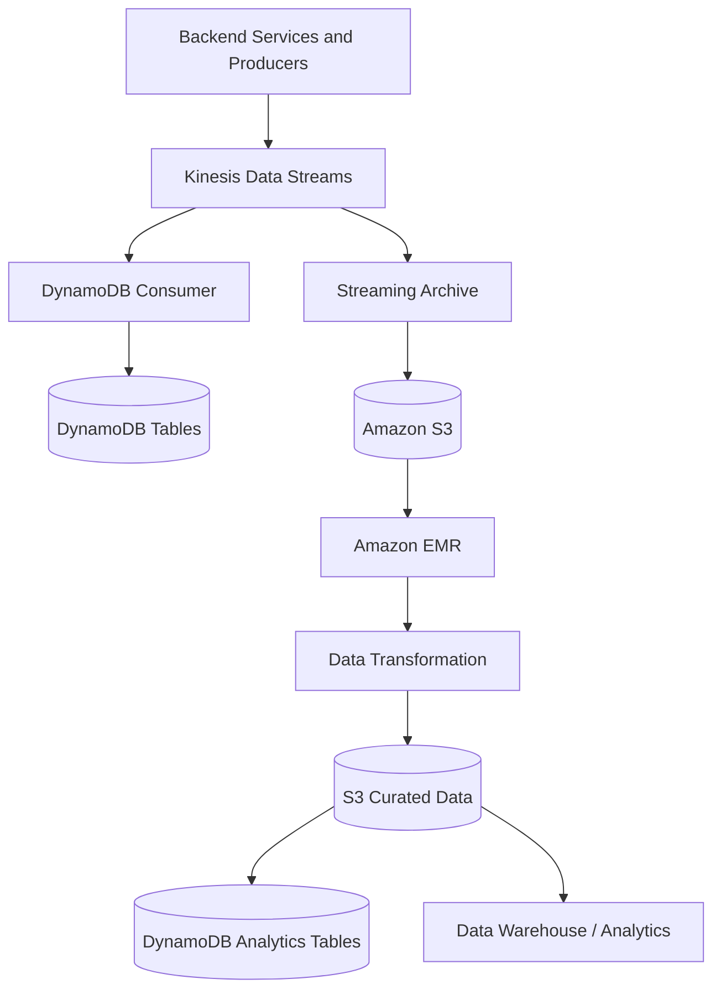
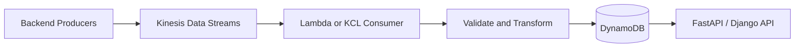
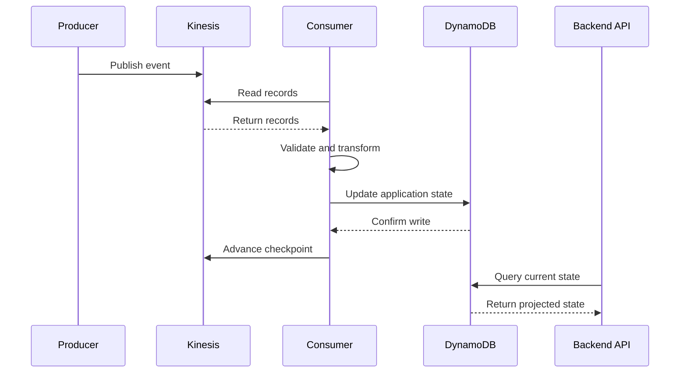
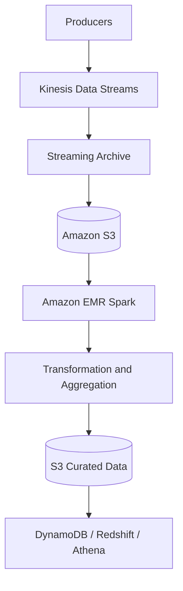
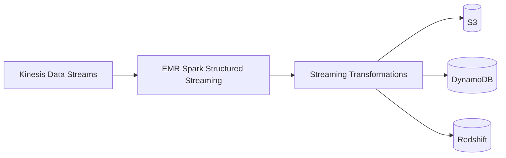
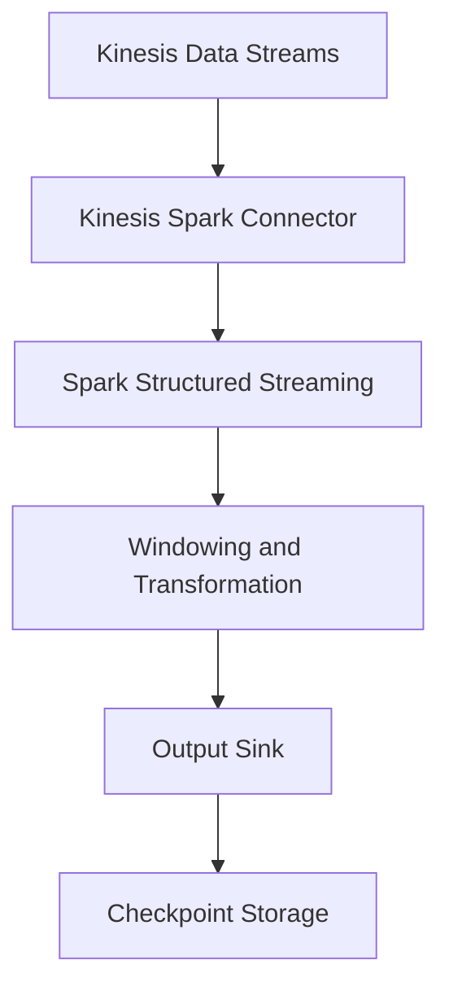
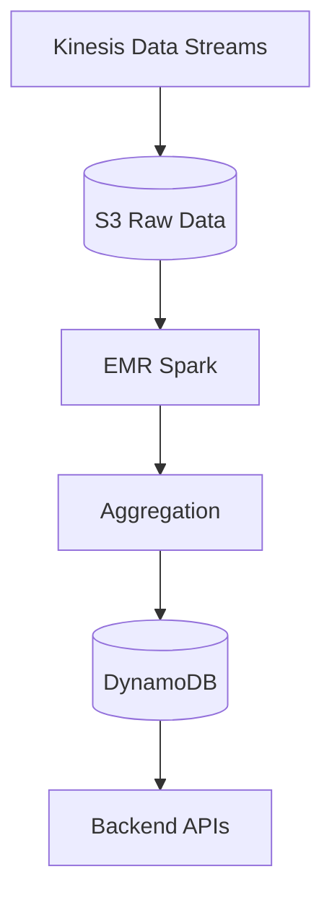

# 05- DynamoDB and EMR Integration

## Overview

Amazon Kinesis Data Streams integrates with Amazon DynamoDB and Amazon EMR to support real-time state management, event-driven applications, large-scale data processing, and analytical workloads.

These services solve different problems:

- **Amazon Kinesis Data Streams** captures and distributes ordered streaming records.
- **Amazon DynamoDB** provides a scalable NoSQL database for low-latency key-value and document access.
- **Amazon EMR** provides managed big data processing using frameworks such as Apache Spark, Hadoop, and Hive.

A common architecture uses Kinesis as the event ingestion layer, DynamoDB for operational state, and EMR for large-scale processing and historical analysis.

Typical use cases include:

- Maintaining real-time customer or device state.
- Updating counters and aggregates from incoming events.
- Processing clickstream and application activity.
- Running large-scale transformations over streaming and historical data.
- Building recommendation and analytics pipelines.
- Reprocessing archived events for data correction or model development.

## Architecture Overview

### Reference Architecture



The architecture separates operational processing from large-scale analytical processing.

| Service | Responsibility | Typical Workload |
|---|---|---|
| Kinesis Data Streams | Event ingestion and distribution | Real-time event streams |
| DynamoDB | Operational state and low-latency access | Lookups, counters, state management |
| Amazon EMR | Distributed data processing | Batch ETL, Spark jobs, large-scale analytics |
| Amazon S3 | Durable data lake and staging | Raw events, intermediate datasets, replay |
| AWS Glue Data Catalog | Metadata and schema management | Table definitions and dataset discovery |

## Kinesis to DynamoDB Integration

### Why Integrate Kinesis with DynamoDB?

Kinesis captures events continuously, while DynamoDB provides fast access to the latest application state.

This combination is useful when applications need to update operational data as events arrive.

Examples:

- Updating order status from order lifecycle events.
- Maintaining customer activity counters.
- Tracking device telemetry state.
- Maintaining inventory projections.
- Updating account activity summaries.
- Building materialized views for backend APIs.

A FastAPI or Django application can query DynamoDB to retrieve the latest projected state without scanning the original event stream.

### Architecture



The consumer reads records from Kinesis, transforms them into application-specific state updates, and writes the results to DynamoDB.

### Processing Lifecycle



The consumer should checkpoint only after the required DynamoDB operations have completed successfully.

If a consumer writes to DynamoDB but fails before checkpointing, the record can be processed again. The update must therefore be idempotent.

## DynamoDB Data Modeling

### Choosing a Table Structure

DynamoDB table design should be driven by access patterns rather than by relational normalization.

For an order-processing pipeline, a simple table could use:

| Attribute | Purpose |
|---|---|
| `PK` | Partition key identifying the order |
| `SK` | Sort key identifying the record type or version |
| `status` | Current order status |
| `customer_id` | Customer reference |
| `amount` | Order amount |
| `event_timestamp` | Last applied event timestamp |
| `last_event_id` | Last processed event identifier |
| `version` | Application-level version number |

Example item:

```json
{
  "PK": "ORDER#ord-1001",
  "SK": "STATE",
  "status": "confirmed",
  "customer_id": "customer-123",
  "amount": 1250.50,
  "event_timestamp": "2026-11-20T10:30:00Z",
  "last_event_id": "evt-1001",
  "version": 3
}
```

This model supports direct retrieval of an order's current projected state.

### Partition Key Design

DynamoDB distributes data across partitions using the partition key.

A poor partition key can concentrate traffic and create hot partitions.

For example, using a constant partition key such as `ORDERS` for every item can produce uneven traffic distribution.

Prefer keys that distribute workload across the expected access patterns.

Examples:

```text
ORDER#ord-1001
CUSTOMER#customer-123
DEVICE#device-9001
```

For high-volume counters or highly active entities, consider sharding the logical key and aggregating the shards when reading.

### Conditional Updates

Conditional writes prevent stale events from overwriting newer state.

For example, a consumer can update an order only when the incoming event version is newer than the stored version.

```python
import boto3
from botocore.exceptions import ClientError

dynamodb = boto3.resource("dynamodb")

table = dynamodb.Table("orders")


def update_order_state(event: dict) -> None:
    try:
        table.update_item(
            Key={
                "PK": f"ORDER#{event['order_id']}",
                "SK": "STATE",
            },
            UpdateExpression=(
                "SET #status = :status, "
                "event_timestamp = :timestamp, "
                "last_event_id = :event_id, "
                "version = :version"
            ),
            ConditionExpression=(
                "attribute_not_exists(version) "
                "OR version < :version"
            ),
            ExpressionAttributeNames={
                "#status": "status",
            },
            ExpressionAttributeValues={
                ":status": event["status"],
                ":timestamp": event["event_timestamp"],
                ":event_id": event["event_id"],
                ":version": event["version"],
            },
        )

    except ClientError as exc:
        error_code = exc.response["Error"]["Code"]

        if error_code == "ConditionalCheckFailedException":
            return

        raise
```

This example assumes that event versions are monotonically increasing for each order.

A conditional failure can indicate that the event is stale or already applied. Production systems should distinguish these cases when they require different operational handling.

## Idempotency and Duplicate Processing

### Why Idempotency Matters

Kinesis consumers can process the same record more than once.

A duplicate can occur when:

1. The consumer receives an event.
2. DynamoDB successfully applies the update.
3. The consumer fails before checkpointing.
4. The event is delivered again.

Without idempotency, duplicate processing can cause:

- Double increments.
- Repeated state transitions.
- Duplicate side effects.
- Incorrect aggregate values.

### Event Identifier Strategy

Every event should include a stable identifier.

Example:

```json
{
  "event_id": "evt-7a4d1b2e",
  "event_type": "order.status_changed",
  "event_version": 3,
  "occurred_at": "2026-11-20T10:30:00Z",
  "data": {
    "order_id": "ord-1001",
    "status": "confirmed"
  }
}
```

The producer should generate the event ID once and retain it across publication retries.

### Idempotency with DynamoDB Transactions

For operations that require both an idempotency marker and a business-state update, DynamoDB transactions can provide atomicity.

A possible table structure:

```text
PK: EVENT#evt-7a4d1b2e
SK: PROCESSED

PK: ORDER#ord-1001
SK: STATE
```

A transaction can:

1. Insert the event-processing marker if it does not exist.
2. Update the corresponding order state.
3. Commit both operations atomically.

Example:

```python
import boto3
from botocore.exceptions import ClientError

client = boto3.client("dynamodb")


def apply_order_event(event: dict) -> None:
    event_id = event["event_id"]
    order_id = event["data"]["order_id"]

    try:
        client.transact_write_items(
            TransactItems=[
                {
                    "Put": {
                        "TableName": "event-processing",
                        "Item": {
                            "PK": {"S": f"EVENT#{event_id}"},
                            "SK": {"S": "PROCESSED"},
                        },
                        "ConditionExpression": (
                            "attribute_not_exists(PK)"
                        ),
                    }
                },
                {
                    "Update": {
                        "TableName": "orders",
                        "Key": {
                            "PK": {"S": f"ORDER#{order_id}"},
                            "SK": {"S": "STATE"},
                        },
                        "UpdateExpression": (
                            "SET #status = :status, "
                            "last_event_id = :event_id"
                        ),
                        "ExpressionAttributeNames": {
                            "#status": "status",
                        },
                        "ExpressionAttributeValues": {
                            ":status": {
                                "S": event["data"]["status"]
                            },
                            ":event_id": {
                                "S": event_id
                            },
                        },
                    }
                },
            ]
        )

    except client.exceptions.TransactionCanceledException as exc:
        raise RuntimeError(
            "Order event transaction was cancelled"
        ) from exc
```

A production implementation should inspect cancellation reasons where available and distinguish duplicate-event conflicts from validation or capacity failures.

DynamoDB transactions have item-count, request-size, and throughput constraints. Use them where atomicity is required rather than for every high-volume write by default.

### Idempotency Retention

Event-processing markers should not necessarily remain forever.

Choose a retention period based on:

- Kinesis retention.
- S3 replay windows.
- Business recovery requirements.
- Expected duplicate-delivery windows.
- Cost and table growth.

For replayable historical data, a short-lived idempotency marker may be insufficient. The application may need durable event identity or version checks in the target state.

## Updating DynamoDB Aggregates

A common use case is maintaining real-time counters.

For example, an order event can increment a customer's order count.

```python
def increment_customer_order_count(customer_id: str) -> None:
    table.update_item(
        Key={
            "PK": f"CUSTOMER#{customer_id}",
            "SK": "METRICS",
        },
        UpdateExpression="ADD order_count :increment",
        ExpressionAttributeValues={
            ":increment": 1,
        },
    )
```

This is atomic for an individual DynamoDB item, but it is not automatically idempotent.

If the same event is processed twice, the counter increments twice.

For exactly-once business effects, combine the aggregate update with an event marker in a transaction or use an alternative aggregation design that can safely recompute results.

### Hot Counter Problem

A popular customer or device can receive a large number of events.

Updating a single counter item for every event can create a hot key.

Possible strategies:

- Sharded counters.
- Time-windowed counters.
- Periodic aggregation.
- Kinesis-side aggregation where appropriate.
- Asynchronous materialized-view rebuilding.

A sharded counter distributes writes across multiple items:

```text
PK: CUSTOMER#customer-123#SHARD#0
PK: CUSTOMER#customer-123#SHARD#1
PK: CUSTOMER#customer-123#SHARD#2
```

The application sums the shard values when it needs the total.

This improves write distribution but increases read and aggregation complexity.

## DynamoDB Streams Versus Kinesis Data Streams

DynamoDB Streams and Kinesis Data Streams are related but serve different ingestion purposes.

| Feature | DynamoDB Streams | Kinesis Data Streams |
|---|---|---|
| Source | Changes to DynamoDB items | Application-published records |
| Primary purpose | Change data capture | General-purpose event streaming |
| Retention | 24 hours | 24 hours by default, configurable up to 365 days |
| Ordering | Per item-level key sequence | Within a shard |
| Consumer model | Stream shards and event source mappings | Stream shards and consumer applications |
| Replay flexibility | Limited by stream retention | Configurable retention and additional archival options |
| Typical use | Reacting to table changes | Distributing application events |

Use DynamoDB Streams when the source of truth is DynamoDB and downstream systems need to react to item changes.

Use Kinesis Data Streams when applications need an independently managed event stream or when events originate from multiple systems.

Avoid publishing a DynamoDB update into Kinesis and then consuming it to update the same DynamoDB item without a clear loop-prevention strategy.

## Kinesis to Amazon EMR Integration

### Why Integrate Kinesis with EMR?

Amazon EMR provides managed infrastructure for distributed data processing.

It supports frameworks such as:

- Apache Spark.
- Apache Hadoop.
- Apache Hive.
- Apache HBase.
- Other supported big data processing frameworks.

Kinesis provides continuous event ingestion, while EMR processes large datasets using distributed compute.

Typical use cases include:

- Large-scale event enrichment.
- Historical data transformations.
- Clickstream analytics.
- Device telemetry processing.
- Fraud analysis.
- Data lake preparation.
- Machine learning feature generation.
- Batch reprocessing of archived events.

### Integration Architecture



For large-scale historical processing, S3 is commonly used as the durable input layer for EMR.

EMR can also consume Kinesis streams directly using supported Spark streaming integrations.

## EMR Processing Models

### Batch Processing

Batch processing reads data from durable storage, processes it, and writes the output.

Typical workflow:

1. Kinesis records are archived to S3.
2. EMR reads the archived files.
3. Spark validates and transforms the records.
4. Results are written to curated S3 datasets.
5. Downstream services consume the transformed data.

Advantages:

- Suitable for large historical datasets.
- Supports reproducible processing.
- Enables backfills and reprocessing.
- Separates ingestion from compute.
- Works well with Parquet and partitioned data lakes.

Limitations:

- Processing latency depends on job scheduling and execution.
- Requires management of job lifecycle and cluster capacity.
- Small input files can reduce processing efficiency.

### Streaming Processing

EMR can run Spark Structured Streaming jobs that consume data from supported streaming sources, including Kinesis through an appropriate connector.

This is useful when continuous transformation is required.

Example architecture:



Streaming workloads require careful checkpoint management, restart behavior, state handling, and sink idempotency.

The exact connector, authentication, and checkpoint configuration depend on the EMR release and selected Spark integration.

## Spark Processing from S3

### Reading Archived Events

For batch processing, store raw events in S3 using a structured format.

Example JSON Lines input:

```json
{"event_id":"evt-1001","event_type":"order.created","order_id":"ord-1001","amount":1250.50}
{"event_id":"evt-1002","event_type":"order.created","order_id":"ord-1002","amount":850.00}
```

A PySpark job can read the files and transform the data.

```python
from pyspark.sql import SparkSession
from pyspark.sql.functions import col, to_timestamp

spark = (
    SparkSession.builder
    .appName("OrdersEventProcessing")
    .getOrCreate()
)

orders = (
    spark.read
    .json("s3://company-data-lake/raw/orders/")
)

validated = (
    orders
    .filter(col("event_id").isNotNull())
    .filter(col("order_id").isNotNull())
    .withColumn(
        "event_timestamp",
        to_timestamp(col("occurred_at")),
    )
)

curated = validated.select(
    "event_id",
    "order_id",
    "event_type",
    "amount",
    "event_timestamp",
)

(
    curated.write
    .mode("append")
    .partitionBy("event_type")
    .parquet("s3://company-data-lake/curated/orders/")
)

spark.stop()
```

Production jobs should define explicit schemas rather than relying entirely on schema inference.

For large datasets, schema inference can increase planning overhead and produce inconsistent results when historical records contain different field types.

### Parquet Output

Parquet is useful for analytical datasets because it provides:

- Columnar storage.
- Compression.
- Efficient column projection.
- Predicate pushdown support.
- Compatibility with Athena, Spark, and other analytical tools.

Avoid generating excessively small Parquet files. Use appropriate repartitioning and output sizing based on workload characteristics.

## Spark Structured Streaming from Kinesis

### Processing Model

Spark Structured Streaming treats incoming records as an unbounded table and processes them incrementally.

A Kinesis connector supplies the stream records to Spark.

Conceptual flow:



A connector-specific implementation is required. Spark does not provide a universal native Kinesis source in every distribution.

Select a connector compatible with the EMR release and Spark version, and validate its maintenance status and checkpoint semantics before production adoption.

### Example Structured Streaming Pattern

The following illustrates the processing pattern after a compatible Kinesis source has been configured.

```python
from pyspark.sql import SparkSession
from pyspark.sql.functions import col, from_json
from pyspark.sql.types import (
    StructType,
    StructField,
    StringType,
    DoubleType,
)

spark = (
    SparkSession.builder
    .appName("KinesisOrdersStreaming")
    .getOrCreate()
)

schema = StructType([
    StructField("event_id", StringType(), False),
    StructField("order_id", StringType(), False),
    StructField("status", StringType(), True),
    StructField("amount", DoubleType(), True),
])

stream = (
    spark.readStream
    .format("kinesis")
    .option("streamName", "orders")
    .option("region", "ap-south-1")
    .option("initialPosition", "LATEST")
    .load()
)

events = (
    stream
    .selectExpr("CAST(data AS STRING) AS json_data")
    .select(
        from_json(col("json_data"), schema).alias("event")
    )
    .select("event.*")
)

query = (
    events.writeStream
    .format("parquet")
    .option(
        "path",
        "s3://company-data-lake/streaming/orders/",
    )
    .option(
        "checkpointLocation",
        "s3://company-data-lake/checkpoints/orders/",
    )
    .outputMode("append")
    .start()
)

query.awaitTermination()
```

This is a connector-dependent example, not a drop-in EMR job. The connector must expose a compatible record schema and authentication model. Some connectors expose Base64-encoded data or additional metadata fields that require decoding before parsing.

For production, validate:

- Source connector compatibility.
- Authentication and IAM permissions.
- Starting position semantics.
- Shard discovery behavior.
- Checkpoint durability.
- Restart and resharding behavior.
- Sink delivery guarantees.
- Duplicate handling.

## EMR and DynamoDB Integration

### Writing Spark Results to DynamoDB

EMR Spark jobs can write transformed datasets to DynamoDB.

This is useful when large-scale processing produces a smaller operational dataset that applications need to query.

Examples:

- Daily customer aggregates.
- Device health summaries.
- Recommendation features.
- Risk scores.
- Search metadata.
- Precomputed application dashboards.

A common architecture is:



### DynamoDB Connector

Spark does not provide a universal built-in DynamoDB DataFrame writer in every EMR release.

Use a compatible connector or the AWS SDK from distributed processing code.

The connector must be compatible with:

- EMR release.
- Spark version.
- Scala version.
- DynamoDB API behavior.
- Authentication mechanism.

Do not assume that a connector built for one Spark or Scala version will work with another.

### Writing with Boto3

For smaller result sets or controlled batch operations, Boto3 can write to DynamoDB.

```python
import boto3

dynamodb = boto3.resource("dynamodb")

table = dynamodb.Table("customer-metrics")


def write_customer_metrics(records: list[dict]) -> None:
    with table.batch_writer(
        overwrite_by_pkeys=["PK", "SK"]
    ) as batch:
        for record in records:
            batch.put_item(Item=record)
```

`batch_writer` handles batching and retries for unprocessed items.

However, DynamoDB batch writes are not transactional and do not provide conditional writes for each item.

For large distributed Spark jobs, avoid collecting an entire DataFrame to the driver and writing it through one Boto3 process.

Instead, use partition-level distributed writes or a compatible connector.

### Distributed Write Pattern

A Spark `foreachPartition` pattern can create a client within each executor partition.

```python
from pyspark.sql import DataFrame


def write_partition(rows):
    import boto3

    dynamodb = boto3.resource("dynamodb")
    table = dynamodb.Table("customer-metrics")

    with table.batch_writer(
        overwrite_by_pkeys=["PK", "SK"]
    ) as batch:
        for row in rows:
            batch.put_item(
                Item=row.asDict(recursive=True)
            )


def write_dataframe_to_dynamodb(df: DataFrame) -> None:
    df.foreachPartition(write_partition)
```

This is a basic distributed pattern. Production implementations should also consider:

- Executor concurrency.
- DynamoDB write capacity.
- Retry behavior.
- Hot partition keys.
- Serialization overhead.
- IAM permissions on worker nodes.
- Duplicate execution of Spark tasks.

Spark tasks can be retried. A task may write some records before failing and then execute again. Writes must therefore be idempotent.

## EMR and DynamoDB for Real-Time Materialized Views

A common architecture combines Kinesis, Spark, and DynamoDB to maintain application-facing aggregates.

Example:

- Kinesis receives purchase events.
- Spark aggregates purchases by customer and time window.
- DynamoDB stores the latest aggregate.
- A backend API retrieves the aggregate.

Example DynamoDB item:

```json
{
  "PK": "CUSTOMER#customer-123",
  "SK": "DAILY#2026-11-20",
  "order_count": 42,
  "total_amount": 18500.75,
  "last_updated": "2026-11-20T23:59:00Z"
}
```

This separates computationally expensive aggregation from API request handling.

For strict low-latency requirements, a direct Kinesis consumer updating DynamoDB may be more appropriate than an EMR streaming job.

EMR is generally more suitable when transformations require distributed state, joins, windows, or large-scale processing.

## Reliability and Processing Guarantees

### Kinesis Consumer Checkpointing

Kinesis records are ordered within shards.

Consumers must maintain processing progress so they can resume after failures.

For KCL-based consumers:

- KCL manages shard leases and checkpoint coordination.
- Checkpoints represent completed processing progress.
- Application processing should complete durably before checkpointing.
- A worker failure can cause records to be processed again.

For Lambda consumers, the event source mapping manages checkpointing based on successful processing and partial batch failure responses.

### DynamoDB Sink Reliability

DynamoDB writes and Kinesis checkpoint updates are not one atomic transaction.

A failure can occur after a successful DynamoDB write but before the consumer checkpoint advances.

Use:

- Stable event IDs.
- Conditional writes.
- Transactional idempotency markers where necessary.
- Monotonic entity versions.
- Reconciliation for critical data.

### EMR Streaming Reliability

Streaming jobs require durable checkpoint storage.

For Spark Structured Streaming:

- Store checkpoints in durable storage such as S3 where supported by the selected source and sink integration.
- Do not reuse a checkpoint location for an incompatible query.
- Preserve checkpoint state across normal restarts.
- Test source resharding and job recovery.
- Understand the connector's source offset semantics.

Checkpointing alone does not guarantee exactly-once effects in arbitrary external systems.

If a Spark task writes to DynamoDB and fails before the streaming checkpoint is committed, the same records may be processed again.

The DynamoDB sink must tolerate duplicate writes.

### S3 as a Recovery Layer

S3 provides a durable source for historical reprocessing.

A robust design preserves:

- Original event payload.
- Event ID.
- Event type and version.
- Event timestamp.
- Source stream metadata.
- Processing metadata where appropriate.

This allows EMR to rebuild derived datasets without relying on Kinesis retention indefinitely.

## Scalability and Performance

### Kinesis Scaling

Kinesis throughput depends on stream mode, shard capacity, partition-key distribution, and consumer model.

For provisioned streams, a shard commonly supports:

- Up to 1 MB/s or 1,000 records/s for writes.
- Up to 2 MB/s shared read throughput for consumers using shared throughput.

These are common provisioned-mode limits. Verify current regional quotas and selected stream mode before production capacity planning.

A hot partition key can concentrate traffic on one shard.

Use partition keys that distribute workload while preserving the required ordering.

### DynamoDB Scaling

DynamoDB capacity depends on:

- Read and write request rates.
- Item sizes.
- Consistency requirements.
- Access patterns.
- Partition-key distribution.
- On-demand or provisioned capacity mode.

Monitor throttling and consumed capacity.

For high-throughput consumers:

- Use batch operations where appropriate.
- Apply bounded concurrency.
- Avoid hot keys.
- Use conditional updates only where business correctness requires them.
- Design retry behavior with exponential backoff and jitter.

### EMR Scaling

EMR scaling depends on:

- Input data volume.
- Number and size of Spark partitions.
- Executor memory and CPU.
- Shuffle volume.
- Data skew.
- S3 read and write throughput.
- Job concurrency.

Avoid increasing cluster size before investigating inefficient joins, skewed partitions, excessive shuffling, or small-file problems.

Use EMR managed scaling where appropriate and establish maximum capacity limits.

### Backpressure

The ingestion rate can exceed the processing rate.

For example:

- DynamoDB throttles writes.
- Spark jobs fall behind the stream.
- EMR executors run out of memory.
- S3 writes become slower.
- A hot key limits effective DynamoDB throughput.

Monitor consumer lag and downstream throttling.

Apply bounded concurrency, controlled batch sizes, and capacity planning rather than allowing unlimited retries.

## Security and IAM

### Kinesis Permissions

Consumers need the permissions required to read from the stream.

Typical actions include:

```json
{
  "Version": "2012-10-17",
  "Statement": [
    {
      "Effect": "Allow",
      "Action": [
        "kinesis:DescribeStream",
        "kinesis:DescribeStreamSummary",
        "kinesis:GetRecords",
        "kinesis:GetShardIterator",
        "kinesis:ListShards"
      ],
      "Resource": "arn:aws:kinesis:ap-south-1:123456789012:stream/orders"
    }
  ]
}
```

### DynamoDB Permissions

Grant only the operations required by the consumer.

Example:

```json
{
  "Version": "2012-10-17",
  "Statement": [
    {
      "Effect": "Allow",
      "Action": [
        "dynamodb:GetItem",
        "dynamodb:PutItem",
        "dynamodb:UpdateItem",
        "dynamodb:TransactWriteItems",
        "dynamodb:BatchWriteItem"
      ],
      "Resource": "arn:aws:dynamodb:ap-south-1:123456789012:table/orders"
    }
  ]
}
```

Separate table permissions from index permissions where applicable.

### EMR IAM Roles

EMR workloads use distinct IAM roles for different responsibilities.

| Role | Responsibility |
|---|---|
| EMR service role | Allows EMR to manage AWS resources |
| EC2 instance profile or runtime role | Grants permissions to cluster nodes and applications |
| EMR job execution role | Provides workload-specific permissions where supported by the deployment model |

Use the narrowest supported role configuration for the selected EMR deployment.

Avoid placing long-lived AWS access keys in Spark configuration files or application code.

### Encryption

Recommended controls:

- Encrypt Kinesis streams.
- Encrypt DynamoDB tables.
- Encrypt S3 data lake buckets.
- Encrypt EMR storage and attached volumes.
- Use TLS for service communication.
- Apply KMS key policies.
- Restrict access to raw and curated datasets.
- Avoid logging sensitive event payloads.

For customer-managed KMS keys, ensure the relevant service roles and application roles have the required permissions.

## Monitoring and Observability

Monitor ingestion, processing, storage, and downstream delivery independently.

### Kinesis Metrics

| Metric | Purpose |
|---|---|
| `IncomingRecords` | Tracks incoming event volume |
| `IncomingBytes` | Tracks ingestion throughput |
| `IteratorAgeMilliseconds` | Measures consumer lag |
| `ReadProvisionedThroughputExceeded` | Detects read throttling |
| `WriteProvisionedThroughputExceeded` | Detects write throttling |

### DynamoDB Metrics

Monitor:

- `ConsumedReadCapacityUnits`.
- `ConsumedWriteCapacityUnits`.
- `ReadThrottleEvents`.
- `WriteThrottleEvents`.
- `SuccessfulRequestLatency`.
- `SystemErrors`.
- Conditional check failures.
- Transaction conflicts.

For on-demand tables, monitor request volume and throttling rather than relying only on provisioned capacity metrics.

### EMR and Spark Metrics

Monitor:

- Job execution duration.
- Executor CPU and memory.
- Failed tasks.
- Task retry counts.
- Shuffle read and write volume.
- Garbage collection time.
- Streaming input and processing rates.
- Batch processing duration.
- Checkpoint duration.
- Streaming query progress.

Use Spark UI and supported EMR monitoring integrations to investigate slow stages and data skew.

### Application-Level Metrics

Track:

- Events consumed.
- Events successfully processed.
- Duplicate events.
- Conditional update failures.
- DynamoDB throttling.
- Records written to S3.
- Spark processing lag.
- Failed records.
- End-to-end event latency.

Use event IDs and correlation IDs in structured logs.

Avoid high-cardinality identifiers as CloudWatch metric dimensions.

## Disaster Recovery

Kinesis, DynamoDB, and EMR are regional services. A regional recovery strategy must explicitly account for each component.

### Recovery Architecture

Possible recovery components include:

- A secondary Kinesis stream.
- Replicated or re-ingested source events.
- DynamoDB global tables where appropriate.
- S3 Cross-Region Replication for eligible objects.
- EMR infrastructure deployed in a recovery Region.
- Replicated Glue Data Catalog metadata where required.
- Replicated IAM and KMS configuration.

DynamoDB global tables support multi-Region replication, but they do not automatically solve application-level conflict resolution or event-ordering problems.

S3 replication does not replicate Kinesis records or EMR cluster state.

### Recovery Considerations

Define:

- RPO for stream ingestion and DynamoDB state.
- RTO for consumer and EMR job recovery.
- Event replay boundaries.
- Duplicate handling during failover.
- DynamoDB conflict-resolution behavior.
- S3 archive completeness.
- EMR checkpoint and output recovery.

For derived DynamoDB tables, rebuilding state from retained source events may be safer than attempting to reconcile partially processed aggregates manually.

## Cost Considerations

| Service | Main Cost Drivers |
|---|---|
| Kinesis Data Streams | Stream capacity, retention, enhanced fan-out |
| DynamoDB | Read/write requests, storage, backups, streams, global tables |
| Amazon EMR | Cluster compute, storage, attached resources, data transfer |
| Amazon S3 | Storage, requests, retrieval, replication |
| AWS Glue Data Catalog | Catalog usage and related features |
| CloudWatch | Logs, metrics, alarms, and retention |
| KMS | Key usage and API requests |

Cost optimization practices:

- Use DynamoDB on-demand or provisioned capacity based on workload predictability.
- Avoid hot keys that cause inefficient capacity utilization.
- Batch DynamoDB writes where appropriate.
- Use EMR managed scaling.
- Use S3 lifecycle policies for historical data.
- Store analytical data in compressed columnar formats.
- Avoid excessive Spark shuffle and unnecessary cluster runtime.
- Terminate transient EMR clusters after batch processing.
- Monitor Kinesis retention and enhanced fan-out usage.

For recurring workloads, compare persistent clusters with transient job clusters and serverless processing alternatives where supported.

## Deployment and Infrastructure as Code

Use infrastructure as code to define the complete pipeline.

A production deployment should manage:

- Kinesis streams and retention.
- DynamoDB tables and indexes.
- EMR cluster or job configuration.
- S3 raw and curated buckets.
- Glue Data Catalog resources.
- IAM roles and policies.
- KMS keys.
- Monitoring and alarms.
- Network configuration.
- Recovery resources.

### Deployment Order

A typical deployment sequence is:

1. Create KMS keys and IAM roles.
2. Create S3 buckets and policies.
3. Create Kinesis streams.
4. Create DynamoDB tables and indexes.
5. Configure EMR infrastructure and application dependencies.
6. Deploy consumers and Spark jobs.
7. Configure checkpoints and failure handling.
8. Enable monitoring and alarms.
9. Validate end-to-end processing.

Deploy schemas and access policies before enabling production traffic.

For EMR, pin compatible application, connector, Spark, and dependency versions. Avoid relying on unversioned external JAR downloads during job startup.

## Testing Strategy

### DynamoDB Consumer Tests

Test:

- Valid event processing.
- Duplicate event delivery.
- Stale event versions.
- Conditional update failures.
- Transaction cancellation.
- DynamoDB throttling.
- Network timeouts.
- Partial batch failures.

Verify that a failed consumer invocation does not corrupt the projected state.

### EMR Job Tests

Test:

- Schema compatibility.
- Invalid records.
- Null and missing fields.
- Large input partitions.
- Data skew.
- Duplicate records.
- Job restart behavior.
- Checkpoint recovery.
- S3 output consistency.
- DynamoDB write retries.

Use representative historical datasets rather than testing only small synthetic inputs.

### Integration Tests

Run tests in an AWS environment to validate:

- IAM permissions.
- Kinesis record consumption.
- DynamoDB conditional writes.
- EMR connector compatibility.
- S3 checkpoint access.
- Spark job restart behavior.
- End-to-end event latency.
- Recovery and replay workflows.

Local emulation is useful for application-level tests but does not replace validation of AWS service integration behavior.

## Common Mistakes and Production Pitfalls

| Mistake | Why It Is a Problem | Recommended Approach |
|---|---|---|
| Treating Kinesis checkpointing as exactly-once processing | Downstream writes can succeed before checkpoint failure | Implement idempotent writes |
| Using a single DynamoDB partition key for all events | Creates hot partitions | Design distributed partition keys |
| Incrementing counters without deduplication | Retries inflate aggregate values | Use transactional idempotency or recomputation |
| Assuming DynamoDB batch writes are transactional | Individual writes can succeed independently | Use transactions when atomicity is required |
| Using Spark driver-side collection for large DynamoDB writes | Creates memory and scalability bottlenecks | Use distributed partition-level writes or a compatible connector |
| Assuming Spark checkpointing guarantees exactly-once sink effects | External writes may repeat after task failure | Make sink operations idempotent |
| Using an incompatible Kinesis Spark connector | Runtime and serialization failures | Pin and test connector versions against EMR and Spark |
| Ignoring data skew | A few Spark partitions dominate execution time | Inspect partition distribution and optimize keys |
| Writing too many small S3 files | Reduces query and processing efficiency | Use suitable partitioning and output file sizes |
| Ignoring DynamoDB throttling | Consumer lag and retries increase | Monitor capacity and apply backpressure |
| Reusing incompatible Spark checkpoints | Query recovery can fail or produce incorrect results | Use stable checkpoint locations per compatible query |
| Assuming DynamoDB global tables solve event ordering | Replication conflicts and stale events remain possible | Use application-level versioning and conflict handling |
| Treating EMR as a low-latency event API | Distributed job scheduling and processing add latency | Use a direct consumer for strict low-latency updates |
| Assuming S3 replication restores Kinesis or EMR state | Replication covers eligible objects, not the complete pipeline | Design explicit stream and compute recovery |

## Key Takeaways

- Kinesis provides the event ingestion layer, DynamoDB maintains low-latency operational state, and EMR handles distributed processing and large-scale transformations.
- DynamoDB consumers must use stable event IDs, conditional updates, or transactional idempotency to tolerate duplicate delivery and stale events.
- EMR commonly uses S3 as a durable input and output layer for batch processing, while streaming jobs require compatible connectors and durable checkpoints.
- Spark task retries and external sink writes can produce duplicate effects; DynamoDB and other sinks must be designed for idempotent processing.
- Production pipelines require workload-aware partitioning, bounded concurrency, monitoring, least-privilege IAM, durable archival, and tested recovery procedures.