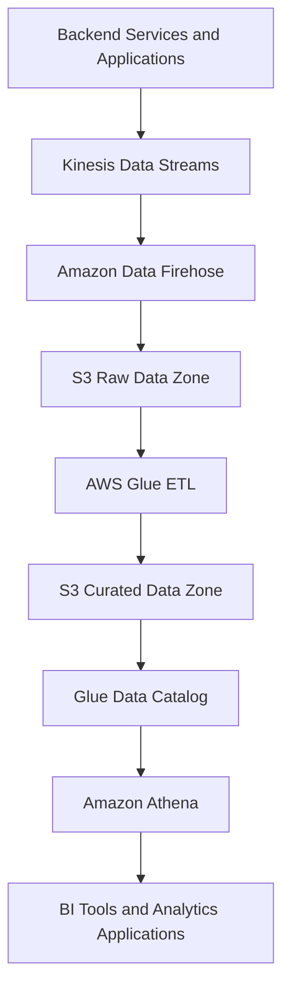
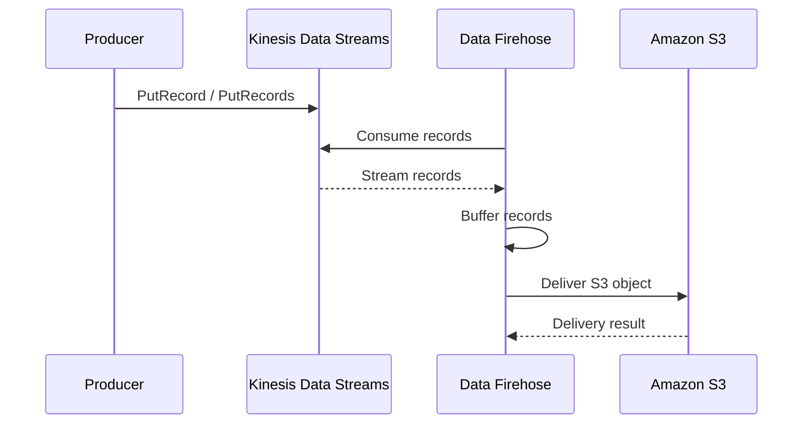
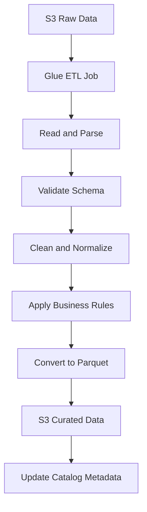
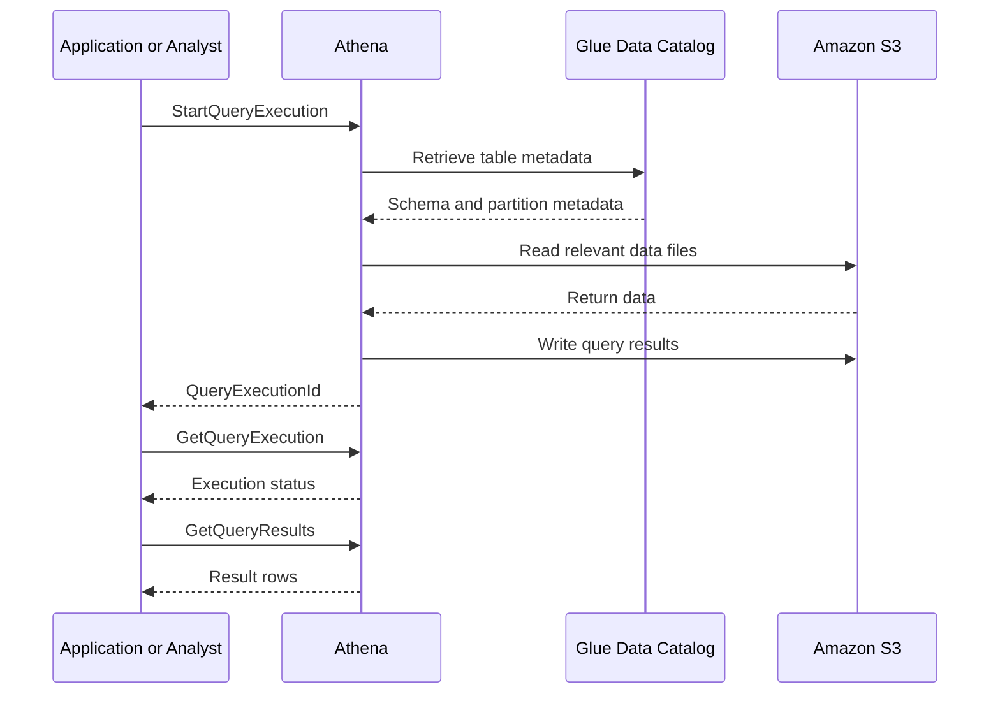

# 06- AWS Glue and Athena Integration

## Overview

AWS Glue and Amazon Athena provide a serverless data-processing and analytics layer for data produced by Amazon Kinesis Data Streams.

A common architecture uses Kinesis to ingest real-time events, Amazon Data Firehose to deliver them to Amazon S3, AWS Glue to transform and catalog the data, and Athena to query the resulting datasets using SQL.

This integration separates streaming ingestion from analytical processing:

- **Kinesis Data Streams** captures and retains streaming records for real-time consumers.
- **Amazon Data Firehose** delivers records to destinations such as Amazon S3.
- **Amazon S3** stores raw, processed, and curated datasets.
- **AWS Glue** performs ETL processing and manages table metadata through the Glue Data Catalog.
- **Amazon Athena** executes SQL queries directly against data stored in S3.

The architecture is useful for analytics workloads that do not require every event to be processed synchronously.

## Architecture

### High-Level Architecture



### Component Responsibilities

| Component | Responsibility |
|---|---|
| Kinesis Data Streams | Ingests and temporarily retains streaming records |
| Amazon Data Firehose | Delivers streaming records to S3 |
| Amazon S3 | Provides durable storage for raw and transformed datasets |
| AWS Glue ETL | Transforms, validates, and enriches data |
| Glue Data Catalog | Stores schemas, table definitions, and partition metadata |
| Glue Crawler | Discovers schemas and partitions when automatic discovery is appropriate |
| Amazon Athena | Executes SQL queries against S3 datasets |
| CloudWatch | Monitors delivery, ETL execution, and query operations |

### Why Separate Ingestion and Analytics?

Streaming ingestion and analytical querying have different operational requirements.

| Concern | Streaming ingestion | Analytical processing |
|---|---|---|
| Latency | Milliseconds to seconds | Seconds to minutes |
| Workload | Continuous event production | Batch and interactive queries |
| Data access | Partition and sequence based | Columnar scans and SQL |
| Scaling | Shards or on-demand capacity | ETL workers and query capacity |
| Primary concern | Throughput and delivery reliability | Data quality and query efficiency |
| Typical services | Kinesis, Firehose | S3, Glue, Athena |

Separating these workloads prevents analytical queries from competing directly with ingestion capacity.

## Kinesis to Amazon S3 Integration

### Architecture Options

There are two common approaches for moving Kinesis records into S3.

| Approach | Description | Suitable for |
|---|---|---|
| Kinesis Data Streams → Data Firehose → S3 | Managed delivery with buffering and optional transformation | Most managed ingestion pipelines |
| Kinesis Data Streams → Custom Consumer → S3 | Application-controlled record processing and object writes | Custom routing, validation, and processing requirements |

### Using Amazon Data Firehose

Amazon Data Firehose can consume records from Kinesis Data Streams and deliver them to S3.

It manages polling, buffering, retries, and destination delivery.

Typical configuration includes:

- Kinesis Data Stream as the source.
- S3 bucket as the destination.
- Buffer size and interval.
- Optional Lambda transformation.
- Compression and output format.
- IAM permissions.
- Error output prefix.

A typical delivery flow is:



Firehose buffering size and interval are delivery hints, not strict delivery deadlines. Actual delivery latency depends on buffering, throughput, retries, destination availability, and configuration.

Firehose is a managed delivery service, not a long-term replayable event log. Retain source records in Kinesis for the required recovery window and preserve raw data in S3 for longer-term replay and auditing.

### Firehose S3 Destination Configuration

A typical S3 destination configuration includes:

```json
{
  "BucketARN": "arn:aws:s3:::company-data-lake",
  "RoleARN": "arn:aws:iam::123456789012:role/FirehoseDeliveryRole",
  "Prefix": "raw/events/year=!{timestamp:yyyy}/month=!{timestamp:MM}/day=!{timestamp:dd}/",
  "ErrorOutputPrefix": "errors/!{firehose:error-output-type}/",
  "BufferingHints": {
    "SizeInMBs": 64,
    "IntervalInSeconds": 300
  },
  "CompressionFormat": "GZIP"
}
```

This is an illustrative destination configuration fragment. A complete Firehose delivery stream also requires source configuration, encryption settings, and appropriate service permissions.

### Buffering Considerations

Firehose buffers records before writing objects to S3.

Buffering reduces the number of small objects created in the destination bucket.

| Configuration | Effect |
|---|---|
| Smaller buffer size | More frequent, smaller objects |
| Larger buffer size | Fewer, larger objects |
| Shorter interval | Lower expected delivery latency |
| Longer interval | Better batching efficiency |

Choose buffering settings based on downstream processing frequency and query requirements.

Avoid excessively small objects because they increase:

- S3 request overhead.
- Glue processing overhead.
- Athena query planning overhead.
- Metadata management complexity.

Do not assume that a configured buffer interval guarantees an object will be available at that exact interval.

## S3 Data Lake Organization

### Storage Zones

A production data lake should separate original records from transformed datasets.

A common layout is:

```text
company-data-lake/
│
├── raw/
│   └── events/
│       └── year=2026/
│           └── month=11/
│               └── day=20/
│
├── validated/
│   └── events/
│
├── curated/
│   └── events/
│       └── year=2026/
│           └── month=11/
│               └── day=20/
│
├── aggregated/
│   └── events/
│
├── failed/
│   └── events/
│
└── athena-results/
```

| Zone | Purpose |
|---|---|
| Raw | Original delivered records |
| Validated | Records that passed structural and business validation |
| Curated | Normalized and query-optimized datasets |
| Aggregated | Precomputed metrics and reporting datasets |
| Failed | Invalid or unprocessable records |
| Athena results | Query execution output |

### Raw Data Preservation

Raw data should remain immutable from the perspective of normal ETL processing.

Preserving original records provides:

- Recovery from transformation defects.
- Reprocessing with updated business rules.
- Auditability.
- Historical analysis.
- Schema migration support.

Do not overwrite raw records when producing curated datasets.

Use separate prefixes or buckets with appropriate retention and access policies.

### Object Naming and Partitioning

Partitioning organizes data into directory-like prefixes.

For example:

```text
s3://company-data-lake/curated/events/
    year=2026/
    month=11/
    day=20/
    part-00001.parquet
```

A query filtering on `year`, `month`, and `day` can avoid scanning unrelated partitions when the table is correctly configured.

Choose partitions based on common query predicates.

Good partition candidates include:

- Event date.
- Business date.
- Region, when the number of regions is limited.
- Event category, when cardinality is manageable.

Avoid partitioning by highly variable identifiers such as:

- User ID.
- Request ID.
- Transaction ID.
- Random UUID.

High-cardinality partitioning creates excessive metadata and small files.

### Event Time vs Ingestion Time

A streaming pipeline may have multiple timestamps:

| Timestamp | Meaning |
|---|---|
| `event_time` | When the business event occurred |
| `produced_at` | When the producer published the event |
| `ingested_at` | When the ingestion system received it |
| `processed_at` | When downstream processing completed |

Use event time for business analytics when appropriate.

Use ingestion time for operational monitoring and delivery-latency analysis.

Late-arriving events require explicit handling. A record received today may belong to yesterday's business partition.

## AWS Glue Integration

### What Is AWS Glue?

AWS Glue is a serverless data integration service used to discover, prepare, transform, and move data.

In a Kinesis analytics pipeline, Glue commonly performs batch ETL against objects stored in S3.

Its main components include:

- Glue Data Catalog.
- Glue Crawlers.
- Glue ETL jobs.
- Glue Workflows and triggers.
- Glue connections.
- Glue Data Quality capabilities.

### Glue Data Catalog

The Glue Data Catalog stores metadata about datasets.

It includes:

- Database names.
- Table definitions.
- Column names and types.
- Storage formats.
- S3 locations.
- Partition metadata.
- SerDe configuration.

The catalog does not store the actual dataset.

The data remains in S3.

Athena uses catalog metadata to understand how to interpret and query the underlying objects.

### Catalog Structure

A typical catalog structure is:

```text
Glue Data Catalog
│
└── analytics_database
    │
    ├── raw_events
    │
    ├── validated_events
    │
    ├── curated_events
    │
    └── daily_event_metrics
```

A Glue database is a logical namespace for tables. It does not represent a separate S3 storage location by itself.

### Creating a Glue Database

Using AWS CLI:

```bash
aws glue create-database \
  --database-input '{
    "Name": "analytics_database",
    "Description": "Analytics datasets for streaming events"
  }'
```

List databases:

```bash
aws glue get-databases
```

List tables:

```bash
aws glue get-tables \
  --database-name analytics_database
```

### Glue Crawlers

A Glue Crawler discovers data structures and updates the Data Catalog.

It can inspect supported data sources and infer:

- Column names.
- Data types.
- File formats.
- Partition structures.

Example:

```bash
aws glue create-crawler \
  --name events-raw-crawler \
  --role arn:aws:iam::123456789012:role/GlueCrawlerRole \
  --database-name analytics_database \
  --targets '{
    "S3Targets": [
      {
        "Path": "s3://company-data-lake/raw/events/"
      }
    ]
  }'
```

Start the crawler:

```bash
aws glue start-crawler \
  --name events-raw-crawler
```

Check crawler status:

```bash
aws glue get-crawler \
  --name events-raw-crawler
```

### When to Use Crawlers

Crawlers are useful when:

- Working with semi-structured data.
- Discovering previously unknown datasets.
- Registering partition metadata.
- Prototyping a data lake.
- Managing datasets with controlled schema evolution.

However, crawlers should not replace schema governance.

Automatically inferred schemas can change unexpectedly when new files contain different fields or incompatible types.

For stable production datasets, explicitly define and manage schemas whenever possible.

### Schema Evolution

Streaming event producers may evolve independently.

For example, an event contract might initially contain:

```json
{
  "event_id": "evt-1001",
  "event_type": "order.created",
  "event_time": "2026-11-20T10:30:00Z",
  "order_id": "ord-1001"
}
```

A later version might add:

```json
{
  "event_id": "evt-1001",
  "event_type": "order.created",
  "event_time": "2026-11-20T10:30:00Z",
  "order_id": "ord-1001",
  "customer_segment": "enterprise"
}
```

Schema evolution requires compatibility rules.

Recommended practices:

- Prefer additive changes.
- Define nullable fields where appropriate.
- Avoid silently changing existing field types.
- Version event contracts.
- Validate producer payloads.
- Maintain compatibility with historical records.
- Test Glue transformations against old and new schema versions.

Do not assume that adding a field to producer JSON automatically updates every downstream table and query correctly.

## Glue ETL Processing

### ETL Lifecycle

Glue ETL jobs read source data, transform records, and write results to a destination.

A typical batch pipeline is:



### Choosing an ETL Format

| Format | Characteristics | Typical use |
|---|---|---|
| JSON | Human-readable, flexible schema | Raw event storage |
| CSV | Simple tabular structure | Interoperability and exports |
| Parquet | Columnar, compressed, typed | Analytical workloads |
| ORC | Columnar, optimized for analytical processing | Hive-oriented workloads |
| Apache Iceberg | Table format with metadata and transactional capabilities | Evolving analytical tables |

Parquet is generally a strong default for curated Athena datasets because it supports column pruning and efficient compression.

### Glue ETL with PySpark

The following example reads JSON event files from S3, validates required fields, normalizes timestamps, and writes partitioned Parquet output.

```python
import sys

from awsglue.context import GlueContext
from awsglue.job import Job
from awsglue.utils import getResolvedOptions
from pyspark.context import SparkContext
from pyspark.sql import functions as F
from pyspark.sql.types import (
    StringType,
    StructField,
    StructType,
    TimestampType,
)

args = getResolvedOptions(
    sys.argv,
    [
        "JOB_NAME",
        "SOURCE_PATH",
        "TARGET_PATH",
    ],
)

sc = SparkContext.getOrCreate()
glue_context = GlueContext(sc)
spark = glue_context.spark_session

job = Job(glue_context)
job.init(args["JOB_NAME"], args)

schema = StructType(
    [
        StructField("event_id", StringType(), False),
        StructField("event_type", StringType(), True),
        StructField("event_time", TimestampType(), True),
        StructField("order_id", StringType(), True),
    ]
)

source_df = (
    spark.read
    .schema(schema)
    .json(args["SOURCE_PATH"])
)

valid_df = source_df.filter(
    F.col("event_id").isNotNull()
    & F.col("event_type").isNotNull()
    & F.col("event_time").isNotNull()
)

curated_df = (
    valid_df
    .withColumn("event_date", F.to_date("event_time"))
    .withColumn("processed_at", F.current_timestamp())
    .select(
        "event_id",
        "event_type",
        "event_time",
        "order_id",
        "event_date",
        "processed_at",
    )
)

(
    curated_df.write
    .mode("append")
    .format("parquet")
    .partitionBy("event_date")
    .save(args["TARGET_PATH"])
)

job.commit()
```

Example job arguments:

```text
--SOURCE_PATH s3://company-data-lake/raw/events/
--TARGET_PATH s3://company-data-lake/curated/events/
```

This is an illustrative ETL job, not a complete production pipeline.

Production implementations should additionally handle:

- Malformed records.
- Explicit timezone and timestamp parsing.
- Schema-version compatibility.
- Rejected-record storage.
- Duplicate events.
- Incremental input selection.
- Output idempotency.
- Partition replacement or transactional table writes.
- Data quality metrics.
- Job retries and failure notifications.

The example uses append mode. Running it repeatedly against the same input can duplicate records.

### Handling Invalid Records

Do not silently discard invalid records.

Separate valid and rejected records:

```python
invalid_df = source_df.filter(
    F.col("event_id").isNull()
    | F.col("event_type").isNull()
    | F.col("event_time").isNull()
)

valid_df = source_df.filter(
    F.col("event_id").isNotNull()
    & F.col("event_type").isNotNull()
    & F.col("event_time").isNotNull()
)
```

Write rejected records to a controlled failure prefix:

```python
(
    invalid_df.write
    .mode("append")
    .format("json")
    .save(
        "s3://company-data-lake/failed/events/"
    )
)
```

Include rejection reasons and processing metadata in a production implementation.

### Incremental ETL Processing

Processing the entire raw dataset on every run becomes expensive as data grows.

Common incremental strategies include:

- Process only newly delivered S3 prefixes.
- Maintain a batch manifest.
- Track completed input objects in a processing ledger.
- Use Glue job bookmarks where the source and transformation pattern support them.
- Use event-driven orchestration to trigger work for new data.
- Use transactional table formats when atomic updates and concurrent writers are required.

Glue job bookmarks help track previously processed source data for supported workloads. They do not automatically make arbitrary output writes idempotent.

### Idempotent ETL Design

ETL jobs can fail after writing some output but before reporting successful completion.

A retry may process the same input again.

Possible consequences include:

- Duplicate rows.
- Duplicate aggregates.
- Conflicting output files.
- Incorrect reporting metrics.

A robust design should identify each processing batch and its input.

Example batch manifest:

```json
{
  "batch_id": "events-2026-11-20-001",
  "source_prefix": "raw/events/year=2026/month=11/day=20/",
  "target_partition": "event_date=2026-11-20",
  "status": "COMPLETED",
  "record_count": 125000
}
```

A production implementation should persist this information in a durable processing ledger.

For append-oriented datasets, use stable event IDs and deduplication logic.

For partition-oriented datasets, controlled partition replacement may be safer than blindly appending the same batch.

For concurrent writers or atomic table updates, evaluate Apache Iceberg or another supported transactional table format.

## Amazon Athena Integration

### What Is Amazon Athena?

Amazon Athena is a serverless interactive query service that executes SQL against data stored in S3.

It commonly uses the Glue Data Catalog for table and schema metadata.

Athena is useful for:

- Operational analytics.
- Business reporting.
- Event analysis.
- Historical investigations.
- Data validation.
- Ad hoc SQL queries.
- BI tool integration.

Athena is not an OLTP database.

It is not designed to replace PostgreSQL, MySQL, or DynamoDB for high-frequency transactional reads and writes.

### Query Execution Flow



Athena queries are asynchronous.

Submitting a query does not mean the query has completed.

Applications should retain the query execution ID and poll or otherwise monitor its status before retrieving results.

### Creating an Athena Table

A table can be created using the Glue Data Catalog through Athena SQL.

Example:

```sql
CREATE EXTERNAL TABLE IF NOT EXISTS analytics_database.raw_events (
    event_id STRING,
    event_type STRING,
    event_time STRING,
    order_id STRING
)
PARTITIONED BY (
    year STRING,
    month STRING,
    day STRING
)
ROW FORMAT SERDE 'org.openx.data.jsonserde.JsonSerDe'
LOCATION 's3://company-data-lake/raw/events/';
```

The exact SerDe and table definition must match the structure of the files.

For curated Parquet data:

```sql
CREATE EXTERNAL TABLE IF NOT EXISTS analytics_database.curated_events (
    event_id STRING,
    event_type STRING,
    event_time TIMESTAMP,
    order_id STRING
)
PARTITIONED BY (
    event_date DATE
)
STORED AS PARQUET
LOCATION 's3://company-data-lake/curated/events/';
```

For production datasets, validate that the table definition matches the physical partition layout and file schema.

### Querying Events

Retrieve recent events:

```sql
SELECT
    event_id,
    event_type,
    event_time,
    order_id
FROM analytics_database.curated_events
WHERE event_date = DATE '2026-11-20'
ORDER BY event_time DESC
LIMIT 100;
```

Aggregate events by type:

```sql
SELECT
    event_type,
    COUNT(*) AS total_events
FROM analytics_database.curated_events
WHERE event_date BETWEEN DATE '2026-11-01'
                     AND DATE '2026-11-20'
GROUP BY event_type
ORDER BY total_events DESC;
```

Calculate daily event counts:

```sql
SELECT
    event_date,
    COUNT(*) AS total_events
FROM analytics_database.curated_events
GROUP BY event_date
ORDER BY event_date;
```

### Partition Pruning

Partition pruning reduces the amount of data Athena needs to scan.

A query that filters on partition columns can avoid reading unrelated partitions.

Prefer:

```sql
SELECT COUNT(*)
FROM analytics_database.curated_events
WHERE event_date = DATE '2026-11-20';
```

Avoid querying the full dataset when only one partition is required.

Partition pruning depends on the table metadata and query predicates. Verify actual scan behavior through Athena query statistics.

### Partition Registration

Creating partition directories in S3 does not always make them immediately available through a manually defined Glue table.

Partition metadata must be registered or discovered.

For Hive-style partitions, Athena supports:

```sql
MSCK REPAIR TABLE analytics_database.curated_events;
```

This command discovers partitions from the table's S3 location.

For large datasets or controlled pipelines, explicit partition registration or partition projection may be more appropriate.

### Partition Projection

Partition projection allows Athena to calculate partition values from configured rules rather than relying on individually registered partition metadata.

It is useful when:

- Partition layouts are predictable.
- Partitions are generated regularly.
- The number of partitions is large.
- Partition registration would create operational overhead.

Example:

```sql
ALTER TABLE analytics_database.curated_events
SET TBLPROPERTIES (
    'projection.enabled' = 'true',
    'projection.event_date.type' = 'date',
    'projection.event_date.range' = '2026-01-01,NOW',
    'projection.event_date.format' = 'yyyy-MM-dd',
    'storage.location.template' =
      's3://company-data-lake/curated/events/event_date=${event_date}/'
);
```

The storage location template must match the actual S3 directory layout.

Partition projection does not create data or validate that projected partitions exist. It also does not remove the need for a correct schema definition.

## Querying Athena from Python

### Boto3 Integration

Backend services can submit Athena queries through Boto3.

A typical integration uses:

- `StartQueryExecution` to submit SQL.
- `GetQueryExecution` to check status.
- `GetQueryResults` to retrieve results.
- S3 as the query-result location.

### Submitting a Query

```python
import boto3

athena = boto3.client("athena", region_name="ap-south-1")

response = athena.start_query_execution(
    QueryString="""
        SELECT
            event_type,
            COUNT(*) AS total_events
        FROM analytics_database.curated_events
        WHERE event_date = DATE '2026-11-20'
        GROUP BY event_type
    """,
    QueryExecutionContext={
        "Database": "analytics_database",
        "Catalog": "AwsDataCatalog",
    },
    ResultConfiguration={
        "OutputLocation": "s3://company-data-lake/athena-results/"
    },
    WorkGroup="analytics-workgroup",
)

query_execution_id = response["QueryExecutionId"]

print(query_execution_id)
```

The query execution ID is the durable reference used to monitor and retrieve query results.

### Monitoring Query Status

```python
import time

def wait_for_query(
    client,
    query_execution_id: str,
    poll_interval: int = 2,
) -> dict:
    terminal_states = {
        "SUCCEEDED",
        "FAILED",
        "CANCELLED",
    }

    while True:
        response = client.get_query_execution(
            QueryExecutionId=query_execution_id
        )

        execution = response["QueryExecution"]
        status = execution["Status"]
        state = status["State"]

        if state in terminal_states:
            if state != "SUCCEEDED":
                reason = status.get(
                    "StateChangeReason",
                    "Unknown Athena query failure",
                )
                raise RuntimeError(
                    f"Athena query {state}: {reason}"
                )

            return execution

        time.sleep(poll_interval)
```

This synchronous polling pattern is suitable for scripts and controlled batch jobs.

For a production API, avoid keeping an HTTP request open while a long-running query executes.

Instead:

1. Submit the query.
2. Persist the query execution ID.
3. Return an accepted response to the caller.
4. Monitor the query asynchronously.
5. Store completion status and result metadata.
6. Expose a separate endpoint for retrieving results.

### Retrieving Query Results

Athena returns query results in pages.

A production client must handle pagination.

```python
def fetch_query_results(
    client,
    query_execution_id: str,
):
    paginator = client.get_paginator(
        "get_query_results"
    )

    for page in paginator.paginate(
        QueryExecutionId=query_execution_id
    ):
        rows = page["ResultSet"]["Rows"]

        for row in rows:
            yield [
                cell.get("VarCharValue")
                for cell in row.get("Data", [])
            ]
```

The first result row commonly contains column headers.

Account for this when converting results into application records.

Do not load an unbounded result set into application memory. Stream pages or write results to a controlled downstream destination.

### Athena Query Parameters

Use Athena execution parameters where supported by the query and engine configuration.

Example:

```python
response = athena.start_query_execution(
    QueryString="""
        SELECT event_id, event_type
        FROM analytics_database.curated_events
        WHERE event_date = DATE ?
    """,
    ExecutionParameters=[
        "'2026-11-20'"
    ],
    QueryExecutionContext={
        "Database": "analytics_database"
    },
    ResultConfiguration={
        "OutputLocation": "s3://company-data-lake/athena-results/"
    },
)
```

Validate the supported parameter syntax for the selected Athena engine version.

Do not build SQL by concatenating untrusted user input.

For dynamic table or column names, use strict allowlists because identifiers generally cannot be treated as ordinary query parameters.

### Integrating Athena with FastAPI

A backend API should normally use asynchronous job submission rather than waiting for Athena to finish inside a request handler.

Example:

```python
from fastapi import FastAPI, HTTPException
from pydantic import BaseModel
import boto3

app = FastAPI()

athena = boto3.client(
    "athena",
    region_name="ap-south-1",
)


class QueryRequest(BaseModel):
    event_date: str


@app.post("/analytics/queries")
def submit_analytics_query(
    request: QueryRequest,
):
    if not request.event_date:
        raise HTTPException(
            status_code=400,
            detail="event_date is required",
        )

    query = """
        SELECT
            event_type,
            COUNT(*) AS total_events
        FROM analytics_database.curated_events
        WHERE event_date = DATE ?
        GROUP BY event_type
    """

    try:
        response = athena.start_query_execution(
            QueryString=query,
            ExecutionParameters=[
                f"'{request.event_date}'"
            ],
            QueryExecutionContext={
                "Database": "analytics_database"
            },
            ResultConfiguration={
                "OutputLocation":
                    "s3://company-data-lake/athena-results/"
            },
            WorkGroup="analytics-workgroup",
        )

        return {
            "query_execution_id":
                response["QueryExecutionId"],
            "status": "SUBMITTED",
        }

    except Exception as exc:
        raise HTTPException(
            status_code=500,
            detail="Unable to submit analytics query",
        ) from exc
```

This is an integration skeleton. A production implementation should additionally:

- Validate date formats and allowed query ranges.
- Authenticate and authorize callers.
- Use a fixed set of approved query templates.
- Persist query execution IDs and ownership.
- Apply request and query quotas.
- Handle throttling and service errors.
- Avoid exposing internal exception details.
- Enforce workgroup and data-access restrictions.
- Retrieve results asynchronously.

## Data Quality and Governance

### Data Quality Checks

Data quality should be validated before datasets become available to reporting users.

Common checks include:

| Check | Example |
|---|---|
| Required fields | `event_id` must not be null |
| Uniqueness | Event IDs must not be duplicated within the defined scope |
| Type validation | `event_time` must be a valid timestamp |
| Range validation | Transaction amounts must be within accepted limits |
| Referential integrity | Order references must resolve where required |
| Freshness | Latest expected partition must be available |
| Volume checks | Record counts must remain within expected thresholds |

Glue ETL jobs can implement these checks directly or integrate with AWS Glue Data Quality capabilities.

Persist quality results so that failed batches can be investigated and reprocessed.

### Data Catalog Governance

The Glue Data Catalog should be managed as a shared metadata layer.

Recommended practices:

- Define table ownership.
- Establish naming conventions.
- Document schemas and business definitions.
- Version important schema changes.
- Control table creation and modification permissions.
- Separate development and production catalogs where appropriate.
- Use Lake Formation when centralized fine-grained data governance is required.

### Schema Registry Considerations

For event streams with multiple producers and consumers, a schema registry can help enforce event contract compatibility.

A registry is useful when:

- Multiple services publish events.
- Consumers evolve independently.
- Serialization formats require schema definitions.
- Compatibility checks must happen before deployment.

Do not confuse Glue Data Catalog with an event schema registry. The catalog describes analytical datasets; an event schema registry governs message contracts.

## Reliability and Failure Handling

### Firehose Delivery Failures

Firehose can retry destination delivery failures.

Configure error output prefixes and monitor delivery failures.

Investigate:

- Missing S3 permissions.
- KMS access failures.
- Bucket policy restrictions.
- Destination throttling or service errors.
- Invalid transformation output.
- Incorrect destination configuration.

Do not treat successful Firehose stream creation as proof that all records have reached S3.

Monitor delivery metrics and verify actual object arrival.

### Glue Job Failures

Glue jobs can fail because of:

- Invalid input data.
- Schema mismatches.
- Insufficient worker capacity.
- S3 permission failures.
- KMS permission failures.
- Spark memory pressure.
- Dependency or runtime incompatibility.
- Unexpected data skew.

Use bounded retries for transient failures.

Do not repeatedly retry deterministic failures such as invalid schemas without changing the input or transformation logic.

Preserve job logs and failed batch metadata.

### Athena Query Failures

Common causes include:

- Missing catalog tables.
- Invalid SQL.
- Incorrect partition metadata.
- Missing S3 permissions.
- KMS access failures.
- Query resource limits.
- Workgroup configuration restrictions.

Persist the query execution ID and inspect the final execution status and error reason.

### Replay Strategy

A robust architecture should support replay without depending on Kinesis retention indefinitely.

Recommended approach:

1. Preserve original records in the raw S3 zone.
2. Track the input objects or partitions used by each ETL batch.
3. Store transformation version and processing metadata.
4. Re-run failed or corrected batches using controlled input selection.
5. Write output idempotently.
6. Validate the resulting dataset before publishing it to consumers.

A replay should not silently overwrite unrelated partitions or create duplicate analytical records.

## Performance and Scalability

### Kinesis Ingestion Capacity

Kinesis Data Streams capacity depends on stream mode and provisioned capacity.

For provisioned streams, shard capacity is a key consideration.

Common provisioned shard limits include:

- Up to 1 MB/s or 1,000 records/s for writes.
- Up to 2 MB/s shared read throughput per shard for shared consumers.

Verify current service quotas and stream configuration before capacity planning.

A hot partition key can concentrate traffic on a single shard even when the overall stream has spare capacity.

### Firehose Delivery Optimization

Tune buffering based on:

- Expected event volume.
- Acceptable delivery latency.
- Target object size.
- Downstream ETL frequency.
- S3 request costs.
- Query workload.

Larger objects generally improve analytical efficiency, but excessively large batches can increase the delay before data becomes queryable.

### Glue Worker Scaling

Glue ETL performance depends on:

- Worker type.
- Number of workers.
- Input file count and size.
- Partition layout.
- Shuffle volume.
- Join strategy.
- Data skew.
- Output file size.

Avoid selecting worker counts based only on total dataset size.

Benchmark representative workloads and inspect Spark execution plans and job metrics.

### Small File Problem

Streaming ingestion can create many small S3 objects.

Small files increase:

- File listing and planning overhead.
- Glue task scheduling overhead.
- Athena query planning time.
- Metadata volume.
- S3 request costs.

Use compaction jobs to combine small files into appropriately sized Parquet files.

Choose target file sizes based on workload and engine behavior rather than enforcing a universal fixed size.

### Athena Query Optimization

Athena performance is influenced by:

- Data format.
- Compression.
- Partitioning.
- Column selection.
- Predicate pushdown.
- File size.
- Data skew.
- Join strategy.

Prefer:

```sql
SELECT
    event_type,
    COUNT(*) AS total_events
FROM analytics_database.curated_events
WHERE event_date >= DATE '2026-11-01'
  AND event_date < DATE '2026-11-21'
GROUP BY event_type;
```

Avoid:

```sql
SELECT *
FROM analytics_database.curated_events;
```

when only a few columns are needed.

Use Parquet or ORC for analytical datasets, and avoid repeatedly scanning raw JSON when a curated columnar representation is available.

## Security Considerations

### IAM Permissions

Use separate IAM roles for:

- Firehose delivery.
- Glue crawlers.
- Glue ETL jobs.
- Athena query execution.
- Backend application access.

Apply least-privilege permissions.

A Glue ETL role generally needs only the relevant source and destination S3 prefixes, catalog operations, logging permissions, and required KMS access.

Avoid granting unrestricted S3 access to every pipeline component.

### S3 Security

Recommended controls include:

- Block Public Access.
- Bucket-owner-enforced object ownership where appropriate.
- Least-privilege bucket policies.
- Server-side encryption.
- TLS-only access.
- Versioning where recovery requirements justify it.
- Lifecycle policies.
- CloudTrail data events for sensitive buckets when required.

### Encryption

Use SSE-S3 or SSE-KMS based on security requirements.

When using SSE-KMS, ensure the relevant service roles and principals have the required KMS permissions.

Encryption failures often occur because the S3 permission exists but the KMS key policy or IAM policy does not authorize the operation.

### Athena Workgroups

Use separate workgroups to isolate query workloads.

Workgroups can control:

- Query result locations.
- Encryption settings.
- Query execution settings.
- Data usage limits.
- Workload organization.

Use workgroup-level controls to prevent uncontrolled query usage.

### Lake Formation

AWS Lake Formation can provide centralized data permissions for supported catalog resources.

It is useful when multiple teams need different access to databases, tables, columns, or rows.

Do not assume that granting Athena API permissions automatically grants access to the underlying data. Catalog permissions, Lake Formation permissions where applicable, S3 permissions, and KMS permissions must align.

## Monitoring and Observability

### Firehose Monitoring

Monitor:

- Incoming records.
- Incoming bytes.
- Delivery success.
- Delivery failures.
- Data freshness.
- Transformation failures.
- S3 object arrival.

### Glue Monitoring

Monitor:

- Job execution duration.
- Job success and failure.
- Worker utilization.
- Input and output record counts.
- Data quality failures.
- Rejected records.
- Processing lag.

Use CloudWatch Logs and Glue job metrics to investigate failures.

### Athena Monitoring

Monitor:

- Query execution count.
- Successful and failed queries.
- Query execution time.
- Data scanned.
- Query queue time.
- Workgroup usage.
- Repeated expensive queries.

Athena query execution metadata is useful for cost and performance analysis.

### Operational Metrics

A useful end-to-end dashboard should include:

| Metric | Purpose |
|---|---|
| Kinesis incoming records | Measures ingestion volume |
| Kinesis write throttles | Identifies producer capacity issues |
| Firehose delivery failures | Detects destination delivery problems |
| Latest S3 object timestamp | Measures data freshness |
| Glue job duration | Detects ETL performance changes |
| Glue failed job count | Tracks transformation reliability |
| Rejected record count | Tracks data quality |
| Athena bytes scanned | Tracks query efficiency and cost |
| Athena failed query count | Detects analytical workload issues |
| End-to-end processing latency | Measures time from event production to query availability |

Track timestamps across the pipeline to distinguish ingestion delay, delivery delay, ETL delay, and query execution time.

## High Availability and Disaster Recovery

### Regional Failure Considerations

Kinesis, Firehose, Glue, Athena, and S3 are regional services.

A multi-Region design requires explicit planning for:

- Stream replication.
- S3 replication.
- Catalog reconstruction or replication.
- Glue job deployment.
- IAM and KMS configuration.
- Athena workgroups.
- Query-result storage.
- Recovery orchestration.

S3 replication does not automatically replicate Kinesis records, Glue job state, Athena query history, or processing checkpoints.

### Recovery Strategy

A practical recovery strategy includes:

- Preserve raw records in S3.
- Use versioning where appropriate.
- Replicate critical datasets to a recovery Region.
- Manage Glue jobs and Athena configuration through infrastructure as code.
- Store ETL manifests and processing ledgers durably.
- Test catalog and partition reconstruction.
- Document replay and backfill procedures.

Define recovery point and recovery time objectives based on business requirements.

## Cost Optimization

### Major Cost Components

| Service | Main cost drivers |
|---|---|
| Kinesis Data Streams | Stream capacity, retention, enhanced fan-out, and relevant request usage |
| Data Firehose | Data ingestion and optional processing or format conversion |
| S3 | Storage, requests, retrieval, and data transfer |
| Glue | ETL compute, crawlers, and related features |
| Athena | Data scanned by queries |
| CloudWatch | Logs, metrics, alarms, and dashboards |
| KMS | Key usage and related operations |

### Cost Reduction Strategies

**Kinesis**
- Select provisioned or on-demand mode based on traffic characteristics.
- Avoid unnecessary retention periods.
- Evaluate enhanced fan-out only when dedicated consumer throughput is needed.

**Firehose**
- Tune buffering to avoid excessive small-object creation.
- Avoid unnecessary transformations.
- Monitor failed delivery and repeated processing.

**S3**
- Use lifecycle policies for older raw data.
- Select storage classes based on access patterns.
- Compress data.
- Avoid excessive object creation.

**Glue**
- Use incremental processing.
- Tune worker capacity.
- Avoid repeatedly scanning historical data.
- Compact small files.
- Avoid unnecessary crawler runs.

**Athena**
- Use columnar formats.
- Filter on partition columns.
- Select only required columns.
- Set workgroup data-scan limits.
- Review query statistics and expensive query patterns.

Athena cost is primarily driven by the amount of data scanned, so partitioning and columnar formats have direct financial impact.

## Infrastructure as Code

A production pipeline should manage S3, Glue, and Athena resources through infrastructure as code.

A Terraform example for an S3 data bucket:

```hcl
resource "aws_s3_bucket" "data_lake" {
  bucket = "company-data-lake-example"
}

resource "aws_s3_bucket_public_access_block" "data_lake" {
  bucket = aws_s3_bucket.data_lake.id

  block_public_acls       = true
  block_public_policy     = true
  ignore_public_acls      = true
  restrict_public_buckets = true
}

resource "aws_s3_bucket_server_side_encryption_configuration" "data_lake" {
  bucket = aws_s3_bucket.data_lake.id

  rule {
    apply_server_side_encryption_by_default {
      sse_algorithm = "AES256"
    }
  }
}

resource "aws_glue_catalog_database" "analytics" {
  name        = "analytics_database"
  description = "Analytics datasets for streaming events"
}
```

An Athena workgroup can be managed separately:

```hcl
resource "aws_athena_workgroup" "analytics" {
  name = "analytics-workgroup"

  configuration {
    enforce_workgroup_configuration = true

    result_configuration {
      output_location = "s3://${aws_s3_bucket.data_lake.bucket}/athena-results/"

      encryption_configuration {
        encryption_option = "SSE_S3"
      }
    }

    bytes_scanned_cutoff_per_query = 10737418240
  }
}
```

The scan limit in this example is 10 GiB per query.

Production infrastructure should additionally define:

- IAM roles and policies.
- KMS configuration where required.
- S3 lifecycle rules.
- Bucket policies.
- Glue tables and crawlers where appropriate.
- Firehose delivery resources.
- Glue job scripts and runtime settings.
- CloudWatch alarms.
- Athena workgroup permissions.
- Lake Formation permissions where used.

Avoid hardcoding account IDs, credentials, and environment-specific bucket names in reusable infrastructure modules.

## Testing Strategy

### Unit Testing

Test transformation logic independently from Glue infrastructure where possible.

Examples include:

- Required-field validation.
- Timestamp parsing.
- Event normalization.
- Schema compatibility.
- Business-rule calculations.
- Rejected-record classification.

### Integration Testing

Validate interactions between:

- Kinesis and Firehose.
- Firehose and S3.
- S3 and Glue ETL.
- Glue and the Data Catalog.
- Athena and catalog tables.
- Athena and query-result storage.

Use isolated test buckets, databases, and workgroups.

### Data Validation Testing

For every processing batch, validate:

- Input record count.
- Accepted record count.
- Rejected record count.
- Output record count.
- Duplicate count.
- Partition availability.
- Schema compatibility.
- Expected business aggregates.

Do not rely only on a successful Glue job status. A job can complete successfully while producing incomplete or logically incorrect data.

### Deployment Testing

A CI/CD pipeline should validate:

- Terraform formatting and validation.
- Glue script syntax and unit tests.
- IAM policy scope.
- Catalog definitions.
- Athena SQL compatibility.
- ETL integration tests.
- Data quality thresholds.

Promote tested artifacts between environments instead of rebuilding different versions of the same job for each environment.

## Common Mistakes and Production Pitfalls

| Mistake | Why it causes problems | Recommended approach |
|---|---|---|
| Treating Firehose as a replayable event log | Firehose is a managed delivery service, not a retained event history | Preserve source records in Kinesis and archive raw data in S3 |
| Assuming buffer intervals are exact | Delivery is asynchronous and affected by service conditions | Monitor actual delivery latency |
| Running full ETL jobs repeatedly | Increases cost and processing time | Use incremental processing and manifests |
| Appending output on every retry | Creates duplicate analytical records | Design idempotent writes and controlled partition replacement |
| Relying entirely on crawlers | Inferred schemas can change unexpectedly | Govern production schemas explicitly |
| Using JSON for every analytical query | Increases scan and parsing overhead | Convert curated datasets to Parquet or ORC |
| Creating excessive partitions | Increases metadata and query-planning overhead | Partition by commonly filtered, manageable dimensions |
| Creating too many small files | Degrades Glue and Athena performance | Use buffering and compaction |
| Ignoring late-arriving events | Places records in incorrect business partitions | Distinguish event time from ingestion time |
| Assuming Glue bookmarks guarantee idempotency | Bookmarks track supported source progress, not arbitrary sink side effects | Make output writes independently idempotent |
| Returning Athena results inside long-running API requests | Causes request timeouts and consumes application resources | Submit asynchronously and expose query status |
| Loading all Athena results into memory | Can exhaust application memory | Use pagination and bounded result processing |
| Granting broad S3 permissions | Increases the impact of compromised roles | Scope permissions to required prefixes |
| Ignoring KMS key policies | Causes access failures even when S3 permissions exist | Validate both IAM and key policies |
| Treating successful jobs as proof of data correctness | A job may complete with missing or invalid records | Run data quality and reconciliation checks |

## Production Reference Architecture

A production-oriented implementation can use the following responsibilities:

| Layer | AWS service | Responsibility |
|---|---|---|
| Event production | Backend services | Publish versioned business events |
| Streaming ingestion | Kinesis Data Streams | Buffer and distribute events |
| Managed delivery | Data Firehose | Deliver records to S3 |
| Raw storage | S3 | Preserve original event records |
| Transformation | AWS Glue ETL | Validate, normalize, and enrich |
| Curated storage | S3 | Store compressed columnar datasets |
| Metadata | Glue Data Catalog | Manage schemas and partitions |
| Query layer | Athena | Execute analytical SQL |
| Application interface | FastAPI or Django | Submit and monitor approved queries |
| Observability | CloudWatch | Monitor ingestion, ETL, and query health |
| Governance | IAM and Lake Formation | Control access to datasets |

### Production Checklist

**Ingestion and storage**
- [ ] Kinesis retention matches the required recovery window.
- [ ] Firehose delivery failures are monitored.
- [ ] Raw event data is preserved.
- [ ] S3 bucket access is private and restricted.
- [ ] Encryption is enabled.
- [ ] Object lifecycle policies are configured.

**ETL and metadata**
- [ ] Glue schemas are governed.
- [ ] Invalid records are retained with rejection details.
- [ ] Incremental processing is implemented.
- [ ] ETL output is idempotent.
- [ ] Small-file compaction is considered.
- [ ] Partition strategy matches query patterns.

**Analytics**
- [ ] Athena tables use the correct file format and schema.
- [ ] Partition metadata is maintained.
- [ ] Workgroups enforce query controls.
- [ ] Query results are stored in a protected S3 location.
- [ ] Applications handle asynchronous execution and pagination.
- [ ] Query access is authorized and audited.

**Operations**
- [ ] Firehose, Glue, and Athena metrics are monitored.
- [ ] Data quality checks are enforced.
- [ ] Failed batches can be replayed.
- [ ] CI/CD validates infrastructure and ETL code.
- [ ] Disaster recovery procedures are tested.

## Key Takeaways

- Kinesis and Firehose provide streaming ingestion and managed delivery, while S3 provides durable storage for raw and curated analytical datasets.
- AWS Glue handles ETL processing and metadata management; the Glue Data Catalog stores schemas and partition metadata, not the underlying data.
- Use Parquet, appropriate partitioning, incremental ETL, and compaction to improve Athena query performance and control costs.
- Design ETL jobs and downstream writes for retries, duplicate inputs, late-arriving events, and controlled replay.
- Secure and operate the pipeline with least-privilege IAM, KMS, Lake Formation where appropriate, CloudWatch monitoring, and tested disaster recovery procedures.