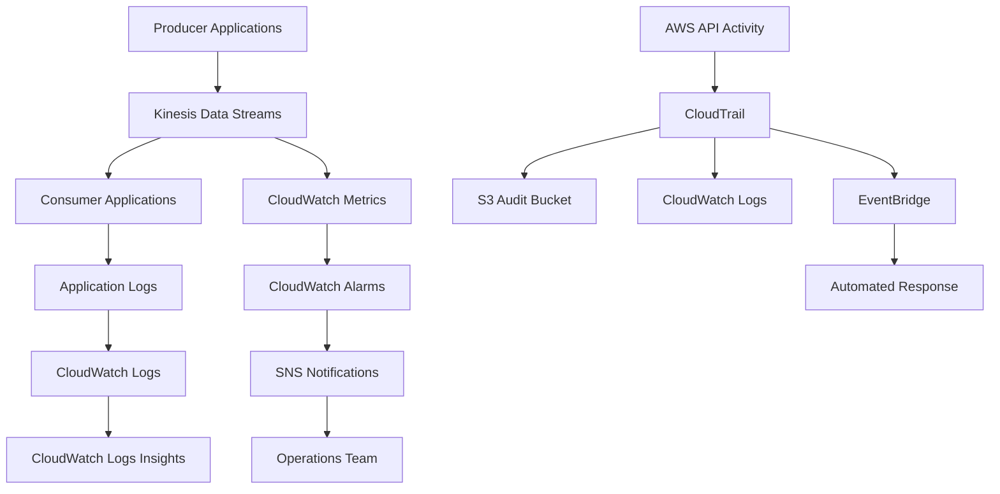
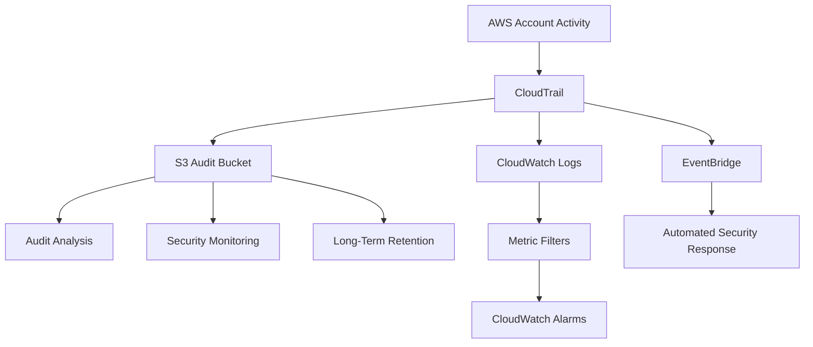
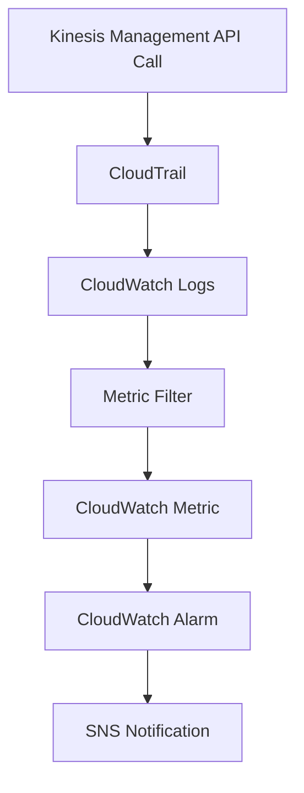
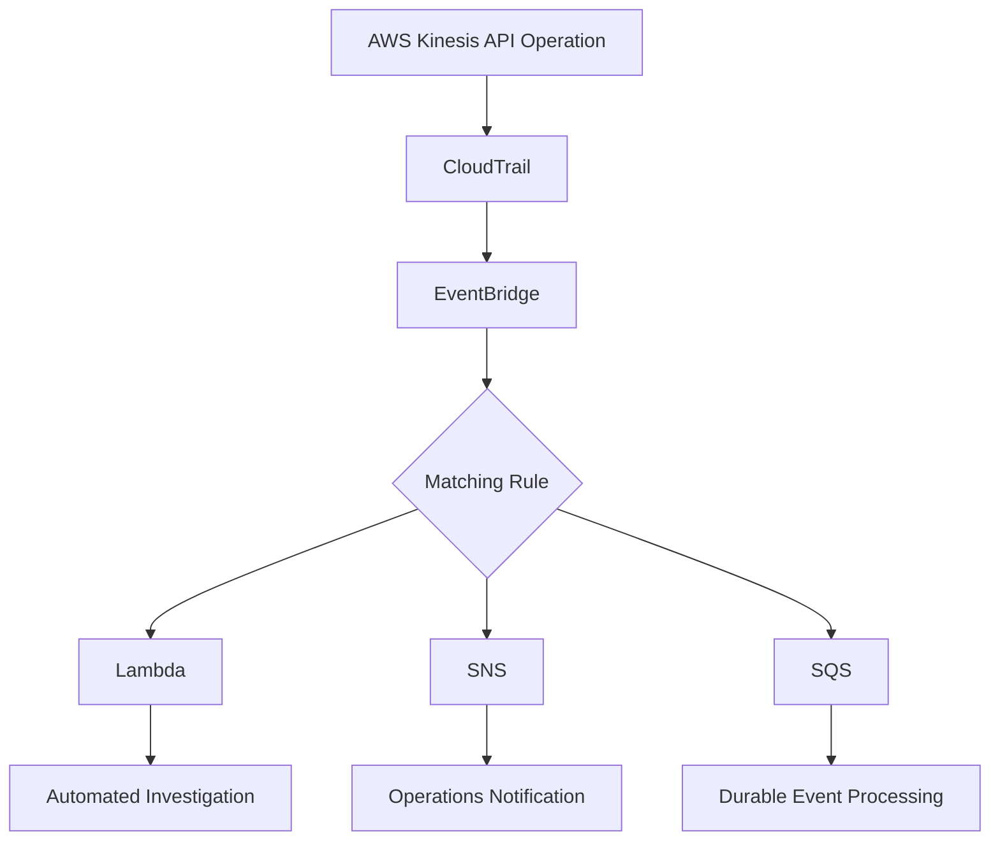
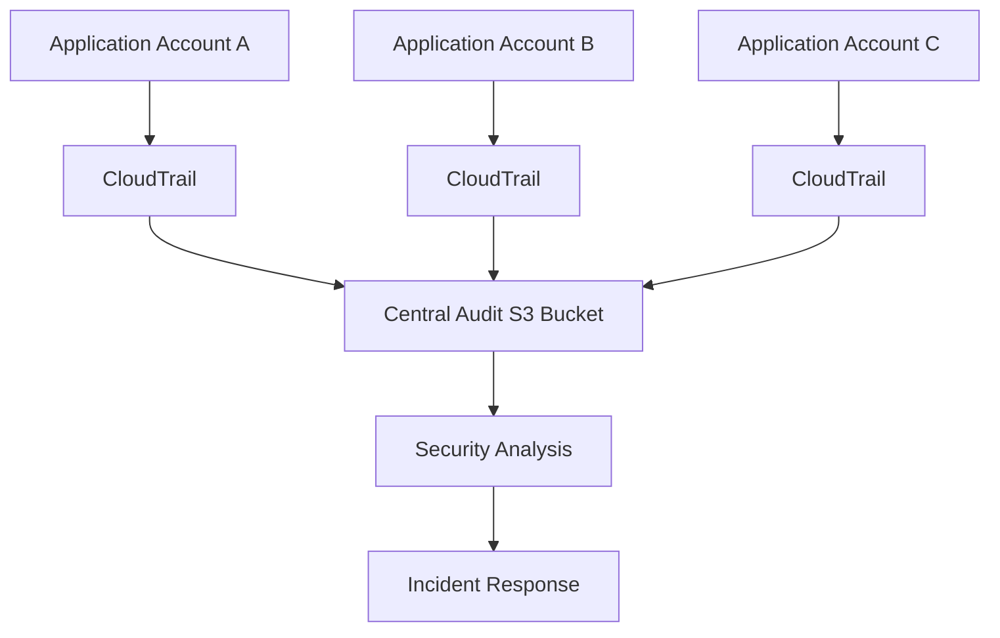

# 07- CloudWatch and CloudTrail Integration

## Overview

Amazon Kinesis integrates with Amazon CloudWatch and AWS CloudTrail to provide operational monitoring, observability, security auditing, and event-driven responses to infrastructure activity.

These services address different operational requirements:

- **Amazon CloudWatch** collects metrics, logs, and alarms to monitor Kinesis resources and streaming applications.
- **AWS CloudTrail** records AWS API activity, providing an audit trail of management operations and supported data events.
- **Amazon EventBridge** routes selected AWS events to downstream targets for automated responses.
- **CloudWatch Logs Insights** supports investigation of application and infrastructure logs.
- **CloudWatch Dashboards** provide a consolidated view of streaming pipeline health.

A production Kinesis deployment needs both operational visibility and an audit trail. Monitoring only stream throughput is insufficient because a stream can remain healthy while consumers fall behind, records are silently rejected, or downstream processing fails.

## Architecture

### High-Level Architecture



### Component Responsibilities

| Component | Responsibility |
|---|---|
| Kinesis Data Streams | Ingests and distributes streaming records |
| CloudWatch Metrics | Collects service and application metrics |
| CloudWatch Logs | Stores application and infrastructure logs |
| CloudWatch Alarms | Evaluates metrics and triggers actions |
| CloudWatch Dashboards | Visualizes operational health |
| CloudWatch Logs Insights | Queries and analyzes log data |
| CloudTrail | Records supported AWS API activity |
| EventBridge | Routes selected AWS events |
| Amazon S3 | Stores durable CloudTrail audit logs |
| Amazon SNS | Delivers alarm notifications |

### Why Both CloudWatch and CloudTrail?

CloudWatch and CloudTrail solve different problems.

| Concern | CloudWatch | CloudTrail |
|---|---|---|
| Primary purpose | Operational monitoring | API auditing and governance |
| Main data | Metrics, logs, alarms | API activity and event records |
| Typical question | Is the stream healthy? | Who changed the stream configuration? |
| Application visibility | Application logs and custom metrics | Not application logs |
| Infrastructure visibility | Performance and operational signals | Supported API calls and activity |
| Alerting | Metric and log alarms | EventBridge rules and CloudTrail-to-CloudWatch Logs integration |
| Long-term storage | Configurable log retention and metric retention | S3 audit archive and configured retention |
| Typical use | Detect lag, throttling, failures | Investigate configuration changes and access activity |

A complete observability strategy uses both services.

## CloudWatch Integration

### CloudWatch Metrics for Kinesis

CloudWatch automatically collects metrics for supported Kinesis Data Streams operations.

These metrics help identify:

- Producer throughput problems.
- Consumer processing delays.
- Read and write throttling.
- Iterator age growth.
- Insufficient stream capacity.
- Unbalanced shard utilization.

Metrics are generally published in the `AWS/Kinesis` namespace.

### Important Kinesis Metrics

| Metric | Description | Operational significance |
|---|---|---|
| `IncomingBytes` | Bytes successfully ingested into the stream | Measures incoming data volume |
| `IncomingRecords` | Records successfully ingested | Measures producer activity |
| `PutRecord.Success` | Successful `PutRecord` operations | Tracks single-record publish success |
| `PutRecords.Success` | Successful records in `PutRecords` requests | Tracks batch publishing success |
| `PutRecords.FailedRecords` | Records that failed in batch requests | Detects partial publishing failures |
| `WriteProvisionedThroughputExceeded` | Write requests exceeding provisioned throughput | Indicates write capacity pressure |
| `ReadProvisionedThroughputExceeded` | Read requests exceeding shared read throughput | Indicates consumer read pressure |
| `GetRecords.IteratorAgeMilliseconds` | Age of the last record returned by `GetRecords` | Indicates consumer lag |
| `GetRecords.Bytes` | Bytes returned by `GetRecords` | Measures consumer read volume |
| `GetRecords.Records` | Records returned by `GetRecords` | Measures consumer read activity |
| `SubscribeToShard.RateExceeded` | Enhanced fan-out subscription rate exceeded | Indicates subscription request pressure |

Metric availability and dimensions depend on the Kinesis operation, stream mode, and consumer type. Consult the current CloudWatch metric documentation when building dashboards.

### Understanding Iterator Age

Iterator age is one of the most important operational metrics for Kinesis consumers.

It measures how far behind a consumer is relative to the latest records available in the stream.

For example:

```text
Current stream time:       12:00:30
Consumer last record time: 12:00:10
Iterator age:              20 seconds
```

A rising iterator age indicates that consumers are not keeping up with incoming records.

Possible causes include:

- Insufficient consumer processing capacity.
- Slow database writes.
- Downstream API latency.
- Excessive record processing time.
- Consumer exceptions and retries.
- Read throttling.
- Partition or shard imbalance.

A healthy stream does not necessarily imply healthy consumers.

Monitor consumer lag independently from producer throughput.

### Shared Consumer vs Enhanced Fan-Out Metrics

Kinesis supports different consumer read models.

| Consumer type | Read mechanism | Monitoring focus |
|---|---|---|
| Shared consumer | `GetRecords` | Read throughput, throttling, iterator age |
| Enhanced fan-out consumer | `SubscribeToShard` | Subscription throughput, rate exceeded, consumer lag |

Enhanced fan-out provides dedicated read throughput per registered consumer.

Do not assume that every metric used for shared polling consumers provides complete visibility into enhanced fan-out processing.

Application-level metrics should complement service metrics.

## Application-Level Metrics

AWS service metrics cannot explain every failure inside a consumer application.

A production consumer should publish custom CloudWatch metrics.

Useful application metrics include:

| Metric | Purpose |
|---|---|
| `RecordsProcessed` | Number of records successfully processed |
| `RecordsFailed` | Number of records that failed processing |
| `ProcessingDuration` | Time spent processing records |
| `BatchProcessingDuration` | Time spent processing a batch |
| `DatabaseWriteFailures` | Failed downstream database writes |
| `ExternalApiFailures` | Failed external API requests |
| `DuplicateEvents` | Number of duplicate events detected |
| `CheckpointLagSeconds` | Delay between processing and durable checkpoint |
| `DeadLetterRecords` | Records routed to a failure destination |

### Publishing Custom Metrics with Boto3

The following example publishes a batch processing metric.

```python
import boto3

cloudwatch = boto3.client(
    "cloudwatch",
    region_name="ap-south-1",
)


def publish_processing_metric(
    records_processed: int,
    environment: str,
) -> None:
    cloudwatch.put_metric_data(
        Namespace="Company/Streaming",
        MetricData=[
            {
                "MetricName": "RecordsProcessed",
                "Dimensions": [
                    {
                        "Name": "Environment",
                        "Value": environment,
                    }
                ],
                "Value": records_processed,
                "Unit": "Count",
            }
        ],
    )
```

Example usage:

```python
publish_processing_metric(
    records_processed=250,
    environment="production",
)
```

### Metric Design Considerations

CloudWatch custom metrics should use stable, low-cardinality dimensions.

Good dimensions include:

- Environment.
- Application.
- Stream name.
- Consumer group.
- Region.
- Processing stage.

Avoid dimensions containing:

- User IDs.
- Request IDs.
- Transaction IDs.
- Event IDs.
- Random UUIDs.

High-cardinality dimensions increase metric costs and make dashboards difficult to manage.

Use structured logs and tracing systems for individual request or event identifiers.

### Metric Publishing Strategy

For high-throughput consumers, publishing one CloudWatch API request per record is inefficient.

Prefer:

- Aggregating counts over processing intervals.
- Publishing batch-level metrics.
- Using embedded metric format where appropriate.
- Sending metrics asynchronously when possible.
- Separating business metrics from infrastructure metrics.

CloudWatch API request volume should not become a bottleneck in the event-processing path.

## CloudWatch Logs Integration

### Application Logging

Kinesis consumers should produce structured logs containing enough context to diagnose processing failures.

Example:

```json
{
  "timestamp": "2026-11-20T10:30:00Z",
  "level": "INFO",
  "application": "order-stream-consumer",
  "environment": "production",
  "stream": "orders-stream",
  "shard_id": "shardId-000000000001",
  "event_id": "evt-1001",
  "event_type": "order.created",
  "processing_status": "SUCCESS",
  "duration_ms": 42
}
```

Useful log fields include:

- Timestamp.
- Application name.
- Environment.
- Stream name.
- Shard ID.
- Sequence number where operationally appropriate.
- Event ID.
- Processing status.
- Error category.
- Processing duration.
- Correlation ID.

Do not log sensitive payloads, credentials, access tokens, or unnecessary personal information.

### Python Logging

A Python consumer can use standard logging and a structured logging formatter.

```python
import json
import logging
import sys
from datetime import datetime, timezone


class JsonFormatter(logging.Formatter):
    def format(self, record):
        payload = {
            "timestamp": datetime.now(
                timezone.utc
            ).isoformat(),
            "level": record.levelname,
            "message": record.getMessage(),
            "application": "order-stream-consumer",
        }

        if record.exc_info:
            payload["exception"] = self.formatException(
                record.exc_info
            )

        return json.dumps(payload)


logger = logging.getLogger("stream-consumer")
logger.setLevel(logging.INFO)

handler = logging.StreamHandler(sys.stdout)
handler.setFormatter(JsonFormatter())

logger.addHandler(handler)
logger.propagate = False


logger.info("Batch processing started")
```

The application can write logs to stdout, with the deployment environment responsible for forwarding them to CloudWatch Logs.

For example:

- Lambda sends function logs to CloudWatch Logs.
- ECS tasks can use the `awslogs` log driver.
- EKS workloads can use a supported logging agent or telemetry pipeline.
- EC2 applications can use the CloudWatch Agent.

### ECS CloudWatch Logging Configuration

A Docker-based consumer can send logs through the ECS `awslogs` driver.

Example task definition fragment:

```json
{
  "logConfiguration": {
    "logDriver": "awslogs",
    "options": {
      "awslogs-group": "/company/streaming/order-consumer",
      "awslogs-region": "ap-south-1",
      "awslogs-stream-prefix": "ecs",
      "awslogs-create-group": "false"
    }
  }
}
```

Create the log group through infrastructure as code before deploying the task.

This avoids relying on runtime permissions to create logging resources.

### CloudWatch Log Groups and Retention

Organize logs by application and environment.

Example:

```text
/company/
    streaming/
        order-producer/
        order-consumer/
        payment-consumer/
    infrastructure/
        deployment/
        audit-forwarding/
```

Configure retention explicitly.

| Environment | Example retention policy |
|---|---|
| Development | 7 days |
| Testing | 14 days |
| Production application logs | 30–90 days |
| Security audit logs | Based on compliance requirements |

Retention values are policy decisions, not universal defaults.

For long-term retention, export or retain logs in S3 according to organizational requirements.

## CloudWatch Logs Insights

CloudWatch Logs Insights provides a query interface for analyzing log events.

It is useful for investigating:

- Consumer exceptions.
- Processing latency.
- Repeated retries.
- Downstream service failures.
- Event processing volume.
- Errors by shard or application.

### Querying Failed Records

```sql
fields @timestamp, application, event_id, error
| filter level = "ERROR"
| sort @timestamp desc
| limit 100
```

### Identifying Slow Processing

```sql
fields @timestamp, event_id, duration_ms
| filter application = "order-stream-consumer"
| filter duration_ms > 1000
| sort duration_ms desc
| limit 100
```

### Counting Errors by Application

```sql
fields application, level
| filter level = "ERROR"
| stats count(*) as error_count by application
| sort error_count desc
```

### Analyzing Error Trends

```sql
fields @timestamp, error_type
| filter level = "ERROR"
| stats count(*) as failures by bin(5m), error_type
| sort bin(5m) asc
```

Use the appropriate log group and time range when executing queries.

Avoid scanning unnecessarily large time windows because Logs Insights queries consume resources and may incur charges.

## CloudWatch Alarms

### What Is a CloudWatch Alarm?

A CloudWatch alarm evaluates a metric against a configured threshold over one or more periods.

It can transition between states:

- `OK`
- `ALARM`
- `INSUFFICIENT_DATA`

Alarms can trigger actions such as:

- Publishing to SNS.
- Invoking supported Auto Scaling actions.
- Triggering supported EC2 actions.
- Initiating incident-management workflows through integrations.

### Kinesis Alarm Strategy

A production deployment should monitor both infrastructure and application health.

| Alarm | Example condition | Response |
|---|---|---|
| High iterator age | Consumer lag exceeds threshold | Investigate consumer throughput |
| Write throttling | Write throttles occur repeatedly | Review producer rate and shard capacity |
| Read throttling | Consumer reads are throttled | Review shared read capacity or consumer design |
| Failed records | Batch publishing failures increase | Inspect producer retry handling |
| Consumer failures | Application error rate increases | Inspect logs and downstream dependencies |
| No incoming records | Expected traffic disappears | Investigate producer health |
| Processing latency | Processing duration exceeds target | Review downstream operations |

Thresholds should be based on business requirements and normal workload behavior.

### Creating an Iterator Age Alarm

Example AWS CLI command:

```bash
aws cloudwatch put-metric-alarm \
  --alarm-name "orders-stream-high-iterator-age" \
  --namespace "AWS/Kinesis" \
  --metric-name "GetRecords.IteratorAgeMilliseconds" \
  --dimensions Name=StreamName,Value=orders-stream \
  --statistic Maximum \
  --period 60 \
  --evaluation-periods 3 \
  --datapoints-to-alarm 2 \
  --threshold 60000 \
  --comparison-operator GreaterThanThreshold \
  --treat-missing-data missing \
  --alarm-actions arn:aws:sns:ap-south-1:123456789012:streaming-alerts
```

This example monitors the shared `GetRecords` consumer metric.

The threshold is 60 seconds, and the alarm requires two breaching datapoints within three evaluation periods.

For multiple shards, ensure the metric dimensions and statistic provide the intended view. Where shard-level dimensions are available, monitor individual shard behavior as well as stream-level aggregates.

### Alarm Evaluation Considerations

A single metric threshold is not sufficient for every workload.

Consider:

- Evaluation period.
- Number of breaching datapoints.
- Metric statistic.
- Missing data behavior.
- Workload seasonality.
- Expected idle periods.
- Business processing objectives.

For example, a stream with no traffic overnight should not necessarily trigger a missing-data alarm.

Use a separate heartbeat or expected-traffic signal when the business requires continuous activity.

### Avoiding Alarm Fatigue

Too many alarms reduce operational effectiveness.

Recommended practices:

- Alert on actionable conditions.
- Use warning and critical thresholds.
- Apply evaluation periods to reduce transient alerts.
- Group related alarms into dashboards.
- Include application and stream context in notifications.
- Route security alerts separately from performance alerts.
- Review alarm quality after incidents.

## CloudWatch Dashboards

Dashboards provide a consolidated operational view.

A Kinesis dashboard should include:

- Incoming bytes and records.
- Write throttling.
- Read throttling.
- Iterator age.
- Consumer processing throughput.
- Consumer failure count.
- Downstream dependency latency.
- S3 delivery health when Firehose is used.

### Example Dashboard Widget

A CloudWatch dashboard can be created through the AWS CLI.

```bash
aws cloudwatch put-dashboard \
  --dashboard-name "Kinesis-Production" \
  --dashboard-body file://dashboard.json
```

Example `dashboard.json`:

```json
{
  "widgets": [
    {
      "type": "metric",
      "x": 0,
      "y": 0,
      "width": 12,
      "height": 6,
      "properties": {
        "title": "Incoming Records",
        "view": "timeSeries",
        "region": "ap-south-1",
        "stat": "Sum",
        "period": 60,
        "metrics": [
          [
            "AWS/Kinesis",
            "IncomingRecords",
            "StreamName",
            "orders-stream"
          ]
        ]
      }
    },
    {
      "type": "metric",
      "x": 12,
      "y": 0,
      "width": 12,
      "height": 6,
      "properties": {
        "title": "Iterator Age",
        "view": "timeSeries",
        "region": "ap-south-1",
        "stat": "Maximum",
        "period": 60,
        "metrics": [
          [
            "AWS/Kinesis",
            "GetRecords.IteratorAgeMilliseconds",
            "StreamName",
            "orders-stream"
          ]
        ]
      }
    }
  ]
}
```

A dashboard should combine AWS service metrics with application-level metrics.

This makes it possible to correlate incoming traffic, processing capacity, and downstream failures.

## CloudTrail Integration

### What Is AWS CloudTrail?

AWS CloudTrail records supported activity performed through AWS accounts and services.

It captures information about AWS API calls and other supported events.

For Kinesis, CloudTrail helps investigate:

- Who created a stream.
- Who deleted a stream.
- Who changed stream configuration.
- Who modified retention settings.
- Who registered or deregistered consumers.
- Which principal performed a supported API operation.
- When a configuration change occurred.

CloudTrail is primarily an audit service, not a real-time application monitoring system.

### CloudTrail Event Categories

CloudTrail events are commonly divided into the following categories:

| Event category | Description | Example |
|---|---|---|
| Management events | Control-plane operations that manage AWS resources | CreateStream, DeleteStream, UpdateShardCount |
| Data events | Supported resource-level data operations | Selected record-level or resource data activity where supported |
| Network activity events | Supported network-related activity visibility | Selected AWS network access events |

The exact supported event types vary by AWS service and resource.

Do not assume that enabling a management-event trail records every Kinesis record read or written.

### Management Events

Management events provide visibility into control-plane activity.

Examples of Kinesis management operations include:

- `CreateStream`
- `DeleteStream`
- `DescribeStream`
- `UpdateShardCount`
- `IncreaseStreamRetentionPeriod`
- `DecreaseStreamRetentionPeriod`
- `RegisterStreamConsumer`
- `DeregisterStreamConsumer`

Availability and event recording depend on the operation and CloudTrail configuration.

CloudTrail Event History provides recent management-event visibility without requiring a separately configured trail.

For durable retention, centralized analysis, and organizational audit requirements, configure a trail or an appropriate CloudTrail Lake event data store.

### Data Events

Data events provide visibility into supported resource-level operations.

They are not automatically equivalent to management events and generally require explicit configuration.

Data events can incur additional charges.

Before enabling them, verify that the required Kinesis resource types and API operations are supported by the current CloudTrail configuration.

Do not assume that every `PutRecord`, `PutRecords`, `GetRecords`, or `SubscribeToShard` operation will appear as a CloudTrail data event.

For record-level processing observability, use application logs and metrics in addition to CloudTrail.

## CloudTrail Architecture for Kinesis

### CloudTrail to S3

A common architecture stores audit logs in a dedicated S3 bucket.



### Why Store CloudTrail Logs in S3?

S3 provides durable storage for audit records.

It supports:

- Long-term retention.
- Lifecycle policies.
- Cross-Region replication.
- Centralized account-level audit storage.
- Integration with Athena and other analysis services.
- Object Lock where immutability requirements apply.

Use a dedicated audit bucket rather than storing audit logs alongside application data.

### Creating a CloudTrail Trail

Example CLI command:

```bash
aws cloudtrail create-trail \
  --name company-audit-trail \
  --s3-bucket-name company-cloudtrail-audit \
  --is-multi-region-trail \
  --enable-log-file-validation
```

Start logging:

```bash
aws cloudtrail start-logging \
  --name company-audit-trail
```

Check trail status:

```bash
aws cloudtrail get-trail-status \
  --name company-audit-trail
```

A production setup should also configure:

- Appropriate S3 bucket policy.
- Encryption.
- Retention and lifecycle.
- Log file validation.
- CloudWatch Logs integration where required.
- Organization-level coverage where appropriate.
- Data event selectors when required.

Creating a trail does not automatically configure every optional audit capability.

### Multi-Region Trail

A multi-Region trail records supported management events across enabled AWS Regions in the account.

It reduces the risk of overlooking activity in another Region.

However, a multi-Region CloudTrail trail does not make Kinesis streams, CloudWatch dashboards, log groups, or alarms global.

Those resources remain Region-specific.

## CloudTrail Event Structure

A CloudTrail event contains metadata describing an AWS API activity.

Example:

```json
{
  "eventVersion": "1.11",
  "eventSource": "kinesis.amazonaws.com",
  "eventName": "UpdateShardCount",
  "awsRegion": "ap-south-1",
  "eventTime": "2026-11-20T10:30:00Z",
  "sourceIPAddress": "203.0.113.10",
  "userAgent": "console.amazonaws.com",
  "requestParameters": {
    "streamName": "orders-stream",
    "targetShardCount": 8
  },
  "userIdentity": {
    "type": "IAMUser",
    "userName": "deployment-user"
  }
}
```

This is an illustrative event structure. Actual fields vary by event type and identity.

Important fields include:

| Field | Purpose |
|---|---|
| `eventSource` | AWS service that received the request |
| `eventName` | API operation |
| `eventTime` | Event timestamp |
| `awsRegion` | Region where the operation occurred |
| `sourceIPAddress` | Source address where available |
| `userAgent` | Client or service making the request |
| `userIdentity` | Identity associated with the activity |
| `requestParameters` | Request details where recorded |
| `responseElements` | Response details where recorded |
| `errorCode` | API failure code where present |
| `errorMessage` | Failure details where present |

Use these fields to investigate configuration changes and unexpected API activity.

## CloudTrail to CloudWatch Logs

CloudTrail can deliver trail events to CloudWatch Logs.

This allows security teams to create metric filters and alarms for selected API activity.

### Architecture



### Configuring CloudWatch Logs Integration

A CloudTrail trail can be configured with a CloudWatch Logs group and an IAM role.

Example CLI command:

```bash
aws cloudtrail update-trail \
  --name company-audit-trail \
  --cloud-watch-logs-log-group-arn \
    arn:aws:logs:ap-south-1:123456789012:log-group:/aws/cloudtrail/company-audit:* \
  --cloud-watch-logs-role-arn \
    arn:aws:iam::123456789012:role/CloudTrailCloudWatchLogsRole
```

The role must trust CloudTrail and permit the required CloudWatch Logs delivery operations.

### Metric Filters for Sensitive Operations

A metric filter can identify selected Kinesis configuration changes.

Example filter pattern:

```text
{ ($.eventSource = "kinesis.amazonaws.com") &&
  (($.eventName = "DeleteStream") ||
   ($.eventName = "UpdateShardCount") ||
   ($.eventName = "DecreaseStreamRetentionPeriod")) }
```

This pattern identifies selected Kinesis management operations.

Create a metric filter:

```bash
aws logs put-metric-filter \
  --log-group-name "/aws/cloudtrail/company-audit" \
  --filter-name "KinesisSensitiveOperations" \
  --filter-pattern '{ ($.eventSource = "kinesis.amazonaws.com") && (($.eventName = "DeleteStream") || ($.eventName = "UpdateShardCount") || ($.eventName = "DecreaseStreamRetentionPeriod")) }' \
  --metric-transformations \
    metricName=SensitiveKinesisOperations,metricNamespace=Security/Kinesis,metricValue=1
```

A metric filter counts matching events.

It does not determine whether an operation was authorized or malicious. Authorization context and expected deployment activity must be considered separately.

### Security Alarm

Create an alarm for sensitive operations:

```bash
aws cloudwatch put-metric-alarm \
  --alarm-name "kinesis-sensitive-operations" \
  --namespace "Security/Kinesis" \
  --metric-name "SensitiveKinesisOperations" \
  --statistic Sum \
  --period 300 \
  --evaluation-periods 1 \
  --threshold 1 \
  --comparison-operator GreaterThanOrEqualToThreshold \
  --treat-missing-data notBreaching \
  --alarm-actions arn:aws:sns:ap-south-1:123456789012:security-alerts
```

For production, distinguish expected deployment activity from unexpected administrative changes.

Use identity, source, Region, and change-management context during investigation.

## EventBridge Integration

### Why Use EventBridge?

CloudTrail records AWS API activity.

EventBridge can route selected events to targets for automated processing.

This enables event-driven operational workflows such as:

- Alerting on stream deletion.
- Notifying teams about retention changes.
- Triggering configuration compliance checks.
- Starting incident workflows.
- Invoking Lambda functions for automated investigation.

### Architecture



### Example EventBridge Rule

The following rule matches selected Kinesis management API activity delivered through CloudTrail.

```json
{
  "source": [
    "aws.kinesis"
  ],
  "detail-type": [
    "AWS API Call via CloudTrail"
  ],
  "detail": {
    "eventSource": [
      "kinesis.amazonaws.com"
    ],
    "eventName": [
      "DeleteStream",
      "UpdateShardCount",
      "DecreaseStreamRetentionPeriod"
    ]
  }
}
```

Create the rule:

```bash
aws events put-rule \
  --name kinesis-sensitive-api-activity \
  --event-pattern file://kinesis-event-pattern.json \
  --state ENABLED \
  --description "Monitor sensitive Kinesis API operations"
```

Add an SNS target:

```bash
aws events put-targets \
  --rule kinesis-sensitive-api-activity \
  --targets '[
    {
      "Id": "security-notification",
      "Arn": "arn:aws:sns:ap-south-1:123456789012:security-alerts"
    }
  ]'
```

The target also requires an appropriate resource policy or role permissions for EventBridge to invoke it.

### Event-Driven Response with Lambda

A Lambda function can inspect the event and initiate a controlled response.

```python
import json
import logging

logger = logging.getLogger()
logger.setLevel(logging.INFO)


def lambda_handler(event, context):
    detail = event.get("detail", {})

    event_name = detail.get("eventName")
    event_time = detail.get("eventTime")
    user_identity = detail.get("userIdentity", {})

    logger.warning(
        json.dumps(
            {
                "message": "Sensitive Kinesis API activity detected",
                "event_name": event_name,
                "event_time": event_time,
                "identity": user_identity,
            }
        )
    )

    return {
        "statusCode": 200,
        "event_name": event_name,
    }
```

A production handler should additionally:

- Validate the event structure.
- Avoid logging sensitive identity attributes unnecessarily.
- Use idempotent processing.
- Persist investigation state where required.
- Apply retries and failure handling.
- Avoid automatically reversing changes without an approved response policy.

EventBridge delivery is asynchronous. Consumers should tolerate duplicate event delivery and implement idempotency where side effects are involved.

## Security and Audit Design

### IAM Role Separation

Use distinct roles for operational and audit responsibilities.

| Role | Responsibility |
|---|---|
| Kinesis producer role | Publish records |
| Kinesis consumer role | Read records |
| CloudWatch publishing role | Publish application metrics |
| CloudTrail delivery role | Deliver logs to CloudWatch Logs |
| Glue audit role | Analyze audit records where required |
| Security automation role | Process selected security events |
| Operations role | View dashboards and alarms |

Avoid using a single broad IAM role for producers, consumers, deployment automation, and audit processing.

### CloudTrail S3 Bucket Security

A CloudTrail bucket should have:

- Block Public Access enabled.
- Restricted bucket policies.
- Encryption enabled.
- Versioning where appropriate.
- Lifecycle and retention policies.
- Access logging or equivalent audit visibility where required.
- Cross-account access controls where applicable.

### Log File Validation

CloudTrail log file validation uses digest files to help verify the integrity of delivered log files.

Enable validation when audit integrity is important.

However, validation does not prevent an administrator from deleting the bucket or its contents.

For stronger immutability controls, consider:

- S3 Object Lock.
- Appropriate retention modes.
- Restricted administrative permissions.
- Separate security accounts.
- Cross-account audit storage.
- Monitoring of audit configuration changes.

### Cross-Account Audit Architecture

Large organizations often centralize CloudTrail logs in a dedicated security account.



Use organization trails where appropriate to collect supported activity across organization accounts.

Apply restrictive bucket policies and encryption controls to protect centralized audit data.

## Monitoring and Operational Strategy

### Operational vs Security Monitoring

Separate operational alerts from security alerts.

| Category | Examples | Response team |
|---|---|---|
| Ingestion health | Write throttling, incoming records | Streaming operations |
| Consumer health | Iterator age, processing failures | Backend/platform team |
| Delivery health | Firehose delivery failures | Data engineering |
| Configuration changes | Retention changes, stream deletion | Cloud operations |
| Access anomalies | Unexpected API activity | Security operations |
| Audit integrity | Missing logs, delivery failures, validation issues | Security and compliance |

This separation improves incident routing and reduces alert noise.

### End-to-End Freshness Monitoring

Service metrics alone cannot prove that a business event is available to downstream consumers.

A complete pipeline should measure:

```text
Event Production
      |
      v
Kinesis Ingestion
      |
      v
Consumer Processing
      |
      v
Downstream Persistence
      |
      v
Business Availability
```

Record timestamps at meaningful processing boundaries.

Calculate:

- Producer-to-ingestion delay.
- Ingestion-to-consumer delay.
- Consumer processing duration.
- Downstream persistence delay.
- End-to-end event freshness.

Use these measurements to identify which pipeline stage is responsible for latency.

### Incident Investigation Workflow

When a Kinesis pipeline becomes unhealthy:

1. Check CloudWatch dashboards for incoming records and bytes.
2. Inspect write throttling and read throttling metrics.
3. Review iterator age and application-level processing latency.
4. Query CloudWatch Logs for exceptions and downstream failures.
5. Inspect recent CloudTrail management events for configuration changes.
6. Check EventBridge and notification delivery when automated responses are involved.
7. Validate downstream data freshness and record counts.
8. Record the root cause and update alarms or capacity configuration.

Correlate metrics, logs, and audit events using timestamps, stream names, application names, and deployment identifiers.

## High Availability and Disaster Recovery

### Regional Considerations

Kinesis, CloudWatch, CloudTrail, and EventBridge are regional services, although some CloudTrail capabilities provide multi-Region coverage.

A multi-Region architecture requires explicit planning for:

- Kinesis stream replication.
- CloudWatch dashboards and alarms in each Region.
- Log group creation and retention.
- CloudTrail trail coverage.
- Audit bucket replication.
- EventBridge rules and targets.
- IAM roles and resource policies.
- Notification destinations.

A multi-Region CloudTrail trail does not automatically replicate CloudWatch dashboards, alarms, log groups, or Kinesis streams.

### Audit Recovery

For audit continuity:

- Store CloudTrail logs in a dedicated S3 bucket.
- Use appropriate retention controls.
- Enable log file validation.
- Consider cross-Region replication.
- Restrict deletion permissions.
- Test audit-log retrieval.
- Monitor trail configuration and delivery status.

Cross-Region replication can protect stored audit objects, but it does not independently recreate missing CloudTrail events or repair an incorrectly configured trail.

### Monitoring Recovery

CloudWatch dashboards and alarms should be managed as code.

This allows them to be recreated in a recovery Region.

Keep configuration in version control and validate it through CI/CD.

## Cost Optimization

### Main Cost Drivers

| Service | Cost drivers |
|---|---|
| CloudWatch Metrics | Custom metrics, detailed monitoring where applicable, metric usage |
| CloudWatch Alarms | Number and type of alarms |
| CloudWatch Logs | Ingestion, storage, queries, and exports |
| CloudTrail | Data events, additional audit capabilities, and related storage |
| S3 | Audit-log storage, requests, replication, and retrieval |
| EventBridge | Event ingestion and applicable delivery or processing features |
| SNS | Notifications and delivery volume |

### Cost Reduction Strategies

**CloudWatch**
- Avoid high-cardinality custom metrics.
- Publish aggregated application metrics.
- Set log retention explicitly.
- Avoid excessive alarm duplication.
- Limit Logs Insights query time ranges.

**CloudTrail**
- Enable data events only for required resources and operations.
- Use appropriate event selectors.
- Centralize audit storage.
- Apply lifecycle policies based on retention requirements.

**S3**
- Use lifecycle transitions for older audit data where permitted.
- Avoid unnecessary replication.
- Apply retention policies consistently.
- Monitor storage growth.

**EventBridge**
- Use specific event patterns.
- Avoid routing unrelated events.
- Ensure targets process events efficiently.

Do not reduce audit coverage solely to lower cost when doing so would violate security or compliance requirements.

## Infrastructure as Code

Manage monitoring and auditing resources through Terraform or another infrastructure-as-code tool.

### CloudWatch Log Group

```hcl
resource "aws_cloudwatch_log_group" "consumer" {
  name              = "/company/streaming/order-consumer"
  retention_in_days = 30

  tags = {
    Environment = "production"
    Application = "order-consumer"
  }
}
```

### CloudWatch Iterator Age Alarm

```hcl
resource "aws_cloudwatch_metric_alarm" "iterator_age" {
  alarm_name          = "orders-stream-high-iterator-age"
  namespace           = "AWS/Kinesis"
  metric_name         = "GetRecords.IteratorAgeMilliseconds"
  statistic           = "Maximum"
  period              = 60
  evaluation_periods  = 3
  datapoints_to_alarm = 2
  threshold           = 60000

  comparison_operator = "GreaterThanThreshold"
  treat_missing_data  = "missing"

  dimensions = {
    StreamName = "orders-stream"
  }

  alarm_actions = [
    aws_sns_topic.streaming_alerts.arn
  ]
}
```

### SNS Alert Topic

```hcl
resource "aws_sns_topic" "streaming_alerts" {
  name = "streaming-alerts"
}
```

### CloudTrail Trail

```hcl
resource "aws_cloudtrail" "audit" {
  name                          = "company-audit-trail"
  s3_bucket_name                = aws_s3_bucket.audit.bucket
  is_multi_region_trail         = true
  enable_log_file_validation    = true
  include_global_service_events = true

  depends_on = [
    aws_s3_bucket_policy.audit
  ]
}
```

The S3 bucket and its policy must permit CloudTrail delivery.

A production implementation should also configure encryption, lifecycle policies, required event selectors, and appropriate organization-level controls.

### EventBridge Rule

```hcl
resource "aws_cloudwatch_event_rule" "kinesis_sensitive_activity" {
  name        = "kinesis-sensitive-api-activity"
  description = "Monitor sensitive Kinesis API operations"

  event_pattern = jsonencode({
    source = ["aws.kinesis"]

    detail-type = [
      "AWS API Call via CloudTrail"
    ]

    detail = {
      eventSource = [
        "kinesis.amazonaws.com"
      ]

      eventName = [
        "DeleteStream",
        "UpdateShardCount",
        "DecreaseStreamRetentionPeriod"
      ]
    }
  })
}
```

Manage the target and its required invocation permissions separately.

Avoid creating duplicate CloudTrail, log group, or alarm resources across independently managed Terraform states without clear ownership.

## Testing Strategy

### CloudWatch Testing

Validate:

- Custom metrics are published.
- Metric dimensions are correct.
- Alarm thresholds are appropriate.
- Missing-data behavior is intentional.
- SNS notifications reach the intended destination.
- Dashboards display the expected metrics.
- Log retention policies are applied.

### CloudTrail Testing

Validate:

- Management events are recorded.
- Multi-Region coverage is configured correctly.
- S3 log delivery succeeds.
- Log file validation is enabled where required.
- CloudWatch Logs delivery works.
- Required data event selectors are configured.
- Audit bucket access is restricted.

### EventBridge Testing

Validate:

- Expected events match the rule.
- Unrelated events do not match.
- Target permissions are correct.
- Failed target invocations are observable.
- Duplicate event processing is safe.
- Automated responses do not perform unintended destructive actions.

### Failure Simulation

Perform controlled tests in a non-production environment.

Examples:

- Trigger a temporary consumer lag condition.
- Simulate a downstream database failure.
- Publish records that exercise error handling.
- Perform a controlled stream configuration update.
- Validate security notifications.
- Confirm that alarms recover after the issue is resolved.

Do not delete production streams or intentionally disrupt critical workloads merely to validate monitoring.

## Common Mistakes and Production Pitfalls

| Mistake | Why it causes problems | Recommended approach |
|---|---|---|
| Monitoring only incoming records | Producers may remain healthy while consumers fall behind | Monitor iterator age and application processing metrics |
| Treating CloudWatch as an audit service | Metrics and logs do not provide a complete AWS API audit trail | Use CloudTrail for supported API activity |
| Assuming CloudTrail records every Kinesis record | Management events do not represent every data-plane operation | Verify supported data events and use application observability |
| Ignoring enhanced fan-out metrics | Shared-consumer metrics do not describe every EFO behavior | Monitor subscription metrics and application-level lag |
| Publishing one metric per record | Increases API overhead and metric costs | Aggregate metrics by batch or interval |
| Using event IDs as metric dimensions | Creates high-cardinality metrics | Keep dimensions stable and use structured logs |
| Setting overly sensitive alarms | Causes alert fatigue | Use evaluation periods and actionable thresholds |
| Treating missing metrics as healthy | A broken producer may stop publishing metrics | Monitor expected traffic and application heartbeats |
| Logging complete event payloads | Can expose credentials or personal data | Log safe identifiers and processing metadata |
| Assuming multi-Region CloudTrail makes monitoring global | CloudWatch resources remain regional | Deploy dashboards and alarms in each required Region |
| Assuming log validation prevents deletion | Validation detects integrity changes but does not enforce immutability | Use Object Lock and restrictive access controls |
| Ignoring EventBridge duplicate delivery | Automated side effects may execute more than once | Make event handlers idempotent |
| Alerting on every API change | Expected deployments can create excessive notifications | Apply context-aware rules and change-management controls |
| Treating successful log delivery as complete audit coverage | Unsupported or unselected event types may be absent | Validate event selectors and audit requirements |

## Production Reference Architecture

A production Kinesis observability and audit design should separate operational signals from security evidence.

| Layer | Service | Responsibility |
|---|---|---|
| Streaming ingestion | Kinesis Data Streams | Accept and distribute events |
| Application monitoring | CloudWatch Metrics | Monitor service and consumer health |
| Application logging | CloudWatch Logs | Store structured consumer and producer logs |
| Log investigation | Logs Insights | Query application failures |
| Alerting | CloudWatch Alarms and SNS | Notify operations teams |
| API auditing | CloudTrail | Record supported AWS API activity |
| Audit archive | S3 | Preserve audit logs |
| Event routing | EventBridge | Route selected AWS activity |
| Automated response | Lambda and SQS | Process security and operational events |
| Infrastructure management | Terraform and CI/CD | Reproduce monitoring and audit configuration |

### Production Checklist

**CloudWatch**
- [ ] Kinesis ingestion metrics are monitored.
- [ ] Consumer lag is monitored.
- [ ] Application processing metrics are published.
- [ ] Structured logs include useful correlation fields.
- [ ] Log retention is configured.
- [ ] Alarms have actionable thresholds.
- [ ] Dashboards cover ingestion and downstream processing.
- [ ] Missing-data behavior is intentional.

**CloudTrail**
- [ ] Management-event coverage is configured.
- [ ] Multi-Region coverage is enabled where required.
- [ ] Required data events are explicitly selected.
- [ ] Audit logs are delivered to a dedicated S3 bucket.
- [ ] Log file validation is enabled where required.
- [ ] Bucket access is restricted.
- [ ] Retention and immutability requirements are addressed.

**EventBridge**
- [ ] Rules match only required events.
- [ ] Target permissions are configured.
- [ ] Failed deliveries are observable.
- [ ] Consumers handle duplicate events.
- [ ] Automated responses follow approved security policies.

**Operations**
- [ ] Operational and security alerts are routed separately.
- [ ] End-to-end data freshness is measured.
- [ ] Incident investigation procedures are documented.
- [ ] Monitoring resources are managed as code.
- [ ] Disaster recovery procedures are tested.

## Key Takeaways

- CloudWatch provides operational visibility through metrics, logs, dashboards, and alarms; monitor consumer lag and application processing health, not just Kinesis ingestion throughput.
- CloudTrail records supported AWS API activity for auditing and governance; management events do not provide complete record-level visibility into Kinesis data processing.
- Use structured application logs, aggregated custom metrics, and Logs Insights to investigate failures without creating high-cardinality metrics or exposing sensitive payloads.
- EventBridge can route selected CloudTrail events to automated workflows, but event handlers must tolerate duplicate delivery and use controlled, idempotent responses.
- Protect audit evidence with restricted S3 access, appropriate retention, log file validation, and tested multi-Region recovery procedures.