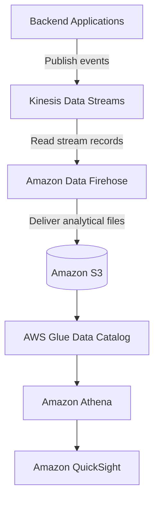
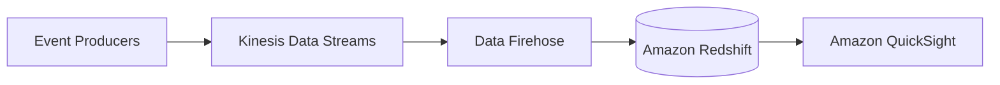
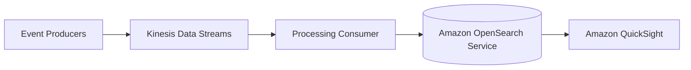
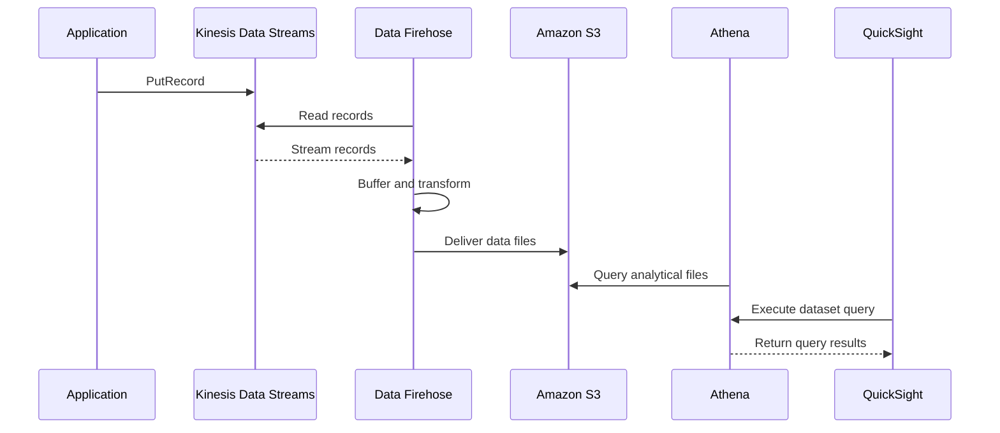
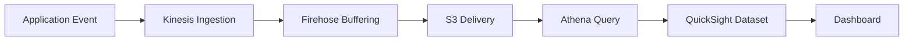

# 08- Amazon QuickSight Integration

## Overview

Amazon QuickSight is a managed business intelligence (BI) and data visualization service used to build interactive dashboards, analytical reports, and operational insights from application and streaming data.

In an Amazon Kinesis architecture, QuickSight provides the visualization and analytics layer. Kinesis captures and transports streaming records, while a downstream data pipeline prepares and stores the data in a format suitable for analytical queries.

QuickSight is not a native Kinesis Data Streams consumer. A typical integration uses an intermediate analytics service or storage layer, such as:

- Amazon Data Firehose
- Amazon S3
- AWS Glue Data Catalog
- Amazon Athena
- Amazon Redshift
- Amazon OpenSearch Service

For example, an application can publish order events to Kinesis Data Streams, deliver them to Amazon S3 through Data Firehose, query the resulting datasets using Athena, and visualize the results through QuickSight.

This architecture separates real-time event ingestion from analytical querying and dashboard rendering.

## Architecture Overview

### Kinesis to QuickSight Through S3 and Athena

A common architecture uses Kinesis Data Streams, Data Firehose, S3, Athena, and QuickSight.



### Component Responsibilities

| Component | Responsibility |
|---|---|
| Kinesis Data Streams | Captures application events in real time |
| Amazon Data Firehose | Buffers, optionally transforms, and delivers streaming records |
| Amazon S3 | Stores analytical datasets |
| AWS Glue Data Catalog | Maintains table and schema metadata |
| Amazon Athena | Executes SQL queries against S3 data |
| Amazon QuickSight | Builds dashboards and analytical visualizations |

### Why Use an Intermediate Analytics Layer?

Kinesis Data Streams is designed for streaming ingestion and consumption. QuickSight is designed for analytical visualization.

These services have different access and processing models.

| Kinesis Data Streams | QuickSight |
|---|---|
| Stream-oriented ingestion | Analytical visualization |
| Records organized into shards | Data organized into datasets |
| Consumers process records continuously | Dashboards query prepared datasets |
| Supports low-latency event processing | Supports interactive analytical queries |
| Retains records for a configurable period | Uses SPICE or direct query depending on the data source |

The intermediate storage and query layers make streaming data accessible through analytical interfaces.

## Amazon QuickSight Integration Patterns

The integration architecture depends on data freshness requirements, query complexity, volume, and operational cost.

### Kinesis Data Streams to S3 to Athena

This is a common pattern for historical and near-real-time analytics.

Data Firehose delivers records to S3, and Athena queries the stored data.

Advantages:

- Durable analytical storage.
- SQL-based querying.
- Separation between ingestion and visualization.
- Support for partitioned datasets.
- Integration with QuickSight through Athena.

Limitations:

- Data freshness depends on delivery buffering and query execution.
- Athena queries can become expensive when scanning large datasets.
- File format and partition design affect query performance.

Use this pattern for operational reporting, business dashboards, event analytics, and historical trend analysis.

### Kinesis Data Streams to Amazon Redshift



Redshift is appropriate when analytical workloads require:

- Complex SQL queries.
- Large-scale joins and aggregations.
- Centralized data warehousing.
- Curated dimensional models.
- Repeated dashboard queries over large datasets.

QuickSight can connect to Redshift using supported database connectivity and authentication configurations.

### Kinesis Data Streams to OpenSearch



OpenSearch is useful for search-oriented and operational analytics workloads.

It can support dashboards involving:

- Application logs.
- Infrastructure events.
- Search activity.
- Operational metrics.
- Event filtering and aggregations.

QuickSight integration depends on the supported OpenSearch data source and deployment configuration.

### Architecture Selection

| Requirement | Suggested Architecture |
|---|---|
| Historical event analytics | Kinesis → Firehose → S3 → Athena → QuickSight |
| SQL-heavy analytical workloads | Kinesis → Firehose → Redshift → QuickSight |
| Search-oriented operational analytics | Kinesis → Consumer → OpenSearch → QuickSight |
| Long-term analytical storage | Kinesis → Firehose → S3 |
| Interactive dashboards over curated datasets | Athena or Redshift → QuickSight |
| Low-latency operational dashboards | Dedicated real-time processing and monitoring architecture |

## Preparing Kinesis Data for QuickSight

QuickSight dashboards depend on the quality and structure of the underlying analytical dataset.

Raw streaming records are rarely suitable for direct business reporting.

A production pipeline should normalize events, validate schemas, remove invalid records, and organize data into query-efficient formats.

### Example Application Event

Consider an order-processing platform that publishes events to Kinesis.

A simplified event might look like:

```json
{
  "event_id": "evt-10001",
  "event_type": "order_completed",
  "event_timestamp": "2026-11-22T09:30:00Z",
  "order_id": "ord-50001",
  "customer_id": "cust-20001",
  "region": "ap-south-1",
  "amount": 2499.50,
  "currency": "INR",
  "status": "completed"
}
```

A processing pipeline can convert these records into Parquet files stored in S3.

Example analytical schema:

| Column | Type | Purpose |
|---|---|---|
| `event_id` | string | Event identifier |
| `event_type` | string | Business event category |
| `event_timestamp` | timestamp | Event occurrence time |
| `order_id` | string | Order identifier |
| `customer_id` | string | Customer identifier |
| `region` | string | Business or AWS Region |
| `amount` | decimal | Order amount |
| `currency` | string | Currency code |
| `status` | string | Processing status |

Use explicit schema definitions rather than relying on inconsistent inference from arbitrary JSON records.

### Data Format Selection

| Format | Characteristics | Recommended Use |
|---|---|---|
| JSON | Human-readable, flexible | Initial ingestion and debugging |
| CSV | Simple tabular representation | Small, straightforward datasets |
| Parquet | Columnar, compressed, typed | Analytical datasets |
| ORC | Columnar storage | Analytical workloads supported by the query engine |
| Avro | Schema-oriented serialization | Event transport and schema evolution |

For Athena-backed QuickSight datasets, Parquet is generally preferable for large analytical datasets because columnar storage reduces unnecessary data scanning.

## Configuring Kinesis Data Firehose Delivery to S3

Amazon Data Firehose can consume records from Kinesis Data Streams and deliver them to S3.

It provides buffering, compression, optional data transformation, and delivery management.

### Delivery Flow



### Create an S3 Destination

Create an S3 bucket:

```bash
aws s3api create-bucket \
  --bucket company-kinesis-analytics-data \
  --region ap-south-1 \
  --create-bucket-configuration LocationConstraint=ap-south-1
```

Enable versioning where object recovery and historical version retention are required:

```bash
aws s3api put-bucket-versioning \
  --bucket company-kinesis-analytics-data \
  --versioning-configuration Status=Enabled \
  --region ap-south-1
```

Configure encryption, lifecycle policies, and access controls before delivering production data.

### Firehose Delivery Configuration

A Firehose delivery stream can use Kinesis Data Streams as its source and S3 as its destination.

A representative Terraform configuration is:

```hcl
resource "aws_iam_role" "firehose_role" {
  name = "kinesis-analytics-firehose-role"

  assume_role_policy = jsonencode({
    Version = "2012-10-17"

    Statement = [
      {
        Effect = "Allow"

        Principal = {
          Service = "firehose.amazonaws.com"
        }

        Action = "sts:AssumeRole"
      }
    ]
  })
}

resource "aws_kinesis_firehose_delivery_stream" "analytics" {
  name        = "orders-analytics-delivery"
  destination = "extended_s3"

  kinesis_source_configuration {
    kinesis_stream_arn = aws_kinesis_stream.orders.arn
    role_arn           = aws_iam_role.firehose_role.arn
  }

  extended_s3_configuration {
    role_arn   = aws_iam_role.firehose_role.arn
    bucket_arn = aws_s3_bucket.analytics.arn
    prefix     = "orders/year=!{timestamp:yyyy}/month=!{timestamp:MM}/day=!{timestamp:dd}/"

    error_output_prefix = "errors/!{firehose:error-output-type}/"

    buffering_size     = 64
    buffering_interval = 60

    compression_format = "GZIP"
  }
}
```

This is a resource-level illustration. The IAM role also needs the required Kinesis read permissions, S3 delivery permissions, and any applicable KMS permissions. The referenced stream and bucket must be defined in the Terraform configuration.

For production analytical workloads, evaluate Parquet or ORC conversion through Firehose's supported data format conversion configuration and Glue schema integration rather than simply compressing JSON.

### Buffering Considerations

Firehose buffers incoming data before delivering it to the destination.

The buffering configuration affects:

- Delivery latency.
- S3 object size.
- Number of S3 objects created.
- Query performance.
- Storage request costs.

Smaller buffers can improve freshness but generate more files. Larger buffers reduce file counts but increase delivery latency.

Choose buffering settings based on dashboard freshness requirements and expected event volume.

## Creating an Athena Table

After Firehose delivers records to S3, Athena needs table metadata to query the dataset.

The AWS Glue Data Catalog stores this metadata.

### Example Athena Table

For a Parquet dataset partitioned by date:

```sql
CREATE EXTERNAL TABLE IF NOT EXISTS analytics.orders (
    event_id STRING,
    event_type STRING,
    event_timestamp TIMESTAMP,
    order_id STRING,
    customer_id STRING,
    region STRING,
    amount DECIMAL(12, 2),
    currency STRING,
    status STRING
)
PARTITIONED BY (
    year STRING,
    month STRING,
    day STRING
)
STORED AS PARQUET
LOCATION 's3://company-kinesis-analytics-data/orders/';
```

The table definition must match the actual Parquet schema and partition layout.

### Partition Projection

For predictable date-based partition structures, Athena partition projection can reduce the need to register every partition individually.

Example:

```sql
ALTER TABLE analytics.orders
SET TBLPROPERTIES (
    'projection.enabled' = 'true',
    'projection.year.type' = 'integer',
    'projection.year.range' = '2024,2030',
    'projection.month.type' = 'integer',
    'projection.month.range' = '1,12',
    'projection.day.type' = 'integer',
    'projection.day.range' = '1,31',
    'storage.location.template' =
        's3://company-kinesis-analytics-data/orders/year=${year}/month=${month}/day=${day}/'
);
```

Partition projection is useful when partition paths follow predictable patterns. It does not remove the need to ensure that the underlying data layout and partition values are correct.

### Query the Dataset

```sql
SELECT
    region,
    currency,
    COUNT(*) AS completed_orders,
    SUM(amount) AS total_revenue
FROM analytics.orders
WHERE year = '2026'
  AND month = '11'
  AND day = '22'
  AND status = 'completed'
GROUP BY
    region,
    currency
ORDER BY total_revenue DESC;
```

Filtering on partition columns reduces the amount of data scanned.

## Connecting QuickSight to Athena

QuickSight can use Athena as a data source.

The integration requires appropriate AWS permissions and access to the Athena query results location.

### Prerequisites

Before configuring the connection:

- Athena workgroup is available.
- Glue Data Catalog contains the required tables.
- S3 analytical data is accessible.
- Athena query results location is configured.
- QuickSight has the required Athena and S3 permissions.
- KMS permissions are configured if encrypted resources are involved.

### Configure Athena Query Results

Create a dedicated S3 bucket or prefix for Athena query results.

For example:

```text
s3://company-athena-query-results/
```

Configure the Athena workgroup to use the designated output location.

```bash
aws athena update-work-group \
  --work-group primary \
  --configuration-updates '{
    "ResultConfigurationUpdates": {
      "OutputLocation": "s3://company-athena-query-results/"
    }
  }' \
  --region ap-south-1
```

The query-results location is separate from the source data location.

### QuickSight Connection Workflow

1. Open the Amazon QuickSight console.
2. Navigate to datasets.
3. Create a new dataset.
4. Select Athena as the data source.
5. Select the appropriate AWS Region and workgroup.
6. Choose the Glue Data Catalog database.
7. Select the required table or define a custom SQL query.
8. Choose the data access mode.
9. Configure fields and data types.
10. Publish the dataset for dashboard development.

The exact console options depend on the QuickSight edition, account configuration, and supported data source settings.

### Permissions

QuickSight requires access to the resources used by Athena.

Depending on the configuration, permissions may include:

| Permission Area | Purpose |
|---|---|
| Athena | Execute queries and inspect query metadata |
| Glue Data Catalog | Read database, table, and schema metadata |
| S3 source bucket | Read analytical files |
| S3 query-results bucket | Read and write Athena query results as required |
| KMS | Decrypt or encrypt data and query results when customer-managed keys are used |

Use QuickSight's managed AWS resource permissions where appropriate, and restrict access to only the required databases, tables, buckets, prefixes, and keys.

## SPICE and Direct Query

QuickSight supports two primary dataset access modes:

- SPICE
- Direct query

SPICE is QuickSight's in-memory calculation engine. It imports data into a managed analytical store for dashboard queries.

Direct query executes queries against the underlying data source when users interact with dashboards.

### Comparison

| Characteristic | SPICE | Direct Query |
|---|---|---|
| Data access | Imported dataset | Queries underlying source |
| Dashboard performance | Generally fast for supported workloads | Depends on source query performance |
| Data freshness | Depends on refresh schedule | Depends on source and query execution |
| Source load | Reduced during dashboard interaction | Queries execute against the source |
| Capacity | Subject to SPICE capacity and ingestion limits | Subject to source capacity and service limits |
| Suitable workloads | Repeated interactive dashboards | Data requiring source-level freshness |

### When to Use SPICE

Use SPICE when:

- Dashboard interaction must be responsive.
- The dataset is reused across many dashboards.
- Source query costs should be reduced.
- Scheduled refresh is acceptable.
- Data can be imported within SPICE capacity limits.

### When to Use Direct Query

Use Direct Query when:

- Source data must be queried without a scheduled SPICE import.
- The source supports the required query workload.
- Dataset size or refresh requirements make import unsuitable.
- Users need access to recently delivered data.

Direct Query does not guarantee that every new Kinesis record appears immediately. The data must first reach the analytical source, and the source query must observe the delivered data.

### SPICE Refresh Strategy

A practical refresh strategy depends on the business reporting requirement.

| Dashboard Type | Possible Refresh Strategy |
|---|---|
| Executive revenue dashboard | Periodic scheduled refresh |
| Operational order dashboard | More frequent refresh or Direct Query |
| Historical business analytics | Scheduled refresh |
| Financial reconciliation | Controlled refresh after data validation |
| High-volume event reporting | Curated aggregates and scheduled refresh |

Avoid refreshing large datasets more frequently than necessary. Refresh frequency affects ingestion capacity, source load, and operational cost.

## Building Analytical Datasets

A useful QuickSight dataset should represent business concepts rather than raw transport records.

For an order analytics dashboard, create curated datasets such as:

- Orders by region.
- Revenue by day.
- Order completion rate.
- Average order value.
- Failed order count.
- Event processing latency.

### Example Aggregation Query

```sql
SELECT
    DATE(event_timestamp) AS order_date,
    region,
    currency,
    COUNT(DISTINCT order_id) AS total_orders,
    SUM(amount) AS total_revenue,
    AVG(amount) AS average_order_value
FROM analytics.orders
WHERE status = 'completed'
GROUP BY
    DATE(event_timestamp),
    region,
    currency;
```

This query produces a daily analytical dataset.

For high-volume workloads, consider materializing aggregates into separate S3 datasets or a warehouse table rather than repeatedly scanning raw event data.

### Data Modeling Considerations

A reporting model should distinguish between:

- Event-level facts.
- Transaction-level facts.
- Customer dimensions.
- Product dimensions.
- Region dimensions.
- Time dimensions.

For example, a single order may generate several events:

```text
order_created
payment_authorized
order_completed
order_shipped
```

Counting all event records as orders would inflate business metrics.

Choose the correct event type and business key for every measure.

## Creating QuickSight Dashboards

QuickSight provides visualizations that can be combined into interactive dashboards.

Typical visualizations for a Kinesis-backed order analytics system include:

| Visualization | Business Metric |
|---|---|
| KPI card | Total revenue |
| Line chart | Revenue over time |
| Bar chart | Orders by region |
| Pie or donut chart | Order distribution by status |
| Table | Recent order events |
| Heat map | Activity by region and time |
| Funnel chart | Order processing stages |

### Example Dashboard Layout

```text
+-------------------------------------------------------+
|                 Order Analytics Dashboard            |
+----------------+----------------+---------------------+
| Total Orders   | Total Revenue  | Completion Rate     |
+----------------+----------------+---------------------+
|                                                       |
|              Revenue Trend by Day                    |
|                                                       |
+-------------------------------+-----------------------+
| Orders by Region              | Orders by Status      |
|                               |                       |
+-------------------------------+-----------------------+
|                                                       |
|              Recent Order Activity                   |
|                                                       |
+-------------------------------------------------------+
```

### Filters and Controls

Useful dashboard filters include:

- Date range.
- Region.
- Order status.
- Currency.
- Product category.
- Customer segment.

Filters should be applied consistently across related visualizations.

Avoid building dashboards that require scanning the entire historical dataset for every interaction.

## Python-Based Event Preparation

A Python consumer can validate and normalize events before they enter the analytical storage pipeline.

For example, a Kinesis consumer may validate records and produce normalized JSON for downstream delivery.

```python
import json
from datetime import datetime, timezone
from decimal import Decimal


def normalize_order_event(record: dict) -> dict:
    required_fields = {
        "event_id",
        "event_type",
        "event_timestamp",
        "order_id",
        "amount",
        "currency",
        "status",
    }

    missing = required_fields - record.keys()

    if missing:
        raise ValueError(
            f"Missing required fields: {sorted(missing)}"
        )

    timestamp = datetime.fromisoformat(
        record["event_timestamp"].replace("Z", "+00:00")
    )

    if timestamp.tzinfo is None:
        raise ValueError("Event timestamp must include a timezone")

    amount = Decimal(str(record["amount"]))

    if not amount.is_finite() or amount < 0:
        raise ValueError("Invalid order amount")

    normalized = {
        "event_id": str(record["event_id"]),
        "event_type": str(record["event_type"]),
        "event_timestamp": timestamp.astimezone(
            timezone.utc
        ).isoformat(),
        "order_id": str(record["order_id"]),
        "customer_id": record.get("customer_id"),
        "region": str(record.get("region", "unknown")),
        "amount": str(amount),
        "currency": str(record["currency"]).upper(),
        "status": str(record["status"]).lower(),
    }

    return normalized


def serialize_event(record: dict) -> bytes:
    normalized = normalize_order_event(record)

    return json.dumps(
        normalized,
        separators=(",", ":"),
    ).encode("utf-8")
```

This example demonstrates validation and normalization. A production consumer should also implement:

- Schema version validation.
- Duplicate-event handling.
- Invalid-record routing.
- Checkpoint management.
- Bounded processing concurrency.
- Structured logging.
- Retry classification.
- Monitoring of consumer lag.

For analytics pipelines, avoid silently dropping invalid events. Store rejected records in a controlled error location for investigation and replay.

## Data Freshness and Latency

The end-to-end freshness of a QuickSight dashboard depends on several independent stages.



The total latency includes:

- Event production and Kinesis ingestion.
- Consumer or Firehose delivery delay.
- S3 buffering and object creation.
- Query execution and data visibility.
- SPICE refresh interval, if applicable.
- Dashboard query and rendering time.

A dashboard cannot be fresher than its slowest upstream stage.

### Improving Freshness

- Tune Firehose buffering based on the required delivery interval.
- Use efficient file formats and appropriate object sizes.
- Avoid excessive partition granularity.
- Use Direct Query where supported and appropriate.
- Refresh SPICE according to business freshness requirements.
- Materialize frequently used aggregates.
- Monitor event ingestion-to-dashboard latency.

For genuinely real-time operational monitoring, CloudWatch dashboards or a purpose-built streaming dashboard may be more suitable than a conventional BI dashboard.

## Security and Access Control

QuickSight integration should protect both the underlying event data and the analytical views.

### IAM and Resource Permissions

Apply least-privilege permissions to:

- Kinesis streams.
- Firehose delivery streams.
- S3 buckets and prefixes.
- Glue databases and tables.
- Athena workgroups.
- Athena query-results buckets.
- KMS keys.
- QuickSight datasets and dashboards.

Use separate roles for ingestion, transformation, querying, and visualization where practical.

### S3 Security

Recommended controls include:

- Block Public Access.
- Bucket policies restricting access to approved principals.
- Server-side encryption.
- TLS for service communication.
- Versioning where recovery requirements justify it.
- Lifecycle policies.
- Access logging and audit trails.

### QuickSight Row-Level Security

Row-level security (RLS) restricts which dataset rows a user can access.

For example, regional managers may be allowed to view only records belonging to their assigned regions.

A simplified permission dataset might look like:

| User | Allowed Region |
|---|---|
| manager-a@example.com | ap-south-1 |
| manager-b@example.com | eu-west-1 |
| analyst@example.com | ap-south-1 |
| analyst@example.com | eu-west-1 |

RLS should be designed and tested as an authorization control.

Do not rely only on dashboard filters to protect sensitive data. Dashboard filters are not a substitute for dataset-level access controls.

### Column-Level Security

Use column-level permissions when users must not access sensitive fields such as:

- Customer email addresses.
- Phone numbers.
- Payment identifiers.
- Internal risk scores.
- Confidential business attributes.

Prefer excluding unnecessary sensitive fields from analytical datasets entirely.

### Encryption

Consider encryption at each layer:

| Layer | Security Control |
|---|---|
| Kinesis | Server-side encryption |
| Firehose | Encrypted delivery configuration |
| S3 | SSE-S3 or SSE-KMS |
| Athena | Encrypted query results |
| Redshift | Cluster encryption |
| QuickSight | Service-managed security and supported data-source permissions |

When customer-managed KMS keys are used, validate key policies and permissions for each service role.

## Monitoring and Operations

Monitor ingestion, delivery, query execution, dataset refresh, and dashboard availability as separate operational stages.

### Kinesis Metrics

Important Kinesis Data Streams metrics include:

- `IncomingRecords`
- `IncomingBytes`
- `OutgoingRecords`
- `OutgoingBytes`
- `WriteProvisionedThroughputExceeded`
- `ReadProvisionedThroughputExceeded`
- `GetRecords.IteratorAgeMilliseconds`
- `OpenShardCount`

Consumer lag is particularly important because delayed consumption affects downstream analytical freshness.

### Firehose Metrics

Monitor:

- Delivery success.
- Delivery failures.
- Data freshness.
- Incoming and delivered bytes.
- S3 destination errors.
- Transformation failures.
- Backup and error-output volume.

Use the relevant Firehose CloudWatch metrics for the configured destination and processing mode.

### Athena Metrics

Monitor:

- Query execution failures.
- Query duration.
- Data scanned.
- Workgroup usage.
- Query concurrency.
- Query-result storage.

Partition pruning and columnar formats are important controls for reducing scan costs.

### QuickSight Operations

Monitor:

- Dataset refresh failures.
- SPICE ingestion duration.
- Dataset ingestion errors.
- Dashboard access issues.
- Source query failures.
- User access and permission changes.

### Operational Alerts

| Condition | Operational Response |
|---|---|
| Kinesis consumer lag increases | Investigate consumer throughput and shard capacity |
| Firehose delivery failures | Check destination permissions, KMS, and service errors |
| S3 data freshness degrades | Inspect Firehose buffering and delivery metrics |
| Athena query cost increases | Review partition filters and file formats |
| SPICE refresh fails | Inspect source connectivity, permissions, and ingestion errors |
| Dashboard data becomes stale | Trace the complete ingestion-to-visualization pipeline |

## Cost Optimization

QuickSight integration introduces costs across ingestion, storage, querying, and visualization.

| Service | Main Cost Drivers | Optimization |
|---|---|---|
| Kinesis Data Streams | Stream capacity, retention, consumers | Select suitable capacity mode and avoid unnecessary retention |
| Data Firehose | Data ingestion and transformation features | Tune buffering and avoid unnecessary transformations |
| S3 | Storage, requests, lifecycle transitions | Use lifecycle policies and compact files |
| Athena | Data scanned by queries | Use Parquet, compression, and partition pruning |
| Redshift | Compute and storage | Right-size workloads and optimize queries |
| QuickSight | User access, capacity, SPICE, and supported features | Select appropriate licensing and dataset strategy |
| CloudWatch | Metrics, logs, and alarms | Control log volume and retention |

### Athena Cost Optimization

Use the following practices:

- Store analytical datasets in Parquet or ORC.
- Compress files.
- Partition data by frequently filtered dimensions.
- Avoid excessive small files.
- Select only required columns.
- Use Athena workgroups to manage query configuration and usage controls.
- Materialize frequently repeated aggregations.

### File Compaction

Firehose buffering and upstream delivery patterns can create many small S3 files.

Small files increase query planning overhead and reduce analytical efficiency.

A scheduled compaction process can combine small files into larger Parquet files.

The appropriate file size depends on query patterns and workload volume. Avoid choosing a fixed target without measuring actual performance.

## Reliability and Disaster Recovery

The analytics pipeline should tolerate ingestion failures, delivery delays, schema changes, and query-service interruptions.

### Failure Handling

| Failure | Recommended Handling |
|---|---|
| Kinesis consumer failure | Restart consumer and recover from durable checkpoints |
| Firehose delivery failure | Inspect destination errors and configure supported backup behavior |
| Invalid event schema | Route invalid records to a controlled error location |
| Athena query failure | Retry transient failures and investigate permanent query errors |
| SPICE ingestion failure | Inspect source and dataset configuration before retrying |
| S3 access failure | Validate IAM, bucket policies, and KMS permissions |

### Retention and Replay

Kinesis retention and S3 retention serve different purposes.

Kinesis retention controls how long stream records remain available for consumers to read. S3 retention controls how long analytical objects remain available.

For historical replay and long-term analytics, S3 should generally serve as the durable analytical archive.

A replay strategy should define:

- Source dataset and time range.
- Schema version compatibility.
- Duplicate handling.
- Reprocessing ownership.
- Output dataset isolation.
- Validation before publishing refreshed datasets.

### Disaster Recovery

A complete recovery design should consider:

- Kinesis stream recovery.
- Firehose configuration recovery.
- S3 replication and object recovery.
- Glue Catalog metadata recovery.
- Athena workgroup configuration.
- QuickSight dataset and dashboard recovery.
- IAM and KMS policy recovery.

S3 replication does not automatically replicate Glue metadata, Athena workgroups, QuickSight datasets, or dashboards.

Treat these as separate infrastructure and application dependencies.

## Common Mistakes and Production Pitfalls

| Mistake | Impact | Recommended Approach |
|---|---|---|
| Assuming QuickSight directly consumes Kinesis Data Streams | Incorrect integration design | Use a supported analytical data source or intermediate storage layer |
| Expecting every event to appear immediately | Incorrect freshness expectations | Account for buffering, delivery, query, and refresh latency |
| Loading raw JSON into large analytical datasets | Higher scan cost and slower queries | Use curated columnar datasets |
| Ignoring schema evolution | Broken queries and dataset refresh failures | Version schemas and manage compatibility |
| Creating too many small S3 files | Query planning overhead and reduced efficiency | Tune buffering and compact files |
| Using Direct Query for every dashboard | Excessive source query load | Evaluate SPICE and materialized aggregates |
| Refreshing SPICE too frequently | Increased ingestion load and cost | Align refresh frequency with business requirements |
| Treating dashboard filters as security | Potential data exposure | Use RLS and column-level security |
| Ignoring Kinesis consumer lag | Increasing analytical freshness delay | Monitor iterator age and consumer capacity |
| Using event counts as transaction counts | Incorrect business metrics | Model business entities and deduplicate events |
| Omitting Athena partition filters | Unnecessary data scanning | Apply partition pruning |
| Assuming S3 replication provides complete DR | Missing analytical metadata and configuration | Recover each dependent service separately |

## Production Readiness Checklist

### Ingestion

- [ ] Kinesis stream capacity is appropriate for expected traffic.
- [ ] Consumer lag is monitored.
- [ ] Event schemas are versioned.
- [ ] Invalid records are routed for investigation.
- [ ] Duplicate events are handled correctly.

### Delivery and Storage

- [ ] Firehose delivery configuration is tested.
- [ ] S3 bucket access is restricted.
- [ ] Encryption is enabled.
- [ ] Buffering settings meet freshness requirements.
- [ ] Data format and partition structure support analytical queries.
- [ ] Lifecycle policies are configured.

### Query Layer

- [ ] Glue schemas match actual data.
- [ ] Athena workgroups are configured.
- [ ] Query results use a dedicated S3 location.
- [ ] Partition pruning is verified.
- [ ] Query cost and duration are monitored.
- [ ] Data quality checks are implemented.

### QuickSight

- [ ] Athena or warehouse connectivity is configured.
- [ ] SPICE or Direct Query is selected based on workload requirements.
- [ ] Dataset refresh schedules meet business requirements.
- [ ] RLS is tested.
- [ ] Sensitive columns are protected.
- [ ] Dashboard access is restricted appropriately.

### Operations

- [ ] End-to-end data freshness is measured.
- [ ] Delivery and query failures generate alerts.
- [ ] Replay procedures are documented.
- [ ] Recovery dependencies are documented.
- [ ] Cost is monitored across the entire pipeline.

## Key Takeaways

- Amazon QuickSight is an analytics and visualization layer, not a native Kinesis Data Streams consumer; use services such as Firehose, S3, Athena, or Redshift to prepare streaming data for analysis.
- S3 with Athena provides a practical architecture for historical and near-real-time dashboards, while Redshift is suitable for more complex warehouse workloads.
- SPICE improves dashboard responsiveness through imported datasets, whereas Direct Query executes against the underlying data source and depends on its performance and freshness.
- Analytical data quality, schema evolution, partitioning, columnar formats, and event deduplication directly affect dashboard correctness and query cost.
- Production integrations require least-privilege access, row-level security, end-to-end freshness monitoring, controlled refresh strategies, and independently managed disaster recovery.