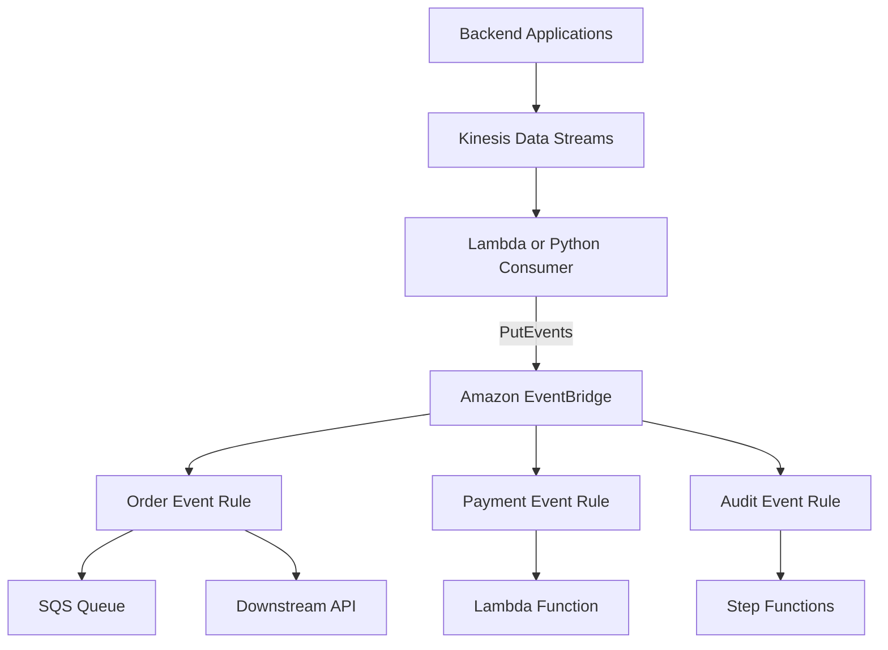
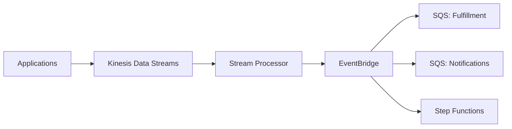
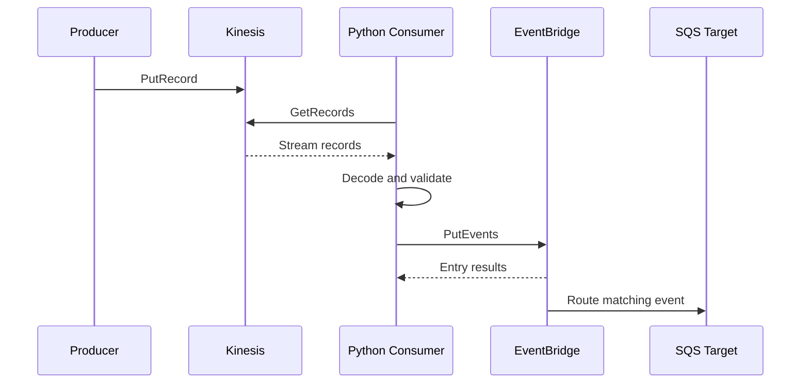
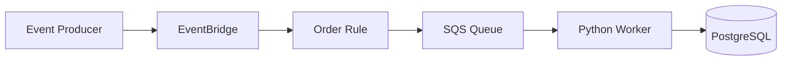
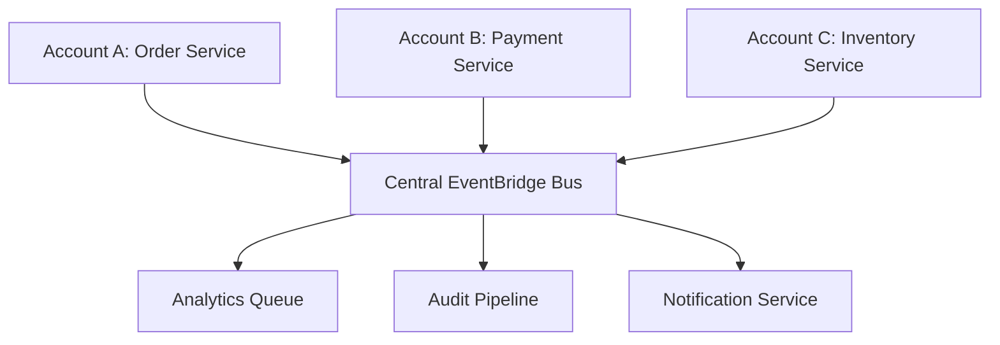

# 09- EventBridge Integration

## Overview

Amazon EventBridge is a serverless event bus service that enables applications and AWS services to communicate through event-driven architectures.

In a Kinesis-based architecture, EventBridge complements streaming ingestion by providing event routing, filtering, and integration with downstream AWS services.

Kinesis Data Streams is optimized for high-throughput streaming data with shard-based consumption, retention, and ordered records within a shard. EventBridge is designed for routing discrete events between producers and consumers using event buses, rules, and targets.

The two services solve different problems:

- **Kinesis Data Streams:** Captures and distributes high-volume streaming records to consumers.
- **Amazon EventBridge:** Routes events to selected targets based on event content and routing rules.

A common architecture uses Kinesis for ingestion and processing, then publishes business events to EventBridge for downstream application integration.

## Kinesis and EventBridge Architecture

### Understanding the Integration

Kinesis Data Streams does not automatically publish every record to EventBridge. An integration component must consume records from Kinesis and publish appropriate events to an EventBridge event bus.

The integration can be implemented using:

- AWS Lambda with a Kinesis event source mapping.
- A custom Python consumer.
- An ECS or EKS application.
- Another supported event-processing service.

### High-Level Architecture



The consumer acts as an adapter between the Kinesis streaming model and the EventBridge event-routing model.

### Component Responsibilities

| Component | Responsibility |
|---|---|
| Kinesis Data Streams | Ingests and retains streaming records |
| Kinesis Consumer | Reads records and transforms them into business events |
| EventBridge Event Bus | Receives and distributes events |
| EventBridge Rules | Match events using event patterns |
| EventBridge Targets | Receive matching events |
| SQS | Buffers events for asynchronous consumers |
| Lambda | Executes event-driven processing |
| Step Functions | Orchestrates multi-step workflows |
| CloudWatch | Monitors ingestion, publishing, routing, and failures |

## Amazon EventBridge Core Concepts

### Event Bus

An event bus is a logical destination that receives events from producers and routes them to matching rules.

EventBridge provides different event bus types.

| Event Bus | Purpose |
|---|---|
| Default event bus | Receives events from AWS services in the account |
| Custom event bus | Receives application and custom events |
| Partner event bus | Receives events from integrated SaaS partners |

For a Kinesis integration, a custom event bus is generally appropriate when a backend application publishes business events.

Example:

```text
company-business-events
```

### Event

An EventBridge event is a JSON object containing metadata and an event payload.

A custom business event might look like:

```json
{
  "Source": "com.company.orders",
  "DetailType": "OrderCompleted",
  "Detail": {
    "event_id": "evt-10001",
    "order_id": "ord-50001",
    "customer_id": "cust-20001",
    "amount": 2499.50,
    "currency": "INR",
    "region": "ap-south-1",
    "status": "completed"
  },
  "EventBusName": "company-business-events"
}
```

EventBridge adds envelope metadata when the event is accepted.

A resulting event has a structure similar to:

```json
{
  "version": "0",
  "id": "example-event-id",
  "detail-type": "OrderCompleted",
  "source": "com.company.orders",
  "account": "123456789012",
  "time": "2026-11-22T09:30:00Z",
  "region": "ap-south-1",
  "resources": [],
  "detail": {
    "event_id": "evt-10001",
    "order_id": "ord-50001",
    "customer_id": "cust-20001",
    "amount": 2499.50,
    "currency": "INR",
    "region": "ap-south-1",
    "status": "completed"
  }
}
```

Important fields:

| Field | Purpose |
|---|---|
| `version` | Event envelope version |
| `id` | EventBridge-generated event identifier |
| `source` | Identifies the event producer |
| `detail-type` | Identifies the business event type |
| `time` | Event timestamp |
| `region` | AWS Region where the event originated |
| `account` | AWS account identifier |
| `resources` | Related resource identifiers |
| `detail` | Application-specific event payload |

The producer should include its own stable business event ID inside `detail`. The EventBridge-generated `id` identifies the accepted EventBridge event, but it should not replace application-level idempotency identifiers.

### Rules

Rules evaluate events using event patterns.

A rule can route matching events to one or more targets.

For example, an order-processing application may define:

- `OrderCompleted` events for fulfillment.
- `PaymentFailed` events for notification.
- `OrderCancelled` events for inventory reconciliation.

### Targets

Targets are the destinations that receive matching events.

Common targets include:

- SQS queues.
- Lambda functions.
- Step Functions state machines.
- SNS topics.
- Event buses.
- API destinations.
- Supported AWS services.

A rule can have multiple targets, allowing independent consumers to receive the same event.

## EventBridge Versus Kinesis Data Streams

Although both services support event-driven architectures, their delivery and processing models are different.

| Characteristic | Kinesis Data Streams | Amazon EventBridge |
|---|---|---|
| Primary purpose | Streaming ingestion | Event routing |
| Data model | Records in a stream | Structured JSON events |
| Ordering | Per-shard ordering | No general ordering guarantee |
| Retention | Configurable stream retention | Not a general-purpose event archive by default |
| Consumption | Shard iterators, enhanced fan-out, KCL | Rules and targets |
| Filtering | Consumer-side filtering and supported enhanced fan-out filtering | Event patterns |
| Throughput model | Shard or on-demand capacity | Service quotas and event bus limits |
| Replay | Read retained records using sequence positions | Archive and replay when configured |
| Typical use case | High-volume event streams | Application integration and routing |

### When to Use Kinesis

Use Kinesis Data Streams when:

- High-throughput streaming ingestion is required.
- Consumers need independent stream processing.
- Ordering within a partition is important.
- Records must remain available for a configurable retention period.
- Stream-processing frameworks or custom consumers are required.

### When to Use EventBridge

Use EventBridge when:

- Multiple services need selected business events.
- Routing depends on event content.
- Application components should remain loosely coupled.
- AWS service integrations are required.
- Cross-account event distribution is needed.
- Event-driven workflow orchestration is required.

### Using Both Services

Use both when the architecture needs high-throughput ingestion and flexible downstream event routing.



Do not route every raw Kinesis record through EventBridge without evaluating throughput, cost, event size, and downstream requirements.

## Creating an EventBridge Event Bus

Create a custom event bus for application events.

```bash
aws events create-event-bus \
  --name company-business-events \
  --region ap-south-1
```

Retrieve the event bus ARN:

```bash
aws events describe-event-bus \
  --name company-business-events \
  --region ap-south-1
```

List event buses:

```bash
aws events list-event-buses \
  --region ap-south-1
```

Delete an event bus when it is no longer required:

```bash
aws events delete-event-bus \
  --name company-business-events \
  --region ap-south-1
```

Before deleting an event bus, inspect its rules, targets, permissions, and dependent applications.

## Publishing Kinesis Records to EventBridge

A Kinesis consumer reads records, validates them, and publishes selected business events using the EventBridge `PutEvents` API.

### Python Dependencies

```bash
pip install boto3
```

### Event Publisher

```python
import json
import logging
import os

import boto3
from botocore.config import Config

logger = logging.getLogger(__name__)

AWS_REGION = os.getenv("AWS_REGION", "ap-south-1")
EVENT_BUS_NAME = os.environ["EVENT_BUS_NAME"]

eventbridge = boto3.client(
    "events",
    region_name=AWS_REGION,
    config=Config(
        connect_timeout=5,
        read_timeout=10,
        retries={
            "mode": "standard",
            "max_attempts": 5,
        },
    ),
)


def publish_order_event(order: dict) -> str:
    response = eventbridge.put_events(
        Entries=[
            {
                "EventBusName": EVENT_BUS_NAME,
                "Source": "com.company.orders",
                "DetailType": "OrderCompleted",
                "Detail": json.dumps(order),
            }
        ]
    )

    failed_count = response.get("FailedEntryCount", 0)

    if failed_count:
        failure = response["Entries"][0]

        raise RuntimeError(
            "EventBridge publish failed: "
            f"{failure.get('ErrorCode')} - "
            f"{failure.get('ErrorMessage')}"
        )

    event_id = response["Entries"][0]["EventId"]

    logger.info(
        "Published OrderCompleted event",
        extra={
            "event_id": event_id,
            "business_event_id": order["event_id"],
            "order_id": order["order_id"],
        },
    )

    return event_id
```

Example:

```python
order_event = {
    "event_id": "evt-10001",
    "order_id": "ord-50001",
    "customer_id": "cust-20001",
    "amount": 2499.50,
    "currency": "INR",
    "status": "completed",
}

publish_order_event(order_event)
```

### PutEvents Batch Limits

`PutEvents` supports batching multiple entries in one API request.

Important considerations:

- A request can contain up to 10 entries.
- Each event has a maximum size of 1 MB.
- The API response can report individual entry failures.
- A successful HTTP response does not mean every entry was accepted.
- Retry only failed entries when appropriate.

Example batch publishing:

```python
def publish_events(events: list[dict]) -> None:
    for offset in range(0, len(events), 10):
        batch = events[offset:offset + 10]

        entries = [
            {
                "EventBusName": EVENT_BUS_NAME,
                "Source": "com.company.orders",
                "DetailType": event["event_type"],
                "Detail": json.dumps(event["payload"]),
            }
            for event in batch
        ]

        response = eventbridge.put_events(Entries=entries)

        failed_entries = []

        for original, result in zip(batch, response["Entries"]):
            if "ErrorCode" in result:
                failed_entries.append({
                    "event": original,
                    "error_code": result.get("ErrorCode"),
                    "error_message": result.get("ErrorMessage"),
                })

        if failed_entries:
            logger.error(
                "EventBridge batch contains failed entries",
                extra={"failed_count": len(failed_entries)},
            )
            raise RuntimeError(
                f"{len(failed_entries)} events failed to publish"
            )
```

This example reports failed entries but does not implement durable retry. A production publisher should persist failed events or use a retry mechanism that preserves the original business event ID.

## Kinesis Consumer Integration

A Kinesis consumer can transform stream records into EventBridge events.

The consumer should distinguish between:

- Raw stream records.
- Valid business events.
- Events that should be ignored.
- Invalid records.
- EventBridge publishing failures.

### Data Flow



### Decode Kinesis Records

Kinesis record data is Base64 encoded when returned through the Kinesis API.

```python
import base64
import json


def decode_kinesis_record(record: dict) -> dict:
    encoded_data = record["Data"]

    decoded_data = base64.b64decode(encoded_data)

    return json.loads(decoded_data)
```

### Transform a Stream Record

```python
def transform_to_event(record: dict) -> dict:
    return {
        "event_id": record["event_id"],
        "event_type": record["event_type"],
        "order_id": record["order_id"],
        "customer_id": record.get("customer_id"),
        "amount": record.get("amount"),
        "currency": record.get("currency"),
        "status": record.get("status"),
    }
```

The consumer should publish only events that have a defined business meaning.

For example, internal telemetry records may remain in Kinesis, while selected business events are forwarded to EventBridge.

### Checkpointing and Delivery Guarantees

A Kinesis consumer must coordinate checkpoint advancement with downstream publishing.

Consider this failure sequence:

1. Consumer reads a Kinesis record.
2. Consumer publishes the event to EventBridge.
3. EventBridge accepts the event.
4. Consumer crashes before checkpointing.
5. The record is processed again.
6. The event is published a second time.

This creates duplicate EventBridge events.

The reverse ordering is unsafe:

1. Consumer checkpoints the Kinesis record.
2. Consumer crashes before publishing to EventBridge.
3. The record is no longer available to that consumer position.
4. The business event is lost from the downstream integration path.

Therefore, consumers should publish before checkpointing and use durable idempotency or an outbox-style publishing design.

Kinesis and EventBridge do not participate in a shared distributed transaction.

## Creating EventBridge Rules

Rules define which events should be routed to targets.

A rule contains an event pattern that matches fields in the event envelope and detail payload.

### Example Order Event Pattern

```json
{
  "source": [
    "com.company.orders"
  ],
  "detail-type": [
    "OrderCompleted"
  ],
  "detail": {
    "status": [
      "completed"
    ]
  }
}
```

This pattern matches only completed order events from the specified producer.

### Create a Rule

```bash
aws events put-rule \
  --name order-completed-rule \
  --event-bus-name company-business-events \
  --event-pattern file://order-event-pattern.json \
  --state ENABLED \
  --description "Routes completed order events" \
  --region ap-south-1
```

### Inspect a Rule

```bash
aws events describe-rule \
  --name order-completed-rule \
  --event-bus-name company-business-events \
  --region ap-south-1
```

List rules:

```bash
aws events list-rules \
  --event-bus-name company-business-events \
  --region ap-south-1
```

Disable a rule:

```bash
aws events disable-rule \
  --name order-completed-rule \
  --event-bus-name company-business-events \
  --region ap-south-1
```

Enable it again:

```bash
aws events enable-rule \
  --name order-completed-rule \
  --event-bus-name company-business-events \
  --region ap-south-1
```

## Event Pattern Design

Event patterns are JSON structures that determine whether an event matches a rule.

They support matching on:

- Event source.
- Event type.
- Account and Region.
- Resource identifiers.
- Nested detail fields.
- Numeric values.
- Prefixes and suffixes.
- Exists conditions.
- Multiple accepted values.

### Numeric Matching

Route orders above a defined amount:

```json
{
  "source": [
    "com.company.orders"
  ],
  "detail-type": [
    "OrderCompleted"
  ],
  "detail": {
    "amount": [
      {
        "numeric": [
          ">",
          10000
        ]
      }
    ]
  }
}
```

### Prefix Matching

Route events from a specific business source category:

```json
{
  "source": [
    {
      "prefix": "com.company."
    }
  ]
}
```

### Exists Matching

Match events that contain a customer identifier:

```json
{
  "detail": {
    "customer_id": [
      {
        "exists": true
      }
    ]
  }
}
```

### Pattern Testing

Use the AWS CLI to test event patterns before deploying them.

```bash
aws events test-event-pattern \
  --event-pattern file://order-event-pattern.json \
  --event file://sample-order-event.json \
  --region ap-south-1
```

Pattern testing should be part of infrastructure validation and deployment pipelines.

### Event Pattern Best Practices

- Match on stable event fields.
- Include `source` and `detail-type` to avoid accidental matches.
- Keep business event schemas versioned.
- Avoid broad patterns that route unrelated events.
- Test both positive and negative cases.
- Do not assume missing fields have default values.
- Avoid using event patterns as a substitute for authorization.

## Configuring EventBridge Targets

A rule can route matching events to one or more targets.

### SQS Target

SQS is useful when downstream processing needs buffering, independent scaling, and retry control.



Add an SQS queue as a target:

```bash
aws events put-targets \
  --rule order-completed-rule \
  --event-bus-name company-business-events \
  --targets '[
    {
      "Id": "order-processing-queue",
      "Arn": "arn:aws:sqs:ap-south-1:123456789012:order-processing-queue"
    }
  ]' \
  --region ap-south-1
```

The SQS queue resource policy must allow EventBridge to send messages.

Example policy:

```json
{
  "Version": "2012-10-17",
  "Statement": [
    {
      "Sid": "AllowEventBridgeDelivery",
      "Effect": "Allow",
      "Principal": {
        "Service": "events.amazonaws.com"
      },
      "Action": "sqs:SendMessage",
      "Resource": "arn:aws:sqs:ap-south-1:123456789012:order-processing-queue",
      "Condition": {
        "ArnEquals": {
          "aws:SourceArn": "arn:aws:events:ap-south-1:123456789012:rule/company-business-events/order-completed-rule"
        }
      }
    }
  ]
}
```

For encrypted queues, validate the required KMS key policy and permissions as well.

### Lambda Target

Lambda is appropriate for short-running event processing.

```bash
aws lambda add-permission \
  --function-name order-event-handler \
  --statement-id allow-eventbridge-order-rule \
  --action lambda:InvokeFunction \
  --principal events.amazonaws.com \
  --source-arn arn:aws:events:ap-south-1:123456789012:rule/company-business-events/order-completed-rule \
  --region ap-south-1
```

Add the Lambda target:

```bash
aws events put-targets \
  --rule order-completed-rule \
  --event-bus-name company-business-events \
  --targets '[
    {
      "Id": "order-lambda",
      "Arn": "arn:aws:lambda:ap-south-1:123456789012:function:order-event-handler"
    }
  ]' \
  --region ap-south-1
```

### Step Functions Target

Step Functions is useful when an event initiates a multi-step workflow.

Example workflow:

```text
OrderCompleted
    |
    v
Validate Order
    |
    v
Reserve Inventory
    |
    v
Generate Invoice
    |
    v
Notify Customer
```

The EventBridge rule invokes the state machine through its configured target integration and IAM role.

Use Step Functions when the workflow requires explicit state, branching, retries, timeouts, or compensation logic.

## EventBridge Archives and Replay

EventBridge archives allow matching events to be retained for replay.

This is useful when:

- A downstream consumer was unavailable.
- A new consumer needs historical events.
- Processing logic has been corrected.
- A controlled recovery operation is required.

An archive is not enabled automatically for every event bus. It must be configured explicitly.

### Create an Archive

```bash
aws events create-archive \
  --archive-name order-events-archive \
  --event-source-arn arn:aws:events:ap-south-1:123456789012:event-bus/company-business-events \
  --description "Archive business order events" \
  --region ap-south-1
```

The archive can use an event pattern to retain only selected event types.

### Start a Replay

```bash
aws events start-replay \
  --replay-name order-events-recovery \
  --event-source-arn arn:aws:events:ap-south-1:123456789012:event-bus/company-business-events \
  --destination '{
    "Arn": "arn:aws:events:ap-south-1:123456789012:event-bus/company-business-events"
  }' \
  --event-start-time 2026-11-01T00:00:00Z \
  --event-end-time 2026-11-02T00:00:00Z \
  --region ap-south-1
```

Replay is useful for recovery, but consumers must remain idempotent.

Replayed events should not blindly repeat irreversible business operations.

Use application-level deduplication and, where necessary, replay-specific controls.

## EventBridge and SQS Reliability

EventBridge delivery and SQS consumption are separate reliability boundaries.

EventBridge attempts to deliver matching events to targets. SQS then provides its own message delivery and retry behavior to consumers.

### Delivery Failure Handling

EventBridge supports retry policies and dead-letter queues for supported target delivery failures.

A target retry policy controls how long and how many times EventBridge attempts delivery.

A target DLQ captures events that cannot be delivered successfully after the configured delivery attempts.

This DLQ is different from the SQS consumer DLQ.

| Failure Boundary | Failure Example | Recovery Mechanism |
|---|---|---|
| Kinesis → Consumer | Consumer unavailable | Kinesis retention and checkpoint recovery |
| Consumer → EventBridge | API failure | Durable retry or publishing outbox |
| EventBridge → SQS | Queue permission or service failure | EventBridge retry policy and target DLQ |
| SQS → Worker | Processing failure | SQS visibility timeout and consumer DLQ |

### Configure a Target DLQ

A target DLQ is an SQS queue that receives events EventBridge could not deliver to the target.

The rule target must be configured with the appropriate retry policy and dead-letter configuration.

For example:

```json
{
  "Id": "order-processing-queue",
  "Arn": "arn:aws:sqs:ap-south-1:123456789012:order-processing-queue",
  "RetryPolicy": {
    "MaximumEventAgeInSeconds": 3600,
    "MaximumRetryAttempts": 10
  },
  "DeadLetterConfig": {
    "Arn": "arn:aws:sqs:ap-south-1:123456789012:eventbridge-delivery-dlq"
  }
}
```

The DLQ resource policy must permit EventBridge to send messages from the relevant rule.

### Reliability Considerations

- EventBridge does not provide a general exactly-once business processing guarantee.
- Target delivery can be retried.
- Duplicate events must be handled by consumers.
- SQS consumer retries are independent of EventBridge target retries.
- A successful `PutEvents` response indicates event acceptance, not successful downstream business processing.
- Monitor each delivery boundary independently.

## Idempotency and Event Contracts

A distributed event architecture must assume duplicate delivery.

A stable event contract should include:

- Event ID.
- Event type.
- Event schema version.
- Event timestamp.
- Aggregate or entity identifier.
- Producer identity.
- Business payload.

Example:

```json
{
  "event_id": "evt-10001",
  "event_type": "OrderCompleted",
  "schema_version": "1",
  "occurred_at": "2026-11-22T09:30:00Z",
  "aggregate_id": "ord-50001",
  "producer": "order-service",
  "payload": {
    "order_id": "ord-50001",
    "amount": 2499.50,
    "currency": "INR"
  }
}
```

### PostgreSQL Idempotency Table

```sql
CREATE TABLE processed_events (
    event_id TEXT PRIMARY KEY,
    consumer_name TEXT NOT NULL,
    processed_at TIMESTAMPTZ NOT NULL DEFAULT NOW(),

    CONSTRAINT uq_consumer_event
        UNIQUE (consumer_name, event_id)
);
```

In practice, use a composite primary key or unique constraint matching the intended consumer-specific idempotency scope.

A consumer should claim an event and commit the business change in the same database transaction.

Conceptually:

```sql
BEGIN;

INSERT INTO processed_events (
    event_id,
    consumer_name
)
VALUES (
    'evt-10001',
    'order-fulfillment'
)
ON CONFLICT DO NOTHING
RETURNING event_id;

-- Apply the business operation only when the insert succeeds.

COMMIT;
```

The application must check whether the insert returned a row before applying the business operation.

For external side effects that cannot participate in the database transaction, use an outbox or another durable workflow mechanism.

## Security and IAM

EventBridge integrations involve several principals:

- Kinesis consumers.
- EventBridge event buses.
- EventBridge rules.
- SQS queues.
- Lambda functions.
- Step Functions state machines.

Each component should have only the permissions required for its responsibility.

### Publisher Permissions

A Kinesis consumer publishing to EventBridge generally requires:

```json
{
  "Version": "2012-10-17",
  "Statement": [
    {
      "Sid": "PublishBusinessEvents",
      "Effect": "Allow",
      "Action": [
        "events:PutEvents"
      ],
      "Resource": "arn:aws:events:ap-south-1:123456789012:event-bus/company-business-events"
    }
  ]
}
```

### Event Bus Resource Policies

For cross-account publishing, configure an event bus resource policy that allows the intended external account or principal.

Use explicit account and organization restrictions where appropriate.

Do not use unrestricted wildcard principals for application event publishing.

### Security Best Practices

- Use IAM roles instead of long-lived access keys.
- Restrict `events:PutEvents` to approved event buses.
- Validate producer identity and event schema.
- Restrict event bus resource policies.
- Use encrypted SQS targets where required.
- Restrict Lambda invocation permissions to the intended rule.
- Protect sensitive event fields.
- Avoid placing secrets or unnecessary personal data in event payloads.
- Audit configuration changes through CloudTrail.
- Apply least privilege to archive and replay operations.

EventBridge event patterns are routing controls, not authorization controls.

## Cross-Account Event Routing

EventBridge supports event routing between AWS accounts.

A central event bus can receive events from multiple application accounts.



This architecture is useful when multiple teams or accounts publish events to a shared integration platform.

Important considerations:

- Configure event bus resource policies.
- Restrict accepted source accounts.
- Define ownership of event schemas.
- Monitor cross-account delivery failures.
- Account for Region boundaries.
- Avoid uncontrolled event fan-out.
- Use separate buses or routing boundaries where isolation is required.

For cross-Region event routing, configure supported event bus targets and permissions explicitly. Do not assume that a custom event bus automatically receives events from other Regions.

## Monitoring and Observability

Monitor the complete event lifecycle.

### EventBridge Metrics

Important CloudWatch metrics include:

| Metric | Purpose |
|---|---|
| `IncomingEvents` | Number of events received |
| `MatchedEvents` | Number of events matched by rules |
| `Invocations` | Number of target invocation attempts |
| `FailedInvocations` | Number of failed target invocations |
| `DeadLetterInvocations` | Number of events sent to target DLQs |
| `ThrottledRules` | Rules affected by throttling |

Metric availability and dimensions depend on the service feature and target configuration.

### Kinesis Metrics

For the Kinesis-to-EventBridge adapter, monitor:

- `IncomingRecords`
- `IncomingBytes`
- `OutgoingRecords`
- `WriteProvisionedThroughputExceeded`
- `ReadProvisionedThroughputExceeded`
- `GetRecords.IteratorAgeMilliseconds`

A growing iterator age can indicate that the consumer is falling behind and downstream event publication may become delayed.

### Application Metrics

Track business-level metrics separately:

```text
events_read_from_kinesis_total
events_published_to_eventbridge_total
events_publish_failed_total
events_validation_failed_total
events_duplicate_total
event_publish_duration_seconds
event_processing_lag_seconds
```

### Logging

Include:

- Kinesis stream name.
- Shard ID.
- Sequence number.
- Business event ID.
- EventBridge event ID.
- Event source.
- Event type.
- Target processing status.
- Correlation ID.

Do not log sensitive event payloads unnecessarily.

### CloudWatch Alarms

Useful alarms include:

- Increased Kinesis iterator age.
- EventBridge failed invocations.
- EventBridge target DLQ message count.
- SQS queue backlog.
- SQS oldest-message age.
- Application publishing failure rate.

A successful EventBridge publish should not be treated as proof that the downstream consumer completed the business operation.

## Infrastructure as Code with Terraform

Terraform can manage the event bus, rules, targets, IAM permissions, and related resources.

### Create an Event Bus

```hcl
resource "aws_cloudwatch_event_bus" "business_events" {
  name = "company-business-events"
}
```

### Create an Event Rule

```hcl
resource "aws_cloudwatch_event_rule" "order_completed" {
  name           = "order-completed-rule"
  event_bus_name = aws_cloudwatch_event_bus.business_events.name

  event_pattern = jsonencode({
    source = [
      "com.company.orders"
    ]

    "detail-type" = [
      "OrderCompleted"
    ]

    detail = {
      status = [
        "completed"
      ]
    }
  })
}
```

### Create an SQS Target

```hcl
resource "aws_sqs_queue" "order_processing" {
  name                      = "order-processing-queue"
  message_retention_seconds = 345600
  receive_wait_time_seconds = 20
  sqs_managed_sse_enabled   = true
}

resource "aws_sqs_queue_policy" "eventbridge_delivery" {
  queue_url = aws_sqs_queue.order_processing.id

  policy = jsonencode({
    Version = "2012-10-17"

    Statement = [
      {
        Sid    = "AllowEventBridgeDelivery"
        Effect = "Allow"

        Principal = {
          Service = "events.amazonaws.com"
        }

        Action   = "sqs:SendMessage"
        Resource = aws_sqs_queue.order_processing.arn

        Condition = {
          ArnEquals = {
            "aws:SourceArn" = aws_cloudwatch_event_rule.order_completed.arn
          }
        }
      }
    ]
  })
}

resource "aws_cloudwatch_event_target" "order_queue" {
  rule           = aws_cloudwatch_event_rule.order_completed.name
  event_bus_name = aws_cloudwatch_event_bus.business_events.name
  target_id      = "order-processing-queue"
  arn            = aws_sqs_queue.order_processing.arn

  depends_on = [
    aws_sqs_queue_policy.eventbridge_delivery
  ]
}
```

### Terraform Deployment Considerations

- Use the current AWS provider version and lock provider dependencies.
- Manage event buses, rules, targets, and resource policies together.
- Use separate modules for reusable event integration patterns.
- Avoid hardcoded account IDs and environment-specific ARNs.
- Configure target retry policies and DLQs.
- Test event patterns before production deployment.
- Protect Terraform state.
- Review IAM and resource policies during code review.

## Performance and Cost Considerations

EventBridge introduces costs based on event ingestion, routing, and supported optional features.

Kinesis and EventBridge costs should be evaluated independently.

### Cost Drivers

| Service | Cost Driver | Optimization |
|---|---|---|
| Kinesis Data Streams | Stream capacity, retention, consumers | Right-size capacity and retention |
| EventBridge | Event ingestion and routing | Publish only meaningful business events |
| SQS | API requests and storage | Use long polling and batching |
| Lambda | Invocations and execution duration | Optimize function execution |
| Step Functions | State transitions and workflow execution | Avoid unnecessary state transitions |
| CloudWatch | Metrics, logs, alarms | Control log volume and retention |

### Event Size

EventBridge supports events up to 1 MB.

Large application payloads should generally remain in S3 or another suitable storage service.

Publish a reference instead:

```json
{
  "event_id": "evt-10001",
  "event_type": "DocumentUploaded",
  "payload": {
    "bucket": "company-documents",
    "key": "incoming/document-001.pdf",
    "version_id": "example-version-id"
  }
}
```

The consumer retrieves the object using its own IAM permissions.

This avoids sending large payloads through the event-routing layer and reduces unnecessary data duplication.

### Avoiding Excessive Event Fan-Out

A broad event pattern can send large numbers of events to many targets.

This can increase:

- EventBridge processing costs.
- Downstream queue volume.
- Lambda invocations.
- Consumer infrastructure usage.
- Operational complexity.

Use specific event contracts and routing rules.

## Common Mistakes and Production Pitfalls

| Mistake | Impact | Recommended Approach |
|---|---|---|
| Assuming Kinesis automatically publishes to EventBridge | Missing integration component | Implement a consumer or supported adapter |
| Treating EventBridge as a streaming replacement for Kinesis | Incorrect throughput and ordering assumptions | Use each service for its intended workload |
| Assuming `PutEvents` HTTP success means all entries succeeded | Failed events may be ignored | Inspect `FailedEntryCount` and individual results |
| Checkpointing before publishing | Downstream events can be lost | Publish before checkpointing and design for duplicates |
| Assuming exactly-once delivery | Duplicate business operations | Use durable idempotency |
| Using broad event patterns | Unnecessary event fan-out | Match on source and detail type |
| Ignoring target DLQs | Silent downstream delivery failures | Monitor and redrive failed events |
| Confusing EventBridge DLQ with SQS consumer DLQ | Incomplete failure recovery | Monitor both delivery boundaries |
| Sending large payloads | Increased cost and event-size failures | Store payloads in S3 and publish references |
| Ignoring event schema evolution | Consumer incompatibility | Version and validate event contracts |
| Assuming event ordering | Incorrect business state transitions | Design consumers for unordered delivery |
| Treating a successful target invocation as completed business processing | Incomplete observability | Track application-level processing status |

## Production Readiness Checklist

### Kinesis Integration

- [ ] Consumer checkpointing is configured correctly.
- [ ] Stream processing lag is monitored.
- [ ] Kinesis records are decoded and validated.
- [ ] Event transformation is deterministic.
- [ ] Failed publishing can be recovered.
- [ ] Duplicate publishing is handled.

### EventBridge Configuration

- [ ] Custom event bus is created.
- [ ] Event schemas are documented and versioned.
- [ ] Event patterns are tested.
- [ ] Rules route only intended event types.
- [ ] Target permissions are restrictive.
- [ ] Target retry policies are configured.
- [ ] Target DLQs are configured where required.
- [ ] Archive and replay requirements are evaluated.

### Consumer Reliability

- [ ] Consumers are idempotent.
- [ ] Event IDs are stable.
- [ ] External side effects have recovery controls.
- [ ] EventBridge delivery failures are monitored.
- [ ] SQS consumer failures are handled independently.
- [ ] Replay operations are controlled.

### Security

- [ ] IAM roles follow least privilege.
- [ ] Event bus resource policies are restricted.
- [ ] Sensitive fields are excluded or protected.
- [ ] SQS and other targets use appropriate encryption.
- [ ] Cross-account permissions are explicit.
- [ ] Configuration changes are audited.

### Operations

- [ ] Kinesis lag and publishing failures are monitored.
- [ ] EventBridge invocation metrics are monitored.
- [ ] Target DLQs are monitored.
- [ ] Business-level event processing metrics are available.
- [ ] Recovery and replay procedures are documented.
- [ ] Cost and event volume are reviewed.

## Key Takeaways

- Kinesis Data Streams provides high-throughput streaming ingestion, while EventBridge provides event routing and integration between application components.
- A Kinesis consumer or adapter must explicitly publish selected records to EventBridge using `PutEvents`; the two services are not automatically connected.
- EventBridge rules use event patterns to route matching events to targets such as SQS, Lambda, and Step Functions.
- Distributed delivery requires idempotent consumers, correct Kinesis checkpointing, target retry policies, and separate dead-letter handling for each failure boundary.
- Production integrations should use versioned event contracts, least-privilege IAM, CloudWatch monitoring, controlled replay, and durable recovery mechanisms.