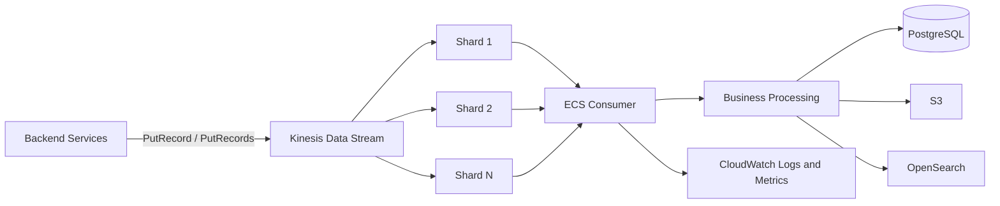
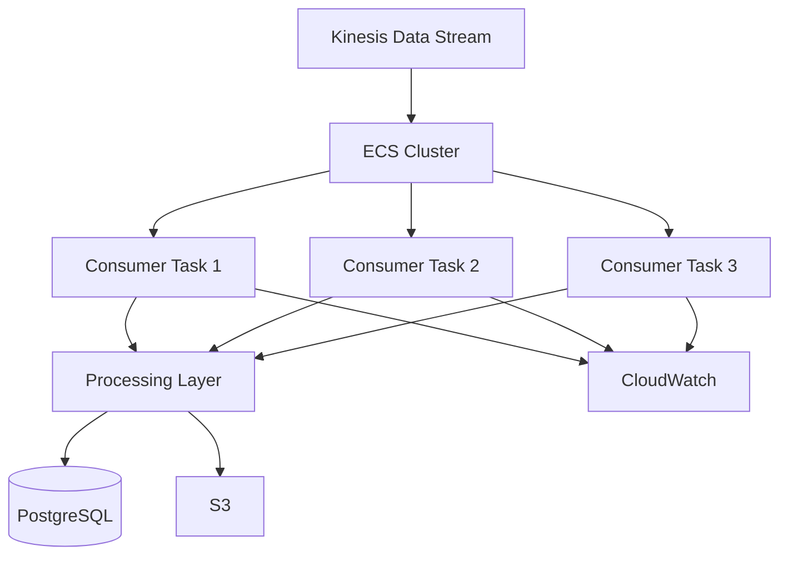
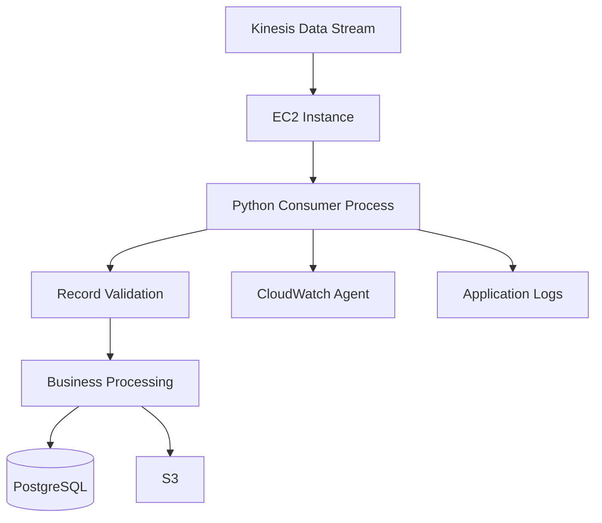
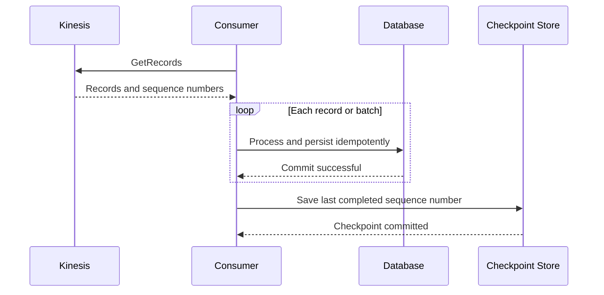
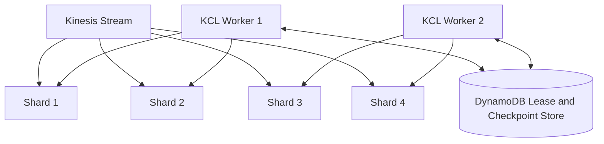
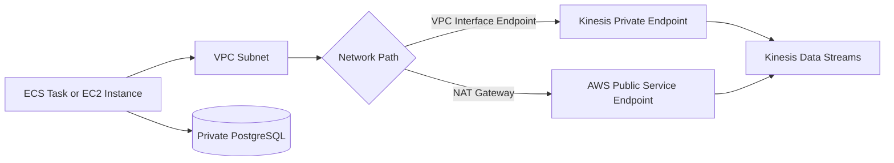
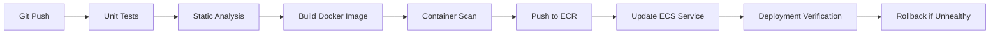

# 10- ECS and EC2 Integration

## Overview

Amazon Kinesis Data Streams integrates with Amazon ECS and Amazon EC2 to support continuously running stream-processing workloads. ECS and EC2 provide the compute environment, while Kinesis provides the durable, partitioned event stream.

This integration is useful when backend applications need to consume events asynchronously, process high-volume data, maintain control over consumer concurrency, or run workloads independently of API request lifecycles.

Typical use cases include:

- Processing application events generated by microservices.
- Ingesting telemetry, logs, and IoT events.
- Running long-lived Python data-processing workers.
- Enriching events before storing them in PostgreSQL, S3, OpenSearch, or other destinations.
- Running custom Kinesis consumers using the AWS SDK or Kinesis Client Library (KCL).
- Implementing event-driven processing without coupling producers to downstream services.

ECS and EC2 do not automatically consume Kinesis records. The application running on the compute environment must implement a consumer using an appropriate mechanism, such as:

- Kinesis Client Library (KCL).
- AWS SDK operations such as `GetShardIterator` and `GetRecords`.
- Enhanced fan-out through `SubscribeToShard`.

The choice affects checkpoint management, throughput, operational complexity, and scaling behavior.

## Integration Architecture

A common architecture uses ECS or EC2 instances to run independent Kinesis consumers.



The producer writes events to Kinesis. The stream distributes records across shards based on partition keys. Consumer applications retrieve records, process them, and persist their results.

The consumer's responsibility includes:

- Reading records from assigned shards.
- Handling shard iteration and pagination.
- Processing records safely.
- Managing checkpoints.
- Retrying transient failures.
- Preventing duplicate business processing.
- Handling shard splits and merges.
- Exposing operational metrics.

## ECS and EC2 Integration Options

There are two primary compute deployment models.

| Characteristic | ECS | EC2 |
|---|---|---|
| Compute management | Managed container orchestration | Direct instance management |
| Application packaging | Docker containers | Native process or containers |
| Scaling | ECS Service Auto Scaling | EC2 Auto Scaling Groups |
| Deployment | ECS rolling or blue/green deployments | Custom deployment or orchestration |
| Runtime isolation | Container-based | Instance/process-based |
| Infrastructure management | ECS manages task placement | Application team manages instances |
| Operational responsibility | Container and task lifecycle | Instance, OS, process, and application lifecycle |

### ECS on Fargate

Fargate runs ECS tasks without requiring direct management of EC2 instances.

Use it when:

- Consumer workloads are containerized.
- Infrastructure management should be minimized.
- Workloads need independent task scaling.
- The application does not require direct access to host-level resources.

### ECS on EC2

ECS can also schedule containers onto an EC2 capacity provider or EC2-backed cluster.

Use it when:

- Workloads require specialized instance types.
- Host-level configuration is necessary.
- GPU or specialized hardware is required.
- Instance-level cost and capacity optimization are important.

### Direct EC2 Consumers

A consumer can run directly on an EC2 instance using Python, Java, or another supported runtime.

Use this model when:

- The application requires direct operating-system control.
- Existing workloads already run on EC2.
- Custom process supervision is required.
- The team manages instance provisioning and lifecycle.

## Kinesis Consumer Processing Model

Kinesis Data Streams organizes records into shards. A consumer reads records independently from each shard.

Each record contains:

- `SequenceNumber`: Position of the record within a shard.
- `PartitionKey`: Key used to determine shard placement.
- `Data`: Application payload.
- `ApproximateArrivalTimestamp`: Approximate arrival time.

A consumer must maintain progress independently for each shard.

### Shard Iteration

The low-level Kinesis API uses shard iterators to identify where reading should begin.

Common iterator types include:

| Iterator type | Behavior | Typical use |
|---|---|---|
| `TRIM_HORIZON` | Starts at the oldest retained record | Initial historical processing |
| `LATEST` | Starts with records arriving after iterator creation | New-event processing |
| `AT_SEQUENCE_NUMBER` | Starts at a specific sequence number | Precise replay |
| `AFTER_SEQUENCE_NUMBER` | Starts after a specified sequence number | Resume after a checkpoint |
| `AT_TIMESTAMP` | Starts at a specified timestamp | Time-based replay |

A shard iterator is temporary and expires after five minutes. Consumers must request a new iterator when necessary.

### Record Retrieval

`GetRecords` retrieves records from a shard iterator.

Important limits and operational characteristics include:

- A shared-throughput consumer has a shard-level read limit of approximately 2 MiB/s.
- `GetRecords` supports up to 10,000 records per request.
- A single `GetRecords` response is limited to 10 MiB.
- Shared-throughput reads are subject to a limit of five `GetRecords` calls per second per shard.
- The iterator must be advanced using the returned `NextShardIterator`.
- An empty response does not necessarily indicate that the stream is inactive.

Consumers should avoid aggressive polling when no records are available.

## Choosing a Consumer Implementation

### AWS SDK Consumer

A custom consumer can use Boto3 to manage shard discovery, iteration, record retrieval, and checkpoints.

Advantages:

- Full control over record processing.
- No additional consumer framework.
- Suitable for smaller workloads and specialized integrations.
- Direct access to Kinesis APIs.

Limitations:

- Shard assignment must be implemented.
- Checkpoint coordination must be implemented.
- Shard splits and merges require explicit handling.
- Concurrent consumers can create coordination problems.
- Operational complexity increases as the number of shards grows.

This approach is appropriate when the consumer topology is simple and the team is prepared to own the operational responsibilities.

### Kinesis Client Library

The Kinesis Client Library provides a higher-level consumer framework.

KCL handles responsibilities such as:

- Shard discovery.
- Shard lease coordination.
- Worker coordination.
- Checkpoint management.
- Shard lifecycle transitions.
- Processing coordination across multiple workers.

KCL uses a lease and checkpoint coordination mechanism backed by a coordination store, commonly DynamoDB.

A KCL application is generally preferable for production workloads requiring multiple workers, dynamic shard topology, and coordinated processing.

KCL is a Java library. For Python applications, KCL can be used through the MultiLangDaemon and a Python record processor, or the application can use another supported integration approach. This introduces additional runtime and deployment considerations.

### Enhanced Fan-Out

Enhanced fan-out provides dedicated read throughput to registered stream consumers.

Instead of competing for shared shard read throughput, each registered enhanced fan-out consumer receives dedicated throughput per shard.

| Characteristic | Shared throughput | Enhanced fan-out |
|---|---|---|
| Read mechanism | `GetRecords` | `SubscribeToShard` |
| Throughput | Shared among consumers | Dedicated per registered consumer |
| Delivery | Polling | Push-based subscription over HTTP/2 |
| Consumer isolation | Limited | Better isolation |
| Cost | Lower baseline cost | Additional consumer charges |
| Typical use | Small number of consumers | Multiple independent high-throughput consumers |

Enhanced fan-out is useful when several applications independently consume the same stream and shared throughput becomes a bottleneck.

## ECS Integration

### ECS Architecture

An ECS service can run multiple consumer tasks. Each task runs the same application image and connects to the Kinesis stream.



The number of ECS tasks should not be selected independently of the stream's shard count and consumer coordination model.

For a custom shared-throughput consumer, multiple tasks must coordinate shard ownership to avoid uncontrolled competition. For KCL, workers coordinate through leases.

### Containerize a Python Consumer

A production consumer should be packaged as a Docker image.

Example project structure:

```text
kinesis-consumer/
├── app/
│   ├── __init__.py
│   ├── consumer.py
│   ├── processor.py
│   └── settings.py
├── requirements.txt
├── Dockerfile
└── .dockerignore
```

Install dependencies:

```text
boto3
psycopg[binary]
```

For production, pin and regularly update dependency versions using a lock file or controlled dependency-management process.

### Configuration

`app/settings.py`:

```python
import os


class Settings:
    stream_name = os.environ["KINESIS_STREAM_NAME"]
    aws_region = os.getenv("AWS_REGION", "ap-south-1")

    database_url = os.environ["DATABASE_URL"]

    batch_size = int(os.getenv("BATCH_SIZE", "500"))
    poll_interval_seconds = float(
        os.getenv("POLL_INTERVAL_SECONDS", "1")
    )


settings = Settings()
```

Do not embed AWS access keys or database passwords in the container image.

Use ECS task roles for AWS permissions and a supported secrets-management mechanism for database credentials.

### Event Processor

`app/processor.py`:

```python
import base64
import json
import logging

logger = logging.getLogger(__name__)


def process_record(record: dict) -> dict:
    payload = json.loads(
        base64.b64decode(record["Data"])
    )

    event_id = payload["event_id"]
    event_type = payload["event_type"]

    logger.info(
        "Processing event",
        extra={
            "event_id": event_id,
            "event_type": event_type,
            "sequence_number": record["SequenceNumber"],
        },
    )

    return payload
```

The processor should validate incoming events and reject malformed payloads explicitly.

For production workloads, use schema validation, event versioning, and structured error classification.

### Basic Boto3 Consumer

The following example demonstrates low-level shard reading for a single shard. It intentionally does not implement distributed shard ownership or durable checkpoint coordination.

`app/consumer.py`:

```python
import base64
import json
import logging
import time

import boto3
from botocore.config import Config

from app.processor import process_record
from app.settings import settings

logger = logging.getLogger(__name__)

client = boto3.client(
    "kinesis",
    region_name=settings.aws_region,
    config=Config(
        connect_timeout=5,
        read_timeout=70,
        retries={
            "mode": "standard",
            "total_max_attempts": 5,
        },
    ),
)


def consume_shard(shard_id: str) -> None:
    iterator_response = client.get_shard_iterator(
        StreamName=settings.stream_name,
        ShardId=shard_id,
        ShardIteratorType="TRIM_HORIZON",
    )

    shard_iterator = iterator_response["ShardIterator"]

    while shard_iterator:
        response = client.get_records(
            ShardIterator=shard_iterator,
            Limit=settings.batch_size,
        )

        records = response["Records"]

        for record in records:
            try:
                process_record(record)
            except Exception:
                logger.exception(
                    "Record processing failed",
                    extra={
                        "sequence_number": record["SequenceNumber"],
                        "shard_id": shard_id,
                    },
                )
                raise

        shard_iterator = response.get("NextShardIterator")

        if not records:
            time.sleep(settings.poll_interval_seconds)


def main() -> None:
    response = client.describe_stream_summary(
        StreamName=settings.stream_name
    )

    if response["StreamDescriptionSummary"]["StreamStatus"] != "ACTIVE":
        raise RuntimeError("Kinesis stream is not ACTIVE")

    shards_response = client.list_shards(
        StreamName=settings.stream_name
    )

    for shard in shards_response["Shards"]:
        consume_shard(shard["ShardId"])


if __name__ == "__main__":
    logging.basicConfig(level=logging.INFO)
    main()
```

This example is useful for understanding the API lifecycle, but it is not a complete production consumer.

Important limitations:

- It processes shards sequentially.
- It starts from `TRIM_HORIZON` on every process restart.
- It does not persist checkpoints.
- It does not coordinate shard ownership.
- It does not implement shard split and merge handling.
- It does not implement a durable retry or dead-letter strategy.
- It can process records more than once after a restart.

Do not deploy this implementation as a horizontally scaled ECS service without adding coordination and checkpoint management.

### Dockerfile

```dockerfile
FROM python:3.12-slim

ENV PYTHONDONTWRITEBYTECODE=1
ENV PYTHONUNBUFFERED=1

WORKDIR /app

COPY requirements.txt .

RUN pip install --no-cache-dir -r requirements.txt

COPY app ./app

RUN useradd --create-home appuser \
    && chown -R appuser:appuser /app

USER appuser

CMD ["python", "-m", "app.consumer"]
```

Use a controlled base-image update process, vulnerability scanning, and immutable image tags in production.

### ECS Task Definition

A simplified Fargate task definition:

```json
{
  "family": "kinesis-consumer",
  "networkMode": "awsvpc",
  "requiresCompatibilities": [
    "FARGATE"
  ],
  "cpu": "512",
  "memory": "1024",
  "executionRoleArn": "arn:aws:iam::123456789012:role/ecsTaskExecutionRole",
  "taskRoleArn": "arn:aws:iam::123456789012:role/kinesisConsumerTaskRole",
  "containerDefinitions": [
    {
      "name": "kinesis-consumer",
      "image": "123456789012.dkr.ecr.ap-south-1.amazonaws.com/kinesis-consumer:1.0.0",
      "essential": true,
      "environment": [
        {
          "name": "KINESIS_STREAM_NAME",
          "value": "application-events"
        },
        {
          "name": "AWS_REGION",
          "value": "ap-south-1"
        }
      ],
      "logConfiguration": {
        "logDriver": "awslogs",
        "options": {
          "awslogs-group": "/ecs/kinesis-consumer",
          "awslogs-region": "ap-south-1",
          "awslogs-stream-prefix": "consumer"
        }
      }
    }
  ]
}
```

The execution role is used by ECS to perform infrastructure-level operations such as pulling images and initializing logging.

The task role provides AWS permissions to the application running inside the container.

Do not grant Kinesis permissions to the execution role when the application itself needs them.

### ECS Service Scaling

ECS Service Auto Scaling can scale the number of tasks based on CloudWatch metrics.

Useful scaling signals include:

- `GetRecords.IteratorAgeMilliseconds`
- Application processing latency.
- Application queue depth.
- CPU utilization.
- Memory utilization.
- Per-task processing throughput.

For KCL applications, task scaling should be coordinated with lease assignment and the number of active shards.

Adding more tasks than available shard work may not improve throughput.

For enhanced fan-out consumers, scaling also depends on the registered consumer architecture and shard-level processing capacity.

A practical scaling strategy is to combine lag-based scaling with CPU and memory safeguards rather than relying only on CPU utilization.

## EC2 Integration

### EC2 Architecture

An EC2 instance can run a Kinesis consumer as a long-running service.



EC2 provides direct control over:

- Operating-system configuration.
- Process supervision.
- Instance storage.
- Network configuration.
- Runtime dependencies.
- Instance-level scaling.

However, the application team is responsible for patching, monitoring, process recovery, and instance replacement.

### Install Dependencies

On an Amazon Linux instance:

```bash
sudo dnf update -y
sudo dnf install -y python3 python3-pip

python3 --version
```

Create an application directory and virtual environment:

```bash
sudo mkdir -p /opt/kinesis-consumer
sudo chown ec2-user:ec2-user /opt/kinesis-consumer

cd /opt/kinesis-consumer

python3 -m venv .venv
source .venv/bin/activate

pip install boto3
```

Use a deployment artifact or controlled source checkout to install the application.

Avoid installing unpinned dependencies manually on production instances.

### EC2 IAM Instance Profile

Attach an IAM instance profile to the EC2 instance.

The application obtains temporary credentials through the instance metadata service rather than using static access keys.

Example IAM policy for a basic consumer:

```json
{
  "Version": "2012-10-17",
  "Statement": [
    {
      "Sid": "ReadKinesisStream",
      "Effect": "Allow",
      "Action": [
        "kinesis:DescribeStreamSummary",
        "kinesis:ListShards",
        "kinesis:GetShardIterator",
        "kinesis:GetRecords"
      ],
      "Resource": "arn:aws:kinesis:ap-south-1:123456789012:stream/application-events"
    }
  ]
}
```

Add only the permissions required by the selected consumer implementation.

A KCL application may additionally require access to its coordination resources, such as DynamoDB lease and checkpoint tables.

Use IMDSv2 and restrict access to instance metadata. Never expose the metadata endpoint to untrusted processes or containers.

### Run the Consumer with systemd

A long-running EC2 consumer should be supervised by a process manager.

Example systemd unit:

`/etc/systemd/system/kinesis-consumer.service`

```ini
[Unit]
Description=Kinesis Stream Consumer
After=network-online.target
Wants=network-online.target

[Service]
Type=simple
User=ec2-user
WorkingDirectory=/opt/kinesis-consumer
EnvironmentFile=/etc/kinesis-consumer.env
ExecStart=/opt/kinesis-consumer/.venv/bin/python -m app.consumer
Restart=always
RestartSec=5
KillSignal=SIGTERM
TimeoutStopSec=60

[Install]
WantedBy=multi-user.target
```

Create the environment file with restricted permissions:

```bash
sudo install -m 600 -o root -g root /dev/null \
  /etc/kinesis-consumer.env
```

Example configuration:

```bash
KINESIS_STREAM_NAME=application-events
AWS_REGION=ap-south-1
```

Enable and start the service:

```bash
sudo systemctl daemon-reload

sudo systemctl enable kinesis-consumer

sudo systemctl start kinesis-consumer

sudo systemctl status kinesis-consumer
```

Inspect logs:

```bash
sudo journalctl -u kinesis-consumer -f
```

A process restart does not guarantee safe recovery. The application must resume from a durable checkpoint and tolerate replayed records.

### EC2 Auto Scaling

For larger workloads, deploy consumer instances through an Auto Scaling Group.

A production design should account for:

- Instance replacement.
- Graceful process shutdown.
- Checkpoint recovery.
- Shard ownership.
- Availability Zone distribution.
- Instance warm-up.
- Capacity limits.
- Rolling deployments.

Do not assume that increasing the EC2 instance count automatically increases Kinesis read throughput.

With shared-throughput consumption, all consumers reading a shard share its read limits. With KCL, lease coordination determines which worker processes each shard.

## Checkpointing and Reliability

Checkpointing records the last successfully processed position in a shard.

It allows a consumer to resume after a restart without unnecessarily replaying the entire stream.

A checkpoint must represent completed processing, not merely successful retrieval.

### Processing Lifecycle



The safe processing order is:

1. Retrieve records.
2. Validate the payload.
3. Perform business processing.
4. Commit durable side effects.
5. Advance the checkpoint.

If the consumer checkpoints before committing its business operation, a crash can cause data loss.

If it commits business processing but crashes before checkpointing, the records may be replayed. This is why idempotency is essential.

### At-Least-Once Processing

Kinesis consumers should generally be designed for at-least-once processing.

A record can be processed again when:

- A worker crashes after committing a database transaction.
- The checkpoint is not updated.
- A lease is reassigned.
- A deployment interrupts processing.
- A retry occurs after an ambiguous network failure.

Kinesis does not provide a distributed transaction between stream consumption and an external database.

Use a stable event identifier and enforce uniqueness at the business-data layer.

Example PostgreSQL table:

```sql
CREATE TABLE processed_events (
    event_id UUID PRIMARY KEY,
    event_type TEXT NOT NULL,
    processed_at TIMESTAMPTZ NOT NULL DEFAULT NOW()
);
```

Example transactional processing:

```python
import json
import psycopg


def persist_event(
    connection: psycopg.Connection,
    event: dict,
) -> bool:
    with connection.transaction():
        with connection.cursor() as cursor:
            cursor.execute(
                """
                INSERT INTO processed_events (
                    event_id,
                    event_type
                )
                VALUES (%s, %s)
                ON CONFLICT (event_id) DO NOTHING
                RETURNING event_id
                """,
                (
                    event["event_id"],
                    event["event_type"],
                ),
            )

            inserted = cursor.fetchone()

            if inserted is None:
                return False

            cursor.execute(
                """
                INSERT INTO business_event_audit (
                    event_id,
                    payload
                )
                VALUES (%s, %s::jsonb)
                """,
                (
                    event["event_id"],
                    json.dumps(event),
                ),
            )

    return True
```

The idempotency record and business side effects must be committed in the same database transaction.

For external side effects, use an outbox or another durable workflow rather than assuming a database transaction can cover an external API call.

## Shard Management and Consumer Scaling

A Kinesis stream consists of one or more shards. Each shard provides a bounded capacity for writes and reads.

Consumer concurrency should be designed around shard topology.

### KCL Lease Coordination

KCL uses leases to coordinate shard processing among workers.

A worker acquires a lease for a shard and processes records from it. Other workers can process different shards.

When workers are added or removed, KCL can rebalance leases.



The coordination store must be available to all workers and protected by appropriate IAM permissions.

Lease balancing does not guarantee exactly-once processing. Applications still need idempotent business operations.

### Shard Splits and Merges

Shard topology changes over time through resharding.

A shard can split into child shards or merge with another shard. Child shards have parent dependencies.

Consumers must respect shard lifecycle and parent-child processing relationships.

A custom consumer that only calls `ListShards` once during startup will not correctly handle a changing stream topology.

KCL is generally preferable when dynamic shard management is required.

### Scaling Considerations

| Scaling dimension | Engineering consideration |
|---|---|
| Shard count | Determines stream-level capacity |
| Consumer count | Determines available processing workers |
| Partition-key distribution | Affects load distribution across shards |
| Record size | Affects bandwidth and processing cost |
| Processing latency | Determines how quickly lag accumulates |
| Database throughput | Can become the downstream bottleneck |
| Lease assignment | Determines shard ownership for KCL |
| Enhanced fan-out | Provides dedicated read throughput per registered consumer |

Adding more consumer tasks does not solve a hot partition key or a downstream database bottleneck.

Measure per-shard throughput and iterator age before changing the topology.

## Networking and Security

ECS tasks and EC2 instances need network connectivity to Kinesis and any downstream services.

### Networking Flow



The networking model depends on the deployment environment.

For private subnets, use either:

- A NAT Gateway for outbound access to public AWS service endpoints.
- An appropriate Kinesis interface VPC endpoint for private connectivity.

A VPC endpoint can reduce reliance on NAT for supported AWS service traffic and keep requests on the AWS network.

Security groups, endpoint policies, IAM policies, DNS resolution, and subnet routing must all be configured correctly.

### IAM Security

Use separate roles for separate responsibilities.

| Role | Responsibility |
|---|---|
| ECS task execution role | Pull container images and initialize logging |
| ECS task role | Allow application access to Kinesis and downstream AWS services |
| EC2 instance profile | Allow the EC2 application to access AWS services |
| Deployment role | Create and update infrastructure |
| KCL coordination permissions | Access lease and checkpoint resources |

Avoid broad permissions such as `kinesis:*` in production.

Restrict access to the required stream ARN and coordination resources.

### Encryption

Kinesis Data Streams supports server-side encryption using AWS KMS.

The consumer application communicates with Kinesis over TLS. Data encryption at rest is handled by the stream's encryption configuration.

Consider:

- KMS key policy permissions.
- IAM permissions for encrypted stream access.
- Cross-account key access.
- Rotation and key lifecycle.
- Encryption of downstream storage.
- Secret management for database credentials.

Encryption of the stream does not automatically encrypt data persisted by the consumer into PostgreSQL, S3, or another destination.

### Secrets Management

Use AWS Secrets Manager or Systems Manager Parameter Store for sensitive application configuration.

For ECS, inject secrets through task-definition secret references or retrieve them at runtime using the task role.

For EC2, retrieve secrets through the instance profile and avoid writing secret values to world-readable files or logs.

Do not put credentials in:

- Docker images.
- Source control.
- Task-definition plaintext environment variables.
- User data scripts.
- Application logs.

## Monitoring and Observability

Consumer monitoring should measure both infrastructure health and stream-processing progress.

A consumer can have low CPU utilization while falling behind because of slow downstream dependencies or insufficient shard read capacity.

### Important CloudWatch Metrics

| Metric | Purpose | Operational interpretation |
|---|---|---|
| `IncomingRecords` | Incoming record count | Producer activity |
| `IncomingBytes` | Incoming data volume | Write throughput |
| `OutgoingRecords` | Records retrieved | Consumer activity |
| `OutgoingBytes` | Read data volume | Consumer throughput |
| `GetRecords.IteratorAgeMilliseconds` | Age of the last returned record | Consumer lag |
| `ReadProvisionedThroughputExceeded` | Read throttling | Shared read capacity pressure |
| `WriteProvisionedThroughputExceeded` | Write throttling | Producer capacity pressure |
| `OpenShardCount` | Number of open shards | Stream topology |

Enhanced shard-level monitoring provides additional metrics, including shard-level throughput and throttling information, subject to the monitoring configuration and associated charges.

### Application Metrics

Publish custom metrics for:

- Records received.
- Records successfully processed.
- Records failed.
- Processing latency.
- Database transaction latency.
- Retry count.
- Duplicate event count.
- Checkpoint age.
- Active shard count.
- Per-shard processing throughput.

Use dimensions carefully. Avoid creating a high-cardinality metric for every event ID or arbitrary partition key.

### Logging

Use structured logs containing:

- Stream name.
- Shard ID.
- Sequence number.
- Event ID.
- Processing duration.
- Error category.
- Retry attempt.
- Consumer worker identifier.

Do not log sensitive event payloads by default.

### Alerting

Useful alerts include:

- Iterator age exceeds the workload's processing-lag objective.
- Read throttling occurs repeatedly.
- Consumer task or EC2 process is unhealthy.
- Processing failures exceed an acceptable threshold.
- Checkpoint progress stops.
- Downstream database latency increases.
- KCL lease ownership or coordination errors occur.

Alert thresholds should reflect business latency requirements rather than arbitrary infrastructure defaults.

## Deployment and Operational Practices

### ECS Deployment

A reliable ECS deployment should include:

- Immutable container image tags.
- Health checks.
- Graceful shutdown.
- Task-role least privilege.
- CloudWatch log configuration.
- CPU and memory limits.
- Deployment rollback.
- Controlled task scaling.
- Secrets injection.
- Container vulnerability scanning.

For long-running consumers, graceful shutdown is particularly important.

When a task receives `SIGTERM`, it should:

1. Stop fetching new records.
2. Finish or safely abandon in-flight processing.
3. Persist completed work.
4. Save a checkpoint only after durable processing.
5. Release coordination resources when applicable.
6. Exit before the configured stop timeout.

The application must not checkpoint records that were only partially processed.

### EC2 Deployment

A reliable EC2 deployment should include:

- Launch templates.
- Auto Scaling Groups where appropriate.
- IAM instance profiles.
- IMDSv2.
- OS patching.
- Process supervision with systemd.
- CloudWatch Agent or equivalent telemetry.
- Graceful shutdown.
- Automated application deployment.
- Instance replacement and recovery procedures.

Do not treat an EC2 process restart as a substitute for application-level checkpoint recovery.

### CI/CD

A typical deployment pipeline includes:



For EC2 deployments, the final deployment stage can publish an application artifact and execute a controlled deployment through Systems Manager or another approved deployment mechanism.

Separate infrastructure changes from application releases where practical.

Use Terraform or AWS CDK to manage:

- Kinesis streams.
- ECS clusters and services.
- Task definitions.
- EC2 launch templates.
- IAM roles and policies.
- CloudWatch log groups and alarms.
- VPC endpoints and security groups.
- KCL coordination tables.

## Cost Considerations

The total integration cost includes more than Kinesis stream capacity.

| Component | Cost driver |
|---|---|
| Kinesis Data Streams | Provisioned shard capacity or on-demand usage, data retention, enhanced monitoring and optional features |
| ECS Fargate | vCPU and memory allocation over task runtime |
| ECS on EC2 | EC2 instance capacity, storage, and associated infrastructure |
| EC2 | Instance type, runtime, EBS storage, and data transfer |
| DynamoDB | KCL lease and checkpoint coordination usage |
| CloudWatch | Logs ingestion, storage, metrics, dashboards, and alarms |
| NAT Gateway | Gateway hours and data processing |
| Enhanced fan-out | Registered consumers and data retrieval |
| Downstream services | Database, S3, OpenSearch, or other destination costs |

Cost optimization should focus on:

- Right-sizing task and instance resources.
- Avoiding excessive idle consumers.
- Batching database writes where appropriate.
- Selecting shared throughput or enhanced fan-out based on actual read requirements.
- Monitoring CloudWatch log volume.
- Using VPC endpoints when they are economically and operationally appropriate.
- Avoiding unnecessary high-frequency polling.

Do not reduce consumer capacity below the level required to meet processing-lag objectives.

## Disaster Recovery and Availability

Kinesis streams, ECS services, and EC2 instances are regional resources.

Running consumers across multiple Availability Zones improves compute availability, but it does not automatically replicate stream data across Regions.

A disaster recovery design should define:

- Stream replication strategy.
- Cross-Region producer behavior.
- Consumer deployment in the recovery Region.
- Checkpoint recovery or reconstruction.
- Downstream database recovery.
- Duplicate processing controls.
- RPO and RTO targets.
- Failover and failback procedures.

For cross-Region recovery, consider replicating records through an application-level pipeline or another supported AWS architecture.

Do not assume that copying a Kinesis stream's configuration also copies its records or consumer checkpoints.

A recovery consumer must be able to resume from a defined recovery position without losing events or creating uncontrolled duplicate side effects.

## Common Mistakes and Production Pitfalls

| Mistake | Why it is a problem | Recommended approach |
|---|---|---|
| Scaling ECS tasks without shard coordination | Multiple workers may compete for the same shard | Use KCL or implement explicit shard ownership |
| Starting from `TRIM_HORIZON` on every restart | Causes unnecessary replay | Persist and recover checkpoints |
| Checkpointing before database commit | Can permanently skip unprocessed records | Commit side effects before checkpointing |
| Assuming exactly-once processing | Restarts and retries can replay records | Use idempotent processing |
| Treating task count as throughput | Shard limits and downstream capacity still apply | Measure shard-level throughput and lag |
| Ignoring shard splits and merges | Consumers can miss new shards or mishandle dependencies | Use KCL or implement topology management |
| Using static AWS credentials | Creates credential leakage and rotation risks | Use task roles or EC2 instance profiles |
| Relying only on CPU alarms | Lag can grow without high CPU utilization | Monitor iterator age and application latency |
| Stopping workers abruptly | In-flight records may be replayed or lost through incorrect checkpointing | Implement graceful shutdown |
| Ignoring database bottlenecks | Consumer lag accumulates downstream | Batch writes carefully and monitor database capacity |
| Using enhanced fan-out without evaluating cost | Can increase operating expenses | Compare throughput requirements and pricing |
| Treating empty `GetRecords` responses as failures | Streams may simply have no new records | Use controlled polling and monitor progress |

## Production Architecture Recommendations

For a production backend, select the integration based on operational ownership and workload characteristics.

| Requirement | Recommended approach |
|---|---|
| Containerized Python consumer with minimal infrastructure management | ECS Fargate |
| Containerized consumer requiring instance-level control | ECS on EC2 |
| Existing VM-based processing system | EC2 with systemd |
| Multiple workers processing dynamically changing shards | KCL |
| Multiple independent high-throughput consumers | Enhanced fan-out |
| Simple low-volume consumer with custom coordination | AWS SDK consumer |
| Strong duplicate protection for database writes | Transactional idempotency |
| Reliable event processing with external side effects | Idempotency plus outbox or durable workflow |

A practical production architecture for a Python backend commonly uses:

- ECS Fargate for consumer deployment.
- Kinesis Data Streams for event transport.
- KCL or a deliberately designed consumer coordination mechanism.
- DynamoDB for KCL lease and checkpoint coordination.
- PostgreSQL for transactional business persistence.
- S3 for large payloads or archival storage.
- CloudWatch for logs, metrics, and alarms.
- IAM task roles for AWS access.
- Secrets Manager for database credentials.
- Terraform or AWS CDK for infrastructure provisioning.

The most important architectural boundary is between record retrieval and durable business processing. A consumer should only advance its checkpoint after the corresponding work has been safely committed.

## Key Takeaways

- ECS and EC2 provide compute capacity for Kinesis consumers; the application must implement record retrieval, processing, and checkpointing.
- Use KCL for coordinated shard ownership, checkpoint management, and dynamic shard topology rather than building distributed coordination casually.
- Design consumers for at-least-once processing and enforce idempotency at the business-data layer.
- Scale based on shard capacity, iterator age, processing latency, and downstream throughput—not task count or CPU utilization alone.
- Use IAM roles, private networking, structured observability, graceful shutdown, and explicit disaster recovery procedures for production deployments.