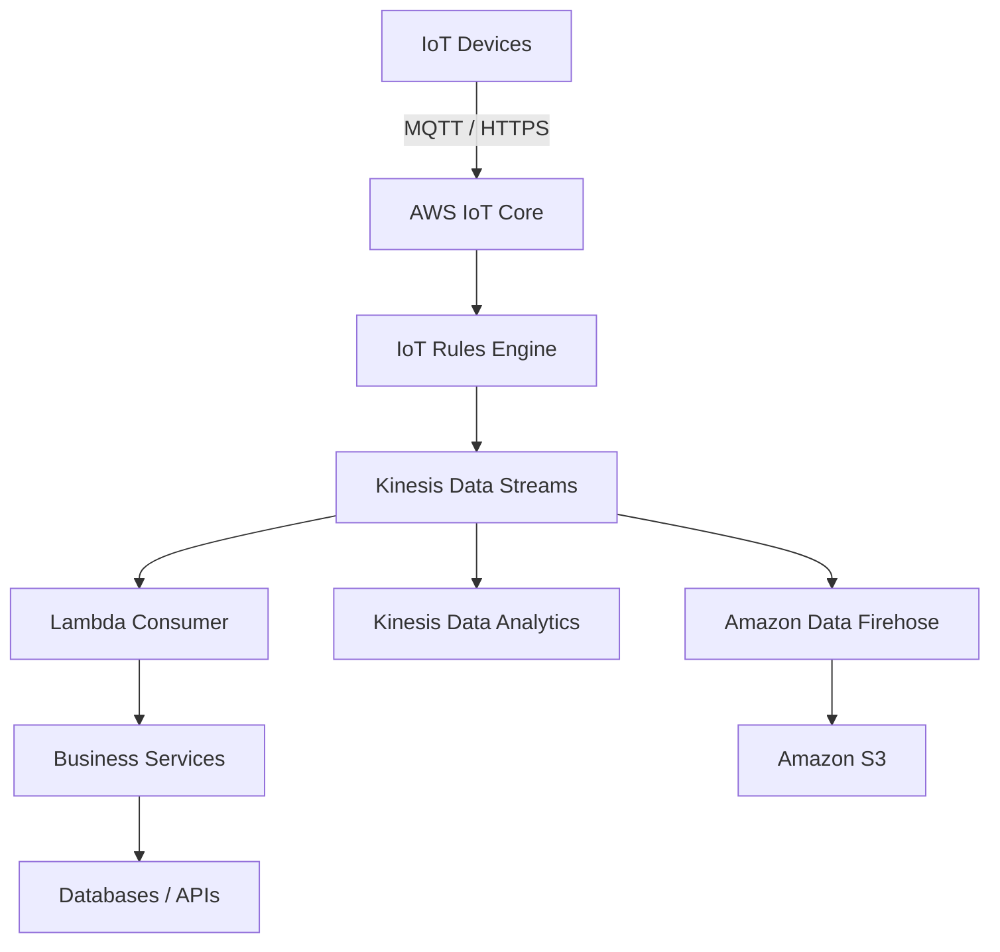
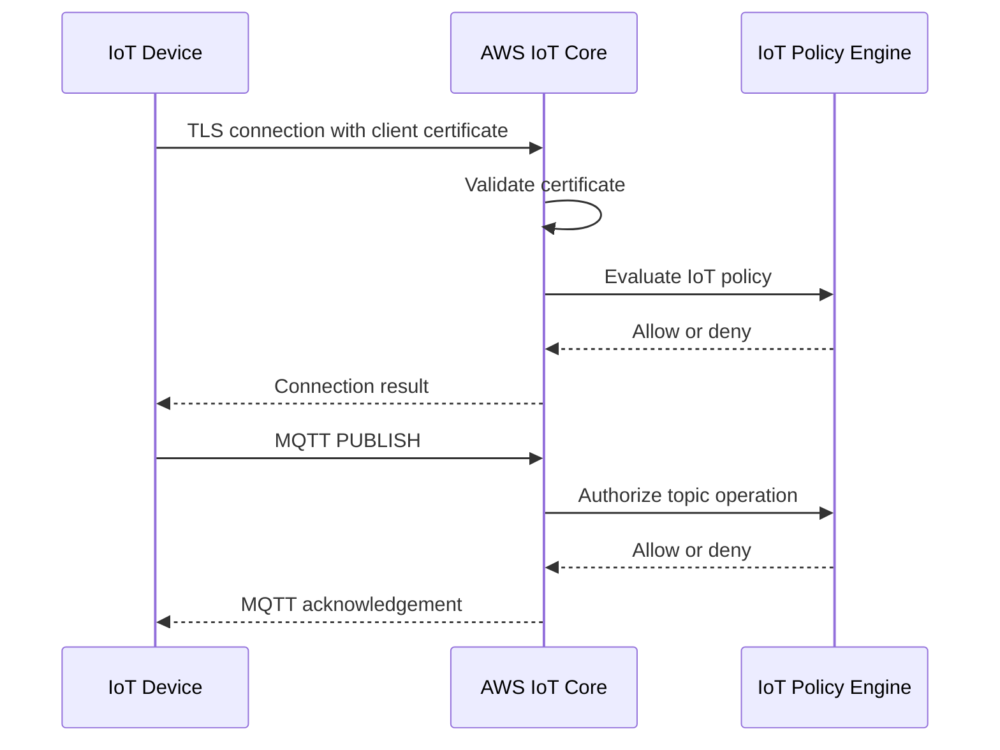
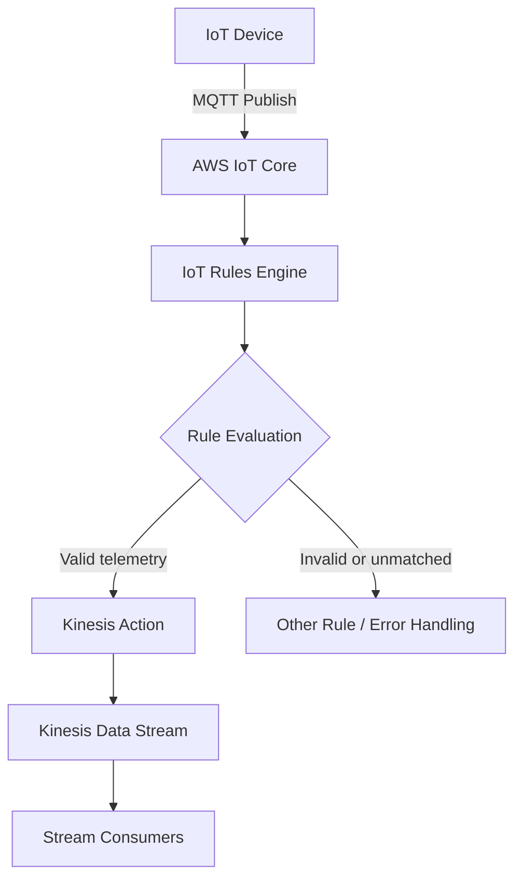
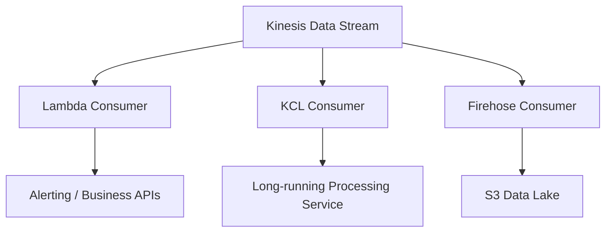
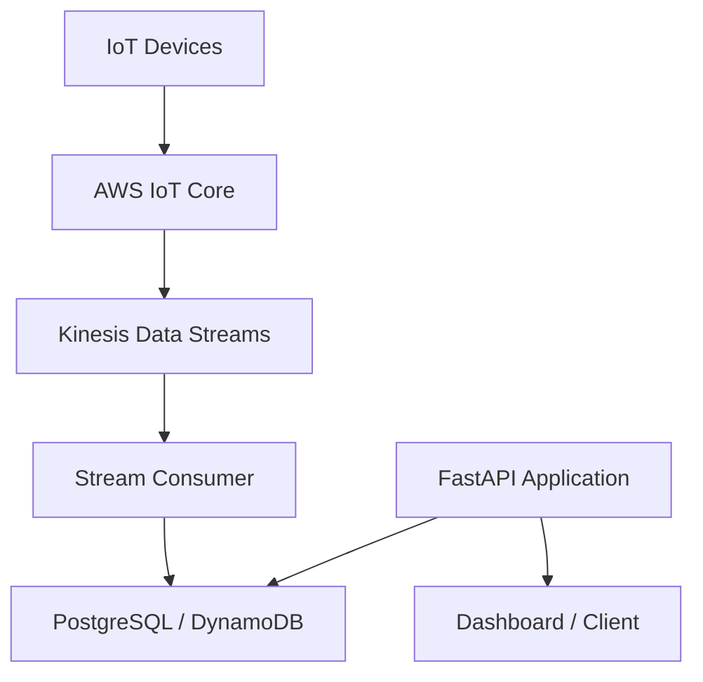

# 11- AWS IoT Core Integration

## Overview

Amazon Kinesis Data Streams integrates with AWS IoT Core to ingest, buffer, and distribute telemetry generated by connected devices.

AWS IoT Core provides managed connectivity for IoT devices using protocols such as MQTT and HTTPS. Kinesis Data Streams provides a scalable streaming layer for processing high-volume device telemetry.

Together, these services support architectures where thousands or millions of devices continuously publish measurements, status updates, and operational events.

Typical use cases include:

- Industrial equipment monitoring.
- Vehicle and fleet telemetry.
- Smart home and building automation.
- Predictive maintenance.
- Real-time device analytics.
- Sensor data ingestion for machine learning.
- Device activity monitoring and alerting.

A common architecture is:



AWS IoT Core handles device connectivity, authentication, and message routing. Kinesis provides durable stream ingestion and consumer access.

The separation is important:

- IoT Core manages device communication.
- Kinesis manages streaming ingestion and retention.
- Consumers process telemetry independently.
- S3 and analytical systems provide long-term storage and analysis.

## AWS IoT Core Fundamentals

AWS IoT Core is a managed cloud service that allows connected devices to communicate securely with AWS services and applications.

Devices connect to an IoT endpoint and publish or subscribe to topics.

### Core Components

| Component | Responsibility |
|---|---|
| Thing | Logical representation of a physical or virtual device |
| Thing Registry | Stores device metadata and identity associations |
| Device Certificate | Identifies and authenticates a device |
| IoT Policy | Controls device permissions |
| MQTT Broker | Handles publish and subscribe communication |
| IoT Rules Engine | Routes and transforms incoming messages |
| Device Shadow | Maintains reported and desired device state |
| IoT Jobs | Manages remote device operations and updates |
| Fleet Provisioning | Automates device registration and certificate provisioning |

### MQTT Protocol

MQTT is a lightweight publish-subscribe messaging protocol commonly used by IoT devices.

It is designed for devices with limited bandwidth, intermittent connectivity, and constrained resources.

A device publishes a message to a topic:

```text
factory/plant-01/machine-100/telemetry
```

An MQTT subscriber can receive messages from that topic or a matching wildcard subscription.

Example telemetry:

```json
{
  "device_id": "machine-100",
  "temperature": 78.5,
  "pressure": 102.4,
  "vibration": 0.32,
  "timestamp": "2026-11-22T10:30:00Z"
}
```

### MQTT Quality of Service

MQTT supports three delivery quality levels.

| QoS | Behavior | Typical use |
|---|---|---|
| 0 | At most once | Frequent telemetry where occasional loss is acceptable |
| 1 | At least once | Important telemetry where duplicates can be handled |
| 2 | Exactly once at MQTT protocol level | Critical MQTT exchanges where additional protocol overhead is acceptable |

QoS 1 may result in duplicate messages. Application consumers should use event identifiers or other deduplication mechanisms.

MQTT QoS does not guarantee exactly-once processing across the complete IoT Core → Kinesis → consumer pipeline.

### MQTT Topics

Use a predictable topic hierarchy.

```text
factory/{plant_id}/{device_id}/telemetry
factory/{plant_id}/{device_id}/status
factory/{plant_id}/{device_id}/commands
factory/{plant_id}/{device_id}/events
```

A structured topic hierarchy helps with:

- Device-level authorization.
- Message routing.
- Subscription filtering.
- Operational debugging.
- Fleet-level monitoring.

Avoid putting sensitive information in topic names because topic names can appear in logs and operational metadata.

### MQTT Wildcards

MQTT supports two subscription wildcard characters:

| Wildcard | Meaning | Example |
|---|---|---|
| `+` | Matches one topic level | `factory/+/+/telemetry` |
| `#` | Matches multiple remaining levels | `factory/plant-01/#` |

Wildcards are useful for fleet-wide subscriptions, but broad subscriptions should be restricted through IoT policies.

## Device Authentication and Authorization

IoT devices must authenticate before publishing telemetry.

AWS IoT Core commonly uses X.509 certificates with mutual TLS authentication.

The device presents its certificate during the TLS handshake. AWS IoT Core validates the certificate and applies the associated IoT policy to authorize MQTT operations.



### Device Certificates

A certificate identifies a device and establishes trust during connection.

Production practices:

- Provision unique certificates per device.
- Store private keys securely on the device.
- Avoid sharing certificates across a device fleet.
- Rotate certificates according to a defined lifecycle.
- Disable compromised certificates immediately.
- Use secure provisioning workflows.
- Track certificate expiration and activation state.

A shared certificate across thousands of devices makes revocation and incident response difficult.

### IoT Policy

An IoT policy determines which MQTT operations a device can perform.

Example policy allowing a device to connect and publish telemetry only to its own topic:

```json
{
  "Version": "2012-10-17",
  "Statement": [
    {
      "Effect": "Allow",
      "Action": "iot:Connect",
      "Resource": "arn:aws:iot:ap-south-1:123456789012:client/${iot:Connection.Thing.ThingName}"
    },
    {
      "Effect": "Allow",
      "Action": "iot:Publish",
      "Resource": "arn:aws:iot:ap-south-1:123456789012:topic/factory/${iot:Connection.Thing.Attributes[plant_id]}/${iot:Connection.Thing.ThingName}/telemetry"
    }
  ]
}
```

The policy uses thing attributes and the thing name to restrict device access.

The actual policy must be validated against the device identity model and the IoT policy variables supported by the deployment.

Avoid broad permissions such as:

```json
{
  "Effect": "Allow",
  "Action": "iot:*",
  "Resource": "*"
}
```

A device that only publishes telemetry should not have permission to subscribe to command topics or publish messages for other devices.

## AWS IoT Rules Engine

The IoT Rules Engine evaluates SQL-like rules against incoming MQTT messages and routes matching messages to AWS services.

It can:

- Filter incoming telemetry.
- Select specific message fields.
- Transform payloads.
- Route messages to Kinesis, Lambda, S3, DynamoDB, and other supported destinations.

An IoT Rule separates device communication from backend processing.

Devices publish telemetry without needing to know which downstream systems consume it.

### IoT Rule to Kinesis Architecture



### Create a Kinesis Stream

Create a Kinesis Data Stream:

```bash
aws kinesis create-stream \
  --stream-name iot-telemetry-stream \
  --stream-mode-details StreamMode=ON_DEMAND
```

For a provisioned stream:

```bash
aws kinesis create-stream \
  --stream-name iot-telemetry-stream \
  --shard-count 2
```

Describe the stream:

```bash
aws kinesis describe-stream-summary \
  --stream-name iot-telemetry-stream
```

Wait until the stream becomes active:

```bash
aws kinesis wait stream-exists \
  --stream-name iot-telemetry-stream
```

On-demand mode is useful when traffic is variable or difficult to predict. Provisioned mode is useful when throughput is sufficiently predictable to justify explicit shard-capacity management.

Neither mode removes the need to design partition keys and monitor stream utilization.

### Create an IAM Role for the IoT Rule

The IoT Rules Engine assumes an IAM role to write records into Kinesis.

Trust policy:

```json
{
  "Version": "2012-10-17",
  "Statement": [
    {
      "Effect": "Allow",
      "Principal": {
        "Service": "iot.amazonaws.com"
      },
      "Action": "sts:AssumeRole"
    }
  ]
}
```

Create the role:

```bash
aws iam create-role \
  --role-name IoTRuleKinesisRole \
  --assume-role-policy-document file://iot-trust-policy.json
```

Attach a policy allowing writes to the target stream:

```json
{
  "Version": "2012-10-17",
  "Statement": [
    {
      "Effect": "Allow",
      "Action": [
        "kinesis:PutRecord"
      ],
      "Resource": "arn:aws:kinesis:ap-south-1:123456789012:stream/iot-telemetry-stream"
    }
  ]
}
```

Create and attach the policy:

```bash
aws iam put-role-policy \
  --role-name IoTRuleKinesisRole \
  --policy-name KinesisWritePolicy \
  --policy-document file://kinesis-write-policy.json
```

The role should be restricted to the intended stream.

### Create an IoT SQL Rule

An IoT SQL statement selects fields from the MQTT message.

Example:

```sql
SELECT
    device_id,
    temperature,
    pressure,
    vibration,
    timestamp
FROM 'factory/+/+/telemetry'
WHERE temperature >= 0
```

The rule matches telemetry messages published to the selected topic hierarchy.

A rule can also transform the message by selecting only the fields required by downstream consumers.

Avoid forwarding every device field without considering payload size, privacy, and downstream requirements.

### Create the IoT Rule

The following example creates an IoT Rule that forwards telemetry to Kinesis.

```bash
aws iot create-topic-rule \
  --rule-name ForwardTelemetryToKinesis \
  --topic-rule-payload file://iot-kinesis-rule.json
```

Example `iot-kinesis-rule.json`:

```json
{
  "sql": "SELECT device_id, temperature, pressure, vibration, timestamp FROM 'factory/+/+/telemetry' WHERE temperature >= 0",
  "awsIotSqlVersion": "2016-03-23",
  "ruleDisabled": false,
  "actions": [
    {
      "kinesis": {
        "roleArn": "arn:aws:iam::123456789012:role/IoTRuleKinesisRole",
        "streamName": "iot-telemetry-stream",
        "partitionKey": "${device_id}"
      }
    }
  ],
  "errorAction": {
    "sqs": {
      "roleArn": "arn:aws:iam::123456789012:role/IoTRuleErrorQueueRole",
      "queueUrl": "https://sqs.ap-south-1.amazonaws.com/123456789012/iot-rule-errors",
      "useBase64": false
    }
  }
}
```

The Kinesis action uses the device identifier as the partition key.

The error action sends rule execution failures to an SQS queue. The error queue requires its own IAM permissions and operational monitoring.

The IoT SQL statement, selected fields, and partition-key template must agree. If `device_id` is not selected or cannot be resolved in the rule context, the action may fail.

The error action is a recovery mechanism for rule execution failures. It does not replace monitoring or reconciliation for downstream Kinesis consumer failures.

## Kinesis Partition Key Design for IoT

The partition key determines how records are distributed across Kinesis shards.

Records with the same partition key map to the same shard while the shard mapping remains unchanged.

For IoT telemetry, a common partition key is `device_id`.

Example:

```json
{
  "device_id": "machine-100",
  "temperature": 78.5,
  "timestamp": "2026-11-22T10:30:00Z"
}
```

Using `machine-100` as the partition key preserves ordering for records from that device within the stream's shard mapping.

### Partition Key Strategies

| Partition key | Advantages | Limitations |
|---|---|---|
| `device_id` | Per-device ordering and simple consumer grouping | A very active device can create a hot partition |
| `plant_id` | Groups telemetry by facility | Large facilities can create uneven distribution |
| `device_id + time bucket` | Spreads long-running high-volume workloads | Ordering is split across time buckets |
| Random identifier | Better distribution | Does not preserve per-device ordering |

The correct key depends on the workload.

If per-device ordering is required, `device_id` is usually a reasonable starting point. If a small number of devices generate a disproportionate amount of traffic, evaluate hot-key behavior and alternative partitioning strategies.

Do not use a timestamp alone as the partition key. It can create uneven distribution and does not provide meaningful per-device ordering.

### Hot Shards

A hot shard occurs when a disproportionate share of traffic is mapped to one shard.

Symptoms include:

- Write throttling.
- Uneven incoming byte rates.
- Uneven record rates.
- Increased consumer lag for affected partitions.

Mitigation options:

- Improve partition-key cardinality.
- Distribute high-volume device traffic more evenly.
- Use on-demand capacity where appropriate.
- Increase provisioned shard capacity when using provisioned mode.
- Reconsider whether strict per-device ordering is necessary.

On-demand capacity does not eliminate hot-key limitations or service quotas.

## Publishing Telemetry from IoT Devices

Devices can publish telemetry using the AWS IoT Device SDK.

For Python-based device simulations and gateways, AWS IoT Device SDK v2 provides MQTT support over mutual TLS.

### Install the SDK

```bash
pip install awsiotsdk
```

### Python MQTT Publisher

The following example connects to AWS IoT Core using a device certificate and private key.

```python
import json
import os
import time
from datetime import datetime, timezone

from awscrt import io, mqtt
from awsiot import mqtt_connection_builder


ENDPOINT = os.environ["AWS_IOT_ENDPOINT"]
CLIENT_ID = os.environ["IOT_CLIENT_ID"]
CERTIFICATE = os.environ["IOT_CERTIFICATE_PATH"]
PRIVATE_KEY = os.environ["IOT_PRIVATE_KEY_PATH"]
CA_FILE = os.environ["IOT_CA_PATH"]

TOPIC = os.environ.get(
    "IOT_TOPIC",
    "factory/plant-01/machine-100/telemetry",
)


def on_connection_interrupted(connection, error, **kwargs):
    print(f"Connection interrupted: {error}")


def on_connection_resumed(connection, return_code, session_present, **kwargs):
    print(
        "Connection resumed:",
        return_code,
        "session_present:",
        session_present,
    )


def create_connection():
    event_loop_group = io.EventLoopGroup(1)
    resolver = io.DefaultHostResolver(event_loop_group)
    bootstrap = io.ClientBootstrap(event_loop_group, resolver)

    connection = mqtt_connection_builder.mtls_from_path(
        endpoint=ENDPOINT,
        cert_filepath=CERTIFICATE,
        pri_key_filepath=PRIVATE_KEY,
        ca_filepath=CA_FILE,
        client_bootstrap=bootstrap,
        client_id=CLIENT_ID,
        clean_session=False,
        keep_alive_secs=30,
        on_connection_interrupted=on_connection_interrupted,
        on_connection_resumed=on_connection_resumed,
    )

    return connection


def main():
    connection = create_connection()

    connection.connect().result()

    try:
        while True:
            payload = {
                "device_id": CLIENT_ID,
                "temperature": 78.5,
                "pressure": 102.4,
                "vibration": 0.32,
                "timestamp": datetime.now(timezone.utc).isoformat(),
            }

            connection.publish(
                topic=TOPIC,
                payload=json.dumps(payload),
                qos=mqtt.QoS.AT_LEAST_ONCE,
            )

            time.sleep(5)

    except KeyboardInterrupt:
        pass

    finally:
        connection.disconnect().result()


if __name__ == "__main__":
    main()
```

The example demonstrates device authentication, connection management, and telemetry publishing.

For a real device deployment:

- Store certificates and private keys in a protected location.
- Do not commit credentials to source control.
- Implement bounded reconnect behavior.
- Persist important telemetry locally during network outages.
- Include a unique event identifier when duplicate detection is required.
- Use a monotonic clock for local elapsed-time calculations.
- Monitor certificate validity and device connectivity.
- Avoid logging private keys or complete sensitive payloads.

The sample publishes every five seconds and is intended as a device integration example. A production telemetry publisher should also handle backpressure, local buffering, shutdown signals, and device-specific resource constraints.

### MQTT Publishing Semantics

A successful MQTT publish operation does not prove that the complete downstream processing pipeline succeeded.

The device may receive an MQTT acknowledgement while a later IoT Rule action or Kinesis operation fails.

For critical telemetry, define explicit delivery and reconciliation requirements. A device may need to retain records until the application receives a separate business-level acknowledgement or until the records are safely persisted by a gateway.

## Consuming IoT Telemetry from Kinesis

Once IoT Core writes telemetry to Kinesis, multiple consumers can process the stream independently.

Typical consumers include:

- Lambda functions for event-driven processing.
- ECS or Kubernetes applications for continuous processing.
- Kinesis Client Library (KCL) applications for managed shard coordination.
- Amazon Data Firehose for S3 delivery.
- Analytics applications for real-time aggregations.

### Consumer Architecture



Multiple consumers can process the same stream independently.

Choose the consumer technology based on processing duration, throughput, checkpoint requirements, and operational complexity.

### Python Kinesis Consumer

Boto3 provides APIs for reading records from Kinesis.

The following example demonstrates a basic consumer using shard iterators.

```python
import json
import time

import boto3
from botocore.exceptions import ClientError


kinesis = boto3.client("kinesis")

STREAM_NAME = "iot-telemetry-stream"


def process_record(record: dict) -> None:
    payload = json.loads(record["Data"])

    device_id = payload.get("device_id")
    temperature = payload.get("temperature")

    print(
        {
            "device_id": device_id,
            "temperature": temperature,
            "sequence_number": record["SequenceNumber"],
        }
    )


def consume_shard(shard_id: str) -> None:
    response = kinesis.get_shard_iterator(
        StreamName=STREAM_NAME,
        ShardId=shard_id,
        ShardIteratorType="LATEST",
    )

    shard_iterator = response["ShardIterator"]

    while shard_iterator:
        try:
            response = kinesis.get_records(
                ShardIterator=shard_iterator,
                Limit=500,
            )

            for record in response["Records"]:
                process_record(record)

            shard_iterator = response.get("NextShardIterator")

            if not response["Records"]:
                time.sleep(1)

        except ClientError:
            raise


def main():
    response = kinesis.describe_stream_summary(
        StreamName=STREAM_NAME,
    )

    if response["StreamDescriptionSummary"]["StreamStatus"] != "ACTIVE":
        raise RuntimeError("Kinesis stream is not active")

    stream = kinesis.describe_stream(
        StreamName=STREAM_NAME,
    )

    for shard in stream["StreamDescription"]["Shards"]:
        consume_shard(shard["ShardId"])


if __name__ == "__main__":
    main()
```

This example is a basic API demonstration, not a complete production consumer.

It does not implement:

- Durable checkpointing.
- Shard discovery after resharding.
- Parent and child shard coordination.
- Distributed worker ownership.
- Retry isolation.
- Idempotent side effects.
- Graceful recovery after process failure.

For production applications requiring sustained stream processing, use KCL or another consumer architecture with explicit checkpoint and shard coordination.

### Kinesis Consumer Checkpointing

Checkpointing records the last successfully processed sequence number for a shard.

Without durable checkpoints, a restarted consumer may either:

- Reprocess records that were already handled.
- Skip records if it resumes from an incorrect position.

KCL manages shard leases and checkpointing using a coordination table in DynamoDB.

Checkpoint only after processing and required side effects have completed.

KCL does not provide exactly-once business side effects. A consumer can complete a database update and fail before checkpointing. The record may be delivered again.

Use idempotency keys and transactional processing to make repeated delivery safe.

## Lambda Processing for IoT Telemetry

Lambda is useful when telemetry processing is event-driven and individual processing operations are relatively short.

A Kinesis event source mapping polls the stream and invokes the function with batches of records.

Example architecture:

```text
Kinesis Data Stream
        |
        v
Lambda Event Source Mapping
        |
        v
Telemetry Processor
        |
        +----> DynamoDB
        |
        +----> SNS Alerts
        |
        +----> External API
```

### Lambda Event Source Mapping

```bash
aws lambda create-event-source-mapping \
  --function-name iot-telemetry-processor \
  --event-source-arn arn:aws:kinesis:ap-south-1:123456789012:stream/iot-telemetry-stream \
  --starting-position LATEST \
  --batch-size 100 \
  --maximum-batching-window-in-seconds 5 \
  --parallelization-factor 1 \
  --function-response-types ReportBatchItemFailures
```

Important configuration options:

| Setting | Purpose |
|---|---|
| `starting-position` | Determines the initial stream position |
| `batch-size` | Maximum number of records per invocation |
| `maximum-batching-window-in-seconds` | Maximum time to gather records |
| `parallelization-factor` | Number of concurrent batches per shard |
| `function-response-types` | Enables partial batch failure reporting |
| `maximum-retry-attempts` | Limits retries for failed records or batches |
| `maximum-record-age-in-seconds` | Limits how long records remain eligible for processing |

`LATEST` starts from the latest stream position when the mapping is created. `TRIM_HORIZON` starts from the oldest available record.

Choose the starting position carefully. It determines whether historical records still retained in the stream are processed.

### Python Lambda Consumer

```python
import base64
import json
import logging

logger = logging.getLogger()
logger.setLevel(logging.INFO)


def process_telemetry(payload: dict) -> None:
    device_id = payload["device_id"]
    temperature = float(payload["temperature"])

    if temperature > 90:
        logger.warning(
            "High temperature detected",
            extra={
                "device_id": device_id,
                "temperature": temperature,
            },
        )

    # Persist or route telemetry using idempotent operations.


def lambda_handler(event, context):
    batch_item_failures = []

    for record in event["Records"]:
        sequence_number = record["kinesis"]["sequenceNumber"]

        try:
            decoded = base64.b64decode(
                record["kinesis"]["data"],
                validate=True,
            )

            payload = json.loads(decoded)

            process_telemetry(payload)

        except Exception:
            logger.exception(
                "Failed to process Kinesis record",
                extra={"sequence_number": sequence_number},
            )

            batch_item_failures.append({
                "itemIdentifier": sequence_number
            })

            break

    return {
        "batchItemFailures": batch_item_failures
    }
```

For Kinesis event source mappings, partial batch failure responses identify the sequence number of the first failed record.

Stopping at the first failure preserves ordering expectations within the shard. Later records in the batch are retried along with the failed record.

The event source mapping must have `ReportBatchItemFailures` enabled for this response to be honored.

### Lambda Scaling Considerations

Lambda concurrency and Kinesis shard throughput are related.

Consider:

- Number of active shards.
- Batch size.
- Parallelization factor.
- Function duration.
- Downstream service limits.
- Retry behavior.
- Maximum record age.

Increasing concurrency can improve throughput, but it may also increase pressure on databases and external APIs.

For per-device ordered processing, use a partition key that groups records by device and carefully configure parallelization.

## Integrating Kinesis with FastAPI

A common architecture separates device ingestion from business APIs.

IoT Core handles device connectivity and Kinesis handles the streaming pipeline. FastAPI provides APIs for applications that need processed telemetry.



The FastAPI service should generally read processed or aggregated data from a database rather than consume raw telemetry directly for every API request.

Example endpoint:

```python
from datetime import datetime

from fastapi import FastAPI, HTTPException
from pydantic import BaseModel, Field
from sqlalchemy import text
from sqlalchemy.ext.asyncio import AsyncSession, async_sessionmaker


app = FastAPI(title="IoT Telemetry API")


class TelemetryResponse(BaseModel):
    device_id: str
    temperature: float = Field(ge=-100, le=300)
    pressure: float
    recorded_at: datetime


def create_router(session_factory: async_sessionmaker[AsyncSession]):
    @app.get(
        "/devices/{device_id}/latest",
        response_model=TelemetryResponse,
    )
    async def get_latest_telemetry(device_id: str):
        async with session_factory() as session:
            result = await session.execute(
                text(
                    """
                    SELECT
                        device_id,
                        temperature,
                        pressure,
                        recorded_at
                    FROM device_telemetry
                    WHERE device_id = :device_id
                    ORDER BY recorded_at DESC
                    LIMIT 1
                    """
                ),
                {"device_id": device_id},
            )

            row = result.mappings().first()

            if row is None:
                raise HTTPException(
                    status_code=404,
                    detail="No telemetry found for device",
                )

            return TelemetryResponse(**row)

    return app
```

This example illustrates a read API backed by processed telemetry.

In a complete application, inject the session factory through application lifespan or dependency injection rather than relying on module-level mutable state. The endpoint should also enforce authorization so users can access only devices they are permitted to view.

For high-volume telemetry, avoid querying an unbounded raw event table for every API request. Use time-series storage, indexes, retention policies, and pre-aggregated data where appropriate.

## Device Shadows and Kinesis

AWS IoT Device Shadows maintain the latest known state of a device.

A shadow separates device state from direct device connectivity.

It contains:

- Desired state: what an application wants the device to become.
- Reported state: what the device reports as its current state.
- Delta: differences between desired and reported state.

Example:

```json
{
  "state": {
    "desired": {
      "sampling_interval": 10
    },
    "reported": {
      "sampling_interval": 30
    }
  }
}
```

A backend application can update the desired state even when the device is offline. The device can retrieve the desired state when it reconnects.

Kinesis serves a different purpose.

| Capability | Device Shadow | Kinesis |
|---|---|---|
| Primary purpose | Maintain latest device state | Process ordered streams of records |
| Data model | Desired and reported state | Append-only stream |
| Historical telemetry | Not intended as a telemetry archive | Retained stream records |
| Device command synchronization | Supported | Requires application-level implementation |
| Analytics ingestion | Limited state-oriented use | Designed for streaming ingestion |

Use Device Shadows for device state synchronization and Kinesis for telemetry and event processing.

A shadow update can also be routed through IoT Rules when downstream systems need to react to state changes.

## Device Jobs and Remote Operations

AWS IoT Jobs provides a mechanism to deploy remote operations to devices.

Typical uses include:

- Firmware updates.
- Configuration changes.
- Certificate rotation workflows.
- Remote diagnostics.
- Device maintenance tasks.

Kinesis can capture telemetry generated during job execution, allowing backend systems to correlate device activity with operational events.

For example:

```text
IoT Job Created
      |
      v
Device Receives Job
      |
      v
Device Performs Update
      |
      v
Device Publishes Status
      |
      v
IoT Core
      |
      v
Kinesis
      |
      v
Deployment Monitoring Service
```

Do not use Kinesis as a replacement for IoT Jobs. Jobs manage device operations; Kinesis processes the resulting event stream.

## Reliability and Delivery Semantics

The complete pipeline contains multiple independent delivery boundaries.

```text
Device
  |
  | MQTT
  v
AWS IoT Core
  |
  | IoT Rule action
  v
Kinesis
  |
  | Consumer processing
  v
Database / External Service
```

Each boundary has different retry and acknowledgement behavior.

### Duplicate Delivery

Duplicates can occur because:

- MQTT QoS 1 may redeliver messages.
- IoT Rule actions may encounter retryable failures.
- Kinesis consumers may reprocess records.
- Lambda may retry failed batches.
- Consumers may fail after performing a side effect but before checkpointing.

Include a stable event identifier in device telemetry:

```json
{
  "event_id": "machine-100-00004567",
  "device_id": "machine-100",
  "sequence": 4567,
  "temperature": 78.5,
  "timestamp": "2026-11-22T10:30:00Z"
}
```

The event identifier should remain unchanged when a device retries the same logical event.

Consumers should store processed event IDs or use a naturally idempotent update strategy.

### Ordering

Kinesis preserves record order within a shard for records sharing the same partition key and shard mapping.

It does not provide global ordering across all devices.

For device-specific ordering:

- Use a stable device partition key.
- Include a device-generated sequence number.
- Detect missing or out-of-order sequence numbers.
- Avoid assuming that timestamps alone establish reliable ordering.

A device may reconnect and upload buffered telemetry long after the original event occurred.

The ingestion time and event time should therefore be treated separately.

### Retention and Replay

Kinesis Data Streams retains records for a configurable period:

- Default retention: 24 hours.
- Maximum retention: 365 days.

Retention enables consumers to recover from temporary outages and replay records while they remain available.

Longer retention increases storage cost.

For long-term archival, use Amazon Data Firehose or a dedicated consumer to store telemetry in Amazon S3.

Do not treat Kinesis retention as a permanent data archive.

## Security Considerations

IoT telemetry pipelines have multiple security boundaries.

### Device Security

- Use unique device certificates.
- Enforce topic-level authorization.
- Rotate and revoke certificates.
- Protect private keys using hardware-backed storage where available.
- Use secure boot and firmware integrity controls where supported.
- Avoid embedding shared AWS credentials in device firmware.

### Kinesis Security

Use IAM policies that grant only the required actions.

A consumer may need:

```json
{
  "Version": "2012-10-17",
  "Statement": [
    {
      "Effect": "Allow",
      "Action": [
        "kinesis:DescribeStreamSummary",
        "kinesis:ListShards",
        "kinesis:GetShardIterator",
        "kinesis:GetRecords"
      ],
      "Resource": "arn:aws:kinesis:ap-south-1:123456789012:stream/iot-telemetry-stream"
    }
  ]
}
```

A producer requires write permissions such as `kinesis:PutRecord` or `kinesis:PutRecords`, depending on the integration.

For IoT Rules, the assumed role should be restricted to the target stream.

### Encryption

Kinesis Data Streams supports server-side encryption using AWS KMS.

Enable encryption for sensitive telemetry and use customer-managed keys when key policy control, auditing, or cross-account requirements justify them.

Use TLS for device communication and supported AWS service connections.

### Sensitive Telemetry

IoT payloads may contain operationally sensitive information, location data, or personal information.

Apply data minimization:

- Publish only fields required by downstream consumers.
- Restrict access to sensitive streams.
- Apply retention policies.
- Avoid logging full telemetry payloads.
- Use separate streams or access controls for different data classifications.

## Scalability and Performance

IoT systems can generate large volumes of small messages continuously.

The architecture must account for device count, message frequency, payload size, and consumer processing time.

### Kinesis Capacity

For provisioned capacity, a shard supports approximately:

| Capacity dimension | Per-shard throughput |
|---|---|
| Writes | 1 MiB/second or 1,000 records/second |
| Shared reads | 2 MiB/second |
| Shared `GetRecords` calls | 5 calls/second |

These are per-shard capacity figures and are subject to service quotas and configuration.

A single record can be up to 10 MiB, but the standard per-shard write throughput still applies.

For `PutRecords`, a request can contain up to 500 records and a total payload of up to 10 MiB. Partial failures must be inspected and retried selectively.

The IoT Rule Kinesis action uses `PutRecord`, not `PutRecords`. Device messages are routed through the rule action individually.

### Capacity Planning

Estimate incoming throughput:

\[
\text{Incoming bytes/sec}
=
\text{Devices}
\times
\text{Messages/sec/device}
\times
\text{Average payload bytes}
\]

Example:

- 10,000 devices.
- One message every five seconds.
- Average payload size: 1 KiB.

\[
\frac{10,000}{5} \times 1,024
=
2,048,000 \text{ bytes/sec}
\]

This is approximately 1.95 MiB/sec of incoming payload before considering service overhead and traffic variation.

For provisioned capacity, estimate the required shard count using both record rate and byte throughput, then add operational headroom.

On-demand mode can simplify capacity management for variable workloads, but it still has service quotas and partition-key distribution constraints.

### Batching

Batching can reduce API overhead for application-based producers and consumers.

For example, a gateway that aggregates telemetry from multiple devices can use `PutRecords` to publish batches to Kinesis.

However, batching introduces latency and can affect ordering semantics.

The IoT Rule Kinesis action is not a general-purpose batch producer. If batching is a requirement, introduce an intermediary producer or gateway.

### Consumer Throughput

Monitor consumer throughput separately from ingestion throughput.

A stream can accept telemetry successfully while consumers fall behind.

Scale consumers according to:

- Incoming record rate.
- Processing duration.
- Number of shards.
- Downstream database capacity.
- External API limits.
- Iterator age.

Avoid scaling consumers without considering the capacity of the database or API receiving the processed telemetry.

## Monitoring and Observability

Monitoring should cover devices, IoT Core, Kinesis, and downstream consumers.

### AWS IoT Core Metrics

Monitor relevant CloudWatch metrics such as:

- Connect success and failure counts.
- Publish success and failure counts.
- Authentication failures.
- Authorization failures.
- Message routing errors.
- Rule execution failures.

Metric names and dimensions vary by IoT Core feature and protocol. Configure alarms based on the metrics available for the deployed integration.

### Kinesis Metrics

| Metric | Purpose |
|---|---|
| `IncomingBytes` | Incoming stream data volume |
| `IncomingRecords` | Incoming record count |
| `WriteProvisionedThroughputExceeded` | Write throttling |
| `ReadProvisionedThroughputExceeded` | Read throttling |
| `GetRecords.IteratorAgeMilliseconds` | Consumer lag |
| `GetRecords.Bytes` | Read throughput |
| `PutRecord.Success` | Successful record writes |

Monitor shard-level metrics when diagnosing uneven traffic distribution.

### Lambda Metrics

Track:

- Invocations.
- Errors.
- Duration.
- Throttles.
- Concurrent executions.
- Iterator age.
- Failed records.

### Application-Level Metrics

CloudWatch service metrics do not fully describe business processing.

Track:

- Events received per device.
- Invalid telemetry count.
- Duplicate event count.
- Missing sequence numbers.
- Out-of-order records.
- End-to-end processing latency.
- Alert generation failures.
- Device last-seen timestamps.

Use structured logs with correlation identifiers:

```json
{
  "event_id": "machine-100-00004567",
  "device_id": "machine-100",
  "stream_name": "iot-telemetry-stream",
  "sequence_number": "496123456789",
  "consumer": "telemetry-processor",
  "status": "processed"
}
```

Do not log private credentials or unnecessary sensitive device data.

## Cost Considerations

The main cost drivers include:

| Service | Cost drivers |
|---|---|
| AWS IoT Core | Connection duration, message volume, messaging features |
| Kinesis Data Streams | On-demand or provisioned capacity, extended retention, enhanced fan-out |
| Lambda | Invocations, execution duration, allocated memory |
| S3 | Storage, requests, lifecycle transitions |
| CloudWatch | Metrics, logs ingestion, retention, alarms |
| AWS KMS | Key usage and applicable key charges |
| SQS | Requests, storage, and data transfer |

Cost optimization recommendations:

- Reduce unnecessary telemetry frequency.
- Compress or compact payloads where the architecture supports it.
- Filter irrelevant messages through IoT Rules.
- Use appropriate Kinesis capacity mode.
- Avoid excessive enhanced fan-out consumers.
- Archive long-term telemetry in S3.
- Apply S3 lifecycle policies.
- Set CloudWatch log retention.
- Monitor device connection patterns.

Reducing message volume can have a larger cost impact than optimizing downstream compute alone.

## High Availability and Disaster Recovery

IoT telemetry pipelines should tolerate intermittent device connectivity and downstream service outages.

### Device-Level Resilience

Devices should:

- Reconnect with exponential backoff and jitter.
- Buffer important telemetry locally.
- Retry failed transmissions.
- Preserve event identifiers across retries.
- Detect prolonged disconnection.
- Handle certificate expiration and rotation.

A device should not generate an uncontrolled reconnect storm when network connectivity returns.

### Stream-Level Resilience

Kinesis Data Streams provides replicated storage across Availability Zones within a Region.

For critical workloads:

- Use appropriate stream capacity.
- Enable monitoring and alarms.
- Configure sufficient retention for recovery.
- Use durable consumer checkpoints.
- Implement idempotent processing.
- Archive important records to S3.

### Cross-Region Recovery

Kinesis Data Streams is regional and does not automatically replicate records to another Region.

A multi-Region architecture may use:

- An additional producer or gateway path.
- A separate stream in the recovery Region.
- A replication application.
- An S3-based archive and replay process.

Define whether the recovery objective requires:

- Reconnecting devices to another endpoint.
- Replicating live telemetry.
- Replaying archived records.
- Rebuilding downstream state.

A disaster recovery plan should be tested, not just documented.

## Terraform Infrastructure

Terraform can manage the Kinesis stream, IoT Rule, IAM roles, and supporting resources.

### Kinesis Stream

```hcl
resource "aws_kinesis_stream" "iot_telemetry" {
  name             = "iot-telemetry-stream"
  retention_period = 168

  stream_mode_details {
    stream_mode = "ON_DEMAND"
  }

  encryption_type = "KMS"
  kms_key_id      = "alias/aws/kinesis"

  tags = {
    Environment = "production"
    Application = "iot-platform"
  }
}
```

The retention period is expressed in hours. The example uses seven days.

For a provisioned stream, configure shard count instead of the on-demand stream mode block.

### IAM Role for IoT Rule

```hcl
resource "aws_iam_role" "iot_rule_kinesis" {
  name = "iot-rule-kinesis-role"

  assume_role_policy = jsonencode({
    Version = "2012-10-17"

    Statement = [
      {
        Effect = "Allow"

        Principal = {
          Service = "iot.amazonaws.com"
        }

        Action = "sts:AssumeRole"
      }
    ]
  })
}

resource "aws_iam_role_policy" "iot_rule_kinesis" {
  name = "iot-rule-kinesis-policy"
  role = aws_iam_role.iot_rule_kinesis.id

  policy = jsonencode({
    Version = "2012-10-17"

    Statement = [
      {
        Effect = "Allow"

        Action = [
          "kinesis:PutRecord"
        ]

        Resource = aws_kinesis_stream.iot_telemetry.arn
      }
    ]
  })
}
```

### IoT Rule

```hcl
resource "aws_iot_topic_rule" "telemetry_to_kinesis" {
  name        = "forward_telemetry_to_kinesis"
  description = "Forward device telemetry to Kinesis"
  enabled     = true

  sql         = "SELECT device_id, temperature, pressure, vibration, timestamp FROM 'factory/+/+/telemetry' WHERE temperature >= 0"
  sql_version = "2016-03-23"

  kinesis {
    role_arn      = aws_iam_role.iot_rule_kinesis.arn
    stream_name   = aws_kinesis_stream.iot_telemetry.name
    partition_key = "$${device_id}"
  }
}
```

Terraform interprets `${...}` as interpolation syntax. The `$${device_id}` form escapes the dollar sign so the IoT Rules Engine receives `${device_id}` as the partition-key template.

The IoT Rule requires a selected `device_id` field in the SQL statement.

### Deployment Commands

```bash
terraform init
terraform fmt -check
terraform validate
terraform plan
terraform apply
```

For production deployments:

- Use remote state with locking.
- Separate environments.
- Review IAM policies.
- Protect state files.
- Use CI/CD plan approval.
- Pin provider versions.
- Avoid hardcoding account-specific identifiers.
- Validate service quotas and Region availability.

The example creates core resources. A complete deployment should also manage device certificates, IoT policies, error queues, Lambda consumers, CloudWatch alarms, and any required S3 archive.

## Testing Strategy

Test the integration at several levels.

### Device Publishing Tests

Validate:

- Certificate authentication.
- Topic authorization.
- MQTT connection recovery.
- QoS behavior.
- Payload validation.
- Reconnect and buffering behavior.

### IoT Rule Tests

Validate:

- SQL filtering.
- Topic matching.
- Field selection.
- Partition-key substitution.
- Kinesis write permissions.
- Error action behavior.

### Kinesis Tests

Validate:

- Record ingestion.
- Partition-key distribution.
- Consumer checkpointing.
- Duplicate processing.
- Shard scaling and resharding.
- Consumer recovery after downtime.

### Failure Tests

Simulate:

- Invalid device certificates.
- Expired certificates.
- IoT policy denial.
- Kinesis throttling.
- Lambda timeouts.
- Duplicate telemetry.
- Consumer database outages.
- Device network interruptions.
- Stream consumer lag.
- Malformed telemetry payloads.

Use an isolated AWS test environment for integration tests. Local mocks do not fully reproduce IoT Core authentication, IoT Rule behavior, Kinesis quotas, or Lambda event source mapping semantics.

## Common Mistakes and Production Pitfalls

### Treating MQTT Acknowledgement as End-to-End Success

**Problem:** A device assumes telemetry has been processed because the MQTT publish was acknowledged.

**Why it happens:** MQTT delivery and downstream Kinesis processing are separate stages.

**Better approach:** Define application-level acknowledgement and reconciliation requirements for critical telemetry.

### Using Broad IoT Policies

**Problem:** One compromised device can publish or subscribe to topics belonging to other devices.

**Why it happens:** Policies grant fleet-wide access for convenience.

**Better approach:** Use unique device identities and restrict topic permissions to the device's authorized namespace.

### Choosing a Poor Partition Key

**Problem:** One shard receives disproportionate traffic.

**Why it happens:** A low-cardinality key such as `plant_id` groups too many devices together.

**Better approach:** Evaluate traffic distribution and use a key that balances ordering requirements with shard utilization.

### Assuming Kinesis Provides Global Ordering

**Problem:** Events from different devices are processed in an assumed global sequence.

**Why it happens:** Per-shard ordering is misunderstood as stream-wide ordering.

**Better approach:** Use device identifiers, sequence numbers, and event timestamps to establish the ordering required by the business workflow.

### Ignoring Duplicate Delivery

**Problem:** The same telemetry causes duplicate alerts or database updates.

**Why it happens:** MQTT QoS 1, Lambda retries, and consumer recovery can reprocess events.

**Better approach:** Include stable event IDs and implement idempotent side effects.

### Using the Basic Boto3 Consumer in Production

**Problem:** Records are skipped or repeatedly processed after failures or resharding.

**Why it happens:** The basic example does not coordinate workers or persist checkpoints.

**Better approach:** Use KCL or implement durable checkpointing, shard discovery, and recovery explicitly.

### Ignoring Stream Retention

**Problem:** A consumer outage exceeds the retention period and records are no longer available for replay.

**Why it happens:** Kinesis retention is treated as permanent storage.

**Better approach:** Archive important telemetry to S3 and define replay procedures.

### Forwarding Every Device Field

**Problem:** Large payloads increase cost, expose sensitive information, and create unnecessary downstream coupling.

**Why it happens:** The IoT Rule forwards complete messages without filtering.

**Better approach:** Select only the fields required by consumers and define stable event contracts.

### Scaling Consumers Without Protecting Dependencies

**Problem:** Increased Lambda or worker concurrency overloads PostgreSQL or external APIs.

**Why it happens:** Consumer scaling is treated as independent of downstream capacity.

**Better approach:** Apply concurrency limits, buffering, backpressure, and database connection controls.

### Ignoring IoT Rule Error Actions

**Problem:** Rule execution failures are difficult to investigate and may remain unnoticed.

**Why it happens:** Only the normal Kinesis action is configured.

**Better approach:** Configure an error action, monitor its destination, and define a replay or remediation workflow.

## Production Architecture Recommendations

For a production IoT telemetry pipeline:

- Use AWS IoT Core for secure device connectivity and MQTT message routing.
- Use unique X.509 certificates and narrowly scoped IoT policies.
- Use IoT Rules to filter and transform telemetry before ingestion.
- Use Kinesis Data Streams for durable streaming ingestion.
- Choose partition keys according to ordering and traffic distribution requirements.
- Use Lambda for short event-driven processing and KCL for long-running consumers requiring durable coordination.
- Use SQS or another durable buffer when downstream systems need additional isolation.
- Archive long-term telemetry in S3.
- Include event identifiers and device sequence numbers.
- Implement idempotency and replay mechanisms.
- Monitor device connectivity, rule failures, stream throttling, and consumer lag.
- Define explicit device, stream, and regional recovery procedures.

## Key Takeaways

- AWS IoT Core manages device connectivity, authentication, and MQTT routing, while Kinesis provides durable streaming ingestion for telemetry.
- IoT Rules route selected device messages into Kinesis using an IAM role; the partition key determines shard distribution and per-key ordering.
- MQTT QoS, IoT Rule delivery, and Kinesis consumer processing have separate delivery semantics, so end-to-end workflows must tolerate duplicates and failures.
- Use stable device identifiers, event IDs, sequence numbers, durable checkpoints, and idempotent consumers to support reliable processing.
- Production pipelines require least-privilege device policies, capacity planning, monitoring, S3 archival, and tested recovery procedures.