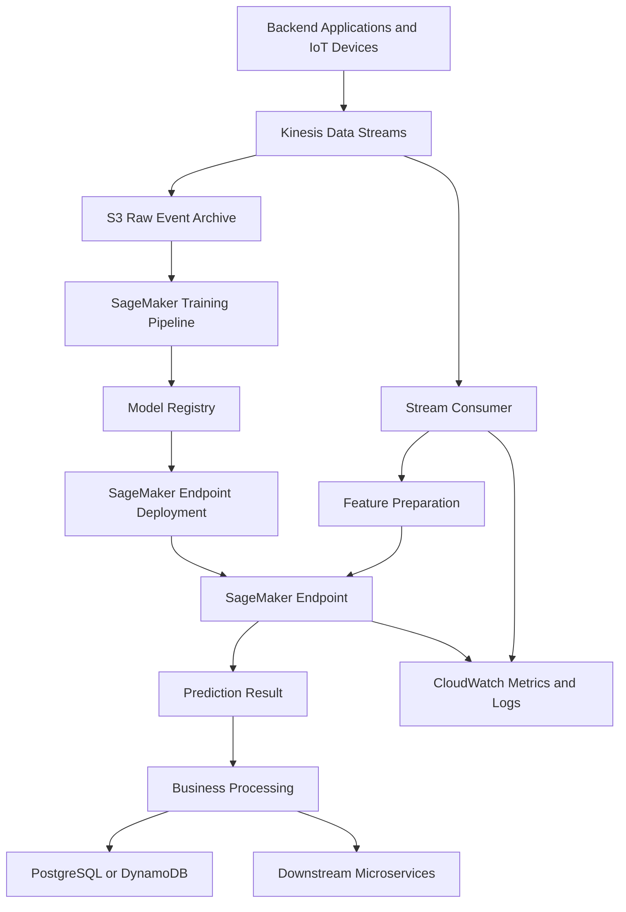
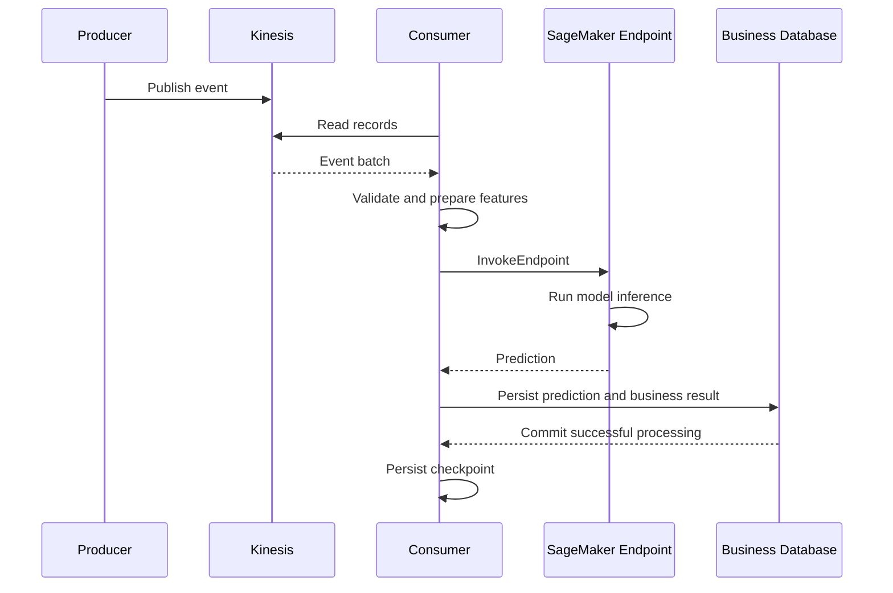
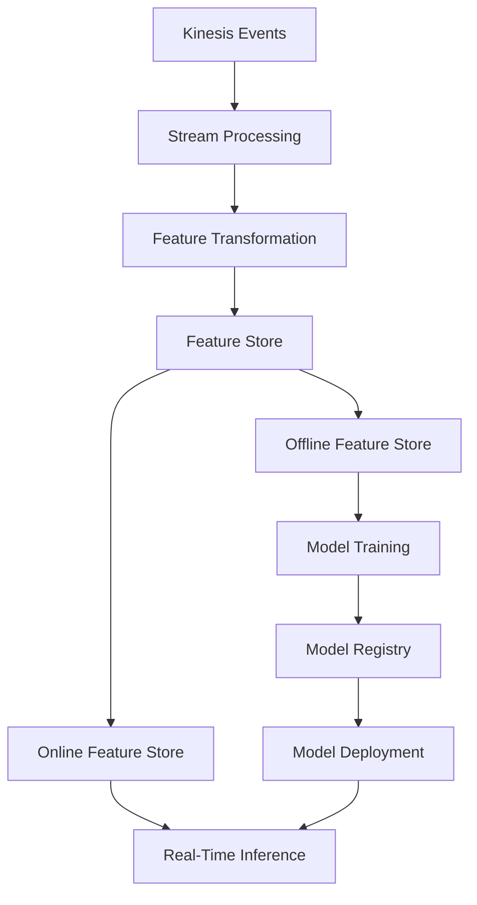
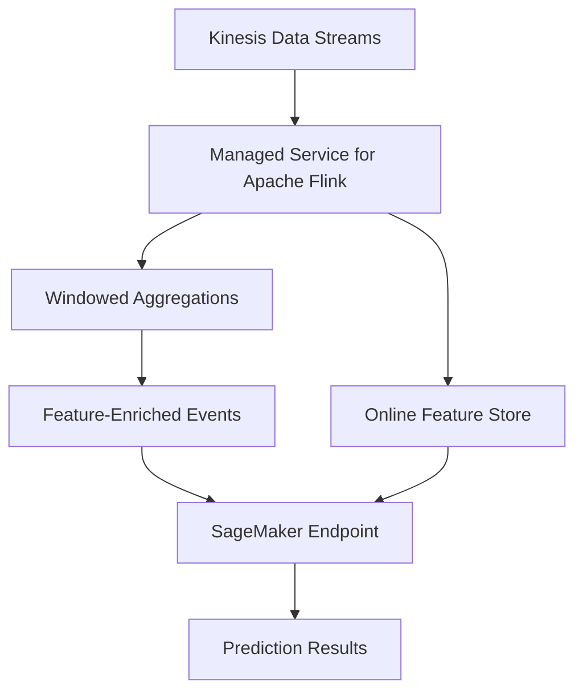
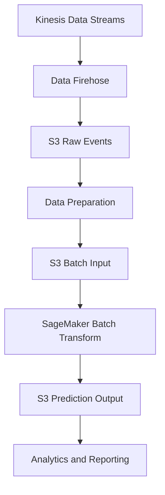
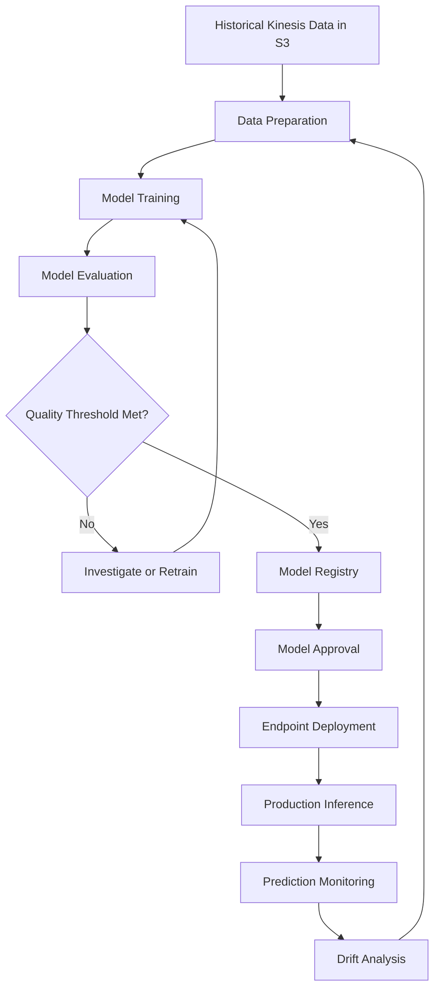

# 12- Amazon SageMaker Integration

## Overview

Amazon SageMaker integrates with Amazon Kinesis Data Streams to support real-time machine learning pipelines. Kinesis provides continuous event ingestion, while SageMaker provides capabilities for model training, deployment, inference, and model lifecycle management.

This integration enables backend systems to process streaming events, generate predictions, detect anomalies, and trigger business actions based on machine learning results.

Typical use cases include:

- Real-time fraud detection.
- Transaction risk scoring.
- Clickstream classification.
- IoT anomaly detection.
- Recommendation systems.
- Predictive maintenance.
- Customer behavior analysis.
- Real-time personalization.

A production architecture generally separates streaming ingestion, feature preparation, model inference, and downstream business processing.

Kinesis does not automatically invoke SageMaker for every record. The integration requires an application consumer, a supported managed integration, or an orchestration layer to connect the streaming and inference workloads.

## Architecture

### High-Level Architecture



### Component Responsibilities

| Component | Responsibility |
|---|---|
| Kinesis Data Streams | Ingests and distributes streaming events |
| Stream Consumer | Reads records and coordinates processing |
| Feature Preparation | Converts events into model-compatible features |
| SageMaker Endpoint | Hosts a deployed model for inference |
| SageMaker Training | Trains models using historical datasets |
| SageMaker Pipelines | Orchestrates repeatable ML workflows |
| SageMaker Model Registry | Manages model versions and approval |
| Amazon S3 | Stores raw events, training data, and model artifacts |
| PostgreSQL or DynamoDB | Stores business state and prediction results |
| CloudWatch | Monitors ingestion, inference, and application health |

## Integration Patterns

Different workloads require different integration approaches.

| Pattern | Description | Suitable for |
|---|---|---|
| Consumer-to-SageMaker real-time inference | A Kinesis consumer invokes a SageMaker endpoint | Low-latency online predictions |
| Kinesis to S3 to SageMaker training | Stream data is archived in S3 and used for training | Historical model training |
| Kinesis to Flink to SageMaker | Stream processing prepares features before inference | Stateful streaming analytics |
| Kinesis Data Firehose to S3 to SageMaker | Firehose delivers events for offline ML processing | Batch-oriented ML workloads |
| Kinesis consumer to SageMaker asynchronous inference | Consumer submits inference requests asynchronously | Large payloads or longer-running predictions |
| Streaming features to SageMaker | Consumer maintains or retrieves online features before inference | Feature-based real-time prediction |

The choice depends on inference latency, payload size, processing volume, model complexity, and business requirements.

## Real-Time Inference Architecture

### Request Lifecycle

A common architecture uses a Kinesis consumer to invoke a SageMaker real-time endpoint.



The consumer performs the following operations:

1. Reads an event from Kinesis.
2. Validates the event contract.
3. Extracts or calculates model features.
4. Serializes the feature vector.
5. Invokes the SageMaker endpoint.
6. Parses the prediction response.
7. Applies business rules.
8. Persists the result.
9. Advances the checkpoint after durable processing.

The consumer must handle inference failures independently from Kinesis read failures.

### Example Event Contract

A transaction event might look like:

```json
{
  "event_id": "evt-1001",
  "event_type": "transaction.created",
  "event_time": "2026-11-20T10:30:00Z",
  "transaction": {
    "transaction_id": "txn-1001",
    "customer_id": "cust-1001",
    "amount": 12500.50,
    "currency": "INR",
    "merchant_category": "electronics",
    "country": "IN"
  }
}
```

The consumer converts the business event into the feature representation expected by the deployed model.

The event schema and model feature schema should be versioned independently but governed through an explicit compatibility contract.

## SageMaker Real-Time Endpoints

### What Is a SageMaker Endpoint?

A SageMaker real-time endpoint hosts a deployed model behind an HTTPS inference API.

Applications invoke the endpoint using the SageMaker Runtime API.

The endpoint can run on supported CPU or GPU instance types and can use one or more production variants.

Use real-time endpoints when predictions must be returned within an interactive or near-real-time processing window.

### Advantages

- Low-latency synchronous inference.
- Managed model hosting.
- Configurable compute resources.
- Endpoint scaling options.
- Integration with IAM and VPC networking.
- CloudWatch monitoring.
- Support for production variants and model deployment strategies.

### Limitations

- Endpoint instances incur costs while provisioned.
- Inference capacity must be sized for traffic.
- Network and service latency affect end-to-end processing.
- Model loading and container startup can affect deployment readiness.
- Synchronous requests have payload and execution constraints.
- A downstream inference outage can delay stream consumption.

### Endpoint Invocation Flow

```text
Kinesis Consumer
       |
       v
Feature Transformation
       |
       v
SageMaker Runtime API
       |
       v
SageMaker Endpoint
       |
       v
Model Container
       |
       v
Prediction Response
       |
       v
Business Processing
```

## Deploying a SageMaker Model

### Training Data Preparation

Historical streaming records can be archived in S3.

A typical training dataset contains:

- Features.
- Target labels.
- Event timestamps.
- Training identifiers.
- Data quality metadata.

Example S3 layout:

```text
company-ml-data/
│
├── raw/
│   └── transactions/
│
├── training/
│   └── fraud-detection/
│       ├── train/
│       ├── validation/
│       └── test/
│
├── processed/
│   └── fraud-detection/
│
└── model-artifacts/
    └── fraud-detection/
```

Separate training, validation, and test datasets to prevent evaluation leakage.

For time-dependent event data, use time-aware splitting rather than randomly distributing records when that better reflects production prediction behavior.

### SageMaker Training

SageMaker training jobs execute training code using managed compute infrastructure.

A typical training workflow:

1. Retrieve training data from S3.
2. Validate the dataset and schema.
3. Train the model.
4. Evaluate model performance.
5. Save model artifacts.
6. Register the model version.
7. Approve the model for deployment.
8. Deploy the approved model.

### Example Training Job with Boto3

```python
import boto3

sagemaker = boto3.client(
    "sagemaker",
    region_name="ap-south-1",
)

response = sagemaker.create_training_job(
    TrainingJobName="fraud-detection-training-001",
    RoleArn=(
        "arn:aws:iam::123456789012:"
        "role/SageMakerExecutionRole"
    ),
    AlgorithmSpecification={
        "TrainingImage": (
            "123456789012.dkr.ecr.ap-south-1.amazonaws.com/"
            "fraud-training:1.0.0"
        ),
        "TrainingInputMode": "File",
    },
    InputDataConfig=[
        {
            "ChannelName": "train",
            "DataSource": {
                "S3DataSource": {
                    "S3DataType": "S3Prefix",
                    "S3Uri": (
                        "s3://company-ml-data/"
                        "training/fraud-detection/train/"
                    ),
                    "S3DataDistributionType": "FullyReplicated",
                }
            },
            "ContentType": "text/csv",
        }
    ],
    OutputDataConfig={
        "S3OutputPath": (
            "s3://company-ml-data/model-artifacts/"
        )
    },
    ResourceConfig={
        "InstanceType": "ml.m5.xlarge",
        "InstanceCount": 1,
        "VolumeSizeInGB": 20,
    },
    StoppingCondition={
        "MaxRuntimeInSeconds": 3600,
    },
)

print(response["TrainingJobArn"])
```

This example uses a custom training container. The container must implement the SageMaker training environment contract and produce model artifacts in the expected location.

Training instance selection should be based on model size, training duration, framework requirements, and cost.

## Model Deployment

### Creating a Model

After training, SageMaker stores the model artifacts in S3.

Create a SageMaker model referencing the inference container and artifact location.

```python
response = sagemaker.create_model(
    ModelName="fraud-detection-model-v1",
    ExecutionRoleArn=(
        "arn:aws:iam::123456789012:"
        "role/SageMakerExecutionRole"
    ),
    PrimaryContainer={
        "Image": (
            "123456789012.dkr.ecr.ap-south-1.amazonaws.com/"
            "fraud-inference:1.0.0"
        ),
        "ModelDataUrl": (
            "s3://company-ml-data/model-artifacts/"
            "fraud-detection/model.tar.gz"
        ),
    },
)

print(response["ModelArn"])
```

The inference image must implement the SageMaker inference container contract or use a supported framework container.

### Creating an Endpoint Configuration

```python
response = sagemaker.create_endpoint_config(
    EndpointConfigName="fraud-detection-config-v1",
    ProductionVariants=[
        {
            "VariantName": "primary",
            "ModelName": "fraud-detection-model-v1",
            "InitialInstanceCount": 2,
            "InstanceType": "ml.m5.large",
            "InitialVariantWeight": 1.0,
        }
    ],
)
```

### Creating an Endpoint

```python
response = sagemaker.create_endpoint(
    EndpointName="fraud-detection-endpoint",
    EndpointConfigName="fraud-detection-config-v1",
)

print(response["EndpointArn"])
```

Endpoint creation is asynchronous.

Wait until the endpoint reaches the `InService` state before sending production inference traffic.

### Endpoint Deployment Considerations

- Use multiple instances for production availability where supported.
- Select instance types based on measured inference latency and throughput.
- Configure endpoint scaling based on workload behavior.
- Use separate development, staging, and production endpoints.
- Apply deployment strategies that support safe model replacement.
- Monitor invocation failures and model latency.
- Validate model compatibility before updating the endpoint.

## Invoking SageMaker from a Kinesis Consumer

### Python Consumer Integration

The following example demonstrates how a Python consumer can invoke a deployed endpoint.

```python
import json
import boto3

runtime = boto3.client(
    "sagemaker-runtime",
    region_name="ap-south-1",
)

ENDPOINT_NAME = "fraud-detection-endpoint"


def predict(features: dict) -> dict:
    response = runtime.invoke_endpoint(
        EndpointName=ENDPOINT_NAME,
        ContentType="application/json",
        Accept="application/json",
        Body=json.dumps(features).encode("utf-8"),
    )

    prediction = response["Body"].read()

    return json.loads(prediction)
```

Example feature payload:

```python
features = {
    "amount": 12500.50,
    "merchant_category": "electronics",
    "country": "IN",
    "transaction_hour": 10,
    "customer_transaction_count": 4,
}

result = predict(features)

print(result)
```

Example model response:

```json
{
  "fraud_probability": 0.93,
  "risk_category": "high"
}
```

The response schema is model-specific. The inference container must implement the serialization and deserialization behavior expected by the application.

### Processing Kinesis Records

A consumer can combine event parsing and inference.

```python
import json
import logging

logger = logging.getLogger(__name__)


def process_kinesis_record(record: dict) -> dict:
    event = json.loads(
        record["Data"].decode("utf-8")
    )

    transaction = event["transaction"]

    features = {
        "amount": transaction["amount"],
        "merchant_category": transaction["merchant_category"],
        "country": transaction["country"],
    }

    prediction = predict(features)

    result = {
        "event_id": event["event_id"],
        "transaction_id": transaction["transaction_id"],
        "prediction": prediction,
    }

    logger.info(
        "Inference completed",
        extra={
            "event_id": event["event_id"],
            "transaction_id": transaction["transaction_id"],
        },
    )

    return result
```

A production consumer should also implement:

- Input schema validation.
- Feature transformation versioning.
- Endpoint timeout handling.
- Bounded retries.
- Idempotent result persistence.
- Model response validation.
- Prediction version tracking.
- Circuit breaking or controlled backpressure.

## Feature Engineering

### Why Feature Engineering Matters

A model expects features in a specific representation.

Raw business events often contain values that need transformation before inference.

For example:

| Raw event field | Model feature |
|---|---|
| Transaction timestamp | Transaction hour |
| Transaction amount | Normalized amount |
| Merchant category | Encoded category |
| Customer history | Historical transaction count |
| Customer location | Location risk indicator |
| Previous transactions | Velocity features |

Feature transformation must be consistent between training and inference.

If training and production inference use different transformations, model quality can degrade even when the deployed model itself has not changed.

### Offline and Online Features

| Feature type | Storage or computation | Purpose |
|---|---|---|
| Offline features | S3 and analytical storage | Training and historical analysis |
| Online features | Low-latency feature store or operational database | Real-time inference |
| Streaming features | Kinesis or stream-processing application | Continuously updated event-derived features |

SageMaker Feature Store can support offline and online feature management.

When using Feature Store, align record identifiers, event timestamps, feature definitions, and consistency requirements across offline and online access patterns.

### Feature Store Architecture



The online store supports low-latency feature retrieval, while the offline store supports historical analysis and training datasets.

Feature Store does not automatically guarantee that every feature is fresh or correctly synchronized. The feature pipeline must define freshness, update, and consistency requirements.

## Stateful Streaming with Kinesis and SageMaker

Some ML features require historical context.

Examples include:

- Number of transactions within the last five minutes.
- Average transaction value over the last 24 hours.
- Number of failed login attempts.
- Recent device activity.
- Rolling sensor measurements.

A stateless consumer cannot calculate these features accurately from one record alone.

Use a stateful stream-processing component or an online feature store.

### Kinesis and Managed Flink

Amazon Managed Service for Apache Flink can calculate rolling features from Kinesis streams.



Flink is useful when features require:

- Event-time processing.
- Stateful aggregations.
- Sliding or tumbling windows.
- Late-arriving event handling.
- Continuous feature updates.

The stream-processing application should define event-time semantics, watermark strategy, checkpointing, and state recovery.

## Inference Patterns

SageMaker provides different inference options.

The correct choice depends on latency, payload size, traffic patterns, and processing requirements.

| Inference type | Description | Suitable for |
|---|---|---|
| Real-time inference | Synchronous endpoint invocation | Low-latency predictions |
| Serverless inference | On-demand inference capacity | Intermittent or variable traffic |
| Asynchronous inference | Queued requests and asynchronous responses | Large payloads and longer processing |
| Batch Transform | Offline batch inference | Historical datasets |
| Inference pipelines | Multiple serial containers in one endpoint | Preprocessing and model execution |
| Multi-model endpoints | Multiple models hosted behind one endpoint | Many models with shared infrastructure |
| Multi-container endpoints | Multiple containers in one endpoint | Specific model composition and hosting requirements |

Not every inference option has the same request, payload, latency, and scaling behavior.

Validate current SageMaker quotas and endpoint constraints before selecting a production architecture.

### Real-Time Inference

Use real-time inference when the consumer requires an immediate prediction before completing business processing.

Example:

```text
Transaction Event
      |
      v
Kinesis
      |
      v
Consumer
      |
      v
SageMaker Real-Time Endpoint
      |
      v
Fraud Probability
      |
      v
Approve / Review / Reject
```

The consumer must account for endpoint latency and availability in its processing capacity calculations.

### Asynchronous Inference

Asynchronous inference is useful when:

- Payloads are large.
- Processing takes longer.
- Immediate responses are unnecessary.
- The application can process completion notifications or retrieve results later.

The asynchronous workflow generally uses S3 for input and output payloads.

A Kinesis consumer can submit an asynchronous inference request and persist the returned request identifier.

Do not treat asynchronous inference submission as proof that prediction processing has completed.

### Batch Transform

Batch Transform is appropriate for offline prediction over large datasets.

Example use cases:

- Scoring historical transactions.
- Recalculating customer risk scores.
- Generating recommendations for a daily campaign.
- Processing archived IoT telemetry.

A common architecture is:



Batch inference avoids making one synchronous endpoint call per event when predictions can be generated as a bulk operation.

## Model Lifecycle Management

### Model Training and Deployment Lifecycle



### SageMaker Pipelines

SageMaker Pipelines can orchestrate repeatable ML workflows.

Typical steps include:

- Data processing.
- Model training.
- Model evaluation.
- Conditional approval.
- Model registration.
- Deployment orchestration.

A pipeline helps ensure that model training and evaluation follow a repeatable process.

Store pipeline definitions and processing code in version control.

### Model Registry

SageMaker Model Registry provides model version management and approval workflows.

Use it to track:

- Model package versions.
- Training artifacts.
- Evaluation metadata.
- Approval status.
- Deployment history.

Do not deploy a newly trained model directly to production without an evaluation and approval process.

### Model Versioning

Prediction records should identify the model version used.

Example:

```json
{
  "event_id": "evt-1001",
  "prediction_id": "pred-1001",
  "model_name": "fraud-detection",
  "model_version": "v12",
  "endpoint_name": "fraud-detection-endpoint",
  "fraud_probability": 0.93,
  "prediction_time": "2026-11-20T10:30:02Z"
}
```

Model version tracking supports:

- Prediction reproducibility.
- Incident investigation.
- Model comparison.
- Rollback.
- Audit requirements.

An endpoint name alone may not be sufficient to identify the exact model artifact if its configuration changes over time.

## Prediction Persistence and Idempotency

### Why Prediction Persistence Matters

A consumer may invoke a model successfully but fail before persisting the prediction.

When the record is processed again, the model may be invoked a second time.

This can create duplicate prediction records and unnecessary inference costs.

Use a stable prediction identity.

A possible key is:

```text
event_id + model_version + feature_version
```

The exact identity depends on whether predictions are expected to change when feature logic or model versions change.

### PostgreSQL Schema

```sql
CREATE TABLE ml_predictions (
    prediction_id UUID PRIMARY KEY,
    event_id VARCHAR(128) NOT NULL,
    model_name VARCHAR(128) NOT NULL,
    model_version VARCHAR(64) NOT NULL,
    feature_version VARCHAR(64) NOT NULL,
    prediction JSONB NOT NULL,
    created_at TIMESTAMPTZ NOT NULL DEFAULT NOW(),

    UNIQUE (
        event_id,
        model_name,
        model_version,
        feature_version
    )
);
```

### Idempotent Persistence

```sql
INSERT INTO ml_predictions (
    prediction_id,
    event_id,
    model_name,
    model_version,
    feature_version,
    prediction
)
VALUES (
    '00000000-0000-0000-0000-000000000001',
    'evt-1001',
    'fraud-detection',
    'v12',
    'features-v3',
    '{"fraud_probability": 0.93}'
)
ON CONFLICT (
    event_id,
    model_name,
    model_version,
    feature_version
)
DO NOTHING;
```

Use database constraints to enforce the intended uniqueness rule.

If predictions trigger external side effects, use an outbox or another reliable delivery mechanism.

## Error Handling and Backpressure

### Failure Scenarios

| Failure | Impact | Recommended handling |
|---|---|---|
| SageMaker endpoint unavailable | Inference cannot complete | Retry transient errors with bounded backoff |
| Model timeout | Consumer processing slows | Apply timeout budgets and monitor latency |
| Invalid feature payload | Model rejects the request | Validate features before invocation |
| Model response parsing failure | Prediction cannot be persisted | Validate response contract and isolate failures |
| PostgreSQL outage | Prediction persistence fails | Preserve processing progress and retry safely |
| Consumer restart | Records may be processed again | Use idempotent persistence and durable checkpoints |
| Endpoint throttling | Requests are rejected or delayed | Control concurrency and endpoint capacity |
| Model deployment issue | New model cannot serve traffic | Use deployment validation and rollback |

### Backpressure

A synchronous inference architecture couples Kinesis consumer throughput to SageMaker endpoint capacity.

For example:

```text
Kinesis Ingestion Rate:       2,000 records/sec
Consumer Processing Capacity: 1,000 records/sec
Inference Capacity:           700 requests/sec
```

The consumer cannot sustain the ingestion rate.

Iterator age increases as records accumulate.

Possible solutions include:

- Increase endpoint capacity.
- Increase consumer concurrency within shard constraints.
- Batch inference where the model supports it.
- Optimize feature preparation.
- Reduce unnecessary inference requests.
- Use asynchronous inference where appropriate.
- Separate real-time and offline workloads.

Do not scale consumer concurrency without considering endpoint quotas and downstream database capacity.

### Retry Strategy

Retry only transient failures.

Use exponential backoff with jitter for:

- Throttling.
- Temporary service failures.
- Network interruptions.
- Recoverable endpoint errors.

Avoid indefinite retries for invalid payloads or incompatible feature schemas.

For permanently invalid records, store:

- Original event reference.
- Event ID.
- Model version.
- Feature version.
- Error category.
- Failure timestamp.

Define an explicit replay or manual recovery procedure.

## Security Considerations

### IAM Roles

Separate IAM responsibilities.

| Role | Responsibility |
|---|---|
| Kinesis consumer role | Read streaming records |
| SageMaker execution role | Access training data and model artifacts |
| SageMaker inference execution role | Access resources required by the deployed model container |
| Training pipeline role | Execute processing and training steps |
| Deployment role | Create and update models and endpoints |
| Application role | Invoke approved SageMaker endpoints |

The consumer role needs permission to invoke the endpoint.

Example policy:

```json
{
  "Version": "2012-10-17",
  "Statement": [
    {
      "Sid": "InvokeFraudDetectionEndpoint",
      "Effect": "Allow",
      "Action": [
        "sagemaker:InvokeEndpoint"
      ],
      "Resource": "arn:aws:sagemaker:ap-south-1:123456789012:endpoint/fraud-detection-endpoint"
    }
  ]
}
```

Grant additional permissions only when the application requires them.

### Network Security

SageMaker endpoints can be configured with VPC networking options.

For private deployments:

- Configure appropriate VPC subnets.
- Restrict endpoint security groups.
- Use private connectivity where supported.
- Configure Kinesis VPC endpoints for consumers.
- Avoid unnecessary public network exposure.
- Validate DNS and routing.

The consumer must have network access to the SageMaker Runtime endpoint.

### Data Protection

Streaming events can contain sensitive business or customer information.

Recommended controls:

- Encrypt Kinesis streams where required.
- Encrypt S3 training datasets.
- Use KMS for model artifacts where required.
- Restrict prediction access.
- Avoid logging complete feature vectors.
- Apply data retention policies.
- Minimize the sensitive information sent to inference containers.

### Model Endpoint Access

Use IAM authorization for endpoint invocation.

Do not expose model endpoints directly to untrusted clients.

A backend API can authenticate callers, validate requests, and invoke the endpoint through its application role.

## Monitoring and Observability

### Kinesis Metrics

Monitor:

- Incoming records.
- Incoming bytes.
- Read throttling.
- Iterator age.
- Consumer processing throughput.

### SageMaker Endpoint Metrics

Monitor relevant endpoint metrics, including:

- `Invocations`
- `Invocation4XXErrors`
- `Invocation5XXErrors`
- `ModelLatency`
- `OverheadLatency`
- `InvocationsPerInstance`
- `ModelSetupTime`

Metric availability depends on endpoint type and hosting configuration.

### Application Metrics

Publish custom metrics for:

- Feature transformation duration.
- Inference request duration.
- Prediction processing failures.
- Model timeout count.
- Prediction persistence failures.
- Duplicate prediction count.
- End-to-end event latency.
- Model version distribution.

### End-to-End Monitoring

A useful dashboard should correlate:

```text
Kinesis Iterator Age
        |
        v
Consumer Processing Latency
        |
        v
Feature Transformation Latency
        |
        v
SageMaker Model Latency
        |
        v
Prediction Persistence Latency
```

This identifies whether delays originate in ingestion, consumer execution, feature processing, inference, or downstream persistence.

### Prediction Quality Monitoring

Infrastructure metrics do not indicate whether a model remains accurate.

Monitor:

- Prediction distribution.
- Feature distribution.
- Missing feature rates.
- Prediction confidence.
- Delayed ground-truth labels.
- Model drift.
- Business outcome metrics.

SageMaker Model Monitor can support monitoring for supported inference and data-quality workflows.

Model monitoring requires appropriate baseline configuration, data capture, and evaluation strategy.

## High Availability and Disaster Recovery

### High Availability

For production inference:

- Use endpoint configurations with appropriate instance counts.
- Configure endpoint scaling.
- Deploy consumers across multiple Availability Zones.
- Keep model artifacts in durable S3 storage.
- Use durable checkpoints.
- Make prediction persistence idempotent.
- Define endpoint timeout and retry policies.

Endpoint instance count and deployment configuration should match availability and latency objectives.

### Disaster Recovery

A multi-Region ML architecture requires explicit recovery planning for:

- Kinesis stream replication.
- S3 training and model artifact replication.
- SageMaker model and endpoint recreation.
- Feature Store recovery.
- IAM and KMS configuration.
- Consumer deployment.
- Checkpoint recovery.
- Prediction database recovery.

SageMaker endpoints and Kinesis streams are regional resources.

S3 replication does not automatically recreate SageMaker endpoint configurations, model registry approvals, pipelines, or Kinesis consumer state.

Manage deployment definitions and model metadata so that critical resources can be recreated in a recovery Region.

## Performance and Cost Optimization

### Inference Performance

Optimize:

- Feature transformation overhead.
- Serialization and deserialization.
- Endpoint instance selection.
- Request concurrency.
- Network latency.
- Model execution time.
- Downstream persistence.

Measure the complete processing path rather than optimizing model execution in isolation.

### Batching

If the model supports batch inference, combine records into larger inference requests.

Batching can reduce request overhead and improve throughput.

However, batching increases:

- Waiting time before inference.
- Memory usage.
- Failure recovery complexity.
- Per-record latency.

Use bounded batch sizes and maximum batch-wait intervals.

### SageMaker Cost Drivers

| Component | Cost drivers |
|---|---|
| Training jobs | Instance type, instance count, and training duration |
| Real-time endpoints | Provisioned instance count and runtime |
| Serverless inference | Invocation duration and allocated memory |
| Asynchronous inference | Hosting resources and processing volume |
| Batch Transform | Instance type, instance count, and execution duration |
| Feature Store | Storage and online request usage |
| Model Monitor | Monitoring compute and data processing |
| S3 | Training data, model artifacts, and prediction storage |
| Kinesis | Stream capacity, retention, and consumer features |

### Cost Optimization Strategies

**Inference**
- Select instance types through load testing.
- Scale endpoints based on traffic.
- Avoid oversized always-on endpoints.
- Use serverless inference for suitable intermittent workloads.
- Use asynchronous inference for suitable longer-running requests.
- Batch offline predictions.

**Training**
- Use incremental training where appropriate.
- Stop unnecessary training jobs.
- Use suitable instance types.
- Remove obsolete intermediate artifacts according to retention policy.

**Streaming**
- Avoid invoking the model for events that do not require prediction.
- Cache reusable deterministic results only when correctness permits.
- Apply feature-based filtering before inference.
- Separate real-time inference from historical scoring.

## Infrastructure as Code

Manage Kinesis, SageMaker, IAM, and monitoring resources through infrastructure as code.

### SageMaker Model

```hcl
resource "aws_sagemaker_model" "fraud_detection" {
  name               = "fraud-detection-model-v1"
  execution_role_arn = aws_iam_role.sagemaker_execution.arn

  primary_container {
    image          = var.inference_image_uri
    model_data_url = var.model_artifact_s3_uri
  }

  tags = {
    Environment = "production"
    Application = "fraud-detection"
  }
}
```

### SageMaker Endpoint Configuration

```hcl
resource "aws_sagemaker_endpoint_configuration" "fraud_detection" {
  name = "fraud-detection-config-v1"

  production_variants {
    variant_name           = "primary"
    model_name             = aws_sagemaker_model.fraud_detection.name
    initial_instance_count = 2
    instance_type          = "ml.m5.large"
    initial_variant_weight = 1.0
  }
}
```

### SageMaker Endpoint

```hcl
resource "aws_sagemaker_endpoint" "fraud_detection" {
  name = "fraud-detection-endpoint"

  endpoint_config_name = (
    aws_sagemaker_endpoint_configuration.fraud_detection.name
  )

  tags = {
    Environment = "production"
  }
}
```

### Endpoint Invocation IAM Policy

```hcl
resource "aws_iam_policy" "invoke_fraud_endpoint" {
  name        = "InvokeFraudDetectionEndpoint"
  description = "Allow the application to invoke the fraud endpoint"

  policy = jsonencode({
    Version = "2012-10-17"

    Statement = [
      {
        Effect = "Allow"

        Action = [
          "sagemaker:InvokeEndpoint"
        ]

        Resource = aws_sagemaker_endpoint.fraud_detection.arn
      }
    ]
  })
}
```

The complete infrastructure should also define:

- SageMaker execution roles.
- ECR repositories and image lifecycle policies.
- S3 training and model artifact buckets.
- Kinesis stream permissions.
- KMS configuration.
- Endpoint scaling policies.
- CloudWatch alarms.
- Model deployment controls.
- Feature Store resources where required.

Do not hardcode model artifact paths or account-specific ARNs in reusable modules.

## Testing Strategy

### Unit Testing

Test feature transformation and prediction handling independently.

Important cases include:

- Valid event parsing.
- Missing required features.
- Invalid numeric values.
- Feature schema compatibility.
- Prediction response parsing.
- Risk threshold evaluation.
- Duplicate event handling.

Example:

```python
def test_feature_extraction():
    event = {
        "transaction": {
            "amount": 12500.50,
            "merchant_category": "electronics",
            "country": "IN",
        }
    }

    features = extract_features(event)

    assert features["amount"] == 12500.50
    assert features["country"] == "IN"
```

### Integration Testing

Validate:

- Kinesis consumer connectivity.
- SageMaker endpoint invocation.
- Model request and response formats.
- IAM permissions.
- Feature retrieval.
- Prediction persistence.
- Checkpoint recovery.
- Retry behavior.

Use a non-production endpoint for integration testing.

### Model Validation

Before deployment, evaluate:

- Accuracy.
- Precision.
- Recall.
- F1 score.
- ROC-AUC where appropriate.
- False-positive rate.
- False-negative rate.
- Inference latency.
- Prediction stability.
- Business-specific performance thresholds.

Model evaluation metrics should reflect the actual business cost of incorrect predictions.

For fraud detection, for example, false negatives and false positives may have different operational and financial consequences.

### Load Testing

Measure:

- Inference requests per second.
- Endpoint latency percentiles.
- Consumer processing throughput.
- Iterator age.
- Endpoint throttling.
- CPU and memory utilization.
- Database write throughput.

Test realistic request sizes and feature distributions.

Include burst traffic and endpoint scaling behavior.

## Common Mistakes and Production Pitfalls

| Mistake | Why it causes problems | Recommended approach |
|---|---|---|
| Calling SageMaker directly from producers | Couples event publishing to inference availability | Decouple through Kinesis consumers |
| Treating Kinesis as an automatic SageMaker trigger | Kinesis does not automatically invoke every endpoint for each record | Implement a consumer or supported integration |
| Using different training and inference features | Produces inconsistent model inputs | Share and version feature transformation logic |
| Ignoring endpoint latency | Consumer throughput falls and iterator age increases | Measure and control inference latency |
| Scaling consumers without endpoint capacity planning | Creates throttling and downstream pressure | Coordinate consumer and endpoint scaling |
| Retrying all inference errors indefinitely | Invalid requests block stream progress | Use bounded retries and failure isolation |
| Persisting predictions without idempotency | Consumer retries create duplicate business effects | Use stable prediction identities and database constraints |
| Ignoring model version metadata | Makes prediction investigation and reproduction difficult | Persist model and feature versions |
| Using real-time inference for bulk scoring | Adds unnecessary request overhead and cost | Evaluate Batch Transform |
| Treating endpoint availability as model quality | Infrastructure health does not prove prediction accuracy | Monitor data quality, drift, and business outcomes |
| Logging complete feature vectors | May expose sensitive customer information | Log safe identifiers and operational metadata |
| Deploying models without evaluation | New models can degrade business performance | Use evaluation thresholds and approval workflows |
| Assuming S3 replication provides complete ML recovery | Model endpoints and pipeline metadata are separate resources | Recreate regional resources through infrastructure as code |
| Ignoring online feature freshness | Predictions may use stale customer or transaction state | Define feature freshness and update guarantees |

## Production Reference Architecture

A production streaming ML architecture can use the following components:

| Layer | AWS service | Responsibility |
|---|---|---|
| Event ingestion | Kinesis Data Streams | Accept business and telemetry events |
| Consumer execution | ECS, EC2, Lambda, or Managed Flink | Prepare features and invoke inference |
| Raw data archive | Amazon S3 | Preserve historical streaming events |
| Feature engineering | Glue, Flink, or application processing | Transform and enrich event data |
| Feature management | SageMaker Feature Store or an operational feature service | Maintain offline and online features |
| Model training | SageMaker Training | Train models |
| Workflow orchestration | SageMaker Pipelines | Automate ML workflows |
| Model governance | SageMaker Model Registry | Version and approve models |
| Model hosting | SageMaker Endpoints | Serve predictions |
| Prediction storage | PostgreSQL or DynamoDB | Persist prediction results |
| Monitoring | CloudWatch and model monitoring workflows | Track infrastructure and model quality |

### Production Checklist

**Streaming integration**
- [ ] Kinesis consumer uses durable checkpoints.
- [ ] Consumer processing is idempotent.
- [ ] Feature transformation is versioned.
- [ ] Inference failures have a defined retry policy.
- [ ] Backpressure is monitored.
- [ ] Prediction results are persisted reliably.

**SageMaker**
- [ ] Training data is validated.
- [ ] Model evaluation thresholds are defined.
- [ ] Model versions are registered.
- [ ] Production deployment requires approval.
- [ ] Endpoint capacity is load-tested.
- [ ] Endpoint scaling is configured.
- [ ] Prediction responses are validated.

**Security**
- [ ] IAM roles follow least privilege.
- [ ] Model artifacts and datasets are encrypted.
- [ ] Endpoint access is restricted.
- [ ] Sensitive features are not logged unnecessarily.
- [ ] Secrets are managed outside application images.

**Operations**
- [ ] Kinesis iterator age is monitored.
- [ ] Model latency and invocation errors are monitored.
- [ ] Feature quality and freshness are measured.
- [ ] Prediction quality is evaluated.
- [ ] Model rollback procedures are tested.
- [ ] Multi-Region recovery requirements are documented.

## Key Takeaways

- Kinesis provides streaming ingestion, while SageMaker provides model training, deployment, and inference; a consumer or stream-processing component connects the two.
- Real-time inference is appropriate for low-latency predictions, while asynchronous inference and Batch Transform address different payload and processing requirements.
- Feature transformations must remain consistent between training and production inference, with explicit schema and feature versioning.
- Consumer throughput, SageMaker endpoint capacity, downstream persistence, and checkpointing must be designed together to prevent backpressure and duplicate business effects.
- Production ML systems require model governance, least-privilege IAM, prediction observability, drift monitoring, idempotent processing, and tested model rollback and disaster recovery procedures.