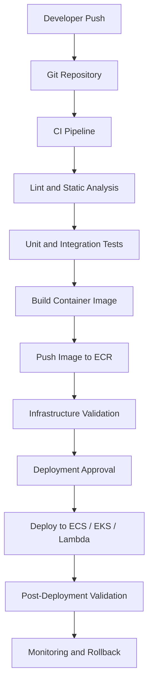
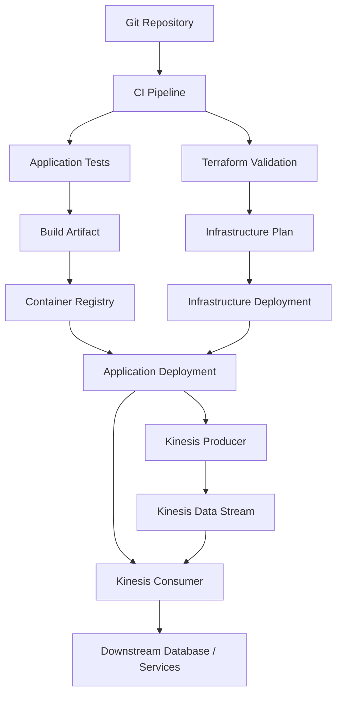
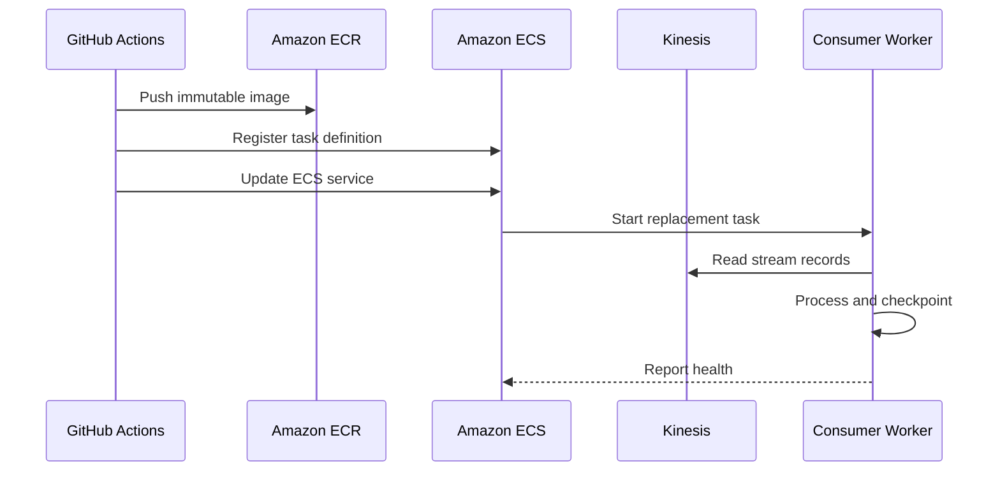

# 13- CI-CD Integration

## Overview

CI/CD (Continuous Integration and Continuous Delivery or Deployment) automates the process of building, testing, validating, and releasing applications that produce or consume Amazon Kinesis Data Streams.

Kinesis-based applications often contain multiple independently deployable components:

- Stream producers that publish records.
- Consumer applications running on Lambda, ECS, EKS, or EC2.
- Kinesis Data Streams infrastructure.
- DynamoDB tables used for KCL checkpoints and leases.
- IAM roles and policies.
- CloudWatch dashboards and alarms.
- Event-processing infrastructure and downstream integrations.

Managing these components manually creates deployment risks, configuration drift, and inconsistent environments.

A production CI/CD pipeline should automate application validation, infrastructure deployment, release promotion, and rollback while preserving stream-processing reliability.

A typical architecture is:



The deployment pipeline must account for more than application availability. A consumer can be running successfully while falling behind the Kinesis stream, processing duplicate records, or failing to persist checkpoints.

CI/CD for Kinesis therefore needs to validate both software correctness and streaming-system behavior.

## CI/CD Fundamentals

### Continuous Integration

Continuous Integration automatically validates code changes whenever developers push commits or open pull requests.

Typical CI activities include:

- Python linting and formatting.
- Static type checking.
- Unit testing.
- Event schema validation.
- Producer and consumer contract testing.
- Docker image building.
- Terraform formatting and validation.
- Dependency and security scanning.

The objective is to detect defects before code reaches a deployment environment.

### Continuous Delivery

Continuous Delivery ensures that validated application artifacts are always ready for deployment.

A deployment may require manual approval before promotion to production.

### Continuous Deployment

Continuous Deployment automatically releases validated changes to production when all pipeline conditions pass.

This requires strong automated testing, controlled rollout strategies, observability, and reliable rollback procedures.

| Practice | Deployment behavior |
|---|---|
| Continuous Integration | Validates changes automatically |
| Continuous Delivery | Produces deployable artifacts and supports controlled releases |
| Continuous Deployment | Automatically releases validated changes to production |

## Kinesis Application Deployment Architecture

A Kinesis application typically has separate infrastructure and application deployment responsibilities.



The deployment strategy depends on the runtime.

| Component | Deployment mechanism |
|---|---|
| Kinesis Data Stream | Terraform or CloudFormation |
| Lambda consumer | Lambda deployment package or container image |
| ECS consumer | Docker image deployed through ECS |
| EKS consumer | Container image and Kubernetes manifests |
| KCL application | Container or application package |
| IAM policies | Terraform or CloudFormation |
| CloudWatch alarms | Terraform or CloudFormation |
| DynamoDB checkpoint table | Terraform or KCL-managed infrastructure, depending on ownership |

Keep infrastructure and application releases logically separate even when they are orchestrated by the same CI/CD pipeline.

## Repository Structure

A practical repository for a Python-based Kinesis application might look like:

```text
kinesis-platform/
│
├── producer/
│   ├── app/
│   │   ├── __init__.py
│   │   ├── producer.py
│   │   └── settings.py
│   ├── tests/
│   ├── Dockerfile
│   └── requirements.txt
│
├── consumer/
│   ├── app/
│   │   ├── __init__.py
│   │   ├── consumer.py
│   │   ├── processor.py
│   │   └── settings.py
│   ├── tests/
│   ├── Dockerfile
│   └── requirements.txt
│
├── infrastructure/
│   ├── modules/
│   ├── environments/
│   │   ├── dev/
│   │   ├── staging/
│   │   └── production/
│   └── versions.tf
│
├── contracts/
│   └── telemetry-event.schema.json
│
├── .github/
│   └── workflows/
│       ├── ci.yml
│       ├── deploy-staging.yml
│       └── deploy-production.yml
│
├── pyproject.toml
└── README.md
```

This structure separates producer and consumer code, infrastructure, event contracts, and deployment workflows.

For larger systems, producer and consumer applications may have independent repositories and release pipelines.

## CI Pipeline for Kinesis Applications

A CI pipeline should validate application code before generating deployable artifacts.

### Python Quality Checks

Typical quality checks include:

| Tool | Responsibility |
|---|---|
| Ruff | Linting and formatting |
| mypy | Static type checking |
| pytest | Unit and integration testing |
| Bandit | Python security analysis |
| pip-audit | Dependency vulnerability scanning |

Install development dependencies:

```bash
pip install ruff mypy pytest pytest-cov bandit pip-audit
```

Run checks:

```bash
ruff check .
ruff format --check .
mypy producer consumer
pytest --cov=producer --cov=consumer --cov-report=term-missing
bandit -r producer consumer
pip-audit
```

Do not treat code coverage as the only measure of quality. Prioritize tests that validate event processing, retry behavior, idempotency, and checkpoint correctness.

### Unit Testing Kinesis Producers

Producer tests should verify:

- Correct partition-key selection.
- Event serialization.
- Payload validation.
- Retry classification.
- Handling of throttling.
- Handling of partial failures from `PutRecords`.

Example producer implementation:

```python
import json
from typing import Any

import boto3


class KinesisProducer:
    def __init__(self, stream_name: str, region_name: str):
        self.stream_name = stream_name
        self.client = boto3.client(
            "kinesis",
            region_name=region_name,
        )

    def publish(self, event: dict[str, Any]) -> str:
        response = self.client.put_record(
            StreamName=self.stream_name,
            Data=json.dumps(event).encode("utf-8"),
            PartitionKey=event["device_id"],
        )

        return response["SequenceNumber"]
```

Example test using a mocked AWS client:

```python
from unittest.mock import MagicMock, patch

from producer.app.producer import KinesisProducer


@patch("producer.app.producer.boto3.client")
def test_publish_uses_device_id_as_partition_key(mock_client):
    client = MagicMock()
    client.put_record.return_value = {
        "SequenceNumber": "12345",
    }
    mock_client.return_value = client

    producer = KinesisProducer(
        stream_name="iot-telemetry-stream",
        region_name="ap-south-1",
    )

    event = {
        "device_id": "machine-100",
        "temperature": 78.5,
    }

    result = producer.publish(event)

    assert result == "12345"

    client.put_record.assert_called_once()

    request = client.put_record.call_args.kwargs

    assert request["PartitionKey"] == "machine-100"
    assert request["StreamName"] == "iot-telemetry-stream"
```

The test validates the producer's interaction with the Kinesis API without requiring an actual AWS stream.

### Unit Testing Consumers

Consumer tests should cover:

- Record deserialization.
- Business transformation.
- Invalid payload handling.
- Duplicate event detection.
- Database transaction behavior.
- Checkpoint sequencing.
- Partial batch failures.

A consumer should not checkpoint a record before its required side effects have completed.

For example, if a consumer writes to PostgreSQL and then checkpoints the Kinesis record, a failure between those operations can cause the record to be processed again.

Use transactional idempotency to make this safe.

## Event Contract Validation

Kinesis streams carry records between independently deployed producers and consumers.

A producer release can break consumers if it changes the event schema unexpectedly.

Use versioned event contracts.

Example event:

```json
{
  "event_id": "telemetry-100-00004567",
  "event_type": "DeviceTelemetry",
  "event_version": 1,
  "device_id": "machine-100",
  "timestamp": "2026-11-22T10:30:00Z",
  "data": {
    "temperature": 78.5,
    "pressure": 102.4
  }
}
```

A JSON Schema can validate the event structure:

```json
{
  "$schema": "https://json-schema.org/draft/2020-12/schema",
  "type": "object",
  "required": [
    "event_id",
    "event_type",
    "event_version",
    "device_id",
    "timestamp",
    "data"
  ],
  "properties": {
    "event_id": {
      "type": "string"
    },
    "event_type": {
      "type": "string"
    },
    "event_version": {
      "type": "integer",
      "minimum": 1
    },
    "device_id": {
      "type": "string"
    },
    "timestamp": {
      "type": "string",
      "format": "date-time"
    },
    "data": {
      "type": "object",
      "required": [
        "temperature",
        "pressure"
      ],
      "properties": {
        "temperature": {
          "type": "number"
        },
        "pressure": {
          "type": "number"
        }
      },
      "additionalProperties": true
    }
  },
  "additionalProperties": false
}
```

Contract testing should verify:

- Required fields remain available.
- Field types do not change unexpectedly.
- Existing consumers can process new producer events.
- Optional fields have safe defaults.
- Incompatible changes use a new event version.

For production systems, consider a schema registry or centrally managed contract repository when multiple teams publish and consume events.

## Docker Image Build and Release

Containerized producers and consumers can be deployed through ECS or EKS.

Build the consumer image:

```bash
docker build \
  -t kinesis-consumer:latest \
  ./consumer
```

Run locally:

```bash
docker run --rm \
  -e AWS_REGION=ap-south-1 \
  -e STREAM_NAME=iot-telemetry-stream \
  kinesis-consumer:latest
```

Production images should:

- Use a minimal supported base image.
- Run as a non-root user.
- Pin dependencies.
- Exclude credentials and environment-specific configuration.
- Include health and readiness behavior where appropriate.
- Use immutable release tags.
- Be scanned before deployment.

Avoid using `latest` as the production deployment identifier.

Use a commit SHA or release version and deploy the exact image digest.

### Example Dockerfile

```dockerfile
FROM python:3.12-slim

ENV PYTHONDONTWRITEBYTECODE=1
ENV PYTHONUNBUFFERED=1

WORKDIR /app

RUN useradd --create-home appuser

COPY requirements.txt .

RUN pip install --no-cache-dir -r requirements.txt

COPY app ./app

USER appuser

CMD ["python", "-m", "app.consumer"]
```

The application should obtain AWS credentials from its execution role rather than embedding access keys in the image.

## AWS Infrastructure Deployment

Terraform is commonly used to manage Kinesis infrastructure.

Infrastructure changes should be validated and reviewed before deployment.

### Terraform Validation

Run:

```bash
terraform fmt -check -recursive
terraform init -backend=false
terraform validate
```

Generate a plan using the appropriate environment configuration:

```bash
terraform init

terraform plan \
  -var-file=environments/staging/terraform.tfvars \
  -out=tfplan
```

Review the plan before applying it:

```bash
terraform show tfplan
terraform apply tfplan
```

Production pipelines should use remote state with appropriate access controls and state locking.

Do not store state files or sensitive variable values in public repositories or build logs.

### Kinesis Infrastructure Considerations

Infrastructure deployment must consider:

- Stream mode.
- Provisioned shard count or on-demand capacity.
- Retention period.
- Encryption configuration.
- IAM permissions.
- Enhanced fan-out consumers.
- CloudWatch alarms.
- Consumer checkpoint storage.
- Stream consumers and dependencies.

Some infrastructure changes can affect existing workloads.

For example, deleting and recreating a stream can invalidate consumers, stream ARNs, checkpoints, and replay assumptions.

Avoid destructive infrastructure changes unless the migration and recovery plan explicitly accounts for them.

## GitHub Actions CI Pipeline

GitHub Actions can automate code validation, testing, and Docker image creation.

Example workflow:

`.github/workflows/ci.yml`

```yaml
name: Kinesis Application CI

on:
  pull_request:
    branches:
      - main
  push:
    branches:
      - main

permissions:
  contents: read

jobs:
  test:
    runs-on: ubuntu-latest

    steps:
      - name: Checkout
        uses: actions/checkout@v4

      - name: Set up Python
        uses: actions/setup-python@v5
        with:
          python-version: "3.12"
          cache: pip

      - name: Install dependencies
        run: |
          python -m pip install --upgrade pip
          pip install -r producer/requirements.txt
          pip install -r consumer/requirements.txt
          pip install ruff mypy pytest pytest-cov

      - name: Lint
        run: |
          ruff check producer consumer
          ruff format --check producer consumer

      - name: Type check
        run: |
          mypy producer consumer

      - name: Test
        run: |
          pytest --cov=producer --cov=consumer --cov-report=term-missing

  infrastructure-validation:
    runs-on: ubuntu-latest

    steps:
      - name: Checkout
        uses: actions/checkout@v4

      - name: Set up Terraform
        uses: hashicorp/setup-terraform@v3

      - name: Terraform format
        working-directory: infrastructure
        run: terraform fmt -check -recursive

      - name: Terraform initialize
        working-directory: infrastructure
        run: terraform init -backend=false

      - name: Terraform validate
        working-directory: infrastructure
        run: terraform validate
```

Pin third-party actions to reviewed commit SHAs in security-sensitive production repositories. Version tags are convenient, but a mutable tag does not provide the same supply-chain assurance as a verified immutable reference.

This workflow validates application code and Terraform syntax. It does not deploy infrastructure or applications.

## Deploying to Amazon ECR

Amazon Elastic Container Registry (ECR) stores container images used by ECS and EKS deployments.

The CI pipeline should:

1. Authenticate to AWS.
2. Authenticate Docker to ECR.
3. Build the image.
4. Tag it with an immutable identifier.
5. Push it to the repository.
6. Record the image digest for deployment.

Example commands:

```bash
aws ecr get-login-password \
  --region ap-south-1 \
  | docker login \
      --username AWS \
      --password-stdin \
      123456789012.dkr.ecr.ap-south-1.amazonaws.com
```

Build and push:

```bash
IMAGE_URI=123456789012.dkr.ecr.ap-south-1.amazonaws.com/kinesis-consumer

docker build \
  -t "${IMAGE_URI}:${GITHUB_SHA}" \
  ./consumer

docker push "${IMAGE_URI}:${GITHUB_SHA}"
```

Enable ECR image scanning and apply lifecycle policies to remove obsolete images while retaining rollback versions.

Use the image digest for deployment where possible so the deployed artifact cannot silently change after publication.

## AWS Authentication with GitHub OIDC

GitHub Actions should use OpenID Connect (OIDC) to obtain temporary AWS credentials.

Avoid storing long-lived AWS access keys in GitHub repository secrets.

### IAM Trust Policy

Create an IAM role that trusts the GitHub Actions OIDC provider.

Example trust policy:

```json
{
  "Version": "2012-10-17",
  "Statement": [
    {
      "Effect": "Allow",
      "Principal": {
        "Federated": "arn:aws:iam::123456789012:oidc-provider/token.actions.githubusercontent.com"
      },
      "Action": "sts:AssumeRoleWithWebIdentity",
      "Condition": {
        "StringEquals": {
          "token.actions.githubusercontent.com:aud": "sts.amazonaws.com"
        },
        "StringLike": {
          "token.actions.githubusercontent.com:sub": "repo:YOUR_ORG/YOUR_REPOSITORY:ref:refs/heads/main"
        }
      }
    }
  ]
}
```

Replace the repository placeholders with the actual organization and repository.

Restrict the trust policy to the expected repository, branch, or deployment environment. Avoid broad subject patterns that allow unrelated workflows to assume the role.

### GitHub Actions Deployment Permissions

The deployment workflow should declare:

```yaml
permissions:
  contents: read
  id-token: write
```

The `id-token: write` permission allows GitHub Actions to request an OIDC token.

### Configure AWS Credentials

```yaml
- name: Configure AWS credentials
  uses: aws-actions/configure-aws-credentials@v4
  with:
    role-to-assume: arn:aws:iam::123456789012:role/GitHubActionsDeploymentRole
    aws-region: ap-south-1
```

The assumed role should have only the permissions required by the deployment process.

For example, a container deployment role may need ECR push permissions and narrowly scoped ECS update permissions. Infrastructure deployment should use a separate role with the permissions needed to manage the Terraform resources.

## Deploying Kinesis Consumers to ECS

ECS is useful for long-running Kinesis consumers that need continuous processing and controlled resource allocation.

A typical deployment flow is:



### ECS Deployment Considerations

Configure:

- Task CPU and memory.
- Execution role.
- Task role.
- Environment variables.
- CloudWatch log configuration.
- Health checks.
- Deployment circuit breaker.
- Minimum and maximum healthy task percentages.
- Service autoscaling where appropriate.

The ECS task execution role allows ECS to perform operations such as pulling images and publishing container logs.

The task role provides the application with AWS permissions, such as reading Kinesis records and accessing its checkpoint store.

Keep these roles separate.

### ECS Deployment Commands

Register a new task definition:

```bash
aws ecs register-task-definition \
  --cli-input-json file://task-definition.json
```

Update the service:

```bash
aws ecs update-service \
  --cluster kinesis-cluster \
  --service kinesis-consumer-service \
  --task-definition kinesis-consumer:12
```

Wait for deployment completion:

```bash
aws ecs wait services-stable \
  --cluster kinesis-cluster \
  --services kinesis-consumer-service
```

The pipeline should verify task health and stream-processing metrics after deployment.

## Deploying Kinesis Consumers to EKS

EKS is appropriate when the organization already operates Kubernetes workloads and needs Kubernetes scheduling, deployment, and autoscaling capabilities.

A simplified deployment manifest:

```yaml
apiVersion: apps/v1
kind: Deployment
metadata:
  name: kinesis-consumer
spec:
  replicas: 2

  selector:
    matchLabels:
      app: kinesis-consumer

  template:
    metadata:
      labels:
        app: kinesis-consumer

    spec:
      serviceAccountName: kinesis-consumer

      containers:
        - name: consumer
          image: 123456789012.dkr.ecr.ap-south-1.amazonaws.com/kinesis-consumer:RELEASE_TAG

          env:
            - name: AWS_REGION
              value: ap-south-1

            - name: STREAM_NAME
              value: iot-telemetry-stream

          resources:
            requests:
              cpu: 250m
              memory: 512Mi

            limits:
              cpu: "1"
              memory: 1Gi

          readinessProbe:
            exec:
              command:
                - python
                - -c
                - "import app.health"

            initialDelaySeconds: 10
            periodSeconds: 15
```

Use EKS Pod Identity or IAM Roles for Service Accounts (IRSA) to provide AWS permissions to workloads.

Do not use node-wide permissions as a substitute for workload-level authorization.

For KCL-based consumers, ensure that lease coordination and checkpoint storage are configured correctly. Multiple replicas should coordinate through the KCL lease table rather than independently consuming the same shards without coordination.

## Deploying Lambda Consumers

Lambda consumers are deployed as ZIP packages or container images.

The deployment process should:

1. Run tests.
2. Build the package or image.
3. Publish the artifact.
4. Update the Lambda function.
5. Verify the event source mapping.
6. Validate invocation and error metrics.

Example deployment command:

```bash
aws lambda update-function-code \
  --function-name kinesis-telemetry-processor \
  --image-uri 123456789012.dkr.ecr.ap-south-1.amazonaws.com/kinesis-lambda:RELEASE_TAG
```

Wait for the update:

```bash
aws lambda wait function-updated \
  --function-name kinesis-telemetry-processor
```

A Lambda deployment does not automatically validate Kinesis event source mapping behavior.

Verify:

- The mapping remains enabled.
- The correct stream ARN is configured.
- The starting position is intentional.
- Batch size and retry limits are appropriate.
- Partial batch response handling is enabled where required.
- The function has sufficient concurrency.
- Iterator age remains within the processing objective.

## Deployment Strategies for Stream Consumers

Stream consumers require careful rollout because application versions may process records differently.

A deployment should not create uncontrolled duplicate side effects or interrupt shard processing.

### Rolling Deployment

A rolling deployment gradually replaces old application instances with new ones.

Advantages:

- Simple operational model.
- No need for a second complete environment.
- Suitable for many stateless consumers.

Limitations:

- Old and new versions may run simultaneously.
- Both versions must support the same event contract.
- Consumer coordination must remain correct during replacement.

For KCL applications, lease management and graceful shutdown are important during rolling updates.

Allow consumers to finish in-flight work and checkpoint successfully before termination where possible.

### Blue-Green Deployment

Blue-green deployment maintains two environments.

- Blue represents the current production version.
- Green represents the new release.

The new version is deployed and validated before traffic or processing responsibility is shifted.

For Kinesis consumers, running both environments against the same stream can result in both processing the same records.

If the new environment needs to consume independently, use a separate consumer application identity and understand the resulting processing duplication and side effects.

For a safe cutover, coordinate:

- Consumer group or KCL application name.
- Lease ownership.
- Checkpoint state.
- Database idempotency.
- Side-effect ownership.
- Shutdown of the old environment.

A blue-green deployment is not automatically safe merely because the container or service can run twice.

### Canary Deployment

A canary deployment exposes a small portion of workload to the new version before full rollout.

For Kinesis, this can be implemented through:

- A separate test stream.
- A shadow consumer that reads production records but does not perform business side effects.
- A controlled partition or event subset where routing permits it.
- A separate Lambda consumer or application version with isolated outputs.

A shadow consumer is useful for comparing:

- Processing latency.
- Validation failures.
- Event transformation results.
- Error rates.
- Resource consumption.

Avoid allowing a canary consumer to execute production side effects unless the workflow explicitly supports duplicate processing.

### Deployment Strategy Comparison

| Strategy | Advantages | Main risk | Suitable use |
|---|---|---|---|
| Rolling | Low infrastructure overhead | Mixed application versions | Compatible consumer releases |
| Blue-green | Controlled cutover | Duplicate consumption and side effects | Major application changes |
| Canary | Early detection of release defects | Additional operational complexity | High-risk processing changes |
| Shadow | Production data validation without normal side effects | Extra stream read and compute cost | Comparing new processing logic |

## Checkpoint and Consumer Compatibility

Kinesis consumer releases must preserve checkpoint compatibility.

For KCL applications, the application name is associated with lease and checkpoint state in DynamoDB.

Changing the application name can cause a new consumer application to start with independent checkpoint state.

This may result in replaying records or processing the same stream independently.

Before changing:

- KCL application name.
- Checkpoint table structure.
- Checkpoint behavior.
- Shard processing logic.
- Record transformation semantics.

Define whether the release should resume existing progress or intentionally replay historical records.

### Checkpoint Timing

A consumer should checkpoint only after its required processing has succeeded.

Incorrect sequence:

```text
Read Record
    |
    v
Checkpoint
    |
    v
Write to Database
```

If the database write fails, the checkpoint may cause the record to be skipped during recovery.

Correct sequence:

```text
Read Record
    |
    v
Process Record
    |
    v
Persist Business Result
    |
    v
Checkpoint
```

This still does not provide exactly-once business processing. A crash after the database commit but before the checkpoint can cause the record to be processed again.

Use idempotency and durable event identifiers to protect side effects.

## Database Migrations and Event Schema Evolution

Kinesis producers and consumers are often deployed independently.

A database schema change can break an existing consumer even when the Kinesis stream itself is unchanged.

Use an expand-and-contract migration strategy.

### Expand Phase

- Add new database columns as nullable or with safe defaults.
- Deploy consumers that understand both old and new event formats.
- Deploy producers that begin publishing the new fields.
- Verify downstream compatibility.

### Contract Phase

- Confirm all consumers have migrated.
- Stop depending on the old fields.
- Remove deprecated fields or database columns in a separate release.

Example:

```text
Release A:
  Database supports old and new fields.
  Consumer supports old and new events.

Release B:
  Producer publishes new event format.
  Consumer continues supporting both versions.

Release C:
  All consumers use the new format.
  Old fields and compatibility logic are removed.
```

Never assume that a producer and every consumer will be deployed simultaneously.

## Rollback Strategy

Application rollback and infrastructure rollback are different operations.

### Application Rollback

For ECS or EKS, redeploy the previously approved image digest.

For Lambda, deploy the previous published version or restore the previous artifact.

A rollback should restore a known compatible application version.

### Infrastructure Rollback

Infrastructure rollback requires more care.

Potentially destructive changes include:

- Deleting a Kinesis stream.
- Replacing a stream.
- Changing encryption configuration.
- Changing IAM policies.
- Modifying retention.
- Replacing checkpoint tables.

Do not blindly run an older Terraform configuration against infrastructure that has already changed.

Review the Terraform plan and understand whether it proposes replacement or deletion.

### Data and Event Compatibility

Rolling back a consumer does not reverse records already processed by the new version.

If a release has produced incorrect side effects, recovery may require:

- Replaying records.
- Correcting affected database rows.
- Compensating business transactions.
- Reprocessing from a known checkpoint.
- Running a reconciliation job.

A rollback plan should include business data recovery, not only application deployment.

## CI/CD Pipeline Example for ECS

The following GitHub Actions workflow demonstrates a deployment pipeline that:

- Runs tests.
- Authenticates to AWS using OIDC.
- Builds and pushes a Docker image to ECR.
- Updates an ECS task definition.
- Deploys the consumer service.

The example assumes that the ECS task definition template and infrastructure already exist.

```yaml
name: Deploy Kinesis Consumer

on:
  push:
    branches:
      - main

permissions:
  contents: read
  id-token: write

env:
  AWS_REGION: ap-south-1
  ECR_REPOSITORY: kinesis-consumer
  ECS_CLUSTER: kinesis-cluster
  ECS_SERVICE: kinesis-consumer-service
  CONTAINER_NAME: consumer

jobs:
  test:
    runs-on: ubuntu-latest

    steps:
      - name: Checkout
        uses: actions/checkout@v4

      - name: Set up Python
        uses: actions/setup-python@v5
        with:
          python-version: "3.12"

      - name: Install dependencies
        run: |
          python -m pip install --upgrade pip
          pip install -r consumer/requirements.txt
          pip install pytest ruff

      - name: Lint
        run: ruff check consumer

      - name: Test
        run: pytest consumer/tests

  deploy:
    needs: test
    runs-on: ubuntu-latest

    environment: staging

    steps:
      - name: Checkout
        uses: actions/checkout@v4

      - name: Configure AWS credentials
        uses: aws-actions/configure-aws-credentials@v4
        with:
          role-to-assume: ${{ secrets.AWS_DEPLOYMENT_ROLE_ARN }}
          aws-region: ${{ env.AWS_REGION }}

      - name: Login to Amazon ECR
        id: login-ecr
        uses: aws-actions/amazon-ecr-login@v2

      - name: Build and push image
        id: build-image
        env:
          REGISTRY: ${{ steps.login-ecr.outputs.registry }}
          IMAGE_TAG: ${{ github.sha }}
        run: |
          IMAGE_URI="$REGISTRY/$ECR_REPOSITORY:$IMAGE_TAG"

          docker build \
            -t "$IMAGE_URI" \
            ./consumer

          docker push "$IMAGE_URI"

          echo "image=$IMAGE_URI" >> "$GITHUB_OUTPUT"

      - name: Render ECS task definition
        id: task-def
        uses: aws-actions/amazon-ecs-render-task-definition@v1
        with:
          task-definition: infrastructure/ecs/task-definition.json
          container-name: ${{ env.CONTAINER_NAME }}
          image: ${{ steps.build-image.outputs.image }}

      - name: Deploy to ECS
        uses: aws-actions/amazon-ecs-deploy-task-definition@v2
        with:
          task-definition: ${{ steps.task-def.outputs.task-definition }}
          service: ${{ env.ECS_SERVICE }}
          cluster: ${{ env.ECS_CLUSTER }}
          wait-for-service-stability: true
```

For production:

- Use a separate deployment role and GitHub environment.
- Require production approval.
- Pin actions to reviewed commit SHAs.
- Use immutable image digests where possible.
- Add infrastructure plan and approval stages.
- Add post-deployment validation.
- Define rollback behavior.
- Monitor consumer lag and processing failures.

The workflow demonstrates the application deployment path. It does not automatically perform Terraform infrastructure deployment.

## Secrets and Configuration Management

Do not store AWS access keys, database passwords, or other long-lived credentials in Docker images or source code.

Use:

- GitHub OIDC for deployment authentication.
- ECS task roles for ECS applications.
- EKS Pod Identity or IRSA for Kubernetes workloads.
- Lambda execution roles for Lambda functions.
- AWS Secrets Manager or Systems Manager Parameter Store for application secrets.

Separate environment configuration from the application artifact.

Example configuration:

```text
AWS_REGION=ap-south-1
KINESIS_STREAM_NAME=iot-telemetry-stream
LOG_LEVEL=INFO
DATABASE_SECRET_ARN=arn:aws:secretsmanager:ap-south-1:123456789012:secret:telemetry-db
```

The application should retrieve credentials through its execution role.

Avoid passing secret values as plain environment variables in deployment logs or build outputs.

## Monitoring and Post-Deployment Validation

A successful deployment command does not prove that the consumer is processing records correctly.

Post-deployment validation should inspect both infrastructure health and business processing.

### Kinesis Metrics

| Metric | Purpose |
|---|---|
| `IncomingRecords` | Confirms stream ingestion |
| `IncomingBytes` | Measures incoming data volume |
| `WriteProvisionedThroughputExceeded` | Detects write throttling |
| `ReadProvisionedThroughputExceeded` | Detects read throttling |
| `GetRecords.IteratorAgeMilliseconds` | Measures consumer lag |
| `GetRecords.Bytes` | Measures consumer read throughput |

Metric dimensions and availability depend on the consumer API and stream configuration.

### Application Metrics

Track:

- Records processed.
- Records failed.
- Duplicate records.
- Processing latency.
- Checkpoint latency.
- Database errors.
- Retry count.
- Consumer restart count.
- End-to-end event latency.

### Deployment Validation Checklist

After deployment, verify:

- ECS tasks or Kubernetes pods are healthy.
- Lambda function updates completed.
- Event source mappings remain enabled.
- IAM permissions are correct.
- Consumer can access the stream.
- Checkpoint or lease storage is accessible.
- Iterator age remains within the service objective.
- Processing error rates are normal.
- Downstream database and API error rates are normal.
- No unexpected duplicate side effects occurred.

A deployment should be considered successful only after the application demonstrates healthy stream processing.

## Security and Supply Chain

CI/CD pipelines have access to source code, build artifacts, and deployment credentials.

Protect the pipeline as part of the production security boundary.

### IAM

Use separate roles for:

- CI validation.
- ECR publishing.
- Infrastructure deployment.
- Application execution.
- Production release operations.

Apply least privilege and restrict OIDC trust policies to approved repositories and branches.

### Container Security

- Use minimal base images.
- Scan dependencies.
- Scan container images.
- Pin dependency versions.
- Avoid running as root.
- Generate software bills of materials where required.
- Sign images when supported by the release process.
- Deploy by immutable digest.

### Terraform Security

- Protect remote state.
- Restrict state access.
- Review IAM changes.
- Scan infrastructure configurations.
- Avoid exposing secrets in plans and logs.
- Require approval for destructive changes.

### Auditability

Record:

- Commit SHA.
- Build identifier.
- Container image digest.
- Terraform plan identifier.
- Deployment environment.
- Approver.
- Deployment timestamp.
- Previous release identifier.

These details support incident investigation and controlled rollback.

## High Availability and Disaster Recovery

CI/CD should deploy infrastructure and applications in a way that preserves recovery capabilities.

For Kinesis-based systems:

- Deploy consumers across multiple Availability Zones where appropriate.
- Preserve stream retention settings.
- Protect KCL checkpoint and lease tables.
- Keep previous application artifacts available.
- Maintain infrastructure state backups and access controls.
- Document stream recreation and consumer recovery procedures.
- Archive critical stream records to S3.
- Test replay and reconciliation workflows.

A replacement stream has a different ARN and does not automatically inherit the old stream's records or consumer checkpoints.

Treat stream replacement as a data migration, not a routine application deployment.

For multi-Region architectures, deploy and validate the recovery Region independently. Kinesis Data Streams does not automatically replicate records across Regions.

## Cost Considerations

CI/CD cost includes both deployment infrastructure and runtime processing.

| Component | Cost drivers |
|---|---|
| GitHub Actions | Runner minutes and storage |
| Amazon ECR | Image storage and data transfer |
| Kinesis Data Streams | Capacity mode, retention, enhanced fan-out |
| ECS / EKS | Compute resources and cluster infrastructure |
| Lambda | Invocations and execution duration |
| DynamoDB | Checkpoint and lease table usage |
| CloudWatch | Logs, metrics, dashboards, and alarms |
| S3 | Artifact and telemetry archive storage |
| AWS KMS | Key usage and applicable key charges |

Control costs by:

- Reusing CI caches.
- Avoiding unnecessary builds.
- Cleaning up obsolete container images.
- Using right-sized consumer tasks.
- Applying log retention policies.
- Reviewing enhanced fan-out requirements.
- Separating test workloads from production workloads.
- Avoiding permanent test infrastructure when ephemeral environments are sufficient.

Do not reduce monitoring or retention blindly to lower cost. Consider the impact on incident response and recovery objectives.

## Common Mistakes and Production Pitfalls

### Deploying Without Contract Tests

**Problem:** A new producer release publishes an incompatible event format.

**Why it happens:** CI validates code but does not validate compatibility with deployed consumers.

**Better approach:** Maintain versioned event contracts and test producer-consumer compatibility.

### Using Mutable Container Tags

**Problem:** A deployment cannot reliably identify which application artifact is running.

**Why it happens:** Tags such as `latest` are reused.

**Better approach:** Use immutable release tags and image digests.

### Changing the KCL Application Name Accidentally

**Problem:** A consumer starts with independent checkpoint state and may replay existing records.

**Why it happens:** The application name is changed during a deployment without understanding its relationship to KCL leases.

**Better approach:** Preserve the application identity when continuing existing processing progress. Treat intentional replay as a separate operational workflow.

### Checkpointing Before Business Processing Completes

**Problem:** Records may be skipped after a downstream failure.

**Why it happens:** Checkpointing is treated as a simple acknowledgement rather than a durable progress marker.

**Better approach:** Complete required side effects before checkpointing and use idempotent processing.

### Running Old and New Consumers Without Isolation

**Problem:** Both versions perform the same business side effects.

**Why it happens:** Blue-green deployment is applied without considering stream consumer semantics.

**Better approach:** Use coordinated cutover, isolated shadow processing, and idempotency.

### Rolling Back Infrastructure Blindly

**Problem:** Terraform proposes stream replacement or destructive changes.

**Why it happens:** Infrastructure rollback is treated like application rollback.

**Better approach:** Review plans carefully and use explicit data migration and recovery procedures.

### Ignoring Consumer Lag

**Problem:** A deployment appears healthy while records accumulate in the stream.

**Why it happens:** Health checks validate process availability but not processing progress.

**Better approach:** Include iterator age, processing latency, and backlog objectives in deployment gates.

### Storing AWS Credentials in GitHub Secrets

**Problem:** Long-lived credentials remain exposed to workflow compromise.

**Why it happens:** Static credentials are used instead of temporary identity federation.

**Better approach:** Use GitHub OIDC with tightly scoped IAM trust and permissions.

### Deploying Infrastructure and Application Changes Without Coordination

**Problem:** New application code expects infrastructure that has not been created or migrated.

**Why it happens:** Independent deployment steps have no dependency ordering.

**Better approach:** Deploy compatible infrastructure changes first, validate them, and then release the application.

## Production Best Practices

A production-ready Kinesis CI/CD process should:

- Run linting, type checks, tests, and dependency scans on every change.
- Validate producer and consumer event contracts.
- Build immutable artifacts once and promote the same artifact across environments.
- Use GitHub OIDC for temporary AWS deployment credentials.
- Manage Kinesis infrastructure through reviewed Infrastructure as Code.
- Separate deployment roles from application execution roles.
- Use controlled rolling, blue-green, canary, or shadow deployment strategies.
- Preserve KCL checkpoint and lease compatibility.
- Use idempotent consumers and safe checkpoint ordering.
- Validate stream lag and business-processing metrics after deployment.
- Require approval for production and destructive infrastructure changes.
- Maintain previous artifacts and tested rollback procedures.
- Archive critical records and test replay and reconciliation workflows.

## Key Takeaways

- CI/CD for Kinesis must validate application code, event contracts, infrastructure, and stream-processing behavior rather than only confirming that deployment commands succeeded.
- Build immutable producer and consumer artifacts, use GitHub OIDC for AWS authentication, and deploy infrastructure through reviewed Infrastructure as Code.
- Preserve KCL checkpoint and lease compatibility during releases; changing consumer identity can cause unexpected replay or duplicate processing.
- Use controlled rollout strategies, idempotent side effects, safe checkpoint ordering, and consumer-lag monitoring to reduce deployment risk.
- Production pipelines need explicit rollback, event replay, security, auditability, and disaster recovery procedures.