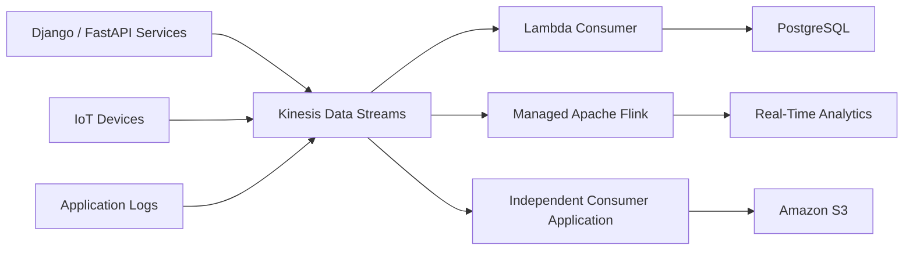

# README

## Overview

Amazon Kinesis is a collection of AWS services for collecting, processing, storing, and analyzing streaming data in real time. It enables backend systems to handle continuous event streams without requiring producers and consumers to communicate synchronously.

Kinesis is useful when applications generate high-volume event data that must be processed continuously, such as:

- Application and infrastructure logs.
- User activity and clickstream events.
- IoT telemetry and device events.
- Financial transactions and operational events.
- Real-time analytics and monitoring data.
- Data integration between distributed services.

Within a backend architecture, Kinesis can act as a streaming ingestion layer between producers and downstream processing systems such as AWS Lambda, Amazon Managed Service for Apache Flink, Amazon S3, and Amazon Redshift.

This directory documents Amazon Kinesis from an integration and backend engineering perspective, covering service selection, architecture, implementation, security, reliability, monitoring, deployment, and troubleshooting.

## Integration Documents

| # | File | Integration | Description |
|---|---|---|---|
| 01 | [Integration Overview](./01-%20Integration%20Overview.md) | Kinesis Overview | Kinesis services, streaming architecture, shard model, retention, replay, backend application integration, and engineering best practices. |
| 02 | [AWS Lambda Integration](./02-%20AWS%20Lambda%20Integration.md) | Kinesis + Lambda | Processing Kinesis records with Lambda using event source mapping without managing consumer infrastructure. |
| 03 | [Amazon S3 Integration](./03-%20Amazon%20S3%20Integration.md) | Kinesis + S3 | Delivering streaming records to S3 via Firehose for data lake storage, archival, and replay. |
| 04 | [Amazon Redshift and OpenSearch Integration](./04-%20Amazon%20Redshift%20and%20OpenSearch%20Integration.md) | Kinesis + Redshift/OpenSearch | Streaming events to analytical databases and search platforms for real-time analytics and search use cases. |
| 05 | [DynamoDB and EMR Integration](./05-%20DynamoDB%20and%20EMR%20Integration.md) | Kinesis + DynamoDB/EMR | Real-time state management with DynamoDB and large-scale batch processing with EMR from Kinesis streams. |
| 06 | [AWS Glue and Athena Integration](./06-%20AWS%20Glue%20and%20Athena%20Integration.md) | Kinesis + Glue/Athena | Serverless data processing and SQL analytics over streaming data stored in S3 via Glue and Athena. |
| 07 | [CloudWatch and CloudTrail Integration](./07-%20CloudWatch%20and%20CloudTrail%20Integration.md) | Kinesis + CloudWatch/CloudTrail | Operational monitoring, observability, security auditing, and event-driven responses to Kinesis infrastructure activity. |
| 08 | [Amazon QuickSight Integration](./08-%20Amazon%20QuickSight%20Integration.md) | Kinesis + QuickSight | Building interactive dashboards and analytical reports from streaming data processed and stored from Kinesis. |
| 09 | [EventBridge Integration](./09-%20EventBridge%20Integration.md) | Kinesis + EventBridge | Connecting Kinesis streaming data with EventBridge for content-based routing and downstream workflow triggers. |
| 10 | [ECS and EC2 Integration](./10-%20ECS%20and%20EC2%20Integration.md) | Kinesis + ECS/EC2 | Running continuously operating Kinesis stream-processing consumers on ECS tasks and EC2 instances. |
| 11 | [AWS IoT Core Integration](./11-%20AWS%20IoT%20Core%20Integration.md) | Kinesis + IoT Core | Ingesting device telemetry from IoT Core into Kinesis for buffering, processing, and downstream distribution. |
| 12 | [Amazon SageMaker Integration](./12-%20Amazon%20SageMaker%20Integration.md) | Kinesis + SageMaker | Real-time ML pipelines: online feature engineering, model inference from streaming events, and training data collection. |
| 13 | [CI/CD Integration](./13-%20CI-CD%20Integration.md) | Kinesis + CI/CD | Automating the build, test, and deployment of Kinesis producers, consumers, and streaming infrastructure. |


## Amazon Kinesis Services

Amazon Kinesis includes multiple services with different streaming and data-delivery responsibilities.

| Service | Primary responsibility | Typical use case |
|---|---|---|
| Kinesis Data Streams | Real-time streaming data ingestion and processing | Event streaming between distributed applications |
| Kinesis Data Firehose | Managed delivery of streaming data to destinations | Deliver application logs and events to S3 or analytics platforms |
| Amazon Managed Service for Apache Flink | Stateful and continuous stream processing | Real-time aggregation, enrichment, and analytics |
| Kinesis Video Streams | Ingestion and processing of video streams | Video analytics, surveillance, and media processing |

### Kinesis Data Streams

Kinesis Data Streams provides durable, ordered event streams that multiple independent consumers can process.

Key capabilities:

- Partitioned data ingestion using shards or on-demand capacity.
- Retention-based stream storage.
- Multiple independent consumers.
- Ordering within a shard.
- Replay of retained records.
- Integration with Lambda and other AWS services.

Use Data Streams when applications need control over event consumption, processing position, replay, and consumer architecture.

### Kinesis Data Firehose

Kinesis Data Firehose is a managed delivery service that continuously transfers streaming data to supported destinations.

Typical destinations include:

- Amazon S3.
- Amazon Redshift.
- Amazon OpenSearch Service.
- Supported third-party and HTTP endpoints.

Use Firehose when the primary requirement is managed delivery and transformation of streaming data rather than custom consumer coordination.

### Managed Service for Apache Flink

Amazon Managed Service for Apache Flink supports stateful stream processing using Apache Flink.

Typical workloads include:

- Real-time aggregation.
- Window-based calculations.
- Event enrichment.
- Stateful processing.
- Continuous analytics.

Use it when event processing requires state, time-based windows, or complex streaming computations.

## Architecture Overview

A typical backend integration uses Kinesis Data Streams to decouple event producers from downstream consumers.



The architecture separates event production from event processing.

Producers publish records to a stream. Consumers independently retrieve and process those records according to their application requirements.

This enables:

- Independent deployment of producers and consumers.
- Multiple consumers for different business purposes.
- Event replay within the configured retention period.
- Asynchronous processing.
- Horizontal scaling through stream partitioning and consumer concurrency.

## Kinesis Data Streams Fundamentals

Kinesis Data Streams is based on streams, shards, records, partition keys, and sequence numbers.

| Component | Responsibility |
|---|---|
| Stream | Logical container for streaming records |
| Shard | Unit of stream capacity and ordering |
| Record | Individual data item |
| Partition key | Determines the shard assignment |
| Sequence number | Identifies a record's position within a shard |
| Consumer | Reads and processes records |
| Retention period | Determines how long records remain available |

### Shards and partitioning

A stream is divided into shards. Each record is assigned to a shard using its partition key.

The partition key determines where records are stored and therefore influences ordering and load distribution.

Records with the same partition key are routed to the same shard, preserving their relative order within that shard.

A poor partition key can create a hot shard, where one shard receives disproportionately more traffic than others.

### Retention and replay

Kinesis Data Streams retains records for a configurable period.

Consumers can read retained records again by selecting an appropriate starting position.

This supports:

- Recovery after consumer outages.
- Reprocessing after application defects.
- New consumers that need historical records.
- Controlled event replay.

Retention is not a permanent archive. Long-term storage should use a destination such as Amazon S3 when required.

## Integration with Backend Applications

Python applications can publish events to Kinesis using Boto3.

A common architecture is:

1. A Django or FastAPI application handles a business request.
2. The application publishes an event to Kinesis.
3. Independent consumers process the event.
4. Downstream systems update databases, generate analytics, or trigger workflows.

Example producer:

```python
import json
import boto3

kinesis = boto3.client("kinesis", region_name="ap-south-1")


def publish_event(stream_name: str, event: dict) -> str:
    response = kinesis.put_record(
        StreamName=stream_name,
        Data=json.dumps(event).encode("utf-8"),
        PartitionKey=str(event["aggregate_id"]),
    )

    return response["SequenceNumber"]
```

Production applications should also consider:

- Stable event identifiers.
- Schema versioning.
- Retry behavior.
- Partial failures.
- Partition key distribution.
- Payload size limits.
- IAM permissions.
- Consumer idempotency.
- Observability and tracing.

For higher-throughput publishing, `PutRecords` supports batching multiple records in one request. Applications must inspect individual failed records because a batch request can partially succeed.

## Reliability and Delivery Semantics

Kinesis consumers must account for processing failures and replay.

A record may be processed more than once when a consumer fails after processing but before checkpointing its progress.

Consequently, downstream operations should be idempotent.

Recommended practices:

- Include stable event IDs in application records.
- Track consumer progress appropriately.
- Make database writes idempotent.
- Use bounded retries.
- Handle poison records separately.
- Monitor iterator age and processing lag.
- Configure retention according to recovery requirements.
- Preserve replayability for critical event pipelines.

Kinesis ordering is scoped to a shard. It does not provide global ordering across an entire stream.

## Security Considerations

Production Kinesis integrations should use AWS identity and resource controls.

Important controls include:

- IAM roles for applications and consumers.
- Least-privilege stream permissions.
- Encryption at rest using AWS KMS.
- TLS for service communication.
- Restricted access to stream data.
- CloudTrail auditing.
- Secure handling of event payloads.
- Appropriate VPC connectivity where required.

Avoid embedding AWS access keys in application source code or container images. Prefer IAM roles and workload identity mechanisms.

## Monitoring and Operations

CloudWatch provides metrics for monitoring stream health and consumer performance.

Important metrics include:

| Metric | Operational purpose |
|---|---|
| `IncomingRecords` | Measures record ingestion |
| `IncomingBytes` | Measures incoming data volume |
| `WriteProvisionedThroughputExceeded` | Detects write capacity pressure |
| `ReadProvisionedThroughputExceeded` | Detects read capacity pressure |
| `GetRecords.IteratorAgeMilliseconds` | Indicates consumer processing lag |
| `ReadProvisionedThroughputExceeded` | Identifies read throughput limitations |

Metric availability and dimensions depend on the stream capacity mode and consumer configuration.

Production monitoring should cover:

- Ingestion throughput.
- Write and read throttling.
- Consumer lag.
- Failed record processing.
- Consumer checkpoint progress.
- Shard utilization.
- Downstream processing latency.
- Cost and capacity utilization.


## Engineering Best Practices

- Choose Data Streams, Firehose, or Managed Service for Apache Flink based on the processing and delivery requirements.
- Design partition keys to distribute traffic evenly while preserving required ordering.
- Use stable event IDs and idempotent consumers.
- Monitor consumer lag and shard-level throughput.
- Use batching where it improves throughput without exceeding latency requirements.
- Configure retention based on replay and recovery needs.
- Store long-term event history in durable storage such as Amazon S3.
- Use IAM roles and least-privilege permissions.
- Version event schemas to support independent producer and consumer deployments.
- Test throttling, consumer failures, replay, and recovery before production deployment.

## Key Takeaways

- Amazon Kinesis supports real-time streaming ingestion, delivery, and processing across distributed backend systems.
- Kinesis Data Streams provides partitioned streams, ordered records within shards, and independent consumer processing.
- Partition key selection directly affects ordering, throughput distribution, and hot-shard risk.
- Reliable consumers require idempotency, replay-aware processing, checkpoint management, and monitoring.
- Production integrations should include least-privilege IAM, encryption, CloudWatch monitoring, and infrastructure automation.