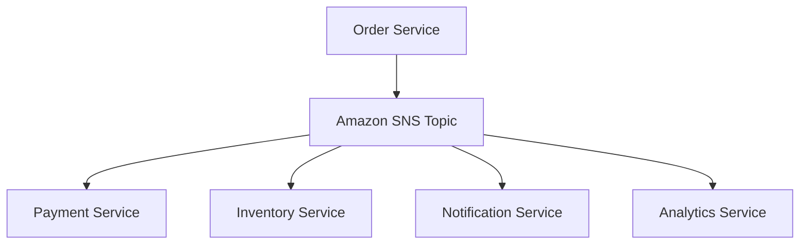
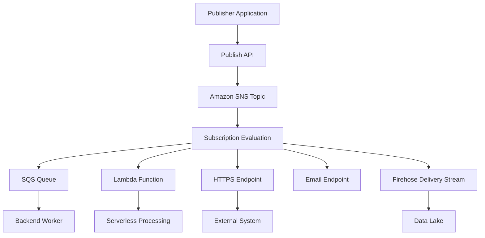
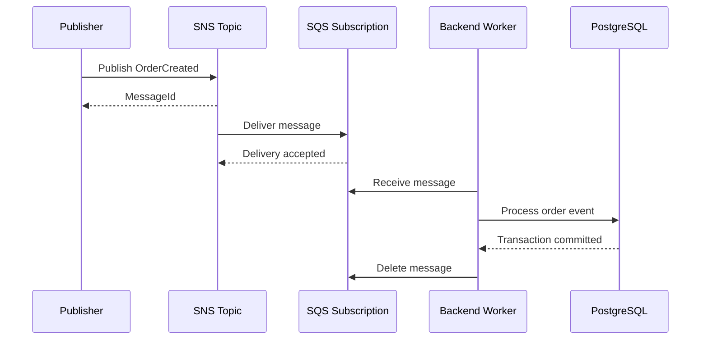
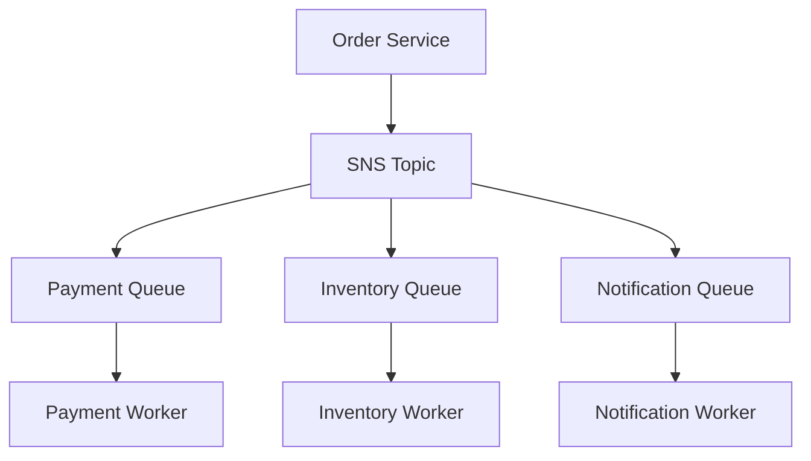
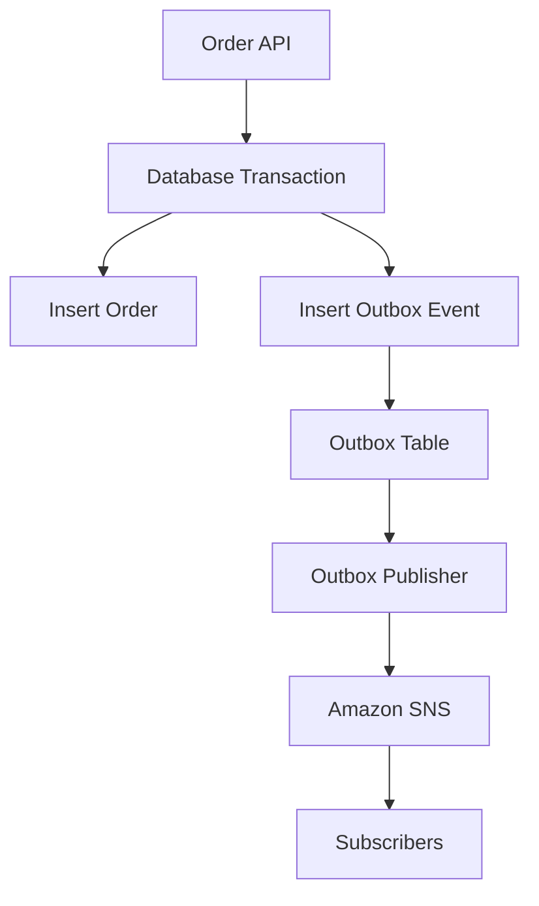
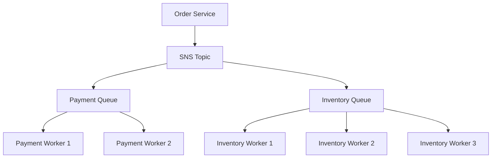

# 01- Integration Overview

## Overview

Amazon Simple Notification Service (Amazon SNS) is a fully managed publish-subscribe messaging service provided by AWS. It enables applications and distributed systems to distribute messages from publishers to multiple subscribers without requiring direct communication between them.

SNS is commonly used to implement event-driven architectures, asynchronous communication, notification systems, and service-to-service messaging.

In backend systems, SNS helps reduce coupling between microservices by allowing publishers to publish events to a topic while multiple independent consumers receive those events.

For example, an e-commerce application can publish an `OrderCreated` event to an SNS topic. Separate subscribers can process payments, update inventory, generate invoices, and send customer notifications.



Each subscriber independently processes the event without requiring the Order Service to know how the downstream services work.

## Core Concepts

### Publisher

A publisher is an application or service that sends messages to an SNS topic.

Publishers can include:

- Python applications using Boto3.
- Django and FastAPI services.
- AWS Lambda functions.
- Amazon EventBridge integrations.
- Other AWS services supporting SNS publishing.
- External applications using the SNS API.

A publisher sends a message to an SNS topic rather than directly invoking every downstream consumer.

### Topic

A topic is a logical communication channel that distributes published messages to its subscribers.

Topics provide a boundary between publishers and subscribers.

For example:

```text
orders-created
payments-completed
inventory-updated
customer-notifications
```

A topic can have multiple subscriptions, each with its own delivery configuration.

### Subscriber

A subscriber is an endpoint that receives messages published to a topic.

SNS supports several subscription protocols.

| Protocol | Subscriber | Typical use case |
|---|---|---|
| SQS | Amazon SQS queue | Asynchronous service processing |
| Lambda | AWS Lambda function | Serverless event processing |
| HTTP/HTTPS | Web application endpoint | External integrations |
| Email | Email address | Operational notifications |
| Email-JSON | Email endpoint | Structured email notifications |
| SMS | Mobile phone number | Text notifications |
| Firehose | Amazon Data Firehose delivery stream | Streaming data delivery |

The available protocols and delivery capabilities depend on topic type and subscription configuration.

### Message

A message is the payload published to an SNS topic.

Messages can contain:

- JSON documents.
- Event metadata.
- Business identifiers.
- Event timestamps.
- Correlation identifiers.
- Version information.

Example:

```json
{
  "event_id": "evt-8f12a9",
  "event_type": "OrderCreated",
  "event_version": "1.0",
  "occurred_at": "2026-11-20T10:30:00Z",
  "data": {
    "order_id": "ORD-10025",
    "customer_id": "CUS-5001",
    "total_amount": 2499.00,
    "currency": "INR"
  }
}
```

Messages should use stable schemas and explicit event versions so that subscribers can evolve independently.

### Subscription

A subscription connects an endpoint to an SNS topic.

A topic can have multiple subscriptions, and each subscription can use different delivery configurations.

For example:

```text
Topic: orders-created

Subscriptions:
    SQS: payment-processing-queue
    SQS: inventory-processing-queue
    Lambda: invoice-generator
    HTTPS: external-order-webhook
```

Each subscriber receives its own delivery of the published message, subject to the subscription's delivery configuration and filtering rules.

## SNS Architecture

SNS follows a publish-subscribe model.

The publisher sends a message to a topic. SNS evaluates the topic's subscriptions and delivers the message to eligible endpoints.



### Message Lifecycle

A typical SNS message lifecycle consists of the following stages:

1. A publisher creates an event.
2. The publisher sends the message to an SNS topic.
3. SNS accepts the publication if the request and authorization are valid.
4. SNS evaluates the topic's subscriptions and applicable message filters.
5. SNS attempts delivery to eligible subscribers.
6. Each subscriber processes the message according to its own delivery mechanism.
7. Failed deliveries are handled according to the endpoint's retry and dead-letter configuration.

SNS manages message distribution, but subscribers remain responsible for business processing, idempotency, and downstream side effects.

### Request Flow



The diagram illustrates SNS delivery to an SQS subscription. The worker acknowledges the SQS message only after successful processing.

A successful SNS publication does not mean that every subscriber has completed its business operation.

## SNS Topic Types

SNS provides Standard and FIFO topics.

Choosing the correct topic type depends on ordering, throughput, deduplication, and subscriber requirements.

### Standard Topics

Standard topics provide high-throughput message distribution with best-effort ordering.

Characteristics:

- High message throughput.
- At-least-once delivery behavior.
- Messages can arrive out of order.
- Duplicate deliveries are possible.
- Broad protocol support.

Use Standard topics when throughput and broad integration support are more important than strict ordering.

Typical use cases:

- Operational notifications.
- Application events.
- Analytics event distribution.
- Independent microservice notifications.
- Monitoring alerts.

### FIFO Topics

FIFO topics provide ordering and deduplication capabilities for supported subscriber integrations.

Characteristics:

- Messages are ordered within a message group.
- Message deduplication is supported.
- Message groups allow independent ordered streams.
- Throughput and subscription protocol support are more constrained than Standard topics.

FIFO topics require a `MessageGroupId`.

For example:

```text
MessageGroupId = order-10025
```

Messages associated with the same group are processed in order by supported FIFO delivery paths.

SNS FIFO topics support SQS FIFO subscriptions, not every protocol available to Standard topics. They do not directly support Lambda, HTTP/S, email, SMS, mobile push, or Firehose subscriptions.

A common architecture is:

```text
SNS FIFO Topic
      |
      v
SQS FIFO Queue
      |
      v
Lambda or ECS Worker
```

This preserves the FIFO messaging boundary while allowing application workers to consume messages asynchronously.

### Standard vs FIFO

| Feature | Standard | FIFO |
|---|---|---|
| Throughput | High | Controlled by FIFO throughput quotas |
| Ordering | Best effort | Ordered within message groups |
| Duplicate delivery | Possible | Deduplication support |
| Message groups | No | Yes |
| Supported subscription protocols | Broad | Restricted |
| Typical use case | General event distribution | Ordered business workflows |

FIFO deduplication is not a replacement for application-level idempotency.

SNS FIFO deduplication uses a five-minute deduplication interval. Content-based deduplication calculates a SHA-256 hash from the message body; message attributes are excluded. An explicit deduplication ID can override content-based deduplication.

For business operations, consumers should still track event identifiers and prevent duplicate side effects.

## SNS and SQS Integration

SNS and SQS are frequently combined to build reliable asynchronous messaging architectures.

SNS distributes messages to multiple queues, while SQS provides durable buffering and independent consumption.



### Why Combine SNS and SQS?

SNS and SQS solve different problems.

| Capability | SNS | SQS |
|---|---|---|
| Primary purpose | Message distribution | Message buffering and consumption |
| Communication model | Publish-subscribe | Queue-based |
| Multiple independent subscribers | Yes | Each queue has its own consumer group |
| Message retention | Not a replayable message store | Configurable retention |
| Consumer polling | Not applicable to normal push delivery | Yes |
| Visibility timeout | No queue visibility timeout | Yes |
| Dead-letter queues | Subscription-level delivery failure handling | Queue-level processing failure handling |
| Consumer processing control | Endpoint-dependent | Consumer-controlled |

Combining them provides fan-out distribution with independent consumer processing.

### Example: E-Commerce Event Distribution

When an order is created:

1. The Order Service publishes an event to SNS.
2. SNS distributes the event to multiple SQS queues.
3. The payment worker processes payment.
4. The inventory worker reserves stock.
5. The notification worker sends an order confirmation.
6. Each queue maintains independent processing state.

A slow notification service does not directly block the payment worker.

### SQS Queue Policy

An SQS queue must allow the SNS service principal to send messages.

Example queue policy:

```json
{
  "Version": "2012-10-17",
  "Statement": [
    {
      "Sid": "AllowSpecificSNSTopic",
      "Effect": "Allow",
      "Principal": {
        "Service": "sns.amazonaws.com"
      },
      "Action": "sqs:SendMessage",
      "Resource": "arn:aws:sqs:ap-south-1:123456789012:payment-queue",
      "Condition": {
        "ArnEquals": {
          "aws:SourceArn": "arn:aws:sns:ap-south-1:123456789012:orders-topic"
        }
      }
    }
  ]
}
```

Restricting `aws:SourceArn` prevents unrelated SNS topics from publishing to the queue.

For cross-account integrations, configure the appropriate topic policy, queue policy, and encryption permissions.

## SNS Message Filtering

Message filtering allows subscribers to receive only messages relevant to them.

Without filtering, every subscriber may receive every message published to the topic.

For example, an order topic can distribute events based on event type.

```text
Topic: application-events

Subscribers:
    Payment Service
        event_type = PaymentCompleted

    Inventory Service
        event_type = OrderCreated

    Notification Service
        event_type = OrderCreated OR PaymentCompleted
```

Example message attributes:

```json
{
  "event_type": {
    "DataType": "String",
    "StringValue": "OrderCreated"
  },
  "environment": {
    "DataType": "String",
    "StringValue": "production"
  }
}
```

Example subscription filter policy:

```json
{
  "event_type": [
    "OrderCreated",
    "PaymentCompleted"
  ],
  "environment": [
    "production"
  ]
}
```

The subscriber receives messages matching the configured policy.

Filtering reduces unnecessary deliveries and allows multiple logical consumers to share a topic.

### Filtering Considerations

- Message attributes must be published correctly.
- Filter policies should be version-controlled.
- Changes to filtering rules can change delivery behavior.
- Filtering is not a replacement for consumer-side authorization or validation.
- Subscription filtering on SNS FIFO has different delivery semantics: filtered messages are treated as successfully processed for that subscription, which can produce sequence gaps for the subscriber.

## Publishing Messages with Python and Boto3

Python backend applications can publish messages using the AWS SDK for Python, Boto3.

Install the dependency:

```bash
pip install boto3
```

Configure AWS credentials using an IAM role, workload identity, or an appropriate local development profile.

### SNS Publisher

```python
import json
import os
from datetime import datetime, timezone
from uuid import uuid4

import boto3


class SNSPublisher:
    def __init__(self, topic_arn: str) -> None:
        self.topic_arn = topic_arn
        self.client = boto3.client(
            "sns",
            region_name=os.getenv("AWS_REGION", "ap-south-1"),
        )

    def publish_order_created(
        self,
        order_id: str,
        customer_id: str,
        total_amount: float,
    ) -> str:
        event = {
            "event_id": str(uuid4()),
            "event_type": "OrderCreated",
            "event_version": "1.0",
            "occurred_at": datetime.now(timezone.utc).isoformat(),
            "data": {
                "order_id": order_id,
                "customer_id": customer_id,
                "total_amount": total_amount,
            },
        }

        response = self.client.publish(
            TopicArn=self.topic_arn,
            Message=json.dumps(event),
            MessageAttributes={
                "event_type": {
                    "DataType": "String",
                    "StringValue": "OrderCreated",
                }
            },
        )

        return response["MessageId"]
```

The publisher returns an SNS message ID, which is useful for tracing publication attempts.

The event ID is generated separately and should remain stable across retries of the same logical event.

### Publishing with FastAPI

A FastAPI application can expose a business endpoint that publishes an event after successfully creating an order.

```python
import os

from fastapi import FastAPI, HTTPException
from pydantic import BaseModel, Field

from publisher import SNSPublisher


app = FastAPI()

publisher = SNSPublisher(
    topic_arn=os.environ["SNS_ORDERS_TOPIC_ARN"]
)


class OrderRequest(BaseModel):
    order_id: str
    customer_id: str
    total_amount: float = Field(gt=0)


@app.post("/orders")
def create_order(payload: OrderRequest):
    try:
        message_id = publisher.publish_order_created(
            order_id=payload.order_id,
            customer_id=payload.customer_id,
            total_amount=payload.total_amount,
        )

        return {
            "status": "published",
            "message_id": message_id,
            "order_id": payload.order_id,
        }

    except Exception as exc:
        raise HTTPException(
            status_code=503,
            detail="Unable to publish order event",
        ) from exc
```

This is a simplified integration example. A production service should not assume that publishing an event and committing a database transaction are atomic.

For reliable business event publishing, use the transactional outbox pattern.

## Transactional Outbox Pattern

A common failure scenario occurs when an application updates PostgreSQL successfully but fails to publish the corresponding SNS event.

For example:

```text
1. Order inserted into PostgreSQL.
2. Application attempts SNS publication.
3. Network timeout occurs.
4. Database transaction remains committed.
5. Downstream services never receive the event.
```

The reverse failure is also possible: the message is published successfully, but the database transaction fails.

The transactional outbox pattern addresses this dual-write problem.

### Architecture



Both the business record and the outbox event are written in the same database transaction.

A separate publisher reads pending events and publishes them to SNS.

### PostgreSQL Outbox Table

```sql
CREATE TABLE outbox_events (
    id UUID PRIMARY KEY,
    aggregate_type VARCHAR(100) NOT NULL,
    aggregate_id VARCHAR(100) NOT NULL,
    event_type VARCHAR(150) NOT NULL,
    payload JSONB NOT NULL,
    created_at TIMESTAMPTZ NOT NULL DEFAULT NOW(),
    published_at TIMESTAMPTZ,
    attempts INTEGER NOT NULL DEFAULT 0
);

CREATE INDEX idx_outbox_unpublished
ON outbox_events (created_at)
WHERE published_at IS NULL;
```

The publisher should:

- Fetch unpublished events in batches.
- Publish each event with its stable event ID.
- Mark an event as published only after SNS confirms acceptance.
- Retry transient failures with exponential backoff and jitter.
- Alert on events that remain unpublished beyond an operational threshold.

A crash after SNS accepts a message but before the outbox row is marked published can cause duplicate publication. Consumers must therefore be idempotent.

For high-volume systems, use controlled batching and concurrency. Avoid holding database locks while making network calls to SNS.

## Message Size and Payload Design

SNS supports messages up to 256 KiB.

Large business payloads should not be embedded directly in SNS messages.

Use an object-storage reference when payloads exceed the message limit or when multiple services need to retrieve large data.

Example:

```json
{
  "event_id": "evt-10025",
  "event_type": "DocumentUploaded",
  "data": {
    "bucket": "application-documents",
    "key": "orders/ORD-10025/invoice.pdf",
    "version_id": "3HL4kqtJlcpXroDTDmjVBH40Nrjfkd"
  }
}
```

The consumer retrieves the object from Amazon S3 using the supplied reference.

For this architecture:

- Restrict S3 access through IAM.
- Prefer versioned object references when object identity matters.
- Validate object ownership and expected bucket/key prefixes.
- Avoid exposing presigned URLs unnecessarily.
- Keep event metadata sufficient for tracing and processing.

## Reliability and Delivery Semantics

SNS provides managed message distribution, but delivery guarantees depend on the topic type and subscription endpoint.

### Standard Topic Delivery

Standard topics use at-least-once delivery semantics for supported delivery paths.

Consequences include:

- Duplicate messages can occur.
- Message ordering is not guaranteed.
- Subscribers must tolerate retries.
- A successful publish does not guarantee successful business processing.

### FIFO Topic Delivery

FIFO topics provide ordered delivery within message groups and deduplication support within the configured deduplication interval.

Ordering is not global across all message groups.

Applications must still protect against duplicate business operations and failures in downstream systems.

### Delivery Retry and Dead-Letter Handling

SNS retries failed deliveries according to the endpoint protocol and subscription delivery policy.

For supported subscription types, configure a subscription-level dead-letter queue to capture messages that cannot be delivered after retry attempts.

An SNS subscription DLQ and an SQS consumer-processing DLQ serve different purposes:

| Failure | Appropriate mechanism |
|---|---|
| SNS cannot deliver to a subscription endpoint | SNS subscription DLQ |
| Consumer repeatedly fails to process an SQS message | SQS queue redrive policy and DLQ |
| Application cannot publish to SNS | Publisher retry and transactional outbox |
| Business operation fails after delivery | Consumer retry, idempotency, and application recovery |

A message successfully delivered to SQS can still fail later during worker processing. That failure is handled by SQS visibility timeout, retry, and redrive behavior.

## Idempotent Consumer Design

Duplicate message delivery can cause repeated business operations unless consumers enforce idempotency.

For example, processing the same payment event twice must not charge a customer twice.

A consumer can maintain a processed-event table:

```sql
CREATE TABLE processed_events (
    event_id UUID PRIMARY KEY,
    consumer_name VARCHAR(100) NOT NULL,
    processed_at TIMESTAMPTZ NOT NULL DEFAULT NOW()
);
```

For a production implementation, use a composite uniqueness constraint when the same event must be tracked independently by multiple consumers:

```sql
CREATE TABLE processed_events (
    event_id UUID NOT NULL,
    consumer_name VARCHAR(100) NOT NULL,
    processed_at TIMESTAMPTZ NOT NULL DEFAULT NOW(),
    PRIMARY KEY (event_id, consumer_name)
);
```

The idempotency record and business changes should be committed in the same database transaction.

Do not mark an event as processed before the corresponding business operation succeeds.

## Security and Access Control

SNS integrates with AWS Identity and Access Management (IAM) and resource-based topic policies.

Security should be enforced at both publisher and subscriber boundaries.

### IAM Permissions

A publisher generally needs:

```json
{
  "Version": "2012-10-17",
  "Statement": [
    {
      "Effect": "Allow",
      "Action": "sns:Publish",
      "Resource": "arn:aws:sns:ap-south-1:123456789012:orders-topic"
    }
  ]
}
```

Avoid granting `sns:*` when only publishing is required.

Separate publisher permissions from administrative permissions such as topic creation, subscription management, and policy modification.

### Topic Policies

Topic policies control which principals can access an SNS topic.

Use them to:

- Restrict cross-account publishers.
- Allow specific AWS services to publish.
- Limit access to approved accounts.
- Enforce encryption requirements where applicable.

### Encryption

SNS supports encryption at rest using AWS Key Management Service (AWS KMS).

For sensitive event data:

- Enable server-side encryption where required.
- Use appropriate KMS key policies.
- Grant publishers and subscribers the required KMS permissions.
- Avoid including secrets or unnecessary personal data in messages.
- Use TLS for network communication.
- Apply least-privilege IAM policies.

Encryption at rest does not replace application-level authorization or data minimization.

## Scalability and Performance

SNS is designed to distribute messages without requiring publishers to manage subscriber connections.

However, the overall system's throughput is influenced by topic quotas, subscription types, downstream capacity, and delivery retries.

### Horizontal Scaling

SNS can distribute messages to multiple independent subscriber endpoints.

For example, each service can scale its own SQS consumers according to queue depth.



This allows independent scaling without changing the publisher.

### Backpressure

SNS does not provide application-level control over how quickly every subscriber processes messages.

For asynchronous processing, place SQS between SNS and workers.

SQS absorbs traffic bursts and provides consumers with control over polling and processing rates.

Monitor:

- Queue depth.
- Oldest message age.
- Consumer throughput.
- Processing failures.
- Visibility timeout expirations.
- DLQ message count.

### Throughput Considerations

Consider:

- SNS regional service quotas.
- Topic type.
- Number of subscriptions.
- Subscriber endpoint capacity.
- Message size.
- Encryption overhead and KMS quotas.
- Retry behavior.
- Downstream throttling.

Do not assume that SNS's ability to accept messages guarantees that every subscriber can process them at the same rate.

## Monitoring and Observability

Monitor SNS publication and delivery behavior through Amazon CloudWatch.

Important metrics include:

| Metric | Purpose |
|---|---|
| NumberOfMessagesPublished | Tracks accepted message publications. |
| NumberOfNotificationsDelivered | Tracks successful subscription deliveries. |
| NumberOfNotificationsFailed | Tracks failed delivery attempts. |
| NumberOfNotificationsFilteredOut | Tracks messages excluded by subscription filters. |
| PublishSize | Tracks published message size. |
| SMSSuccessRate | Tracks SMS delivery success where applicable. |

Metric availability depends on the subscription protocol and SNS configuration.

### Application-Level Observability

SNS metrics do not provide complete visibility into downstream business processing.

Include the following metadata in events:

- Event ID.
- Correlation ID.
- Causation ID.
- Event type.
- Event version.
- Producer service.
- Occurrence timestamp.

Propagate correlation identifiers into application logs and distributed traces.

A successful SNS delivery metric should not be interpreted as proof that a subscriber completed its business operation.

## High Availability and Disaster Recovery

SNS is a regional AWS service.

Topics, subscriptions, policies, and delivery configurations should be managed as infrastructure so they can be recreated consistently.

For critical systems:

- Define topics and subscriptions using Terraform, AWS CDK, or CloudFormation.
- Maintain infrastructure configuration in version control.
- Use appropriate retry and DLQ policies.
- Monitor delivery failures.
- Maintain recovery procedures for subscriber endpoints.
- Replicate required event data or publish events to separate regional infrastructure when cross-region recovery is required.

SNS does not automatically replicate topics and messages across AWS Regions.

A multi-region architecture must explicitly address:

- Topic creation in each Region.
- Subscription configuration.
- Event routing.
- Duplicate processing across Regions.
- Ordering and event identity.
- KMS keys and IAM policies.
- Regional failover and recovery.

For event durability beyond SNS distribution, retain an independent event archive, such as Amazon S3, or use a durable event-streaming platform where replay is required.

## Infrastructure as Code

Manage SNS topics, subscriptions, policies, encryption, and delivery failure handling through Infrastructure as Code.

Example Terraform configuration:

```hcl
resource "aws_sns_topic" "orders" {
  name              = "orders-topic"
  kms_master_key_id = "alias/aws/sns"

  tags = {
    Environment = "production"
    Service     = "order-management"
  }
}

resource "aws_sqs_queue" "payment" {
  name                       = "payment-processing-queue"
  visibility_timeout_seconds = 120
  message_retention_seconds  = 1209600
}

resource "aws_sqs_queue_policy" "payment" {
  queue_url = aws_sqs_queue.payment.id

  policy = jsonencode({
    Version = "2012-10-17"
    Statement = [
      {
        Sid    = "AllowOrdersTopic"
        Effect = "Allow"

        Principal = {
          Service = "sns.amazonaws.com"
        }

        Action   = "sqs:SendMessage"
        Resource = aws_sqs_queue.payment.arn

        Condition = {
          ArnEquals = {
            "aws:SourceArn" = aws_sns_topic.orders.arn
          }
        }
      }
    ]
  })
}

resource "aws_sns_topic_subscription" "payment" {
  topic_arn = aws_sns_topic.orders.arn
  protocol  = "sqs"
  endpoint  = aws_sqs_queue.payment.arn

  raw_message_delivery = true

  redrive_policy = jsonencode({
    deadLetterTargetArn = aws_sqs_queue.payment_dlq.arn
  })
}
```

The `aws_sqs_queue.payment_dlq` resource must also be declared with appropriate retention, encryption, and access policies.

For a complete deployment, define:

- SNS topic policies.
- SQS queue policies.
- Subscription filter policies.
- Subscription DLQs.
- KMS key policies.
- CloudWatch alarms.
- IAM publisher and consumer roles.

Terraform's `aws_sns_topic_subscription` resource manages the subscription's delivery configuration. Keep ownership of each subscription explicit to avoid conflicting infrastructure management.

## Cost Considerations

SNS pricing is primarily based on message publishing, delivery, and applicable data transfer or optional feature usage.

Cost drivers include:

- Number of published requests.
- Number of subscription deliveries.
- Message payload size.
- Subscription protocol.
- SMS usage.
- Cross-region or external data transfer.
- KMS requests where applicable.
- Downstream SQS, Lambda, or Firehose usage.

A single message published to a topic with multiple eligible subscribers can generate multiple deliveries.

For example, one publication delivered to four subscribers produces four subscription deliveries.

Optimize cost by:

- Using subscription filtering.
- Avoiding unnecessary fan-out.
- Keeping message payloads appropriately sized.
- Using SQS for controlled asynchronous processing.
- Monitoring SMS usage and delivery volume.
- Reviewing regional pricing and service quotas.

## Common Mistakes and Production Pitfalls

| Mistake | Why it causes problems | Recommended practice |
|---|---|---|
| Treating SNS as a durable event store | SNS is not designed for indefinite event retention or replay. | Archive events separately when replay is required. |
| Assuming exactly-once business processing | Duplicate deliveries can repeat side effects. | Implement consumer idempotency. |
| Assuming global ordering | Standard topics do not guarantee ordering. | Use FIFO topics when ordering requirements justify them. |
| Publishing before database commit | Subscribers can receive events for transactions that later fail. | Use a transactional outbox. |
| Assuming SNS delivery means processing completed | Endpoint acceptance and business completion are different events. | Monitor consumer processing separately. |
| Using SNS without SQS for slow workers | Push delivery may overwhelm subscriber capacity. | Introduce SQS buffering. |
| Ignoring message filtering | Subscribers receive unnecessary events. | Configure and test subscription filter policies. |
| Misconfiguring SQS queue policies | SNS cannot deliver messages to the queue. | Restrict queue access using the exact topic ARN. |
| Confusing SNS and SQS DLQs | Delivery failures and processing failures occur at different stages. | Configure both where required. |
| Assuming FIFO supports every subscriber protocol | FIFO subscription support is restricted. | Use supported SQS FIFO integration patterns. |
| Ignoring cross-region behavior | SNS topics and messages are regional. | Build explicit regional replication and failover. |
| Using large event payloads | Messages can exceed the SNS size limit. | Store large payloads in S3 and publish references. |

## Key Takeaways

- Amazon SNS provides managed publish-subscribe messaging for distributing events and notifications across independent services.
- Standard topics prioritize throughput and broad integration support, while FIFO topics provide ordering within message groups and deduplication support.
- Combining SNS with SQS provides independent buffering, consumer scaling, retry handling, and dead-letter processing.
- Production publishers should use transactional outbox patterns, while consumers should implement idempotency to handle duplicate delivery safely.
- SNS is regional and is not a replayable event store; production architectures must explicitly address observability, security, disaster recovery, and event retention.