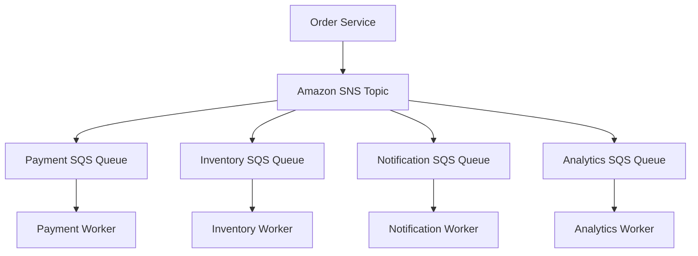
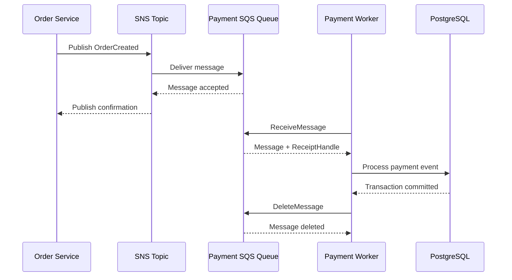
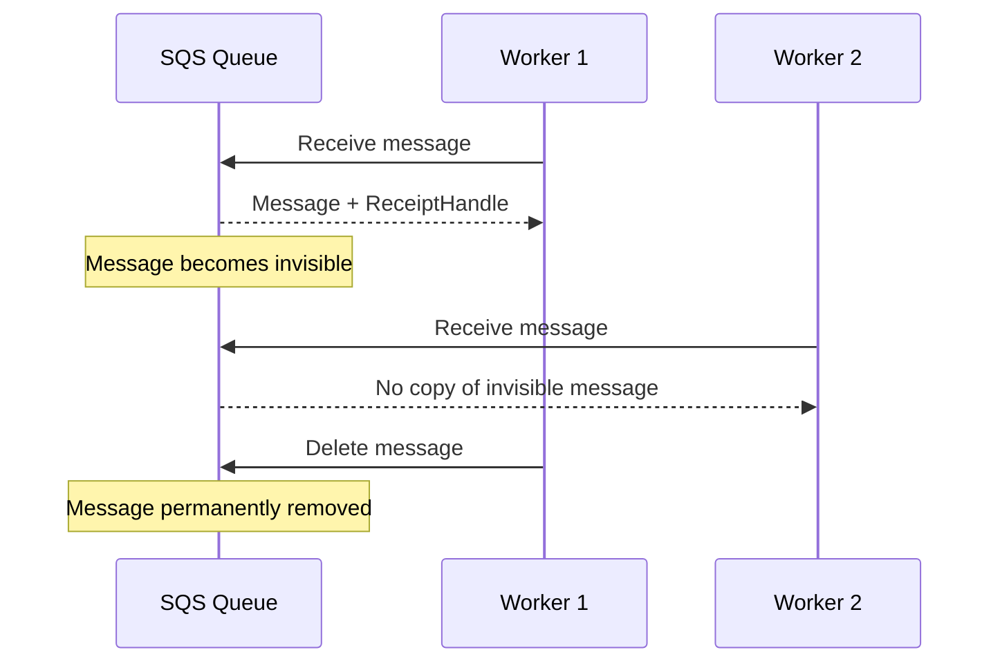
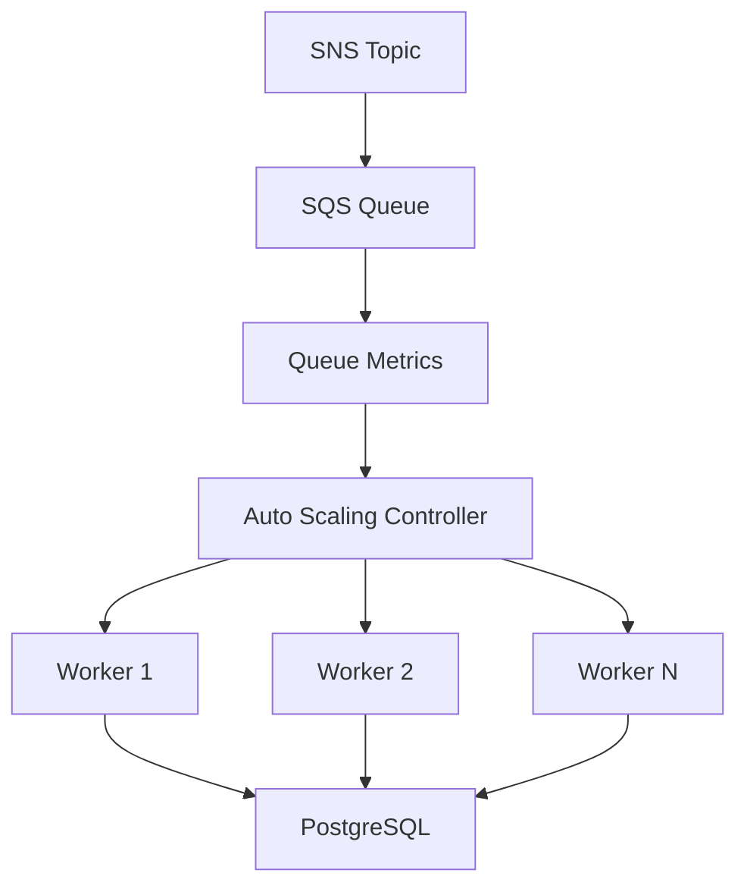
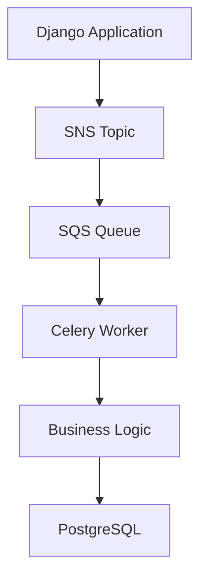
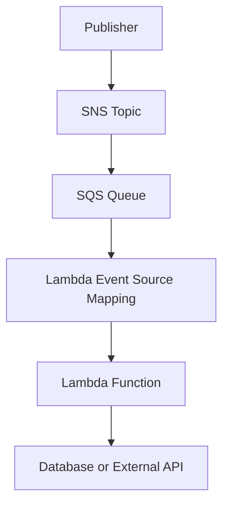

# 02- Amazon SQS Integration

## Overview

Amazon Simple Queue Service (Amazon SQS) is a fully managed message queuing service used to decouple application components and process messages asynchronously.

When integrated with Amazon SNS, SQS provides durable message buffering and independent consumer processing. SNS distributes events to multiple queues, while each queue allows its consumer application to retrieve and process messages at its own pace.

This combination is particularly useful in microservice architectures where multiple services need to react to the same business event without depending on each other's availability or processing speed.

Typical use cases include:

- Order processing across multiple backend services.
- Payment and inventory workflows.
- Asynchronous notification delivery.
- Background job execution.
- Event-driven integrations.
- Independent processing pipelines for analytics and auditing.

## SNS and SQS Integration Architecture

SNS and SQS provide complementary messaging capabilities.

- SNS implements publish-subscribe distribution.
- SQS provides durable message buffering and pull-based consumption.
- Workers process messages independently from publishers.
- Each SQS subscription maintains its own message backlog and processing lifecycle.

### Fan-Out Architecture

Consider an e-commerce platform where an order service publishes an `OrderCreated` event.

The event must be processed by payment, inventory, notification, and analytics services.



Each subscriber receives an independent copy of the event.

For example:

- Payment workers process payment authorization.
- Inventory workers reserve stock.
- Notification workers send order confirmations.
- Analytics workers update reporting datasets.

A slow analytics consumer does not prevent payment workers from processing their queue.

### Message Lifecycle



Important distinction: SNS publication confirmation means SNS accepted the publication. It does not mean the SQS consumer completed its business operation.

Similarly, successful delivery to SQS means the queue accepted the message, not that the downstream application processed it.

## Creating an SNS Topic and SQS Queue

The integration requires:

1. An SNS topic.
2. An SQS queue for each independent subscriber.
3. An SQS queue policy permitting the SNS topic to publish.
4. An SNS subscription connecting the topic to the queue.
5. Appropriate consumer permissions.

### Create an SNS Topic

```bash
aws sns create-topic \
    --name orders-topic \
    --region ap-south-1
```

The command returns a topic ARN.

Example:

```text
arn:aws:sns:ap-south-1:123456789012:orders-topic
```

### Create an SQS Queue

```bash
aws sqs create-queue \
    --queue-name payment-processing-queue \
    --region ap-south-1
```

Retrieve the queue URL:

```bash
aws sqs get-queue-url \
    --queue-name payment-processing-queue \
    --region ap-south-1
```

Retrieve its ARN:

```bash
aws sqs get-queue-attributes \
    --queue-url https://sqs.ap-south-1.amazonaws.com/123456789012/payment-processing-queue \
    --attribute-names QueueArn
```

The queue ARN is required when creating the SNS subscription and configuring its resource policy.

## SQS Queue Policy

An SQS queue must explicitly authorize SNS to send messages.

Without an appropriate queue policy, SNS cannot deliver messages to the queue.

### Example Queue Policy

```json
{
  "Version": "2012-10-17",
  "Statement": [
    {
      "Sid": "AllowOrdersTopic",
      "Effect": "Allow",
      "Principal": {
        "Service": "sns.amazonaws.com"
      },
      "Action": "sqs:SendMessage",
      "Resource": "arn:aws:sqs:ap-south-1:123456789012:payment-processing-queue",
      "Condition": {
        "ArnEquals": {
          "aws:SourceArn": "arn:aws:sns:ap-south-1:123456789012:orders-topic"
        }
      }
    }
  ]
}
```

The policy allows the SNS service principal to send messages only when the source topic matches the specified ARN.

This restriction prevents unrelated SNS topics from publishing to the queue.

Apply the policy using:

```bash
aws sqs set-queue-attributes \
    --queue-url https://sqs.ap-south-1.amazonaws.com/123456789012/payment-processing-queue \
    --attributes file://queue-policy.json
```

### Security Considerations

- Restrict `sqs:SendMessage` to the intended SNS topic.
- Avoid wildcard source ARNs.
- Use separate policies for independent queues.
- Apply least-privilege IAM permissions to consumers.
- Configure encryption and KMS permissions where required.
- Review cross-account access explicitly.

## Creating the SNS Subscription

Create an SNS subscription using the queue ARN.

```bash
aws sns subscribe \
    --topic-arn arn:aws:sns:ap-south-1:123456789012:orders-topic \
    --protocol sqs \
    --notification-endpoint arn:aws:sqs:ap-south-1:123456789012:payment-processing-queue
```

The subscription connects the topic to the queue.

Verify the subscription:

```bash
aws sns list-subscriptions-by-topic \
    --topic-arn arn:aws:sns:ap-south-1:123456789012:orders-topic
```

SNS can now deliver eligible topic messages to the configured SQS queue.

For same-account SNS-to-SQS integrations, the queue policy is generally the critical authorization requirement. Cross-account integrations require coordinated topic and queue policies.

## Raw Message Delivery

By default, SNS wraps the published message in an SNS notification envelope before delivering it to SQS.

### Default Message Format

An SQS consumer may receive a message body similar to:

```json
{
  "Type": "Notification",
  "MessageId": "example-message-id",
  "TopicArn": "arn:aws:sns:ap-south-1:123456789012:orders-topic",
  "Message": "{\"event_id\":\"evt-10025\",\"event_type\":\"OrderCreated\"}",
  "Timestamp": "2026-11-20T10:30:00.000Z",
  "SignatureVersion": "1",
  "Signature": "example-signature",
  "SigningCertURL": "https://example.com/certificate.pem"
}
```

The actual business event is nested inside the `Message` field.

Consumers must parse the SNS envelope before parsing the business payload.

### Raw Message Delivery Enabled

Raw message delivery removes the SNS notification envelope for supported endpoint types such as SQS.

The SQS consumer receives the original published message body.

Example:

```json
{
  "event_id": "evt-10025",
  "event_type": "OrderCreated",
  "event_version": "1.0",
  "data": {
    "order_id": "ORD-10025",
    "customer_id": "CUS-5001"
  }
}
```

Enable raw delivery:

```bash
aws sns set-subscription-attributes \
    --subscription-arn arn:aws:sns:ap-south-1:123456789012:orders-topic:subscription-id \
    --attribute-name RawMessageDelivery \
    --attribute-value true
```

### Default vs Raw Delivery

| Feature | Default delivery | Raw delivery |
|---|---|---|
| SNS envelope | Included | Removed |
| Consumer parsing | Parse SNS envelope and business message | Parse business message directly |
| SNS metadata in body | Available in envelope | Not included in the message body |
| Message attributes | Available through SNS notification structure | Forwarded as SQS message attributes, subject to limits |
| Typical use | Consumers requiring SNS metadata | Consumers expecting application JSON |

With raw delivery to SQS, SNS supports forwarding up to 10 message attributes. If more attributes are present, the delivery is treated as a client-side delivery failure.

Choose raw delivery based on the consumer contract rather than enabling it automatically.

## Publishing Messages with Python and Boto3

Python applications can publish events to SNS using Boto3.

Install the dependency:

```bash
pip install boto3
```

### SNS Publisher

```python
import json
import os
from datetime import datetime, timezone
from uuid import uuid4

import boto3


class OrderEventPublisher:
    def __init__(self, topic_arn: str) -> None:
        self.topic_arn = topic_arn
        self.client = boto3.client(
            "sns",
            region_name=os.getenv("AWS_REGION", "ap-south-1"),
        )

    def publish_order_created(
        self,
        order_id: str,
        customer_id: str,
    ) -> str:
        event = {
            "event_id": str(uuid4()),
            "event_type": "OrderCreated",
            "event_version": "1.0",
            "occurred_at": datetime.now(timezone.utc).isoformat(),
            "data": {
                "order_id": order_id,
                "customer_id": customer_id,
            },
        }

        response = self.client.publish(
            TopicArn=self.topic_arn,
            Message=json.dumps(event),
            MessageAttributes={
                "event_type": {
                    "DataType": "String",
                    "StringValue": "OrderCreated",
                }
            },
        )

        return response["MessageId"]
```

For production systems, generate the event ID when the business event is created and persist it. Retrying publication should reuse the same event ID instead of generating a new one.

A stable event ID allows downstream consumers to recognize repeated publication attempts.

## Consuming SQS Messages with Python

SQS consumers retrieve messages using the `ReceiveMessage` API.

The response includes:

- Message body.
- Message ID.
- Receipt handle.
- Optional message attributes.
- Approximate receive count and other system attributes when requested.

The receipt handle is important because SQS uses it to identify a specific received message delivery.

A consumer must use the latest receipt handle when deleting or changing the visibility of a received message.

### Basic Consumer

```python
import json
import logging
import os
import time

import boto3
from botocore.exceptions import BotoCoreError, ClientError


logger = logging.getLogger(__name__)
logger.setLevel(logging.INFO)

sqs = boto3.client(
    "sqs",
    region_name=os.getenv("AWS_REGION", "ap-south-1"),
)

QUEUE_URL = os.environ["PAYMENT_QUEUE_URL"]


def process_order_event(event: dict) -> None:
    event_type = event["event_type"]
    event_data = event["data"]

    if event_type != "OrderCreated":
        raise ValueError(f"Unsupported event type: {event_type}")

    logger.info(
        "Processing order event",
        extra={
            "event_id": event["event_id"],
            "order_id": event_data["order_id"],
        },
    )

    # Perform the business operation using an idempotent service layer.


def consume_messages() -> None:
    while True:
        try:
            response = sqs.receive_message(
                QueueUrl=QUEUE_URL,
                MaxNumberOfMessages=10,
                WaitTimeSeconds=20,
                VisibilityTimeout=120,
                AttributeNames=["ApproximateReceiveCount"],
            )

            for message in response.get("Messages", []):
                receipt_handle = message["ReceiptHandle"]

                try:
                    event = json.loads(message["Body"])
                    process_order_event(event)

                    sqs.delete_message(
                        QueueUrl=QUEUE_URL,
                        ReceiptHandle=receipt_handle,
                    )

                except (ValueError, KeyError, TypeError):
                    logger.exception(
                        "Invalid or unsupported message",
                        extra={"message_id": message["MessageId"]},
                    )
                    raise

        except (BotoCoreError, ClientError):
            logger.exception("SQS polling failed")
            time.sleep(5)


if __name__ == "__main__":
    consume_messages()
```

This illustrates the polling and acknowledgement lifecycle. A production worker needs an explicit policy for poison messages, transient failures, shutdown, and concurrent processing.

The example deliberately does not delete a message when processing fails. SQS will make it visible again after its visibility timeout unless it is moved to a DLQ by the queue's redrive policy.

Do not continuously retry malformed messages without a bounded retry and quarantine strategy.

## Handling SNS Notification Envelopes

When raw message delivery is disabled, the consumer must extract the business event from the SNS envelope.

```python
import json


def extract_event(message_body: str) -> dict:
    notification = json.loads(message_body)

    if notification.get("Type") != "Notification":
        raise ValueError("Unexpected SNS notification type")

    return json.loads(notification["Message"])
```

The consumer can use this function before processing the event.

Do not assume that every SQS message originated from SNS. If a queue has multiple producers, define and validate a consistent message contract.

## Long Polling

SQS supports short polling and long polling.

### Short Polling

Short polling returns immediately and can return fewer messages than are available because SQS samples a subset of its servers.

### Long Polling

Long polling waits for messages to become available or until the configured wait time expires.

Configure it using `WaitTimeSeconds`, with a maximum of 20 seconds.

Example:

```python
response = sqs.receive_message(
    QueueUrl=QUEUE_URL,
    MaxNumberOfMessages=10,
    WaitTimeSeconds=20,
)
```

Long polling reduces empty responses and unnecessary API requests.

For production consumers, configure queue-level `ReceiveMessageWaitTimeSeconds` or set the value explicitly in polling requests.

## Visibility Timeout

When a consumer receives a message, SQS temporarily hides it from other consumers.

This period is called the visibility timeout.



If the consumer does not delete the message before the visibility timeout expires, the message becomes available again.

### Visibility Timeout Configuration

Consider a worker that normally processes messages in 30 seconds.

A visibility timeout of 120 seconds may provide sufficient processing time while allowing recovery from failed workers.

The correct value depends on:

- Processing duration.
- Downstream API latency.
- Database transaction duration.
- Worker concurrency.
- Retry strategy.
- Shutdown behavior.

For long-running jobs, extend visibility using `ChangeMessageVisibility`.

Do not set an excessively long visibility timeout without considering recovery time. A crashed worker can leave messages unavailable until the timeout expires.

## Message Acknowledgement

SQS uses explicit message deletion as the acknowledgement mechanism.

The correct processing order is:

1. Receive the message.
2. Validate the message.
3. Execute the business operation.
4. Commit the database transaction.
5. Delete the SQS message.

If the worker crashes after the database commit but before deletion, the message can be delivered again.

Therefore, message deletion alone cannot guarantee exactly-once business processing.

Use idempotent consumers to handle this failure window.

## Idempotent Consumer Implementation

A production consumer should prevent duplicate business operations.

For example, processing an `OrderCreated` event twice should not reserve inventory twice.

Use a database table with a unique event identifier.

```sql
CREATE TABLE processed_events (
    event_id UUID NOT NULL,
    consumer_name VARCHAR(100) NOT NULL,
    processed_at TIMESTAMPTZ NOT NULL DEFAULT NOW(),
    PRIMARY KEY (event_id, consumer_name)
);
```

The event-processing operation and idempotency record should be committed in the same database transaction.

Example using PostgreSQL and Python:

```python
import json

import psycopg


def process_event(
    connection: psycopg.Connection,
    event: dict,
) -> bool:
    event_id = event["event_id"]
    order_id = event["data"]["order_id"]

    with connection.transaction():
        with connection.cursor() as cursor:
            cursor.execute(
                """
                INSERT INTO processed_events (
                    event_id,
                    consumer_name
                )
                VALUES (%s, %s)
                ON CONFLICT DO NOTHING
                RETURNING event_id
                """,
                (event_id, "inventory-service"),
            )

            inserted = cursor.fetchone()

            if inserted is None:
                return False

            cursor.execute(
                """
                UPDATE orders
                SET inventory_status = 'RESERVED'
                WHERE order_id = %s
                  AND inventory_status = 'PENDING'
                """,
                (order_id,),
            )

    return True
```

The consumer should delete the SQS message only after this transaction commits successfully.

The idempotency key should identify the logical business event, not an SNS message delivery attempt.

## Dead-Letter Queues

A dead-letter queue (DLQ) captures messages that repeatedly fail processing.

For an SNS-to-SQS architecture, distinguish two failure boundaries.

### SNS Subscription DLQ

An SNS subscription DLQ handles messages that SNS cannot successfully deliver to the subscribed endpoint after its delivery retry policy is exhausted.

For example:

```text
SNS Topic
    |
    v
Payment SQS Queue

If SNS delivery fails:
    |
    v
SNS Subscription DLQ
```

This is different from a consumer-processing failure.

### SQS Consumer DLQ

An SQS consumer DLQ handles messages that repeatedly fail after being delivered to the queue.

Example:

```text
Payment Queue
    |
    v
Payment Worker
    |
    | Repeated processing failures
    v
Payment DLQ
```

Configure the queue's redrive policy with a maximum receive count.

Example:

```json
{
  "deadLetterTargetArn": "arn:aws:sqs:ap-south-1:123456789012:payment-dlq",
  "maxReceiveCount": "5"
}
```

A message is moved to the DLQ after exceeding the configured receive count.

### DLQ Operational Practices

- Monitor DLQ message count.
- Alert when messages appear unexpectedly.
- Preserve original event identifiers.
- Inspect failure reasons before replaying messages.
- Fix the underlying issue before redriving.
- Ensure replay operations are idempotent.
- Set appropriate retention periods.

For Standard queues, moving messages to a DLQ does not preserve their original ordering. FIFO queue behavior and retention calculations also require careful consideration when designing redrive workflows.

## Message Filtering

SNS supports subscription-level message filtering.

This prevents irrelevant events from reaching a particular SQS queue.

Example:

```json
{
  "event_type": [
    "OrderCreated"
  ],
  "environment": [
    "production"
  ]
}
```

A payment queue can subscribe only to order creation events, while a notification queue can receive order and payment events.

Filtering reduces unnecessary message traffic and consumer processing.

For production systems:

- Keep filter policies in infrastructure code.
- Validate attribute names and data types.
- Test filter changes before deployment.
- Monitor filtered message metrics.
- Do not use filtering as a substitute for business authorization.

## SQS Standard and FIFO Integration

SNS and SQS topic and queue types must be compatible.

| SNS topic | SQS queue | Integration |
|---|---|---|
| Standard | Standard | Supported |
| FIFO | FIFO | Supported |
| Standard | FIFO | Not supported |
| FIFO | Standard | Not supported |

### Standard Integration

Use SNS Standard with SQS Standard when:

- High throughput is important.
- Ordering is not required.
- Duplicate delivery is acceptable with idempotent processing.
- Broad subscriber integration is needed.

### FIFO Integration

Use SNS FIFO with SQS FIFO when:

- Ordering within business groups matters.
- Deduplication support is required.
- Consumers must process each message group in order.
- Supported FIFO subscription protocols meet the architecture requirements.

Example:

```text
SNS FIFO Topic
      |
      v
SQS FIFO Queue
      |
      v
Worker
```

FIFO ordering is maintained within message groups, not globally across all groups.

SNS FIFO subscription filtering can introduce sequence gaps because filtered messages are treated as successfully processed for that subscription. Do not assume that a filtered FIFO subscription receives every sequence number.

## Scaling SQS Consumers

SNS and SQS support independent scaling of downstream consumers.

A queue can accumulate messages during traffic spikes while workers process them at a controlled rate.



### Scaling Metrics

Useful CloudWatch metrics include:

| Metric | Purpose |
|---|---|
| ApproximateNumberOfMessagesVisible | Messages waiting to be processed. |
| ApproximateNumberOfMessagesNotVisible | Messages currently being processed or invisible. |
| ApproximateAgeOfOldestMessage | Age of the oldest available message. |
| NumberOfMessagesReceived | Messages received by consumers. |
| NumberOfMessagesDeleted | Messages successfully deleted. |
| NumberOfEmptyReceives | Empty polling responses. |

Metrics are approximate and should be interpreted together.

### Scaling Recommendations

- Scale using queue backlog and message age.
- Consider processing time and worker capacity.
- Limit worker concurrency to protect databases.
- Use long polling to reduce empty receives.
- Configure visibility timeout based on processing duration.
- Monitor downstream API and database saturation.
- Avoid scaling faster than dependencies can handle.

Scaling workers without considering database connection limits can overload PostgreSQL even when SQS processing is healthy.

## Django and Celery Integration

SNS and SQS can integrate with Django applications that use Celery for asynchronous processing.

A common architecture is:



The SQS queue acts as the transport layer, while Celery manages application task execution.

However, Celery's SQS transport is not automatically equivalent to native SNS-to-SQS fan-out. An SNS subscription must still be configured, and the consumer must understand the message format.

### Integration Approaches

| Approach | Description | Considerations |
|---|---|---|
| Custom SQS worker | Application polls SQS and invokes business services. | Direct control over acknowledgement and retry behavior. |
| Celery with SQS transport | Celery consumes messages using its SQS transport. | Requires compatible message format and queue configuration. |
| SNS-to-SQS-to-Lambda | Lambda consumes messages from SQS. | Managed scaling and event-source mapping behavior. |
| SNS-to-SQS-to-ECS | Containerized workers poll queues. | Explicit control over concurrency and runtime. |

For complex business workflows, keep the event-processing layer separate from framework-specific task execution where practical.

## AWS Lambda Integration

SQS can trigger Lambda through an event source mapping.

With SNS fan-out, the architecture becomes:



Lambda polls the SQS queue and invokes the function with batches of messages.

Important considerations:

- Configure batch size according to processing capacity.
- Set visibility timeout appropriately.
- Configure partial batch failure handling.
- Make processing idempotent.
- Monitor throttling and queue age.
- Configure an SQS DLQ for repeatedly failing messages.

For partial batch failures, use the `ReportBatchItemFailures` response mechanism so successfully processed messages do not need to be retried with failed messages.

A Lambda event source mapping's visibility timeout should generally be at least six times the function timeout, with additional allowance for batching windows where applicable.

## Message Attributes and Metadata

SNS supports message attributes that can carry metadata alongside the message body.

Example:

```python
response = sns.publish(
    TopicArn=topic_arn,
    Message=json.dumps(event),
    MessageAttributes={
        "event_type": {
            "DataType": "String",
            "StringValue": "OrderCreated",
        },
        "priority": {
            "DataType": "String",
            "StringValue": "high",
        },
    },
)
```

Attributes can support subscription filtering and routing decisions.

Use the message body for the actual business event contract. Use attributes for routing and delivery metadata.

Do not place essential business data exclusively in attributes because consumers may receive messages through different delivery configurations.

## Reliability and Failure Handling

SNS-to-SQS integration introduces multiple failure boundaries.

| Failure | Expected behavior | Recommended handling |
|---|---|---|
| Publisher cannot reach SNS | Publication may fail or have an ambiguous outcome. | Retry with stable event ID and use an outbox. |
| SNS cannot deliver to SQS | SNS retries according to delivery policy. | Configure subscription DLQ and monitor failures. |
| SQS is temporarily unavailable | Consumers cannot retrieve messages. | Retry polling and monitor service health. |
| Worker crashes after receiving | Message becomes visible after timeout. | Use idempotent processing. |
| Database transaction fails | Message should not be deleted. | Retry with bounded failure handling. |
| Invalid event payload | Processing repeatedly fails. | Quarantine through a DLQ. |
| External API times out | Business operation may have an ambiguous result. | Use provider idempotency and reconciliation. |

### Ambiguous Publication Outcomes

A network timeout during SNS publication does not prove that SNS rejected the message.

SNS may have accepted the message even if the publisher did not receive the response.

Retrying can therefore publish a duplicate.

Use a stable event ID and consumer-side idempotency to protect business operations.

### Poison Messages

A poison message is one that consistently fails processing because of malformed data, unsupported event versions, or deterministic business errors.

Do not allow poison messages to consume worker capacity indefinitely.

Use:

- Bounded retries.
- DLQ redrive policies.
- Structured error logs.
- Failure classification.
- Operational alerts.
- Controlled replay.

## Security and Encryption

SNS and SQS support IAM-based access control and encryption.

### IAM Separation

Use separate roles for:

- Publishers requiring `sns:Publish`.
- SNS delivery to SQS through the queue resource policy.
- Consumers requiring `sqs:ReceiveMessage`, `sqs:DeleteMessage`, and `sqs:GetQueueAttributes`.
- Operators requiring administrative access.

Avoid granting broad `sns:*` or `sqs:*` permissions to application workloads.

### Encryption at Rest

SQS supports server-side encryption using SQS-managed encryption keys or AWS KMS customer-managed keys.

SNS also supports encryption at rest using KMS.

When both services use customer-managed KMS keys, configure the relevant key policies and service permissions for the publishing, delivery, and consumption paths.

### Network and Data Security

- Use TLS for AWS API communication.
- Restrict queue policies to trusted topics.
- Avoid sensitive information in message bodies.
- Apply encryption at rest according to data classification.
- Rotate and review customer-managed keys.
- Use private networking endpoints where required by security architecture.
- Audit access through CloudTrail.

Encryption does not replace authorization. A consumer must still validate the event and enforce business-level access rules.

## Monitoring and Alerting

Monitor both SNS delivery and SQS processing.

### SNS Metrics

| Metric | Purpose |
|---|---|
| NumberOfMessagesPublished | Publication volume. |
| NumberOfNotificationsDelivered | Successful subscription delivery. |
| NumberOfNotificationsFailed | Delivery failures. |
| NumberOfNotificationsFilteredOut | Messages excluded by subscription filtering. |

### SQS Metrics

| Metric | Purpose |
|---|---|
| ApproximateNumberOfMessagesVisible | Queue backlog. |
| ApproximateNumberOfMessagesNotVisible | Messages currently invisible. |
| ApproximateAgeOfOldestMessage | Processing delay indicator. |
| NumberOfMessagesReceived | Consumer receive activity. |
| NumberOfMessagesDeleted | Successful acknowledgements. |
| NumberOfEmptyReceives | Polling efficiency. |

### Operational Alerts

Configure alerts for:

- Growing queue backlog.
- Increasing oldest-message age.
- Messages appearing in a DLQ.
- SNS delivery failures.
- Consumer error rate increases.
- Excessive visibility timeout expirations.
- Sustained worker throttling.

For end-to-end observability, include event IDs and correlation IDs in logs across publishers and consumers.

Do not rely only on AWS service metrics. Application-level processing outcomes are necessary to understand whether business events completed successfully.

## Infrastructure as Code with Terraform

Terraform can define SNS topics, SQS queues, queue policies, subscriptions, and DLQs.

Example:

```hcl
resource "aws_sns_topic" "orders" {
  name = "orders-topic"
}

resource "aws_sqs_queue" "payment_dlq" {
  name                      = "payment-processing-dlq"
  message_retention_seconds = 1209600
}

resource "aws_sqs_queue" "payment" {
  name                       = "payment-processing-queue"
  visibility_timeout_seconds = 120
  message_retention_seconds  = 345600

  redrive_policy = jsonencode({
    deadLetterTargetArn = aws_sqs_queue.payment_dlq.arn
    maxReceiveCount     = 5
  })
}

resource "aws_sqs_queue_policy" "payment" {
  queue_url = aws_sqs_queue.payment.id

  policy = jsonencode({
    Version = "2012-10-17"

    Statement = [
      {
        Sid    = "AllowOrdersTopic"
        Effect = "Allow"

        Principal = {
          Service = "sns.amazonaws.com"
        }

        Action   = "sqs:SendMessage"
        Resource = aws_sqs_queue.payment.arn

        Condition = {
          ArnEquals = {
            "aws:SourceArn" = aws_sns_topic.orders.arn
          }
        }
      }
    ]
  })
}

resource "aws_sns_topic_subscription" "payment" {
  topic_arn = aws_sns_topic.orders.arn
  protocol  = "sqs"
  endpoint  = aws_sqs_queue.payment.arn

  raw_message_delivery = true

  depends_on = [
    aws_sqs_queue_policy.payment
  ]
}
```

This configuration creates a Standard SNS-to-SQS integration with a consumer-processing DLQ.

For production deployments, also configure:

- SNS subscription delivery DLQ where required.
- KMS encryption and key policies.
- SNS topic policies.
- Queue access restrictions.
- Subscription filter policies.
- CloudWatch alarms.
- Queue retention and visibility timeout based on workload characteristics.
- Consumer IAM roles.

Use a separate subscription DLQ if SNS delivery failures must be captured independently from SQS consumer-processing failures.

## High Availability and Disaster Recovery

SNS and SQS are regional AWS services.

The integration does not automatically replicate topics, queues, or messages to another Region.

For critical systems:

- Manage topics, queues, policies, and subscriptions using IaC.
- Retain business events independently when replay is required.
- Configure appropriate queue retention.
- Monitor delivery failures and consumer backlog.
- Maintain recovery procedures for workers and dependent databases.
- Define cross-region event distribution explicitly.
- Test queue and consumer recovery procedures.

A regional recovery architecture must account for:

- SNS topic and subscription recreation.
- SQS queue recreation and policy configuration.
- KMS keys and IAM roles.
- Event duplication during failover.
- Consumer idempotency across Regions.
- Database replication and recovery.
- DNS and application traffic routing.

Do not assume that creating a second SNS topic and SQS queue automatically synchronizes messages from the primary Region.

## Cost Considerations

SNS and SQS are billed independently.

Cost drivers include:

- SNS publication requests.
- SNS subscription deliveries.
- SQS API requests.
- Message payload size.
- Long polling behavior.
- KMS usage.
- Data transfer.
- Downstream compute usage.

A single SNS publication distributed to four SQS subscriptions creates four queue deliveries.

Each queue also incurs costs when consumers poll, receive, and delete messages.

Optimize costs by:

- Using long polling.
- Retrieving multiple messages per request.
- Avoiding unnecessary subscriptions.
- Applying message filtering.
- Scaling workers according to queue demand.
- Avoiding excessive empty receives.
- Monitoring KMS and cross-region transfer costs.

SQS request billing uses 64 KiB payload chunks, so larger messages can consume multiple request units. Confirm current AWS pricing and regional quotas before estimating production costs.

## Common Mistakes and Production Pitfalls

| Mistake | Why it causes problems | Recommended practice |
|---|---|---|
| Missing SQS queue policy | SNS cannot deliver messages. | Authorize the exact SNS topic ARN. |
| Using the wrong queue type | FIFO and Standard topic compatibility differs. | Match SNS and SQS topic types. |
| Ignoring raw message delivery | Consumers may parse the wrong payload structure. | Define and test the delivery contract. |
| Deleting messages before processing completes | Failed operations can lose messages. | Delete only after durable processing. |
| Ignoring visibility timeout | Messages may be delivered again while still processing. | Configure timeout and extend it for long jobs. |
| Treating SQS as exactly-once processing | Messages can be received more than once. | Implement idempotent consumers. |
| Confusing SNS and SQS DLQs | Delivery failures and processing failures are different. | Configure each failure boundary independently. |
| Ignoring queue backlog | Processing latency can increase without obvious application errors. | Monitor oldest-message age and visible messages. |
| Scaling workers without database limits | Increased concurrency can overload PostgreSQL. | Apply bounded concurrency and connection management. |
| Replaying DLQ messages without validation | The original failure may occur again. | Fix the cause and replay with idempotency. |
| Assuming SNS confirmation means business completion | Publication and processing are separate operations. | Track processing outcomes independently. |
| Using large messages unnecessarily | Payload size increases cost and can exceed service limits. | Store large payloads in S3 and publish references. |

## Production Integration Checklist

### Architecture

- [ ] SNS topic type matches the required delivery semantics.
- [ ] Each independent consumer has its own SQS queue.
- [ ] Queue policies restrict publishing to approved topics.
- [ ] Message schemas are versioned.
- [ ] Raw message delivery is configured intentionally.

### Reliability

- [ ] Consumers are idempotent.
- [ ] Visibility timeout reflects processing duration.
- [ ] Long polling is enabled where appropriate.
- [ ] SQS consumer DLQs are configured.
- [ ] SNS subscription DLQs are configured where required.
- [ ] Publisher retries use stable event identifiers.
- [ ] Database and event publication consistency is addressed.

### Security

- [ ] Publisher and consumer IAM roles follow least privilege.
- [ ] Queue resource policies restrict source topics.
- [ ] Encryption requirements are implemented.
- [ ] KMS permissions are configured correctly.
- [ ] Sensitive information is minimized in event payloads.

### Operations

- [ ] SNS delivery metrics are monitored.
- [ ] Queue depth and oldest-message age are monitored.
- [ ] DLQ alarms are configured.
- [ ] Consumer failures are logged with event identifiers.
- [ ] Worker concurrency is bounded.
- [ ] Replay and disaster recovery procedures are tested.

## Key Takeaways

- SNS distributes events to independent SQS queues, while each queue provides durable buffering and controlled consumer processing.
- SQS queue policies must explicitly authorize the intended SNS topic to publish messages.
- Consumers should delete messages only after successful durable processing and must implement idempotency because duplicate delivery is possible.
- SNS subscription DLQs handle delivery failures, whereas SQS consumer DLQs handle repeated processing failures.
- Production integrations require deliberate configuration of visibility timeouts, long polling, scaling, encryption, monitoring, and disaster recovery.