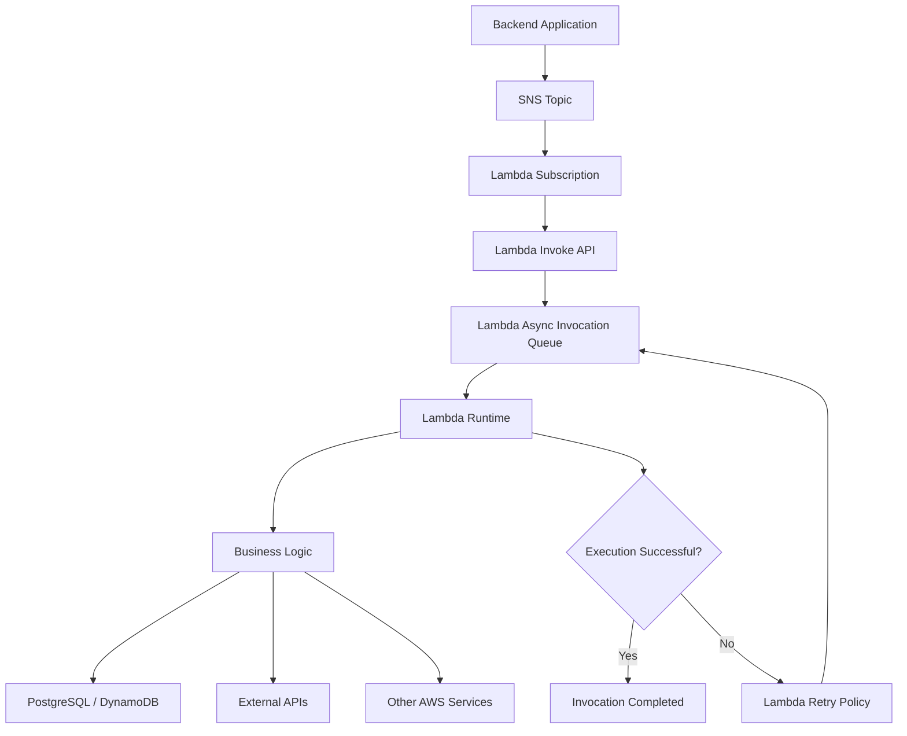
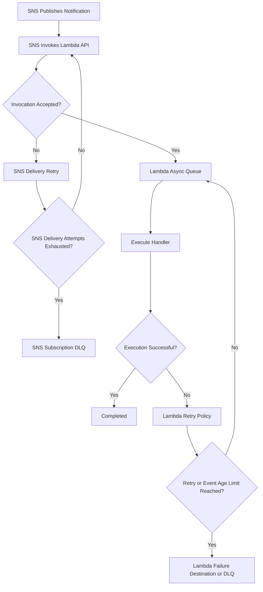

# 03- AWS Lambda Integration

## Overview

Amazon Simple Notification Service (SNS) integrates directly with AWS Lambda, allowing applications to invoke serverless functions asynchronously whenever a message is published to an SNS topic.

This integration is useful for event-driven architectures where multiple independent processing components must react to the same event without requiring the producer to know about individual consumers.

For example, an order management service can publish an `order.created` event to SNS. SNS can then invoke separate Lambda functions for inventory updates, customer notifications, analytics, and audit processing.

The integration provides:

- Asynchronous event delivery.
- Fan-out to multiple Lambda functions.
- Independent consumer deployment and scaling.
- Retry handling for invocation delivery.
- Integration with Lambda asynchronous execution.
- Resource-based access control.
- Dead-letter handling for delivery failures.

A critical architectural distinction is that **SNS delivery to Lambda and Lambda function execution are separate failure boundaries**. SNS handles delivery to the Lambda invocation API. After Lambda accepts the asynchronous invocation, Lambda manages function execution and its associated retries.

## Architecture

SNS invokes Lambda through the Lambda service API. The function does not need to poll the SNS topic.



A typical message lifecycle is:

1. A producer publishes a message to an SNS topic.
2. SNS evaluates the topic's subscriptions and filter policies.
3. SNS invokes the subscribed Lambda function.
4. Lambda accepts the asynchronous invocation.
5. Lambda places the event in its internal asynchronous processing system.
6. The Lambda runtime executes the handler.
7. The function processes the event and performs its business operations.
8. Lambda records execution success or failure.
9. Failed executions may be retried or routed to a configured failure destination.

SNS does not wait for the Lambda function to finish its business processing before considering the invocation delivery successful.

## When to Use SNS with Lambda

Use this integration when multiple independent event consumers need to react to the same business event.

Typical use cases include:

| Use case | Example |
|---|---|
| Notification processing | Send email or SMS after an order is created |
| Data processing | Transform and enrich application events |
| Audit processing | Persist business events for compliance |
| Analytics | Aggregate events for reporting |
| Workflow orchestration | Trigger downstream processing |
| Integration | Synchronize data with external systems |
| Event-driven automation | Start background operations after resource changes |

SNS-to-Lambda is particularly useful when consumers are independent and do not require direct coordination.

For workloads requiring explicit message buffering, controlled polling, consumer-managed acknowledgment, or queue-based backpressure, consider SNS-to-SQS-to-Lambda instead.

## SNS Subscription Configuration

A Lambda function receives SNS notifications through a subscription.

The subscription connects the SNS topic to the Lambda function's ARN.

### Create an SNS topic

```bash
aws sns create-topic \
    --name order-events \
    --region ap-south-1
```

Example response:

```json
{
    "TopicArn": "arn:aws:sns:ap-south-1:123456789012:order-events"
}
```

### Create a Lambda subscription

```bash
aws sns subscribe \
    --topic-arn "arn:aws:sns:ap-south-1:123456789012:order-events" \
    --protocol lambda \
    --notification-endpoint "arn:aws:lambda:ap-south-1:123456789012:function:order-event-processor" \
    --region ap-south-1
```

The subscription establishes the SNS-to-Lambda relationship.

However, creating the subscription alone is not sufficient. SNS must also be authorized to invoke the Lambda function.

## Lambda Resource-Based Permission

SNS requires permission to invoke the subscribed Lambda function.

This permission is configured through the Lambda function's resource-based policy.

It is separate from the Lambda execution role.

### Understand the two permission boundaries

| Permission | Purpose | Used by |
|---|---|---|
| Lambda resource-based policy | Allows SNS to invoke the function | SNS service |
| Lambda execution role | Allows function code to access AWS resources | Lambda runtime |

The Lambda execution role does not grant SNS permission to invoke the function.

Similarly, allowing SNS to invoke the function does not grant the function permission to access DynamoDB, S3, PostgreSQL credentials, or other downstream resources.

### Add SNS invocation permission

```bash
aws lambda add-permission \
    --function-name order-event-processor \
    --statement-id allow-sns-order-events \
    --action lambda:InvokeFunction \
    --principal sns.amazonaws.com \
    --source-arn "arn:aws:sns:ap-south-1:123456789012:order-events" \
    --region ap-south-1
```

The `SourceArn` condition restricts invocation permission to the intended SNS topic.

Avoid granting the SNS service unrestricted invocation access.

### Inspect Lambda permissions

```bash
aws lambda get-policy \
    --function-name order-event-processor \
    --region ap-south-1
```

The policy should contain a statement allowing:

- Principal: `sns.amazonaws.com`
- Action: `lambda:InvokeFunction`
- Source ARN: the intended SNS topic ARN

### Remove an invocation permission

```bash
aws lambda remove-permission \
    --function-name order-event-processor \
    --statement-id allow-sns-order-events \
    --region ap-south-1
```

Use the statement ID associated with the permission being removed.

## Message Delivery and Event Structure

By default, SNS sends a notification envelope to Lambda.

The Lambda event contains an outer SNS record with metadata and the original message body.

Example event:

```json
{
    "Records": [
        {
            "EventSource": "aws:sns",
            "EventVersion": "1.0",
            "EventSubscriptionArn": "arn:aws:sns:ap-south-1:123456789012:order-events:example-subscription-id",
            "Sns": {
                "Type": "Notification",
                "MessageId": "example-message-id",
                "TopicArn": "arn:aws:sns:ap-south-1:123456789012:order-events",
                "Subject": "Order Created",
                "Message": "{\"event_id\":\"order-123-created\",\"event_type\":\"order.created\"}",
                "Timestamp": "2026-11-25T10:30:00.000Z",
                "MessageAttributes": {
                    "event_type": {
                        "Type": "String",
                        "Value": "order.created"
                    }
                }
            }
        }
    ]
}
```

Important fields:

| Field | Purpose |
|---|---|
| `Records` | Collection of SNS notification records |
| `EventSource` | Identifies SNS as the event source |
| `EventSubscriptionArn` | Identifies the subscription |
| `Sns.MessageId` | SNS message identifier |
| `Sns.TopicArn` | Publishing topic |
| `Sns.Message` | Original message body |
| `Sns.MessageAttributes` | Published message attributes |
| `Sns.Timestamp` | SNS publication timestamp |

The `Message` field is a string. If the producer publishes JSON, the consumer must deserialize that string separately.

## Python Lambda Handler

A Lambda function subscribed to SNS receives an event object containing the notification records.

A production handler should validate the event structure, process records independently where appropriate, and emit useful operational logs.

### Example implementation

```python
import json
import logging
from typing import Any

logger = logging.getLogger()
logger.setLevel(logging.INFO)


def process_order_event(event: dict[str, Any]) -> None:
    event_id = event["event_id"]
    event_type = event["event_type"]

    if event_type != "order.created":
        raise ValueError(f"Unsupported event type: {event_type}")

    logger.info(
        "Processing order event",
        extra={"event_id": event_id},
    )

    # Execute the business operation here.


def lambda_handler(event: dict[str, Any], context: Any) -> dict[str, Any]:
    records = event.get("Records", [])

    if not records:
        raise ValueError("SNS event contains no records")

    for record in records:
        sns_record = record.get("Sns")

        if not sns_record:
            raise ValueError("Invalid SNS record structure")

        message = json.loads(sns_record["Message"])

        process_order_event(message)

    return {
        "status": "processed",
        "record_count": len(records),
    }
```

Important considerations:

- Validate the event structure before processing.
- Treat the SNS message body as untrusted input.
- Validate event schemas and versions.
- Avoid logging sensitive payload contents.
- Use stable application-level event IDs.
- Make business operations idempotent.
- Allow unexpected processing failures to propagate so Lambda can apply its configured retry behavior.

For a batch containing multiple SNS records, an exception from one record causes the invocation to fail. Lambda asynchronous execution retries the invocation as a whole, so previously successful records can be processed again.

Design the handler to tolerate duplicate processing.

## Message Filtering

SNS subscription filter policies allow a Lambda subscription to receive only messages matching specified criteria.

Filtering reduces unnecessary Lambda invocations and separates consumers by event type or business attributes.

### Example filter policy

Suppose the topic publishes multiple order events:

```json
{
    "event_type": [
        "order.created",
        "order.confirmed"
    ]
}
```

Only messages with matching `event_type` attributes are delivered to the subscription when the filter policy uses the default message-attribute scope.

### Configure the filter policy

```bash
aws sns set-subscription-attributes \
    --subscription-arn "arn:aws:sns:ap-south-1:123456789012:order-events:example-subscription-id" \
    --attribute-name FilterPolicy \
    --attribute-value '{"event_type":["order.created","order.confirmed"]}' \
    --region ap-south-1
```

### Filter by message body

SNS also supports filtering JSON message bodies.

Configure the subscription scope:

```bash
aws sns set-subscription-attributes \
    --subscription-arn "arn:aws:sns:ap-south-1:123456789012:order-events:example-subscription-id" \
    --attribute-name FilterPolicyScope \
    --attribute-value MessageBody \
    --region ap-south-1
```

The filter policy must match the structure of the published JSON message body.

Important considerations:

- Message attribute filtering and message body filtering are different modes.
- Filter policies are subscription-specific.
- Multiple properties in a filter policy are combined using AND semantics.
- Multiple accepted values for one property use OR semantics.
- Filter policy changes are eventually consistent.
- Filtered messages do not invoke the Lambda function.
- Filtered messages are not Lambda execution failures.

Do not use SNS filters as a replacement for authorization or business validation inside the function.

## Delivery Retry and Failure Boundaries

SNS-to-Lambda has two distinct retry mechanisms.

Understanding them is essential when diagnosing missing processing or repeated execution.

### SNS delivery retry

SNS attempts to deliver notifications to the Lambda invocation endpoint.

For Lambda endpoints, SNS uses its managed retry behavior when delivery fails.

If SNS cannot successfully deliver the notification, it may retry according to its delivery policy. A subscription dead-letter queue can capture messages that SNS cannot deliver after exhausting its delivery attempts.

### Lambda asynchronous execution retry

After Lambda accepts the invocation, the event enters Lambda's asynchronous invocation system.

Lambda then manages function execution and retry behavior.

By default, function errors are retried twice, with delays between attempts. The asynchronous invocation configuration can change the retry and event-age limits.

### Compare the failure boundaries

| Failure | Responsible service | Recovery mechanism |
|---|---|---|
| SNS cannot invoke Lambda | SNS | SNS delivery retries and subscription DLQ |
| Lambda accepts invocation but handler fails | Lambda | Lambda asynchronous retries |
| Event exceeds Lambda maximum event age | Lambda | Event expiration and configured failure handling |
| Function throttling prevents execution | Lambda asynchronous invocation system | Retry behavior and configured destinations |
| Downstream database unavailable | Lambda application | Function-level retry strategy and idempotency |



The SNS subscription DLQ and Lambda asynchronous failure destination solve different problems. Configure and monitor them independently.

## Configure Lambda Asynchronous Failure Handling

Lambda asynchronous invocation configuration controls how long events can remain eligible for execution and how many times failed executions are retried.

Inspect the configuration:

```bash
aws lambda get-function-event-invoke-config \
    --function-name order-event-processor \
    --region ap-south-1
```

Example configuration:

```json
{
    "MaximumEventAgeInSeconds": 3600,
    "MaximumRetryAttempts": 2,
    "DestinationConfig": {
        "OnFailure": {
            "Destination": "arn:aws:sqs:ap-south-1:123456789012:lambda-failures"
        }
    }
}
```

Configure it using:

```bash
aws lambda put-function-event-invoke-config \
    --function-name order-event-processor \
    --maximum-event-age-in-seconds 3600 \
    --maximum-retry-attempts 2 \
    --destination-config '{
        "OnFailure": {
            "Destination": "arn:aws:sqs:ap-south-1:123456789012:lambda-failures"
        }
    }' \
    --region ap-south-1
```

The failure destination receives information about the failed asynchronous invocation, including the original request payload and execution metadata.

Supported destinations include SQS, SNS, S3, Lambda, and EventBridge, subject to the relevant service and permission requirements.

A Lambda asynchronous DLQ is an alternative failure-handling mechanism with different payload behavior. Do not assume that a DLQ and an on-failure destination are interchangeable.

## Configure an SNS Subscription Dead-Letter Queue

An SNS subscription DLQ captures notifications that SNS cannot successfully deliver to the Lambda invocation endpoint.

It does not capture application exceptions after Lambda has accepted the invocation.

### Create a DLQ

```bash
aws sqs create-queue \
    --queue-name order-lambda-delivery-dlq \
    --region ap-south-1
```

Retrieve the queue ARN:

```bash
aws sqs get-queue-attributes \
    --queue-url "https://sqs.ap-south-1.amazonaws.com/123456789012/order-lambda-delivery-dlq" \
    --attribute-names QueueArn \
    --region ap-south-1
```

### Configure the subscription redrive policy

```bash
aws sns set-subscription-attributes \
    --subscription-arn "arn:aws:sns:ap-south-1:123456789012:order-events:example-subscription-id" \
    --attribute-name RedrivePolicy \
    --attribute-value '{"deadLetterTargetArn":"arn:aws:sqs:ap-south-1:123456789012:order-lambda-delivery-dlq"}' \
    --region ap-south-1
```

The DLQ must have a resource policy that allows SNS to send messages.

Example policy statement:

```json
{
    "Sid": "AllowSpecificSNSTopicDelivery",
    "Effect": "Allow",
    "Principal": {
        "Service": "sns.amazonaws.com"
    },
    "Action": "sqs:SendMessage",
    "Resource": "arn:aws:sqs:ap-south-1:123456789012:order-lambda-delivery-dlq",
    "Condition": {
        "ArnEquals": {
            "aws:SourceArn": "arn:aws:sns:ap-south-1:123456789012:order-events"
        }
    }
}
```

Merge the statement into the existing queue policy rather than replacing unrelated permissions.

## Idempotency and Duplicate Processing

SNS and Lambda provide at-least-once delivery and execution behavior. A notification or function invocation may be processed more than once.

Duplicates can occur because of:

- SNS delivery retries.
- Lambda asynchronous execution retries.
- Function timeout after completing a database operation.
- Lost acknowledgment or ambiguous downstream responses.
- Producer publishing the same logical event more than once.

The application must not assume that one notification always produces exactly one business operation.

### Use stable event IDs

A producer should include a stable identifier:

```json
{
    "event_id": "order-123-created",
    "event_type": "order.created",
    "schema_version": 1,
    "order_id": "order-123"
}
```

Do not use the SNS `MessageId` as the sole business idempotency key. If the producer publishes the same logical event twice, SNS can assign different message IDs.

### PostgreSQL idempotency example

```sql
CREATE TABLE processed_events (
    event_id VARCHAR(255) PRIMARY KEY,
    processed_at TIMESTAMPTZ NOT NULL DEFAULT NOW()
);
```

Use a transaction to protect the idempotency record and business operation together:

```python
def process_order_event(connection, event: dict) -> None:
    event_id = event["event_id"]

    with connection.transaction():
        inserted = connection.execute(
            """
            INSERT INTO processed_events (event_id)
            VALUES (%s)
            ON CONFLICT (event_id) DO NOTHING
            RETURNING event_id
            """,
            (event_id,),
        ).fetchone()

        if inserted is None:
            return

        connection.execute(
            """
            UPDATE orders
            SET status = 'confirmed'
            WHERE order_id = %s
            """,
            (event["order_id"],),
        )
```

For external side effects, such as payment processing or third-party API calls, use downstream idempotency keys or an outbox-based workflow.

A database transaction cannot atomically commit an operation in PostgreSQL and an unrelated external API.

## Lambda Execution Role

The Lambda execution role controls which AWS resources the function can access while processing an event.

For example, an order processor may require access to:

- DynamoDB.
- S3.
- Secrets Manager.
- CloudWatch Logs.
- Other internal AWS services.

The role does not need `sns:Subscribe` or `sns:Publish` merely because the function is subscribed to an SNS topic.

SNS invokes the function through its resource-based permission.

### Example execution role policy

```json
{
    "Version": "2012-10-17",
    "Statement": [
        {
            "Effect": "Allow",
            "Action": [
                "dynamodb:GetItem",
                "dynamodb:UpdateItem"
            ],
            "Resource": "arn:aws:dynamodb:ap-south-1:123456789012:table/orders"
        }
    ]
}
```

Use the minimum permissions required by the function's business operations.

## Cross-Account SNS-to-Lambda Integration

SNS can invoke Lambda functions across AWS accounts when the required permissions and service configuration are correct.

For example:

- Account A owns the SNS topic.
- Account B owns the Lambda function.

The Lambda function's resource-based policy in Account B must allow the SNS topic from Account A to invoke it.

Example:

```bash
aws lambda add-permission \
    --function-name order-event-processor \
    --statement-id allow-cross-account-sns \
    --action lambda:InvokeFunction \
    --principal sns.amazonaws.com \
    --source-arn "arn:aws:sns:ap-south-1:111111111111:orders-topic" \
    --region ap-south-1 \
    --profile account-b
```

Then create the subscription from the account that owns the SNS topic:

```bash
aws sns subscribe \
    --topic-arn "arn:aws:sns:ap-south-1:111111111111:orders-topic" \
    --protocol lambda \
    --notification-endpoint "arn:aws:lambda:ap-south-1:222222222222:function:order-event-processor" \
    --region ap-south-1 \
    --profile account-a
```

Verify:

- Topic and function regions.
- Lambda resource-based permission.
- Correct source topic ARN.
- Account ownership.
- Subscription creation and delivery status.
- Relevant organization and security restrictions.

Do not assume that a cross-account subscription automatically grants invocation permission.

## Terraform Integration

Terraform is useful for managing SNS topics, Lambda functions, subscriptions, invocation permissions, and failure handling as a single deployment unit.

### Example Terraform configuration

```hcl
resource "aws_sns_topic" "order_events" {
  name = "order-events"
}

resource "aws_lambda_function" "order_processor" {
  function_name = "order-event-processor"
  role          = aws_iam_role.lambda_execution.arn
  handler       = "app.lambda_handler"
  runtime       = "python3.12"
  filename      = "deployment.zip"
  source_code_hash = filebase64sha256("deployment.zip")

  timeout     = 30
  memory_size = 512
}

resource "aws_lambda_permission" "allow_sns" {
  statement_id  = "AllowExecutionFromSNS"
  action        = "lambda:InvokeFunction"
  function_name = aws_lambda_function.order_processor.function_name
  principal     = "sns.amazonaws.com"
  source_arn    = aws_sns_topic.order_events.arn
}

resource "aws_sns_topic_subscription" "order_processor" {
  topic_arn = aws_sns_topic.order_events.arn
  protocol  = "lambda"
  endpoint  = aws_lambda_function.order_processor.arn

  depends_on = [
    aws_lambda_permission.allow_sns
  ]
}
```

The explicit dependency ensures that invocation permission is created before the subscription.

### Add subscription filtering

```hcl
resource "aws_sns_topic_subscription" "order_processor" {
  topic_arn = aws_sns_topic.order_events.arn
  protocol  = "lambda"
  endpoint  = aws_lambda_function.order_processor.arn

  filter_policy = jsonencode({
    event_type = [
      "order.created",
      "order.confirmed"
    ]
  })

  depends_on = [
    aws_lambda_permission.allow_sns
  ]
}
```

Avoid defining duplicate resources for the same subscription. Keep the filter policy in the subscription resource that owns the integration.

### Terraform deployment considerations

- Keep Lambda execution roles separate from invocation permissions.
- Use specific topic ARNs in `aws_lambda_permission`.
- Package dependencies reproducibly.
- Use deployment artifacts rather than manually managed local ZIP files in production pipelines.
- Keep environment-specific configuration outside source code.
- Review Terraform plans before replacing functions or subscriptions.
- Protect state files and sensitive variables.
- Validate the integration with a controlled event after deployment.

A successful Terraform apply proves that the resources were created or updated. It does not prove that the function successfully processes real notifications.

## Monitoring and Observability

Monitor SNS delivery and Lambda execution independently.

### SNS metrics

SNS exposes metrics in the `AWS/SNS` namespace.

Useful metrics include:

| Metric | Purpose |
|---|---|
| `NumberOfMessagesPublished` | Tracks messages accepted by the topic |
| `NumberOfNotificationsDelivered` | Tracks successful notification delivery |
| `NumberOfNotificationsFailed` | Tracks failed notification delivery |
| `NumberOfNotificationsFilteredOut` | Tracks messages excluded by subscription filters |

Metric availability and dimensions depend on the metric and integration configuration.

### Lambda metrics

Lambda exposes metrics in the `AWS/Lambda` namespace.

| Metric | Purpose |
|---|---|
| `Invocations` | Number of function invocations |
| `Errors` | Failed function executions |
| `Throttles` | Invocations rejected due to concurrency limits |
| `Duration` | Function execution time |
| `ConcurrentExecutions` | Active function executions |
| `AsyncEventsReceived` | Asynchronous events accepted |
| `AsyncEventAge` | Age of events when Lambda begins processing |
| `AsyncEventsDropped` | Events discarded by asynchronous processing |

Use these metrics together to identify the failure boundary.

For example:

- SNS publishes successfully but delivery fails: investigate SNS subscription delivery and Lambda resource permissions.
- SNS delivery succeeds but Lambda errors increase: investigate handler execution and downstream dependencies.
- Lambda throttles increase: investigate concurrency limits and execution capacity.
- Async event age increases: investigate processing lag and retry behavior.

### Structured logging

Log the SNS message ID, application event ID, topic ARN, and Lambda request ID.

Example:

```python
import logging

logger = logging.getLogger()
logger.setLevel(logging.INFO)


def log_event_context(
    event_id: str,
    sns_message_id: str,
    request_id: str,
) -> None:
    logger.info(
        "Processing SNS notification",
        extra={
            "event_id": event_id,
            "sns_message_id": sns_message_id,
            "lambda_request_id": request_id,
        },
    )
```

Do not use high-cardinality identifiers as CloudWatch metric dimensions.

Avoid logging complete message bodies when they contain personal, financial, or confidential information.

## Performance and Scaling

SNS and Lambda scale independently, but downstream dependencies may become the limiting factor.

Important considerations include:

- Lambda concurrency quotas.
- Function duration.
- SNS publication rate.
- Lambda asynchronous queue behavior.
- Database connection limits.
- External API rate limits.
- Memory and CPU requirements.
- Payload size.
- Retry amplification.

### Concurrency planning

A high event arrival rate combined with slow processing can increase Lambda concurrency and downstream pressure.

A rough concurrency estimate is:

\[
\text{Concurrency} \approx
\text{Invocation Rate} \times \text{Average Duration}
\]

For example, if the function receives 100 invocations per second and average execution duration is 0.5 seconds:

\[
100 \times 0.5 = 50
\]

The approximate required concurrency is 50, excluding burst behavior and retry overhead.

This estimate should be validated against actual workload distribution and service quotas.

### Use reserved concurrency carefully

Reserved concurrency can protect downstream services by limiting the maximum concurrent executions of a function.

However, setting it too low can cause throttling and increase asynchronous event age.

Do not use reserved concurrency as a substitute for application-level rate limiting or dependency protection.

## SNS-to-Lambda Versus SNS-to-SQS-to-Lambda

Both architectures support event-driven processing, but their operational behavior differs.

| Characteristic | SNS to Lambda | SNS to SQS to Lambda |
|---|---|---|
| Delivery model | Direct asynchronous invocation | Queue-based buffering |
| Consumer polling | Managed by AWS | Managed by Lambda event source mapping |
| Message retention | Lambda asynchronous event handling | SQS queue retention |
| Backpressure | Lambda concurrency and async queue behavior | Queue buffering and consumer concurrency |
| Consumer acknowledgment | Function execution result | SQS message deletion after successful batch processing |
| Replay | Requires configured failure handling or upstream replay | Messages can remain in queue or DLQ for recovery |
| Batch processing | SNS notification records in an invocation | SQS event source mapping batches messages |
| Multiple consumers | Multiple SNS subscriptions | SNS fan-out to multiple queues |
| Best suited for | Direct event-driven invocation | Buffered processing and independent consumer control |

Choose direct SNS-to-Lambda when the processing workflow is relatively straightforward and does not require an additional queueing boundary.

Choose SNS-to-SQS-to-Lambda when durable buffering, controlled consumption, queue-level retention, or independent consumer scaling is important.

## Security Best Practices

- Restrict Lambda invocation permissions to specific SNS topic ARNs.
- Use dedicated Lambda execution roles.
- Apply least-privilege IAM policies.
- Encrypt sensitive downstream data.
- Protect secrets using AWS Secrets Manager or Systems Manager Parameter Store.
- Validate message schemas and event types.
- Avoid trusting message attributes as authorization controls.
- Avoid logging sensitive payloads.
- Review cross-account resource policies.
- Use CloudTrail to audit relevant configuration and access changes.

SNS messages should be treated as external input even when they originate from internal services. Validate their structure and business invariants before executing sensitive operations.

## Common Mistakes

| Mistake | Why it causes problems | Recommended approach |
|---|---|---|
| Confusing Lambda execution role with invocation permission | SNS cannot invoke the function without resource-based permission | Configure `lambda:InvokeFunction` permission |
| Assuming SNS waits for function completion | SNS delivery success does not mean business processing succeeded | Monitor Lambda execution separately |
| Ignoring asynchronous retries | Failed executions may be repeated | Implement idempotency |
| Configuring only an SNS DLQ | Lambda execution failures occur after SNS delivery succeeds | Configure Lambda failure handling separately |
| Using SNS `MessageId` as the business idempotency key | The same logical event can have multiple SNS message IDs | Include a stable application event ID |
| Ignoring batch-level failures | One failed record can cause successful records to be retried | Design handlers for duplicate processing |
| Granting unrestricted Lambda invocation access | Other principals may invoke the function unexpectedly | Restrict permission using `SourceArn` |
| Ignoring subscription filters | Expected messages may be filtered out | Inspect filter policy and scope |
| Scaling Lambda without checking dependencies | Database and API overload can increase failures | Scale the complete processing path |
| Assuming Terraform apply proves delivery | Infrastructure creation does not validate runtime behavior | Perform end-to-end integration tests |

## Production Deployment Checklist

### Infrastructure

- [ ] SNS topic exists in the intended account and region.
- [ ] Lambda function is deployed.
- [ ] Lambda execution role has required permissions.
- [ ] Lambda resource policy allows the intended SNS topic.
- [ ] SNS subscription points to the correct function.
- [ ] Subscription filter policy is correct.
- [ ] SNS subscription DLQ is configured where required.
- [ ] Lambda asynchronous failure handling is configured.
- [ ] KMS and encryption requirements are satisfied.

### Application

- [ ] Handler validates SNS event structure.
- [ ] Message schema is versioned.
- [ ] Application event IDs are stable.
- [ ] Processing is idempotent.
- [ ] Downstream calls have bounded timeouts.
- [ ] Transient and permanent failures are distinguished.
- [ ] Sensitive payloads are not logged.

### Operations

- [ ] SNS delivery metrics are monitored.
- [ ] Lambda errors and throttles are monitored.
- [ ] Async event age is monitored.
- [ ] DLQ and failure destination alarms are configured.
- [ ] Logs include event and request correlation identifiers.
- [ ] Concurrency limits are reviewed.
- [ ] Controlled end-to-end tests are performed after deployment.
- [ ] Recovery and replay procedures are documented.

## Key Takeaways

- SNS invokes Lambda through a resource-based permission; the Lambda execution role separately controls access to downstream resources.
- SNS delivery retries and Lambda asynchronous execution retries are separate failure boundaries and require independent monitoring and recovery configuration.
- SNS notifications use an event envelope by default, so the original message body must be extracted and deserialized by the handler.
- At-least-once delivery and asynchronous retries require stable application event IDs and idempotent business processing.
- Production integrations should combine least-privilege permissions, subscription filtering, failure destinations, structured observability, and controlled concurrency.