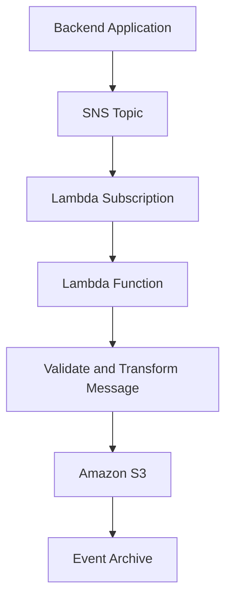
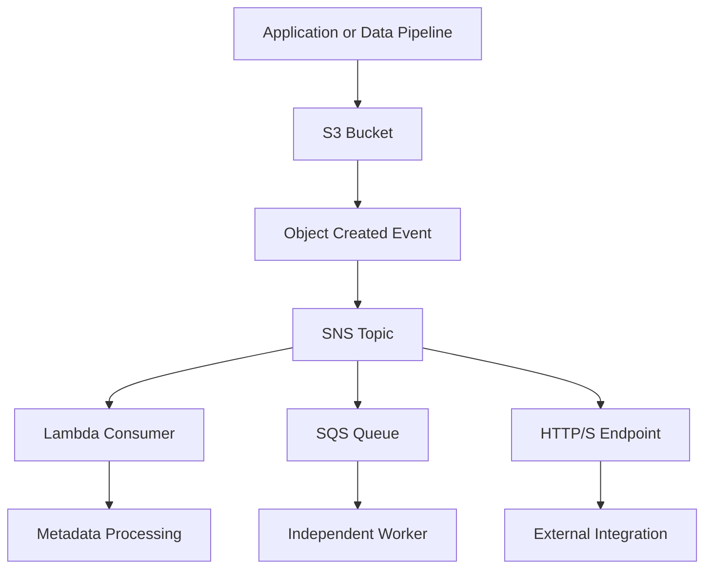
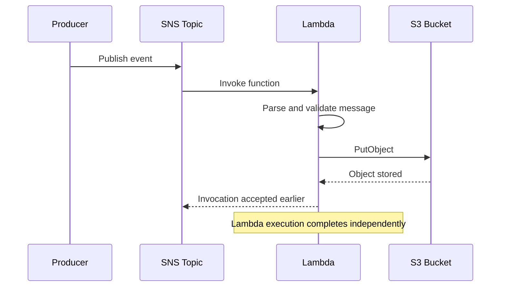

# 04- Amazon S3 Integration

## Overview

Amazon Simple Notification Service (SNS) integrates with Amazon Simple Storage Service (S3) to support event-driven object processing, storage notifications, and asynchronous data pipelines.

There are two important integration patterns:

1. **SNS to S3:** SNS does not provide a native subscription protocol that writes notifications directly into an S3 bucket. Use an intermediary such as Lambda or SQS to process SNS messages and write objects to S3.
2. **S3 to SNS:** Amazon S3 can publish supported object event notifications to an SNS standard topic, allowing multiple independent consumers to react to object creation or deletion events.

These patterns solve different architectural problems.

- Use SNS-to-S3 through Lambda when SNS messages must be transformed, validated, or persisted as objects.
- Use S3-to-SNS when object storage events must trigger multiple downstream systems.
- Use SNS-to-SQS-to-Lambda when durable buffering and controlled processing are important.

This integration is useful for document ingestion, audit event storage, data lake ingestion, image processing, application event archiving, and distributed file-processing workflows.

## Architecture Patterns

### SNS to S3 through Lambda

SNS invokes Lambda, and Lambda writes the notification payload to an S3 bucket.



Typical use cases:

- Persist application events as JSON objects.
- Archive notification payloads.
- Store audit records.
- Transform event formats before storage.
- Partition event data by date, tenant, or event type.

### S3 to SNS Event Notifications

S3 can publish supported object event notifications to an SNS topic.



Typical use cases:

- Trigger document processing after uploads.
- Notify multiple microservices about new files.
- Start image or video processing workflows.
- Synchronize object metadata with PostgreSQL.
- Trigger data ingestion and analytics pipelines.

## SNS to S3 Integration

SNS cannot directly deliver notifications to an S3 bucket using a native S3 subscription protocol.

A Lambda function or another intermediary must consume the SNS notification and perform the S3 write operation.

### Message Processing Lifecycle

1. A producer publishes an event to SNS.
2. SNS invokes the subscribed Lambda function.
3. Lambda extracts the original SNS message.
4. The function validates the payload.
5. The function constructs an S3 object key.
6. Lambda writes the object using the S3 `PutObject` API.
7. The function completes successfully.

If the function fails after receiving the SNS notification, Lambda's asynchronous retry behavior applies.



SNS considers delivery successful when Lambda accepts the asynchronous invocation. S3 persistence happens later during Lambda execution.

Therefore, successful SNS delivery does not guarantee that the object was written successfully.

## Create the S3 Bucket

Create a bucket for storing archived SNS messages.

```bash
aws s3api create-bucket \
    --bucket application-sns-event-archive \
    --region ap-south-1 \
    --create-bucket-configuration LocationConstraint=ap-south-1
```

For `us-east-1`, omit `--create-bucket-configuration`.

Enable versioning when retaining object history is important:

```bash
aws s3api put-bucket-versioning \
    --bucket application-sns-event-archive \
    --versioning-configuration Status=Enabled \
    --region ap-south-1
```

Enable default encryption:

```bash
aws s3api put-bucket-encryption \
    --bucket application-sns-event-archive \
    --server-side-encryption-configuration '{
        "Rules": [
            {
                "ApplyServerSideEncryptionByDefault": {
                    "SSEAlgorithm": "AES256"
                }
            }
        ]
    }' \
    --region ap-south-1
```

For workloads requiring customer-managed encryption keys, configure SSE-KMS and the corresponding KMS permissions.

## Lambda Execution Permissions

The Lambda function requires permission to write objects to the target bucket.

A minimal identity policy can grant `s3:PutObject` on the intended object prefix.

```json
{
    "Version": "2012-10-17",
    "Statement": [
        {
            "Effect": "Allow",
            "Action": [
                "s3:PutObject"
            ],
            "Resource": "arn:aws:s3:::application-sns-event-archive/events/*"
        }
    ]
}
```

Additional permissions may be required for specific operations:

| Action | Purpose |
|---|---|
| `s3:PutObject` | Write an object |
| `s3:PutObjectTagging` | Add object tags |
| `s3:AbortMultipartUpload` | Abort multipart uploads |
| `kms:GenerateDataKey` | Support SSE-KMS writes |
| `kms:Decrypt` | Required in certain multipart or encrypted-object workflows |

For SSE-KMS, configure both the IAM identity policy and KMS key policy appropriately.

SNS also requires permission to invoke the Lambda function. This is a separate Lambda resource-based permission and should be restricted to the intended SNS topic ARN.

## Python Lambda Implementation

The following example receives an SNS notification, extracts the original message, and writes it to S3.

The object key uses a date-based prefix and a stable application event ID.

```python
import json
import logging
import os
from datetime import datetime, timezone
from typing import Any

import boto3

logger = logging.getLogger()
logger.setLevel(logging.INFO)

s3 = boto3.client("s3")

BUCKET_NAME = os.environ["ARCHIVE_BUCKET"]


def archive_event(event: dict[str, Any]) -> str:
    event_id = event["event_id"]

    now = datetime.now(timezone.utc)

    object_key = (
        f"events/"
        f"year={now:%Y}/"
        f"month={now:%m}/"
        f"day={now:%d}/"
        f"{event_id}.json"
    )

    payload = json.dumps(
        event,
        separators=(",", ":"),
    ).encode("utf-8")

    s3.put_object(
        Bucket=BUCKET_NAME,
        Key=object_key,
        Body=payload,
        ContentType="application/json",
    )

    return object_key


def lambda_handler(
    event: dict[str, Any],
    context: Any,
) -> dict[str, Any]:
    records = event.get("Records", [])

    if not records:
        raise ValueError("SNS event contains no records")

    archived = []

    for record in records:
        sns_record = record.get("Sns")

        if not sns_record:
            raise ValueError("Invalid SNS record")

        message = json.loads(sns_record["Message"])

        if not message.get("event_id"):
            raise ValueError("Missing event_id")

        object_key = archive_event(message)

        archived.append(object_key)

        logger.info(
            "SNS event archived",
            extra={
                "event_id": message["event_id"],
                "sns_message_id": sns_record["MessageId"],
                "object_key": object_key,
            },
        )

    return {
        "status": "archived",
        "objects": archived,
    }
```

### Production Considerations

The example uses the application event ID as the object key. This makes retries easier to handle when the same logical event is published more than once.

However, repeated writes to the same key can overwrite the previous object unless versioning or conditional writes are used.

For immutable event archives:

- Use stable event IDs.
- Enable bucket versioning where appropriate.
- Consider conditional writes using `If-None-Match: *` when duplicate object creation must be rejected.
- Define how duplicate events are handled.
- Preserve the original event timestamp separately from the archive timestamp.
- Validate event schemas before persistence.
- Avoid storing sensitive data without appropriate encryption and access controls.

A successful `PutObject` operation should be treated as the persistence boundary. If the write fails, allow the Lambda invocation to fail so the configured asynchronous retry or failure handling can operate.

## S3 Object Key Design

Object key design affects organization, retrieval, lifecycle management, analytics, and operational costs.

A useful structure separates event data by date and business category.

Example:

```text
events/
├── event_type=order.created/
│   ├── year=2026/
│   │   ├── month=11/
│   │   │   ├── day=25/
│   │   │   │   ├── order-123-created.json
│   │   │   │   └── order-124-created.json
│
├── event_type=payment.completed/
│   ├── year=2026/
│   │   ├── month=11/
│   │   │   ├── day=25/
│   │   │   │   └── payment-456-completed.json
```

### Key Design Recommendations

- Use stable identifiers for object names.
- Use UTC timestamps for time-based partitioning.
- Avoid excessively large or random key prefixes when efficient listing and analytics are required.
- Avoid exposing sensitive information in object keys.
- Use consistent event-type names.
- Separate raw and transformed data when both must be retained.
- Keep object naming independent of SNS message IDs when business-level deduplication is required.

For analytics workloads using Athena, date-based and event-type-based partitions can reduce the amount of data scanned.

## S3 to SNS Integration

S3 can publish supported object event notifications to an SNS standard topic.

This enables multiple consumers to react to object changes without directly coupling the bucket to each application.

### Configure the SNS Topic

```bash
aws sns create-topic \
    --name s3-object-events \
    --region ap-south-1
```

Retrieve the topic ARN:

```bash
aws sns list-topics \
    --region ap-south-1
```

### Allow S3 to Publish to SNS

The SNS topic policy must allow the S3 service principal to publish.

Example policy:

```json
{
    "Version": "2012-10-17",
    "Statement": [
        {
            "Sid": "AllowS3BucketNotifications",
            "Effect": "Allow",
            "Principal": {
                "Service": "s3.amazonaws.com"
            },
            "Action": "SNS:Publish",
            "Resource": "arn:aws:sns:ap-south-1:123456789012:s3-object-events",
            "Condition": {
                "ArnEquals": {
                    "aws:SourceArn": "arn:aws:s3:::application-document-bucket"
                },
                "StringEquals": {
                    "aws:SourceAccount": "123456789012"
                }
            }
        }
    ]
}
```

Replace the example account, bucket, and topic identifiers with the actual deployment values.

The source ARN and source account restrictions prevent unrelated buckets from publishing to the topic.

### Apply the Topic Policy

Save the policy as `sns-topic-policy.json`.

```bash
aws sns set-topic-attributes \
    --topic-arn "arn:aws:sns:ap-south-1:123456789012:s3-object-events" \
    --attribute-name Policy \
    --attribute-value file://sns-topic-policy.json \
    --region ap-south-1
```

When updating an existing topic, preserve its existing policy statements.

## Configure S3 Event Notifications

S3 supports event notifications for operations such as object creation and deletion.

Common event types include:

| Event type | Description |
|---|---|
| `s3:ObjectCreated:Put` | Object created through a PUT operation |
| `s3:ObjectCreated:Post` | Object created through a POST operation |
| `s3:ObjectCreated:Copy` | Object created through a copy operation |
| `s3:ObjectCreated:CompleteMultipartUpload` | Multipart upload completed |
| `s3:ObjectRemoved:Delete` | Object deleted |
| `s3:ObjectRemoved:DeleteMarkerCreated` | Delete marker created in a versioned bucket |

### Configure SNS Notification

Create `s3-notification.json`:

```json
{
    "TopicConfigurations": [
        {
            "Id": "document-upload-notification",
            "TopicArn": "arn:aws:sns:ap-south-1:123456789012:s3-object-events",
            "Events": [
                "s3:ObjectCreated:*"
            ],
            "Filter": {
                "Key": {
                    "FilterRules": [
                        {
                            "Name": "prefix",
                            "Value": "incoming/"
                        },
                        {
                            "Name": "suffix",
                            "Value": ".pdf"
                        }
                    ]
                }
            }
        }
    ]
}
```

Apply the configuration:

```bash
aws s3api put-bucket-notification-configuration \
    --bucket application-document-bucket \
    --notification-configuration file://s3-notification.json \
    --region ap-south-1
```

This configuration sends notifications for matching object creation events under the `incoming/` prefix with a `.pdf` suffix.

**Important:** `put-bucket-notification-configuration` replaces the bucket's notification configuration. When adding a notification to an existing bucket, include all existing Lambda, SNS, SQS, and EventBridge notification configurations that must remain.

## S3 Event Message Structure

S3 sends an event notification containing information about the object operation.

Example:

```json
{
    "Records": [
        {
            "eventVersion": "2.1",
            "eventSource": "aws:s3",
            "awsRegion": "ap-south-1",
            "eventTime": "2026-11-25T10:30:00.000Z",
            "eventName": "ObjectCreated:Put",
            "s3": {
                "bucket": {
                    "name": "application-document-bucket"
                },
                "object": {
                    "key": "incoming/invoice-123.pdf",
                    "size": 102400,
                    "eTag": "example-etag"
                }
            }
        }
    ]
}
```

When S3 publishes the event to SNS, the S3 event JSON is carried inside the SNS notification's `Message` field.

The consumer therefore processes two layers:

1. The SNS notification envelope.
2. The original S3 event JSON.

The object key in S3 event notifications is URL-encoded. Consumers should decode it before using it as an S3 object key.

## Lambda Consumer for S3 Events Through SNS

A Lambda function subscribed to the SNS topic can extract the S3 event and process the referenced object.

```python
import json
import logging
from typing import Any
from urllib.parse import unquote_plus

import boto3

logger = logging.getLogger()
logger.setLevel(logging.INFO)

s3 = boto3.client("s3")


def process_s3_record(record: dict[str, Any]) -> None:
    bucket = record["s3"]["bucket"]["name"]
    encoded_key = record["s3"]["object"]["key"]
    object_key = unquote_plus(encoded_key)

    response = s3.head_object(
        Bucket=bucket,
        Key=object_key,
    )

    logger.info(
        "S3 object event received",
        extra={
            "bucket": bucket,
            "object_key": object_key,
            "content_length": response["ContentLength"],
        },
    )


def lambda_handler(
    event: dict[str, Any],
    context: Any,
) -> dict[str, Any]:
    processed = 0

    for sns_record in event.get("Records", []):
        sns_message = sns_record["Sns"]["Message"]
        s3_event = json.loads(sns_message)

        for s3_record in s3_event.get("Records", []):
            if s3_record.get("eventSource") != "aws:s3":
                continue

            process_s3_record(s3_record)
            processed += 1

    return {
        "status": "processed",
        "record_count": processed,
    }
```

The Lambda execution role requires the appropriate S3 permissions. For this example, `s3:HeadObject` is authorized through the `s3:GetObject` permission.

If the function downloads or transforms the object, grant only the required read and write permissions.

## Duplicate and Out-of-Order Events

S3 event notifications are designed for at-least-once delivery. Notifications may be delivered more than once and are not guaranteed to arrive in the order in which operations occurred.

This affects downstream consumers.

For example:

1. An application uploads `invoice-123.pdf`.
2. S3 emits an object-created notification.
3. A consumer starts document processing.
4. The same notification is delivered again.
5. The consumer attempts to process the same document twice.

### Recommended Handling

- Use stable application-level object identifiers.
- Track processed object versions where versioning is enabled.
- Make processing idempotent.
- Avoid assuming notification order.
- Inspect object version IDs when available.
- Use conditional database updates for processing state.
- Handle missing or replaced objects safely.

An S3 event's sequencer can help compare event order for the same object key. It is not a global ordering mechanism and should not be compared across different object keys.

For versioned buckets, use the event's version ID to identify the exact object version that triggered processing.

## Prevent Recursive Event Processing

A common production problem occurs when a Lambda function writes an object to the same bucket that triggers its own invocation.

Example:

1. S3 receives an object under `incoming/`.
2. S3 publishes an event to SNS.
3. Lambda processes the event.
4. Lambda writes a transformed object under `incoming/`.
5. S3 publishes another event.
6. The process repeats.

This can create an invocation loop and unexpected costs.

### Prevention Strategies

**Use separate input and output prefixes**

```text
incoming/
processed/
failed/
```

Configure notifications only for `incoming/`.

**Use separate buckets**

For systems with different security, retention, or lifecycle requirements, use separate source and destination buckets.

**Use explicit event filters**

Limit notifications to the required object prefixes and suffixes.

Do not rely exclusively on application code to prevent recursion. The notification configuration should avoid triggering on the function's own output.

## SNS Message Filtering for S3 Events

SNS subscription filter policies can route object notifications to different consumers.

For example, a consumer may process only PDF uploads.

Because the S3 event JSON is inside the SNS `Message` field, body filtering can be used to inspect its structure where supported by the SNS filter policy.

An alternative is to use SNS message attributes when the producer or an intermediary publishes enriched notifications.

For S3-generated notifications, do not assume arbitrary message attributes are available. Design filters around the actual notification payload and validate the policy against representative events.

For complex routing requirements, consider an intermediary Lambda or Amazon EventBridge.

## Terraform Integration

Terraform can manage the SNS topic, topic policy, S3 bucket notification, and downstream Lambda subscription.

### Create the SNS Topic

```hcl
resource "aws_sns_topic" "s3_events" {
  name = "s3-object-events"
}
```

### Create the S3 Bucket

```hcl
resource "aws_s3_bucket" "documents" {
  bucket = "application-document-bucket"
}

resource "aws_s3_bucket_versioning" "documents" {
  bucket = aws_s3_bucket.documents.id

  versioning_configuration {
    status = "Enabled"
  }
}

resource "aws_s3_bucket_server_side_encryption_configuration" "documents" {
  bucket = aws_s3_bucket.documents.id

  rule {
    apply_server_side_encryption_by_default {
      sse_algorithm = "AES256"
    }
  }
}
```

### Configure SNS Topic Policy

```hcl
data "aws_iam_policy_document" "s3_publish" {
  statement {
    sid    = "AllowS3BucketNotifications"
    effect = "Allow"

    principals {
      type        = "Service"
      identifiers = ["s3.amazonaws.com"]
    }

    actions = [
      "sns:Publish"
    ]

    resources = [
      aws_sns_topic.s3_events.arn
    ]

    condition {
      test     = "ArnEquals"
      variable = "aws:SourceArn"
      values   = [aws_s3_bucket.documents.arn]
    }

    condition {
      test     = "StringEquals"
      variable = "aws:SourceAccount"
      values   = [data.aws_caller_identity.current.account_id]
    }
  }
}

data "aws_caller_identity" "current" {}

resource "aws_sns_topic_policy" "s3_events" {
  arn    = aws_sns_topic.s3_events.arn
  policy = data.aws_iam_policy_document.s3_publish.json
}
```

### Configure S3 Event Notification

```hcl
resource "aws_s3_bucket_notification" "documents" {
  bucket = aws_s3_bucket.documents.id

  topic {
    topic_arn = aws_sns_topic.s3_events.arn
    events = [
      "s3:ObjectCreated:*"
    ]

    filter_prefix = "incoming/"
    filter_suffix = ".pdf"
  }

  depends_on = [
    aws_sns_topic_policy.s3_events
  ]
}
```

The dependency ensures that the topic policy is available before S3 validates the notification destination.

When managing bucket notifications through Terraform, keep the complete notification configuration in one `aws_s3_bucket_notification` resource. Multiple resources managing notifications for the same bucket can overwrite each other's configuration.

### Terraform Deployment Considerations

- Ensure the SNS topic and S3 bucket are in the same AWS Region for this notification integration.
- Keep topic policy restrictions specific to the source bucket.
- Avoid duplicate bucket notification resources.
- Preserve existing notification configurations.
- Review replacement and destruction plans carefully.
- Test the notification after deployment.
- Keep bucket names globally unique.
- Use separate IAM roles for producers and consumers.

## Monitoring and Observability

Monitor both SNS delivery and S3 object persistence.

### SNS Metrics

The `AWS/SNS` namespace provides metrics including:

| Metric | Purpose |
|---|---|
| `NumberOfMessagesPublished` | Messages accepted by SNS |
| `NumberOfNotificationsDelivered` | Successful notification delivery |
| `NumberOfNotificationsFailed` | Failed notification delivery |
| `NumberOfNotificationsFilteredOut` | Notifications excluded by subscription filters |

### Lambda Metrics

The `AWS/Lambda` namespace provides:

| Metric | Purpose |
|---|---|
| `Invocations` | Function invocation count |
| `Errors` | Failed executions |
| `Throttles` | Invocations rejected due to concurrency limits |
| `Duration` | Execution duration |
| `AsyncEventAge` | Age of asynchronous events when processing begins |
| `AsyncEventsDropped` | Events discarded by asynchronous processing |

### S3 Monitoring

Monitor:

- Object creation activity.
- Bucket storage growth.
- Failed object writes.
- Request metrics where enabled.
- Storage class distribution.
- Lifecycle transitions.
- Replication failures when replication is configured.

### Application-Level Metrics

Track:

- SNS events received.
- S3 objects successfully archived.
- Duplicate events detected.
- Object processing duration.
- Failed object writes.
- Invalid event payloads.
- Events waiting for retry.
- Objects processed by event type.

Do not assume that a successful SNS delivery metric means the S3 object exists. Verify the Lambda execution and S3 persistence boundaries independently.

## Reliability and Disaster Recovery

SNS-to-S3 through Lambda and S3-to-SNS notifications have different recovery requirements.

### SNS-to-S3 Recovery

For SNS-to-S3 archival workflows:

- Configure Lambda asynchronous failure destinations.
- Use idempotent object keys.
- Enable bucket versioning where object history matters.
- Retain source events or another replayable record.
- Monitor failed Lambda invocations.
- Define a controlled replay procedure.

If the Lambda function fails after receiving an SNS event, the SNS delivery may already be considered successful. Recovery must therefore account for Lambda's asynchronous failure handling.

### S3-to-SNS Recovery

For S3-to-SNS notifications:

- Account for at-least-once delivery.
- Make consumers idempotent.
- Keep source objects available for reprocessing.
- Use SQS buffering where durable queue-based recovery is required.
- Maintain application-level processing state.
- Use S3 versioning when historical object versions must be processed.

S3 notifications should not be treated as the only permanent record of object changes. For workloads requiring durable event history and replay, consider S3 inventory, object versioning, application manifests, or EventBridge-based event archiving.

## Security Best Practices

- Use dedicated IAM roles for Lambda execution.
- Restrict `s3:PutObject` and `s3:GetObject` to specific bucket prefixes.
- Restrict SNS publishing to the intended S3 bucket ARN and source account.
- Use bucket encryption and KMS where required.
- Enable S3 Block Public Access.
- Avoid sensitive information in object keys.
- Validate notification payloads.
- Avoid logging complete object contents.
- Use bucket versioning where recovery requirements justify it.
- Apply lifecycle policies to control storage costs.
- Audit access and configuration changes through CloudTrail.

For cross-account integrations, review both the SNS topic policy and the S3 bucket policy where applicable. Encryption with customer-managed KMS keys introduces additional authorization requirements.

## Cost Considerations

The integration can incur charges across multiple AWS services.

| Service | Cost drivers |
|---|---|
| SNS | Published messages and notification delivery |
| Lambda | Requests, execution duration, and configured memory |
| S3 | Storage, requests, retrieval, and data transfer |
| KMS | Key usage and API requests where applicable |
| CloudWatch | Metrics, logs, alarms, and log ingestion |

Cost optimization recommendations:

- Use SNS filters to avoid unnecessary Lambda invocations.
- Batch downstream processing where appropriate.
- Avoid writing duplicate archive objects.
- Use lifecycle policies for older objects.
- Select appropriate S3 storage classes.
- Avoid excessive application logging.
- Monitor Lambda retries and repeated S3 writes.
- Use SQS buffering when it provides meaningful control over processing capacity.

Do not choose a storage class solely for its storage price. Retrieval charges, minimum storage duration, and access patterns also matter.

## Common Mistakes

| Mistake | Why it causes problems | Recommended approach |
|---|---|---|
| Expecting SNS to write directly to S3 | S3 is not a native SNS subscription protocol | Use Lambda or another intermediary |
| Assuming SNS delivery means S3 persistence | Lambda executes asynchronously after invocation acceptance | Monitor Lambda execution and S3 writes separately |
| Ignoring duplicate notifications | S3 and SNS use at-least-once delivery behavior | Implement idempotent processing |
| Using the encoded S3 key directly | Object keys in notifications are URL-encoded | Decode with `unquote_plus` |
| Replacing all bucket notifications unintentionally | Bucket notification configuration is replaced as a whole | Preserve existing configurations |
| Writing processed objects under the triggering prefix | Can cause recursive event invocation | Separate input and output prefixes |
| Using broad SNS topic policies | Unrelated buckets may publish notifications | Restrict source ARN and account |
| Ignoring KMS permissions | Encrypted writes or reads may fail | Validate IAM and key policies |
| Treating S3 events as globally ordered | Event ordering is not guaranteed | Use version IDs and per-object sequencing where needed |
| Using random object keys for retries | Creates duplicate archive objects | Use stable event identifiers |
| Assuming SNS message IDs are business identifiers | Repeated logical events can have different SNS IDs | Include application-level event IDs |

## Production Deployment Checklist

### SNS-to-S3

- [ ] SNS topic exists.
- [ ] Lambda subscription is configured.
- [ ] Lambda resource policy allows the intended topic.
- [ ] Lambda execution role has the required S3 permissions.
- [ ] Bucket encryption is configured.
- [ ] Object key structure is defined.
- [ ] Duplicate event handling is implemented.
- [ ] Lambda asynchronous failure handling is configured.
- [ ] Monitoring and alarms are configured.

### S3-to-SNS

- [ ] S3 bucket exists.
- [ ] SNS topic exists in the intended Region.
- [ ] SNS topic policy allows the source bucket.
- [ ] Source ARN and account restrictions are configured.
- [ ] S3 event types are correct.
- [ ] Prefix and suffix filters are validated.
- [ ] Existing bucket notification configurations are preserved.
- [ ] Downstream consumers handle duplicate notifications.
- [ ] Recursive event processing is prevented.

### Operational Validation

- [ ] Publish a controlled SNS message for the archival workflow.
- [ ] Verify the resulting S3 object.
- [ ] Upload a test object for the S3 notification workflow.
- [ ] Verify SNS delivery.
- [ ] Verify downstream processing.
- [ ] Test duplicate event handling.
- [ ] Test failure and recovery behavior.
- [ ] Review CloudWatch metrics and logs.

## Key Takeaways

- SNS does not natively write messages to S3; use Lambda or another intermediary for SNS-to-S3 persistence.
- S3 can publish supported object events to SNS, enabling event-driven fan-out to independent consumers.
- SNS and S3 notifications can be delivered more than once, so stable event identifiers and idempotent processing are essential.
- Protect integrations with scoped SNS topic policies, least-privilege Lambda roles, S3 encryption, and appropriate bucket controls.
- Monitor SNS delivery, Lambda execution, and S3 persistence as separate operational boundaries.