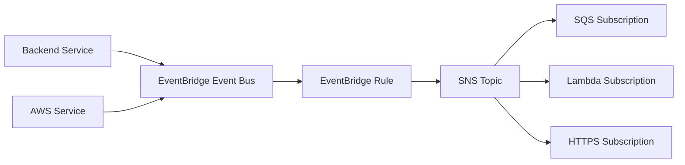
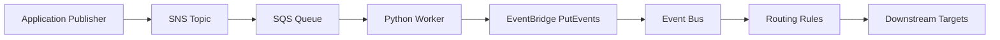
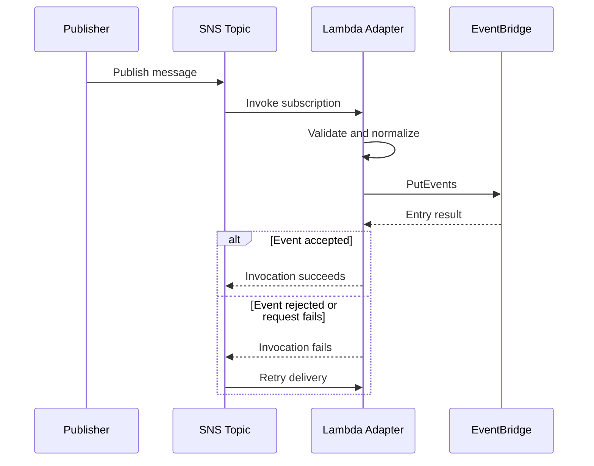
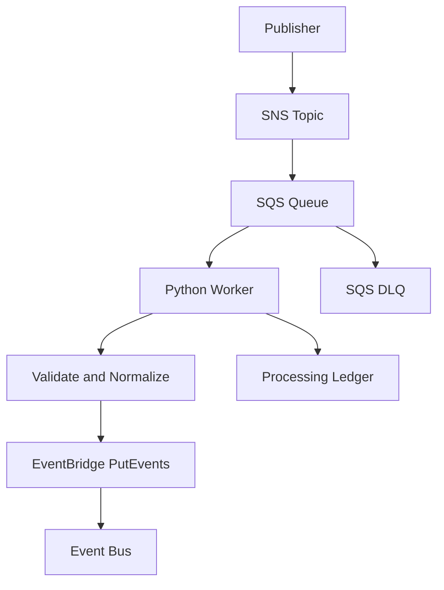
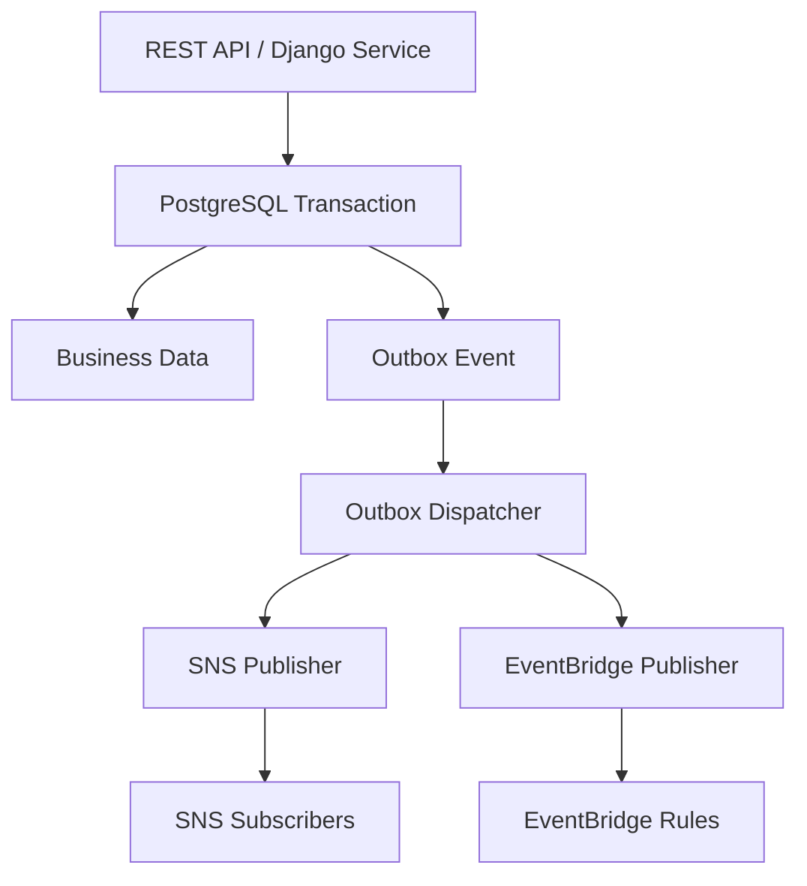

# 05- Amazon EventBridge Integration

## Overview

Amazon EventBridge is a serverless event-routing service that connects applications, AWS services, and SaaS platforms through event buses, rules, and targets. Amazon SNS provides pub/sub messaging through topics and subscriptions. Integrating the two services allows backend systems to combine SNS fan-out with EventBridge's content-based routing, event transformation, cross-account routing, and event archive capabilities.

The integration direction matters:

- **EventBridge → SNS:** EventBridge rules can route matching events to SNS topics. SNS then fans out notifications to its subscribers.
- **SNS → EventBridge:** SNS does not provide a general-purpose native subscription endpoint that automatically forwards every published message to an EventBridge event bus. Use an intermediary consumer, such as Lambda or SQS with a worker, to transform SNS messages and call `PutEvents`.
- **Application → SNS and EventBridge:** A backend can publish to both services, but this introduces a dual-write consistency problem unless publication is coordinated through an outbox or another reliable delivery mechanism.

Choose the integration direction based on which service owns the event-routing responsibility. Avoid introducing both services into a workflow when one service already satisfies the routing and delivery requirements.

## EventBridge and SNS Responsibilities

The services solve related but different problems.

| Capability | Amazon SNS | Amazon EventBridge |
|---|---|---|
| Primary responsibility | Pub/sub message delivery | Event ingestion and routing |
| Routing model | Topic subscriptions and filter policies | Event buses, rules, and event patterns |
| Consumer integration | SQS, Lambda, HTTP/S, email, SMS, and supported endpoints | AWS service targets, APIs, Lambda, SQS, SNS, and other supported targets |
| Filtering | Subscription filter policies | Event patterns on rules |
| Event transformation | Limited message-level delivery configuration | Input transformers and target input configuration |
| Event archive and replay | Not a general-purpose event archive | EventBridge archives and replay |
| FIFO support | SNS FIFO topics and compatible FIFO subscriptions | EventBridge does not provide end-to-end FIFO ordering |
| Cross-account routing | Topic resource policies and subscription configuration | Event bus resource policies and supported cross-account targets |
| Delivery model | Depends on topic type and subscription protocol | Rule-based asynchronous target invocation with retry and optional DLQ |

### When to use each service

Use SNS when:

- A publisher needs to notify multiple independent subscribers.
- Subscribers need protocol-specific delivery.
- A simple pub/sub topology is sufficient.
- FIFO message groups and deduplication are required by the messaging workflow.

Use EventBridge when:

- Consumers need content-based routing across event attributes and nested details.
- Multiple teams own independent event consumers.
- Events need to be routed across accounts or to multiple AWS services.
- Event archive and replay are operational requirements.
- Event producers and consumers should be decoupled through a shared event contract.

Use both when their responsibilities are distinct. For example, EventBridge can route business events to an SNS topic, and SNS can fan out notifications to several independent consumers.

## Integration Architectures

### EventBridge to SNS

This is the most direct integration. An application or AWS service publishes an event to an EventBridge event bus. A rule matches the event and invokes an SNS topic as a target.

SNS then delivers the notification to its subscribers.



Typical use cases include:

- Broadcasting domain events to multiple teams.
- Sending operational notifications.
- Triggering independent downstream workflows.
- Separating event classification from subscriber delivery.

The EventBridge rule determines whether an event should be sent to SNS. SNS determines which subscribers receive the resulting notification.

### SNS to EventBridge through an intermediary

When an existing SNS topic is the source of events, introduce a consumer that reads SNS messages and publishes normalized events to EventBridge.

A Lambda subscription is suitable for lightweight transformations. For higher-volume workloads or when durable buffering and controlled consumption are required, use SNS → SQS → worker → EventBridge.



This architecture is useful when:

- SNS is already the established publisher interface.
- Existing subscribers must remain unchanged.
- EventBridge routing is being introduced incrementally.
- The integration requires message validation, normalization, or enrichment.

The intermediary must handle duplicate delivery, partial failures, retries, and the relationship between acknowledging the SNS-originated message and successfully publishing to EventBridge.

### Application publishing to both services

A backend may need to notify existing SNS subscribers while also publishing a structured event to EventBridge.

A naive implementation performs two independent network calls:

```python
sns.publish(...)
eventbridge.put_events(...)
```

This creates a dual-write problem. If the first operation succeeds and the second fails, the two systems receive different event histories. Reversing the order only reverses the failure scenario.

For important business events, persist the event and publication state in a transactional outbox. Separate dispatchers can publish the same durable event to SNS and EventBridge, with retries and idempotency.

## EventBridge to SNS Integration

### Create an SNS topic

Create a Standard SNS topic for general-purpose fan-out:

```bash
aws sns create-topic \
  --name order-notifications \
  --region ap-south-1
```

Capture the returned topic ARN:

```text
arn:aws:sns:ap-south-1:123456789012:order-notifications
```

The topic and EventBridge event bus must be in compatible Regions for this target integration. Use the same Region for a straightforward deployment.

Inspect the topic:

```bash
aws sns get-topic-attributes \
  --topic-arn arn:aws:sns:ap-south-1:123456789012:order-notifications \
  --region ap-south-1
```

### Create an EventBridge event bus

A custom event bus provides an application-owned boundary for business events.

```bash
aws events create-event-bus \
  --name commerce-events \
  --region ap-south-1
```

Retrieve its ARN:

```bash
aws events describe-event-bus \
  --name commerce-events \
  --region ap-south-1
```

Custom buses help isolate application events from the default event bus and make event ownership and access control easier to manage.

### Publish an event

Use `PutEvents` to publish structured events to the custom bus.

```bash
aws events put-events \
  --entries '[
    {
      "Source": "com.example.orders",
      "DetailType": "OrderCreated",
      "EventBusName": "commerce-events",
      "Time": "2026-11-22T10:30:00Z",
      "Detail": "{\"order_id\":\"ord-1001\",\"customer_id\":\"cus-204\",\"status\":\"created\",\"total\":2499.00}"
    }
  ]' \
  --region ap-south-1
```

The `Detail` field must contain a JSON object encoded as a string in the CLI request. Use a JSON file for complex payloads to avoid shell-escaping errors.

Example `event.json`:

```json
[
  {
    "Source": "com.example.orders",
    "DetailType": "OrderCreated",
    "EventBusName": "commerce-events",
    "Detail": "{\"order_id\":\"ord-1001\",\"customer_id\":\"cus-204\",\"status\":\"created\",\"total\":2499.00}"
  }
]
```

Publish it:

```bash
aws events put-events \
  --entries file://event.json \
  --region ap-south-1
```

A successful HTTP response does not guarantee that every entry in a batch was accepted. Inspect `FailedEntryCount` and each entry's error fields.

### Create an EventBridge rule

Create a rule that matches order creation events:

```bash
aws events put-rule \
  --name order-created-to-sns \
  --event-bus-name commerce-events \
  --event-pattern '{
    "source": ["com.example.orders"],
    "detail-type": ["OrderCreated"]
  }' \
  --state ENABLED \
  --description "Route order creation events to SNS" \
  --region ap-south-1
```

The rule uses an event pattern to match the event's `source` and `detail-type` fields.

For more selective routing, match fields inside `detail`:

```json
{
  "source": ["com.example.orders"],
  "detail-type": ["OrderCreated"],
  "detail": {
    "status": ["created"],
    "total": [
      {
        "numeric": [">=", 1000]
      }
    ]
  }
}
```

Event patterns are routing conditions, not authorization controls. Access to the event bus and SNS topic must still be protected through IAM and resource policies.

### Add SNS as a target

Use the SNS topic ARN as the target ARN.

```bash
aws events put-targets \
  --rule order-created-to-sns \
  --event-bus-name commerce-events \
  --targets '[
    {
      "Id": "order-notifications-target",
      "Arn": "arn:aws:sns:ap-south-1:123456789012:order-notifications"
    }
  ]' \
  --region ap-south-1
```

EventBridge requires permission to publish to the SNS topic. Grant the EventBridge service principal access through the topic resource policy, scoped to the specific rule ARN and account.

Example topic policy statement:

```json
{
  "Sid": "AllowEventBridgePublish",
  "Effect": "Allow",
  "Principal": {
    "Service": "events.amazonaws.com"
  },
  "Action": "sns:Publish",
  "Resource": "arn:aws:sns:ap-south-1:123456789012:order-notifications",
  "Condition": {
    "ArnEquals": {
      "aws:SourceArn": "arn:aws:events:ap-south-1:123456789012:rule/commerce-events/order-created-to-sns"
    },
    "StringEquals": {
      "aws:SourceAccount": "123456789012"
    }
  }
}
```

For the default event bus, the rule ARN has a different format. Use the actual rule ARN returned by EventBridge rather than constructing it from assumptions.

Apply the policy while preserving existing topic policy statements. Updating the SNS `Policy` attribute replaces the complete policy document.

```bash
aws sns set-topic-attributes \
  --topic-arn arn:aws:sns:ap-south-1:123456789012:order-notifications \
  --attribute-name Policy \
  --attribute-value file://topic-policy.json \
  --region ap-south-1
```

Verify the target:

```bash
aws events list-targets-by-rule \
  --rule order-created-to-sns \
  --event-bus-name commerce-events \
  --region ap-south-1
```

A target being registered does not prove that it can successfully deliver events. Validate the topic policy, encryption permissions, and actual delivery path.

## SNS to EventBridge Integration

### Choose an intermediary

There are two common implementation patterns.

| Pattern | Advantages | Limitations | Suitable workloads |
|---|---|---|---|
| SNS → Lambda → EventBridge | Low operational overhead, direct transformation, automatic scaling | Lambda execution retries and duplicate processing must be handled | Lightweight event transformation |
| SNS → SQS → worker → EventBridge | Durable buffering, independent scaling, controlled retry and backpressure | Additional infrastructure and operational responsibility | High-volume or business-critical event pipelines |

Use Lambda when the transformation is short-running and stateless. Use SQS when the integration needs an independently controlled processing backlog, explicit visibility-timeout behavior, or worker concurrency management.

### Lambda subscription architecture



The Lambda adapter should:

1. Validate the SNS envelope and message payload.
2. Parse the source message using a versioned schema.
3. Normalize the payload into an EventBridge event.
4. Publish using `PutEvents`.
5. Inspect per-entry results.
6. Raise an error when publication fails so the invocation can be retried.

Do not report success merely because the SDK call returned an HTTP response. A `PutEvents` response can contain failed entries even when the overall request succeeds.

### Configure the SNS subscription

Create the Lambda function first and grant SNS permission to invoke it.

```bash
aws lambda add-permission \
  --function-name sns-eventbridge-adapter \
  --statement-id AllowSnsInvocation \
  --action lambda:InvokeFunction \
  --principal sns.amazonaws.com \
  --source-arn arn:aws:sns:ap-south-1:123456789012:legacy-order-events \
  --region ap-south-1
```

Subscribe the function to the topic:

```bash
aws sns subscribe \
  --topic-arn arn:aws:sns:ap-south-1:123456789012:legacy-order-events \
  --protocol lambda \
  --notification-endpoint arn:aws:lambda:ap-south-1:123456789012:function:sns-eventbridge-adapter \
  --region ap-south-1
```

The Lambda resource-based policy authorizes SNS to invoke the function. The Lambda execution role separately authorizes the function to call EventBridge.

### Python Lambda adapter

The following example assumes the SNS message contains a JSON order event. It validates the payload, normalizes the event, and checks the `PutEvents` result.

```python
import json
import logging
import os
from datetime import datetime, timezone
from typing import Any

import boto3
from botocore.config import Config

logger = logging.getLogger()
logger.setLevel(logging.INFO)

EVENT_BUS_NAME = os.environ["EVENT_BUS_NAME"]

eventbridge = boto3.client(
    "events",
    config=Config(
        retries={
            "mode": "standard",
            "max_attempts": 5,
        },
        connect_timeout=3,
        read_timeout=10,
    ),
)


def build_event(message: dict[str, Any]) -> dict[str, Any]:
    required_fields = {"event_id", "order_id", "status"}

    missing_fields = required_fields.difference(message)
    if missing_fields:
        raise ValueError(
            f"Missing required event fields: {sorted(missing_fields)}"
        )

    return {
        "Source": "com.example.orders",
        "DetailType": "OrderStatusChanged",
        "EventBusName": EVENT_BUS_NAME,
        "Time": datetime.now(timezone.utc),
        "Detail": json.dumps(
            {
                "event_id": message["event_id"],
                "order_id": message["order_id"],
                "status": message["status"],
                "schema_version": message.get("schema_version", 1),
            },
            separators=(",", ":"),
        ),
    }


def lambda_handler(event: dict[str, Any], context: Any) -> dict[str, int]:
    entries = []

    for record in event.get("Records", []):
        if record.get("EventSource") != "aws:sns":
            raise ValueError("Unsupported event source")

        message = json.loads(record["Sns"]["Message"])
        entries.append(build_event(message))

    if not entries:
        return {"published": 0}

    response = eventbridge.put_events(Entries=entries)

    failed_count = response.get("FailedEntryCount", 0)
    results = response.get("Entries", [])

    if failed_count:
        failures = [
            {
                "index": index,
                "error_code": result.get("ErrorCode"),
                "error_message": result.get("ErrorMessage"),
            }
            for index, result in enumerate(results)
            if result.get("ErrorCode")
        ]

        logger.error(
            "EventBridge rejected one or more entries: %s",
            failures,
        )

        # Fail the invocation so the source delivery can be retried.
        raise RuntimeError(
            f"EventBridge rejected {failed_count} event(s)"
        )

    logger.info("Published %d event(s) to EventBridge", len(entries))

    return {"published": len(entries)}
```

This implementation is a starting point, not a complete exactly-once delivery mechanism. If a batch contains both successful and failed entries, raising an exception can cause already accepted entries to be published again on retry. Consumers must therefore be idempotent.

For high-volume batch processing, use a durable per-event processing ledger or an SQS-based adapter that can track individual event outcomes. Do not assume a Lambda invocation retry will replay only failed records from an SNS batch.

### Lambda execution role

The execution role needs permission to publish to the intended event bus.

```json
{
  "Version": "2012-10-17",
  "Statement": [
    {
      "Sid": "PublishToCommerceEventBus",
      "Effect": "Allow",
      "Action": [
        "events:PutEvents"
      ],
      "Resource": "arn:aws:events:ap-south-1:123456789012:event-bus/commerce-events"
    }
  ]
}
```

The role also needs the standard Lambda logging permissions. Avoid granting `events:*` or unrestricted `Resource: "*"` when a specific event bus ARN is sufficient.

## EventBridge Event Design

### Event envelope

EventBridge events use a standard envelope containing routing metadata and a JSON `detail` object.

```json
{
  "version": "0",
  "id": "eventbridge-generated-id",
  "detail-type": "OrderCreated",
  "source": "com.example.orders",
  "account": "123456789012",
  "time": "2026-11-22T10:30:00Z",
  "region": "ap-south-1",
  "resources": [],
  "detail": {
    "event_id": "evt-90001",
    "schema_version": 1,
    "order_id": "ord-1001",
    "customer_id": "cus-204",
    "status": "created"
  }
}
```

The EventBridge envelope provides routing metadata. The application owns the business schema inside `detail`.

Use stable event contracts across services. Do not make consumers depend on incidental fields from the original SNS notification envelope.

### Map SNS messages to EventBridge events

A typical SNS notification contains:

- `Type`
- `MessageId`
- `TopicArn`
- `Subject`, when supplied
- `Message`
- `Timestamp`
- `MessageAttributes`

The adapter should explicitly decide which fields become EventBridge routing metadata and which become business details.

| SNS field | EventBridge mapping |
|---|---|
| `TopicArn` | Optional source metadata or a controlled source mapping |
| `MessageId` | Transport-level correlation metadata |
| `Message` | Parsed and validated business payload |
| `Subject` | Optional metadata; do not use as the sole event type contract |
| `MessageAttributes` | Selected application metadata |
| `Timestamp` | Original publication timestamp, if retained in `detail` |

EventBridge assigns its own event ID and envelope timestamp. If the original business event has an event ID and creation timestamp, preserve them in `detail`.

### Event contract versioning

Include a schema version in the business payload:

```json
{
  "event_id": "evt-90001",
  "schema_version": 2,
  "order_id": "ord-1001",
  "status": "confirmed",
  "occurred_at": "2026-11-22T10:30:00Z"
}
```

Recommended practices:

- Add optional fields when possible to preserve backward compatibility.
- Avoid changing the meaning or type of existing fields.
- Introduce a new event type or schema version for breaking changes.
- Validate events before publishing.
- Keep consumers tolerant of unknown optional fields.
- Maintain contract tests between publishers and consumers.

EventBridge Schema Registry can help discover and manage event schemas, but it does not replace application-level compatibility rules or runtime validation.

## Event Filtering and Routing

### Filter events using event patterns

EventBridge rules can match event metadata and nested business fields.

Example: route high-value orders to a dedicated SNS topic.

```json
{
  "source": ["com.example.orders"],
  "detail-type": ["OrderCreated"],
  "detail": {
    "total": [
      {
        "numeric": [">=", 5000]
      }
    ],
    "status": ["created"]
  }
}
```

Example: match multiple order event types:

```json
{
  "source": ["com.example.orders"],
  "detail-type": [
    "OrderCreated",
    "OrderCancelled",
    "OrderRefunded"
  ]
}
```

Test patterns before deploying them:

```bash
aws events test-event-pattern \
  --event-pattern file://order-pattern.json \
  --event file://sample-event.json \
  --region ap-south-1
```

A pattern that does not match an event silently prevents the rule from invoking its target. Include representative positive and negative test cases in deployment validation.

### EventBridge filtering versus SNS filtering

| Requirement | Recommended mechanism |
|---|---|
| Route based on event source and business event type | EventBridge rule |
| Route based on nested event details | EventBridge rule |
| Deliver only selected messages to a particular SNS subscriber | SNS subscription filter policy |
| Route one event to multiple independent AWS targets | EventBridge rules |
| Fan out one notification to protocol-specific subscribers | SNS topic |

Avoid duplicating the same filtering logic in both services without a clear ownership boundary. Multiple filtering layers make missing deliveries harder to diagnose.

## Reliability and Failure Handling

### EventBridge target retries

EventBridge retries failed target delivery according to the rule's retry policy. Configure a dead-letter queue when events must be retained for investigation or recovery after target delivery failures.

Example target configuration:

```bash
aws events put-targets \
  --rule order-created-to-sns \
  --event-bus-name commerce-events \
  --targets '[
    {
      "Id": "order-notifications-target",
      "Arn": "arn:aws:sns:ap-south-1:123456789012:order-notifications",
      "RetryPolicy": {
        "MaximumEventAgeInSeconds": 3600,
        "MaximumRetryAttempts": 10
      },
      "DeadLetterConfig": {
        "Arn": "arn:aws:sqs:ap-south-1:123456789012:eventbridge-target-dlq"
      }
    }
  ]' \
  --region ap-south-1
```

The SQS DLQ needs a resource policy that allows EventBridge to send messages. Scope that policy to the specific rule ARN and account.

The retry policy and DLQ apply to EventBridge's attempt to deliver to the SNS target. They do not monitor whether SNS subscribers successfully process the notification.

### Distinguish failure boundaries

A combined architecture can have several independent failure boundaries.

| Failure boundary | Example | Recovery mechanism |
|---|---|---|
| Application → SNS | SNS publish request fails | Publisher retry and outbox |
| SNS → Lambda adapter | Lambda invocation delivery fails | SNS delivery retry and subscription DLQ where configured |
| Lambda adapter → EventBridge | `PutEvents` request or entry fails | Invocation failure, retry, durable processing state |
| EventBridge → SNS | Target delivery fails | EventBridge retry policy and target DLQ |
| SNS → subscriber | Subscriber delivery fails | SNS protocol-specific retry and subscription DLQ where supported |
| Subscriber processing | Consumer receives but fails business processing | Consumer retry, SQS visibility timeout, and consumer DLQ |

Do not treat these as one retry mechanism. Each service owns a different stage of the delivery pipeline.

### Idempotency and duplicate delivery

SNS and EventBridge are asynchronous event-delivery systems. A message can be delivered more than once, and retries can repeat work that already succeeded.

Use a stable business event identifier:

```json
{
  "event_id": "evt-90001",
  "order_id": "ord-1001",
  "schema_version": 1,
  "status": "created"
}
```

Consumers should persist processed event IDs:

```sql
CREATE TABLE processed_events (
    consumer_name TEXT NOT NULL,
    event_id TEXT NOT NULL,
    processed_at TIMESTAMPTZ NOT NULL DEFAULT NOW(),
    PRIMARY KEY (consumer_name, event_id)
);
```

A consumer can use a transaction to claim an event and apply its business change:

```sql
BEGIN;

INSERT INTO processed_events (
    consumer_name,
    event_id
)
VALUES (
    'order-projection',
    'evt-90001'
)
ON CONFLICT DO NOTHING
RETURNING event_id;
```

If the insert returns no row, the event was already processed by that consumer. If it returns a row, apply the business update in the same transaction and commit.

The idempotency record and business side effect must share a transaction when both are stored in the same database. For external side effects, use an idempotency key supported by the downstream API or another durable workflow.

EventBridge's generated event ID is useful for transport-level tracing. Prefer a stable application-owned event ID for deduplicating the same logical event across retries, republishing, and multiple transport services.

### Partial `PutEvents` failures

`PutEvents` accepts batches and reports the result for each entry. A request can partially succeed.

A robust publisher must:

- Inspect `FailedEntryCount`.
- Inspect each entry's `ErrorCode` and `ErrorMessage`.
- Retry only failed entries when the processing model allows individual tracking.
- Avoid blindly retrying the complete batch.
- Preserve stable business event IDs across retries.
- Send permanent failures to a durable failure store or operational workflow.

A retry can still create duplicates if EventBridge accepted an event but the publisher did not receive or correctly interpret the response. Idempotency remains necessary.

## SQS-Based SNS to EventBridge Adapter

For workloads that require durable buffering, place SQS between SNS and the worker.



The worker should delete an SQS message only after all required EventBridge entries have been accepted or durably recorded for retry.

For a batch containing partial failures, do not delete the source message unless the failed events have been durably preserved. If the worker retries the whole message, already accepted events can be published again. Use stable event IDs and idempotent consumers.

### Python worker example

The following example handles one SQS message containing an SNS notification. It publishes the parsed business event to EventBridge and raises an exception when the event is rejected.

```python
import json
import logging
import os
from datetime import datetime, timezone
from typing import Any

import boto3
from botocore.config import Config

logger = logging.getLogger(__name__)
logger.setLevel(logging.INFO)

EVENT_BUS_NAME = os.environ["EVENT_BUS_NAME"]

eventbridge = boto3.client(
    "events",
    config=Config(
        retries={"mode": "standard", "max_attempts": 5},
        connect_timeout=3,
        read_timeout=10,
    ),
)


def to_eventbridge_entry(sns_message: dict[str, Any]) -> dict[str, Any]:
    required = {"event_id", "order_id", "status"}
    missing = required.difference(sns_message)

    if missing:
        raise ValueError(f"Missing fields: {sorted(missing)}")

    detail = {
        "event_id": sns_message["event_id"],
        "order_id": sns_message["order_id"],
        "status": sns_message["status"],
        "schema_version": sns_message.get("schema_version", 1),
    }

    return {
        "EventBusName": EVENT_BUS_NAME,
        "Source": "com.example.orders",
        "DetailType": "OrderStatusChanged",
        "Time": datetime.now(timezone.utc),
        "Detail": json.dumps(detail, separators=(",", ":")),
    }


def process_sqs_record(record: dict[str, Any]) -> None:
    envelope = json.loads(record["body"])

    if envelope.get("Type") != "Notification":
        raise ValueError("Expected an SNS notification envelope")

    business_message = json.loads(envelope["Message"])
    entry = to_eventbridge_entry(business_message)

    response = eventbridge.put_events(Entries=[entry])
    result = response["Entries"][0]

    if response.get("FailedEntryCount", 0) != 0:
        raise RuntimeError(
            f"EventBridge publish failed: "
            f"{result.get('ErrorCode')} - "
            f"{result.get('ErrorMessage')}"
        )

    logger.info(
        "Published event_id=%s to EventBridge",
        business_message["event_id"],
    )


def lambda_handler(event: dict[str, Any], context: Any) -> dict[str, list]:
    batch_item_failures = []

    for record in event.get("Records", []):
        try:
            process_sqs_record(record)
        except Exception:
            logger.exception(
                "Failed to process SQS message %s",
                record.get("messageId"),
            )
            batch_item_failures.append(
                {"itemIdentifier": record["messageId"]}
            )

    return {"batchItemFailures": batch_item_failures}
```

When using this handler with an SQS event source mapping, enable `ReportBatchItemFailures`. Otherwise, the Lambda integration may treat a partially failed batch as a complete failure and retry messages that already succeeded.

The example does not include a durable per-event ledger. If one SQS message can contain multiple business events, persist individual event outcomes so partial publication can be recovered without repeatedly publishing accepted events.

## Transactional Outbox for Backend Publishers

When a business transaction must reliably generate events for SNS and EventBridge, use a transactional outbox.

The application writes the business change and the outbox record in the same PostgreSQL transaction. Dispatchers then publish the durable event to the required destinations.



Example schema:

```sql
CREATE TABLE event_outbox (
    id BIGSERIAL PRIMARY KEY,
    event_id UUID NOT NULL UNIQUE,
    event_type TEXT NOT NULL,
    payload JSONB NOT NULL,
    created_at TIMESTAMPTZ NOT NULL DEFAULT NOW(),
    sns_published_at TIMESTAMPTZ,
    eventbridge_published_at TIMESTAMPTZ,
    attempts INTEGER NOT NULL DEFAULT 0
);
```

A Django service can persist the order and event together:

```python
from django.db import transaction
from uuid import uuid4


def create_order(customer_id: int, total: int):
    with transaction.atomic():
        order = Order.objects.create(
            customer_id=customer_id,
            total=total,
            status="created",
        )

        event_id = uuid4()

        EventOutbox.objects.create(
            event_id=event_id,
            event_type="OrderCreated",
            payload={
                "event_id": str(event_id),
                "order_id": str(order.id),
                "customer_id": customer_id,
                "total": total,
                "status": "created",
                "schema_version": 1,
            },
        )

    return order
```

The dispatcher should track publication independently for each destination. A successful SNS publish must not cause the EventBridge publication to be marked complete, and vice versa.

Production considerations:

- Claim outbox rows safely when multiple dispatchers run concurrently.
- Use leases or `SELECT ... FOR UPDATE SKIP LOCKED` to prevent workers from processing the same row simultaneously.
- Record attempts and last error details.
- Use bounded exponential backoff with jitter.
- Keep event IDs stable across retries.
- Make consumers idempotent.
- Alert on outbox age and repeated failures.
- Retain or archive published rows according to audit and replay requirements.

The outbox provides durable intent, not exactly-once delivery. A process can publish successfully and crash before recording the publication timestamp. The dispatcher may publish the event again after recovery.

## Security

### IAM permissions

Use separate roles for publishing, routing, and consuming.

| Component | Required permission | Scope |
|---|---|---|
| Application publisher | `events:PutEvents` | Specific event bus |
| EventBridge rule | `sns:Publish` through topic resource policy | Specific SNS topic and rule |
| SNS service | Invoke Lambda through Lambda resource policy | Specific function and topic |
| Lambda adapter | `events:PutEvents` | Specific event bus |
| SQS worker | Receive/delete messages and publish events | Specific queue and event bus |
| EventBridge DLQ delivery | `sqs:SendMessage` | Specific DLQ and rule |

Avoid using broad service permissions such as `events:*`, `sns:*`, or `sqs:*` in production roles.

### Resource policies

Resource policies are important when a service principal or another AWS account needs access to a resource.

For EventBridge to publish to SNS:

- Allow `events.amazonaws.com` to call `sns:Publish`.
- Scope the statement to the topic ARN.
- Restrict the source to the expected rule ARN.
- Restrict the source account where applicable.
- Preserve existing topic policy statements.

For SNS to invoke Lambda:

- Add a Lambda resource-based permission for `sns.amazonaws.com`.
- Restrict the permission with the expected SNS topic ARN.
- Keep the Lambda execution role separate from the invocation permission.

For cross-account EventBridge routing, configure the event bus resource policy and the required sender-side permissions. Cross-account SNS targets also require the target topic policy to authorize the intended EventBridge rule.

### Encryption

SNS topics, SQS queues, and EventBridge event buses have separate encryption and access-control considerations.

- Enable SNS server-side encryption where required.
- Enable SQS encryption for queues and DLQs.
- Use customer-managed KMS keys when key-policy control or cross-account access requires them.
- Review KMS key policies and grants for service integrations.
- Do not assume encrypting the SNS topic automatically encrypts SQS messages or EventBridge event data.
- Protect application payloads from unnecessary sensitive data exposure.

EventBridge target delivery to an encrypted SNS topic may require additional KMS permissions and a compatible key policy. Validate the complete path in the target account and Region.

### Sensitive data

Event buses and SNS topics should not be used as unrestricted storage for secrets or unnecessary personal data.

Prefer publishing references to protected records rather than embedding credentials, access tokens, or large sensitive documents in event payloads. Apply retention and access controls to archives, queues, logs, and DLQs because they can contain copies of event data.

## Monitoring and Observability

Monitor each service independently and correlate events across the complete delivery path.

### EventBridge metrics

Useful metrics include:

- `TriggeredRules`
- `Invocations`
- `FailedInvocations`
- `ThrottledRules`
- `MatchedEvents`
- `InvocationsSentToDLQ`
- `InvocationsFailedToBeSentToDLQ`

Metric availability and dimensions depend on the event bus, rule, and target configuration.

### SNS metrics

Monitor:

- Published messages.
- Delivered messages.
- Failed notifications.
- Notifications filtered out.
- Delivery retries and endpoint failures.
- Number of messages sent to subscription DLQs where supported.

### SQS and Lambda metrics

For an SQS-based adapter, monitor:

- `ApproximateNumberOfMessagesVisible`
- `ApproximateNumberOfMessagesNotVisible`
- `ApproximateAgeOfOldestMessage`
- `NumberOfMessagesSent`
- `NumberOfMessagesReceived`
- `NumberOfMessagesDeleted`

For Lambda, monitor:

- Invocations.
- Errors.
- Throttles.
- Duration.
- Concurrent executions.
- Iterator or queue processing behavior where applicable.

### Correlation identifiers

Carry a stable event ID through every stage:

```json
{
  "event_id": "evt-90001",
  "correlation_id": "req-20261122-10001",
  "causation_id": "cmd-70001",
  "schema_version": 1
}
```

Log the event ID, source message ID, EventBridge response metadata, and downstream processing result. Avoid logging complete payloads by default, particularly when they may contain sensitive information.

Use structured logs and distributed tracing where supported. EventBridge and SNS do not automatically provide one end-to-end trace across every asynchronous consumer.

## Infrastructure as Code with Terraform

The following example creates a custom event bus, an SNS topic, a rule, a topic policy, and the target relationship.

```hcl
resource "aws_cloudwatch_event_bus" "commerce" {
  name = "commerce-events"
}

resource "aws_sns_topic" "order_notifications" {
  name = "order-notifications"
}

resource "aws_cloudwatch_event_rule" "order_created" {
  name           = "order-created-to-sns"
  event_bus_name = aws_cloudwatch_event_bus.commerce.name

  event_pattern = jsonencode({
    source        = ["com.example.orders"]
    "detail-type" = ["OrderCreated"]
  })
}

data "aws_iam_policy_document" "sns_topic" {
  statement {
    sid    = "AllowEventBridgePublish"
    effect = "Allow"

    principals {
      type        = "Service"
      identifiers = ["events.amazonaws.com"]
    }

    actions   = ["sns:Publish"]
    resources = [aws_sns_topic.order_notifications.arn]

    condition {
      test     = "ArnEquals"
      variable = "aws:SourceArn"
      values   = [aws_cloudwatch_event_rule.order_created.arn]
    }

    condition {
      test     = "StringEquals"
      variable = "aws:SourceAccount"
      values   = [data.aws_caller_identity.current.account_id]
    }
  }
}

data "aws_caller_identity" "current" {}

resource "aws_sns_topic_policy" "order_notifications" {
  arn    = aws_sns_topic.order_notifications.arn
  policy = data.aws_iam_policy_document.sns_topic.json
}

resource "aws_cloudwatch_event_target" "order_notifications" {
  rule           = aws_cloudwatch_event_rule.order_created.name
  event_bus_name = aws_cloudwatch_event_bus.commerce.name
  arn            = aws_sns_topic.order_notifications.arn

  depends_on = [
    aws_sns_topic_policy.order_notifications
  ]

  retry_policy {
    maximum_event_age_in_seconds = 3600
    maximum_retry_attempts       = 10
  }
}
```

The example assumes the AWS provider and Region are configured elsewhere in the Terraform project.

For production deployments:

- Pin the AWS provider version through the project's dependency configuration.
- Manage the SNS topic policy centrally.
- Add a dedicated SQS DLQ and its resource policy.
- Add CloudWatch alarms for failed target invocations and DLQ activity.
- Configure encryption and key policies explicitly.
- Avoid multiple Terraform resources attempting to manage the same SNS topic policy.
- Keep event patterns in version-controlled files or modules where they can be tested.
- Use separate environments and event buses where isolation is required.

For an SNS-to-EventBridge Lambda adapter, also define the Lambda function, execution role, SNS subscription, Lambda invocation permission, environment variables, and deployment artifact. For an SQS-based adapter, define the queue, queue policy, DLQ, worker, and event source mapping.

## Testing and Deployment

### Unit testing

Test the adapter independently from AWS by mocking the EventBridge client.

Important test cases:

- Valid SNS envelope and valid business payload.
- Missing required business fields.
- Invalid JSON in the SNS message.
- Unsupported SNS record type.
- Successful `PutEvents` response.
- `PutEvents` response with failed entries.
- Network timeout or service exception.
- Duplicate event delivery.
- Partial batch failure.
- Event schema compatibility.

Example test for a failed EventBridge entry:

```python
from unittest.mock import patch

import pytest

from app.handler import lambda_handler


def test_eventbridge_entry_failure_is_retried():
    event = {
        "Records": [
            {
                "EventSource": "aws:sns",
                "Sns": {
                    "Message": (
                        '{"event_id":"evt-1",'
                        '"order_id":"ord-1",'
                        '"status":"created"}'
                    )
                },
            }
        ]
    }

    failed_response = {
        "FailedEntryCount": 1,
        "Entries": [
            {
                "ErrorCode": "InternalFailure",
                "ErrorMessage": "Temporary service failure",
            }
        ],
    }

    with patch(
        "app.handler.eventbridge.put_events",
        return_value=failed_response,
    ):
        with pytest.raises(RuntimeError):
            lambda_handler(event, None)
```

Adapt the import path to the actual project package structure.

### Integration testing

Deploy a non-production event bus and SNS topic. Verify:

1. A valid event is accepted by EventBridge.
2. The expected rule matches the event.
3. EventBridge invokes the SNS target.
4. SNS delivers the notification to the configured subscriber.
5. The subscriber receives the expected business payload.
6. Invalid or unmatched events do not reach unintended targets.
7. A failed target delivery follows the configured retry and DLQ behavior.
8. Duplicate delivery does not repeat business side effects.

Use representative payloads from production schemas, with sensitive data removed or anonymized.

### Deployment sequence

A safe deployment sequence for EventBridge-to-SNS is:

1. Create or verify the SNS topic.
2. Configure the topic policy and encryption.
3. Create the event bus.
4. Create the event rule.
5. Add the SNS target and retry/DLQ configuration.
6. Verify rule and target configuration.
7. Publish a controlled test event.
8. Verify SNS subscriber delivery.
9. Enable production publishers or event sources.

For SNS-to-EventBridge, deploy the event bus and permissions before enabling the adapter. This avoids sending source messages into a consumer that cannot yet publish to its destination.

## Scalability and Performance

### Event volume

EventBridge and SNS scale as managed services, but downstream targets and application consumers still have capacity limits.

Consider:

- EventBridge service quotas and `PutEvents` throughput.
- SNS publish and delivery quotas.
- Lambda concurrency and execution duration.
- SQS queue backlog and worker throughput.
- Database connection limits.
- Downstream API rate limits.
- Retry amplification during an outage.

Check current service quotas for the target account and Region before setting production throughput expectations.

### Backpressure

SNS-to-Lambda delivery can create pressure on a downstream EventBridge publisher or target system when incoming traffic increases.

For workloads requiring explicit backpressure:

- Buffer messages in SQS.
- Scale workers based on queue age and visible message count.
- Limit worker concurrency.
- Apply bounded retries and backoff.
- Protect downstream APIs with rate limits and circuit breakers.
- Use a DLQ for messages that exceed retry policy.

A queue absorbs temporary traffic spikes; it does not solve a permanently undersized consumer.

### Payload size

Keep event payloads small and focused on business data required by consumers.

SNS and EventBridge have service-specific event size limits. SNS messages are limited to 256 KiB. EventBridge event entries have a 1 MB maximum event size. Validate the effective limits of every service in the path rather than assuming the largest limit applies end to end.

For large documents or binary objects:

1. Store the object in S3.
2. Publish the bucket, key, version ID, and required metadata.
3. Grant consumers narrowly scoped read access.
4. Retrieve the object only when needed.
5. Apply S3 lifecycle and retention policies that preserve data for the full retry and replay window.

## Disaster Recovery and Replay

EventBridge archives and replay can support recovery from downstream processing problems when configured in advance.

Use archives when:

- Business events must be retained for later replay.
- A consumer needs to rebuild a projection.
- A downstream service was unavailable for an extended period.
- A new consumer needs historical events within the archive retention window.

An archive is not automatically enabled for every event bus. Configure its event pattern and retention deliberately.

SNS topics are not a substitute for a durable event archive. If historical replay is a requirement, design it explicitly using EventBridge archives, S3, a database event store, or another durable event-storage mechanism.

For multi-Region recovery:

- Deploy event buses, rules, SNS topics, queues, and permissions in the recovery Region.
- Replicate required application data and event archives using an explicit strategy.
- Define how publishers select the active Region.
- Prevent uncontrolled duplicate processing during failover.
- Test recovery and replay procedures.
- Validate KMS keys, resource policies, and service quotas in the recovery Region.

Do not assume SNS topic configuration, EventBridge rules, or event data automatically replicate across Regions.

## Common Mistakes and Production Pitfalls

| Mistake | Why it causes problems | Recommended approach |
|---|---|---|
| Assuming SNS directly forwards all messages to an EventBridge bus | The integration requires a supported event source or intermediary | Use a Lambda or SQS-based adapter, or publish to both services from a durable outbox |
| Treating EventBridge target delivery as subscriber processing success | SNS may accept the notification while a downstream subscriber later fails | Monitor SNS delivery and consumer processing independently |
| Ignoring `FailedEntryCount` | `PutEvents` can partially fail | Inspect every response entry and handle failed events |
| Retrying an entire batch after partial success | Previously accepted events can be published again | Track per-event outcomes and make consumers idempotent |
| Assuming EventBridge preserves FIFO ordering | EventBridge is not an end-to-end FIFO transport | Use explicit sequence handling or a FIFO-capable workflow when ordering is required |
| Using SNS filter policies and EventBridge patterns without clear ownership | Routing behavior becomes difficult to reason about | Assign filtering responsibility to a specific layer |
| Overwriting an SNS topic policy | Existing publisher or subscriber permissions may be lost | Merge policy statements before applying updates |
| Omitting a target DLQ | Failed EventBridge deliveries may become difficult to recover | Configure a DLQ and alarm on its activity |
| Treating a DLQ as automatic recovery | Messages still require inspection and controlled redrive | Build a documented replay and remediation process |
| Publishing large business documents in events | Increases payload size and couples consumers to transport limits | Publish S3 object references |
| Using transport message IDs as business idempotency keys | Republishing the same logical event can generate a new transport ID | Carry a stable application-generated event ID |
| Logging complete event payloads | Sensitive data may leak into logs | Log identifiers and selected metadata |

## Production Readiness Checklist

### Architecture and contracts

- [ ] Choose a clear integration direction: EventBridge-to-SNS, SNS-to-EventBridge through an adapter, or application dual publication.
- [ ] Define event ownership, source names, detail types, and schema versions.
- [ ] Document event size and throughput expectations.
- [ ] Define ordering and idempotency requirements.
- [ ] Avoid unnecessary duplication of filtering logic.

### Reliability

- [ ] Inspect every `PutEvents` response entry.
- [ ] Configure retry policies and DLQs at the appropriate delivery boundaries.
- [ ] Make consumers idempotent using stable business event IDs.
- [ ] Persist publication intent for critical business events.
- [ ] Monitor queue age, outbox age, and repeated failures.
- [ ] Test partial failures and recovery procedures.

### Security

- [ ] Apply least-privilege IAM policies.
- [ ] Scope SNS topic policies to the expected EventBridge rule.
- [ ] Scope Lambda invocation permissions to the expected SNS topic.
- [ ] Configure KMS key policies for encrypted integrations.
- [ ] Restrict cross-account access explicitly.
- [ ] Avoid sensitive data in event payloads and logs.

### Operations

- [ ] Monitor EventBridge, SNS, SQS, and Lambda independently.
- [ ] Add alarms for failed invocations and DLQ messages.
- [ ] Carry correlation and business event identifiers.
- [ ] Test event patterns and schema compatibility in CI/CD.
- [ ] Document archive, replay, and DLQ redrive procedures.
- [ ] Validate Region-specific quotas and disaster recovery behavior.

## Key Takeaways

- EventBridge provides content-based event routing, while SNS provides topic-based pub/sub fan-out; combine them when each service has a distinct responsibility.
- EventBridge can route matching events to SNS, while SNS-to-EventBridge forwarding generally requires an intermediary consumer or application-level publication.
- `PutEvents` can partially fail, so publishers must inspect individual entry results and use stable event IDs to support idempotent processing.
- Retries and DLQs operate at separate delivery boundaries; successful delivery to SNS does not prove that downstream subscribers completed their business processing.
- Production integrations require least-privilege resource policies, explicit encryption permissions, end-to-end monitoring, and tested replay and recovery procedures.