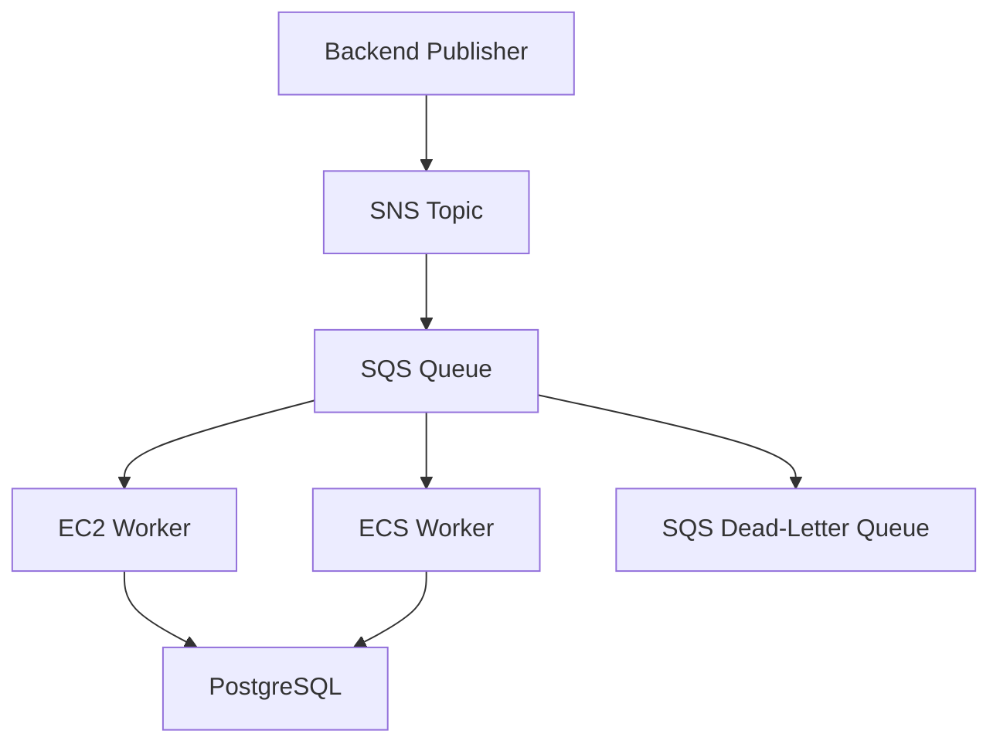
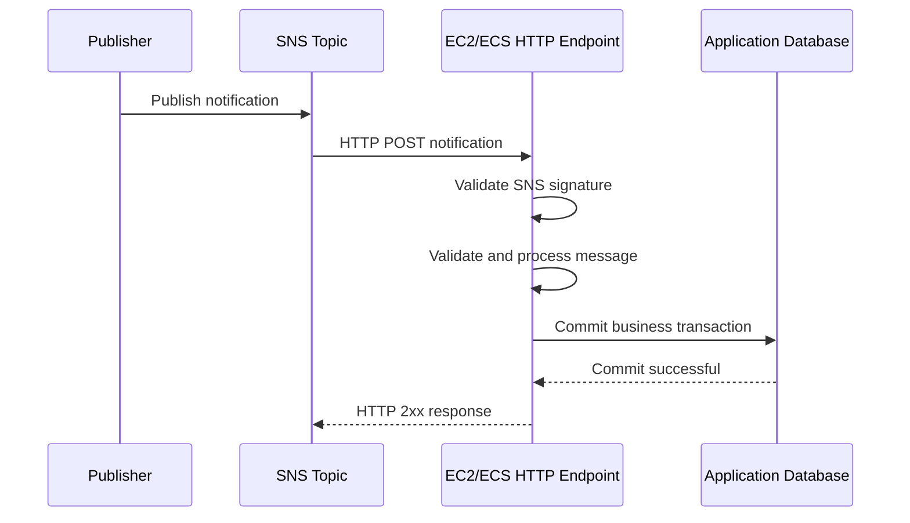
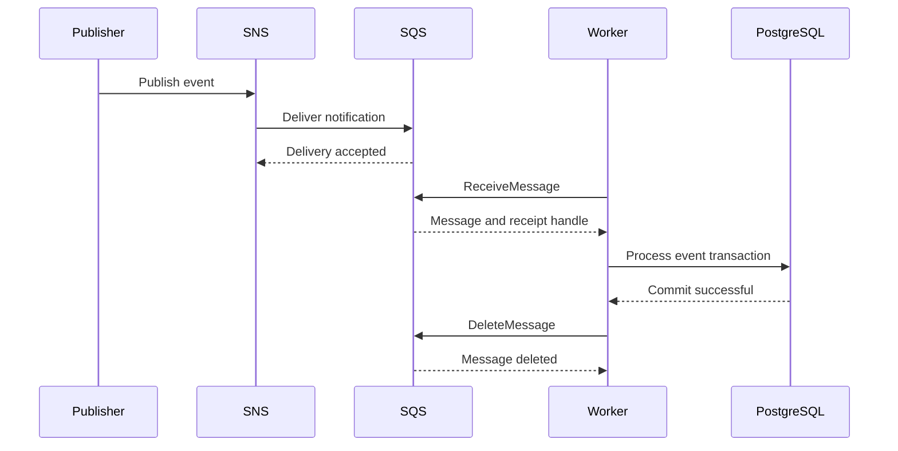
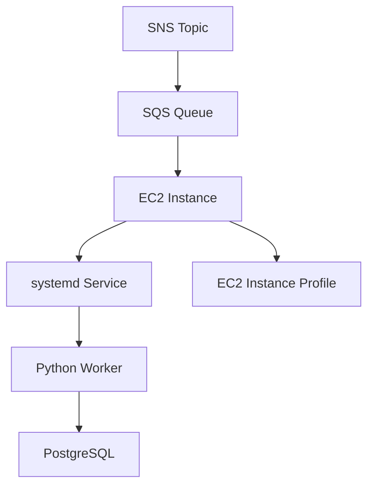
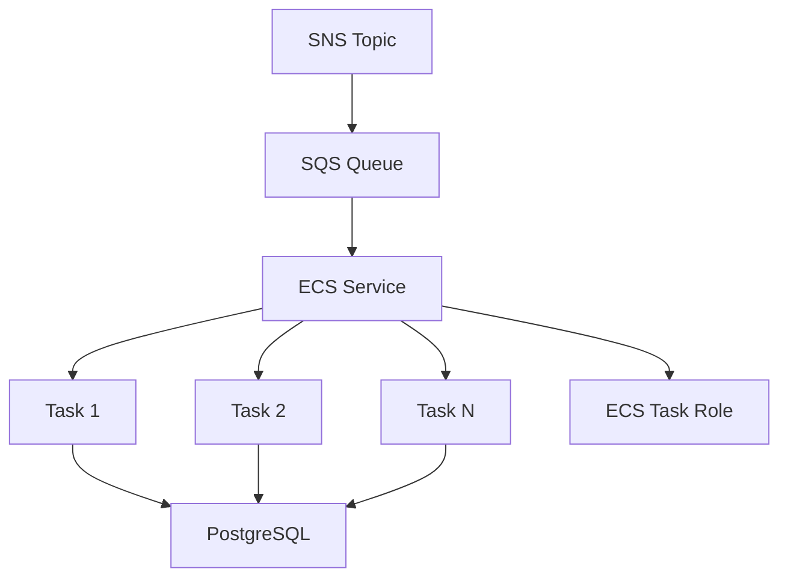

# 06- Amazon EC2 and ECS Integration

## Overview

Amazon SNS can deliver notifications to applications running on Amazon EC2 instances and Amazon ECS tasks. These compute environments are commonly used for long-running backend workers, event processors, integration services, and microservices that consume asynchronous notifications.

SNS does not require consumers to run on Lambda. Applications deployed on EC2 or ECS can receive SNS messages through supported subscription protocols or through an intermediary such as Amazon SQS.

The most common production architecture is:

- SNS publishes notifications to an SQS queue.
- EC2 or ECS workers poll the queue.
- Workers process messages and delete them after successful processing.
- Failed messages are retried and eventually moved to a dead-letter queue.

This architecture separates message delivery from application execution and provides durable buffering, backpressure control, and independent scaling.

## Integration Architecture

### SNS to EC2 or ECS through SQS

SNS supports direct HTTP/S subscriptions, but exposing application endpoints on EC2 or ECS introduces networking, endpoint availability, authentication, and delivery-retry concerns.

For backend workloads, SNS-to-SQS-to-worker is generally the preferred pattern.



The architecture provides:

- **Decoupling:** Publishers do not need to know where workers run.
- **Durability:** Messages remain in SQS until successfully deleted or expired.
- **Backpressure:** SQS absorbs temporary traffic spikes.
- **Independent scaling:** EC2 and ECS consumers can scale without changing publishers.
- **Failure isolation:** Unprocessable messages can be moved to a DLQ.
- **Operational control:** Workers control polling, concurrency, visibility timeout, and processing behavior.

An SQS queue can have multiple consumers, but consumers compete for messages. If every application must receive a copy of every notification, create separate SQS subscriptions for each consumer.

### Direct SNS HTTP/S subscription

SNS can also invoke an HTTP/S endpoint hosted by an EC2 or ECS application.



This approach is appropriate when:

- A publicly or privately reachable HTTPS endpoint is already available.
- The application can process notifications within the SNS delivery constraints.
- The endpoint has reliable availability and appropriate authentication.
- The application can handle duplicate notifications and delivery retries.

Limitations include:

- The application must expose an endpoint reachable by SNS.
- Endpoint confirmation and notification signature validation must be implemented correctly.
- HTTP delivery retries can create duplicate requests.
- The application must return a successful response only after durable acceptance.
- The endpoint must handle traffic spikes and temporary downstream failures.

For most asynchronous backend processing, SQS provides a more resilient boundary.

## Choosing EC2 or ECS

EC2 and ECS can both run SNS-backed workers, but they have different operational characteristics.

| Capability | EC2 worker | ECS on Fargate | ECS on EC2 |
|---|---|---|---|
| Infrastructure management | Instance lifecycle managed by the team | AWS manages underlying compute | Team manages container instances |
| Deployment unit | Application process or service | Container task | Container task |
| Scaling | Auto Scaling groups | ECS service/task scaling | ECS service and capacity provider scaling |
| Isolation | Instance-level | Task-level | Task-level with shared host resources |
| Runtime control | Full operating-system access | Limited host-level control | Host and container control |
| Operational overhead | Higher | Lower | Moderate to high |
| Suitable workloads | Legacy workers, custom host requirements | Standard containerized workers | Specialized compute and cost-sensitive workloads |

Use EC2 when the workload requires host-level customization, specialized software, or an existing VM-based deployment model.

Use ECS Fargate when the worker is containerized and the team wants to avoid managing EC2 capacity.

Use ECS on EC2 when workloads need control over the container host, specialized instance types, or greater control over compute placement and cost.

## SNS Topic and SQS Queue Setup

### Create an SNS topic

Create a Standard topic for general-purpose event delivery:

```bash
aws sns create-topic \
  --name order-events \
  --region ap-south-1
```

Capture the returned topic ARN:

```text
arn:aws:sns:ap-south-1:123456789012:order-events
```

Inspect the topic:

```bash
aws sns get-topic-attributes \
  --topic-arn arn:aws:sns:ap-south-1:123456789012:order-events \
  --region ap-south-1
```

Standard topics are suitable for most worker workloads. They provide high-throughput pub/sub delivery but do not guarantee strict ordering or eliminate duplicate delivery.

### Create an SQS queue

Create a queue for the EC2 or ECS worker:

```bash
aws sqs create-queue \
  --queue-name order-events-worker \
  --attributes '{
    "VisibilityTimeout": "120",
    "MessageRetentionPeriod": "1209600",
    "ReceiveMessageWaitTimeSeconds": "20"
  }' \
  --region ap-south-1
```

The configuration establishes:

- A 120-second visibility timeout.
- A 14-day message retention period.
- Long polling with a 20-second wait time.

Choose the visibility timeout based on the maximum expected processing duration and retry strategy. It must not be treated as a lock that guarantees exclusive processing.

Retrieve the queue URL:

```bash
aws sqs get-queue-url \
  --queue-name order-events-worker \
  --region ap-south-1
```

Retrieve its ARN:

```bash
aws sqs get-queue-attributes \
  --queue-url https://sqs.ap-south-1.amazonaws.com/123456789012/order-events-worker \
  --attribute-names QueueArn \
  --region ap-south-1
```

### Configure the queue policy

The SQS queue policy must allow SNS to send messages to the queue.

Example `queue-policy.json`:

```json
{
  "Version": "2012-10-17",
  "Statement": [
    {
      "Sid": "AllowSpecificSnsTopic",
      "Effect": "Allow",
      "Principal": {
        "Service": "sns.amazonaws.com"
      },
      "Action": "sqs:SendMessage",
      "Resource": "arn:aws:sqs:ap-south-1:123456789012:order-events-worker",
      "Condition": {
        "ArnEquals": {
          "aws:SourceArn": "arn:aws:sns:ap-south-1:123456789012:order-events"
        },
        "StringEquals": {
          "aws:SourceAccount": "123456789012"
        }
      }
    }
  ]
}
```

Apply the policy:

```bash
aws sqs set-queue-attributes \
  --queue-url https://sqs.ap-south-1.amazonaws.com/123456789012/order-events-worker \
  --attributes file://queue-policy-attributes.json \
  --region ap-south-1
```

The CLI expects the queue policy as the value of the `Policy` attribute. Create `queue-policy-attributes.json`:

```json
{
  "Policy": "{\"Version\":\"2012-10-17\",\"Statement\":[{\"Sid\":\"AllowSpecificSnsTopic\",\"Effect\":\"Allow\",\"Principal\":{\"Service\":\"sns.amazonaws.com\"},\"Action\":\"sqs:SendMessage\",\"Resource\":\"arn:aws:sqs:ap-south-1:123456789012:order-events-worker\",\"Condition\":{\"ArnEquals\":{\"aws:SourceArn\":\"arn:aws:sns:ap-south-1:123456789012:order-events\"},\"StringEquals\":{\"aws:SourceAccount\":\"123456789012\"}}}]}"
}
```

For maintainability, generate the policy JSON with Terraform or another configuration-management tool rather than manually maintaining escaped JSON.

### Subscribe the queue to SNS

```bash
aws sns subscribe \
  --topic-arn arn:aws:sns:ap-south-1:123456789012:order-events \
  --protocol sqs \
  --notification-endpoint arn:aws:sqs:ap-south-1:123456789012:order-events-worker \
  --region ap-south-1
```

Verify the subscription:

```bash
aws sns list-subscriptions-by-topic \
  --topic-arn arn:aws:sns:ap-south-1:123456789012:order-events \
  --region ap-south-1
```

SNS wraps the published message in an SNS notification envelope by default. If the worker should receive only the original message body, enable raw message delivery.

```bash
aws sns set-subscription-attributes \
  --subscription-arn <subscription-arn> \
  --attribute-name RawMessageDelivery \
  --attribute-value true \
  --region ap-south-1
```

Raw delivery changes the message structure received by the worker. Make the consumer implementation consistent with the configured delivery mode.

## Message Delivery Lifecycle

The SNS-to-SQS-to-worker flow has separate delivery and processing stages.



Important behavior:

1. SNS accepts the publisher's message.
2. SNS delivers a notification to the subscribed SQS queue.
3. SQS stores the message.
4. A worker receives the message.
5. SQS hides the message temporarily using the visibility timeout.
6. The worker performs business processing.
7. The worker deletes the message after durable processing.
8. If the worker fails or does not delete the message, it becomes visible again after the visibility timeout.

A message is not permanently removed when a worker receives it. It is removed only after a successful `DeleteMessage` operation.

## Python Worker Implementation

### Install dependencies

```bash
pip install boto3
```

Use the standard AWS credential provider chain rather than embedding access keys in application code.

### Configure the SQS client

```python
import boto3
from botocore.config import Config

sqs = boto3.client(
    "sqs",
    region_name="ap-south-1",
    config=Config(
        connect_timeout=3,
        read_timeout=30,
        retries={
            "mode": "standard",
            "max_attempts": 5,
        },
    ),
)
```

For long polling, ensure the HTTP read timeout exceeds the SQS `WaitTimeSeconds` value. This prevents the client from timing out before the long-poll request completes.

### Process SNS notifications from SQS

By default, SNS sends an envelope containing the original application message.

Example SQS message body:

```json
{
  "Type": "Notification",
  "MessageId": "sns-message-id",
  "TopicArn": "arn:aws:sns:ap-south-1:123456789012:order-events",
  "Message": "{\"event_id\":\"evt-1001\",\"order_id\":\"ord-1001\",\"status\":\"created\"}",
  "Timestamp": "2026-11-22T10:30:00.000Z"
}
```

A worker must parse the outer SNS envelope and then parse its `Message` field.

```python
import json
import logging
from typing import Any

logger = logging.getLogger(__name__)


def parse_sns_message(body: str) -> dict[str, Any]:
    envelope = json.loads(body)

    if envelope.get("Type") != "Notification":
        raise ValueError("Expected an SNS notification")

    message = envelope.get("Message")

    if not isinstance(message, str):
        raise ValueError("SNS Message must be a string")

    payload = json.loads(message)

    required_fields = {"event_id", "order_id", "status"}
    missing_fields = required_fields.difference(payload)

    if missing_fields:
        raise ValueError(
            f"Missing required fields: {sorted(missing_fields)}"
        )

    return payload
```

When raw message delivery is enabled, the SQS body contains the original published payload rather than the SNS envelope. In that case, parse the body directly and do not expect the `Type` or `Message` fields.

### Implement idempotent processing

SQS Standard queues provide at-least-once delivery. The same message can be delivered more than once, so the worker must protect business operations against duplicates.

Use a stable event ID and a database uniqueness constraint.

```sql
CREATE TABLE processed_events (
    consumer_name TEXT NOT NULL,
    event_id TEXT NOT NULL,
    processed_at TIMESTAMPTZ NOT NULL DEFAULT NOW(),
    PRIMARY KEY (consumer_name, event_id)
);
```

Example application service:

```python
from django.db import transaction

from orders.models import Order
from events.models import ProcessedEvent


@transaction.atomic
def process_order_event(payload: dict) -> bool:
    event_id = payload["event_id"]

    _, created = ProcessedEvent.objects.get_or_create(
        consumer_name="order-worker",
        event_id=event_id,
    )

    if not created:
        return False

    Order.objects.filter(
        id=payload["order_id"]
    ).update(
        status=payload["status"]
    )

    return True
```

The idempotency record and business update must be committed in the same database transaction. The unique database constraint is essential when multiple worker processes can receive duplicate messages concurrently.

If processing includes external API calls, use downstream idempotency keys or a separate durable workflow. A database transaction cannot atomically commit an external HTTP request.

### Build a long-running SQS worker

The following implementation uses long polling and deletes a message only after successful processing.

```python
import json
import logging
import os
import signal
import time
from typing import Any

import boto3
from botocore.config import Config

logger = logging.getLogger(__name__)
logging.basicConfig(level=os.getenv("LOG_LEVEL", "INFO"))

QUEUE_URL = os.environ["QUEUE_URL"]

sqs = boto3.client(
    "sqs",
    region_name=os.getenv("AWS_REGION", "ap-south-1"),
    config=Config(
        connect_timeout=3,
        read_timeout=30,
        retries={
            "mode": "standard",
            "max_attempts": 5,
        },
    ),
)

running = True


def stop_worker(signum: int, frame: Any) -> None:
    global running
    running = False
    logger.info("Shutdown signal received")


signal.signal(signal.SIGTERM, stop_worker)
signal.signal(signal.SIGINT, stop_worker)


def parse_message(body: str) -> dict[str, Any]:
    envelope = json.loads(body)

    if envelope.get("Type") != "Notification":
        raise ValueError("Unexpected SNS message type")

    return json.loads(envelope["Message"])


def process_event(payload: dict[str, Any]) -> None:
    required = {"event_id", "order_id", "status"}
    missing = required.difference(payload)

    if missing:
        raise ValueError(f"Missing fields: {sorted(missing)}")

    # Invoke an idempotent application service here.
    logger.info(
        "Processing order event event_id=%s order_id=%s",
        payload["event_id"],
        payload["order_id"],
    )


def run_worker() -> None:
    while running:
        try:
            response = sqs.receive_message(
                QueueUrl=QUEUE_URL,
                MaxNumberOfMessages=10,
                WaitTimeSeconds=20,
                VisibilityTimeout=120,
                AttributeNames=["ApproximateReceiveCount"],
            )

            for message in response.get("Messages", []):
                if not running:
                    break

                receipt_handle = message["ReceiptHandle"]

                try:
                    payload = parse_message(message["Body"])
                    process_event(payload)

                    sqs.delete_message(
                        QueueUrl=QUEUE_URL,
                        ReceiptHandle=receipt_handle,
                    )

                except Exception:
                    logger.exception(
                        "Message processing failed message_id=%s",
                        message.get("MessageId"),
                    )

                    # Do not delete the message.
                    # SQS will make it visible after the visibility timeout.

        except Exception:
            logger.exception("SQS polling failed")
            time.sleep(5)

    logger.info("Worker stopped")


if __name__ == "__main__":
    run_worker()
```

This is a single-process worker. For production deployments, add:

- Database-backed idempotency.
- Visibility-timeout extension for long-running tasks.
- A configured redrive policy and DLQ.
- Graceful handling of in-flight messages during shutdown.
- Metrics for processing latency, failures, and queue age.
- Controlled concurrency and downstream connection limits.

The example processes messages sequentially. Increase concurrency only after verifying database capacity, downstream service limits, and idempotency behavior.

## Visibility Timeout and Long-Running Processing

The visibility timeout determines how long a received message remains hidden from other consumers.

If processing takes longer than the visibility timeout, another worker may receive the same message while the original worker is still processing it.

For example:

- Worker A receives a message.
- The message becomes invisible for 120 seconds.
- Worker A takes 150 seconds to process it.
- The message becomes visible after 120 seconds.
- Worker B receives the same message.
- Both workers may execute the business operation concurrently.

Use a visibility timeout that accounts for expected processing time and extend it when processing exceeds the initial estimate.

Example visibility extension:

```python
sqs.change_message_visibility(
    QueueUrl=QUEUE_URL,
    ReceiptHandle=receipt_handle,
    VisibilityTimeout=120,
)
```

The worker should extend visibility before the existing timeout expires. The maximum visibility period for an SQS message is 12 hours from the time it is first received.

For very long-running jobs, consider splitting the work into smaller units or storing job state in a database rather than holding a message invisible for an extended period.

## Dead-Letter Queue Configuration

A DLQ captures messages that repeatedly fail processing.

Create a queue:

```bash
aws sqs create-queue \
  --queue-name order-events-dlq \
  --region ap-south-1
```

Configure the source queue's redrive policy:

```json
{
  "deadLetterTargetArn": "arn:aws:sqs:ap-south-1:123456789012:order-events-dlq",
  "maxReceiveCount": "5"
}
```

Apply it:

```bash
aws sqs set-queue-attributes \
  --queue-url https://sqs.ap-south-1.amazonaws.com/123456789012/order-events-worker \
  --attributes file://redrive-policy-attributes.json \
  --region ap-south-1
```

The attributes file should contain the redrive policy:

```json
{
  "RedrivePolicy": "{\"deadLetterTargetArn\":\"arn:aws:sqs:ap-south-1:123456789012:order-events-dlq\",\"maxReceiveCount\":\"5\"}"
}
```

The `maxReceiveCount` setting controls how many receives are allowed before SQS moves a message to the DLQ.

A DLQ is not an automatic recovery mechanism. Implement a process to:

- Inspect failed messages.
- Identify whether failures are transient or permanent.
- Fix the underlying issue.
- Redrive messages safely.
- Preserve event IDs and original metadata.
- Avoid repeatedly replaying poison messages without correction.

The SQS consumer DLQ captures failures in worker processing. It is different from an SNS subscription DLQ, which captures failures delivering notifications to the SQS subscription endpoint.

## EC2 Worker Deployment

### EC2 architecture

An EC2 worker runs as a long-lived process managed by systemd or another process supervisor.



Use an EC2 instance profile to provide AWS credentials. Do not store long-lived AWS access keys in environment files or source code.

### Install the application

Example Linux setup:

```bash
sudo apt-get update
sudo apt-get install -y python3 python3-venv

sudo mkdir -p /opt/order-worker
sudo chown "$USER":"$USER" /opt/order-worker

cd /opt/order-worker

python3 -m venv .venv
source .venv/bin/activate

pip install --upgrade pip
pip install boto3
```

Deploy the application code and configure environment variables through a protected configuration mechanism.

Example environment configuration:

```ini
AWS_REGION=ap-south-1
QUEUE_URL=https://sqs.ap-south-1.amazonaws.com/123456789012/order-events-worker
LOG_LEVEL=INFO
```

Avoid placing secrets in a world-readable environment file. Use AWS Systems Manager Parameter Store or AWS Secrets Manager for sensitive configuration.

### Create a systemd service

Create `/etc/systemd/system/order-worker.service`:

```ini
[Unit]
Description=Order Events SQS Worker
After=network-online.target
Wants=network-online.target

[Service]
Type=simple
User=app
Group=app
WorkingDirectory=/opt/order-worker
EnvironmentFile=/etc/order-worker/worker.env
ExecStart=/opt/order-worker/.venv/bin/python -m app.worker
Restart=always
RestartSec=5
KillSignal=SIGTERM
TimeoutStopSec=90

[Install]
WantedBy=multi-user.target
```

Enable and start the service:

```bash
sudo systemctl daemon-reload
sudo systemctl enable order-worker
sudo systemctl start order-worker
```

Inspect status and logs:

```bash
sudo systemctl status order-worker
sudo journalctl -u order-worker -f
```

Operational recommendations:

- Run the worker under a dedicated non-root user.
- Use an EC2 Auto Scaling group across multiple Availability Zones.
- Configure health checks and instance replacement.
- Ensure the worker handles `SIGTERM` and shutdown gracefully.
- Use CloudWatch Agent or another supported log collection mechanism.
- Keep application deployment separate from instance provisioning.

### EC2 IAM instance profile

Attach an IAM role to the EC2 instance through an instance profile.

Example worker permissions:

```json
{
  "Version": "2012-10-17",
  "Statement": [
    {
      "Sid": "ConsumeOrderQueue",
      "Effect": "Allow",
      "Action": [
        "sqs:ReceiveMessage",
        "sqs:DeleteMessage",
        "sqs:ChangeMessageVisibility",
        "sqs:GetQueueAttributes"
      ],
      "Resource": "arn:aws:sqs:ap-south-1:123456789012:order-events-worker"
    }
  ]
}
```

The worker does not need `sns:Publish` or `sns:Subscribe` if it only consumes messages from SQS. Separate publisher and consumer permissions according to application responsibilities.

## ECS Worker Deployment

### ECS architecture

ECS runs the worker as a containerized task. An ECS service maintains the desired number of tasks and replaces unhealthy tasks.



The worker does not need an inbound HTTP endpoint when it only polls SQS. This simplifies networking and reduces the externally exposed attack surface.

### Dockerize the worker

Example project structure:

```text
order-worker/
├── app/
│   ├── __init__.py
│   ├── worker.py
│   └── services.py
├── requirements.txt
├── Dockerfile
└── .dockerignore
```

`requirements.txt`:

```text
boto3
```

`Dockerfile`:

```dockerfile
FROM python:3.12-slim

ENV PYTHONDONTWRITEBYTECODE=1
ENV PYTHONUNBUFFERED=1

WORKDIR /app

RUN useradd --create-home --uid 10001 app

COPY requirements.txt .
RUN pip install --no-cache-dir -r requirements.txt

COPY app ./app

USER app

CMD ["python", "-m", "app.worker"]
```

`.dockerignore`:

```text
.git
.venv
__pycache__
*.pyc
.env
.pytest_cache
```

Build and test locally:

```bash
docker build -t order-worker:latest .
```

Do not include AWS credentials in the image. In ECS, the task role supplies application permissions.

### ECS task execution role and task role

These roles serve different purposes.

| Role | Responsibility |
|---|---|
| Task execution role | Allows ECS infrastructure to pull images, publish logs, and retrieve supported startup secrets |
| Task role | Provides AWS permissions to application code running inside the container |

The task role needs SQS consumer permissions.

Example task role policy:

```json
{
  "Version": "2012-10-17",
  "Statement": [
    {
      "Sid": "ConsumeOrderEvents",
      "Effect": "Allow",
      "Action": [
        "sqs:ReceiveMessage",
        "sqs:DeleteMessage",
        "sqs:ChangeMessageVisibility",
        "sqs:GetQueueAttributes"
      ],
      "Resource": "arn:aws:sqs:ap-south-1:123456789012:order-events-worker"
    }
  ]
}
```

Do not attach application permissions to the execution role merely because it is already configured in the task definition.

### ECS task definition

Example Fargate task definition:

```json
{
  "family": "order-worker",
  "networkMode": "awsvpc",
  "requiresCompatibilities": [
    "FARGATE"
  ],
  "cpu": "512",
  "memory": "1024",
  "executionRoleArn": "arn:aws:iam::123456789012:role/ecsTaskExecutionRole",
  "taskRoleArn": "arn:aws:iam::123456789012:role/orderWorkerTaskRole",
  "containerDefinitions": [
    {
      "name": "order-worker",
      "image": "123456789012.dkr.ecr.ap-south-1.amazonaws.com/order-worker:latest",
      "essential": true,
      "environment": [
        {
          "name": "AWS_REGION",
          "value": "ap-south-1"
        },
        {
          "name": "QUEUE_URL",
          "value": "https://sqs.ap-south-1.amazonaws.com/123456789012/order-events-worker"
        },
        {
          "name": "LOG_LEVEL",
          "value": "INFO"
        }
      ],
      "logConfiguration": {
        "logDriver": "awslogs",
        "options": {
          "awslogs-group": "/ecs/order-worker",
          "awslogs-region": "ap-south-1",
          "awslogs-stream-prefix": "worker"
        }
      }
    }
  ]
}
```

The task definition uses a placeholder image URI. Replace it with an immutable image tag or digest produced by the CI/CD pipeline.

### Create an ECS service

An ECS service maintains the desired number of worker tasks.

```bash
aws ecs create-service \
  --cluster backend-cluster \
  --service-name order-worker \
  --task-definition order-worker \
  --desired-count 2 \
  --launch-type FARGATE \
  --network-configuration '{
    "awsvpcConfiguration": {
      "subnets": [
        "subnet-0123456789abcdef0",
        "subnet-0abcdef0123456789"
      ],
      "securityGroups": [
        "sg-0123456789abcdef0"
      ],
      "assignPublicIp": "DISABLED"
    }
  }' \
  --region ap-south-1
```

For private subnets, provide outbound connectivity to AWS APIs through appropriate VPC endpoints or NAT infrastructure.

Relevant endpoints may include:

- SQS interface endpoint.
- CloudWatch Logs interface endpoint.
- ECR API and ECR Docker interface endpoints.
- S3 gateway endpoint for image-layer access where required by the ECR deployment path.
- Secrets Manager or Systems Manager endpoints if the application retrieves configuration from those services.

The exact endpoint requirements depend on the task's image, logging, secret retrieval, and networking configuration.

### ECS service scaling

ECS worker tasks can scale based on SQS queue metrics.

A useful scaling signal is `ApproximateNumberOfMessagesVisible`, but queue depth alone can be misleading. A large backlog may be harmless if messages are processed quickly, while a smaller backlog with slow processing can indicate a serious delay.

Consider:

- Visible message count.
- Age of oldest message.
- Average processing duration.
- Messages processed per task.
- CPU and memory utilization.
- Database connection capacity.
- Downstream API throughput.

Use Application Auto Scaling with ECS service desired count and a scaling policy appropriate to the workload. Configure minimum and maximum task counts to protect downstream dependencies.

## Direct SNS HTTP/S Subscription from EC2 or ECS

A direct HTTP/S subscription can be appropriate when the application is designed to accept webhook-style notifications.

### Endpoint requirements

The endpoint should:

- Use HTTPS.
- Be reachable from SNS.
- Support SNS subscription confirmation.
- Validate SNS message signatures.
- Validate the expected topic ARN.
- Handle duplicate notifications.
- Return a successful response only after durable acceptance.
- Avoid long-running business processing in the HTTP request.

A common pattern is to validate the notification, persist it in a database or internal queue, and return success after durable acceptance.

### SNS signature validation

SNS notifications include a signature and certificate URL. Validate the signature using AWS-supported SNS message validation logic or a maintained SDK/library that implements the SNS signature-verification process.

Do not:

- Trust the certificate URL without validating its expected AWS SNS certificate location.
- Accept arbitrary topic ARNs.
- Skip signature verification because the endpoint uses HTTPS.
- Treat the message body as trusted application input.

For private applications, network access controls and authentication should also be considered. HTTPS alone does not prove that a request originated from the expected SNS topic.

## Networking and Availability

### EC2 networking

EC2 workers require outbound connectivity to SQS and any downstream services.

For private subnets, use one of the following:

- NAT Gateway for general outbound access.
- VPC interface endpoints for supported AWS APIs.
- Gateway endpoints where supported.

Prefer VPC endpoints when they reduce exposure to public network paths and fit the operational cost model.

### ECS networking

For Fargate tasks using `awsvpc` networking:

- Assign security groups to tasks.
- Place tasks in private subnets for internal worker workloads.
- Allow outbound connections to SQS, databases, and required AWS APIs.
- Avoid public IP assignment unless explicitly required.
- Configure VPC endpoints or NAT connectivity.

A worker that only polls SQS generally does not need inbound security-group rules.

### High availability

For EC2:

- Run instances across multiple Availability Zones.
- Use an Auto Scaling group.
- Replace unhealthy instances automatically.
- Ensure worker startup is safe and idempotent.
- Avoid local disk as the only location for message-processing state.

For ECS:

- Spread tasks across multiple Availability Zones.
- Configure service deployment health behavior.
- Set appropriate minimum and maximum task counts.
- Use deployment circuit breakers where suitable.
- Ensure task termination does not delete unprocessed messages.

SQS remains the durable buffer when compute instances or tasks restart. A worker must never assume that an in-memory message is the only copy of a business event.

## Security

### IAM least privilege

Separate permissions by responsibility:

- Publisher role: `sns:Publish` on the required topic.
- SNS delivery: topic subscription and SQS queue resource policies.
- EC2 worker role: required SQS consumer operations.
- ECS task role: required SQS consumer operations.
- ECS execution role: image, logging, and startup configuration permissions.

Avoid sharing one broad IAM role across publishers and consumers.

### Queue and topic resource policies

The SNS topic policy controls who can publish or subscribe to the topic. The SQS queue policy controls which principals can send messages to the queue.

For SNS-to-SQS delivery, the queue policy should allow only the expected SNS topic ARN and account. Avoid unrestricted service-principal permissions.

### Encryption

Configure encryption independently for SNS and SQS.

- SNS topic encryption protects messages stored by SNS using its configured KMS key.
- SQS server-side encryption protects messages stored by SQS.
- Customer-managed KMS keys require appropriate key policies and service permissions.
- Cross-account integrations require careful review of both IAM and KMS permissions.

Do not assume that enabling SNS encryption automatically configures SQS encryption.

### Secrets and configuration

Use Systems Manager Parameter Store or AWS Secrets Manager for sensitive configuration.

For ECS, task definitions can reference supported secret sources. For EC2, retrieve secrets using the instance role and avoid writing them to broadly readable files.

Never bake secrets into Docker images, AMIs, source repositories, or CI/CD logs.

## Monitoring and Observability

Monitor the messaging pipeline and compute workers independently.

### SQS metrics

| Metric | Purpose |
|---|---|
| `ApproximateNumberOfMessagesVisible` | Messages waiting to be processed |
| `ApproximateNumberOfMessagesNotVisible` | Messages currently in flight |
| `ApproximateAgeOfOldestMessage` | Age of the oldest available message |
| `NumberOfMessagesReceived` | Receive activity |
| `NumberOfMessagesDeleted` | Successfully deleted messages |
| `NumberOfMessagesSent` | Messages delivered to the queue |

A growing visible-message count can indicate insufficient worker capacity or a downstream bottleneck.

A high not-visible count may indicate active processing, slow workers, or messages repeatedly being received without deletion.

### SNS metrics

Monitor:

- Published messages.
- Delivered notifications.
- Failed notifications.
- Notifications filtered out.
- Subscription delivery failures.

SNS delivery success to SQS does not indicate that the EC2 or ECS worker has processed the message.

### EC2 and ECS metrics

Monitor:

- Worker process health.
- CPU and memory utilization.
- Worker restart count.
- Processing duration.
- Processing failures.
- Messages processed per minute.
- Database connection usage.
- Downstream API errors.
- Graceful shutdown failures.

For ECS, use CloudWatch Container Insights where appropriate. For EC2, use CloudWatch Agent or an equivalent observability agent to collect operating-system and application metrics.

### Structured logging

Log stable identifiers instead of entire message bodies.

Example:

```python
logger.info(
    "order_event_processed",
    extra={
        "event_id": payload["event_id"],
        "order_id": payload["order_id"],
        "worker_type": "ecs",
    },
)
```

Ensure the logging configuration serializes structured fields consistently. Include correlation IDs where available, and avoid logging credentials or sensitive payload data.

## Performance and Scaling

### Long polling

Enable SQS long polling to reduce empty receives and unnecessary API calls.

A `WaitTimeSeconds` value of 20 seconds is commonly used.

Long polling reduces request volume but increases the duration of each receive request. Configure client read timeouts accordingly.

### Batch receives

SQS `ReceiveMessage` can return up to 10 messages per request.

Batching can reduce API overhead, but it increases the amount of work that can be affected by one worker failure.

Use batch sizes that match:

- Processing duration.
- Memory usage.
- Database transaction boundaries.
- Visibility timeout.
- Retry and partial-failure behavior.

Do not delete an entire batch if only some messages were processed successfully.

### Worker concurrency

For EC2 workers, control concurrency through application configuration and process management.

For ECS workers, scale task count and configure per-task concurrency.

The total processing concurrency is approximately:

```text
Total concurrency = Number of worker tasks × Concurrent workers per task
```

Use this value when estimating database connections and downstream API load.

For example, eight ECS tasks with five concurrent message handlers can generate up to 40 concurrent processing operations.

Scale based on processing throughput and queue age, not CPU utilization alone. A worker blocked on database or network I/O may have low CPU utilization while the queue backlog grows.

### Database connection management

A worker fleet can exhaust PostgreSQL connections when scaled aggressively.

Use:

- Bounded worker concurrency.
- Connection pooling.
- Appropriate connection lifetimes.
- RDS Proxy where it fits the database architecture.
- Short database transactions.
- Backpressure when database capacity is exhausted.

Do not increase ECS desired count without checking the downstream database's connection and transaction capacity.

## Reliability and Operational Best Practices

### Message acknowledgement

Delete an SQS message only after its business operation is durably committed.

The following order is unsafe:

1. Receive message.
2. Delete message.
3. Process business operation.

If the worker crashes after deletion, the event is lost from the queue.

The correct sequence is:

1. Receive message.
2. Validate and process the event.
3. Commit the business transaction.
4. Delete the message.

A crash between steps 3 and 4 can cause duplicate delivery. Idempotency protects against that failure.

### Graceful shutdown

EC2 and ECS workers must handle termination signals.

On shutdown:

- Stop receiving new messages.
- Allow in-flight processing to finish within the shutdown window.
- Extend visibility for work that cannot finish safely, or allow the message to reappear.
- Do not delete messages whose processing outcome is uncertain.
- Close database and network resources cleanly.

ECS tasks can be terminated during deployments, scaling events, and infrastructure maintenance. Treat termination as a normal operational event.

### Retry strategy

Use bounded retries and exponential backoff with jitter for transient dependency failures.

Distinguish:

- Transient failures, such as temporary network errors or throttling.
- Permanent failures, such as invalid event schemas.
- Business rejections, which may require a separate workflow.

Repeatedly retrying permanently invalid messages wastes compute and delays healthy messages. Configure a DLQ and alert on messages that reach it.

### Disaster recovery

SQS queues and SNS topics are regional resources. Do not assume that messages or subscription configuration automatically replicate to another Region.

For regional recovery:

- Provision SNS topics and SQS queues in the recovery Region.
- Replicate required application data.
- Deploy EC2 or ECS worker infrastructure.
- Configure IAM roles, resource policies, and KMS permissions.
- Define publisher failover behavior.
- Document how messages are replayed or reconciled.
- Test recovery procedures regularly.

Use an explicit cross-Region messaging design if regional failover is a business requirement.

## Infrastructure as Code with Terraform

The following example provisions an SNS topic, an SQS queue, a DLQ, and the SNS subscription.

```hcl
data "aws_caller_identity" "current" {}

resource "aws_sns_topic" "order_events" {
  name = "order-events"
}

resource "aws_sqs_queue" "order_events_dlq" {
  name                      = "order-events-dlq"
  message_retention_seconds = 1209600
}

resource "aws_sqs_queue" "order_events_worker" {
  name                       = "order-events-worker"
  visibility_timeout_seconds = 120
  message_retention_seconds  = 1209600
  receive_wait_time_seconds  = 20

  redrive_policy = jsonencode({
    deadLetterTargetArn = aws_sqs_queue.order_events_dlq.arn
    maxReceiveCount     = 5
  })
}

data "aws_iam_policy_document" "worker_queue" {
  statement {
    sid    = "AllowSnsDelivery"
    effect = "Allow"

    principals {
      type        = "Service"
      identifiers = ["sns.amazonaws.com"]
    }

    actions   = ["sqs:SendMessage"]
    resources = [aws_sqs_queue.order_events_worker.arn]

    condition {
      test     = "ArnEquals"
      variable = "aws:SourceArn"
      values   = [aws_sns_topic.order_events.arn]
    }

    condition {
      test     = "StringEquals"
      variable = "aws:SourceAccount"
      values   = [data.aws_caller_identity.current.account_id]
    }
  }
}

resource "aws_sqs_queue_policy" "worker_queue" {
  queue_url = aws_sqs_queue.order_events_worker.id
  policy    = data.aws_iam_policy_document.worker_queue.json
}

resource "aws_sns_topic_subscription" "worker_queue" {
  topic_arn            = aws_sns_topic.order_events.arn
  protocol             = "sqs"
  endpoint             = aws_sqs_queue.order_events_worker.arn
  raw_message_delivery = false

  depends_on = [
    aws_sqs_queue_policy.worker_queue
  ]
}

output "sns_topic_arn" {
  value = aws_sns_topic.order_events.arn
}

output "worker_queue_url" {
  value = aws_sqs_queue.order_events_worker.url
}

output "worker_queue_arn" {
  value = aws_sqs_queue.order_events_worker.arn
}
```

For production, extend the configuration with:

- SNS and SQS encryption.
- KMS key policies where customer-managed keys are used.
- EC2 instance profiles or ECS task roles.
- ECS task definitions and services.
- EC2 Auto Scaling groups where applicable.
- CloudWatch alarms and dashboards.
- DLQ monitoring and redrive procedures.
- VPC endpoints and security groups.

Keep the queue policy and subscription configuration under a single infrastructure-management boundary to avoid accidental replacement or conflicting ownership.

## Common Mistakes and Production Pitfalls

| Mistake | Impact | Recommended approach |
|---|---|---|
| Using direct SNS HTTP delivery for long-running jobs | Request timeouts and repeated deliveries | Buffer through SQS |
| Deleting messages before business processing | Permanent message loss after a crash | Delete only after durable processing |
| Ignoring duplicate delivery | Repeated business operations | Use database-backed idempotency |
| Setting visibility timeout too low | Concurrent processing of the same message | Size timeout for processing duration and extend when necessary |
| Setting visibility timeout too high | Slow recovery after worker failure | Choose a bounded timeout based on workload behavior |
| Using short polling unnecessarily | Increased empty receives and API calls | Enable long polling |
| Scaling workers without database limits | Connection exhaustion and database degradation | Bound concurrency and use connection pooling |
| Running workers as root | Unnecessary host-level privileges | Use dedicated non-root users |
| Storing AWS credentials in containers | Credential leakage and rotation problems | Use EC2 instance profiles or ECS task roles |
| Confusing execution role with task role | Application receives missing or excessive permissions | Assign runtime permissions to the task role |
| Ignoring the DLQ | Poison messages repeatedly consume resources | Configure redrive policy and operational review |
| Treating SQS receive as message acknowledgement | Message may be processed more than once | Delete after successful processing |
| Assuming SNS success means worker success | Downstream failures remain undetected | Monitor queue and worker processing independently |
| Scaling ECS solely on CPU | Queue backlog may grow while workers wait on I/O | Include queue age and processing throughput |
| Ignoring shutdown behavior | In-flight messages may be interrupted during deployments | Handle SIGTERM and preserve uncertain work |

## Production Readiness Checklist

### Messaging

- [ ] SNS topic and SQS queue are deployed in the intended Region.
- [ ] Queue policy allows only the expected SNS topic.
- [ ] Subscription delivery mode is explicitly configured.
- [ ] Visibility timeout matches processing behavior.
- [ ] Long polling is enabled.
- [ ] DLQ and redrive policy are configured.
- [ ] Duplicate delivery is handled through idempotency.

### Compute

- [ ] EC2 workers use instance profiles.
- [ ] ECS workers use task roles for application permissions.
- [ ] ECS execution roles are limited to infrastructure startup responsibilities.
- [ ] Containers run as non-root users.
- [ ] Worker concurrency is bounded.
- [ ] Graceful shutdown is implemented.
- [ ] Compute capacity spans multiple Availability Zones where required.

### Security and networking

- [ ] IAM permissions follow least privilege.
- [ ] SNS and SQS encryption requirements are configured independently.
- [ ] KMS key policies support the required service integrations.
- [ ] Private workers have required AWS API connectivity.
- [ ] Secrets are retrieved from managed secret stores.
- [ ] Direct HTTP/S subscriptions validate SNS signatures.

### Operations

- [ ] Queue depth and oldest-message age are monitored.
- [ ] Worker failures and processing latency are monitored.
- [ ] DLQ activity triggers alerts.
- [ ] Database and downstream API capacity are considered during scaling.
- [ ] Logs include event and correlation identifiers.
- [ ] Replay, redrive, and disaster recovery procedures are documented and tested.

## Key Takeaways

- SNS-to-SQS-to-EC2/ECS is a resilient architecture for asynchronous backend workers because it separates notification delivery from application processing.
- SQS messages must be deleted only after durable business processing; at-least-once delivery requires database-backed idempotency.
- Visibility timeout, long polling, worker concurrency, and DLQ configuration directly affect reliability and throughput.
- EC2 workers should use instance profiles, while ECS applications should use task roles; execution roles serve a separate infrastructure purpose.
- Production deployments require independent monitoring of SNS delivery, SQS backlog, worker health, downstream capacity, and recovery behavior.