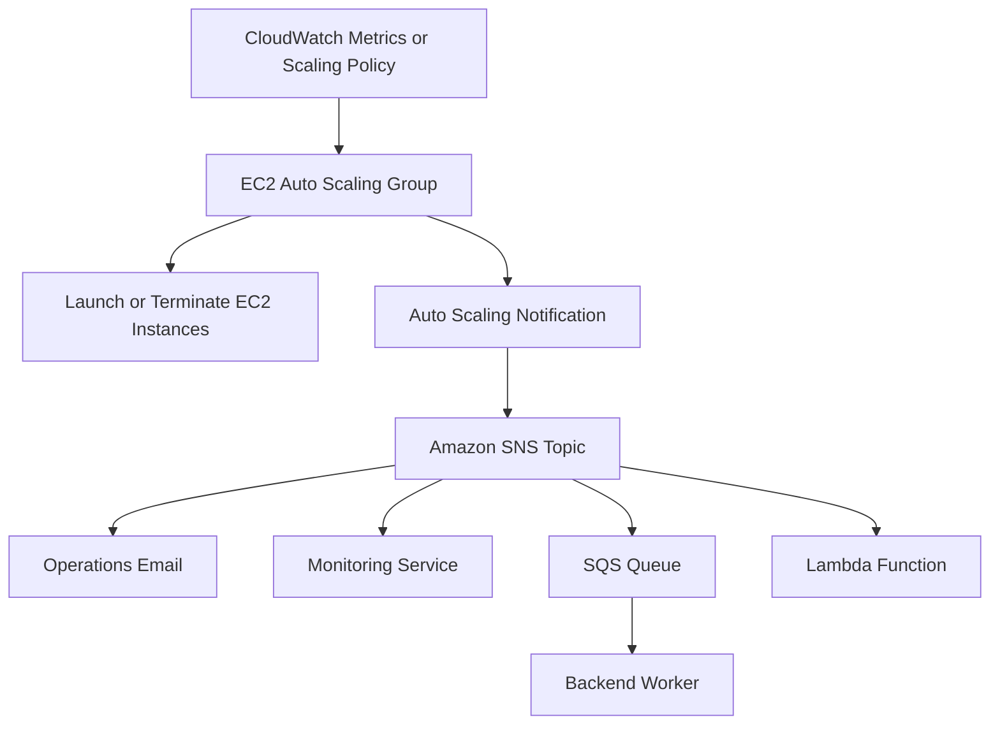
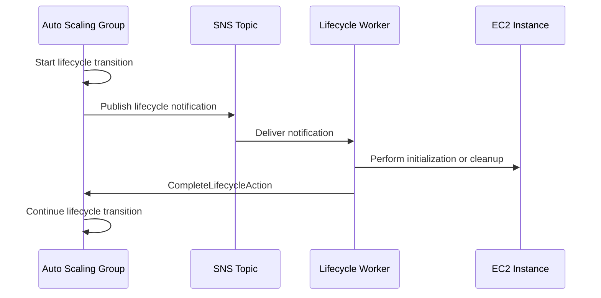
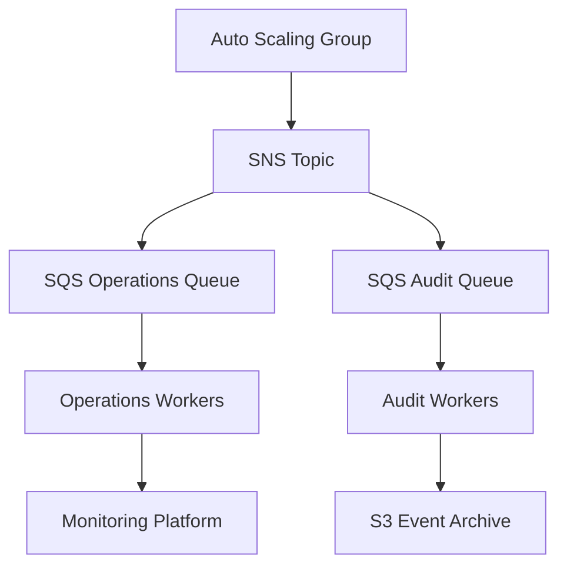

# 07- AWS Auto Scaling Integration

## Overview

Amazon SNS integrates with AWS Auto Scaling to distribute notifications about Auto Scaling group activities and lifecycle events.

Amazon EC2 Auto Scaling can publish notifications to an SNS topic when instances are launched, terminated, or encounter lifecycle-related failures. Subscribers can use these notifications to trigger operational workflows, update monitoring systems, notify administrators, or coordinate activities across distributed applications.

This integration is useful when backend platforms need visibility into infrastructure scaling events without tightly coupling application services to the Auto Scaling control plane.

Typical use cases include:

- Notifying operations teams about instance launches and terminations.
- Triggering external monitoring and inventory updates.
- Recording infrastructure scaling events for auditing.
- Coordinating application-specific initialization and cleanup.
- Integrating Auto Scaling events with external automation systems.
- Building lifecycle workflows for EC2-based backend services.

SNS provides the notification distribution layer. EC2 Auto Scaling remains responsible for managing instance capacity and executing scaling activities.

## Architecture

An Auto Scaling group manages a collection of EC2 instances based on configured capacity requirements and scaling policies.

SNS can receive notifications when selected Auto Scaling activities occur and distribute them to subscribed endpoints.



### Component Responsibilities

| Component | Responsibility |
|---|---|
| EC2 Auto Scaling Group | Maintains the desired number of EC2 instances. |
| Scaling policy | Determines when capacity should increase or decrease. |
| CloudWatch | Supplies metrics and alarms used by scaling policies. |
| SNS topic | Distributes Auto Scaling notifications. |
| SQS queue | Buffers notifications for asynchronous processing. |
| Lambda function | Executes serverless notification processing. |
| Operations endpoint | Receives infrastructure alerts. |

The notification path is separate from the scaling decision path. SNS does not determine how many instances should run.

## Auto Scaling Notification Types

EC2 Auto Scaling supports notifications for several instance lifecycle events.

| Notification type | Description | Typical use case |
|---|---|---|
| `autoscaling:EC2_INSTANCE_LAUNCH` | An instance has launched successfully. | Update infrastructure inventory. |
| `autoscaling:EC2_INSTANCE_LAUNCH_ERROR` | An instance launch failed. | Alert operations teams. |
| `autoscaling:EC2_INSTANCE_TERMINATE` | An instance is terminating. | Update monitoring and inventory. |
| `autoscaling:EC2_INSTANCE_TERMINATE_ERROR` | An instance termination failed. | Investigate infrastructure issues. |
| `autoscaling:TEST_NOTIFICATION` | A test notification is sent. | Validate notification configuration. |

These notifications provide visibility into Auto Scaling activities.

They should not be treated as a complete substitute for instance health monitoring or application-level deployment events.

## SNS Topic Configuration

Create an SNS topic to receive Auto Scaling notifications.

```bash
aws sns create-topic \
    --name autoscaling-events \
    --region ap-south-1
```

Example topic ARN:

```text
arn:aws:sns:ap-south-1:123456789012:autoscaling-events
```

The topic should be created in the same AWS Region as the Auto Scaling group.

### Topic Access Policy

EC2 Auto Scaling requires permission to publish notifications to the SNS topic.

The topic policy should allow the Auto Scaling service principal to publish while restricting access to the intended AWS account and Auto Scaling group.

Example:

```json
{
  "Version": "2012-10-17",
  "Statement": [
    {
      "Sid": "AllowAutoScalingNotifications",
      "Effect": "Allow",
      "Principal": {
        "Service": "autoscaling.amazonaws.com"
      },
      "Action": "sns:Publish",
      "Resource": "arn:aws:sns:ap-south-1:123456789012:autoscaling-events",
      "Condition": {
        "StringEquals": {
          "aws:SourceAccount": "123456789012"
        },
        "ArnLike": {
          "aws:SourceArn": "arn:aws:autoscaling:ap-south-1:123456789012:autoScalingGroup:*:autoScalingGroupName/backend-asg"
        }
      }
    }
  ]
}
```

Apply the policy:

```bash
aws sns set-topic-attributes \
    --topic-arn arn:aws:sns:ap-south-1:123456789012:autoscaling-events \
    --attribute-name Policy \
    --attribute-value file://autoscaling-topic-policy.json
```

The policy restricts publication to the specified account and Auto Scaling group.

Use the actual account, Region, and group name in production.

## Configuring Auto Scaling Notifications

An Auto Scaling group can be configured to send notifications for selected lifecycle events.

The notification configuration associates:

- The Auto Scaling group.
- The SNS topic ARN.
- The notification event types.

### AWS CLI Configuration

Create a notification configuration:

```bash
aws autoscaling put-notification-configuration \
    --auto-scaling-group-name backend-asg \
    --topic-arn arn:aws:sns:ap-south-1:123456789012:autoscaling-events \
    --notification-types \
        autoscaling:EC2_INSTANCE_LAUNCH \
        autoscaling:EC2_INSTANCE_LAUNCH_ERROR \
        autoscaling:EC2_INSTANCE_TERMINATE \
        autoscaling:EC2_INSTANCE_TERMINATE_ERROR
```

This configuration enables notifications for instance launch and termination events.

Verify the configuration:

```bash
aws autoscaling describe-notification-configurations \
    --auto-scaling-group-names backend-asg
```

The returned configuration identifies the notification topic and registered event types.

### Test Notification

Send a test notification:

```bash
aws autoscaling send-test-notification \
    --auto-scaling-group-name backend-asg \
    --topic-arn arn:aws:sns:ap-south-1:123456789012:autoscaling-events
```

A test notification helps validate the SNS topic policy and notification delivery path.

It does not prove that every production lifecycle event will be processed successfully by downstream applications.

## Subscribing to Auto Scaling Notifications

SNS supports multiple subscriber types.

For Auto Scaling notifications, common integrations include:

| Subscriber | Purpose |
|---|---|
| Email | Notify infrastructure and operations teams. |
| SQS | Buffer events for asynchronous processing. |
| Lambda | Execute lightweight automation. |
| HTTPS endpoint | Integrate with external monitoring platforms. |

### Email Subscription

```bash
aws sns subscribe \
    --topic-arn arn:aws:sns:ap-south-1:123456789012:autoscaling-events \
    --protocol email \
    --notification-endpoint operations@example.com
```

The recipient must confirm the subscription before receiving notifications.

Email is suitable for operational alerts but is not a reliable mechanism for automated infrastructure workflows.

### SQS Subscription

Create a queue:

```bash
aws sqs create-queue \
    --queue-name autoscaling-events-queue \
    --region ap-south-1
```

Allow the SNS topic to publish to the queue using an appropriate SQS queue policy.

Create the subscription:

```bash
aws sns subscribe \
    --topic-arn arn:aws:sns:ap-south-1:123456789012:autoscaling-events \
    --protocol sqs \
    --notification-endpoint arn:aws:sqs:ap-south-1:123456789012:autoscaling-events-queue
```

For automated processing, SQS provides buffering and independent consumer control.

### Lambda Subscription

A Lambda function can subscribe directly to an SNS topic.

```bash
aws sns subscribe \
    --topic-arn arn:aws:sns:ap-south-1:123456789012:autoscaling-events \
    --protocol lambda \
    --notification-endpoint arn:aws:lambda:ap-south-1:123456789012:function:autoscaling-event-handler
```

The Lambda function must also have a resource-based permission allowing SNS to invoke it.

```bash
aws lambda add-permission \
    --function-name autoscaling-event-handler \
    --statement-id AllowSNSInvocation \
    --action lambda:InvokeFunction \
    --principal sns.amazonaws.com \
    --source-arn arn:aws:sns:ap-south-1:123456789012:autoscaling-events
```

Use SQS between SNS and Lambda when additional buffering, independent retry control, or queue-based failure handling is required.

## Understanding Auto Scaling Notification Payloads

Auto Scaling notifications contain information about the event that occurred.

A notification can include:

- Event type.
- Auto Scaling group name.
- Account and Region.
- EC2 instance identifier.
- Activity description.
- Event timestamp.
- Notification identifier.

Example payload:

```json
{
  "Service": "AWS Auto Scaling",
  "AccountId": "123456789012",
  "AutoScalingGroupName": "backend-asg",
  "ActivityId": "activity-123456789",
  "Description": "Launching a new EC2 instance",
  "Cause": "At 2026-11-20T10:30:00Z a user request increased the desired capacity",
  "Event": "autoscaling:EC2_INSTANCE_LAUNCH",
  "Details": {
    "Availability Zone": "ap-south-1a",
    "Subnet ID": "subnet-0123456789abcdef0",
    "EC2InstanceId": "i-0123456789abcdef0",
    "StatusCode": "InProgress",
    "StatusMessage": ""
  },
  "NotificationMetadata": "",
  "StartTime": "2026-11-20T10:30:00Z"
}
```

The exact payload fields and values depend on the event type.

Consumers should not assume that every notification contains an EC2 instance ID or the same set of fields.

### Event Validation

Before processing a notification:

- Validate the expected event type.
- Verify the Auto Scaling group name.
- Extract the instance ID when available.
- Record the activity identifier.
- Preserve the original event for troubleshooting.
- Handle missing optional fields safely.

Do not use notification text as the sole source of truth for infrastructure state. Query the Auto Scaling or EC2 APIs when current resource state must be confirmed.

## Python Notification Processing with Lambda

A Lambda function can process SNS notifications and trigger application-level automation.

Example:

```python
import json
import logging

logger = logging.getLogger()
logger.setLevel(logging.INFO)


def lambda_handler(event, context):
    for record in event.get("Records", []):
        if record.get("EventSource") != "aws:sns":
            logger.warning("Ignoring unsupported event source")
            continue

        sns_record = record["Sns"]
        message = json.loads(sns_record["Message"])

        event_type = message.get("Event")
        group_name = message.get("AutoScalingGroupName")

        details = message.get("Details", {})
        instance_id = details.get("EC2InstanceId")

        logger.info(
            "Received Auto Scaling notification",
            extra={
                "event_type": event_type,
                "group_name": group_name,
                "instance_id": instance_id,
                "sns_message_id": sns_record.get("MessageId"),
            },
        )

        if event_type == "autoscaling:EC2_INSTANCE_LAUNCH":
            handle_instance_launch(message)

        elif event_type == "autoscaling:EC2_INSTANCE_TERMINATE":
            handle_instance_termination(message)

        elif event_type in {
            "autoscaling:EC2_INSTANCE_LAUNCH_ERROR",
            "autoscaling:EC2_INSTANCE_TERMINATE_ERROR",
        }:
            handle_scaling_error(message)

        else:
            logger.info("No handler registered for event type: %s", event_type)


def handle_instance_launch(message):
    logger.info(
        "Instance launch notification received for %s",
        message.get("Details", {}).get("EC2InstanceId"),
    )


def handle_instance_termination(message):
    logger.info(
        "Instance termination notification received for %s",
        message.get("Details", {}).get("EC2InstanceId"),
    )


def handle_scaling_error(message):
    logger.error(
        "Auto Scaling operation failed: %s",
        message.get("Description"),
    )
```

This example demonstrates event routing. Production handlers should implement idempotency, bounded retries, structured error handling, and authorization checks before performing external side effects.

## Auto Scaling Lifecycle Hooks

SNS notifications and lifecycle hooks serve different purposes.

An Auto Scaling notification reports that an Auto Scaling event occurred. A lifecycle hook pauses an instance during a defined lifecycle transition so that custom actions can run before the transition continues.

Lifecycle hooks are useful when an application needs to prepare or clean up resources during instance launch or termination.

### Launch Lifecycle

A launch lifecycle hook can hold an instance in a pending state while initialization takes place.

Examples:

- Register the instance with an external inventory.
- Download application configuration.
- Perform custom initialization.
- Register the instance with a service discovery system.
- Validate application readiness.

### Termination Lifecycle

A termination lifecycle hook can delay termination while cleanup takes place.

Examples:

- Drain application traffic.
- Stop accepting new background jobs.
- Complete or transfer in-flight work.
- Deregister the instance from service discovery.
- Export local operational data.

### Lifecycle Hook Flow



The worker must explicitly complete or abandon the lifecycle action using the Auto Scaling API.

For example:

```bash
aws autoscaling complete-lifecycle-action \
    --lifecycle-hook-name backend-launch-hook \
    --auto-scaling-group-name backend-asg \
    --lifecycle-action-token ACTION_TOKEN \
    --lifecycle-action-result CONTINUE
```

The action token must come from the lifecycle notification.

Lifecycle hooks have a configurable heartbeat timeout and a global wait limit. Workers should send heartbeats for long-running operations and complete the action before the lifecycle deadline.

If the worker fails or the lifecycle action times out, the hook's configured default result determines how the transition proceeds.

### Lifecycle Hook Notification Targets

Lifecycle hooks can publish notifications to SNS topics or SQS queues. EventBridge is also available for observing Auto Scaling lifecycle events.

Choose the target based on the processing model:

| Target | Use case |
|---|---|
| SNS | Distribute lifecycle notifications to multiple subscribers. |
| SQS | Buffer lifecycle work for controlled processing. |
| EventBridge | Route events using rules and integrate with AWS event-driven services. |

For workflows requiring guaranteed completion of custom lifecycle actions, use a durable processing design and explicitly track lifecycle action tokens and deadlines.

A notification subscription alone does not pause an instance or complete its lifecycle transition.

## SNS Notifications vs EventBridge

AWS provides multiple mechanisms for observing Auto Scaling events.

SNS notifications are useful for direct topic-based distribution. EventBridge provides event routing and filtering across AWS services.

| Capability | SNS Auto Scaling notifications | EventBridge |
|---|---|---|
| Primary purpose | Distribute configured Auto Scaling notifications | Route and filter service events |
| Routing | Topic subscriptions | Event patterns and rules |
| Multiple targets | SNS subscriptions | Multiple rule targets |
| Filtering | SNS subscription filter policies | Event patterns |
| Event integration | Topic-based messaging | Broad AWS event integration |
| Lifecycle hook completion | Requires a worker calling Auto Scaling APIs | Requires a target or worker calling Auto Scaling APIs |
| Event archive and replay | Not a native replayable event store | EventBridge archive and replay capabilities where configured |

Use SNS when an application already uses topic-based notification distribution or needs straightforward integration with SQS, email, or Lambda.

Use EventBridge when event pattern matching, broader AWS service integration, or event archive and replay capabilities are important.

These services can also be combined when the architecture requires both event routing and topic-based fan-out.

## Terraform Integration

Terraform can manage the SNS topic, topic policy, Auto Scaling group, and notification configuration.

The following example assumes that a launch template and the referenced networking resources already exist.

### SNS Topic

```hcl
resource "aws_sns_topic" "autoscaling_events" {
  name = "autoscaling-events"

  tags = {
    Environment = "production"
    Service     = "backend-platform"
  }
}
```

### SNS Topic Policy

```hcl
data "aws_caller_identity" "current" {}

data "aws_region" "current" {}

resource "aws_sns_topic_policy" "autoscaling_events" {
  arn = aws_sns_topic.autoscaling_events.arn

  policy = jsonencode({
    Version = "2012-10-17"

    Statement = [
      {
        Sid    = "AllowAutoScalingPublish"
        Effect = "Allow"

        Principal = {
          Service = "autoscaling.amazonaws.com"
        }

        Action   = "sns:Publish"
        Resource = aws_sns_topic.autoscaling_events.arn

        Condition = {
          StringEquals = {
            "aws:SourceAccount" = data.aws_caller_identity.current.account_id
          }

          ArnLike = {
            "aws:SourceArn" = "arn:aws:autoscaling:${data.aws_region.current.name}:${data.aws_caller_identity.current.account_id}:autoScalingGroup:*:autoScalingGroupName/backend-asg"
          }
        }
      }
    ]
  })
}
```

### Auto Scaling Group Notification

```hcl
resource "aws_autoscaling_group" "backend" {
  name                = "backend-asg"
  min_size            = 2
  max_size            = 8
  desired_capacity    = 2
  vpc_zone_identifier = var.private_subnet_ids

  launch_template {
    id      = var.launch_template_id
    version = "$Latest"
  }

  tag {
    key                 = "Service"
    value               = "backend-api"
    propagate_at_launch = true
  }

  depends_on = [
    aws_sns_topic_policy.autoscaling_events
  ]
}

resource "aws_autoscaling_notification" "backend" {
  group_names = [
    aws_autoscaling_group.backend.name
  ]

  notifications = [
    "autoscaling:EC2_INSTANCE_LAUNCH",
    "autoscaling:EC2_INSTANCE_LAUNCH_ERROR",
    "autoscaling:EC2_INSTANCE_TERMINATE",
    "autoscaling:EC2_INSTANCE_TERMINATE_ERROR"
  ]

  topic_arn = aws_sns_topic.autoscaling_events.arn
}
```

This configuration enables notifications for the specified Auto Scaling group events.

For production deployments:

- Use a reviewed launch template.
- Restrict the topic policy to the intended group.
- Configure subscriptions separately.
- Add CloudWatch alarms for delivery and processing failures.
- Manage lifecycle hooks independently when custom lifecycle actions are required.
- Review provider documentation for supported resource arguments and current behavior.

## Reliability and Failure Handling

SNS delivery and Auto Scaling lifecycle transitions are separate operations.

A failure in a notification consumer should not be assumed to stop or reverse an Auto Scaling activity.

For lifecycle hooks, the worker must account for the lifecycle timeout and explicitly complete the action.

### Failure Scenarios

| Failure | Impact | Recommended handling |
|---|---|---|
| SNS topic policy is incorrect | Auto Scaling cannot publish notifications. | Validate topic policy and test delivery. |
| SNS subscriber is unavailable | Notification delivery may fail or be delayed. | Configure appropriate delivery retries and a subscription DLQ where supported. |
| Lambda processing fails | Notification processing does not complete successfully. | Use structured errors, idempotency, and appropriate retry handling. |
| SQS consumer is unavailable | Notifications accumulate in the queue. | Monitor backlog and scale consumers. |
| Lifecycle worker crashes | Lifecycle action may remain pending until timeout. | Use heartbeats, durable work tracking, and timeout handling. |
| Duplicate notification is processed | External actions may execute repeatedly. | Use event identifiers and idempotent handlers. |
| Instance terminates before cleanup finishes | Application work or local data may be lost. | Drain workloads and design cleanup within lifecycle deadlines. |

### Idempotency

Notifications can be delivered more than once.

A consumer should avoid repeating external operations when it receives the same logical event again.

A suitable processing key can include:

- Auto Scaling group name.
- Activity ID or lifecycle action token, when available.
- Instance ID, when available.
- Event type.
- Consumer operation.

Persist processing state when an event triggers important business or infrastructure changes.

Do not assume that an SNS message ID alone is a permanent business idempotency key.

## Monitoring and Observability

Monitor both Auto Scaling activity and SNS delivery.

### CloudWatch Auto Scaling Metrics

Important Auto Scaling group metrics include:

| Metric | Purpose |
|---|---|
| `GroupDesiredCapacity` | Desired instance capacity. |
| `GroupInServiceInstances` | Instances currently in service. |
| `GroupPendingInstances` | Instances being launched. |
| `GroupTerminatingInstances` | Instances being terminated. |
| `GroupTotalInstances` | Total instances in the group. |
| `GroupInServiceCapacity` | In-service capacity in weighted capacity units. |

These metrics help identify scaling delays and capacity mismatches.

### SNS Metrics

Monitor relevant SNS metrics:

| Metric | Purpose |
|---|---|
| `NumberOfMessagesPublished` | Number of accepted publications. |
| `NumberOfNotificationsDelivered` | Successful subscription deliveries. |
| `NumberOfNotificationsFailed` | Failed subscription deliveries. |
| `NumberOfNotificationsFilteredOut` | Messages excluded by subscription filters. |

Metric availability depends on the subscription protocol and configuration.

### Operational Alerts

Configure alerts for:

- Auto Scaling launch failures.
- Auto Scaling termination failures.
- Instances remaining pending for unusually long periods.
- Desired capacity not matching in-service capacity.
- SNS delivery failures.
- SQS notification backlog.
- Lifecycle hooks approaching their timeout.
- Repeated lifecycle action failures.

Include the Auto Scaling group name, event type, instance ID, activity ID, and correlation identifiers in structured logs where available.

Use CloudTrail to audit relevant API activity, including changes to Auto Scaling groups, scaling policies, lifecycle hooks, and SNS configuration.

## Security Considerations

Auto Scaling notifications can trigger privileged infrastructure automation. Treat notification consumers as security-sensitive components.

Recommended controls:

- Restrict topic publication to the intended Auto Scaling service and group.
- Restrict subscription management to authorized operators.
- Use least-privilege IAM roles for Lambda and worker applications.
- Validate event source, account, Region, and group name.
- Avoid trusting notification payloads as authorization decisions.
- Use KMS encryption where required.
- Protect lifecycle action tokens and avoid logging them unnecessarily.
- Audit changes to notification policies and lifecycle configurations.

For automated operations, retrieve current infrastructure state through authorized AWS APIs before taking consequential actions.

## Scalability and Performance

SNS can distribute Auto Scaling notifications to multiple subscribers without requiring the Auto Scaling group to maintain direct connections to each consumer.

However, downstream processing capacity must be considered.

### Recommended Architecture for High-Volume Processing



This design separates operational processing from audit retention.

### Scaling Recommendations

- Use SQS when consumers need independent processing rates.
- Use long polling to reduce unnecessary SQS requests.
- Scale workers using queue backlog and message age.
- Bound concurrency to protect downstream APIs.
- Make processing idempotent.
- Avoid synchronous dependencies on notification delivery.
- Use separate queues for consumers with different reliability requirements.

Auto Scaling notifications are generally low-volume compared with application traffic, but lifecycle events can arrive in bursts during large scale-out or scale-in operations.

## High Availability and Disaster Recovery

SNS and EC2 Auto Scaling are regional AWS services.

For critical infrastructure automation:

- Define topics and notification configurations using IaC.
- Retain the ability to recreate subscriptions and policies.
- Monitor notification delivery failures.
- Maintain recovery procedures for notification consumers.
- Store operational records independently when long-term retention is required.
- Test lifecycle hook recovery and timeout behavior.
- Define regional failover procedures.

SNS does not automatically replicate topics or notifications to another Region.

A multi-region architecture must explicitly configure topics, subscribers, permissions, event routing, and recovery procedures.

Do not make application availability depend exclusively on receiving an SNS notification. Infrastructure state should remain discoverable through AWS APIs and independent monitoring.

## Cost Considerations

The SNS and Auto Scaling integration introduces costs primarily through SNS publication and delivery, subscriber processing, and any supporting services.

Cost drivers include:

- Number of Auto Scaling notifications.
- Number of SNS subscriptions.
- SQS API requests.
- Lambda invocations and execution duration.
- CloudWatch metrics and alarms.
- Log ingestion and retention.
- KMS usage where applicable.

Optimize costs by:

- Subscribing only to required event types.
- Using subscription filtering where appropriate.
- Avoiding unnecessary fan-out.
- Batching downstream processing through SQS.
- Applying suitable log retention policies.
- Monitoring notification and consumer volumes.

The cost of notification delivery is generally small compared with the infrastructure being managed, but poorly controlled downstream automation can introduce unnecessary compute and operational costs.

## Common Mistakes and Production Pitfalls

| Mistake | Why it causes problems | Recommended practice |
|---|---|---|
| Missing SNS topic policy | Auto Scaling cannot publish notifications. | Allow the Auto Scaling service principal with source restrictions. |
| Using a topic in another Region | The expected regional notification integration cannot be configured as intended. | Create the topic in the Auto Scaling group's Region. |
| Treating SNS notification as a scaling command | SNS reports events; it does not control desired capacity. | Use scaling policies and Auto Scaling APIs for capacity changes. |
| Confusing notifications with lifecycle hooks | Notifications do not pause instance transitions. | Use lifecycle hooks for controlled initialization and cleanup. |
| Ignoring lifecycle deadlines | Instances can continue or terminate when the hook times out. | Use heartbeats and complete lifecycle actions explicitly. |
| Assuming every payload has an instance ID | Some event types have different payload fields. | Validate optional fields and handle event-specific schemas. |
| Trusting notification text as current state | The underlying infrastructure may have changed after publication. | Query AWS APIs when current state is required. |
| Ignoring duplicate delivery | Automation may repeat external operations. | Implement idempotent event handlers. |
| Using email for automated workflows | Email is not a reliable machine-processing transport. | Use SQS or Lambda for automation. |
| Ignoring subscriber failures | Notifications may not reach operational systems. | Monitor delivery metrics and configure failure handling. |
| Treating SNS as an event archive | SNS does not provide general message replay and long-term retention. | Archive required events independently. |

## Production Integration Checklist

### Configuration

- [ ] SNS topic exists in the Auto Scaling group's Region.
- [ ] Topic policy allows only the intended Auto Scaling source.
- [ ] Required notification types are configured.
- [ ] Subscribers are confirmed and operational.
- [ ] Test notifications have been validated.

### Lifecycle Management

- [ ] Lifecycle hooks are used where custom actions must delay transitions.
- [ ] Lifecycle workers handle heartbeat and completion operations.
- [ ] Lifecycle deadlines and default results are documented.
- [ ] Cleanup operations are bounded and recoverable.

### Reliability

- [ ] Notification handlers are idempotent.
- [ ] Failed subscriber deliveries are monitored.
- [ ] SQS buffering is used where appropriate.
- [ ] Lifecycle action failures are observable.
- [ ] Recovery procedures are documented.

### Security and Operations

- [ ] IAM permissions follow least privilege.
- [ ] Topic policies restrict publication.
- [ ] Sensitive payload data and lifecycle tokens are protected.
- [ ] CloudWatch alarms cover scaling and notification failures.
- [ ] CloudTrail auditing is enabled.
- [ ] Infrastructure configuration is managed through IaC.

## Key Takeaways

- EC2 Auto Scaling can publish instance lifecycle and scaling-related notifications to SNS topics for distribution to multiple subscribers.
- SNS notifications provide visibility into Auto Scaling activities but do not control scaling decisions or guarantee downstream business processing.
- Lifecycle hooks are distinct from ordinary notifications: they pause selected instance transitions until a worker completes or abandons the lifecycle action.
- Production integrations should use restricted topic policies, idempotent consumers, appropriate buffering, and monitoring for delivery and processing failures.
- SNS is regional and is not a replayable event store; critical infrastructure automation must include independent state verification and recovery procedures.