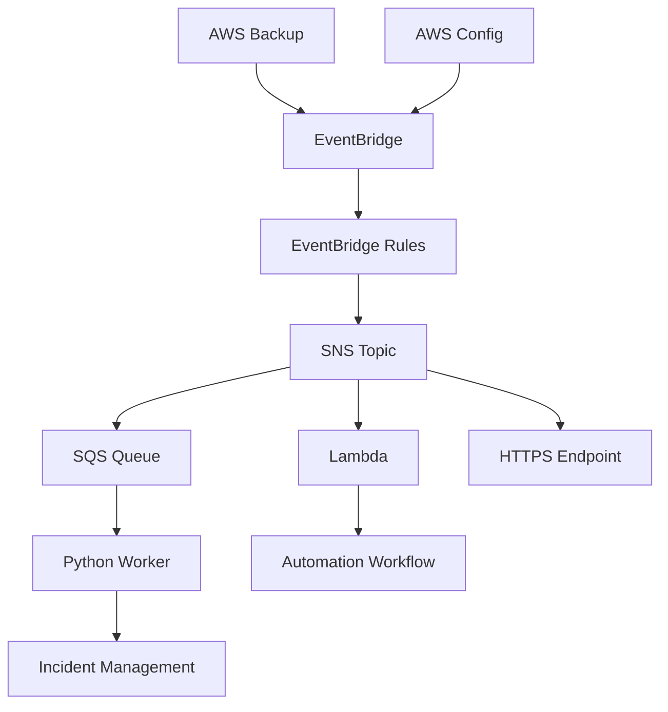
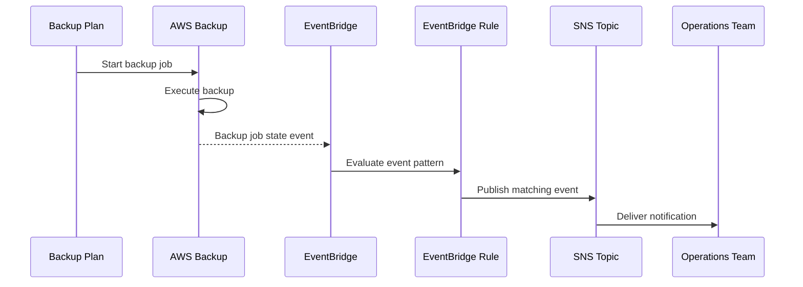
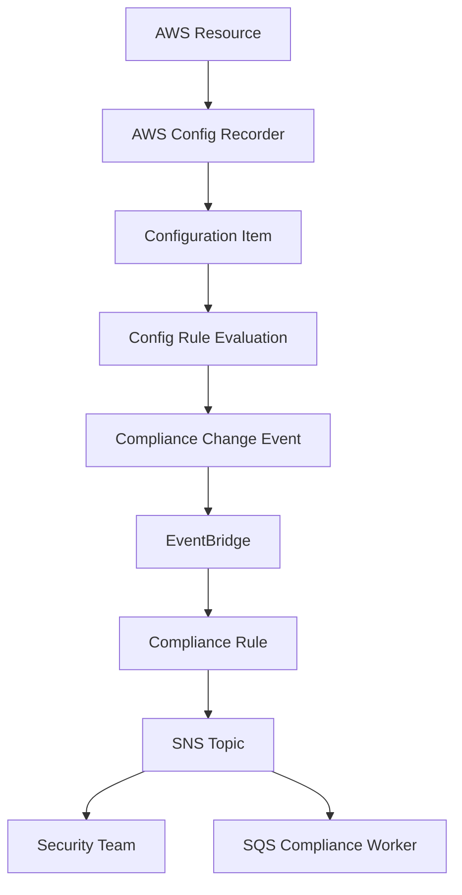
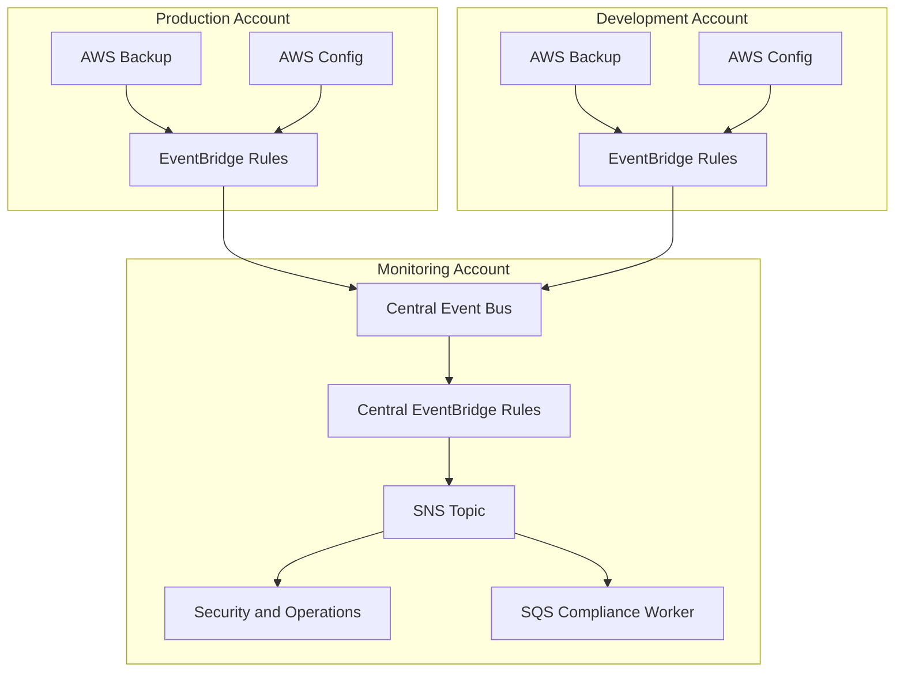

# 08- AWS Backup and AWS Config Integration

## Overview

Amazon SNS can be integrated with AWS Backup and AWS Config to distribute operational notifications about backup activity, resource compliance, configuration changes, and governance events.

These services have different responsibilities:

- **AWS Backup** centrally manages backup plans, backup vaults, recovery points, lifecycle policies, and restore operations.
- **AWS Config** records resource configuration changes, evaluates compliance against rules, and provides configuration history.
- **Amazon SNS** distributes notifications to subscribers such as SQS queues, Lambda functions, HTTPS endpoints, and operational email systems.
- **Amazon EventBridge** provides event routing and filtering between AWS services and SNS.

A common architecture uses EventBridge rules to identify relevant AWS Backup or AWS Config events and routes them to SNS topics. SNS then distributes notifications to operational systems and backend applications.



This integration is useful for:

- Backup job failure notifications.
- Recovery point creation and expiration monitoring.
- Backup policy and vault governance.
- AWS Config compliance notifications.
- Resource configuration change alerts.
- Security and operational incident workflows.
- Centralized audit and compliance reporting.

SNS should be treated as a notification transport, not as the authoritative record of backup status or resource compliance. AWS Backup and AWS Config remain the systems of record.

## Service Responsibilities and Integration Options

### AWS Backup

AWS Backup provides centralized backup management across supported AWS services. It supports backup plans, backup selections, backup vaults, lifecycle management, restore operations, and audit capabilities.

Important operational events include:

- Backup job creation.
- Backup job completion.
- Backup job failure.
- Copy job completion or failure.
- Restore job completion or failure.
- Recovery point lifecycle changes.

AWS Backup can publish backup notifications through EventBridge. It also supports backup vault notification configurations for selected backup events and SNS destinations.

Use EventBridge when routing requires detailed event matching, multiple targets, centralized event governance, or integration with other AWS services.

Use backup vault notifications when a simpler vault-level notification mechanism is sufficient.

### AWS Config

AWS Config continuously records supported resource configuration changes and evaluates resource configurations against rules.

Important events include:

- Resource configuration changes.
- Compliance evaluation results.
- Compliance state changes.
- Configuration recorder and delivery channel issues.
- Aggregated compliance findings.

AWS Config integrates with EventBridge for event-driven notifications. EventBridge can route selected configuration and compliance events to SNS.

AWS Config also supports SNS-based notifications through its delivery channel for supported notification types, such as configuration history and compliance-related notifications.

### Integration comparison

| Requirement | Recommended integration |
|---|---|
| Notify when a backup job fails | AWS Backup → EventBridge → SNS |
| Notify when a recovery point is created | AWS Backup → EventBridge → SNS |
| Send selected vault backup notifications | AWS Backup vault notification configuration |
| Notify on AWS Config compliance changes | AWS Config → EventBridge → SNS |
| Route only non-compliant resource findings | EventBridge rule filtering Config events |
| Send configuration history notifications | AWS Config delivery channel → SNS |
| Centralize notifications across accounts | EventBridge cross-account routing and centralized SNS |
| Trigger automated remediation | EventBridge → Lambda, Systems Manager, or Step Functions |

## AWS Backup Integration with SNS

### AWS Backup event flow

AWS Backup emits events to EventBridge for backup-related operations.

The event flow is:

1. A backup plan starts a backup job.
2. AWS Backup executes the backup operation.
3. AWS Backup emits an event describing the job state.
4. EventBridge evaluates configured rules.
5. Matching events are delivered to an SNS topic.
6. SNS distributes the notification to subscribers.



The EventBridge event is an operational notification. It does not replace querying AWS Backup for the authoritative job details or recovery point state.

### Create an SNS topic

Create a topic for backup notifications:

```bash
aws sns create-topic \
  --name aws-backup-alerts \
  --region ap-south-1
```

Retrieve its attributes:

```bash
aws sns get-topic-attributes \
  --topic-arn arn:aws:sns:ap-south-1:123456789012:aws-backup-alerts \
  --region ap-south-1
```

Subscribe an operational email address:

```bash
aws sns subscribe \
  --topic-arn arn:aws:sns:ap-south-1:123456789012:aws-backup-alerts \
  --protocol email \
  --notification-endpoint operations@example.com \
  --region ap-south-1
```

The email subscription must be confirmed before notifications are delivered.

For production systems, prefer SQS or an authenticated HTTPS integration for machine processing. Email is useful for human notification but is not a reliable processing interface.

### Create an EventBridge rule for failed backup jobs

AWS Backup job events include fields such as:

- `source`
- `detail-type`
- `detail.state`
- `detail.backupJobId`
- `detail.resourceArn`
- `detail.backupVaultName`

Create a rule matching failed backup jobs:

```bash
aws events put-rule \
  --name backup-job-failed \
  --event-pattern '{
    "source": ["aws.backup"],
    "detail-type": ["Backup Job State Change"],
    "detail": {
      "state": ["FAILED"]
    }
  }' \
  --state ENABLED \
  --description "Notify operations about failed AWS Backup jobs" \
  --region ap-south-1
```

The rule matches backup job failure events. It does not automatically match copy or restore job failures. Create separate rules when those workflows require independent notifications.

### Add SNS as the EventBridge target

```bash
aws events put-targets \
  --rule backup-job-failed \
  --targets '[
    {
      "Id": "backup-alerts-topic",
      "Arn": "arn:aws:sns:ap-south-1:123456789012:aws-backup-alerts"
    }
  ]' \
  --region ap-south-1
```

EventBridge must have permission to publish to the SNS topic.

Add a topic resource policy statement:

```json
{
  "Sid": "AllowEventBridgeBackupRule",
  "Effect": "Allow",
  "Principal": {
    "Service": "events.amazonaws.com"
  },
  "Action": "sns:Publish",
  "Resource": "arn:aws:sns:ap-south-1:123456789012:aws-backup-alerts",
  "Condition": {
    "ArnEquals": {
      "aws:SourceArn": "arn:aws:events:ap-south-1:123456789012:rule/backup-job-failed"
    },
    "StringEquals": {
      "aws:SourceAccount": "123456789012"
    }
  }
}
```

Apply the complete topic policy using `set-topic-attributes`. Preserve existing policy statements because updating the `Policy` attribute replaces the full policy document.

Verify the target:

```bash
aws events list-targets-by-rule \
  --rule backup-job-failed \
  --region ap-south-1
```

### Backup job event pattern

A more selective pattern can match failed backup jobs for a specific resource type or vault.

Example:

```json
{
  "source": ["aws.backup"],
  "detail-type": ["Backup Job State Change"],
  "detail": {
    "state": ["FAILED"],
    "backupVaultName": ["production-vault"]
  }
}
```

Use actual event fields from the relevant AWS Backup event type. EventBridge matching is case-sensitive, and field names and values must match the emitted event structure.

Inspect actual events in a non-production environment before deploying a restrictive pattern. An incorrect pattern can silently prevent notifications.

### Monitor completed backup jobs

Not every operational event should be treated as an incident. Successful backup completion is useful for reporting and audit workflows.

Example rule:

```bash
aws events put-rule \
  --name backup-job-completed \
  --event-pattern '{
    "source": ["aws.backup"],
    "detail-type": ["Backup Job State Change"],
    "detail": {
      "state": ["COMPLETED"]
    }
  }' \
  --state ENABLED \
  --region ap-south-1
```

Route successful backup events to a separate SNS topic or SQS queue when reporting and operational alerts have different retention and processing requirements.

Avoid sending every successful backup notification to an incident-management channel. High-volume success notifications can obscure failures.

## AWS Backup Vault Notifications

AWS Backup backup vault notifications provide a simpler mechanism for publishing selected vault events to SNS.

A backup vault notification configuration can include supported event types such as:

- Backup job started.
- Backup job completed.
- Backup job failed.
- Recovery point created.
- Recovery point deleted.
- Copy job events.
- Restore job events.

The exact supported event types should be checked against the AWS Backup API and the target Region.

### Configure vault notifications

First, identify the backup vault:

```bash
aws backup list-backup-vaults \
  --region ap-south-1
```

Configure notifications:

```bash
aws backup put-backup-vault-notifications \
  --backup-vault-name production-vault \
  --sns-topic-arn arn:aws:sns:ap-south-1:123456789012:aws-backup-alerts \
  --backup-vault-events \
    BACKUP_JOB_STARTED \
    BACKUP_JOB_COMPLETED \
    BACKUP_JOB_FAILED \
  --region ap-south-1
```

Retrieve the configuration:

```bash
aws backup get-backup-vault-notifications \
  --backup-vault-name production-vault \
  --region ap-south-1
```

Remove the configuration when it is no longer required:

```bash
aws backup delete-backup-vault-notifications \
  --backup-vault-name production-vault \
  --region ap-south-1
```

### EventBridge versus vault notifications

| Feature | EventBridge | Backup vault notifications |
|---|---|---|
| Routing | Content-based rules | Vault-level event selection |
| Multiple targets | Yes | SNS topic destination |
| Event transformation | Input transformers | Limited |
| Cross-account routing | Supported through event bus configuration | Requires appropriate SNS and account configuration |
| Centralized event processing | Suitable | More limited |
| Complex filtering | Supported | Not designed for complex filtering |
| Operational complexity | Higher | Lower |

Use vault notifications for straightforward backup-event delivery. Use EventBridge when event routing, centralized governance, or multiple downstream workflows are required.

Avoid configuring both mechanisms to publish the same event to the same notification destination unless duplicate notifications are intentional.

## AWS Backup Job Types and Notification Strategy

AWS Backup has several job categories. A production notification architecture should distinguish them rather than treating every event as a generic backup failure.

| Job type | Purpose | Notification use case |
|---|---|---|
| Backup job | Creates a recovery point | Success and failure monitoring |
| Copy job | Copies a recovery point to another vault or Region | Cross-account and cross-Region backup validation |
| Restore job | Restores a resource from a recovery point | Recovery workflow monitoring |
| Recovery point lifecycle | Tracks recovery point creation, deletion, and retention | Retention and governance monitoring |

For disaster recovery, copy-job monitoring is especially important. A successful source backup does not prove that the recovery point was copied successfully to the destination vault or Region.

A useful operational policy is:

- Alert immediately on failed backup jobs.
- Alert on failed copy jobs for critical workloads.
- Alert on failed restore jobs during recovery operations.
- Report successful jobs through a dashboard or periodic summary.
- Monitor recovery point age and retention independently of job notifications.

## AWS Config Integration with SNS

### AWS Config event flow

AWS Config records resource configuration changes and evaluates resources against rules.

When a resource changes or a compliance evaluation completes, AWS Config can emit events that EventBridge routes to SNS.



This architecture separates compliance evaluation from notification delivery.

AWS Config determines the compliance result. EventBridge filters the relevant events. SNS distributes notifications.

### Create an SNS topic

Create a topic dedicated to compliance notifications:

```bash
aws sns create-topic \
  --name aws-config-compliance-alerts \
  --region ap-south-1
```

Separate compliance notifications from backup notifications when they have different operational owners, retention requirements, or access policies.

### AWS Config compliance events

AWS Config can emit compliance-related events, including compliance state changes.

A typical compliance event contains fields such as:

- `source`
- `detail-type`
- `detail.resourceType`
- `detail.resourceId`
- `detail.configRuleName`
- `detail.newEvaluationResult.complianceType`

A rule can match non-compliant evaluations:

```bash
aws events put-rule \
  --name config-non-compliant-alert \
  --event-pattern '{
    "source": ["aws.config"],
    "detail-type": ["Config Rules Compliance Change"],
    "detail": {
      "newEvaluationResult": {
        "complianceType": ["NON_COMPLIANT"]
      }
    }
  }' \
  --state ENABLED \
  --description "Notify when AWS Config detects non-compliant resources" \
  --region ap-south-1
```

The rule filters compliance-change events. It does not replace AWS Config's compliance history or evaluation records.

### Add SNS as the target

```bash
aws events put-targets \
  --rule config-non-compliant-alert \
  --targets '[
    {
      "Id": "config-compliance-topic",
      "Arn": "arn:aws:sns:ap-south-1:123456789012:aws-config-compliance-alerts"
    }
  ]' \
  --region ap-south-1
```

Add a topic resource policy that allows the specific EventBridge rule to publish:

```json
{
  "Sid": "AllowConfigComplianceRule",
  "Effect": "Allow",
  "Principal": {
    "Service": "events.amazonaws.com"
  },
  "Action": "sns:Publish",
  "Resource": "arn:aws:sns:ap-south-1:123456789012:aws-config-compliance-alerts",
  "Condition": {
    "ArnEquals": {
      "aws:SourceArn": "arn:aws:events:ap-south-1:123456789012:rule/config-non-compliant-alert"
    },
    "StringEquals": {
      "aws:SourceAccount": "123456789012"
    }
  }
}
```

Preserve existing topic policy statements when applying this policy.

### Match specific resource types

Compliance notifications can be filtered by resource type.

Example: notify only when an S3 bucket becomes non-compliant.

```json
{
  "source": ["aws.config"],
  "detail-type": ["Config Rules Compliance Change"],
  "detail": {
    "resourceType": ["AWS::S3::Bucket"],
    "newEvaluationResult": {
      "complianceType": ["NON_COMPLIANT"]
    }
  }
}
```

This is useful when separate teams own different resource categories.

For example:

- Security team: IAM, KMS, and S3 compliance.
- Platform team: EC2, VPC, and networking compliance.
- Database team: RDS and database encryption compliance.

Create separate rules or route events to a central processing service when ownership is more complex.

### Configuration item change notifications

AWS Config can also emit configuration-change events.

These events are useful when a resource's configuration changes and downstream systems need to investigate or reconcile the change.

Example EventBridge pattern:

```json
{
  "source": ["aws.config"],
  "detail-type": ["Config Configuration Item Change"]
}
```

Configuration-change events can occur frequently. Avoid sending every event to an email distribution list.

For high-volume environments, route them to SQS or a processing service that can:

- Normalize configuration changes.
- Compare old and new configuration.
- Identify security-relevant changes.
- Enrich events with account and resource ownership.
- Persist audit records.
- Generate alerts only for meaningful changes.

## AWS Config Delivery Channel and SNS

AWS Config supports a delivery channel that can deliver configuration snapshots and history files to S3 and send supported notifications to SNS.

This mechanism is separate from EventBridge rule-based routing.

### Inspect the delivery channel

```bash
aws configservice describe-delivery-channels \
  --region ap-south-1
```

The delivery channel can include:

- An S3 bucket for configuration history and snapshots.
- An SNS topic for supported notifications.
- Optional delivery frequency settings.

### Create a delivery channel

Example `delivery-channel.json`:

```json
{
  "name": "default",
  "s3BucketName": "company-config-history",
  "snsTopicARN": "arn:aws:sns:ap-south-1:123456789012:aws-config-compliance-alerts",
  "configSnapshotDeliveryProperties": {
    "deliveryFrequency": "TwentyFour_Hours"
  }
}
```

Create the channel:

```bash
aws configservice put-delivery-channel \
  --delivery-channel file://delivery-channel.json \
  --region ap-south-1
```

The configuration recorder and delivery channel must be configured appropriately. AWS Config requires the recorder to be started before it can record resource configuration.

Inspect the recorder:

```bash
aws configservice describe-configuration-recorders \
  --region ap-south-1
```

Check recorder status:

```bash
aws configservice describe-configuration-recorder-status \
  --region ap-south-1
```

### Delivery channel versus EventBridge

| Capability | Config delivery channel | EventBridge |
|---|---|---|
| Configuration snapshots | Yes, through S3 delivery | Not the primary mechanism |
| Configuration history files | Yes, through S3 delivery | Not the primary mechanism |
| SNS notifications | Supported notification delivery | SNS target through rules |
| Complex event filtering | Limited | Yes |
| Multiple event targets | No general rule-based target model | Yes |
| Event transformation | Limited | Input transformers |
| Event-driven automation | Limited | Strong integration with AWS services |

Use the delivery channel for configuration history and snapshot delivery. Use EventBridge for selective, event-driven operational notifications.

Do not assume that the delivery channel sends every AWS Config event as a complete configuration record through SNS. Use S3 configuration history or AWS Config APIs when complete configuration data is required.

## Python Integration with AWS Backup and SNS

Backend applications can consume backup notifications from SQS and retrieve authoritative job details through the AWS Backup API.

A recommended design is:

1. AWS Backup emits an event.
2. EventBridge routes the event to SNS.
3. SNS publishes to an SQS subscription.
4. A Python worker receives the notification.
5. The worker extracts the backup job identifier.
6. The worker queries AWS Backup for authoritative job details.
7. The worker persists the result and triggers the required workflow.

### Install dependencies

```bash
pip install boto3
```

### Query backup job details

```python
import boto3
from botocore.config import Config

backup = boto3.client(
    "backup",
    region_name="ap-south-1",
    config=Config(
        retries={
            "mode": "standard",
            "max_attempts": 5,
        },
        connect_timeout=3,
        read_timeout=10,
    ),
)


def get_backup_job(backup_job_id: str) -> dict:
    response = backup.describe_backup_job(
        BackupJobId=backup_job_id
    )

    return {
        "backup_job_id": response["BackupJobId"],
        "state": response["State"],
        "resource_arn": response.get("ResourceArn"),
        "backup_vault_name": response.get("BackupVaultName"),
        "creation_date": response.get("CreationDate"),
        "completion_date": response.get("CompletionDate"),
        "status_message": response.get("StatusMessage"),
    }
```

The IAM role needs `backup:DescribeBackupJob` permission on the required resources, subject to the API's resource-level authorization support.

### Process a backup failure event

```python
import json
import logging

logger = logging.getLogger(__name__)


def process_backup_event(event: dict) -> None:
    detail = event.get("detail", {})

    backup_job_id = detail.get("backupJobId")
    state = detail.get("state")

    if not backup_job_id:
        raise ValueError("Backup event does not contain backupJobId")

    if state != "FAILED":
        return

    job = get_backup_job(backup_job_id)

    logger.error(
        "Backup job failed: job_id=%s resource=%s message=%s",
        job["backup_job_id"],
        job.get("resource_arn"),
        job.get("status_message"),
    )

    # Persist the failure and trigger an operational workflow.
```

Do not assume every event contains every optional field. Validate the event type and handle missing fields explicitly.

## Python Integration with AWS Config

A backend compliance worker can consume AWS Config events and retrieve additional information through AWS Config APIs.

Typical responsibilities include:

- Recording compliance state changes.
- Mapping findings to resource owners.
- Creating tickets.
- Triggering remediation workflows.
- Maintaining compliance dashboards.
- Tracking repeated violations.

### Retrieve compliance details

```python
import boto3
from botocore.config import Config

config_client = boto3.client(
    "config",
    region_name="ap-south-1",
    config=Config(
        retries={
            "mode": "standard",
            "max_attempts": 5,
        }
    ),
)


def get_resource_compliance(
    resource_type: str,
    resource_id: str,
) -> list[dict]:
    paginator = config_client.get_paginator(
        "get_compliance_details_by_resource"
    )

    results = []

    for page in paginator.paginate(
        ResourceType=resource_type,
        ResourceId=resource_id,
        ComplianceTypes=["NON_COMPLIANT"],
    ):
        results.extend(
            page.get("EvaluationResults", [])
        )

    return results
```

Use the returned evaluation details to enrich notifications with rule names, annotation messages, and evaluation timestamps.

Do not use a notification payload as the sole source of compliance truth. Query AWS Config when the workflow requires current evaluation details.

## Idempotency and Event Processing

AWS Backup and AWS Config events are asynchronous. Consumers must tolerate duplicate delivery and retries.

A notification may be delivered more than once because:

- EventBridge retries target delivery.
- SNS retries subscriber delivery.
- SQS provides at-least-once message delivery.
- A worker may complete its database transaction but fail before deleting the SQS message.
- A network timeout may leave the publisher or consumer uncertain about the result.

Use a stable event identifier and persist processed events.

Example PostgreSQL schema:

```sql
CREATE TABLE processed_aws_events (
    consumer_name TEXT NOT NULL,
    event_id TEXT NOT NULL,
    event_source TEXT NOT NULL,
    event_type TEXT NOT NULL,
    processed_at TIMESTAMPTZ NOT NULL DEFAULT NOW(),
    PRIMARY KEY (consumer_name, event_id)
);
```

For EventBridge events, the envelope `id` is useful for transport-level deduplication. For business-level deduplication across republishing or different transport paths, retain an application or source-specific identifier such as the backup job ID together with the event state and processing purpose.

A backup job can legitimately emit multiple state transitions. Do not deduplicate all events using only the backup job ID. Include the event type or state transition in the idempotency key where each transition must be processed.

For AWS Config, compliance can change repeatedly for the same resource and rule. Include the resource identity, rule identity, and evaluation transition or event identifier in the processing model.

## Reliability and Failure Handling

### EventBridge target retry policy

EventBridge retries failed target delivery. Configure a retry policy and a DLQ for important notification rules.

Example:

```bash
aws events put-targets \
  --rule backup-job-failed \
  --targets '[
    {
      "Id": "backup-alerts-topic",
      "Arn": "arn:aws:sns:ap-south-1:123456789012:aws-backup-alerts",
      "RetryPolicy": {
        "MaximumEventAgeInSeconds": 3600,
        "MaximumRetryAttempts": 10
      },
      "DeadLetterConfig": {
        "Arn": "arn:aws:sqs:ap-south-1:123456789012:backup-eventbridge-dlq"
      }
    }
  ]' \
  --region ap-south-1
```

The DLQ must have a resource policy allowing EventBridge to send messages. Restrict the permission to the expected rule and account.

### Distinguish failure boundaries

| Boundary | Example failure | Recovery mechanism |
|---|---|---|
| AWS Backup job | Backup operation fails | Retry or investigate the backup job |
| AWS Backup → EventBridge | Event delivery or rule matching issue | Service monitoring and event configuration validation |
| EventBridge → SNS | Target delivery fails | EventBridge retry and target DLQ |
| SNS → SQS | Subscription delivery fails | SNS retry and subscription DLQ where configured |
| SQS → worker | Worker processing fails | Visibility timeout, retry, and SQS DLQ |
| Worker → AWS API | API throttling or network failure | SDK retries and application backoff |
| Worker → database | Transaction failure | Database retry and message redelivery |

A successful SNS delivery only confirms delivery to the subscriber endpoint. It does not confirm that the operational workflow completed.

### Reconciliation

Notifications are useful for near-real-time response, but critical backup and compliance workflows should also perform periodic reconciliation.

For backup operations:

- Query backup jobs for the required time range.
- Compare expected backup schedules with completed jobs.
- Identify resources without recent recovery points.
- Verify copy jobs and destination recovery points.
- Detect recovery points that are approaching expiration.

For AWS Config:

- Query current compliance status.
- Identify resources that have not been evaluated recently.
- Compare expected resource coverage with recorded resources.
- Detect stale or missing configuration data.
- Reconcile findings with the notification-processing database.

Reconciliation protects against missed notifications, misconfigured event patterns, and downstream processing failures.

## Security and IAM

### SNS topic policies

Allow only the intended EventBridge rule to publish to each topic.

Use:

- `events.amazonaws.com` as the service principal.
- The exact SNS topic ARN as the resource.
- The expected EventBridge rule ARN in `aws:SourceArn`.
- `aws:SourceAccount` where applicable.

Avoid unrestricted service-principal permissions.

### AWS Backup permissions

A backend worker may need permissions such as:

```json
{
  "Version": "2012-10-17",
  "Statement": [
    {
      "Sid": "ReadBackupJobDetails",
      "Effect": "Allow",
      "Action": [
        "backup:DescribeBackupJob",
        "backup:DescribeCopyJob",
        "backup:DescribeRestoreJob",
        "backup:ListBackupJobs",
        "backup:ListCopyJobs",
        "backup:ListRestoreJobs"
      ],
      "Resource": "*"
    }
  ]
}
```

AWS Backup API actions have different resource-level authorization capabilities. Use resource scoping where supported and validate policies against the exact APIs being called.

Separate read-only monitoring permissions from permissions that create backup plans, delete recovery points, or initiate restores.

### AWS Config permissions

A compliance worker may require read-only permissions such as:

```json
{
  "Version": "2012-10-17",
  "Statement": [
    {
      "Sid": "ReadConfigCompliance",
      "Effect": "Allow",
      "Action": [
        "config:DescribeComplianceByConfigRule",
        "config:DescribeComplianceByResource",
        "config:GetComplianceDetailsByResource",
        "config:DescribeConfigRules",
        "config:DescribeConfigurationRecorders",
        "config:DescribeConfigurationRecorderStatus"
      ],
      "Resource": "*"
    }
  ]
}
```

AWS Config read APIs commonly require wildcard resource scope. Restrict the role through action selection, account boundaries, and other applicable controls.

Do not grant remediation permissions to a notification-only worker.

### Encryption

Configure encryption independently for:

- SNS topics.
- SQS queues and DLQs.
- S3 buckets used by AWS Config.
- Backup vaults and recovery points.
- EventBridge archives where configured.
- Application databases and logs.

For customer-managed KMS keys, review key policies and service permissions. Encryption configuration on one service does not automatically protect data stored by another service.

### Cross-account security

In multi-account environments:

- Use centralized event routing where appropriate.
- Restrict event bus resource policies to trusted source accounts.
- Restrict SNS topic policies to the intended publishing service and rule.
- Use dedicated roles for centralized compliance processing.
- Keep backup vault access and recovery permissions separate from notification permissions.
- Audit cross-account role assumptions and resource-policy changes.

## Multi-Account Architecture

Organizations commonly deploy AWS Backup and AWS Config across multiple AWS accounts.

A centralized monitoring account can receive selected events from workload accounts and distribute notifications through centralized SNS topics.



This architecture supports centralized monitoring without requiring every workload account to maintain separate operational notification infrastructure.

Important considerations:

- Configure event bus resource policies in the receiving account.
- Restrict permitted source accounts and event sources.
- Define whether source-account rules or central rules own filtering.
- Preserve account ID and Region in event records.
- Avoid duplicate routing through both local and central notification paths.
- Deploy equivalent rules and policies in recovery Regions.
- Keep remediation authority separate from centralized notification authority.

For large AWS Organizations environments, evaluate AWS Config aggregators and AWS Backup Audit Manager alongside EventBridge routing. Aggregation and audit capabilities provide centralized visibility that should not be reconstructed solely from SNS notifications.

## Monitoring and Observability

### AWS Backup monitoring

Monitor:

- Backup job failures.
- Copy job failures.
- Restore job failures.
- Backup job duration.
- Recovery point age.
- Backup vault capacity and lifecycle behavior where applicable.
- Recovery point retention and expiration.
- Missed backup schedules.

Use AWS Backup job APIs and supported CloudWatch metrics for authoritative operational monitoring. EventBridge notifications should trigger investigation, not replace periodic verification.

### AWS Config monitoring

Monitor:

- Non-compliant resource count.
- Compliance state transitions.
- Configuration recorder status.
- Delivery channel status.
- Resource coverage.
- Evaluation failures.
- Stale configuration data.

A resource not appearing in a compliance notification does not prove that it is compliant. It may not have been recorded or evaluated.

### SNS and EventBridge monitoring

Monitor:

- EventBridge matched events.
- Target invocations.
- Failed target invocations.
- Throttled rules.
- Events sent to target DLQs.
- SNS published notifications.
- SNS delivery failures.
- Subscription-level failures.

Metric names and dimensions depend on the service and target configuration. Build dashboards around operational outcomes rather than assuming that a single metric represents end-to-end success.

### Correlation identifiers

Preserve:

- AWS account ID.
- Region.
- Resource ARN.
- Backup job ID or recovery point ARN.
- AWS Config rule name.
- Configuration resource ID.
- EventBridge event ID.
- Event source and detail type.
- Event timestamp.

Avoid logging complete configuration payloads if they contain sensitive resource metadata.

## Infrastructure as Code with Terraform

The following example creates an SNS topic, an EventBridge rule for failed backup jobs, a topic policy, and an SNS target.

```hcl
data "aws_caller_identity" "current" {}

resource "aws_sns_topic" "backup_alerts" {
  name = "aws-backup-alerts"
}

resource "aws_cloudwatch_event_rule" "backup_job_failed" {
  name        = "backup-job-failed"
  description = "Notify operations about failed backup jobs"

  event_pattern = jsonencode({
    source        = ["aws.backup"]
    "detail-type" = ["Backup Job State Change"]
    detail = {
      state = ["FAILED"]
    }
  })
}

data "aws_iam_policy_document" "backup_topic" {
  statement {
    sid    = "AllowBackupEventBridgeRule"
    effect = "Allow"

    principals {
      type        = "Service"
      identifiers = ["events.amazonaws.com"]
    }

    actions   = ["sns:Publish"]
    resources = [aws_sns_topic.backup_alerts.arn]

    condition {
      test     = "ArnEquals"
      variable = "aws:SourceArn"
      values   = [aws_cloudwatch_event_rule.backup_job_failed.arn]
    }

    condition {
      test     = "StringEquals"
      variable = "aws:SourceAccount"
      values   = [data.aws_caller_identity.current.account_id]
    }
  }
}

resource "aws_sns_topic_policy" "backup_alerts" {
  arn    = aws_sns_topic.backup_alerts.arn
  policy = data.aws_iam_policy_document.backup_topic.json
}

resource "aws_cloudwatch_event_target" "backup_alerts" {
  rule = aws_cloudwatch_event_rule.backup_job_failed.name
  arn  = aws_sns_topic.backup_alerts.arn

  depends_on = [
    aws_sns_topic_policy.backup_alerts
  ]
}
```

For AWS Config compliance alerts, create a separate rule and topic or extend the module with independently managed resources.

Production Terraform modules should also manage:

- SQS subscriptions and DLQs.
- EventBridge target retry policies.
- CloudWatch alarms.
- SNS and SQS encryption.
- KMS key policies.
- Cross-account event bus permissions.
- AWS Backup vault notification configurations where required.
- AWS Config recorders and delivery channels.
- Resource tags and environment-specific configuration.

Avoid managing the same SNS topic policy through multiple Terraform resources. A topic policy is a single document and updates can replace existing statements.

## Testing and Deployment

### Event pattern testing

Use EventBridge pattern testing before deployment:

```bash
aws events test-event-pattern \
  --event-pattern file://backup-failed-pattern.json \
  --event file://backup-failed-event.json \
  --region ap-south-1
```

Create representative fixtures for:

- Backup job completion.
- Backup job failure.
- Copy job failure.
- Restore job failure.
- Config compliance becoming non-compliant.
- Config compliance returning to compliant.
- Configuration item changes.

Do not assume that a pattern tested against one event type is valid for every related AWS service event.

### Integration testing

Validate the complete notification path:

1. Generate or identify a supported AWS Backup event.
2. Verify the event reaches EventBridge.
3. Verify the rule matches.
4. Verify SNS receives the notification.
5. Verify the subscriber receives the expected payload.
6. Verify the processing worker persists the event.
7. Simulate a subscriber failure.
8. Verify retry and DLQ behavior.
9. Reconcile the result with AWS Backup or AWS Config APIs.

For AWS Config, use a controlled non-production resource and rule to produce a known compliance transition. Avoid changing production security controls merely to test notification delivery.

### Deployment sequence

A safe deployment sequence is:

1. Create SNS topics and encryption configuration.
2. Configure topic resource policies.
3. Create SQS queues and DLQs if required.
4. Configure SNS subscriptions.
5. Create EventBridge rules.
6. Add targets and retry policies.
7. Deploy the backend consumers.
8. Enable or verify AWS Backup and AWS Config event sources.
9. Test the end-to-end path.
10. Enable operational alerts.

For AWS Config delivery-channel integration, ensure the S3 bucket policy, SNS topic policy, configuration recorder, and delivery channel are configured consistently.

## Common Mistakes and Production Pitfalls

| Mistake | Why it causes problems | Recommended approach |
|---|---|---|
| Treating SNS as the source of truth | Notifications can be delayed, duplicated, or missed downstream | Query AWS Backup and AWS Config APIs for authoritative state |
| Assuming every backup event is a backup-job event | Copy and restore jobs have separate event types | Create rules for each required job category |
| Using an incorrect EventBridge detail type | The rule never matches the emitted event | Inspect actual events and test patterns |
| Sending every Config change to email | High-volume notifications become unusable | Filter events and use SQS for machine processing |
| Assuming Config compliance events contain complete resource configuration | Notifications are not a complete configuration history store | Query AWS Config or use S3 configuration history |
| Configuring both vault notifications and EventBridge for the same destination | Duplicate notifications may be generated | Assign clear ownership to each notification path |
| Ignoring EventBridge target failures | SNS may never receive the notification | Configure retries, DLQs, and alarms |
| Deduplicating only by backup job ID | Legitimate state transitions can be discarded | Include event type or state transition in the idempotency key |
| Assuming successful backup means successful copy | Disaster recovery copy can fail independently | Monitor copy jobs and destination recovery points |
| Treating absence of a Config alert as compliance | Resources may not have been recorded or evaluated | Monitor recorder health and compliance coverage |
| Overwriting SNS topic policies | Existing publisher or service permissions may be removed | Preserve and merge policy statements |
| Giving notification workers remediation permissions | A compromised worker gains unnecessary control | Separate notification and remediation roles |
| Relying only on event notifications for audit | Events are not a complete historical audit store | Use AWS Backup, AWS Config, CloudTrail, and S3 history as appropriate |

## Production Readiness Checklist

### AWS Backup

- [ ] Backup plans and vaults are configured.
- [ ] Backup job failures generate notifications.
- [ ] Copy and restore job failures are monitored separately.
- [ ] Recovery point age and retention are monitored.
- [ ] Backup vault notifications or EventBridge rules are configured intentionally.
- [ ] Backup reconciliation runs independently of notification delivery.

### AWS Config

- [ ] Configuration recorder is enabled and healthy.
- [ ] Delivery channel is configured where required.
- [ ] Compliance rules cover the intended resource types.
- [ ] Non-compliant events are routed to the correct SNS topic.
- [ ] Configuration history is retained in the configured S3 destination.
- [ ] Resource coverage and stale evaluations are monitored.

### Messaging and security

- [ ] SNS topic policies restrict publishing to intended EventBridge rules.
- [ ] SQS subscriptions use least-privilege queue policies.
- [ ] EventBridge targets have retry and DLQ configuration.
- [ ] Consumers implement idempotent processing.
- [ ] KMS permissions support encrypted service integrations.
- [ ] Cross-account policies restrict trusted accounts and resources.

### Operations

- [ ] Backup and compliance notifications have clear ownership.
- [ ] EventBridge patterns are tested against representative events.
- [ ] SNS delivery and consumer processing are monitored separately.
- [ ] DLQ messages trigger alerts and have a redrive procedure.
- [ ] Reconciliation detects missing or delayed notifications.
- [ ] Multi-account and disaster recovery procedures are tested.

## Key Takeaways

- AWS Backup and AWS Config are the authoritative systems for backup and compliance state; SNS distributes operational notifications rather than replacing their APIs or history.
- EventBridge provides flexible filtering and routing for backup job events and Config compliance changes, while AWS Backup vault notifications and Config delivery channels support more specific notification workflows.
- Monitor backup, copy, and restore jobs independently; a successful backup does not guarantee a successful cross-Region or cross-account copy.
- AWS Config notifications must be combined with recorder health, resource coverage, and compliance reconciliation because the absence of an alert does not prove compliance.
- Production integrations require least-privilege resource policies, idempotent consumers, retry and DLQ handling, encryption controls, and periodic reconciliation against authoritative service state.