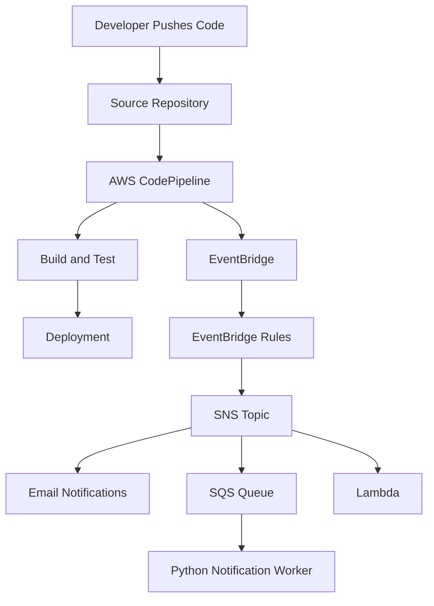
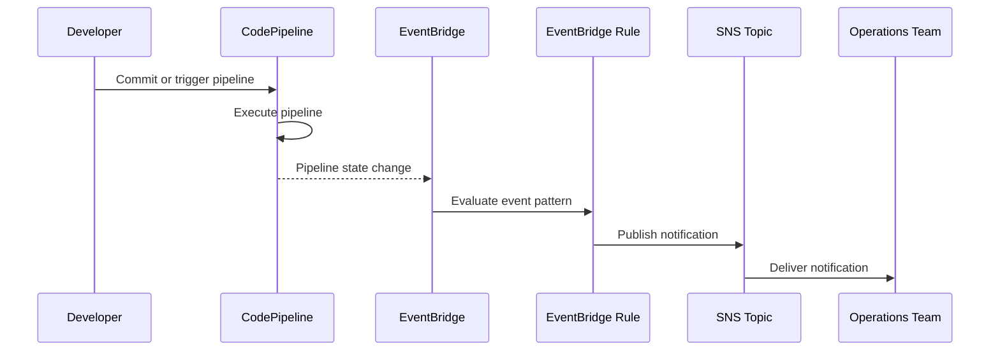
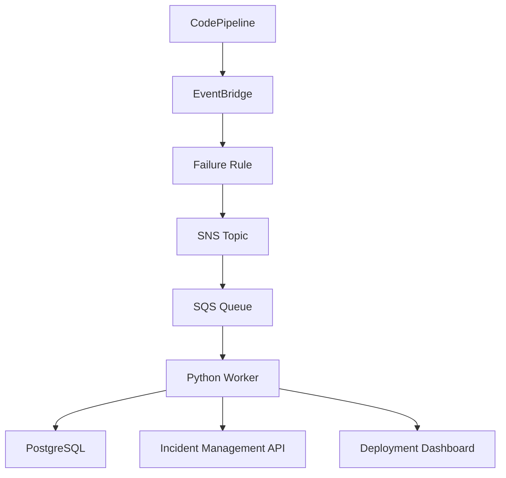
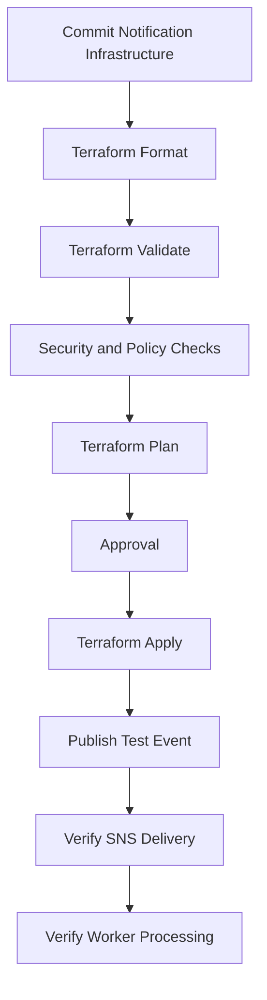

# 09- AWS CodePipeline Integration

## Overview

Amazon SNS integrates with AWS CodePipeline to distribute notifications about pipeline execution events, stage transitions, and action results.

AWS CodePipeline automates software delivery workflows by coordinating source, build, test, approval, and deployment stages. SNS provides a notification mechanism that allows development teams, operations teams, and backend systems to react to pipeline events.

A typical integration uses EventBridge to capture CodePipeline events and route selected events to SNS topics. SNS then distributes notifications to email subscribers, SQS queues, Lambda functions, and HTTPS endpoints.



Common use cases include:

- Pipeline execution failure notifications.
- Deployment completion notifications.
- Manual approval notifications.
- Stage transition monitoring.
- Build and test failure alerts.
- Centralized CI/CD reporting.
- Automated incident and deployment workflows.

SNS should be treated as a notification transport. CodePipeline and CodeBuild remain the authoritative sources for pipeline and build execution status.

## Architecture and Integration Options

### EventBridge to SNS

EventBridge is the recommended integration when notification requirements involve selective event routing, multiple targets, or centralized event management.

CodePipeline emits events to EventBridge. EventBridge rules match the events and publish them to SNS.



Advantages:

- Filter events by pipeline, state, stage, and action.
- Route events to multiple independent targets.
- Support centralized notification architecture.
- Integrate with SQS, Lambda, Step Functions, and other AWS services.
- Configure retry policies and dead-letter queues for target delivery.

### CodePipeline direct SNS notifications

CodePipeline also supports notification rules that publish selected pipeline events directly to SNS through AWS CodeStar Notifications.

This mechanism is useful for straightforward pipeline notifications without maintaining EventBridge rules.

Typical notification events include:

- Pipeline execution started.
- Pipeline execution succeeded.
- Pipeline execution failed.
- Stage execution started.
- Stage execution succeeded.
- Stage execution failed.
- Manual approval needed.

The notification rule uses an SNS topic as its target. The topic must satisfy the notification service's requirements, including the appropriate resource policy.

### Integration comparison

| Capability | CodeStar Notifications | EventBridge |
|---|---|---|
| Pipeline notifications | Native notification rules | Event patterns |
| Stage notifications | Supported notification event types | Stage state-change events |
| Action-level routing | Depends on supported notification event types | More flexible event matching |
| Multiple targets | Notification-rule target configuration | Multiple rule targets |
| Event transformation | Limited | Input transformers |
| Cross-account event routing | More limited | Supported through event bus configuration |
| DLQ and retry configuration | Service-specific notification delivery behavior | Configurable target retry and DLQ |
| Complex event processing | Limited | Suitable for complex routing workflows |

Use CodeStar Notifications for simple pipeline notifications. Use EventBridge when notifications are part of a broader event-driven architecture.

Avoid configuring both mechanisms to send the same events to the same SNS subscribers unless duplicate notifications are intentional.

## EventBridge Integration

### CodePipeline event structure

CodePipeline emits events to EventBridge for pipeline execution and stage/action state changes.

Common event attributes include:

| Field | Purpose |
|---|---|
| `source` | AWS service that generated the event |
| `detail-type` | Event category |
| `account` | AWS account ID |
| `region` | AWS Region |
| `time` | Event timestamp |
| `resources` | Related resource identifiers |
| `detail.pipeline` | Pipeline name |
| `detail.execution-id` | Pipeline execution identifier |
| `detail.state` | Execution state |
| `detail.stage` | Stage name, when applicable |
| `detail.action` | Action name, when applicable |

Typical event detail types include:

- `CodePipeline Pipeline Execution State Change`
- `CodePipeline Stage Execution State Change`
- `CodePipeline Action Execution State Change`

The exact fields differ by event type. Inspect actual events before designing restrictive patterns.

### Create an SNS topic

Create a topic for pipeline notifications:

```bash
aws sns create-topic \
  --name codepipeline-alerts \
  --region ap-south-1
```

Retrieve its ARN:

```bash
aws sns list-topics \
  --region ap-south-1
```

Example ARN:

```text
arn:aws:sns:ap-south-1:123456789012:codepipeline-alerts
```

Subscribe an operations email address:

```bash
aws sns subscribe \
  --topic-arn arn:aws:sns:ap-south-1:123456789012:codepipeline-alerts \
  --protocol email \
  --notification-endpoint devops@example.com \
  --region ap-south-1
```

The email subscription must be confirmed before notifications are delivered.

For machine processing, use SQS or Lambda rather than parsing email messages.

### Create an EventBridge rule for pipeline failures

Create a rule that matches failed pipeline executions:

```bash
aws events put-rule \
  --name codepipeline-execution-failed \
  --event-pattern '{
    "source": ["aws.codepipeline"],
    "detail-type": [
      "CodePipeline Pipeline Execution State Change"
    ],
    "detail": {
      "state": ["FAILED"]
    }
  }' \
  --state ENABLED \
  --description "Notify when a CodePipeline execution fails" \
  --region ap-south-1
```

This rule matches pipeline execution failures across pipelines in the account and Region.

To monitor a specific pipeline, add its name:

```json
{
  "source": ["aws.codepipeline"],
  "detail-type": [
    "CodePipeline Pipeline Execution State Change"
  ],
  "detail": {
    "pipeline": ["backend-deployment"],
    "state": ["FAILED"]
  }
}
```

This prevents unrelated pipeline failures from generating notifications.

### Add SNS as an EventBridge target

```bash
aws events put-targets \
  --rule codepipeline-execution-failed \
  --targets '[
    {
      "Id": "codepipeline-alerts-target",
      "Arn": "arn:aws:sns:ap-south-1:123456789012:codepipeline-alerts"
    }
  ]' \
  --region ap-south-1
```

EventBridge requires permission to publish to the SNS topic.

Add a topic policy statement:

```json
{
  "Sid": "AllowEventBridgeCodePipelineRule",
  "Effect": "Allow",
  "Principal": {
    "Service": "events.amazonaws.com"
  },
  "Action": "sns:Publish",
  "Resource": "arn:aws:sns:ap-south-1:123456789012:codepipeline-alerts",
  "Condition": {
    "ArnEquals": {
      "aws:SourceArn": "arn:aws:events:ap-south-1:123456789012:rule/codepipeline-execution-failed"
    },
    "StringEquals": {
      "aws:SourceAccount": "123456789012"
    }
  }
}
```

Apply the complete policy:

```bash
aws sns set-topic-attributes \
  --topic-arn arn:aws:sns:ap-south-1:123456789012:codepipeline-alerts \
  --attribute-name Policy \
  --attribute-value file://topic-policy.json \
  --region ap-south-1
```

Preserve existing topic policy statements. Updating the `Policy` attribute replaces the entire policy document.

Verify the target:

```bash
aws events list-targets-by-rule \
  --rule codepipeline-execution-failed \
  --region ap-south-1
```

### Monitor successful pipeline executions

Successful pipeline completion can be useful for deployment reporting.

```bash
aws events put-rule \
  --name codepipeline-execution-succeeded \
  --event-pattern '{
    "source": ["aws.codepipeline"],
    "detail-type": [
      "CodePipeline Pipeline Execution State Change"
    ],
    "detail": {
      "state": ["SUCCEEDED"]
    }
  }' \
  --state ENABLED \
  --description "Monitor successful pipeline executions" \
  --region ap-south-1
```

Use a separate SNS topic or SQS subscription for deployment reporting if success notifications have different consumers from failure alerts.

Avoid sending every successful execution to an incident-management channel. Separate operational incidents from informational deployment events.

## Stage and Action Notifications

Pipeline-level notifications do not always provide sufficient operational detail. Stage and action events can help identify where an execution failed.

### Stage failure rule

Example event pattern:

```json
{
  "source": ["aws.codepipeline"],
  "detail-type": [
    "CodePipeline Stage Execution State Change"
  ],
  "detail": {
    "pipeline": ["backend-deployment"],
    "state": ["FAILED"]
  }
}
```

This allows teams to identify failures in stages such as:

- Source.
- Build.
- Test.
- Approval.
- Deploy.

### Action failure rule

Action-level events provide more granular information about pipeline operations.

Example:

```json
{
  "source": ["aws.codepipeline"],
  "detail-type": [
    "CodePipeline Action Execution State Change"
  ],
  "detail": {
    "pipeline": ["backend-deployment"],
    "state": ["FAILED"]
  }
}
```

Action-level notifications are useful when a pipeline contains multiple independently managed actions.

For example:

```text
backend-deployment
├── Source
│   └── GitHubSource
├── Build
│   └── DockerBuild
├── Test
│   └── Pytest
└── Deploy
    ├── ECSDeployment
    └── SmokeTests
```

A notification system can use stage and action metadata to route failures to the responsible team.

### Event pattern testing

Test patterns against representative event fixtures:

```bash
aws events test-event-pattern \
  --event-pattern file://pipeline-failed-pattern.json \
  --event file://pipeline-failed-event.json \
  --region ap-south-1
```

EventBridge matching is case-sensitive. A pattern with an incorrect detail type, field name, or state value may never match.

## CodeStar Notifications Integration

AWS CodeStar Notifications provides notification rules for supported developer-tool events, including CodePipeline.

It offers a simpler alternative when the requirement is to notify subscribers about pipeline execution events without building a separate EventBridge routing layer.

### Create a notification rule

First, identify the pipeline ARN:

```bash
aws codepipeline get-pipeline \
  --name backend-deployment \
  --region ap-south-1
```

Create a notification rule:

```bash
aws codestar-notifications create-notification-rule \
  --name backend-pipeline-notifications \
  --resource arn:aws:codepipeline:ap-south-1:123456789012:backend-deployment \
  --detail-type FULL \
  --event-type-ids \
    codepipeline-pipeline-pipeline-execution-failed \
    codepipeline-pipeline-pipeline-execution-succeeded \
    codepipeline-pipeline-stage-execution-failed \
  --targets \
    TargetType=SNS,TargetAddress=arn:aws:sns:ap-south-1:123456789012:codepipeline-alerts \
  --status ENABLED \
  --region ap-south-1
```

The supported event type identifiers should be selected from the notification service's available event types for the target resource.

Inspect notification rules:

```bash
aws codestar-notifications list-notification-rules \
  --region ap-south-1
```

Inspect a specific rule:

```bash
aws codestar-notifications describe-notification-rule \
  --arn <notification-rule-arn> \
  --region ap-south-1
```

### Notification detail types

CodeStar Notifications supports different detail levels.

| Detail type | Behavior |
|---|---|
| `BASIC` | Provides basic event information |
| `FULL` | Provides additional event details where supported |

Choose the detail level based on the information required by subscribers and the sensitivity of event metadata.

### SNS permissions for CodeStar Notifications

The SNS topic must authorize the notification service to publish messages.

The exact topic policy should be configured according to the CodeStar Notifications service requirements and the notification rule's account and Region.

Do not reuse an EventBridge-only topic policy without verifying that it grants the required service principal permissions.

For production, scope the policy to the expected notification rule and account where supported.

## Python Integration for Pipeline Notifications

Backend applications can consume pipeline notifications from SQS and trigger deployment workflows, update deployment records, or notify internal systems.

A recommended architecture is:



### Create an SQS subscription

Create a queue:

```bash
aws sqs create-queue \
  --queue-name codepipeline-events \
  --attributes '{
    "VisibilityTimeout": "120",
    "ReceiveMessageWaitTimeSeconds": "20"
  }' \
  --region ap-south-1
```

Configure the queue policy to allow the SNS topic to send messages. Restrict `sqs:SendMessage` to the specific topic ARN and account.

Subscribe the queue:

```bash
aws sns subscribe \
  --topic-arn arn:aws:sns:ap-south-1:123456789012:codepipeline-alerts \
  --protocol sqs \
  --notification-endpoint arn:aws:sqs:ap-south-1:123456789012:codepipeline-events \
  --region ap-south-1
```

By default, SNS wraps the EventBridge event in an SNS notification envelope. The worker must parse both layers.

### Install dependencies

```bash
pip install boto3
```

### Parse the notification

```python
import json
from typing import Any


def parse_pipeline_notification(body: str) -> dict[str, Any]:
    envelope = json.loads(body)

    if envelope.get("Type") != "Notification":
        raise ValueError("Expected an SNS notification envelope")

    event = json.loads(envelope["Message"])

    if event.get("source") != "aws.codepipeline":
        raise ValueError("Unexpected event source")

    return event
```

If raw message delivery is enabled on the SNS subscription, the SQS body contains the original EventBridge event. In that case, parse the body directly rather than expecting an SNS envelope.

### Process pipeline failures

```python
import logging
from typing import Any

logger = logging.getLogger(__name__)


def process_pipeline_event(event: dict[str, Any]) -> None:
    detail = event.get("detail", {})

    pipeline_name = detail.get("pipeline")
    state = detail.get("state")
    execution_id = detail.get("execution-id")

    if not pipeline_name or not state:
        raise ValueError("Pipeline event is missing required fields")

    if state == "FAILED":
        logger.error(
            "Pipeline execution failed: pipeline=%s execution=%s",
            pipeline_name,
            execution_id,
        )

        # Persist the failure and trigger an incident workflow.
        return

    if state == "SUCCEEDED":
        logger.info(
            "Pipeline execution succeeded: pipeline=%s execution=%s",
            pipeline_name,
            execution_id,
        )
```

Do not assume that every event contains stage, action, or execution metadata. Validate fields according to the event type.

### Retrieve pipeline execution details

The notification provides event information, but the CodePipeline API can be used to retrieve authoritative execution details.

```python
import boto3
from botocore.config import Config

codepipeline = boto3.client(
    "codepipeline",
    region_name="ap-south-1",
    config=Config(
        retries={
            "mode": "standard",
            "max_attempts": 5,
        },
        connect_timeout=3,
        read_timeout=10,
    ),
)


def get_pipeline_execution(
    pipeline_name: str,
    execution_id: str,
) -> dict:
    response = codepipeline.get_pipeline_execution(
        pipelineName=pipeline_name,
        pipelineExecutionId=execution_id,
    )

    execution = response["pipelineExecution"]

    return {
        "pipeline_name": pipeline_name,
        "execution_id": execution_id,
        "status": execution["status"],
        "start_time": execution.get("startTime"),
        "last_update_time": execution.get("lastUpdateTime"),
        "trigger": execution.get("trigger"),
    }
```

The worker role needs `codepipeline:GetPipelineExecution` permission for the relevant pipeline resources where supported.

Use the API when the workflow requires execution metadata beyond what is included in the event.

## Reliability and Idempotency

### Delivery behavior

The integration contains several independent delivery boundaries:

| Boundary | Failure example | Recovery mechanism |
|---|---|---|
| CodePipeline → EventBridge | Event delivery or rule configuration issue | Service monitoring and rule validation |
| EventBridge → SNS | Target delivery failure | EventBridge retry and target DLQ |
| SNS → SQS | Subscriber delivery failure | SNS delivery retry and subscription DLQ where configured |
| SQS → worker | Worker crash or processing failure | Visibility timeout and SQS redelivery |
| Worker → downstream API | Timeout or throttling | Application retry and idempotency |
| Worker → database | Transaction failure | Database transaction retry and message redelivery |

A successful SNS publication does not mean that the notification worker completed its business operation.

### Idempotent processing

Asynchronous event delivery can produce duplicates.

For pipeline notifications, use a stable event identifier and execution metadata.

A practical idempotency key can combine:

```text
pipeline_name + execution_id + event_type + state
```

For stage-level or action-level events, include the stage or action identifier.

Example PostgreSQL table:

```sql
CREATE TABLE processed_pipeline_events (
    consumer_name TEXT NOT NULL,
    event_id TEXT NOT NULL,
    pipeline_name TEXT NOT NULL,
    execution_id TEXT,
    event_type TEXT NOT NULL,
    processed_at TIMESTAMPTZ NOT NULL DEFAULT NOW(),
    PRIMARY KEY (consumer_name, event_id)
);
```

Use the EventBridge event `id` for transport-level deduplication. Use execution and stage/action identifiers for business-level processing when the same logical event can be republished through another path.

A pipeline execution can legitimately emit multiple state changes. Do not deduplicate all events using only the execution ID.

### SQS message deletion

Delete an SQS message only after the notification has been durably processed.

Correct sequence:

1. Receive the message.
2. Parse and validate the event.
3. Persist the notification or execute the business workflow.
4. Commit the database transaction.
5. Delete the message.

If the worker crashes after step 4 but before step 5, the message can be delivered again. Idempotency prevents duplicate business effects.

### Dead-letter queues

Configure an SQS DLQ for messages that repeatedly fail processing.

Example redrive policy:

```json
{
  "deadLetterTargetArn": "arn:aws:sqs:ap-south-1:123456789012:codepipeline-events-dlq",
  "maxReceiveCount": "5"
}
```

Also configure an EventBridge target DLQ when target delivery failures must be retained.

These DLQs capture different failures:

- EventBridge DLQ: EventBridge cannot deliver the event to SNS.
- SNS subscription DLQ: SNS cannot deliver the notification to the subscribed endpoint, where supported and configured.
- SQS consumer DLQ: The application repeatedly fails to process the queued message.

Define a controlled redrive procedure. Replaying an old pipeline notification should not automatically trigger a deployment or rollback unless that behavior is explicitly designed.

## Security and IAM

### EventBridge permissions

The EventBridge rule needs permission to publish to the SNS topic through the topic resource policy.

Use:

- `events.amazonaws.com` as the service principal.
- The specific SNS topic ARN as the resource.
- The exact rule ARN in `aws:SourceArn`.
- The expected account ID in `aws:SourceAccount` where applicable.

### Publisher permissions

Applications that publish deployment-related events directly to SNS need `sns:Publish` on the intended topic.

Do not grant publisher permissions to pipeline consumers unless they need to publish notifications.

### Consumer permissions

A worker consuming pipeline notifications through SQS typically requires:

```json
{
  "Version": "2012-10-17",
  "Statement": [
    {
      "Sid": "ConsumePipelineNotifications",
      "Effect": "Allow",
      "Action": [
        "sqs:ReceiveMessage",
        "sqs:DeleteMessage",
        "sqs:ChangeMessageVisibility",
        "sqs:GetQueueAttributes"
      ],
      "Resource": "arn:aws:sqs:ap-south-1:123456789012:codepipeline-events"
    },
    {
      "Sid": "ReadPipelineExecution",
      "Effect": "Allow",
      "Action": [
        "codepipeline:GetPipelineExecution"
      ],
      "Resource": "arn:aws:codepipeline:ap-south-1:123456789012:backend-deployment"
    }
  ]
}
```

Validate resource-level authorization support for each action. Some APIs require broader resource scope.

### Sensitive deployment information

Pipeline events can contain resource identifiers, execution metadata, and deployment details.

Avoid including:

- Credentials.
- Access tokens.
- Environment secrets.
- Private deployment configuration.
- Unnecessary customer data.

SNS encryption and SQS encryption should be configured independently. For customer-managed KMS keys, validate key policies and the permissions required by the publishing and consuming services.

## Monitoring and Observability

Monitor pipeline execution, event delivery, and notification processing independently.

### CodePipeline monitoring

Track:

- Pipeline execution failures.
- Pipeline execution duration.
- Stage failures.
- Action failures.
- Manual approval delays.
- Deployment frequency.
- Deployment success rate.

Use CodePipeline APIs and supported CloudWatch metrics for authoritative pipeline status.

### EventBridge monitoring

Useful metrics include:

- `MatchedEvents`
- `TriggeredRules`
- `Invocations`
- `FailedInvocations`
- `ThrottledRules`
- `InvocationsSentToDLQ`
- `InvocationsFailedToBeSentToDLQ`

Metric availability and dimensions depend on the rule and target configuration.

### SNS monitoring

Monitor:

- Published notifications.
- Delivered notifications.
- Failed notifications.
- Filtered notifications.
- Subscription delivery failures.

### SQS monitoring

For a worker-based integration, monitor:

- `ApproximateNumberOfMessagesVisible`
- `ApproximateNumberOfMessagesNotVisible`
- `ApproximateAgeOfOldestMessage`
- `NumberOfMessagesReceived`
- `NumberOfMessagesDeleted`

A growing queue age indicates that pipeline events are not being processed quickly enough.

### Structured logging

Log stable identifiers:

```python
logger.info(
    "pipeline_notification_processed",
    extra={
        "pipeline": pipeline_name,
        "execution_id": execution_id,
        "event_id": event.get("id"),
        "state": state,
    },
)
```

Include account ID, Region, stage, action, and correlation identifiers when available.

Avoid logging the complete event payload by default.

## Infrastructure as Code with Terraform

The following example provisions an SNS topic, an EventBridge rule for failed pipeline executions, the required topic policy, and the EventBridge target.

```hcl
data "aws_caller_identity" "current" {}

resource "aws_sns_topic" "codepipeline_alerts" {
  name = "codepipeline-alerts"
}

resource "aws_cloudwatch_event_rule" "pipeline_failed" {
  name        = "codepipeline-execution-failed"
  description = "Notify operations about failed pipeline executions"

  event_pattern = jsonencode({
    source        = ["aws.codepipeline"]
    "detail-type" = [
      "CodePipeline Pipeline Execution State Change"
    ]
    detail = {
      state = ["FAILED"]
    }
  })
}

data "aws_iam_policy_document" "sns_topic" {
  statement {
    sid    = "AllowEventBridgePipelineRule"
    effect = "Allow"

    principals {
      type        = "Service"
      identifiers = ["events.amazonaws.com"]
    }

    actions   = ["sns:Publish"]
    resources = [aws_sns_topic.codepipeline_alerts.arn]

    condition {
      test     = "ArnEquals"
      variable = "aws:SourceArn"
      values   = [aws_cloudwatch_event_rule.pipeline_failed.arn]
    }

    condition {
      test     = "StringEquals"
      variable = "aws:SourceAccount"
      values   = [data.aws_caller_identity.current.account_id]
    }
  }
}

resource "aws_sns_topic_policy" "codepipeline_alerts" {
  arn    = aws_sns_topic.codepipeline_alerts.arn
  policy = data.aws_iam_policy_document.sns_topic.json
}

resource "aws_cloudwatch_event_target" "pipeline_alerts" {
  rule = aws_cloudwatch_event_rule.pipeline_failed.name
  arn  = aws_sns_topic.codepipeline_alerts.arn

  depends_on = [
    aws_sns_topic_policy.codepipeline_alerts
  ]

  retry_policy {
    maximum_event_age_in_seconds = 3600
    maximum_retry_attempts       = 10
  }
}
```

For production deployments, extend the module with:

- SQS subscriptions and consumer DLQs.
- EventBridge target DLQs and their queue policies.
- CloudWatch alarms.
- SNS and SQS encryption.
- KMS key policies.
- Separate rules for pipeline, stage, and action events.
- CodeStar notification rules where appropriate.
- IAM roles for notification workers.
- Environment-specific pipeline and topic configuration.

Manage SNS topic policies centrally. Multiple Terraform resources should not independently replace the same topic policy document.

## CI/CD Deployment Workflow

A notification integration should itself be deployed and tested through CI/CD.

A practical deployment workflow is:



Recommended validation stages:

- Terraform formatting and validation.
- IAM policy review.
- EventBridge pattern tests.
- SNS topic policy verification.
- Integration tests in a non-production account.
- End-to-end notification delivery tests.
- DLQ and retry behavior tests.

Do not test production notification delivery by deliberately breaking a production deployment pipeline. Use controlled test pipelines or representative EventBridge fixtures.

## Common Mistakes and Production Pitfalls

| Mistake | Why it causes problems | Recommended approach |
|---|---|---|
| Assuming SNS directly receives all pipeline events | CodePipeline event routing and notification mechanisms must be configured | Use EventBridge rules or CodeStar Notifications |
| Using incorrect event detail types | EventBridge rules never match | Inspect actual events and test patterns |
| Monitoring only pipeline-level events | Stage and action failures lack sufficient detail for diagnosis | Add stage/action rules where needed |
| Sending all successful executions to incident channels | Important failures become difficult to identify | Separate success reporting from failure alerts |
| Configuring both notification mechanisms for the same destination | Duplicate notifications | Define a single routing ownership model |
| Treating SNS delivery as processing success | Downstream workers may fail | Monitor subscriber processing separately |
| Ignoring partial event-processing failures | Messages may be retried or lost incorrectly | Use durable processing and idempotency |
| Deduplicating only by execution ID | Legitimate stage and state transitions may be discarded | Include event type and stage/action identity |
| Overwriting SNS topic policies | Existing permissions can be removed | Merge and centrally manage policy statements |
| Omitting DLQs | Failed target deliveries and consumer processing failures become harder to recover | Configure DLQs at appropriate boundaries |
| Triggering deployment actions directly from replayed notifications | Historical events can cause unintended side effects | Make replay workflows explicit and idempotent |
| Logging complete pipeline payloads | Sensitive deployment metadata may be exposed | Log identifiers and selected metadata |

## Production Readiness Checklist

### Architecture

- [ ] Choose EventBridge or CodeStar Notifications based on routing requirements.
- [ ] Define separate notification paths for failures and successful deployments.
- [ ] Decide whether pipeline, stage, and action events require separate rules.
- [ ] Use SQS when notifications require durable asynchronous processing.
- [ ] Define event ownership and subscriber responsibilities.

### Reliability

- [ ] Configure EventBridge target retries and DLQs.
- [ ] Configure SQS redrive policies where workers are used.
- [ ] Implement idempotent notification processing.
- [ ] Delete SQS messages only after durable processing.
- [ ] Test duplicate delivery and partial failures.
- [ ] Define controlled replay and recovery procedures.

### Security

- [ ] Restrict SNS topic policies to intended publishers.
- [ ] Use least-privilege IAM permissions.
- [ ] Configure SNS and SQS encryption independently.
- [ ] Validate KMS key policies.
- [ ] Avoid secrets and sensitive deployment data in notifications.
- [ ] Restrict cross-account access where applicable.

### Operations

- [ ] Monitor CodePipeline execution status.
- [ ] Monitor EventBridge target delivery.
- [ ] Monitor SNS delivery failures.
- [ ] Monitor SQS queue age and DLQ activity.
- [ ] Include pipeline and execution identifiers in structured logs.
- [ ] Test notification delivery during infrastructure deployment.
- [ ] Document notification ownership and incident response procedures.

## Key Takeaways

- CodePipeline integrates with SNS through EventBridge rules or CodeStar Notifications; choose based on routing complexity and operational requirements.
- EventBridge supports granular pipeline, stage, and action event filtering, while SNS distributes matching notifications to independent subscribers.
- SNS delivery does not guarantee successful downstream processing; use SQS, retries, DLQs, and idempotent consumers for reliable workflows.
- Pipeline execution IDs, event IDs, and stage/action metadata should be preserved for correlation and duplicate detection.
- Production integrations require least-privilege topic policies, independent monitoring of pipeline and notification delivery, and tested recovery procedures.