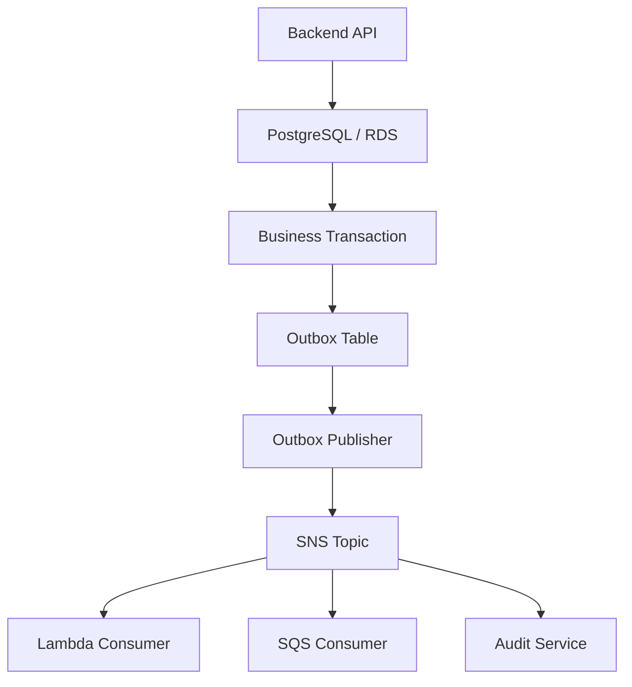
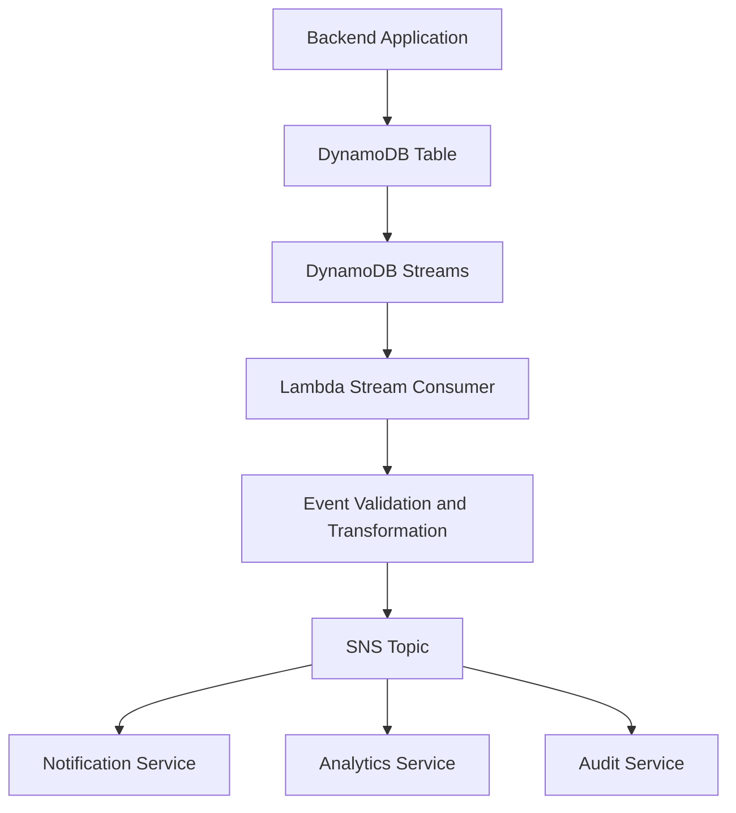
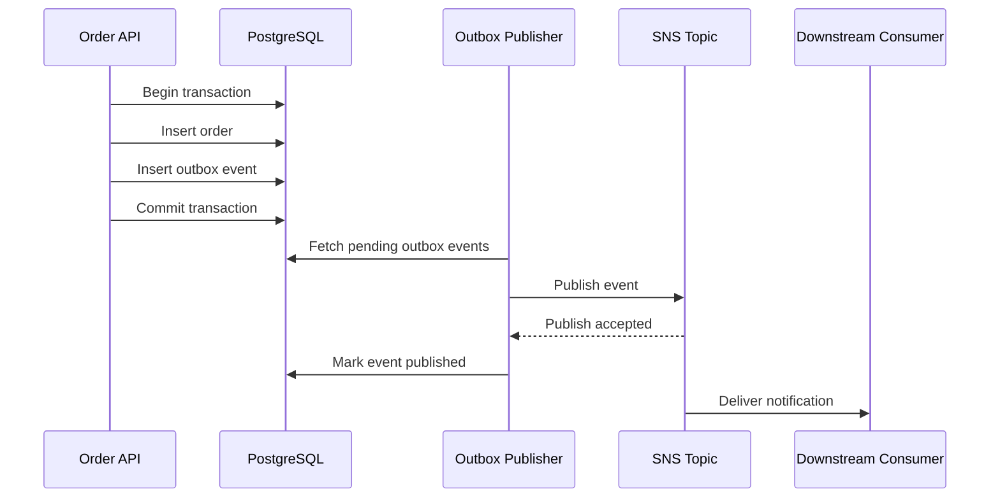
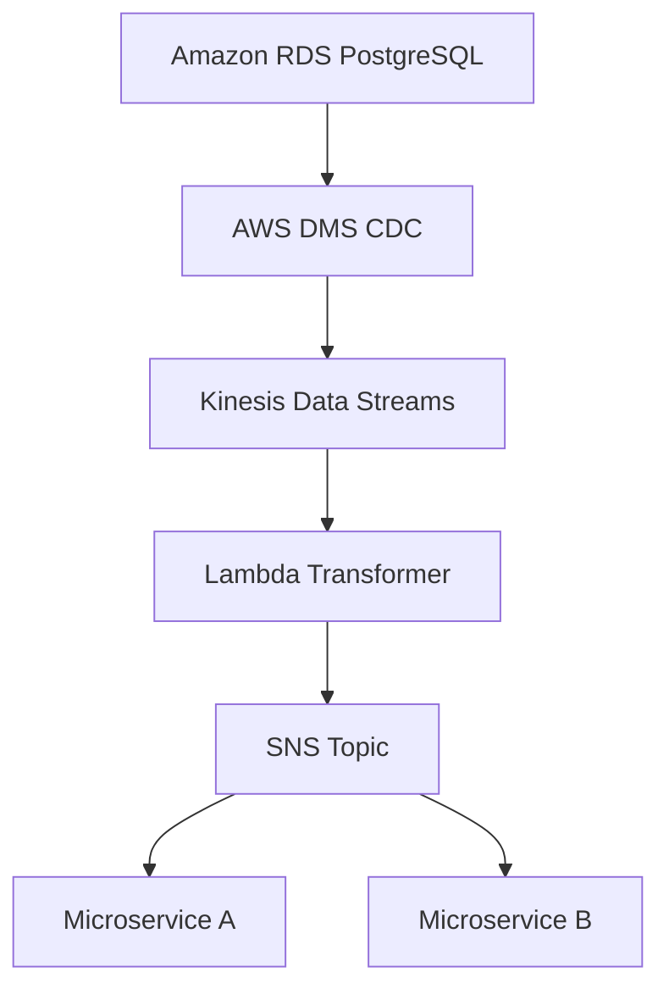
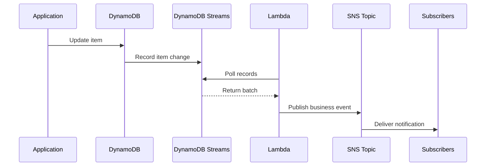
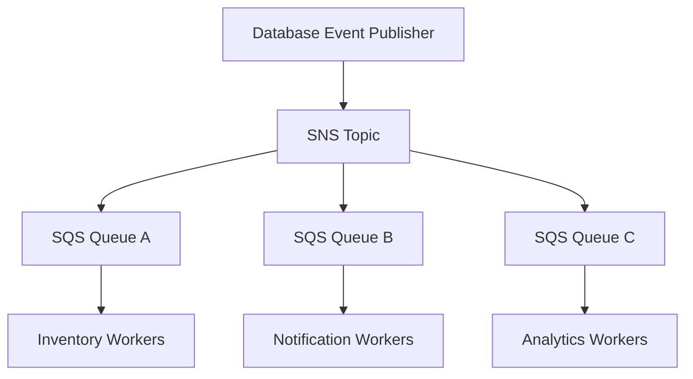

# 10- Amazon RDS and DynamoDB Integration

## Overview

Amazon SNS integrates with Amazon RDS and Amazon DynamoDB to distribute database-related events across backend services and event-driven workflows.

SNS acts as an event distribution layer. Database systems remain responsible for storing application data, while SNS distributes notifications to independent consumers that need to react to changes.

Common integration scenarios include:

- Publishing business events after database transactions.
- Notifying microservices when records change.
- Triggering asynchronous workflows after order creation or payment updates.
- Distributing DynamoDB Streams events through Lambda and SNS.
- Broadcasting database-related notifications to multiple consumers.
- Building audit, analytics, and notification pipelines.

SNS does not automatically monitor arbitrary changes in RDS tables or DynamoDB items. The application or an appropriate database event mechanism must detect changes and publish events.

## Integration Architecture

There are different integration patterns depending on the database and the event source.

### RDS with SNS

Amazon RDS does not provide a generic direct table-change-to-SNS notification mechanism.

A common architecture uses the transactional outbox pattern:



The application writes both business data and an outbox event in the same database transaction. A separate publisher reads pending events and publishes them to SNS.

This avoids the dual-write problem associated with independently committing a database transaction and publishing an event.

### DynamoDB with SNS

DynamoDB supports change data capture through DynamoDB Streams.

DynamoDB Streams records item-level changes. Lambda can consume those records and publish normalized events to SNS.



DynamoDB Streams captures item modifications, while SNS distributes events to downstream subscribers.

This separation allows the database change-capture mechanism and event distribution layer to scale independently.

## Choosing the Integration Pattern

| Requirement | Recommended approach |
|---|---|
| Publish events after RDS transactions | Transactional outbox |
| Capture DynamoDB item changes | DynamoDB Streams |
| Distribute database events to multiple consumers | SNS topic |
| Buffer events for independently scaled workers | SNS with SQS subscriptions |
| Process DynamoDB changes asynchronously | DynamoDB Streams with Lambda |
| Build a durable event publication pipeline from RDS | Outbox publisher with retries and idempotency |
| Publish application-level business events | Application service and SNS |
| Capture PostgreSQL changes without application-level outbox writes | Evaluate CDC tooling such as AWS DMS |

Choose the event source according to the consistency and reliability requirements.

Database change events and business events are not interchangeable. A database row update may not represent a meaningful business event.

For example, updating an order's internal processing timestamp should not necessarily publish an `order.completed` event.

## RDS Integration with SNS

### Why use the Transactional Outbox Pattern?

Consider an order service using PostgreSQL on Amazon RDS.

When an order is created, the application must:

1. Persist the order.
2. Publish an `order.created` event to SNS.

A naive implementation performs two independent operations:

```python
order.save()
sns.publish(...)
```

This introduces a dual-write problem.

Possible failure scenarios:

| Database operation | SNS publication | Result |
|---|---|---|
| Success | Success | Expected behavior |
| Success | Failure | Order exists, but consumers are not notified |
| Failure | Success | Consumers receive an event for a transaction that did not commit |
| Success | Application crashes before publish | Event is missing |

The transactional outbox pattern addresses this by storing the business change and event record in the same database transaction.

### Outbox architecture



The business record and outbox record are committed atomically.

If SNS is unavailable, the outbox record remains available for retry.

The publisher must still handle duplicate publication. A crash can occur after SNS accepts a message but before the publisher marks the outbox record as published.

## Implementing the Transactional Outbox

### Create the outbox table

Example PostgreSQL schema:

```sql
CREATE TABLE outbox_events (
    id UUID PRIMARY KEY,
    aggregate_type VARCHAR(100) NOT NULL,
    aggregate_id VARCHAR(128) NOT NULL,
    event_type VARCHAR(150) NOT NULL,
    payload JSONB NOT NULL,
    created_at TIMESTAMPTZ NOT NULL DEFAULT NOW(),
    published_at TIMESTAMPTZ,
    attempts INTEGER NOT NULL DEFAULT 0
);

CREATE INDEX idx_outbox_unpublished
ON outbox_events (created_at)
WHERE published_at IS NULL;
```

Important fields:

| Field | Purpose |
|---|---|
| `id` | Stable event identifier |
| `aggregate_type` | Business entity type |
| `aggregate_id` | Entity identifier |
| `event_type` | Business event name |
| `payload` | Serialized event data |
| `created_at` | Event creation timestamp |
| `published_at` | Publication completion timestamp |
| `attempts` | Number of publication attempts |

The partial index helps the publisher find unpublished events without scanning the entire table.

For high-volume systems, consider partitioning, archival, and cleanup strategies.

### Django model

```python
import uuid

from django.db import models


class OutboxEvent(models.Model):
    id = models.UUIDField(
        primary_key=True,
        default=uuid.uuid4,
        editable=False,
    )
    aggregate_type = models.CharField(max_length=100)
    aggregate_id = models.CharField(max_length=128)
    event_type = models.CharField(max_length=150)
    payload = models.JSONField()
    created_at = models.DateTimeField(auto_now_add=True)
    published_at = models.DateTimeField(null=True, blank=True)
    attempts = models.PositiveIntegerField(default=0)

    class Meta:
        db_table = "outbox_events"
        indexes = [
            models.Index(
                fields=["created_at"],
                name="outbox_created_idx",
                condition=models.Q(published_at__isnull=True),
            )
        ]
```

### Write business data and the event atomically

```python
import uuid

from django.db import transaction

from orders.models import Order
from integrations.models import OutboxEvent


def create_order(customer_id: str, amount: str) -> Order:
    with transaction.atomic():
        order = Order.objects.create(
            customer_id=customer_id,
            amount=amount,
            status="created",
        )

        OutboxEvent.objects.create(
            id=uuid.uuid4(),
            aggregate_type="order",
            aggregate_id=str(order.id),
            event_type="order.created",
            payload={
                "event_id": str(uuid.uuid4()),
                "event_type": "order.created",
                "order_id": str(order.id),
                "customer_id": customer_id,
                "amount": amount,
            },
        )

    return order
```

The business record and outbox event are committed in one transaction.

For consistency, use the outbox record's primary key as the event identifier rather than generating a second independent identifier. This keeps the persisted event identity and published event identity aligned.

A refined implementation can construct the identifier once:

```python
import uuid

from django.db import transaction

from orders.models import Order
from integrations.models import OutboxEvent


def create_order(customer_id: str, amount: str) -> Order:
    event_id = uuid.uuid4()

    with transaction.atomic():
        order = Order.objects.create(
            customer_id=customer_id,
            amount=amount,
            status="created",
        )

        OutboxEvent.objects.create(
            id=event_id,
            aggregate_type="order",
            aggregate_id=str(order.id),
            event_type="order.created",
            payload={
                "event_id": str(event_id),
                "event_type": "order.created",
                "order_id": str(order.id),
                "customer_id": customer_id,
                "amount": amount,
            },
        )

    return order
```

## Building the SNS Outbox Publisher

The publisher reads pending events, publishes them to SNS, and marks successful records as published.

### Basic publisher implementation

```python
import json
import logging
import os

import boto3
from botocore.exceptions import BotoCoreError, ClientError
from django.db import transaction
from django.utils import timezone

from integrations.models import OutboxEvent

logger = logging.getLogger(__name__)

sns = boto3.client(
    "sns",
    region_name=os.environ["AWS_REGION"],
)

TOPIC_ARN = os.environ["SNS_TOPIC_ARN"]


def publish_outbox_batch(batch_size: int = 100) -> int:
    published_count = 0

    with transaction.atomic():
        events = list(
            OutboxEvent.objects
            .select_for_update(skip_locked=True)
            .filter(published_at__isnull=True)
            .order_by("created_at")[:batch_size]
        )

        for event in events:
            try:
                response = sns.publish(
                    TopicArn=TOPIC_ARN,
                    Message=json.dumps(event.payload),
                    MessageAttributes={
                        "event_type": {
                            "DataType": "String",
                            "StringValue": event.event_type,
                        }
                    },
                )

                event.published_at = timezone.now()
                event.attempts += 1
                event.save(
                    update_fields=["published_at", "attempts"]
                )

                logger.info(
                    "Outbox event published",
                    extra={
                        "event_id": str(event.id),
                        "sns_message_id": response["MessageId"],
                    },
                )

                published_count += 1

            except (BotoCoreError, ClientError):
                event.attempts += 1
                event.save(update_fields=["attempts"])

                logger.exception(
                    "Outbox publication failed",
                    extra={"event_id": str(event.id)},
                )

    return published_count
```

This implementation illustrates the publication flow, but it holds database row locks while making network calls to SNS.

For production systems, avoid holding long-running database transactions across external network operations.

A more scalable implementation separates claiming, publishing, and completion using a lease or claim token.

### Production publisher design

A robust publisher should:

1. Claim a bounded batch of unpublished events.
2. Assign a lease or claim identifier.
3. Commit the claim transaction.
4. Publish events outside the database transaction.
5. Mark successful events as published using the claim identifier.
6. Release or expire claims for failed publications.
7. Retry with bounded exponential backoff and jitter.

A claim mechanism prevents multiple workers from continuously publishing the same rows while avoiding long-held database locks.

The publisher must still tolerate duplicate publication if it crashes after SNS accepts an event but before marking it complete.

### Operational recommendations

- Use a stable event ID.
- Track attempt count and last error.
- Set a maximum retry policy.
- Alert on old unpublished events.
- Archive or delete published records according to retention requirements.
- Use bounded batch sizes.
- Avoid holding database transactions open during SNS API calls.
- Preserve per-aggregate ordering if downstream consumers depend on it.

## RDS Change Data Capture with AWS DMS

For some workloads, application-level outbox records are not sufficient or cannot be introduced into an existing application.

AWS Database Migration Service (AWS DMS) can capture database changes using change data capture (CDC) and deliver them to supported targets, including Kinesis Data Streams.

A typical architecture is:



DMS is not a direct generic RDS-to-SNS publisher in this architecture. The stream and transformation stages provide the integration path.

### When to use CDC

Use CDC when:

- Existing applications cannot be modified easily.
- Database-level changes must be captured.
- Multiple tables need change extraction.
- A migration or replication pipeline already uses DMS.
- Downstream systems need a stream of database changes.

### CDC versus transactional outbox

| Consideration | Transactional outbox | Database CDC |
|---|---|---|
| Event meaning | Explicit business events | Database row changes |
| Application changes | Requires application writes | Requires database and CDC configuration |
| Transaction consistency | Business data and event committed together | Captures committed database changes |
| Event payload | Application-defined | Often reflects database records and operation metadata |
| Schema coupling | Event schema can be independent | More closely coupled to database schema |
| Operational complexity | Outbox publisher and cleanup | DMS tasks, replication configuration, and downstream transformation |
| Best suited for | Business integration events | Database change replication |

Use an outbox when the downstream contract should express business meaning. Use CDC when capturing database changes is the primary requirement.

## DynamoDB Integration with SNS

DynamoDB supports change data capture through DynamoDB Streams.

A stream captures item-level modifications and provides records representing changes to the table.

Lambda can consume these records and publish application events to SNS.

### DynamoDB Streams

DynamoDB Streams records changes to items in a DynamoDB table.

Depending on the configured stream view type, records can include:

| Stream view type | Data captured |
|---|---|
| `KEYS_ONLY` | Primary key attributes |
| `NEW_IMAGE` | Item state after modification |
| `OLD_IMAGE` | Item state before modification |
| `NEW_AND_OLD_IMAGES` | Both previous and updated item states |

Choose the view type according to downstream processing requirements.

For example, an audit pipeline may require both old and new images, while a notification service may only need the new image.

### Stream record structure

A simplified DynamoDB Streams record looks like:

```json
{
  "eventID": "example-event-id",
  "eventName": "MODIFY",
  "eventSource": "aws:dynamodb",
  "awsRegion": "ap-south-1",
  "dynamodb": {
    "Keys": {
      "order_id": {
        "S": "ord-123"
      }
    },
    "NewImage": {
      "order_id": {
        "S": "ord-123"
      },
      "status": {
        "S": "confirmed"
      }
    },
    "OldImage": {
      "order_id": {
        "S": "ord-123"
      },
      "status": {
        "S": "pending"
      }
    },
    "SequenceNumber": "123456789",
    "SizeBytes": 120,
    "StreamViewType": "NEW_AND_OLD_IMAGES"
  }
}
```

DynamoDB Streams uses typed attribute representations such as `S`, `N`, `BOOL`, and `M`.

Consumers should deserialize these values correctly rather than treating them as ordinary JSON application objects.

## Configuring DynamoDB Streams

Enable a stream on the table with the required view type.

Example:

```bash
aws dynamodb update-table \
  --table-name Orders \
  --stream-specification \
    StreamEnabled=true,StreamViewType=NEW_AND_OLD_IMAGES
```

Retrieve the stream ARN:

```bash
aws dynamodb describe-table \
  --table-name Orders \
  --query 'Table.LatestStreamArn' \
  --output text
```

The stream ARN is used when configuring a Lambda event source mapping.

DynamoDB Streams retains change records for up to 24 hours. Consumers that remain unavailable beyond the retention period can lose the opportunity to process older records from the stream.

For longer retention or independent replay requirements, consider forwarding events into a durable downstream event store or stream.

## Connecting DynamoDB Streams to Lambda

Lambda can poll DynamoDB Streams through an event source mapping.

The Lambda service manages polling and invokes the function with batches of stream records.

This is different from SNS invoking Lambda directly.



### Create the event source mapping

```bash
aws lambda create-event-source-mapping \
  --function-name dynamodb-to-sns-publisher \
  --event-source-arn arn:aws:dynamodb:ap-south-1:123456789012:table/Orders/stream/2026-11-22T10:00:00.000 \
  --starting-position LATEST \
  --batch-size 100 \
  --maximum-batching-window-in-seconds 5
```

Use the actual stream ARN returned by DynamoDB.

The `starting-position` setting determines where Lambda begins reading when the event source mapping is created.

- `LATEST`: Starts from the latest available records.
- `TRIM_HORIZON`: Starts from the oldest available records still retained.

For a new production consumer that must process all available retained records, evaluate `TRIM_HORIZON` rather than assuming `LATEST` is appropriate.

## Implementing a DynamoDB Streams to SNS Publisher

A Lambda function can transform DynamoDB stream records into business events and publish them to SNS.

### Install dependencies

```bash
pip install boto3
```

### Python implementation

```python
import json
import logging
import os
from typing import Any

import boto3
from boto3.dynamodb.types import TypeDeserializer

logger = logging.getLogger()
logger.setLevel(logging.INFO)

sns = boto3.client("sns")
deserializer = TypeDeserializer()

TOPIC_ARN = os.environ["SNS_TOPIC_ARN"]


def deserialize_item(item: dict[str, Any]) -> dict[str, Any]:
    return {
        key: deserializer.deserialize(value)
        for key, value in item.items()
    }


def transform_record(record: dict[str, Any]) -> dict[str, Any] | None:
    event_name = record["eventName"]
    dynamodb_data = record["dynamodb"]

    if event_name not in {"INSERT", "MODIFY", "REMOVE"}:
        return None

    keys = deserialize_item(dynamodb_data["Keys"])

    new_image = (
        deserialize_item(dynamodb_data["NewImage"])
        if "NewImage" in dynamodb_data
        else None
    )

    old_image = (
        deserialize_item(dynamodb_data["OldImage"])
        if "OldImage" in dynamodb_data
        else None
    )

    order_id = keys["order_id"]

    return {
        "event_id": record["eventID"],
        "event_type": f"order.{event_name.lower()}",
        "order_id": order_id,
        "new_image": new_image,
        "old_image": old_image,
    }


def lambda_handler(
    event: dict[str, Any],
    context: Any,
) -> dict[str, int]:
    published = 0

    for record in event.get("Records", []):
        payload = transform_record(record)

        if payload is None:
            continue

        sns.publish(
            TopicArn=TOPIC_ARN,
            Message=json.dumps(payload, default=str),
            MessageAttributes={
                "event_type": {
                    "DataType": "String",
                    "StringValue": payload["event_type"],
                }
            },
        )

        published += 1

    return {"published": published}
```

The example demonstrates conversion of DynamoDB typed attributes into Python values.

For production use:

- Define an explicit event schema.
- Avoid publishing complete database images unless consumers require them.
- Exclude sensitive attributes.
- Validate message size.
- Handle partial batch failures.
- Implement idempotency.
- Configure retry and failure destinations.
- Monitor stream iterator age.

### Important reliability limitation

The example publishes records sequentially and assumes that an exception fails the invocation.

DynamoDB Streams event source mappings support partial batch failure reporting. For production consumers, configure the appropriate response type and return failed sequence numbers when only part of a batch fails.

This prevents successfully processed records from being unnecessarily retried when the event source mapping supports partial batch response handling.

## DynamoDB Stream Ordering

DynamoDB Streams preserves modification order for a given item key.

However, applications should not assume global ordering across all items.

When publishing changes to SNS standard topics, downstream consumers should not assume the original DynamoDB ordering is preserved.

If strict ordering is required for a business entity:

- Use the entity key as the logical ordering key.
- Include a version or sequence value in the event.
- Reject stale updates where appropriate.
- Consider an ordered transport or per-entity processing mechanism.
- Avoid relying on SNS standard delivery order.

SNS FIFO topics cannot be configured as direct S3 notification destinations, and DynamoDB Streams-to-Lambda-to-SNS can publish to FIFO topics when the publisher explicitly supplies the required FIFO parameters. The publisher must provide a `MessageGroupId` and a deduplication strategy.

## Lambda Event Source Mapping Reliability

DynamoDB Streams invokes Lambda through an event source mapping.

The event source mapping polls the stream and invokes the function with batches.

Important configuration options include:

| Setting | Purpose |
|---|---|
| `BatchSize` | Maximum number of records in a batch |
| `MaximumBatchingWindowInSeconds` | Maximum time to collect records before invocation |
| `StartingPosition` | Initial stream position |
| `MaximumRetryAttempts` | Maximum retry attempts for a failed batch |
| `MaximumRecordAgeInSeconds` | Maximum age of records Lambda attempts to process |
| `BisectBatchOnFunctionError` | Splits failed batches to isolate problematic records |
| `DestinationConfig` | Configures destinations for discarded records |
| `FunctionResponseTypes` | Enables partial batch failure reporting |

### Configure partial batch responses

For a DynamoDB Streams event source mapping, enable the `ReportBatchItemFailures` response type:

```bash
aws lambda update-event-source-mapping \
  --uuid example-event-source-mapping-id \
  --function-response-types ReportBatchItemFailures
```

The Lambda handler can then return failed sequence numbers:

```python
def lambda_handler(event, context):
    failures = []

    for record in event.get("Records", []):
        sequence_number = record["dynamodb"]["SequenceNumber"]

        try:
            process_record(record)
        except Exception:
            logger.exception(
                "DynamoDB stream record processing failed",
                extra={"sequence_number": sequence_number},
            )

            failures.append({
                "itemIdentifier": sequence_number,
            })

    return {
        "batchItemFailures": failures,
    }
```

The event source mapping uses these identifiers to determine which records need retry.

A production implementation should distinguish transient failures from permanent failures and use a durable failure destination or recovery workflow.

## Idempotency Across Database and SNS

Both RDS outbox publishers and DynamoDB Streams consumers can publish duplicate messages.

For example:

1. A Lambda function receives a DynamoDB stream record.
2. The function publishes the event to SNS.
3. The function fails before the event source mapping records successful processing.
4. Lambda retries the stream record.
5. The function publishes the event again.

The downstream subscriber can therefore receive duplicate logical events.

Use a stable event ID and durable idempotency storage.

For DynamoDB Streams, `eventID` can be used as a source-record identifier. For application-level events, use a business event identifier generated when the business change is committed.

### DynamoDB idempotency table

Example table design:

| Attribute | Type | Purpose |
|---|---|---|
| `event_id` | String (partition key) | Unique event identifier |
| `processed_at` | Number or String | Processing timestamp |
| `ttl` | Number | Optional expiration timestamp |

A conditional write prevents duplicate processing:

```python
import time

from botocore.exceptions import ClientError


def claim_event(table, event_id: str) -> bool:
    try:
        table.put_item(
            Item={
                "event_id": event_id,
                "processed_at": int(time.time()),
            },
            ConditionExpression="attribute_not_exists(event_id)",
        )

        return True

    except ClientError as exc:
        if exc.response["Error"]["Code"] == "ConditionalCheckFailedException":
            return False

        raise
```

This example claims an event before processing. For critical workflows, a simple claim record is not sufficient if the process can fail after claiming but before completing the business operation.

A stronger design uses an explicit state machine such as `IN_PROGRESS`, `COMPLETED`, and `FAILED`, with leases and recovery rules.

When the idempotency record and business update are stored in the same database, use a transaction or conditional operation to make the state change atomic.

## Security and IAM

Database-to-SNS integrations require permissions at multiple layers.

### RDS outbox publisher permissions

The publisher needs permission to publish to the intended SNS topic.

Example IAM policy:

```json
{
  "Version": "2012-10-17",
  "Statement": [
    {
      "Sid": "PublishOrderEvents",
      "Effect": "Allow",
      "Action": [
        "sns:Publish"
      ],
      "Resource": "arn:aws:sns:ap-south-1:123456789012:orders-topic"
    }
  ]
}
```

The application also needs database credentials and network access to RDS.

Prefer IAM database authentication where supported and appropriate, or retrieve database credentials from AWS Secrets Manager.

### DynamoDB stream publisher permissions

The Lambda execution role requires permissions to read the stream and publish to SNS.

Typical stream permissions include:

- `dynamodb:DescribeStream`
- `dynamodb:GetRecords`
- `dynamodb:GetShardIterator`
- `dynamodb:ListStreams`

The role also needs the required `sns:Publish` permission.

Example SNS permission:

```json
{
  "Version": "2012-10-17",
  "Statement": [
    {
      "Sid": "PublishDynamoDBEvents",
      "Effect": "Allow",
      "Action": [
        "sns:Publish"
      ],
      "Resource": "arn:aws:sns:ap-south-1:123456789012:dynamodb-events"
    }
  ]
}
```

The Lambda event source mapping and execution role must also be configured to access the DynamoDB stream.

### Encryption

Consider encryption at each layer:

| Component | Security consideration |
|---|---|
| RDS | Encryption at rest, TLS connections, credential management |
| DynamoDB | Encryption at rest and IAM-controlled access |
| DynamoDB Streams | Access through IAM and service-managed stream infrastructure |
| SNS | Server-side encryption using supported KMS configuration |
| SQS | Independent encryption configuration for subscribed queues |
| Secrets Manager | Secure database credential storage |
| CloudWatch | Log access controls and retention policies |

Encryption of one service does not automatically configure encryption for every downstream destination.

## Monitoring and Observability

Monitor the database, event source, publisher, and downstream subscribers.

### RDS and outbox metrics

Track:

- Number of unpublished outbox events.
- Age of the oldest unpublished event.
- Publication attempts.
- SNS publication failures.
- Outbox processing duration.
- Database transaction latency.
- Database connection utilization.

A growing outbox backlog can indicate that the publisher is unavailable or that SNS publication is failing.

### DynamoDB and Streams metrics

Useful metrics include:

| Metric | Purpose |
|---|---|
| `GetRecords.IteratorAgeMilliseconds` | Measures stream consumer lag |
| `GetRecords.Records` | Tracks records retrieved |
| `ReadThrottleEvents` | Indicates read throttling |
| `WriteThrottleEvents` | Indicates write throttling on the table |
| `SuccessfulRequestLatency` | Helps identify request latency |
| `ThrottledRequests` | Tracks throttled requests |

Metric availability depends on the service and operation.

### Lambda metrics

Monitor:

- `Invocations`
- `Errors`
- `Duration`
- `Throttles`
- `ConcurrentExecutions`
- `IteratorAge`
- `AsyncEventAge`, where applicable

DynamoDB Streams event source mappings and direct SNS asynchronous invocations have different processing models. Use the metrics appropriate to each integration.

### SNS metrics

Monitor:

- `NumberOfMessagesPublished`
- `NumberOfNotificationsDelivered`
- `NumberOfNotificationsFailed`
- `NumberOfNotificationsFilteredOut`

Do not assume published message counts and delivered notification counts should be equal. A topic can have multiple subscribers, and filtering can reduce deliveries.

### Application-level observability

Include:

- Stable event ID.
- Aggregate ID.
- Database transaction or request correlation ID.
- Event type.
- Publication attempt.
- Consumer processing outcome.

Avoid high-cardinality identifiers as CloudWatch metric dimensions. Use structured logs and tracing for individual event diagnostics.

## Scalability and Performance

### RDS outbox scaling

For a high-volume outbox:

- Use partial indexes for unpublished records.
- Claim records in bounded batches.
- Publish outside database transactions.
- Use multiple workers with safe claim coordination.
- Keep publication attempts bounded.
- Archive or delete published records.
- Monitor database storage and index growth.

Avoid allowing outbox records to accumulate indefinitely.

### DynamoDB Streams scaling

DynamoDB Streams uses shards to expose change records.

Lambda event source mappings poll stream shards and invoke functions with batches.

Consider:

- Batch size and batching window.
- Lambda concurrency.
- Downstream API and database capacity.
- Stream iterator age.
- Retry behavior.
- Poison records.
- Parallelization settings.

Increasing Lambda concurrency does not automatically improve throughput if the downstream database or SNS publishing rate is the bottleneck.

### SNS subscriber scaling

SNS distributes messages independently to its subscriptions.

Use SQS subscriptions when consumers need buffering and independent processing capacity.

For example:



This architecture prevents a slow consumer from directly controlling the processing capacity of other subscribers.

## Disaster Recovery and Replay

Recovery requirements differ between RDS and DynamoDB integrations.

### RDS outbox recovery

The outbox table provides a durable record of unpublished events.

Recovery procedures should include:

- Identifying stale unpublished events.
- Releasing expired publisher claims.
- Retrying failed publications.
- Reconciling published records.
- Detecting duplicate downstream processing.
- Archiving completed events.

Retain outbox records long enough to support operational investigation and replay requirements.

### DynamoDB Streams recovery

DynamoDB Streams retains records for up to 24 hours.

If the consumer remains unavailable beyond the retention period, older stream records may no longer be available for processing.

For longer replay requirements, forward events into a durable storage or streaming system.

A recovery strategy should define:

- How failed batches are retained.
- How events are replayed.
- How duplicates are detected.
- How stale events are handled.
- How consumers recover without overwriting newer state.

## Cost Considerations

| Component | Cost factors |
|---|---|
| Amazon RDS | Instance capacity, storage, I/O, backups, and data transfer |
| PostgreSQL outbox | Storage, indexes, transaction overhead, and publisher queries |
| DynamoDB | Read/write capacity, storage, and optional features |
| DynamoDB Streams | Stream processing and associated read activity |
| Lambda | Invocation count, execution duration, memory, and concurrency |
| SNS | Publish requests and notification deliveries |
| SQS | API requests and optional features |
| CloudWatch | Metrics, logs, alarms, and dashboards |
| AWS DMS | Replication instance or serverless capacity and data processing |

Cost optimization practices:

- Use bounded outbox polling intervals.
- Avoid unnecessary event payload fields.
- Choose DynamoDB stream view types carefully.
- Use batch processing where appropriate.
- Avoid repeatedly processing duplicate events.
- Set log retention policies.
- Monitor stream consumer lag and Lambda duration.
- Archive completed outbox records according to retention requirements.

## Common Mistakes and Production Pitfalls

| Mistake | Impact | Prevention |
|---|---|---|
| Publishing directly after an RDS commit without an outbox | Events can be lost after database commit | Use a transactional outbox |
| Holding database locks while calling SNS | Long transactions and connection pressure | Claim records, commit, then publish |
| Assuming SNS publication is exactly once | Duplicate notifications | Use stable event IDs and idempotent consumers |
| Treating database row changes as business events | Consumers become coupled to database schema | Publish explicit business event contracts |
| Ignoring DynamoDB Streams retention | Missed changes during prolonged outages | Forward events to durable storage when longer retention is required |
| Using `LATEST` without understanding its semantics | Older available records may be skipped | Choose the starting position according to recovery requirements |
| Publishing full DynamoDB images unnecessarily | Larger messages and sensitive data exposure | Transform and minimize event payloads |
| Ignoring partial batch failures | Successfully processed records may be retried unnecessarily | Enable partial batch response handling |
| Assuming global event ordering | Incorrect downstream state | Use per-entity versioning and ordering controls |
| Using a simple idempotency claim without recovery | Events can remain permanently stuck after a crash | Use processing states and lease-based recovery |
| Ignoring outbox cleanup | Database growth and slower queries | Archive or purge completed records |
| Assuming SNS handles database change detection | No events are generated automatically for arbitrary RDS changes | Use outbox, CDC, or DynamoDB Streams as appropriate |

## Production Readiness Checklist

### RDS and SNS

- [ ] Business data and outbox events are written in one transaction.
- [ ] Events have stable identifiers.
- [ ] Publisher workers use bounded batches.
- [ ] Database locks are not held across external SNS calls.
- [ ] Publication retries use bounded backoff.
- [ ] Stale unpublished events are monitored.
- [ ] Published event retention and cleanup are defined.
- [ ] Consumers implement durable idempotency.

### DynamoDB and SNS

- [ ] DynamoDB Streams is enabled with the required view type.
- [ ] Lambda event source mapping uses the intended starting position.
- [ ] Lambda has least-privilege stream and SNS permissions.
- [ ] Partial batch failure handling is configured where appropriate.
- [ ] Stream iterator age is monitored.
- [ ] Duplicate records are handled safely.
- [ ] Event payloads exclude unnecessary sensitive attributes.
- [ ] Recovery procedures account for stream retention limits.

### SNS and downstream consumers

- [ ] Topic access is restricted through IAM and resource policies.
- [ ] Subscriber-specific filtering is configured where useful.
- [ ] Delivery failures have appropriate DLQs.
- [ ] Lambda or SQS processing failures have separate recovery mechanisms.
- [ ] Consumers validate event schemas.
- [ ] Ordering requirements are explicitly documented.
- [ ] CloudWatch metrics and application-level logs provide end-to-end visibility.

## Key Takeaways

- RDS-to-SNS integrations commonly use the transactional outbox pattern to atomically persist business changes and publication intent.
- DynamoDB Streams captures item-level changes, while Lambda can transform and publish those changes to SNS.
- Database change events and business events have different semantics; use explicit event contracts when downstream services depend on business meaning.
- Both integration patterns require duplicate handling, durable idempotency, retry management, and observability.
- Production systems must account for database capacity, stream retention, event ordering, security policies, and replay procedures.