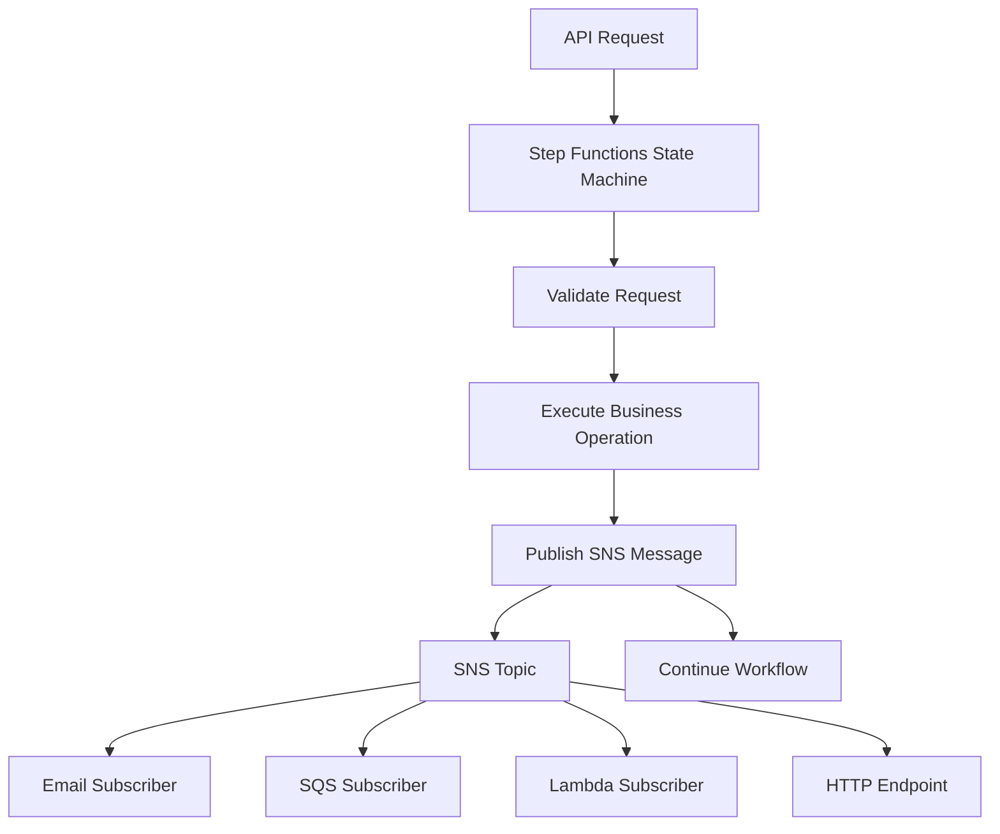
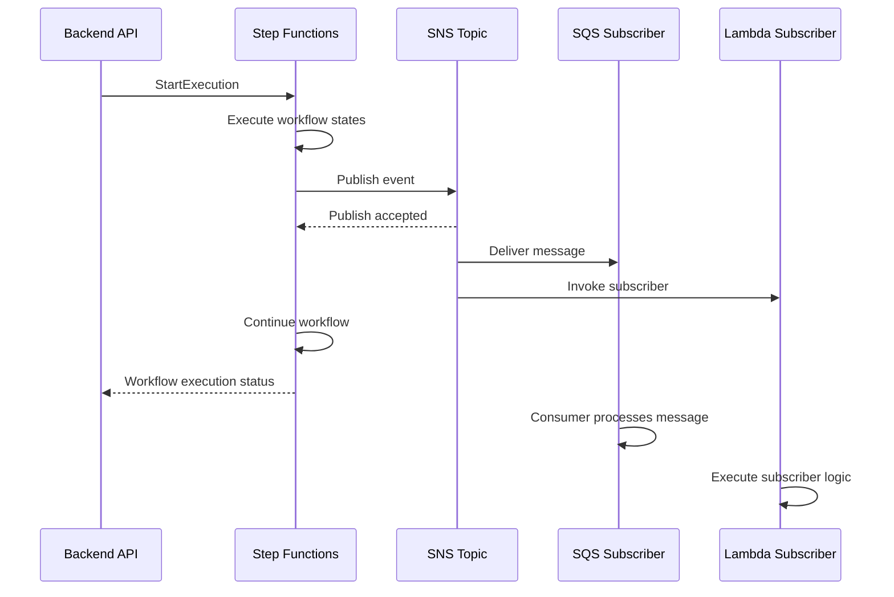
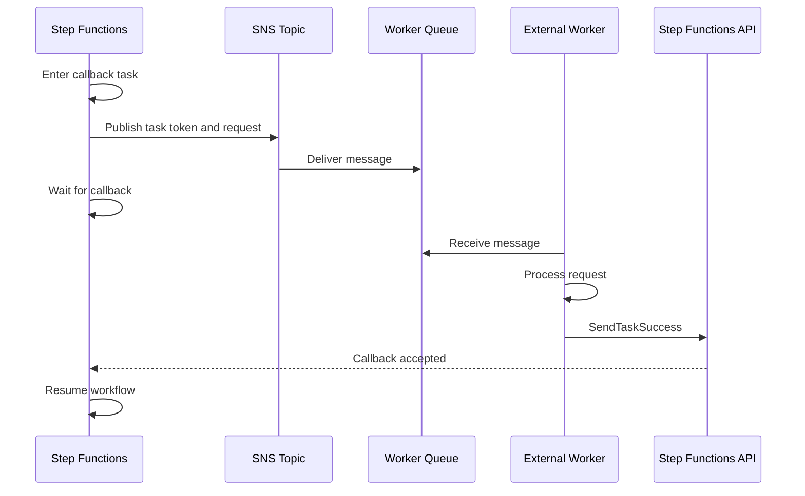
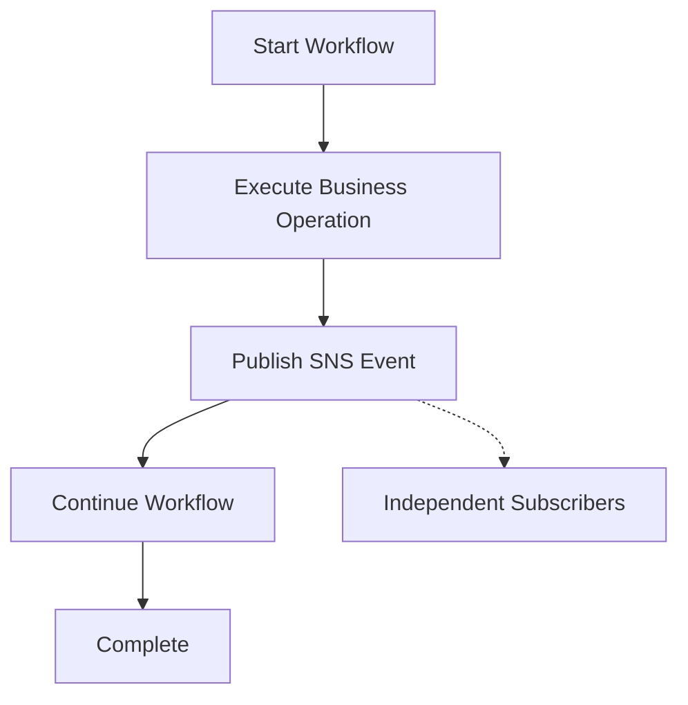
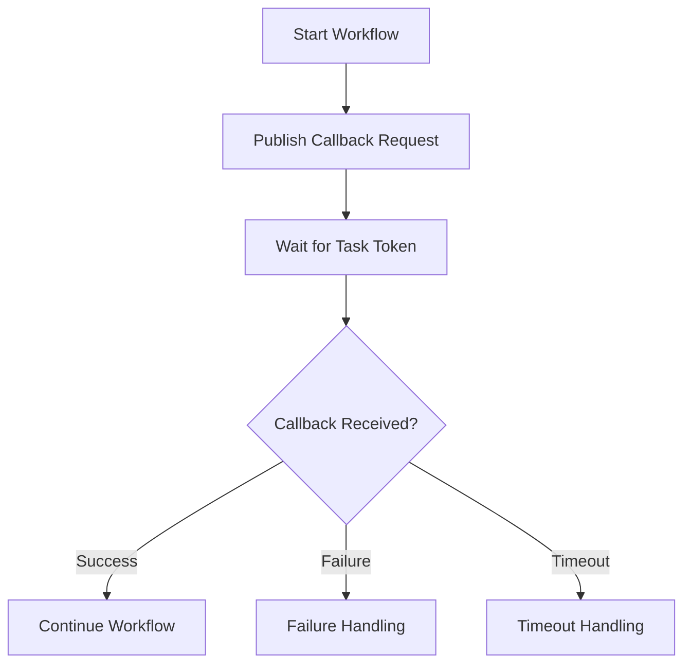
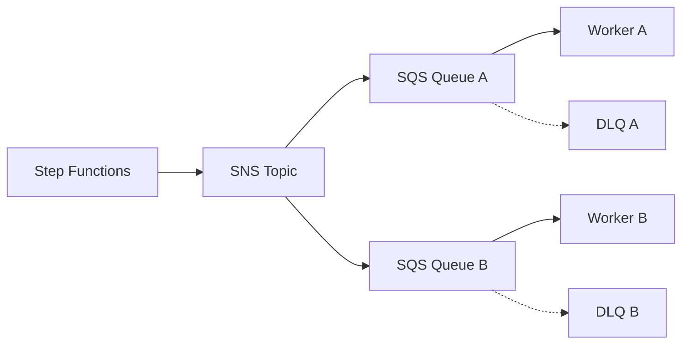
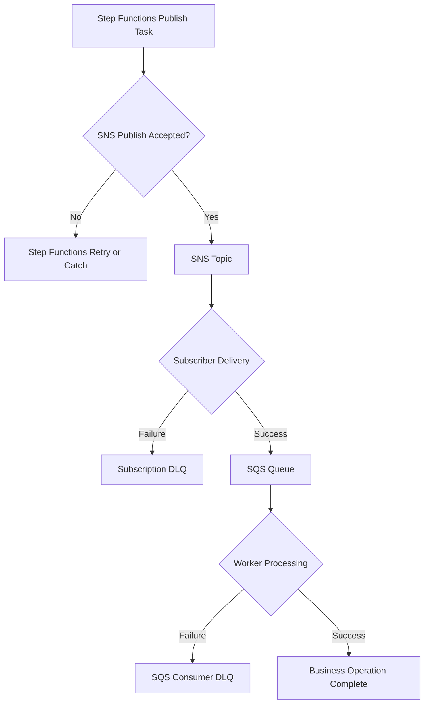

# 11- AWS Step Functions Integration

## Overview

AWS Step Functions orchestrates distributed applications by coordinating AWS services and application components through state machines. Integrating Step Functions with Amazon SNS allows workflows to publish notifications and business events to multiple subscribers without coupling the workflow to individual consumers.

SNS is useful when a workflow needs to notify multiple independent systems, distribute status changes, or trigger asynchronous processing. Step Functions manages workflow execution and state transitions, while SNS handles message distribution.

A typical integration looks like this:



This integration is useful for:

- Publishing workflow completion or failure notifications.
- Broadcasting business events to independent microservices.
- Triggering asynchronous downstream processing.
- Sending operational alerts.
- Waiting for external systems to complete work using callback task tokens.
- Decoupling workflow orchestration from event consumers.

The integration supports two primary interaction models:

| Model | Description | Typical use case |
|---|---|---|
| Direct SNS publishing | Step Functions publishes a message and continues after SNS accepts it | Notifications and event distribution |
| Callback with task token | Step Functions publishes a task token and waits for an external system to report completion | Human approval and asynchronous external processing |

A successful SNS publish does not mean that subscribers have completed their processing. It means SNS accepted the message for distribution.

## Step Functions and SNS Architecture

### Responsibilities of Each Service

| Component | Responsibility |
|---|---|
| AWS Step Functions | Orchestrates workflow execution and state transitions |
| SNS topic | Distributes messages to subscribers |
| SNS subscription | Connects a subscriber to a topic |
| SQS queue | Provides durable buffering for asynchronous consumers |
| Lambda function | Executes event-driven processing |
| External worker | Processes messages outside AWS or through a custom application |
| IAM execution role | Authorizes Step Functions to publish to SNS |

Step Functions should own workflow coordination and business process progression. SNS should own fan-out distribution.

Avoid embedding subscriber-specific processing logic into the state machine when independent consumers can process events themselves.

### Direct Publishing Architecture



The workflow does not wait for the SQS consumer or Lambda business operation to finish.

If downstream completion is required before the workflow progresses, use a callback pattern or an explicit polling and status-checking design.

## Direct SNS Integration

### Service Integration ARN

Step Functions provides a native SNS integration that allows a state machine to publish messages without invoking a Lambda function.

The integration resource ARN is:

```text
arn:aws:states:::sns:publish
```

This is an AWS SDK service integration. Step Functions invokes the SNS Publish API using the state machine execution role.

The workflow can specify:

- SNS topic ARN.
- Message body.
- Subject for supported notification protocols.
- Message attributes.
- FIFO message group and deduplication identifiers where applicable.

### Why Use Direct Integration?

A Lambda function is not necessary when the only operation is publishing a message.

Direct integration reduces:

- Additional compute execution.
- Lambda deployment and maintenance overhead.
- Network and invocation dependencies.
- Operational complexity.
- End-to-end latency introduced by an unnecessary intermediary.

Use Lambda when publishing requires substantial custom logic, external API calls, complex transformations, or specialized error handling that is difficult to express in Amazon States Language (ASL).

### Basic State Machine Definition

The following state machine publishes a workflow completion notification.

```json
{
  "Comment": "Publish workflow completion notification through SNS",
  "StartAt": "PublishNotification",
  "States": {
    "PublishNotification": {
      "Type": "Task",
      "Resource": "arn:aws:states:::sns:publish",
      "Parameters": {
        "TopicArn": "arn:aws:sns:ap-south-1:123456789012:workflow-events",
        "Message": {
          "event_type": "ORDER_PROCESSED",
          "order_id.$": "$.order_id",
          "status": "COMPLETED",
          "execution_id.$": "$$.Execution.Id"
        },
        "Subject": "Order Processing Completed"
      },
      "End": true
    }
  }
}
```

The definition uses JSONPath-based parameter mapping.

| Field | Purpose |
|---|---|
| `Resource` | Identifies the SNS Publish integration |
| `TopicArn` | Destination SNS topic |
| `Message` | Message body |
| `order_id.$` | Reads the order ID from workflow input |
| `$$.Execution.Id` | Reads the current execution identifier |
| `Subject` | Optional subject for supported notification protocols |

The `.$` suffix indicates that the value is dynamically resolved from the workflow context rather than treated as a literal string.

The message body is structured JSON. SNS accepts a message string, so the Step Functions integration serializes the supplied JSON object for publication.

### Workflow Input

An example execution input:

```json
{
  "order_id": "ORD-10045",
  "customer_id": "CUST-204",
  "amount": 1499.99,
  "currency": "INR"
}
```

The resulting message contains the order identifier, completion status, and execution identifier.

Avoid publishing sensitive customer information or unnecessary internal workflow state.

## Publishing Dynamic Messages

Production workflows usually construct notification messages from previous task results and execution metadata.

Step Functions supports input and result processing through fields such as:

- `InputPath`
- `Parameters`
- `ResultSelector`
- `ResultPath`
- `OutputPath`

The exact processing behavior depends on the state machine's query language and state definition.

### Using Parameters

Consider a workflow that receives an order, executes payment processing, and publishes an event.

```json
{
  "StartAt": "ProcessPayment",
  "States": {
    "ProcessPayment": {
      "Type": "Task",
      "Resource": "arn:aws:states:::lambda:invoke",
      "Parameters": {
        "FunctionName": "process-payment",
        "Payload.$": "$"
      },
      "ResultSelector": {
        "payment_id.$": "$.Payload.payment_id",
        "payment_status.$": "$.Payload.status"
      },
      "ResultPath": "$.payment",
      "Next": "PublishPaymentEvent"
    },
    "PublishPaymentEvent": {
      "Type": "Task",
      "Resource": "arn:aws:states:::sns:publish",
      "Parameters": {
        "TopicArn": "arn:aws:sns:ap-south-1:123456789012:payment-events",
        "Message": {
          "event_type": "PAYMENT_PROCESSED",
          "order_id.$": "$.order_id",
          "payment_id.$": "$.payment.payment_id",
          "status.$": "$.payment.payment_status"
        }
      },
      "End": true
    }
  }
}
```

The `ResultSelector` extracts only the required fields from the Lambda integration result. `ResultPath` stores the selected result under `payment`, preserving the original workflow input.

This produces a cleaner event contract than publishing an entire Lambda response.

### Dynamic Topic ARN

A topic ARN can also be supplied through workflow input or configuration.

```json
{
  "PublishNotification": {
    "Type": "Task",
    "Resource": "arn:aws:states:::sns:publish",
    "Parameters": {
      "TopicArn.$": "$.notification_topic_arn",
      "Message.$": "$.notification"
    },
    "End": true
  }
}
```

Dynamic destinations require careful validation.

Do not allow untrusted API callers to select arbitrary SNS topic ARNs. Prefer an allowlisted mapping between business event types and configured topic ARNs.

## Message Attributes and Filtering

SNS message attributes allow subscribers to filter messages without parsing the complete message body.

Step Functions can supply message attributes as part of the SNS Publish request.

### Publishing Message Attributes

```json
{
  "PublishOrderEvent": {
    "Type": "Task",
    "Resource": "arn:aws:states:::sns:publish",
    "Parameters": {
      "TopicArn": "arn:aws:sns:ap-south-1:123456789012:order-events",
      "Message": {
        "event_type": "ORDER_CREATED",
        "order_id.$": "$.order_id"
      },
      "MessageAttributes": {
        "event_type": {
          "DataType": "String",
          "StringValue": "ORDER_CREATED"
        },
        "environment": {
          "DataType": "String",
          "StringValue": "production"
        }
      }
    },
    "End": true
  }
}
```

Message attributes are metadata associated with the published message.

### Filtering at the Subscription Level

Suppose the topic has three subscribers:

| Subscriber | Filter policy | Messages received |
|---|---|---|
| Billing queue | `event_type = PAYMENT_COMPLETED` | Payment events |
| Fulfillment queue | `event_type = ORDER_CREATED` | Order creation events |
| Audit queue | No filter | All published events |

Example subscription filter policy:

```json
{
  "event_type": [
    "PAYMENT_COMPLETED"
  ]
}
```

Apply this policy to the relevant SNS subscription.

Filtering reduces unnecessary downstream processing and keeps consumers focused on their responsibilities.

Important considerations:

- Message attributes must be included when publishing.
- Filter policies operate on message attributes by default.
- SNS also supports body-based filtering when the subscription is configured with `FilterPolicyScope` set to `MessageBody`.
- Attribute names and values must remain consistent across publishers and subscribers.
- Filtering is not an authorization boundary. Use IAM and topic policies for access control.

## Workflow Error Handling

SNS publishing is a network-dependent service operation. It can fail because of permissions, invalid parameters, throttling, service errors, or temporary infrastructure issues.

A production workflow should explicitly define retry and failure behavior.

### Retry Transient Failures

```json
{
  "PublishNotification": {
    "Type": "Task",
    "Resource": "arn:aws:states:::sns:publish",
    "Parameters": {
      "TopicArn": "arn:aws:sns:ap-south-1:123456789012:workflow-events",
      "Message.$": "$.notification"
    },
    "Retry": [
      {
        "ErrorEquals": [
          "SNS.InternalErrorException",
          "SNS.ThrottledException",
          "States.Timeout"
        ],
        "IntervalSeconds": 2,
        "BackoffRate": 2,
        "MaxAttempts": 4,
        "MaxDelaySeconds": 30,
        "JitterStrategy": "FULL"
      }
    ],
    "Catch": [
      {
        "ErrorEquals": [
          "States.ALL"
        ],
        "ResultPath": "$.notification_error",
        "Next": "HandleNotificationFailure"
      }
    ],
    "Next": "ContinueWorkflow"
  },
  "HandleNotificationFailure": {
    "Type": "Pass",
    "Parameters": {
      "status": "NOTIFICATION_FAILED",
      "error.$": "$.notification_error"
    },
    "End": true
  },
  "ContinueWorkflow": {
    "Type": "Pass",
    "End": true
  }
}
```

The example demonstrates retry and catch structure. Adapt error names to the actual integration errors surfaced by the workflow and validate the definition before deployment.

### Retry Strategy

| Failure | Recommended behavior |
|---|---|
| Temporary SNS service error | Retry with exponential backoff |
| Throttling | Retry with backoff and jitter |
| Invalid topic ARN | Fail fast and alert |
| Access denied | Fix IAM or topic policy; avoid repeated retries |
| Invalid message parameters | Fix the event contract |
| Persistent publish failure | Route to a failure-handling state and record the event |

Do not retry every error indiscriminately.

Retries are appropriate for transient failures. Configuration and authorization errors generally require intervention.

### Catching Errors Without Losing Workflow Context

Use `ResultPath` to preserve the original input and store error information separately.

For example:

```json
{
  "Catch": [
    {
      "ErrorEquals": [
        "States.ALL"
      ],
      "ResultPath": "$.sns_error",
      "Next": "RecordPublishFailure"
    }
  ]
}
```

Avoid replacing the entire workflow state with an error object when later states need the original business identifiers.

### Notification Failure Versus Business Failure

A notification failure does not always mean the underlying business operation failed.

For example:

```text
Order processing succeeds
        |
        v
SNS publishing fails
        |
        v
Workflow enters notification failure handling
```

The application must decide whether notification delivery is:

- A mandatory part of the business transaction.
- A best-effort side effect.
- A separately recoverable operation.

For most asynchronous notification systems, the business transaction should not be rolled back merely because an optional notification could not be published.

For critical events, persist the event and implement a durable recovery mechanism rather than relying only on workflow retries.

## Callback Pattern with Task Tokens

### Overview

Some workflows must wait for an external system to finish processing before continuing.

For example:

- A human approval is required before an order can be fulfilled.
- An external payment provider must confirm a transaction.
- A third-party service performs a long-running operation.
- An asynchronous worker must complete a document-processing task.

A callback integration allows Step Functions to pause a task and resume it when an external worker calls `SendTaskSuccess` or `SendTaskFailure`.

SNS can distribute the task token to the external worker.

The integration pattern uses:

```text
arn:aws:states:::sns:publish.waitForTaskToken
```

The task token identifies the waiting task execution. It is a sensitive, temporary capability and must be handled securely.

### Callback Architecture



The workflow remains in a waiting state until a callback is received or the task times out.

### Callback State Definition

```json
{
  "StartAt": "RequestExternalApproval",
  "States": {
    "RequestExternalApproval": {
      "Type": "Task",
      "Resource": "arn:aws:states:::sns:publish.waitForTaskToken",
      "TimeoutSeconds": 3600,
      "Parameters": {
        "TopicArn": "arn:aws:sns:ap-south-1:123456789012:approval-requests",
        "Message": {
          "event_type": "APPROVAL_REQUESTED",
          "order_id.$": "$.order_id",
          "task_token.$": "$$.Task.Token",
          "execution_id.$": "$$.Execution.Id"
        }
      },
      "ResultPath": "$.approval_result",
      "Next": "ProcessApproval"
    },
    "ProcessApproval": {
      "Type": "Choice",
      "Choices": [
        {
          "Variable": "$.approval_result.status",
          "StringEquals": "APPROVED",
          "Next": "CompleteOrder"
        }
      ],
      "Default": "RejectOrder"
    },
    "CompleteOrder": {
      "Type": "Succeed"
    },
    "RejectOrder": {
      "Type": "Fail",
      "Error": "ApprovalRejected",
      "Cause": "The approval request was rejected."
    }
  }
}
```

The message contains the task token required by the external worker.

The external worker must call the Step Functions API using that token to resume the workflow.

### Callback Worker Implementation

A Python worker can consume the request from SQS, perform the external operation, and report the result.

```python
import json
import logging
import os

import boto3
from botocore.exceptions import BotoCoreError, ClientError

logger = logging.getLogger(__name__)
logger.setLevel(logging.INFO)

sqs = boto3.client("sqs")
stepfunctions = boto3.client("stepfunctions")

QUEUE_URL = os.environ["QUEUE_URL"]


def process_approval(message: dict) -> dict:
    """
    Replace this function with the actual approval integration.
    """
    order_id = message["order_id"]

    logger.info("Processing approval for order_id=%s", order_id)

    return {
        "status": "APPROVED",
        "order_id": order_id,
        "approved_by": "approval-service",
    }


def handle_message(message: dict) -> None:
    task_token = message["task_token"]

    try:
        result = process_approval(message)

        stepfunctions.send_task_success(
            taskToken=task_token,
            output=json.dumps(result),
        )

        logger.info(
            "Callback submitted successfully for order_id=%s",
            message.get("order_id"),
        )

    except (ClientError, BotoCoreError):
        logger.exception(
            "AWS operation failed for order_id=%s",
            message.get("order_id"),
        )
        raise


def main() -> None:
    while True:
        response = sqs.receive_message(
            QueueUrl=QUEUE_URL,
            MaxNumberOfMessages=10,
            WaitTimeSeconds=20,
            VisibilityTimeout=120,
        )

        for record in response.get("Messages", []):
            receipt_handle = record["ReceiptHandle"]

            try:
                envelope = json.loads(record["Body"])
                message = json.loads(envelope["Message"])

                handle_message(message)

                sqs.delete_message(
                    QueueUrl=QUEUE_URL,
                    ReceiptHandle=receipt_handle,
                )

            except Exception:
                logger.exception("Message processing failed")
                # Leave the message for retry or eventual DLQ delivery.


if __name__ == "__main__":
    main()
```

This example assumes an SNS subscription delivers messages to SQS and the worker receives the SNS notification envelope.

For production deployment:

- Use a dedicated worker identity with least-privilege permissions.
- Configure an SQS visibility timeout longer than the expected processing duration.
- Extend visibility for long-running work.
- Configure an SQS dead-letter queue.
- Validate the message schema.
- Protect task tokens as secrets.
- Handle expired and already-completed task tokens.
- Ensure the worker does not acknowledge a message before its callback has been accepted.

The example uses a simple polling loop to demonstrate the callback lifecycle. A production worker should also implement graceful shutdown, bounded concurrency, structured metrics, and controlled retry behavior.

### Reporting Callback Success

The worker calls:

```python
stepfunctions.send_task_success(
    taskToken=task_token,
    output=json.dumps({
        "status": "APPROVED",
        "approval_id": "APR-10045",
    }),
)
```

Step Functions validates the task token and resumes the waiting task.

The callback output becomes the task result and can be accessed by subsequent workflow states.

### Reporting Callback Failure

When processing fails permanently, the worker can report failure:

```python
stepfunctions.send_task_failure(
    taskToken=task_token,
    error="ApprovalProcessingFailed",
    cause="The approval service rejected the request.",
)
```

The state machine can handle this failure using a `Catch` transition.

Do not report every temporary worker failure through `SendTaskFailure`. Transient failures should normally be retried by the worker while the task remains valid.

### Callback Timeouts and Heartbeats

A callback task should define an appropriate timeout.

| Setting | Purpose |
|---|---|
| `TimeoutSeconds` | Maximum duration for the callback task |
| `HeartbeatSeconds` | Maximum interval between heartbeat signals |
| `SendTaskHeartbeat` | Signals that a long-running task is still active |

For long-running callback tasks, a worker can periodically send a heartbeat:

```python
stepfunctions.send_task_heartbeat(
    taskToken=task_token,
)
```

A heartbeat does not complete the task. It only indicates that processing is still active.

The worker must send heartbeats within the configured interval. Otherwise, Step Functions can fail the task with a heartbeat timeout.

### Task Token Security

Task tokens must be treated as credentials.

A token can allow its holder to complete or fail the associated task. Publishing it to an overly broad topic or logging it creates a security risk.

Recommended controls:

- Use a dedicated SNS topic for callback requests.
- Restrict topic subscriptions to trusted workers.
- Prefer SNS→SQS delivery for durable worker consumption.
- Encrypt messages using appropriate AWS KMS configuration.
- Do not log task tokens.
- Avoid including tokens in application traces or exception messages.
- Use short, appropriate callback timeouts.
- Restrict worker permissions to the required Step Functions callback APIs.
- Avoid exposing callback messages to untrusted HTTP subscribers.

A task token should never be treated as an ordinary business identifier.

## Workflow Design Patterns

### Publish-and-Continue

Use this pattern when the workflow only needs to notify other systems.



Suitable for:

- Order completion events.
- User notification events.
- Audit events.
- Workflow status broadcasts.

The workflow does not wait for subscriber processing.

### Publish-and-Wait

Use this pattern when the workflow must wait for external completion.



Suitable for:

- Human approval.
- External payment confirmation.
- Long-running document processing.
- External system coordination.

### SNS to SQS to Worker

For workloads that require durable buffering, use SNS with SQS subscriptions.



Advantages:

- Durable message storage.
- Independent consumer scaling.
- Back-pressure handling.
- Controlled retries.
- Dead-letter queue support.
- Isolation between subscribers.

This is generally preferable to direct Lambda subscriptions when consumers need explicit buffering, workload isolation, or long-running processing.

## Step Functions Standard and Express Workflows

Step Functions offers Standard and Express workflow types. Their execution semantics influence how SNS publishing should be designed.

| Capability | Standard | Express |
|---|---|---|
| Maximum execution duration | Up to one year | Up to five minutes |
| Execution model | Exactly-once workflow execution semantics by default | At-least-once for asynchronous Express; at-most-once for synchronous Express |
| Execution history | Detailed execution history | CloudWatch Logs for execution history |
| Long-running callback workflows | Supported | Not suitable for long-running callback waits |
| Typical use | Business workflows and long-running orchestration | High-volume, short-duration workflows |

The workflow execution guarantee does not make SNS subscriber processing exactly once.

A Standard workflow can successfully publish a message, and a subscriber can still receive a duplicate or fail during processing.

Express workflows require particular care because workflow execution semantics can result in repeated side effects.

### Choosing a Workflow Type

Use Standard workflows when:

- The workflow may run for an extended period.
- Human approval or external callbacks are required.
- Detailed execution history is important.
- Workflow-level retry and recovery are important.

Use Express workflows when:

- Execution duration is short.
- Throughput requirements are high.
- The workload is event-driven and latency-sensitive.
- Consumers are designed to tolerate the workflow's execution semantics.

Do not choose Express solely because SNS publishing is a short operation. Consider the complete workflow lifecycle.

## Reliability and Delivery Semantics

### SNS Acceptance Is Not Subscriber Completion

The direct SNS integration follows this sequence:

1. Step Functions invokes the SNS Publish API.
2. SNS accepts the message.
3. SNS returns a successful publish response.
4. Step Functions continues to the next state.
5. SNS delivers the message to configured subscriptions.
6. Subscribers process the message independently.

The workflow's success at step 3 does not guarantee success at step 6.

This distinction is essential when designing business workflows.

### Duplicate Message Handling

SNS Standard topics provide at-least-once delivery. Duplicate messages are possible.

Duplicates can also occur when:

- Step Functions retries a publish after an ambiguous response.
- A worker processes a message but fails before acknowledging it.
- An SQS visibility timeout expires during processing.
- A consumer crashes after completing a side effect but before recording completion.

Every business event should include a stable event identifier.

Example:

```json
{
  "event_id": "evt-7c2d9f45",
  "event_type": "ORDER_COMPLETED",
  "order_id": "ORD-10045",
  "occurred_at": "2026-11-22T10:30:00Z",
  "workflow_execution_id": "arn:aws:states:ap-south-1:123456789012:execution:OrderWorkflow:execution-10045"
}
```

Consumers should persist processed event identifiers and make business operations idempotent.

### Idempotency at the Consumer

A PostgreSQL consumer can use a unique event identifier to prevent duplicate side effects.

```sql
CREATE TABLE processed_events (
    event_id VARCHAR(128) PRIMARY KEY,
    event_type VARCHAR(100) NOT NULL,
    processed_at TIMESTAMPTZ NOT NULL DEFAULT NOW()
);
```

The consumer should record the event and apply the business change in the same database transaction.

```python
import json
import logging

import psycopg
from psycopg.errors import UniqueViolation

logger = logging.getLogger(__name__)


def process_event(
    connection: psycopg.Connection,
    event: dict,
) -> bool:
    event_id = event["event_id"]

    with connection.transaction():
        with connection.cursor() as cursor:
            cursor.execute(
                """
                INSERT INTO processed_events (event_id, event_type)
                VALUES (%s, %s)
                ON CONFLICT (event_id) DO NOTHING
                RETURNING event_id
                """,
                (event_id, event["event_type"]),
            )

            if cursor.fetchone() is None:
                logger.info("Duplicate event ignored: %s", event_id)
                return False

            cursor.execute(
                """
                UPDATE orders
                SET status = %s
                WHERE order_id = %s
                """,
                ("COMPLETED", event["order_id"]),
            )

    return True
```

The transaction ensures that the event record and business update commit together.

If the business update fails, the event record rolls back as well.

Avoid recording an event as processed before applying its business operation in a separate transaction. That can permanently suppress an event whose business operation never completed.

### Ambiguous Publish Outcomes

A network timeout can occur after SNS has accepted a message but before Step Functions receives the response.

The workflow may retry the publish operation, potentially producing a duplicate.

This is an important reason to make subscribers idempotent.

For SNS FIFO topics, explicit message deduplication identifiers can help suppress duplicate publications within the FIFO deduplication interval. However, they do not replace durable consumer idempotency.

## SNS FIFO Topics

SNS FIFO topics support ordered delivery within message groups and deduplication behavior.

A Step Functions task can publish to an SNS FIFO topic using message group and deduplication identifiers.

```json
{
  "PublishOrderEvent": {
    "Type": "Task",
    "Resource": "arn:aws:states:::sns:publish",
    "Parameters": {
      "TopicArn": "arn:aws:sns:ap-south-1:123456789012:order-events.fifo",
      "Message": {
        "event_type": "ORDER_UPDATED",
        "order_id.$": "$.order_id",
        "status.$": "$.status"
      },
      "MessageGroupId.$": "$.order_id",
      "MessageDeduplicationId.$": "$.event_id"
    },
    "End": true
  }
}
```

The message group ID determines the ordering group. Using the order ID ensures that messages for the same order are grouped together.

The event ID provides an explicit deduplication identifier.

Important considerations:

- FIFO topics require FIFO-compatible subscriptions.
- Message group IDs should reflect the required ordering boundary.
- Messages in different groups can be processed concurrently.
- Deduplication has a limited time window.
- Content-based deduplication uses the message body and does not include message attributes.
- Explicit deduplication IDs should be stable across retries of the same logical event.
- FIFO ordering does not guarantee that external business operations complete in order unless consumers preserve that ordering.

Do not use one global message group ID unless global serialization is genuinely required. It can create a throughput bottleneck.

## Payload Design and Size Limits

SNS supports messages up to 256 KiB.

Step Functions also has a 256 KiB state input and output limit. Large workflow payloads can therefore become problematic before the SNS integration is invoked.

Avoid publishing:

- Large documents.
- Full database records.
- Binary payloads.
- Large API responses.
- Entire workflow execution histories.
- Sensitive information that subscribers do not need.

Prefer publishing a compact event with a reference to the underlying data.

Example:

```json
{
  "event_id": "evt-10045",
  "event_type": "DOCUMENT_PROCESSED",
  "document_id": "DOC-10045",
  "bucket": "application-documents",
  "object_key": "processed/2026/11/DOC-10045.json"
}
```

The consumer retrieves the document from S3 using its own IAM permissions.

This approach reduces message size and separates event transport from bulk data storage.

## Security and IAM

Step Functions requires an execution role that allows it to publish to the target SNS topic.

### Execution Role Permissions

A minimal identity policy for publishing to one topic:

```json
{
  "Version": "2012-10-17",
  "Statement": [
    {
      "Sid": "PublishWorkflowEvents",
      "Effect": "Allow",
      "Action": [
        "sns:Publish"
      ],
      "Resource": "arn:aws:sns:ap-south-1:123456789012:workflow-events"
    }
  ]
}
```

Avoid granting `sns:*` or using `"Resource": "*"` when the workflow only needs to publish to specific topics.

### SNS Topic Resource Policy

The topic can also restrict which principals are allowed to publish.

Example:

```json
{
  "Version": "2012-10-17",
  "Statement": [
    {
      "Sid": "AllowStepFunctionsPublish",
      "Effect": "Allow",
      "Principal": {
        "AWS": "arn:aws:iam::123456789012:role/StepFunctionsExecutionRole"
      },
      "Action": "sns:Publish",
      "Resource": "arn:aws:sns:ap-south-1:123456789012:workflow-events"
    }
  ]
}
```

The identity policy and resource policy must permit the operation under the applicable IAM evaluation rules.

For cross-account publishing, configure the source execution role and destination topic policy appropriately.

### Encryption

SNS supports server-side encryption using AWS KMS.

For an encrypted topic:

- Configure the topic with an appropriate KMS key.
- Ensure the publishing principal is authorized to use the key as required.
- Ensure the KMS key policy permits the relevant operations.
- Restrict key usage to trusted principals.
- Review cross-account key access separately.

Do not assume that enabling SNS encryption automatically makes all message handling secure. Subscriber permissions, task token exposure, logs, and downstream storage also require protection.

### Protecting Workflow Data

Step Functions execution input and state data can contain sensitive values.

Apply these controls:

- Pass only required fields between states.
- Avoid putting passwords, access tokens, and payment credentials in workflow input.
- Avoid publishing sensitive data to broad SNS topics.
- Use Secrets Manager or Systems Manager Parameter Store for secrets.
- Restrict access to execution history and CloudWatch Logs.
- Avoid logging callback task tokens.
- Use separate topics for different trust boundaries.

## Monitoring and Observability

A production integration should monitor both workflow execution and SNS delivery.

### Step Functions Monitoring

Important metrics and signals include:

| Metric or signal | Purpose |
|---|---|
| ExecutionsStarted | Tracks workflow volume |
| ExecutionsSucceeded | Tracks successful executions |
| ExecutionsFailed | Identifies workflow failures |
| ExecutionsTimedOut | Detects workflow timeouts |
| ExecutionThrottled | Identifies workflow throttling |
| Execution history | Identifies the failed state and error details |

For Standard workflows, execution history provides detailed state transition information.

For Express workflows, configure CloudWatch Logs appropriately to support execution troubleshooting.

### SNS Monitoring

Important SNS metrics include:

| Metric | Purpose |
|---|---|
| NumberOfMessagesPublished | Number of messages accepted by SNS |
| NumberOfNotificationsDelivered | Successful subscription deliveries |
| NumberOfNotificationsFailed | Failed delivery attempts |
| NumberOfNotificationsFilteredOut | Messages excluded by subscription filters |
| NumberOfNotificationsRedrivenToDlq | Messages moved to subscription DLQs |
| PublishSize | Published message size |

Metric availability and dimensions depend on the protocol and SNS configuration.

### Correlation IDs

Use a stable correlation identifier across the workflow and subscribers.

Example event:

```json
{
  "event_id": "evt-10045",
  "correlation_id": "corr-ORD-10045",
  "event_type": "ORDER_COMPLETED",
  "order_id": "ORD-10045",
  "execution_id": "arn:aws:states:ap-south-1:123456789012:execution:OrderWorkflow:execution-10045"
}
```

Include the correlation ID in:

- Step Functions execution input.
- SNS message body.
- SQS message processing logs.
- Lambda logs.
- Backend API logs.
- Distributed traces where supported.

Do not use the task token or other secret values as correlation identifiers.

### CloudWatch Alarms

Create alarms for:

- Increasing workflow failure rates.
- Workflow timeout spikes.
- SNS delivery failures.
- Subscription DLQ message growth.
- Unusually high message publication volume.
- Unexpected callback timeout rates.

An SNS topic can itself be used as a CloudWatch alarm notification destination, but avoid creating circular notification architectures.

## Dead-Letter Queues and Failure Boundaries

A reliable design distinguishes failures at different stages.



| Failure boundary | Recovery mechanism |
|---|---|
| Step Functions cannot publish | Step Functions Retry and Catch |
| SNS cannot deliver to a subscription | SNS subscription redrive policy and DLQ |
| SQS worker cannot process a message | SQS redrive policy and consumer DLQ |
| Lambda asynchronous execution fails | Lambda retry and failure destination or DLQ configuration |
| Callback worker cannot complete task | Worker retry, callback timeout handling, and task failure reporting |

These mechanisms are not interchangeable.

An SNS subscription DLQ captures delivery failures at the SNS-to-subscriber boundary. It does not automatically capture application processing failures after a message has been accepted by SQS.

For an SQS subscriber, configure a separate SQS DLQ to capture messages that repeatedly fail consumer processing.

### Recovery Strategy

A production recovery process should:

1. Identify the failure boundary.
2. Inspect the relevant workflow execution or dead-letter queue.
3. Determine whether the event was already processed.
4. Check the consumer's idempotency record.
5. Correct the underlying configuration or application issue.
6. Redrive or replay the event.
7. Verify the resulting business state.

Never blindly replay messages without checking whether their side effects have already occurred.

## Deployment with Terraform

Infrastructure as Code should manage the SNS topic, Step Functions execution role, state machine, and supporting resources.

### SNS Topic

```hcl
resource "aws_sns_topic" "workflow_events" {
  name = "workflow-events"

  kms_master_key_id = "alias/aws/sns"

  tags = {
    Environment = "production"
    Application = "order-workflow"
  }
}
```

For production systems with specific key-management requirements, use a customer-managed KMS key and configure its key policy explicitly.

### Step Functions Execution Role

```hcl
resource "aws_iam_role" "step_functions_execution" {
  name = "order-workflow-execution-role"

  assume_role_policy = jsonencode({
    Version = "2012-10-17"
    Statement = [
      {
        Effect = "Allow"
        Principal = {
          Service = "states.amazonaws.com"
        }
        Action = "sts:AssumeRole"
      }
    ]
  })
}
```

### Publish Permission

```hcl
resource "aws_iam_role_policy" "publish_to_sns" {
  name = "publish-workflow-events"
  role = aws_iam_role.step_functions_execution.id

  policy = jsonencode({
    Version = "2012-10-17"
    Statement = [
      {
        Effect = "Allow"
        Action = [
          "sns:Publish"
        ]
        Resource = aws_sns_topic.workflow_events.arn
      }
    ]
  })
}
```

### State Machine Definition

```hcl
resource "aws_sfn_state_machine" "order_workflow" {
  name     = "order-workflow"
  role_arn = aws_iam_role.step_functions_execution.arn
  type     = "STANDARD"

  definition = jsonencode({
    Comment = "Order processing with SNS event publishing"

    StartAt = "PublishOrderEvent"

    States = {
      PublishOrderEvent = {
        Type     = "Task"
        Resource = "arn:aws:states:::sns:publish"

        Parameters = {
          TopicArn = aws_sns_topic.workflow_events.arn

          Message = {
            event_type = "ORDER_COMPLETED"
            order_id   = "$.order_id"
          }
        }

        End = true
      }
    }
  })

  depends_on = [
    aws_iam_role_policy.publish_to_sns
  ]

  tags = {
    Environment = "production"
    Application = "order-workflow"
  }
}
```

The example illustrates resource relationships, but the `Message.order_id` value above is a literal string because `jsonencode` does not interpret Step Functions JSONPath syntax automatically.

For a dynamic value, use the ASL key `order_id.$`:

```hcl
Message = {
  event_type = "ORDER_COMPLETED"
  "order_id.$" = "$.order_id"
}
```

This distinction is important when generating ASL definitions through Terraform.

### Outputs

```hcl
output "sns_topic_arn" {
  description = "SNS topic ARN used by the order workflow"
  value       = aws_sns_topic.workflow_events.arn
}

output "state_machine_arn" {
  description = "Order workflow state machine ARN"
  value       = aws_sfn_state_machine.order_workflow.arn
}
```

### Deployment Considerations

- Keep state machine definitions in version control.
- Review IAM permissions as part of code review.
- Use separate environments and topic ARNs.
- Validate ASL definitions before deployment.
- Avoid hardcoding account IDs and Regions.
- Use remote Terraform state with appropriate locking and encryption.
- Deploy topic and IAM changes before workflows that depend on them.
- Use controlled state machine updates and test rollback procedures.

## Deployment with AWS CLI

### Create an SNS Topic

```bash
aws sns create-topic \
  --name workflow-events \
  --region ap-south-1
```

Capture the returned topic ARN.

### Create the State Machine

Save the state machine definition as `workflow.asl.json`.

```bash
aws stepfunctions create-state-machine \
  --name order-workflow \
  --definition file://workflow.asl.json \
  --role-arn arn:aws:iam::123456789012:role/StepFunctionsExecutionRole \
  --type STANDARD \
  --region ap-south-1
```

The execution role must trust `states.amazonaws.com` and have the required SNS permissions.

### Start an Execution

```bash
aws stepfunctions start-execution \
  --state-machine-arn arn:aws:states:ap-south-1:123456789012:stateMachine:order-workflow \
  --input '{
    "order_id": "ORD-10045",
    "customer_id": "CUST-204"
  }' \
  --region ap-south-1
```

### Inspect Execution Status

```bash
aws stepfunctions describe-execution \
  --execution-arn arn:aws:states:ap-south-1:123456789012:execution:order-workflow:execution-10045 \
  --region ap-south-1
```

### Retrieve Execution History

```bash
aws stepfunctions get-execution-history \
  --execution-arn arn:aws:states:ap-south-1:123456789012:execution:order-workflow:execution-10045 \
  --region ap-south-1
```

Use execution history to inspect state transitions, task failures, and retry behavior.

## Testing Strategy

Testing should cover the state machine definition, SNS integration, failure handling, and subscriber behavior.

### Definition Validation

Use the Step Functions API to validate the state machine definition before deployment.

```bash
aws stepfunctions validate-state-machine-definition \
  --definition file://workflow.asl.json \
  --type STANDARD \
  --region ap-south-1
```

This catches definition and ASL validation issues before creating or updating the state machine.

### Step Functions Local

Step Functions Local can help test state machine behavior during development.

It is useful for:

- Testing state transitions.
- Validating input and output processing.
- Testing Choice states.
- Exercising Retry and Catch logic.
- Testing workflow definitions without deploying a complete state machine.

It does not replace integration tests against AWS. Service integrations, IAM policies, SNS delivery, and callback behavior should also be tested in an AWS test environment.

### Unit Testing Event Contracts

Python event producers and consumers should validate event structure independently.

```python
from pydantic import BaseModel, ConfigDict
from typing import Literal


class OrderCompletedEvent(BaseModel):
    model_config = ConfigDict(extra="forbid")

    event_id: str
    event_type: Literal["ORDER_COMPLETED"]
    order_id: str
    correlation_id: str
```

This provides a clear event contract and catches incompatible payload changes.

### Integration Test Scenarios

| Scenario | Expected result |
|---|---|
| Valid SNS publish | Workflow continues |
| Invalid topic ARN | Task fails or enters Catch |
| Missing publish permission | Access error is handled |
| Temporary SNS failure | Retry policy is applied |
| Subscriber delivery failure | Subscription DLQ receives the message when configured |
| Duplicate event | Consumer ignores duplicate side effects |
| Callback success | Waiting workflow resumes |
| Callback failure | Workflow enters failure handling |
| Callback timeout | Workflow handles timeout |
| Expired task token | Worker records and handles callback failure |
| Invalid message schema | Consumer rejects or quarantines message |

Test the complete event lifecycle rather than treating a successful state machine execution as proof that subscribers processed the event.

## Performance and Scalability

### Workflow Throughput

Workflow throughput depends on:

- Standard or Express workflow type.
- State transition volume.
- Account and Region quotas.
- SNS topic publishing quotas.
- Downstream subscription capacity.
- Consumer concurrency and processing duration.

A workflow that publishes a message for every record in a large batch can generate substantial SNS traffic and state transitions.

For high-volume workloads, consider batching, asynchronous ingestion, or a streaming service when the event pattern requires sustained high-throughput processing.

### SNS Fan-Out

SNS can distribute one published message to multiple subscribers.

However, each subscriber has independent delivery and processing characteristics.

For example:

- A Lambda subscriber may process messages quickly.
- An SQS subscriber may accumulate a backlog.
- An HTTP subscriber may experience endpoint failures.
- An email subscriber may have different delivery latency.

Monitor each subscription independently.

### Callback Workflow Capacity

Callback workflows consume waiting execution capacity and remain active until completion or timeout.

For long-running external operations:

- Set realistic task timeouts.
- Use heartbeats for long-running workers.
- Avoid unnecessarily long callback waits.
- Persist business state outside the workflow when appropriate.
- Handle abandoned approvals and expired tasks.
- Design callback workers to tolerate duplicate delivery.

Do not use a callback task as a substitute for a durable business process database.

## High Availability and Disaster Recovery

Step Functions and SNS are regional services. Their integration does not automatically provide cross-Region workflow or message replication.

A resilient architecture should consider:

- Deploying workflows and topics in the required Regions.
- Replicating application data using an appropriate database strategy.
- Recreating state machine definitions through IaC.
- Maintaining recovery procedures for failed workflow executions.
- Configuring SNS subscription DLQs.
- Configuring SQS consumer DLQs.
- Testing recovery from a Region-level outage.
- Maintaining event identifiers and idempotency records across recovery boundaries.

For critical workflows, define how in-flight executions and waiting callback tasks are handled during regional recovery.

A recovery architecture may need to restart business operations from persisted application state rather than attempting to resume every in-flight execution.

## Cost Considerations

The integration has costs across several services.

| Component | Cost driver |
|---|---|
| Step Functions Standard | State transitions |
| Step Functions Express | Requests and execution duration |
| SNS | API requests, delivery, and optional features |
| SQS | API requests and data transfer considerations |
| Lambda | Invocations, duration, and allocated resources |
| KMS | Key usage and applicable key charges |
| CloudWatch | Logs, metrics, alarms, and retention |

Control costs by:

- Avoiding unnecessary workflow states.
- Publishing compact messages.
- Avoiding duplicate notifications.
- Using appropriate workflow types.
- Setting sensible log retention.
- Filtering messages at the subscription level.
- Choosing SQS buffering when it improves consumer efficiency.
- Avoiding excessive callback polling.

For high-volume event pipelines, compare Step Functions orchestration costs with event-driven designs based on SNS, SQS, EventBridge, or Kinesis.

## Common Mistakes and Production Pitfalls

### Assuming Workflow Success Means Consumer Success

**Problem:** The state machine completes after SNS accepts the message, even though a subscriber later fails.

**Correction:** Monitor subscriber delivery and processing independently. Use SQS and DLQs where durable processing is required.

### Using Lambda Only to Publish SNS Messages

**Problem:** An unnecessary Lambda function adds compute cost, deployment complexity, and another failure boundary.

**Correction:** Use the native SNS service integration when the operation is simply publishing a message.

### Publishing Entire Workflow State

**Problem:** Messages contain unrelated data, sensitive values, or payloads that exceed service limits.

**Correction:** Construct explicit event contracts and publish only required fields.

### Retrying Permanent Errors

**Problem:** Invalid topic ARNs and IAM authorization failures are repeatedly retried.

**Correction:** Retry transient failures and route configuration failures to an appropriate error-handling path.

### Ignoring Duplicate Events

**Problem:** Retries or at-least-once delivery cause the same business operation to execute more than once.

**Correction:** Include stable event identifiers and implement consumer-side idempotency.

### Exposing Callback Task Tokens

**Problem:** Task tokens are published to untrusted subscribers or written to logs.

**Correction:** Restrict callback topics, encrypt messages, limit worker access, and never log task tokens.

### Using Callback Tasks for Unbounded Work

**Problem:** External systems take longer than the configured task timeout or stop sending heartbeats.

**Correction:** Define realistic timeouts, heartbeat intervals, retry policies, and recovery procedures.

### Using a Single FIFO Message Group

**Problem:** All messages are serialized through one group, reducing concurrency.

**Correction:** Choose message group IDs based on the business ordering boundary, such as an order or account identifier.

### Treating SNS DLQs as Consumer DLQs

**Problem:** Messages successfully delivered to SQS are assumed to be protected by the SNS subscription DLQ if the worker later fails.

**Correction:** Configure separate DLQs for SNS delivery failures and SQS consumer processing failures.

### Allowing Untrusted Dynamic Topic Selection

**Problem:** Workflow input controls the SNS destination and can potentially publish to unintended topics.

**Correction:** Use allowlisted destinations and tightly scoped IAM policies.

## Production Best Practices

- Prefer native Step Functions SNS integration over Lambda when no custom publishing logic is required.
- Keep event schemas explicit, versioned, and backward-compatible.
- Include stable event IDs and correlation IDs in published messages.
- Make every consumer idempotent.
- Separate workflow success from subscriber processing success.
- Use SNS→SQS for durable buffering and independent consumer scaling.
- Use callback task tokens only when the workflow must wait for external completion.
- Treat task tokens as sensitive credentials.
- Configure retries for transient failures and Catch transitions for permanent failures.
- Use subscription DLQs and consumer DLQs at their respective failure boundaries.
- Apply least-privilege IAM permissions to execution roles and subscribers.
- Use KMS encryption where required by the data classification and security policy.
- Monitor Step Functions executions, SNS delivery, and downstream processing separately.
- Validate ASL definitions and test integration behavior before production deployment.
- Manage topics, roles, policies, and state machines through Terraform or another IaC tool.
- Test duplicate delivery, callback expiration, timeout handling, and recovery procedures.

## Interview Questions

### What is the benefit of integrating Step Functions directly with SNS?

Step Functions can publish messages using a native service integration without requiring a Lambda function. This reduces infrastructure and operational overhead when the workflow only needs to publish an event.

### Does a successful SNS publish mean that all subscribers have processed the message?

No. It means SNS accepted the message for distribution. Subscriber delivery and business processing happen independently.

### When should you use a callback task token?

Use a callback task token when a workflow must wait for an external system or human process to complete before moving to the next state.

### How does Step Functions resume a callback task?

An external worker calls `SendTaskSuccess` or `SendTaskFailure` with the task token. Step Functions validates the token and completes or fails the waiting task.

### What happens if a callback task times out?

The task fails with a timeout-related error. The workflow can use Retry or Catch behavior where applicable to handle the failure.

### Why should callback task tokens be protected?

A task token allows its holder to report completion or failure for the associated waiting task. Exposure can permit unauthorized workflow progression or failure.

### How should duplicate SNS messages be handled?

Consumers should use a stable event identifier and persist processed event IDs transactionally with their business operations.

### When should SNS be combined with SQS?

Use SNS with SQS when multiple consumers need independent durable queues, controlled processing rates, buffering, retries, and dead-letter queues.

### What is the difference between an SNS subscription DLQ and an SQS consumer DLQ?

An SNS subscription DLQ captures failures delivering messages from SNS to the subscriber endpoint. An SQS consumer DLQ captures messages that a worker repeatedly fails to process after they have been delivered to SQS.

### Should a notification failure fail the entire business workflow?

It depends on the business requirement. Best-effort notifications should generally be handled independently. Mandatory business events require durable persistence and explicit recovery rather than relying only on a notification attempt.

## Key Takeaways

- Step Functions integrates directly with SNS through `arn:aws:states:::sns:publish`, eliminating unnecessary Lambda functions for simple message publication.
- SNS publishing confirms message acceptance, not successful subscriber processing; downstream delivery and business execution require independent monitoring.
- Callback task tokens allow external workers to resume waiting workflows through `SendTaskSuccess` or `SendTaskFailure`, but tokens must be protected as sensitive credentials.
- Production event processing requires stable event IDs, consumer idempotency, explicit retry policies, and separate DLQs for distinct failure boundaries.
- Reliable deployments require least-privilege IAM, controlled payload sizes, IaC-managed resources, observability, and tested recovery procedures.