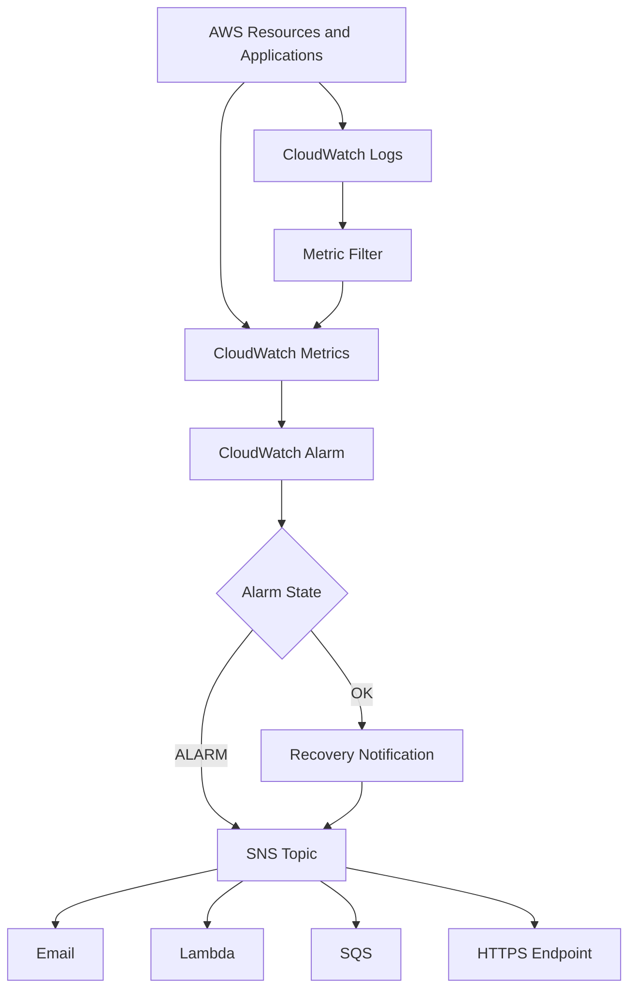
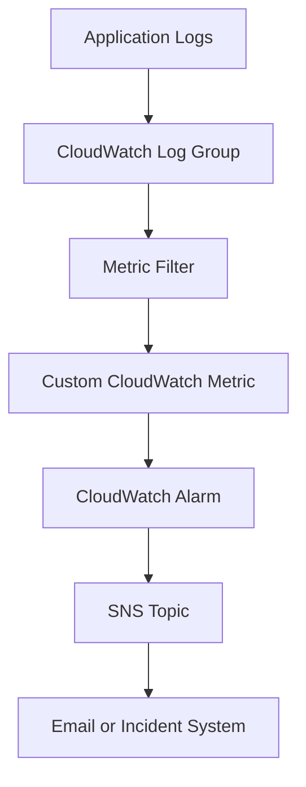
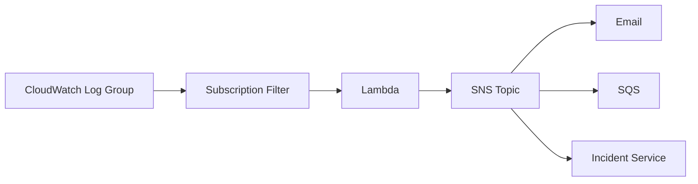
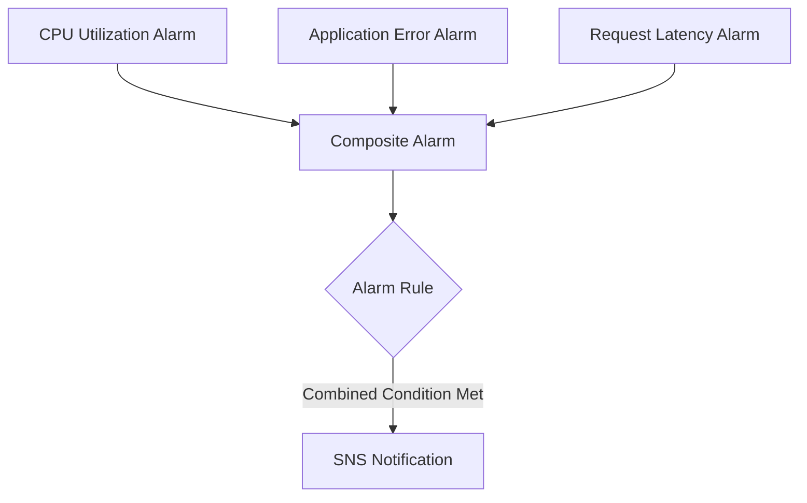
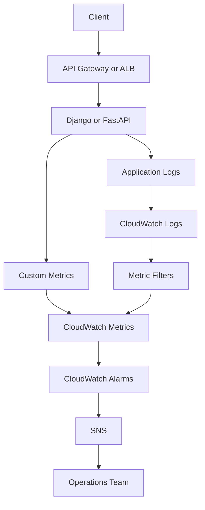
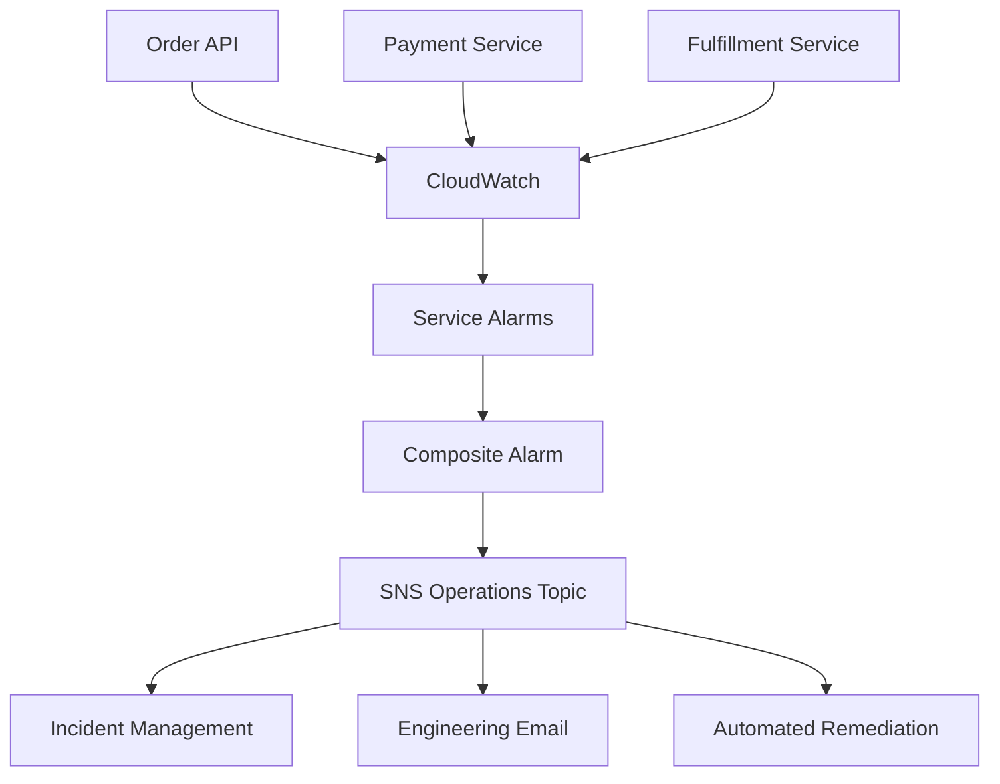
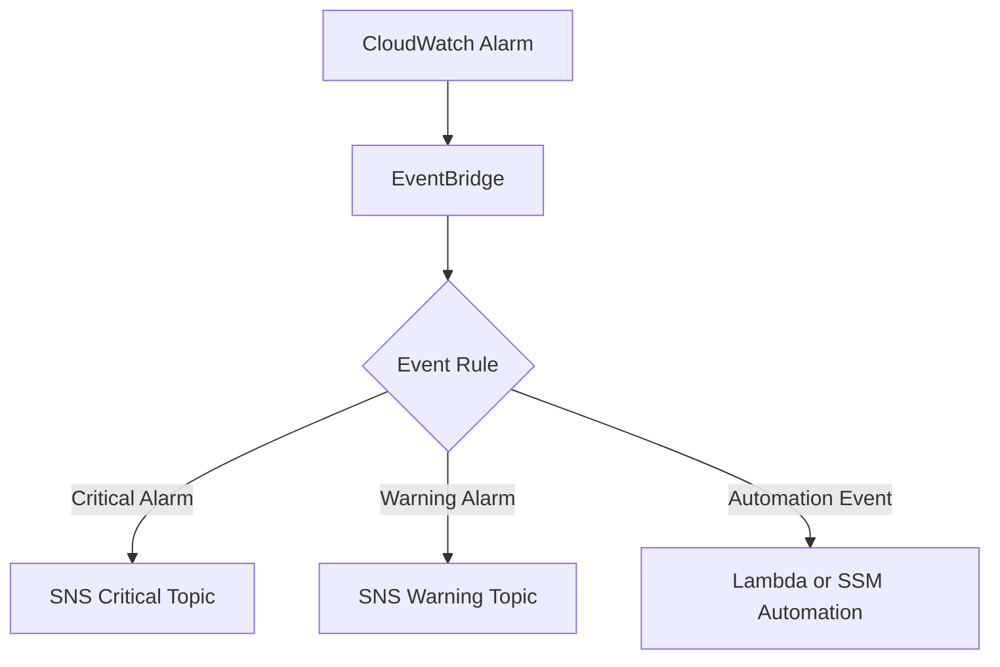

# 12- CloudWatch Integration

## Overview

Amazon CloudWatch is AWS's monitoring and observability service for collecting metrics, logs, traces, and operational events from AWS resources and applications.

Integrating CloudWatch with Amazon SNS enables monitoring systems to notify operators, backend services, and incident-management workflows when specific conditions occur.

The most common integration is:

```text
CloudWatch Alarm → SNS Topic → Subscribers
```

CloudWatch evaluates metrics and determines whether an alarm condition has been met. When an alarm changes state, it can publish a notification to an SNS topic. SNS distributes that notification to configured subscribers.

This integration is useful for:

- Alerting on infrastructure failures.
- Monitoring application errors and latency.
- Detecting Step Functions execution failures.
- Monitoring SNS delivery failures and message volume.
- Notifying engineering teams about operational incidents.
- Triggering automated incident-response workflows.
- Sending notifications to email, SQS, Lambda, and HTTPS endpoints.

CloudWatch and SNS have separate responsibilities:

| Service | Responsibility |
|---|---|
| CloudWatch Metrics | Stores time-series measurements |
| CloudWatch Logs | Stores application and service logs |
| CloudWatch Alarms | Evaluates metric conditions and changes alarm state |
| CloudWatch Logs Insights | Queries and analyzes log data |
| CloudWatch Dashboards | Visualizes operational metrics |
| SNS | Distributes notifications to subscribers |

CloudWatch detects and evaluates conditions. SNS handles notification delivery.

## Architecture

### Basic CloudWatch Alarm to SNS Architecture



The monitoring lifecycle is:

1. AWS resources and applications emit metrics or logs.
2. CloudWatch collects and stores the telemetry.
3. Alarms evaluate configured metric conditions.
4. An alarm changes state when its evaluation criteria are met.
5. CloudWatch invokes the configured SNS alarm action.
6. SNS distributes the notification to its subscribers.
7. Subscribers notify operators or execute automated responses.

A successful SNS publish means SNS accepted the notification. It does not guarantee that every subscriber completed its downstream processing.

### Alarm States

CloudWatch alarms use three primary states.

| State | Meaning |
|---|---|
| `OK` | The monitored metric is within the configured threshold |
| `ALARM` | The monitored condition has breached the configured threshold |
| `INSUFFICIENT_DATA` | CloudWatch does not have enough information to determine the state |

For example, an application error-rate alarm might use:

```text
Error rate <= 5%  → OK
Error rate > 5%   → ALARM
No sufficient data → INSUFFICIENT_DATA
```

Alarm actions can be configured for state transitions.

Typical actions include:

- Sending an SNS notification when the alarm enters `ALARM`.
- Sending a recovery notification when the alarm returns to `OK`.
- Sending a notification when the alarm enters `INSUFFICIENT_DATA`.

Do not treat `INSUFFICIENT_DATA` as equivalent to a healthy system. It can indicate missing telemetry, a stopped resource, or an incorrectly configured metric.

## CloudWatch Metrics

### Overview

CloudWatch Metrics stores numerical measurements associated with AWS resources and applications.

A metric consists of:

- Namespace.
- Metric name.
- Dimensions.
- Timestamp.
- Value.
- Unit.

Example:

```text
Namespace: Application/Orders
Metric: RequestErrorCount
Dimensions:
    Environment = production
    Service = order-api
Value: 25
Unit: Count
```

CloudWatch metrics are used by alarms to evaluate system health.

### AWS Service Metrics

Many AWS services publish metrics automatically.

Examples:

| AWS Service | Example metrics |
|---|---|
| EC2 | CPUUtilization, NetworkIn, NetworkOut |
| RDS | CPUUtilization, DatabaseConnections, FreeStorageSpace |
| Lambda | Invocations, Errors, Duration, Throttles |
| SQS | ApproximateNumberOfMessagesVisible, ApproximateAgeOfOldestMessage |
| SNS | NumberOfMessagesPublished, NumberOfNotificationsFailed |
| Step Functions | ExecutionsStarted, ExecutionsFailed, ExecutionsTimedOut |
| API Gateway | Count, Latency, 4XXError, 5XXError |

Metric availability, dimensions, and publication frequency vary by service.

### Custom Application Metrics

Backend applications often need metrics that AWS services do not publish automatically.

Examples include:

- Business transaction failures.
- Payment processing duration.
- Orders created per minute.
- External API error counts.
- Database connection pool saturation.
- Background job failures.

Applications can publish custom metrics using the CloudWatch `PutMetricData` API.

### Publishing Metrics with Boto3

Install the AWS SDK:

```bash
pip install boto3
```

Example:

```python
import logging
import os
import time

import boto3
from botocore.exceptions import BotoCoreError, ClientError

logger = logging.getLogger(__name__)

cloudwatch = boto3.client(
    "cloudwatch",
    region_name=os.getenv("AWS_REGION", "ap-south-1"),
)


def publish_order_failure_metric(
    environment: str,
    service: str,
) -> None:
    try:
        cloudwatch.put_metric_data(
            Namespace="Application/Orders",
            MetricData=[
                {
                    "MetricName": "OrderProcessingFailures",
                    "Dimensions": [
                        {
                            "Name": "Environment",
                            "Value": environment,
                        },
                        {
                            "Name": "Service",
                            "Value": service,
                        },
                    ],
                    "Timestamp": time.time(),
                    "Value": 1,
                    "Unit": "Count",
                }
            ],
        )

    except (ClientError, BotoCoreError):
        logger.exception("Unable to publish CloudWatch metric")
        raise
```

The application publishes a metric whenever an order-processing failure occurs.

CloudWatch aggregates the measurements according to the metric's dimensions and time periods.

### Metric Dimensions

Dimensions identify a metric's characteristics.

For example:

```text
Namespace: Application/Orders
Metric: OrderProcessingFailures

Environment=production
Service=order-api
```

A different dimension combination represents a different metric identity.

Avoid dimensions containing highly variable identifiers such as:

- Request IDs.
- User IDs.
- Order IDs.
- Session IDs.
- Random UUIDs.

These create high-cardinality metrics and can significantly increase custom metric costs.

Use dimensions for bounded attributes such as environment, service, region, and operation type.

### Metric Resolution

CloudWatch supports standard-resolution and high-resolution custom metrics.

| Resolution | Characteristics |
|---|---|
| Standard resolution | Measurements are aggregated at a minimum period of 60 seconds |
| High resolution | Measurements can be stored at 1-second resolution |

High-resolution metrics are useful when short-lived events and rapid operational changes must be detected.

However, they can increase monitoring costs and should be used only when the shorter evaluation interval provides operational value.

### Metric Publishing Limits

The `PutMetricData` API supports batching metric data.

Important considerations include:

- The API supports up to 1,000 metric data items per request.
- A request can contain up to 1 MB of data after decompression.
- Each metric datum can contain up to 150 values and their corresponding counts when using `Values` and `Counts`.
- High-resolution metrics require the appropriate storage resolution.
- Custom metric quotas and pricing should be checked for the target account and Region.

For high-volume applications, batch metrics rather than making one API call per business event.

Do not publish every request as a unique metric with a unique dimension. Use aggregated counters, histograms, and bounded dimensions.

## CloudWatch Alarms

### Overview

A CloudWatch alarm continuously evaluates a metric against a configured condition.

An alarm defines:

- Metric or metric expression.
- Statistic or extended statistic.
- Evaluation period.
- Threshold.
- Number of evaluation periods.
- Datapoints to alarm.
- Missing-data treatment.
- Alarm actions.

When the condition is satisfied, the alarm changes state and can invoke its SNS action.

### Alarm Evaluation

Consider an alarm configured as follows:

```text
Metric: Application/Orders/OrderProcessingFailures
Threshold: GreaterThanOrEqualToThreshold
Threshold value: 10
Period: 60 seconds
Evaluation periods: 3
Datapoints to alarm: 2
```

The alarm enters `ALARM` when at least two of the last three evaluated one-minute datapoints breach the threshold.

The `EvaluationPeriods` and `DatapointsToAlarm` settings control how sensitive the alarm is to temporary spikes.

| Configuration | Behavior |
|---|---|
| 1 of 1 | Triggers after one breaching period |
| 2 of 3 | Triggers when at least two of three periods breach |
| 3 of 5 | Requires three breaching periods among five |

A longer evaluation window reduces sensitivity to short-lived spikes but increases detection time.

### Missing Data Treatment

CloudWatch allows an alarm to define how missing datapoints are evaluated.

| Setting | Behavior |
|---|---|
| `missing` | Missing datapoints are treated as missing |
| `notBreaching` | Missing datapoints are treated as non-breaching |
| `breaching` | Missing datapoints are treated as breaching |
| `ignore` | The current alarm state is maintained |

Choose the behavior based on the metric.

For an error counter, missing data might mean no errors were reported. For a heartbeat metric, missing data may indicate that the application has stopped publishing telemetry.

Do not configure every alarm with `notBreaching`. Doing so can hide monitoring failures.

### Creating an Alarm with AWS CLI

The following example creates an alarm for EC2 CPU utilization.

```bash
aws cloudwatch put-metric-alarm \
  --alarm-name production-ec2-high-cpu \
  --alarm-description "EC2 CPU utilization exceeded 80 percent" \
  --namespace AWS/EC2 \
  --metric-name CPUUtilization \
  --dimensions Name=InstanceId,Value=i-0123456789abcdef0 \
  --statistic Average \
  --period 300 \
  --evaluation-periods 2 \
  --datapoints-to-alarm 2 \
  --threshold 80 \
  --comparison-operator GreaterThanThreshold \
  --treat-missing-data notBreaching \
  --region ap-south-1
```

This command creates the alarm but does not configure an SNS action.

The notification action can be attached separately.

## CloudWatch Alarm to SNS Integration

### Create an SNS Topic

Create a topic for operational alerts:

```bash
aws sns create-topic \
  --name production-cloudwatch-alerts \
  --region ap-south-1
```

Example response:

```json
{
  "TopicArn": "arn:aws:sns:ap-south-1:123456789012:production-cloudwatch-alerts"
}
```

Store the returned ARN in the deployment configuration.

### Subscribe an Email Endpoint

```bash
aws sns subscribe \
  --topic-arn arn:aws:sns:ap-south-1:123456789012:production-cloudwatch-alerts \
  --protocol email \
  --notification-endpoint alerts@example.com \
  --region ap-south-1
```

The email endpoint must confirm the subscription before it receives notifications.

For production systems, use an approved distribution list or incident-management endpoint rather than an individual employee's address.

### Attach SNS to the Alarm

```bash
aws cloudwatch put-metric-alarm \
  --alarm-name production-ec2-high-cpu \
  --alarm-description "EC2 CPU utilization exceeded 80 percent" \
  --namespace AWS/EC2 \
  --metric-name CPUUtilization \
  --dimensions Name=InstanceId,Value=i-0123456789abcdef0 \
  --statistic Average \
  --period 300 \
  --evaluation-periods 2 \
  --datapoints-to-alarm 2 \
  --threshold 80 \
  --comparison-operator GreaterThanThreshold \
  --alarm-actions arn:aws:sns:ap-south-1:123456789012:production-cloudwatch-alerts \
  --ok-actions arn:aws:sns:ap-south-1:123456789012:production-cloudwatch-alerts \
  --region ap-south-1
```

The alarm publishes notifications when it enters `ALARM` and when it returns to `OK`.

The `INSUFFICIENT_DATA` action can also be configured through `--insufficient-data-actions`.

### Alarm Action Types

| Action | Purpose |
|---|---|
| `--alarm-actions` | Actions executed when the alarm enters `ALARM` |
| `--ok-actions` | Actions executed when the alarm enters `OK` |
| `--insufficient-data-actions` | Actions executed when the alarm enters `INSUFFICIENT_DATA` |

SNS is one supported alarm action.

CloudWatch also supports other actions, including selected Auto Scaling, EC2, and Systems Manager operations.

Use SNS for notification and decoupled event distribution rather than embedding operational remediation logic into email notifications.

## CloudWatch Alarm Notification Payload

CloudWatch sends a structured notification to SNS when an alarm action is executed.

A simplified notification looks like:

```json
{
  "AlarmName": "production-ec2-high-cpu",
  "AlarmDescription": "EC2 CPU utilization exceeded 80 percent",
  "AWSAccountId": "123456789012",
  "NewStateValue": "ALARM",
  "NewStateReason": "Threshold Crossed",
  "StateChangeTime": "2026-11-22T10:30:00.000+0000",
  "Region": "Asia Pacific (Mumbai)",
  "AlarmArn": "arn:aws:cloudwatch:ap-south-1:123456789012:alarm:production-ec2-high-cpu",
  "OldStateValue": "OK",
  "Trigger": {
    "MetricName": "CPUUtilization",
    "Namespace": "AWS/EC2",
    "StatisticType": "Statistic",
    "Statistic": "AVERAGE",
    "Unit": null,
    "Dimensions": [
      {
        "name": "InstanceId",
        "value": "i-0123456789abcdef0"
      }
    ],
    "Period": 300,
    "EvaluationPeriods": 2,
    "ComparisonOperator": "GreaterThanThreshold",
    "Threshold": 80
  }
}
```

The exact notification structure can vary with alarm configuration and notification version.

For an SNS email subscription, CloudWatch's notification is presented as an email message.

For an SQS or HTTP subscription, the notification is delivered through the corresponding SNS protocol envelope.

### Processing Alarm Notifications with Lambda

A Lambda function can subscribe to the SNS topic and process alarm notifications.

```python
import json
import logging

logger = logging.getLogger()
logger.setLevel(logging.INFO)


def lambda_handler(event, context):
    for record in event.get("Records", []):
        if record.get("EventSource") != "aws:sns":
            continue

        sns_record = record["Sns"]
        message = json.loads(sns_record["Message"])

        alarm_name = message.get("AlarmName")
        state = message.get("NewStateValue")
        reason = message.get("NewStateReason")

        logger.info(
            "CloudWatch alarm changed: alarm=%s state=%s reason=%s",
            alarm_name,
            state,
            reason,
        )

        if state == "ALARM":
            handle_alarm(message)

        elif state == "OK":
            handle_recovery(message)

        elif state == "INSUFFICIENT_DATA":
            handle_missing_data(message)


def handle_alarm(message: dict) -> None:
    logger.warning(
        "Alarm entered ALARM state: %s",
        message.get("AlarmName"),
    )


def handle_recovery(message: dict) -> None:
    logger.info(
        "Alarm recovered: %s",
        message.get("AlarmName"),
    )


def handle_missing_data(message: dict) -> None:
    logger.warning(
        "Alarm entered INSUFFICIENT_DATA: %s",
        message.get("AlarmName"),
    )
```

This example assumes the Lambda function receives standard SNS event records.

A production implementation should additionally:

- Validate the message structure.
- Restrict the accepted topic and account.
- Use structured logging.
- Implement idempotent incident creation.
- Avoid treating repeated notifications as separate incidents.
- Configure appropriate failure handling and monitoring.

SNS delivery to Lambda is asynchronous. Lambda execution failures are handled through Lambda's asynchronous invocation behavior, not through the original CloudWatch alarm evaluation.

## CloudWatch Logs Integration

### Overview

CloudWatch Logs stores application and AWS service logs.

Applications running on EC2, ECS, EKS, Lambda, and other environments can send logs to CloudWatch Logs.

Logs can be used to identify application failures and generate metrics through metric filters.

A metric filter evaluates incoming log events and publishes matching values as CloudWatch metrics.

These metrics can then drive CloudWatch alarms that publish notifications to SNS.

### Log-Based Alerting Architecture



This is useful when an application already emits structured logs but does not directly publish custom metrics.

### Structured Application Logs

Prefer JSON logs over unstructured text.

Example:

```json
{
  "timestamp": "2026-11-22T10:30:00Z",
  "level": "ERROR",
  "service": "order-api",
  "environment": "production",
  "event": "payment_processing_failed",
  "order_id": "ORD-10045",
  "error_code": "PAYMENT_PROVIDER_TIMEOUT"
}
```

Structured logs make it easier to filter, aggregate, and analyze application events.

Avoid logging credentials, access tokens, payment data, or other sensitive information.

### Creating a Log Group

```bash
aws logs create-log-group \
  --log-group-name /application/order-api \
  --region ap-south-1
```

Configure retention explicitly:

```bash
aws logs put-retention-policy \
  --log-group-name /application/order-api \
  --retention-in-days 30 \
  --region ap-south-1
```

Without an appropriate retention policy, logs may remain stored indefinitely.

### Creating a Metric Filter

Suppose the application emits JSON log records with:

```json
{
  "level": "ERROR",
  "event": "payment_processing_failed"
}
```

Create a metric filter:

```bash
aws logs put-metric-filter \
  --log-group-name /application/order-api \
  --filter-name PaymentProcessingFailures \
  --filter-pattern '{ $.event = "payment_processing_failed" }' \
  --metric-transformations \
    metricName=PaymentProcessingFailures,metricNamespace=Application/Orders,metricValue=1 \
  --region ap-south-1
```

Each matching log event contributes a value of `1` to the metric.

Metric filters can also extract numerical values from log events.

### Create an Alarm for the Metric Filter

```bash
aws cloudwatch put-metric-alarm \
  --alarm-name production-payment-failures \
  --namespace Application/Orders \
  --metric-name PaymentProcessingFailures \
  --statistic Sum \
  --period 300 \
  --evaluation-periods 1 \
  --threshold 10 \
  --comparison-operator GreaterThanOrEqualToThreshold \
  --alarm-actions arn:aws:sns:ap-south-1:123456789012:production-cloudwatch-alerts \
  --treat-missing-data notBreaching \
  --region ap-south-1
```

This alarm notifies the SNS topic when at least ten matching failures are recorded in the evaluation period.

Choose the threshold and missing-data treatment based on the application's traffic pattern.

### CloudWatch Logs Subscription Filters

Subscription filters deliver log events to supported streaming destinations for near-real-time processing.

Common destinations include:

- AWS Lambda.
- Amazon Kinesis Data Streams.
- Amazon Data Firehose.
- Cross-account CloudWatch Logs destinations.

CloudWatch Logs does not provide a direct SNS subscription-filter destination.

When SNS distribution is required, use an intermediary such as Lambda or Kinesis.

Example architecture:



The Lambda function receives batches of compressed and encoded log data, processes the records, and publishes selected events to SNS.

Use this approach when log events must be transformed, filtered, enriched, or routed to multiple notification subscribers.

Do not publish every application log line to SNS. Prefer metric filters and alarms for threshold-based monitoring, or selectively publish important events.

## CloudWatch Logs Insights

CloudWatch Logs Insights allows engineers to query log data using a purpose-built query language.

It is useful for:

- Investigating application errors.
- Finding frequently occurring exceptions.
- Analyzing request latency.
- Identifying failing API endpoints.
- Correlating errors across services.
- Investigating incidents before creating permanent metric filters.

Example query:

```sql
fields @timestamp, level, service, event, error_code
| filter level = "ERROR"
| sort @timestamp desc
| limit 100
```

To identify the most common error events:

```sql
fields event, error_code
| filter level = "ERROR"
| stats count(*) as failure_count by event, error_code
| sort failure_count desc
```

To analyze request latency:

```sql
fields @timestamp, path, duration_ms, status_code
| filter ispresent(duration_ms)
| stats
    avg(duration_ms) as average_latency,
    max(duration_ms) as maximum_latency,
    pct(duration_ms, 95) as p95_latency
  by path
| sort p95_latency desc
```

Logs Insights queries are useful for investigation and analysis. For continuous threshold monitoring, publish appropriate metrics and configure alarms.

## CloudWatch Composite Alarms

### Overview

A composite alarm combines the states of multiple underlying alarms using a Boolean expression.

This is useful when a notification should be sent only when several related conditions are satisfied.

For example, high CPU usage alone may not indicate a production incident. However, high CPU combined with elevated application errors may justify an alert.

### Architecture



### Example Alarm Rule

```text
ALARM(cpu-alarm) AND ALARM(error-rate-alarm)
```

This composite alarm enters `ALARM` only when both underlying alarms are in the `ALARM` state.

Another example:

```text
ALARM(cpu-alarm) OR ALARM(memory-alarm)
```

This triggers when either condition is met.

### Creating a Composite Alarm

```bash
aws cloudwatch put-composite-alarm \
  --alarm-name production-application-incident \
  --alarm-description "Application CPU and error rate are both elevated" \
  --alarm-rule 'ALARM(production-high-cpu) AND ALARM(production-high-error-rate)' \
  --alarm-actions arn:aws:sns:ap-south-1:123456789012:production-cloudwatch-alerts \
  --region ap-south-1
```

Composite alarms help reduce notification noise by combining related signals.

However, they should not hide individual failure conditions that require independent investigation.

Use composite alarms for incident-level notification policies while retaining visibility into the underlying metric alarms.

## Monitoring SNS with CloudWatch

CloudWatch is also responsible for monitoring SNS itself.

This creates an important feedback loop: SNS distributes alerts, while CloudWatch monitors SNS health.

### Important SNS Metrics

| Metric | Description | Operational use |
|---|---|---|
| `NumberOfMessagesPublished` | Number of messages published to a topic | Detect unexpected traffic changes |
| `NumberOfNotificationsDelivered` | Number of successful subscription deliveries | Monitor delivery activity |
| `NumberOfNotificationsFailed` | Number of failed subscription deliveries | Detect delivery problems |
| `NumberOfNotificationsFilteredOut` | Messages excluded by subscription filtering | Investigate filtering behavior |
| `NumberOfNotificationsRedrivenToDlq` | Notifications moved to a subscription DLQ | Detect persistent delivery failures |
| `PublishSize` | Size of published messages | Monitor message-size patterns |

Metric availability depends on the SNS topic, subscription protocol, and service configuration.

### Alarm on SNS Delivery Failures

Create an alarm:

```bash
aws cloudwatch put-metric-alarm \
  --alarm-name production-sns-delivery-failures \
  --namespace AWS/SNS \
  --metric-name NumberOfNotificationsFailed \
  --dimensions Name=TopicName,Value=production-cloudwatch-alerts \
  --statistic Sum \
  --period 300 \
  --evaluation-periods 1 \
  --threshold 1 \
  --comparison-operator GreaterThanOrEqualToThreshold \
  --alarm-actions arn:aws:sns:ap-south-1:123456789012:operations-alerts \
  --treat-missing-data notBreaching \
  --region ap-south-1
```

This example monitors failed notifications for the specified topic.

The monitoring destination should ideally be independent of the SNS topic being monitored. Otherwise, an SNS outage can affect the delivery of the alarm intended to report that outage.

For critical alerting, use independent escalation paths such as a separate notification topic, an external incident-management system, or another operational channel.

## Monitoring Step Functions with CloudWatch and SNS

Step Functions publishes execution metrics to CloudWatch.

Common metrics include:

| Metric | Purpose |
|---|---|
| `ExecutionsStarted` | Number of executions started |
| `ExecutionsSucceeded` | Number of successful executions |
| `ExecutionsFailed` | Number of failed executions |
| `ExecutionsTimedOut` | Number of timed-out executions |
| `ExecutionThrottled` | Number of throttled execution requests |
| `ExecutionTime` | Execution duration |

These metrics can be used to create alarms that notify an SNS topic.

### Example: Alarm on Failed Executions

```bash
aws cloudwatch put-metric-alarm \
  --alarm-name production-order-workflow-failures \
  --namespace AWS/States \
  --metric-name ExecutionsFailed \
  --dimensions Name=StateMachineArn,Value=arn:aws:states:ap-south-1:123456789012:stateMachine:order-workflow \
  --statistic Sum \
  --period 300 \
  --evaluation-periods 1 \
  --threshold 1 \
  --comparison-operator GreaterThanOrEqualToThreshold \
  --alarm-actions arn:aws:sns:ap-south-1:123456789012:production-cloudwatch-alerts \
  --region ap-south-1
```

This alarm sends a notification when at least one execution failure is observed during the evaluation period.

For production systems, consider separate alarms for:

- Failed executions.
- Timed-out executions.
- Execution throttling.
- Unusually long execution duration.
- Failed callback workflows.

An alarm on failed executions does not explain the underlying business failure. Use execution history and application logs to investigate the specific execution.

## Monitoring Backend Applications

### Django and FastAPI

CloudWatch can monitor backend applications through:

- Application logs.
- Custom metrics.
- Infrastructure metrics.
- Container metrics.
- API Gateway metrics.
- Load balancer metrics.

A typical architecture:



### Application Error Metrics

A backend application can publish metrics for:

- HTTP 5xx responses.
- Database connection failures.
- External API timeouts.
- Queue processing failures.
- Payment processing failures.
- Background job failures.

For request latency, use distributions or histograms rather than only average latency.

Averages can hide tail-latency problems. Track percentiles such as p95 and p99 where the instrumentation and metric design support them.

### Celery Worker Monitoring

For Celery-based systems, monitor:

- Task failures.
- Task retry counts.
- Queue depth.
- Oldest queued task age.
- Worker availability.
- Task execution duration.

A growing queue depth combined with increasing task age can indicate insufficient worker capacity or a downstream dependency failure.

CloudWatch alarms can publish SNS notifications when these conditions exceed operational thresholds.

## Monitoring Architecture for Microservices

In a microservice architecture, each service should publish telemetry with consistent naming and dimensions.

Example metric organization:

```text
Namespace: Application/Backend

Dimensions:
    Environment = production
    Service = order-api
    Operation = create-order

Metrics:
    RequestCount
    RequestErrors
    RequestLatency
    DatabaseFailures
    ExternalApiFailures
```

A centralized monitoring architecture can use separate alarms for each service and SNS topics for different operational responsibilities.



Use bounded dimensions and consistent naming conventions.

Avoid creating a separate SNS topic for every metric or alarm. Organize topics around operational ownership, severity, and notification requirements.

## EventBridge and CloudWatch Notifications

CloudWatch integrates with EventBridge for event-driven monitoring.

CloudWatch alarm state changes can be delivered as EventBridge events.

This enables architectures where EventBridge routes alarm events based on:

- Alarm name.
- State value.
- Account.
- Region.
- Resource metadata.

For example:



### Example EventBridge Rule

```json
{
  "source": [
    "aws.cloudwatch"
  ],
  "detail-type": [
    "CloudWatch Alarm State Change"
  ],
  "detail": {
    "state": {
      "value": [
        "ALARM"
      ]
    }
  }
}
```

This rule matches CloudWatch alarm state-change events when the new state is `ALARM`.

The EventBridge target can be an SNS topic.

### Direct Alarm Action Versus EventBridge

| Requirement | Recommended integration |
|---|---|
| Simple notification for an alarm state | CloudWatch alarm → SNS |
| Route notifications based on alarm metadata | CloudWatch → EventBridge → SNS |
| Different topics for warning and critical alarms | EventBridge routing |
| Trigger automated remediation | EventBridge → Lambda or Systems Manager |
| Publish alarm notifications to several independent destinations | EventBridge rules and SNS targets |

Direct SNS alarm actions are simpler when routing requirements are straightforward.

EventBridge is useful when multiple rules, event transformations, or different target destinations are required.

Do not configure both direct SNS actions and EventBridge rules to notify the same endpoint unless duplicate notifications are intentional.

## Security and IAM

Monitoring infrastructure often has broad visibility into application behavior and infrastructure state.

Apply least-privilege permissions to metric publishers, log writers, alarm administrators, and notification subscribers.

### Application Metric Publishing Policy

An application publishing custom metrics requires `cloudwatch:PutMetricData`.

Example policy:

```json
{
  "Version": "2012-10-17",
  "Statement": [
    {
      "Sid": "PublishApplicationMetrics",
      "Effect": "Allow",
      "Action": [
        "cloudwatch:PutMetricData"
      ],
      "Resource": "*",
      "Condition": {
        "StringEquals": {
          "cloudwatch:namespace": "Application/Orders"
        }
      }
    }
  ]
}
```

`PutMetricData` does not support resource-level authorization in the same way as many resource-based AWS APIs. Restrict the namespace using the supported IAM condition key.

### CloudWatch Logs Permissions

Applications and agents generally need permissions such as:

```text
logs:CreateLogStream
logs:PutLogEvents
```

Additional permissions may be needed to create log groups or manage retention policies.

Prefer provisioning log groups and retention policies through IaC rather than granting application runtime roles broad log-management permissions.

### CloudWatch Alarm Permissions

Administrators or deployment roles may require:

```text
cloudwatch:PutMetricAlarm
cloudwatch:DeleteAlarms
cloudwatch:DescribeAlarms
cloudwatch:PutCompositeAlarm
cloudwatch:DescribeAlarmHistory
```

Separate deployment permissions from application runtime permissions.

### SNS Topic Permissions

The SNS topic policy should allow only the intended publishers and subscribers.

Consider:

- Restricting publishers to trusted AWS services or roles.
- Restricting subscription creation.
- Using HTTPS endpoints with appropriate authentication.
- Enabling KMS encryption where required.
- Protecting sensitive information in notification payloads.
- Avoiding public topic policies.

CloudWatch alarm actions and SNS topic policies must be configured so the service can publish to the topic under the applicable authorization model.

For cross-account notification architectures, explicitly configure the destination topic policy and any required service permissions.

## Terraform Implementation

Terraform can manage CloudWatch alarms, SNS topics, subscriptions, and IAM permissions as one infrastructure deployment.

### SNS Topic

```hcl
resource "aws_sns_topic" "cloudwatch_alerts" {
  name = "production-cloudwatch-alerts"

  tags = {
    Environment = "production"
    Application = "monitoring"
  }
}
```

### Email Subscription

```hcl
resource "aws_sns_topic_subscription" "operations_email" {
  topic_arn = aws_sns_topic.cloudwatch_alerts.arn
  protocol  = "email"
  endpoint  = "alerts@example.com"
}
```

The email subscription must be confirmed by its recipient.

### CloudWatch Alarm

```hcl
resource "aws_cloudwatch_metric_alarm" "high_cpu" {
  alarm_name        = "production-ec2-high-cpu"
  alarm_description = "EC2 CPU utilization exceeded 80 percent"

  namespace   = "AWS/EC2"
  metric_name = "CPUUtilization"

  dimensions = {
    InstanceId = var.ec2_instance_id
  }

  statistic           = "Average"
  period              = 300
  evaluation_periods  = 2
  datapoints_to_alarm = 2

  threshold           = 80
  comparison_operator = "GreaterThanThreshold"

  treat_missing_data = "notBreaching"

  alarm_actions = [
    aws_sns_topic.cloudwatch_alerts.arn
  ]

  ok_actions = [
    aws_sns_topic.cloudwatch_alerts.arn
  ]

  tags = {
    Environment = "production"
    Application = "compute"
  }
}
```

### Variables

```hcl
variable "ec2_instance_id" {
  description = "EC2 instance identifier monitored by the CPU alarm"
  type        = string
}
```

### Outputs

```hcl
output "cloudwatch_alerts_topic_arn" {
  description = "SNS topic ARN for CloudWatch alerts"
  value       = aws_sns_topic.cloudwatch_alerts.arn
}

output "high_cpu_alarm_arn" {
  description = "CloudWatch high CPU alarm ARN"
  value       = aws_cloudwatch_metric_alarm.high_cpu.arn
}
```

### Deployment

```bash
terraform init
terraform fmt -check
terraform validate
terraform plan
terraform apply
```

For production deployments:

- Keep alarm thresholds configurable.
- Separate monitoring resources by environment.
- Use remote Terraform state.
- Restrict access to alarm and notification resources.
- Confirm email subscriptions during environment setup.
- Avoid hardcoding account IDs and Regions.
- Review notification routing before applying changes.
- Manage alarm changes through pull requests and CI/CD.

## Testing and Validation

Monitoring infrastructure must be tested before production incidents occur.

### Test SNS Delivery

Publish a test notification:

```bash
aws sns publish \
  --topic-arn arn:aws:sns:ap-south-1:123456789012:production-cloudwatch-alerts \
  --subject "Monitoring Test" \
  --message "CloudWatch SNS integration test" \
  --region ap-south-1
```

This verifies that SNS accepts the message. It does not verify CloudWatch alarm evaluation or the successful processing of every subscriber.

### Set an Alarm to a Test State

For controlled testing, CloudWatch provides `SetAlarmState`.

```bash
aws cloudwatch set-alarm-state \
  --alarm-name production-ec2-high-cpu \
  --state-value ALARM \
  --state-reason "Testing SNS alarm notification" \
  --region ap-south-1
```

This changes the alarm's state for testing. It does not change the underlying metric.

CloudWatch can subsequently reevaluate the alarm and return it to the state indicated by the metric.

Use this operation carefully and only in a controlled environment. It can trigger configured alarm actions and real operational notifications.

### Validation Checklist

| Test | Expected result |
|---|---|
| Publish directly to SNS | SNS accepts the message |
| Confirm email subscription | Subscription becomes confirmed |
| Trigger an alarm condition | Alarm enters `ALARM` |
| Alarm enters `ALARM` | SNS notification is published |
| Metric returns to normal | Alarm returns to `OK` |
| Missing telemetry | Alarm follows configured missing-data behavior |
| Lambda subscriber fails | Lambda failure handling is activated |
| HTTPS endpoint is unavailable | SNS delivery retry and DLQ behavior apply when configured |
| EventBridge rule matches | Configured target receives the event |
| Alarm configuration changes | IaC plan reflects the intended change |

Test both the alert and recovery paths.

A monitoring system that sends alerts but does not communicate recovery can leave operators uncertain about whether an incident is still active.

## Reliability and High Availability

### Notification Delivery

CloudWatch alarm state changes and SNS delivery are separate operations.

A robust monitoring architecture should account for:

- Alarm evaluation delays.
- Missing or delayed metrics.
- SNS delivery failures.
- Unavailable subscriber endpoints.
- Lambda execution failures.
- SQS consumer backlogs.
- Dead-letter queue growth.
- Duplicate notifications.

SNS Standard topics provide at-least-once delivery, so subscribers should tolerate duplicate notifications.

### Avoiding Alerting Loops

An alerting loop can occur when an SNS notification triggers automation that causes another monitored alarm, which sends another SNS notification.

Examples include:

- Lambda remediation causing repeated service state changes.
- Alarm automation publishing events that trigger itself.
- An SNS failure alarm using the same failing notification path.

Prevent loops by:

- Separating monitoring and remediation responsibilities.
- Adding idempotency to automated actions.
- Using explicit event filters.
- Avoiding circular SNS topic dependencies.
- Applying retry limits and cooldown periods.

### Independent Alerting Paths

For critical systems, do not rely exclusively on the same component being monitored to deliver its own failure notification.

For example, if the primary SNS topic becomes unavailable, notifications sent through that topic may also fail.

Consider an independent incident-management integration or a separate operational notification path for critical failures.

### Disaster Recovery

CloudWatch and SNS resources are regional.

For regional disaster recovery:

- Recreate alarm definitions through IaC.
- Provision SNS topics and subscriptions in the recovery Region.
- Configure required cross-Region monitoring or event routing.
- Maintain independent operational contacts.
- Verify recovery-region permissions and KMS policies.
- Test alarm delivery during recovery exercises.

Do not assume that CloudWatch alarms, SNS subscriptions, or custom metrics automatically replicate to another Region.

## Performance and Cost Considerations

### Monitoring Cost Drivers

| Component | Cost driver |
|---|---|
| CloudWatch metrics | Standard and high-resolution custom metrics |
| CloudWatch alarms | Standard, high-resolution, and composite alarms |
| CloudWatch Logs | Ingestion, storage, and queries |
| Logs Insights | Data scanned by queries |
| CloudWatch dashboards | Dashboard usage and applicable pricing |
| SNS | Publish requests, delivery, and optional features |
| Lambda | Invocation count and execution duration |
| KMS | Key usage and applicable key charges |

Pricing varies by Region, metric type, resolution, and feature configuration.

### Cost Optimization

- Avoid high-cardinality custom metric dimensions.
- Publish aggregated metrics instead of one metric per request.
- Use high-resolution metrics only when required.
- Configure CloudWatch Logs retention.
- Avoid repeatedly querying large log groups.
- Use metric filters for recurring threshold-based monitoring.
- Remove obsolete alarms and unused custom metrics.
- Review SNS subscription and delivery costs.
- Monitor the volume of notifications generated by noisy alarms.

### Alert Noise

Too many alarms can reduce operational effectiveness.

Use:

- Meaningful thresholds.
- Appropriate evaluation periods.
- Composite alarms.
- Severity-based notification routing.
- Recovery notifications.
- Alarm suppression during planned maintenance where appropriate.
- Separate alert policies for customer-impacting failures and informational events.

An alert should represent an actionable condition rather than merely a metric fluctuation.

## Operational Best Practices

- Use CloudWatch metrics for continuous threshold monitoring and Logs Insights for investigation.
- Use SNS as a notification transport rather than as the monitoring system itself.
- Configure alarm actions for critical state transitions.
- Define missing-data behavior according to the meaning of each metric.
- Monitor application and infrastructure health separately.
- Use metric dimensions with bounded cardinality.
- Publish custom metrics in batches where appropriate.
- Use structured JSON logs for backend applications.
- Apply metric filters selectively to important log events.
- Use composite alarms to reduce correlated alert noise.
- Monitor SNS delivery failures and dead-letter queues.
- Keep the primary alerting path independent from the service being monitored where possible.
- Use EventBridge when alarm events require conditional routing or multiple automation targets.
- Manage alarms, topics, subscriptions, and policies through IaC.
- Test alert, recovery, timeout, and notification-failure scenarios.
- Review thresholds and notification routing as application traffic and architecture evolve.

## Common Mistakes and Production Pitfalls

### Treating Missing Metrics as Healthy

**Problem:** An alarm is configured with `notBreaching`, so missing telemetry appears healthy.

**Why it happens:** The alarm treats absent datapoints as non-breaching even when the application has stopped publishing metrics.

**Correction:** Use metric-specific missing-data policies. Heartbeat and availability metrics often require different treatment from error counters.

### Creating High-Cardinality Metrics

**Problem:** Every request, user, or order creates a separate metric identity.

**Why it happens:** Application identifiers are incorrectly used as metric dimensions.

**Correction:** Use bounded dimensions and place unique identifiers in logs or traces.

### Sending Every Log Entry to SNS

**Problem:** High log volume produces excessive notifications and costs.

**Why it happens:** SNS is treated as a general-purpose log transport.

**Correction:** Use CloudWatch Logs, metric filters, and alarms for threshold-based monitoring. Publish only actionable events to SNS.

### Assuming Alarm Notification Means Remediation Succeeded

**Problem:** An SNS notification is delivered, but the incident remains unresolved.

**Why it happens:** Notification delivery is confused with remediation execution.

**Correction:** Track remediation workflows independently and monitor their outcomes.

### Ignoring Recovery Notifications

**Problem:** Operators receive an alarm but no indication that the condition recovered.

**Why it happens:** Only `alarm_actions` is configured.

**Correction:** Configure `ok_actions` where recovery notifications are operationally useful.

### Creating Too Many Alarms

**Problem:** Teams receive a large volume of low-value alerts.

**Why it happens:** Every metric is treated as an incident condition.

**Correction:** Use actionable thresholds, composite alarms, and severity-based routing.

### Monitoring SNS Through the Same Failure Path

**Problem:** SNS delivery failures cannot be reported because the alert uses the failing topic.

**Why it happens:** The monitored notification infrastructure is also the only notification channel.

**Correction:** Provide an independent escalation path for critical monitoring failures.

### Ignoring Subscriber Processing Failures

**Problem:** CloudWatch reports successful SNS publication, but downstream consumers fail.

**Why it happens:** SNS acceptance is mistaken for successful application processing.

**Correction:** Monitor subscriber delivery and processing independently, including SQS backlog and DLQ metrics.

## Interview Questions

### What is the role of SNS in CloudWatch integration?

SNS distributes notifications generated by CloudWatch alarms to subscribers such as email endpoints, Lambda functions, SQS queues, and HTTPS endpoints.

### What are the three primary CloudWatch alarm states?

`OK`, `ALARM`, and `INSUFFICIENT_DATA`.

### What happens when a CloudWatch alarm enters the ALARM state?

CloudWatch executes configured alarm actions. If an SNS topic is configured, CloudWatch publishes an alarm notification to that topic.

### Does CloudWatch Logs directly publish subscription-filter events to SNS?

No. CloudWatch Logs subscription filters support destinations such as Lambda, Kinesis Data Streams, and Data Firehose. An intermediary is needed when SNS distribution is required.

### What is a CloudWatch metric filter?

A metric filter evaluates incoming log events and publishes matching values as CloudWatch metrics. Those metrics can be used by CloudWatch alarms.

### What is the difference between a metric filter and Logs Insights?

A metric filter continuously evaluates incoming log events and publishes metrics. Logs Insights runs queries against stored log data for investigation and analysis.

### What is a composite alarm?

A composite alarm combines the states of multiple underlying alarms using Boolean expressions such as `AND` and `OR`.

### Why should metric dimensions have bounded cardinality?

Each unique dimension combination creates a distinct metric identity. High-cardinality dimensions increase metric volume and cost and make monitoring harder to manage.

### What is the difference between alarm actions and OK actions?

Alarm actions execute when an alarm enters `ALARM`. OK actions execute when it returns to `OK`.

### How would you monitor Step Functions execution failures?

Publish or inspect Step Functions execution metrics in CloudWatch, create alarms on failure or timeout metrics, and configure SNS actions for operational notifications.

### Why should SNS delivery be monitored independently?

A successful publish only confirms SNS acceptance. Subscriber delivery and application processing can fail afterward.

## Key Takeaways

- CloudWatch collects metrics and logs, evaluates alarm conditions, and uses SNS to distribute operational notifications.
- Custom application metrics and CloudWatch Logs metric filters enable backend-specific monitoring without coupling alerting logic to individual services.
- Alarm configuration must account for evaluation periods, missing data, recovery states, and actionable thresholds to avoid false alerts and missed incidents.
- SNS delivery, subscriber processing, and automated remediation are separate reliability boundaries and must be monitored independently.
- Production monitoring requires least-privilege IAM, bounded metric dimensions, controlled log retention, independent alerting paths, and IaC-managed deployment.