# 13- CI-CD and Event-Driven Microservices Integration

## Overview

Amazon SNS plays an important role in event-driven microservice architectures by distributing application events to multiple independent consumers. Integrating SNS with CI/CD pipelines enables teams to deploy event producers, consumers, infrastructure, and event contracts in a controlled and repeatable manner.

This integration addresses two related engineering concerns:

- **CI/CD for event-driven systems:** Building, testing, validating, deploying, and rolling back services that publish or consume SNS messages.
- **Event-driven microservices:** Designing loosely coupled services that communicate through SNS topics and subscription endpoints.

SNS provides asynchronous publish-subscribe messaging. A producer publishes an event to a topic, and SNS distributes it to subscribed endpoints such as SQS queues, Lambda functions, HTTP endpoints, and other supported protocols.

A typical architecture:

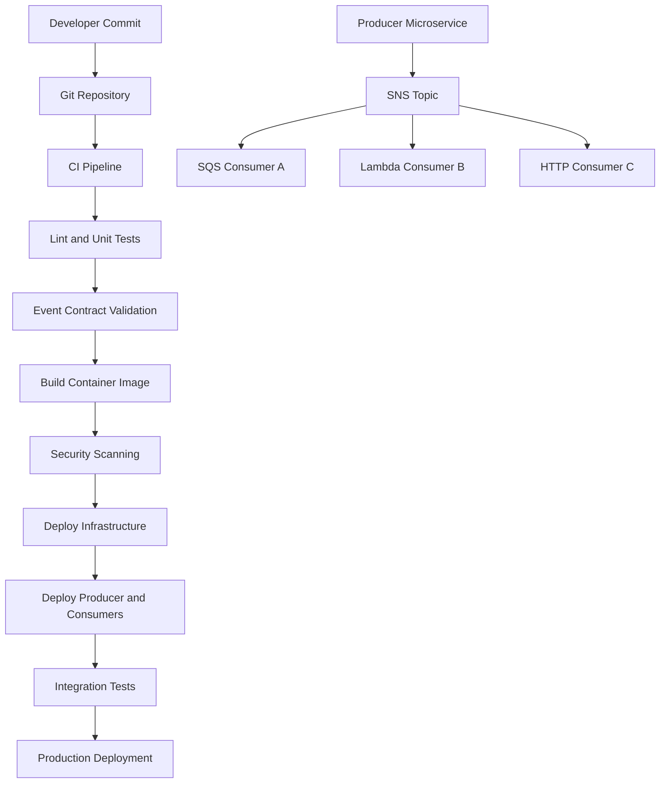

A production implementation must coordinate application code, event schemas, SNS resources, IAM permissions, consumer deployment, and operational monitoring.

## Event-Driven Microservices Architecture

### Overview

Event-driven architecture allows services to communicate through events rather than requiring direct synchronous calls between every service.

A service publishes an event when something meaningful happens. Other services subscribe and react independently.

For example, an e-commerce platform might contain:

- Order Service.
- Payment Service.
- Inventory Service.
- Notification Service.
- Shipping Service.
- Analytics Service.

When an order is created, the Order Service publishes an `OrderCreated` event. Other services independently process the event according to their responsibilities.

### Architecture

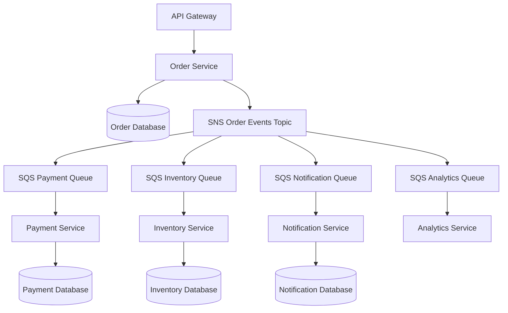

SNS distributes the event, while SQS provides independent buffering for each consumer.

Each service controls its own processing rate and failure-handling behavior.

### Why Use SNS with Microservices?

Without messaging, services may need direct HTTP or gRPC calls to coordinate every operation.

This creates runtime dependencies:

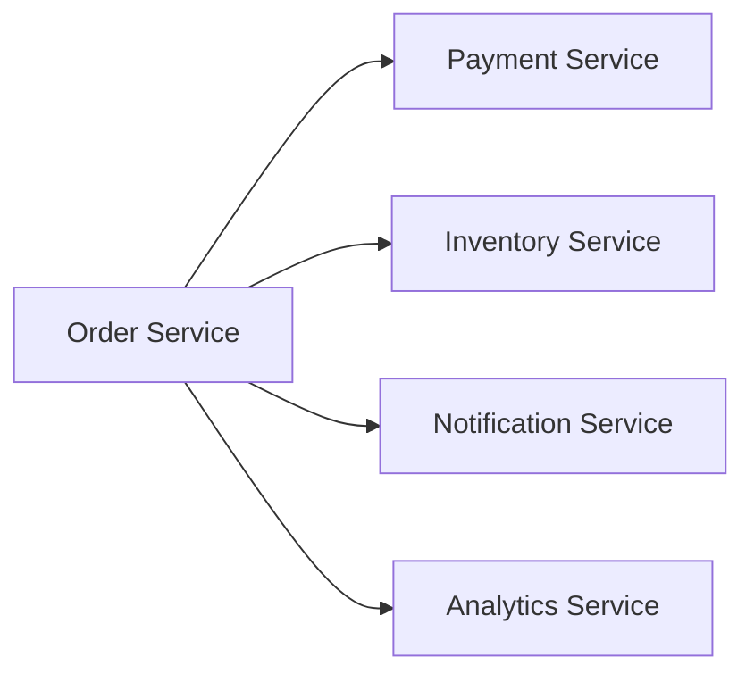

If one downstream service becomes unavailable, the producer may experience increased latency or request failures.

With SNS:

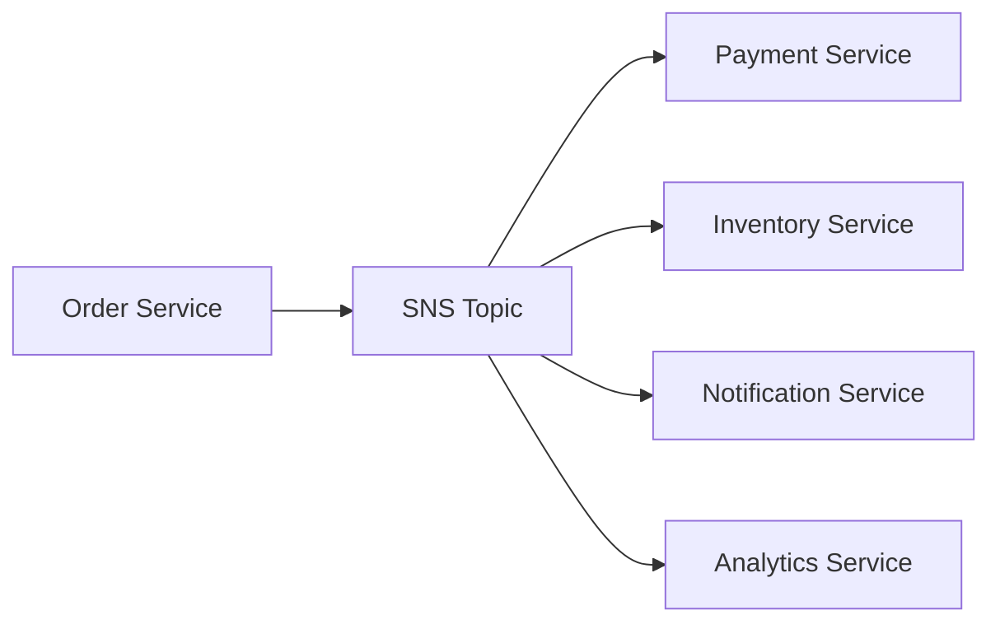

The producer publishes an event without knowing the implementation details of individual consumers.

### Advantages

- Reduced direct service dependencies.
- Independent consumer deployment.
- Independent scaling.
- Asynchronous processing.
- Multiple subscribers for one event.
- Better workload isolation when combined with SQS.
- Easier integration of new consumers.

### Limitations

- Eventual consistency.
- Duplicate message delivery.
- More complex distributed debugging.
- Event schema compatibility requirements.
- Independent consumer failures.
- No automatic end-to-end exactly-once business processing.
- More operational components to monitor.

Use synchronous APIs when a caller needs an immediate response. Use asynchronous events when the producer should not wait for independent downstream processing.

## Event Producer and Consumer Responsibilities

### Producer Responsibilities

An event producer is responsible for publishing events that accurately represent completed business facts.

For example, the Order Service should publish `OrderCreated` only after the order has been successfully persisted.

Producer responsibilities include:

- Defining stable event contracts.
- Generating unique event IDs.
- Publishing only valid business events.
- Including correlation and causation identifiers where appropriate.
- Handling publish failures.
- Preventing lost events through durable publication patterns.
- Avoiding sensitive information in event payloads.

### Consumer Responsibilities

A consumer processes events independently.

Consumer responsibilities include:

- Validating the event schema.
- Implementing idempotency.
- Handling duplicate messages.
- Applying business changes transactionally.
- Retrying transient failures.
- Sending permanently failing messages to a DLQ.
- Recording processing outcomes.
- Supporting compatible event schema evolution.

A consumer must not assume that every event arrives exactly once or in global chronological order.

## Designing Event Contracts

### Overview

An event contract defines the structure and semantics of messages exchanged between services.

A stable contract allows producers and consumers to evolve independently.

An event should represent a business fact rather than an implementation detail.

Examples:

| Event | Meaning |
|---|---|
| `OrderCreated` | An order was successfully created |
| `PaymentAuthorized` | A payment authorization succeeded |
| `PaymentFailed` | A payment operation failed |
| `InventoryReserved` | Inventory was reserved |
| `OrderCancelled` | An order was cancelled |

Avoid generic event names such as `UpdateOrder` or `ProcessData`. They describe commands or implementation behavior rather than business facts.

### Recommended Event Structure

```json
{
  "event_id": "evt-8f4c2d91",
  "event_type": "OrderCreated",
  "event_version": 1,
  "occurred_at": "2026-11-22T10:30:00Z",
  "producer": "order-service",
  "correlation_id": "corr-ORD-10045",
  "data": {
    "order_id": "ORD-10045",
    "customer_id": "CUST-204",
    "amount": 1499.99,
    "currency": "INR"
  }
}
```

| Field | Purpose |
|---|---|
| `event_id` | Unique identifier for idempotency |
| `event_type` | Identifies the business event |
| `event_version` | Identifies the event schema version |
| `occurred_at` | Time when the business event occurred |
| `producer` | Identifies the originating service |
| `correlation_id` | Connects related operations across services |
| `data` | Contains event-specific business information |

Use UTC timestamps and stable identifiers.

Do not include complete database records unless consumers genuinely require them.

### Event Schema Validation with Pydantic

Python services can define event contracts using Pydantic.

```python
from datetime import datetime
from decimal import Decimal
from typing import Literal

from pydantic import BaseModel, ConfigDict, Field


class OrderCreatedData(BaseModel):
    model_config = ConfigDict(extra="forbid")

    order_id: str
    customer_id: str
    amount: Decimal = Field(gt=0)
    currency: str = Field(min_length=3, max_length=3)


class OrderCreatedEvent(BaseModel):
    model_config = ConfigDict(extra="forbid")

    event_id: str
    event_type: Literal["OrderCreated"]
    event_version: int = Field(ge=1)
    occurred_at: datetime
    producer: str
    correlation_id: str
    data: OrderCreatedData
```

Validate events before publication and after consumption.

For larger systems, maintain event schemas in a dedicated repository or schema registry strategy with compatibility checks in CI.

### Schema Evolution

Event consumers and producers are often deployed at different times.

A producer may publish a new event version while older consumers are still running.

Use backward-compatible changes whenever possible.

| Change | Compatibility consideration |
|---|---|
| Add optional field | Usually backward-compatible |
| Add required field | Can break older producers and consumers |
| Rename field | Breaking change |
| Remove field | Breaking change |
| Change field type | Usually breaking |
| Change event meaning | Semantic breaking change |
| Add new event type | Requires routing and consumer consideration |

A safe evolution process:

1. Add an optional field.
2. Deploy consumers that understand the field.
3. Deploy producers that populate it.
4. Verify all consumers have migrated.
5. Remove obsolete fields only through an explicit breaking-version migration.

Do not assume that JSON parsing success means semantic compatibility.

## SNS Topic and Subscription Design

### Topic Boundaries

SNS topics should represent meaningful event domains or routing boundaries.

Examples:

```text
order-events
payment-events
inventory-events
customer-events
```

A single topic for every business event can become difficult to govern. Creating one topic for every individual event can also create unnecessary infrastructure complexity.

Choose topic boundaries based on:

- Event ownership.
- Security boundaries.
- Subscriber groups.
- Operational ownership.
- Traffic patterns.
- Retention and recovery requirements of downstream queues.

### Fan-Out with SQS

SNS combined with SQS is a common architecture for event-driven microservices.

Each subscriber receives an independent queue.

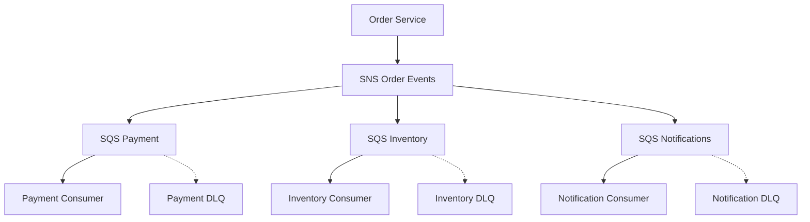

This architecture provides:

- Independent consumer scaling.
- Durable buffering.
- Different retry policies.
- Consumer-specific dead-letter queues.
- Back-pressure isolation.

A slow notification service does not need to block payment processing.

### Subscription Filter Policies

SNS filter policies allow subscribers to receive only relevant messages.

Example message attributes:

```json
{
  "event_type": {
    "DataType": "String",
    "StringValue": "OrderCreated"
  },
  "environment": {
    "DataType": "String",
    "StringValue": "production"
  }
}
```

Example filter policy:

```json
{
  "event_type": [
    "OrderCreated",
    "OrderCancelled"
  ]
}
```

Apply filters at the subscription level.

Filtering reduces unnecessary consumer invocations and queue traffic.

Remember that message attributes are separate from the JSON message body. Configure body-based filtering explicitly when using `FilterPolicyScope` with `MessageBody`.

## Reliable Event Publishing

### The Dual-Write Problem

A common implementation performs two independent operations:

1. Write business data to a database.
2. Publish an event to SNS.

Example:

```python
order = create_order_in_database()
publish_order_created_event(order)
```

This creates a consistency problem.

If the database transaction commits but SNS publishing fails, the order exists but downstream services never receive the event.

If the event is published before the database transaction commits, consumers may process an event for a transaction that later rolls back.

### Transactional Outbox Pattern

The transactional outbox pattern solves the database-to-message-broker dual-write problem.

The business record and event are stored in the same database transaction. A separate publisher reads unpublished events and sends them to SNS.

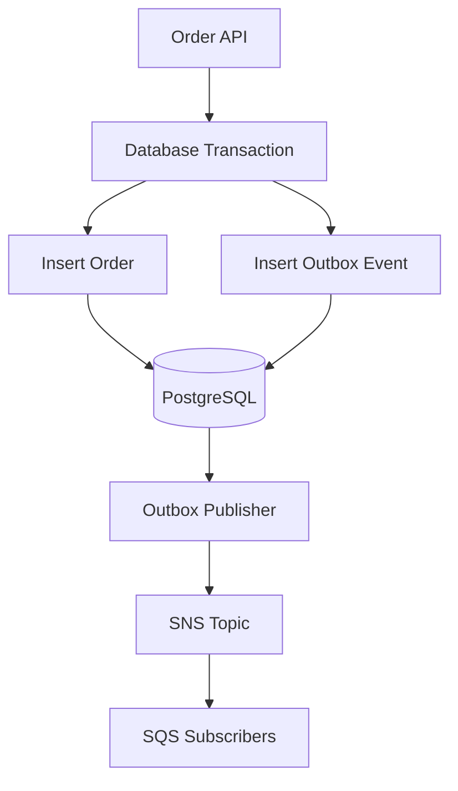

The transaction guarantees that either both the order and outbox event are persisted or neither is persisted.

### Outbox Table

```sql
CREATE TABLE outbox_events (
    event_id UUID PRIMARY KEY,
    aggregate_id VARCHAR(128) NOT NULL,
    event_type VARCHAR(128) NOT NULL,
    event_version INTEGER NOT NULL,
    payload JSONB NOT NULL,
    occurred_at TIMESTAMPTZ NOT NULL DEFAULT NOW(),
    published_at TIMESTAMPTZ,
    attempts INTEGER NOT NULL DEFAULT 0,
    locked_until TIMESTAMPTZ,
    locked_by VARCHAR(128),
    created_at TIMESTAMPTZ NOT NULL DEFAULT NOW()
);

CREATE INDEX idx_outbox_unpublished
ON outbox_events (created_at)
WHERE published_at IS NULL;
```

The lease fields support concurrent publisher workers.

### Writing the Business Record and Event

```python
import json
from datetime import datetime, timezone
from uuid import uuid4

import psycopg
from psycopg.types.json import Jsonb


def create_order(
    connection: psycopg.Connection,
    customer_id: str,
    amount: str,
) -> str:
    order_id = str(uuid4())
    event_id = str(uuid4())

    event = {
        "event_id": event_id,
        "event_type": "OrderCreated",
        "event_version": 1,
        "occurred_at": datetime.now(timezone.utc).isoformat(),
        "producer": "order-service",
        "correlation_id": f"corr-{order_id}",
        "data": {
            "order_id": order_id,
            "customer_id": customer_id,
            "amount": amount,
            "currency": "INR",
        },
    }

    with connection.transaction():
        with connection.cursor() as cursor:
            cursor.execute(
                """
                INSERT INTO orders (
                    order_id,
                    customer_id,
                    amount,
                    status
                )
                VALUES (%s, %s, %s, %s)
                """,
                (
                    order_id,
                    customer_id,
                    amount,
                    "CREATED",
                ),
            )

            cursor.execute(
                """
                INSERT INTO outbox_events (
                    event_id,
                    aggregate_id,
                    event_type,
                    event_version,
                    payload
                )
                VALUES (%s, %s, %s, %s, %s)
                """,
                (
                    event_id,
                    order_id,
                    "OrderCreated",
                    1,
                    Jsonb(event),
                ),
            )

    return order_id
```

The event is persisted in the same transaction as the order.

The example assumes the application has an existing `orders` table and a configured PostgreSQL connection.

### Claiming Outbox Events

Multiple publisher workers must not publish the same outbox row concurrently under normal operation.

Use `FOR UPDATE SKIP LOCKED` and a lease to claim work.

```sql
WITH candidates AS (
    SELECT event_id
    FROM outbox_events
    WHERE published_at IS NULL
      AND (
          locked_until IS NULL
          OR locked_until < NOW()
      )
    ORDER BY created_at
    FOR UPDATE SKIP LOCKED
    LIMIT 100
)
UPDATE outbox_events AS events
SET locked_by = %(worker_id)s,
    locked_until = NOW() + INTERVAL '60 seconds',
    attempts = attempts + 1
FROM candidates
WHERE events.event_id = candidates.event_id
RETURNING events.*;
```

The claim operation should execute inside a database transaction.

Workers should use bounded batches and leases long enough for normal processing. Long-running publication batches may need lease renewal.

### Publishing to SNS

```python
import json
import logging

import boto3
from botocore.exceptions import BotoCoreError, ClientError

logger = logging.getLogger(__name__)

sns = boto3.client("sns")

TOPIC_ARN = "arn:aws:sns:ap-south-1:123456789012:order-events"


def publish_outbox_event(event: dict) -> str:
    try:
        response = sns.publish(
            TopicArn=TOPIC_ARN,
            Message=json.dumps(event),
            MessageAttributes={
                "event_type": {
                    "DataType": "String",
                    "StringValue": event["event_type"],
                },
            },
        )

        return response["MessageId"]

    except (ClientError, BotoCoreError):
        logger.exception(
            "SNS publication failed for event_id=%s",
            event.get("event_id"),
        )
        raise
```

After successful publication, mark the event as published:

```sql
UPDATE outbox_events
SET published_at = NOW(),
    locked_by = NULL,
    locked_until = NULL
WHERE event_id = %(event_id)s
  AND locked_by = %(worker_id)s
  AND published_at IS NULL;
```

If publication fails, release the lease or allow it to expire:

```sql
UPDATE outbox_events
SET locked_by = NULL,
    locked_until = NULL
WHERE event_id = %(event_id)s
  AND locked_by = %(worker_id)s
  AND published_at IS NULL;
```

### Publication Ambiguity

There is an unavoidable failure window:

1. SNS accepts the message.
2. The publisher crashes before marking the outbox event as published.
3. The lease expires.
4. Another worker publishes the event again.

This can create duplicate messages.

The outbox pattern prevents lost events caused by the database-to-broker dual write, but it does not provide exactly-once publication.

Consumers must remain idempotent.

For SNS FIFO topics, an explicit deduplication identifier based on the event ID can reduce duplicate publication within the FIFO deduplication interval. It does not replace durable consumer idempotency.

## Consumer Idempotency

### Why Idempotency Matters

SNS Standard delivery is at-least-once. Consumers may receive duplicate messages.

Duplicates can also occur when:

- SQS visibility timeouts expire.
- A worker crashes after committing a database transaction but before deleting the message.
- A publisher retries after an ambiguous SNS response.
- An event is manually redriven from a DLQ.

A consumer should make repeated processing of the same event safe.

### Processed Events Table

```sql
CREATE TABLE processed_events (
    event_id UUID PRIMARY KEY,
    consumer_name VARCHAR(128) NOT NULL,
    processed_at TIMESTAMPTZ NOT NULL DEFAULT NOW()
);
```

If the same event can be processed independently by multiple logical consumers, include the consumer identity in the unique key:

```sql
ALTER TABLE processed_events
DROP CONSTRAINT processed_events_pkey;

ALTER TABLE processed_events
ADD PRIMARY KEY (event_id, consumer_name);
```

Choose one schema based on the ownership of the table. A shared table across consumers requires consumer-specific idempotency keys.

### Transactional Consumer Processing

```python
import logging

import psycopg

logger = logging.getLogger(__name__)


def process_order_event(
    connection: psycopg.Connection,
    event: dict,
) -> bool:
    event_id = event["event_id"]
    order_id = event["data"]["order_id"]

    with connection.transaction():
        with connection.cursor() as cursor:
            cursor.execute(
                """
                INSERT INTO processed_events (
                    event_id,
                    consumer_name
                )
                VALUES (%s, %s)
                ON CONFLICT DO NOTHING
                RETURNING event_id
                """,
                (event_id, "inventory-service"),
            )

            if cursor.fetchone() is None:
                logger.info(
                    "Duplicate event ignored: event_id=%s",
                    event_id,
                )
                return False

            cursor.execute(
                """
                INSERT INTO inventory_reservations (
                    order_id,
                    status
                )
                VALUES (%s, %s)
                ON CONFLICT (order_id) DO NOTHING
                """,
                (order_id, "PENDING"),
            )

    return True
```

The processed-event record and business operation commit together.

If processing fails, the transaction rolls back, allowing the message to be retried.

For external side effects that cannot participate in the database transaction, use another outbox or a provider-supported idempotency key.

## Consumer Implementation with SQS and Python

SNS-to-SQS delivery is a common choice for backend microservices.

An SQS consumer receives an SNS notification envelope unless raw message delivery is enabled.

### Message Structure

A typical SQS message body contains:

```json
{
  "Type": "Notification",
  "MessageId": "sns-message-id",
  "TopicArn": "arn:aws:sns:ap-south-1:123456789012:order-events",
  "Message": "{\"event_id\":\"evt-10045\",\"event_type\":\"OrderCreated\"}",
  "Timestamp": "2026-11-22T10:30:00.000Z"
}
```

The `Message` field contains the original event JSON as a string.

### Consumer Parsing

```python
import json


def parse_sns_sqs_message(record: dict) -> dict:
    envelope = json.loads(record["body"])

    if envelope.get("Type") != "Notification":
        raise ValueError("Unsupported SNS message envelope")

    message = envelope.get("Message")

    if not isinstance(message, str):
        raise ValueError("SNS message body must be a string")

    return json.loads(message)
```

If raw message delivery is enabled on the SNS subscription, the SQS body contains the original message instead of the SNS envelope. Consumer parsing must match the subscription configuration.

Do not silently support both formats unless the consumer explicitly validates and documents the expected contract.

### SQS Worker Lifecycle

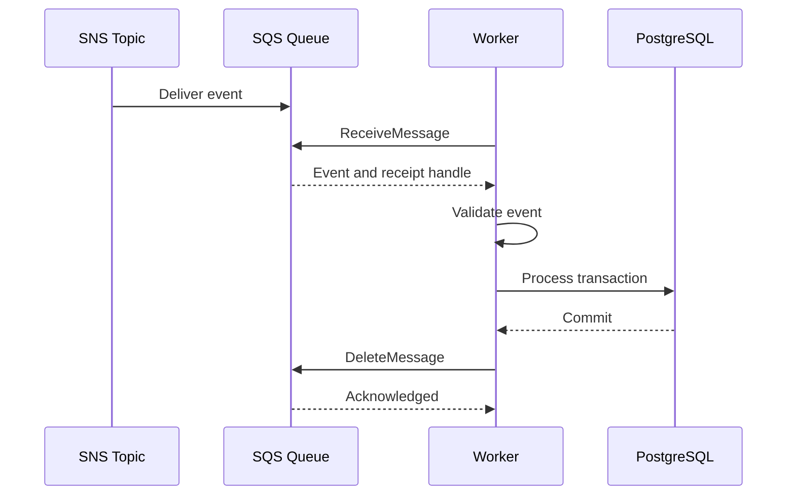

Delete the SQS message only after successful processing.

If processing fails, allow the message to become visible again or explicitly change its visibility according to the retry strategy.

### Visibility Timeout

The SQS visibility timeout should exceed the expected processing duration.

For long-running tasks:

- Extend visibility while processing.
- Use bounded worker concurrency.
- Configure a redrive policy.
- Avoid processing the same receipt concurrently.
- Ensure the queue retention period supports the recovery window.

The visibility timeout does not guarantee exclusive processing forever. A worker that exceeds the timeout can overlap with another consumer.

## CI/CD Pipeline for Event-Driven Microservices

### Overview

CI/CD for event-driven applications must validate more than application code.

A pipeline should test:

- Application behavior.
- Event schemas.
- Producer and consumer compatibility.
- SNS and SQS infrastructure definitions.
- IAM policies.
- Container images.
- Deployment ordering.
- Operational configuration.
- Rollback and recovery procedures.

A typical pipeline:

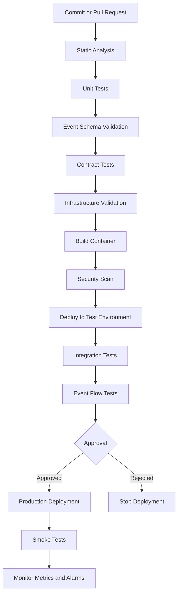

### CI/CD Responsibilities

| Stage | Responsibility |
|---|---|
| Source validation | Check formatting, linting, and static analysis |
| Unit testing | Validate application logic |
| Schema validation | Verify event contract compatibility |
| Contract testing | Verify producer and consumer compatibility |
| Infrastructure validation | Validate Terraform and IAM configuration |
| Build | Create immutable application artifacts |
| Security scanning | Scan dependencies and container images |
| Integration testing | Verify SNS and SQS behavior |
| Deployment | Release application and infrastructure changes |
| Smoke testing | Verify production behavior |
| Monitoring | Detect deployment-related failures |

### Deployment Order

Event-driven deployments require careful ordering because producers and consumers may run different application versions.

A common safe sequence is:

1. Deploy infrastructure changes that are backward-compatible.
2. Deploy consumers capable of reading both old and new compatible events.
3. Deploy producers that publish the new optional fields or event version.
4. Verify event processing and consumer metrics.
5. Remove obsolete compatibility code in a later release.

Never deploy a producer that emits a breaking schema before its consumers can understand it.

## CI Pipeline for Python Microservices

### Project Structure

A typical producer service:

```text
order-service/
├── app/
│   ├── __init__.py
│   ├── api/
│   ├── events/
│   │   ├── schemas.py
│   │   └── publisher.py
│   ├── services/
│   └── main.py
├── tests/
│   ├── unit/
│   ├── contract/
│   └── integration/
├── Dockerfile
├── pyproject.toml
└── .github/
    └── workflows/
        └── ci.yml
```

A consumer service should own its message parsing, validation, idempotency, and business processing logic.

Avoid coupling consumer code directly to the producer's internal database models.

### GitHub Actions CI Workflow

```yaml
name: Order Service CI

on:
  pull_request:
    branches:
      - main
  push:
    branches:
      - main

permissions:
  contents: read

jobs:
  test:
    runs-on: ubuntu-latest

    steps:
      - name: Checkout
        uses: actions/checkout@v4

      - name: Set up Python
        uses: actions/setup-python@v5
        with:
          python-version: "3.12"
          cache: pip

      - name: Install dependencies
        run: |
          python -m pip install --upgrade pip
          pip install -e ".[dev]"

      - name: Run Ruff
        run: |
          ruff check .
          ruff format --check .

      - name: Run type checks
        run: mypy app

      - name: Validate event schemas
        run: pytest tests/contract -v

      - name: Run unit tests
        run: pytest tests/unit -v
```

Pin GitHub Actions to reviewed immutable commit SHAs in production workflows rather than relying indefinitely on mutable version tags.

The example uses version tags for readability.

### Dependency Management

Keep runtime and development dependencies separate.

Example `pyproject.toml`:

```toml
[project]
name = "order-service"
version = "1.0.0"
requires-python = ">=3.12"

dependencies = [
    "boto3>=1.35,<2",
    "pydantic>=2.9,<3",
    "psycopg[binary]>=3.2,<4"
]

[project.optional-dependencies]
dev = [
    "pytest>=8,<9",
    "ruff>=0.8,<1",
    "mypy>=1.13,<2"
]

[tool.pytest.ini_options]
testpaths = ["tests"]

[tool.ruff]
line-length = 88
target-version = "py312"
```

Use a lockfile or another reproducible dependency-resolution mechanism for production builds.

Do not allow unbounded dependency upgrades during deployment.

## Dockerizing Event-Driven Services

Containerized producers and consumers can be deployed independently.

### Producer Dockerfile

```dockerfile
FROM python:3.12-slim

ENV PYTHONDONTWRITEBYTECODE=1
ENV PYTHONUNBUFFERED=1

WORKDIR /app

RUN addgroup --system app \
    && adduser --system --ingroup app app

COPY pyproject.toml ./
COPY app ./app

RUN pip install --no-cache-dir .

USER app

CMD ["python", "-m", "app.main"]
```

For a production build, use a reproducible dependency lock and a multi-stage build where appropriate.

### Consumer Deployment

Consumers often need different scaling characteristics from producers.

For example:

| Service | Scaling signal |
|---|---|
| Order API | Request rate, CPU, latency |
| Payment consumer | SQS queue depth, oldest message age |
| Inventory consumer | Queue depth and processing duration |
| Notification consumer | Queue backlog and provider rate limits |

Do not scale every consumer based only on CPU utilization. Queue depth and message age are often more useful indicators of processing capacity.

### IAM for Containers

Avoid storing AWS access keys in Docker images or environment files.

Use workload identities:

- ECS task roles.
- EKS IAM Roles for Service Accounts or EKS Pod Identity.
- EC2 instance profiles.

The producer should have only the required `sns:Publish` permission.

The consumer should have only the required SQS receive, delete, and visibility permissions, plus its application-specific dependencies.

## Infrastructure as Code with Terraform

### SNS Topic

```hcl
resource "aws_sns_topic" "order_events" {
  name = "order-events"

  tags = {
    Environment = var.environment
    Application = "order-platform"
  }
}
```

### SQS Queue

```hcl
resource "aws_sqs_queue" "payment_dlq" {
  name                      = "payment-events-dlq"
  message_retention_seconds = 1209600
}
```

### Main Consumer Queue

```hcl
resource "aws_sqs_queue" "payment_events" {
  name                       = "payment-events"
  visibility_timeout_seconds = 180
  message_retention_seconds  = 345600

  redrive_policy = jsonencode({
    deadLetterTargetArn = aws_sqs_queue.payment_dlq.arn
    maxReceiveCount     = 5
  })
}
```

The visibility timeout should be aligned with the consumer's expected processing duration. Long-running workers may need to extend visibility dynamically.

### SNS to SQS Subscription

```hcl
resource "aws_sns_topic_subscription" "payment_events" {
  topic_arn = aws_sns_topic.order_events.arn
  protocol  = "sqs"
  endpoint  = aws_sqs_queue.payment_events.arn
}
```

### SQS Queue Policy

SNS needs permission to send messages to the queue.

```hcl
data "aws_iam_policy_document" "payment_queue_policy" {
  statement {
    sid    = "AllowOrderEventsTopic"
    effect = "Allow"

    principals {
      type        = "Service"
      identifiers = ["sns.amazonaws.com"]
    }

    actions = [
      "sqs:SendMessage"
    ]

    resources = [
      aws_sqs_queue.payment_events.arn
    ]

    condition {
      test     = "ArnEquals"
      variable = "aws:SourceArn"
      values   = [aws_sns_topic.order_events.arn]
    }
  }
}

resource "aws_sqs_queue_policy" "payment_events" {
  queue_url = aws_sqs_queue.payment_events.id
  policy    = data.aws_iam_policy_document.payment_queue_policy.json
}
```

The queue policy restricts message delivery to the intended SNS topic.

### SNS Subscription Filter Policy

```hcl
resource "aws_sns_topic_subscription" "payment_events" {
  topic_arn = aws_sns_topic.order_events.arn
  protocol  = "sqs"
  endpoint  = aws_sqs_queue.payment_events.arn

  filter_policy = jsonencode({
    event_type = [
      "OrderCreated",
      "OrderCancelled"
    ]
  })

  depends_on = [
    aws_sqs_queue_policy.payment_events
  ]
}
```

The queue policy and subscription resource must be coordinated. Keep Terraform resource names unique within a module; if using both subscription examples, combine their configuration into one resource rather than declaring the same resource address twice.

### Producer IAM Policy

```hcl
resource "aws_iam_policy" "order_publish" {
  name = "order-service-publish-events"

  policy = jsonencode({
    Version = "2012-10-17"

    Statement = [
      {
        Effect = "Allow"

        Action = [
          "sns:Publish"
        ]

        Resource = aws_sns_topic.order_events.arn
      }
    ]
  })
}
```

Attach this policy to the producer's runtime role.

### Terraform Deployment

```bash
terraform init
terraform fmt -check
terraform validate
terraform plan
terraform apply
```

Use separate Terraform states or clearly separated modules for independently owned services where that improves lifecycle management.

Avoid allowing every microservice pipeline to modify shared production topics and policies without ownership controls.

## CI/CD Deployment Strategies

### Rolling Deployment

A rolling deployment replaces application instances gradually.

Advantages:

- Simple operational model.
- No need for a separate full environment.
- Supports gradual replacement of consumers.

Risks:

- Old and new consumer versions may process messages concurrently.
- Both versions must understand the current event contract.
- A deployment can overlap with messages produced by earlier versions.

Use backward-compatible message handling.

### Blue-Green Deployment

Blue-green deployment runs two application environments and switches traffic or processing responsibility between them.

For consumers, simply running both environments against the same SQS queue can cause both versions to process messages concurrently.

A safer approach may use:

- Separate queues.
- Controlled consumer activation.
- A deliberate cutover procedure.
- Compatible idempotency and processing behavior.

Do not assume that switching HTTP traffic automatically controls asynchronous queue consumers.

### Canary Deployment

Canary deployment releases a new version to a limited portion of the workload.

For event consumers, canary strategies can use:

- A separate canary queue.
- A controlled event subset.
- A separate subscription with carefully designed filtering.
- A dedicated test topic receiving representative events.

Ensure that canary consumers do not duplicate production business side effects.

### Deployment Strategy Comparison

| Strategy | Advantages | Risks |
|---|---|---|
| Rolling | Operationally simple | Mixed application versions |
| Blue-green | Clear environment separation | Consumer cutover complexity |
| Canary | Limits exposure | Requires traffic or event segmentation |
| Shadow processing | Allows comparison without production side effects | Additional processing cost and isolation requirements |

## Event Contract Testing

### Why Contract Testing Matters

Unit tests verify individual service behavior. They do not guarantee that independently deployed producers and consumers agree on event structure and semantics.

Contract tests verify that a producer emits messages consumers can understand.

They help detect:

- Missing required fields.
- Unexpected field types.
- Renamed attributes.
- Removed fields.
- Unsupported event versions.
- Semantic incompatibilities.

### Producer Contract Test

```python
import json

from app.events.schemas import OrderCreatedEvent


def test_order_created_event_contract():
    payload = {
        "event_id": "evt-10045",
        "event_type": "OrderCreated",
        "event_version": 1,
        "occurred_at": "2026-11-22T10:30:00Z",
        "producer": "order-service",
        "correlation_id": "corr-ORD-10045",
        "data": {
            "order_id": "ORD-10045",
            "customer_id": "CUST-204",
            "amount": "1499.99",
            "currency": "INR",
        },
    }

    event = OrderCreatedEvent.model_validate(payload)

    serialized = json.loads(event.model_dump_json())

    assert serialized["event_type"] == "OrderCreated"
    assert serialized["data"]["order_id"] == "ORD-10045"
```

### Consumer Compatibility Test

A consumer should test representative event fixtures from supported schema versions.

```python
import pytest

from app.events.consumer import parse_order_created_event


@pytest.mark.parametrize(
    "event_version",
    [1],
)
def test_supported_order_event_versions(event_version):
    payload = {
        "event_id": "evt-10045",
        "event_type": "OrderCreated",
        "event_version": event_version,
        "occurred_at": "2026-11-22T10:30:00Z",
        "producer": "order-service",
        "correlation_id": "corr-ORD-10045",
        "data": {
            "order_id": "ORD-10045",
            "customer_id": "CUST-204",
            "amount": "1499.99",
            "currency": "INR",
        },
    }

    parsed = parse_order_created_event(payload)

    assert parsed.data.order_id == "ORD-10045"
```

For large systems, use a schema compatibility tool or a dedicated contract-testing framework.

The important requirement is that compatibility checks run before producer or consumer changes are released.

## Testing SNS and SQS Integration

### Unit Testing

Mock AWS SDK calls when testing business logic.

Test:

- Event serialization.
- Required fields.
- Message attributes.
- Publish failures.
- Retry behavior.
- Invalid payload handling.

Avoid mocking the entire application in a way that prevents tests from verifying actual event contracts.

### Integration Testing

Deploy isolated SNS and SQS resources in a test account or environment.

Validate:

1. Producer publishes an event.
2. SNS accepts the event.
3. Subscription delivers the message to SQS.
4. Consumer receives the message.
5. Consumer validates the schema.
6. Consumer applies its database transaction.
7. Consumer acknowledges the message.
8. Duplicate messages do not repeat side effects.

### Failure Testing

| Scenario | Expected behavior |
|---|---|
| SNS permission denied | Producer reports publication failure |
| SNS throttling | Publisher retries according to policy |
| SQS temporarily unavailable | Message delivery or consumption recovers |
| Consumer crashes | Message becomes available again |
| Duplicate event | Idempotency prevents duplicate side effects |
| Invalid event schema | Consumer rejects or quarantines the message |
| Repeated processing failure | Message reaches the DLQ |
| Consumer deployment during backlog | Old and new versions process compatible events |
| Breaking schema change | CI compatibility checks fail |

Use LocalStack or similar tools for selected local integration tests, but validate IAM, subscription policies, delivery behavior, and service quotas in AWS.

## Deployment Ordering and Compatibility

### The Producer-Consumer Compatibility Problem

Consider a producer that starts publishing:

```json
{
  "event_type": "OrderCreated",
  "event_version": 2,
  "data": {
    "order_id": "ORD-10045",
    "customer_id": "CUST-204",
    "currency": "INR",
    "total_amount": 1499.99
  }
}
```

An older consumer may expect `amount` instead of `total_amount`.

Deploying the producer first can cause consumer failures.

### Expand-and-Contract Deployment

Use an expand-and-contract strategy.

**Expand phase:**

- Add the new field without removing the old field.
- Deploy consumers that support both representations.
- Verify compatibility.

**Migration phase:**

- Deploy producers that populate the new field.
- Monitor consumer processing.
- Confirm that old consumers have been retired.

**Contract phase:**

- Remove the old field in a planned breaking version.
- Update the schema contract.
- Remove compatibility code from consumers.

This approach avoids requiring all microservices to deploy simultaneously.

## CI/CD for Terraform and Shared Messaging Infrastructure

SNS topics, subscription policies, queue policies, and IAM roles are infrastructure dependencies.

Infrastructure changes should be validated independently from application builds.

### Recommended Pipeline Stages

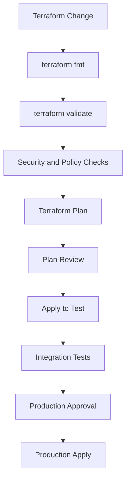

### Validation Commands

```bash
terraform fmt -check
terraform init -backend=false
terraform validate
terraform plan
```

Use the real remote backend and workspace configuration in deployment jobs. The `-backend=false` initialization is useful for isolated validation, not as a substitute for production planning.

Additional checks should include:

- IAM policy analysis.
- Public resource exposure checks.
- KMS key policy validation.
- SNS subscription filter validation.
- SQS redrive policy validation.
- Cross-account access review.
- Resource naming and tagging standards.

### Separate Infrastructure and Application Releases

Infrastructure and application deployments have different lifecycle requirements.

A useful ownership model:

| Component | Ownership |
|---|---|
| Shared SNS topics | Platform or domain infrastructure team |
| SQS consumer queues | Consumer service or platform team |
| Producer application | Producer service team |
| Consumer application | Consumer service team |
| Event schemas | Domain event owners |
| Shared IAM policies | Platform or security team |
| Monitoring and alarms | Service owners with platform standards |

Avoid allowing every application pipeline to modify shared messaging infrastructure without review.

## CI/CD with GitHub Actions and AWS OIDC

### Overview

GitHub Actions can deploy AWS infrastructure and applications without storing long-lived AWS access keys in GitHub secrets.

Use OpenID Connect (OIDC) to obtain short-lived AWS credentials.

The deployment role should trust the expected repository and branch or GitHub environment.

### GitHub Actions Deployment Workflow

```yaml
name: Deploy Order Service

on:
  push:
    branches:
      - main

permissions:
  contents: read
  id-token: write

jobs:
  deploy:
    runs-on: ubuntu-latest

    steps:
      - name: Checkout
        uses: actions/checkout@v4

      - name: Configure AWS credentials
        uses: aws-actions/configure-aws-credentials@v4
        with:
          role-to-assume: arn:aws:iam::123456789012:role/github-order-service-deploy
          aws-region: ap-south-1

      - name: Build application
        run: |
          docker build -t order-service:${{ github.sha }} .

      - name: Validate AWS identity
        run: aws sts get-caller-identity

      - name: Run deployment
        run: |
          ./scripts/deploy.sh
```

This workflow illustrates credential federation and deployment structure.

A production pipeline should also include:

- Unit and contract tests.
- Immutable image publishing.
- Container vulnerability scanning.
- Deployment approvals.
- Environment-specific configuration.
- Post-deployment smoke tests.
- Rollback procedures.

Pin third-party GitHub Actions to reviewed commit SHAs.

### OIDC Trust Policy Considerations

The deployment role should restrict:

- GitHub's OIDC provider.
- The expected audience.
- Repository identity.
- Branch or protected environment.
- Deployment permissions.

Do not allow every repository in an organization to assume a production deployment role.

### ECR Image Publishing

A typical deployment flow is:

```text
GitHub Actions
    |
    v
AWS OIDC
    |
    v
Deployment Role
    |
    v
Amazon ECR
    |
    v
ECS / EKS
```

Tag images with immutable identifiers such as the Git commit SHA.

Avoid using only `latest` for production deployments because it does not provide a reliable release identity.

## CI/CD Rollback Strategies

### Application Rollback

A rollback should restore a known-good application artifact.

For event consumers, rollback must consider the messages already present in queues.

A previous consumer version must remain compatible with messages produced by the current producer.

### Infrastructure Rollback

Infrastructure rollback requires more care than application rollback.

Examples:

- Reverting a topic policy may break active producers.
- Removing a subscription can interrupt event delivery.
- Changing a filter policy can exclude events.
- Deleting a queue can destroy unprocessed messages.
- Removing a KMS permission can prevent publishing or consumption.

Do not automatically destroy messaging resources during application rollback.

### Safe Rollback Principles

- Preserve SNS topic ARNs when possible.
- Avoid destructive changes to queues.
- Keep old event schemas supported during rollback windows.
- Deploy backward-compatible infrastructure changes.
- Preserve DLQs and event archives where required.
- Validate IAM permissions before switching traffic or consumers.
- Monitor backlog and delivery metrics after rollback.

### Database and Event Compatibility

Application rollback does not automatically roll back database migrations or already-published events.

Use expand-and-contract database migrations and backward-compatible event contracts.

A rollback plan must account for the state of both the application and its externally visible events.

## Monitoring and Observability

Event-driven microservices require monitoring across multiple independent boundaries.

### Producer Metrics

Monitor:

- Events generated.
- SNS publish successes.
- SNS publish failures.
- Publication latency.
- Outbox backlog.
- Oldest unpublished event age.
- Outbox retry count.

### SNS Metrics

Monitor:

- `NumberOfMessagesPublished`.
- `NumberOfNotificationsDelivered`.
- `NumberOfNotificationsFailed`.
- `NumberOfNotificationsFilteredOut`.
- `NumberOfNotificationsRedrivenToDlq`.

### SQS Metrics

Monitor:

- `ApproximateNumberOfMessagesVisible`.
- `ApproximateNumberOfMessagesNotVisible`.
- `ApproximateAgeOfOldestMessage`.
- `NumberOfMessagesReceived`.
- `NumberOfMessagesDeleted`.
- `NumberOfMessagesSent`.

### Consumer Metrics

Monitor:

- Events processed.
- Events rejected.
- Duplicate events ignored.
- Processing duration.
- Processing failures.
- Retry count.
- DLQ messages.
- Database transaction failures.

### Correlation and Tracing

Include consistent identifiers in events:

```json
{
  "event_id": "evt-10045",
  "correlation_id": "corr-ORD-10045",
  "causation_id": "evt-10040",
  "event_type": "OrderCreated",
  "producer": "order-service"
}
```

These identifiers help connect logs across services.

For distributed tracing, propagate trace context explicitly through event metadata when supported by the instrumentation strategy. Do not assume that an SNS message automatically preserves the complete trace context.

Avoid placing secrets or sensitive personal information in correlation metadata.

### End-to-End Observability

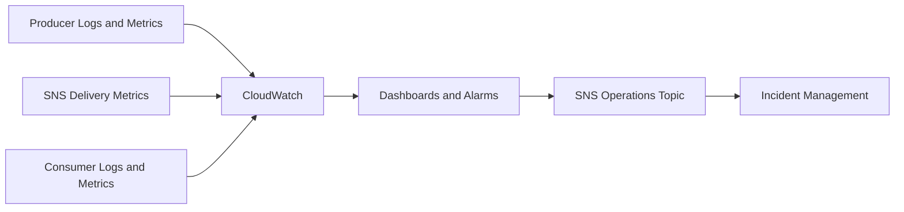

Measure end-to-end processing latency, not just SNS publish latency.

A producer can publish successfully while a consumer backlog grows for hours.

## Reliability and Disaster Recovery

### Delivery Semantics

SNS Standard topics provide at-least-once delivery. Duplicate messages are possible.

SNS FIFO topics provide ordering within message groups and deduplication behavior within a limited deduplication interval.

Neither approach guarantees exactly-once business processing across all producers, brokers, databases, and consumers.

Use durable idempotency at the consumer boundary.

### Failure Boundaries

| Failure | Recovery mechanism |
|---|---|
| Database transaction fails | Roll back business record and outbox event |
| Outbox publisher fails | Retry unpublished event |
| SNS publish fails | Retry publication |
| SNS accepts message but publisher crashes | Republish may create duplicate |
| SNS cannot deliver to SQS | Subscription DLQ when configured |
| SQS consumer fails | Visibility timeout and retry |
| Consumer repeatedly fails | SQS DLQ |
| Consumer database unavailable | Retry with controlled backoff |
| External API unavailable | Consumer retry and provider idempotency |
| Breaking event contract | Reject, quarantine, and correct producer or consumer |

SNS subscription DLQs and SQS consumer DLQs protect different delivery boundaries.

### Disaster Recovery

A multi-Region design must explicitly address:

- SNS topic provisioning in the recovery Region.
- SQS queue provisioning and policies.
- Application deployment and runtime identity.
- Event schema availability.
- Database recovery and consistency.
- Idempotency records.
- Outbox recovery.
- In-flight messages.
- DLQ recovery and redrive.
- Monitoring and alert routing.

SNS topics and subscriptions do not automatically provide application-level cross-Region event replication.

For critical events, consider durable event storage or a replayable event architecture in addition to SNS fan-out.

Do not assume that replaying an event in a recovery Region is harmless. Consumers must be idempotent across the recovery boundary.

## Security Considerations

### IAM Least Privilege

Use separate runtime roles for producers and consumers.

Producer permissions:

```json
{
  "Version": "2012-10-17",
  "Statement": [
    {
      "Effect": "Allow",
      "Action": [
        "sns:Publish"
      ],
      "Resource": "arn:aws:sns:ap-south-1:123456789012:order-events"
    }
  ]
}
```

Consumer permissions should be restricted to the required queues:

```json
{
  "Version": "2012-10-17",
  "Statement": [
    {
      "Effect": "Allow",
      "Action": [
        "sqs:ReceiveMessage",
        "sqs:DeleteMessage",
        "sqs:ChangeMessageVisibility",
        "sqs:GetQueueAttributes"
      ],
      "Resource": "arn:aws:sqs:ap-south-1:123456789012:payment-events"
    }
  ]
}
```

Avoid sharing one broad IAM role across every microservice.

### SNS and SQS Resource Policies

Restrict SQS queue policies so only the intended SNS topic can send messages.

Restrict SNS topic policies so only trusted producers can publish.

For cross-account subscriptions, explicitly configure the required topic and queue resource policies.

### Encryption

Use encryption at rest for SNS and SQS where required.

Consider:

- Customer-managed KMS keys for stricter access control.
- KMS key policies.
- Runtime role permissions.
- Cross-account key access.
- Encryption requirements for database outbox storage.
- TLS for service communication.

### Event Data Security

Do not publish:

- Passwords.
- Access tokens.
- API keys.
- Payment card data.
- Unnecessary personal information.
- Database credentials.
- Internal authentication secrets.

Prefer identifiers and references to protected data.

Consumers should retrieve sensitive information through authorized APIs or storage access.

### Supply-Chain Security

CI/CD pipelines should protect application and infrastructure artifacts.

Use:

- Dependency scanning.
- Container image scanning.
- Secret scanning.
- Pinned build actions.
- Immutable artifact tags.
- Protected production environments.
- OIDC-based AWS authentication.
- Restricted deployment roles.
- Auditable deployment approvals.

Never commit AWS credentials to Git repositories or embed them in Docker images.

## Scalability and Performance

### Independent Consumer Scaling

SNS fan-out allows subscribers to scale independently.

For SQS consumers, use queue metrics to control scaling.

A useful scaling strategy considers:

- Queue depth.
- Oldest message age.
- Average processing duration.
- Worker concurrency.
- Downstream API capacity.
- Database connection limits.

Increasing worker count without considering database or provider limits can move the bottleneck downstream.

### Back-Pressure

SQS provides a buffer between SNS and consumers.

When a consumer is slower than the producer:

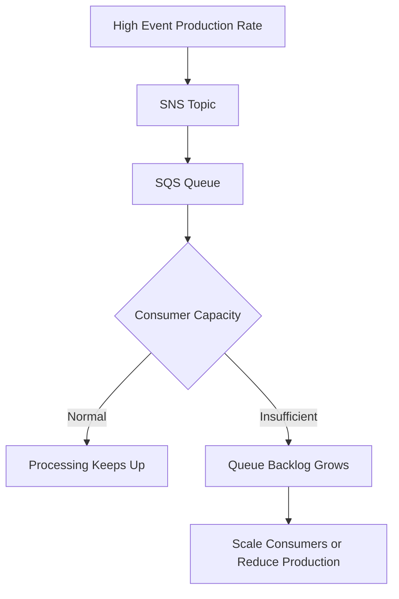

Monitor oldest message age as well as queue depth.

A large queue may be acceptable for batch processing, while a small queue containing very old messages may indicate a serious latency problem.

### Hot Partitions and FIFO Message Groups

For SNS FIFO topics, message group IDs determine ordering groups.

A single group serializes processing within that group.

Use a business key such as `order_id` or `account_id` when ordering is required per aggregate.

Do not use a single global group ID unless global ordering is required.

### Batch Processing

SQS consumers can receive and process multiple messages per request.

Batching reduces API overhead but requires careful partial-failure handling.

For Lambda SQS event source mappings, configure partial batch responses so successfully processed messages do not need to be retried solely because another message in the batch failed.

For custom workers, delete only successfully processed messages.

## Cost Considerations

| Component | Cost driver |
|---|---|
| SNS | Publish requests, delivery protocol, optional features |
| SQS | API requests and payload volume |
| Lambda | Invocation count and execution duration |
| ECS/EKS | Compute resources and runtime duration |
| CloudWatch | Logs, metrics, dashboards, alarms, and retention |
| KMS | Key usage and applicable key charges |
| ECR | Image storage and data transfer |
| CI/CD | Runner minutes and artifact storage |

Cost optimization practices:

- Batch SQS receives and deletes where appropriate.
- Avoid publishing unnecessary events.
- Use subscription filtering to reduce irrelevant deliveries.
- Keep messages compact.
- Set log retention policies.
- Remove unused topics, queues, and subscriptions.
- Avoid high-cardinality metrics.
- Scale consumers based on backlog and service capacity.
- Use appropriate compute sizing.
- Retain container images according to a release policy.

For high-volume event streaming, compare SNS/SQS with Kinesis or Kafka when replay, partitioned stream processing, or sustained throughput requirements become central.

## Common Mistakes and Production Pitfalls

### Publishing Before Database Commit

**Problem:** A consumer receives an event for a business transaction that later rolls back.

**Correction:** Publish after commit or use the transactional outbox pattern.

### Assuming SNS Provides Exactly-Once Processing

**Problem:** Duplicate messages produce duplicate business side effects.

**Correction:** Use stable event IDs and transactional consumer idempotency.

### Deploying Producers Before Consumers

**Problem:** New event fields or versions break older consumers.

**Correction:** Use backward-compatible schema changes and expand-and-contract deployment.

### Using SNS Without SQS for Critical Consumers

**Problem:** Consumers lack an independent durable buffer and processing isolation.

**Correction:** Use SNS-to-SQS fan-out when durable asynchronous processing is required.

Direct SNS-to-Lambda can still be appropriate for short, independently retryable event handlers, but its delivery and failure model must be understood.

### Treating the DLQ as a Retry Strategy

**Problem:** Failed messages accumulate without investigation or recovery.

**Correction:** Monitor DLQ depth, identify root causes, and implement controlled redrive procedures.

### Sharing One IAM Role Across All Services

**Problem:** A compromised service can publish to or consume from resources it does not own.

**Correction:** Use service-specific runtime roles and resource-scoped permissions.

### Ignoring Event Schema Ownership

**Problem:** Producers and consumers evolve contracts independently without compatibility checks.

**Correction:** Establish event ownership, versioning rules, and automated contract tests.

### Scaling Consumers Without Database Capacity Planning

**Problem:** More workers exhaust database connections or overload downstream services.

**Correction:** Scale according to queue backlog and downstream capacity, with bounded concurrency.

### Treating CI Success as Proof of Event Flow Correctness

**Problem:** Unit tests pass, but real SNS subscriptions, IAM policies, and SQS delivery fail.

**Correction:** Run integration tests in an AWS environment and validate the complete publish-to-consume lifecycle.

### Deleting Queues During Rollback

**Problem:** Unprocessed messages are lost when infrastructure changes remove a consumer queue.

**Correction:** Separate application rollback from destructive messaging infrastructure changes.

## Production Best Practices

- Use SNS for event fan-out and SQS for durable, independently scalable consumer processing.
- Design event contracts around business facts with stable IDs and explicit versions.
- Use the transactional outbox pattern when database changes and event publication must remain consistent.
- Make consumers idempotent and commit processed-event records with business changes.
- Use subscription filter policies to route only relevant events.
- Deploy consumers before producers when introducing compatible event changes.
- Use expand-and-contract migrations for breaking schema evolution.
- Validate event contracts in CI before building and deploying artifacts.
- Manage SNS topics, SQS queues, policies, and alarms through IaC.
- Use GitHub OIDC or equivalent workload federation instead of long-lived AWS credentials.
- Keep producer and consumer IAM roles separate and narrowly scoped.
- Monitor outbox backlog, SNS delivery, SQS age, consumer failures, and DLQ depth.
- Implement controlled retries, visibility extensions, and DLQ redrive procedures.
- Test duplicate delivery, partial batch failure, deployment overlap, and rollback.
- Preserve messages and event compatibility during application and infrastructure rollback.
- Use independent alerting and recovery procedures for critical event pipelines.

## Interview Questions

### What is the difference between synchronous and event-driven communication?

Synchronous communication requires the caller to wait for a response from the target service. Event-driven communication allows a producer to publish an event and continue without waiting for independent consumers to finish processing it.

### Why combine SNS with SQS?

SNS provides fan-out distribution, while SQS provides durable buffering and independent consumer processing. Each subscriber can scale and retry independently.

### What problem does the transactional outbox pattern solve?

It prevents lost events caused by writing business data to a database and publishing to a message broker as separate operations.

### Does the transactional outbox provide exactly-once delivery?

No. It ensures the business transaction and event persistence are atomic. Publication can still be duplicated if the publisher crashes after SNS accepts a message but before the outbox record is marked as published.

### How do you prevent duplicate consumer processing?

Use stable event IDs and persist processed-event records transactionally with the consumer's business changes.

### How should event schemas evolve?

Prefer backward-compatible changes such as adding optional fields. Deploy consumers before producers and use expand-and-contract migrations for breaking changes.

### How do you deploy a consumer without losing messages?

Use a deployment strategy that preserves queue resources, maintains compatible consumer versions, and ensures messages are acknowledged only after successful processing.

### What is the purpose of an SNS subscription filter policy?

It limits which messages a subscription receives based on message attributes or, when configured, message body fields.

### What is the difference between an SNS subscription DLQ and an SQS consumer DLQ?

An SNS subscription DLQ captures delivery failures between SNS and the subscriber endpoint. An SQS consumer DLQ captures messages that repeatedly fail after delivery to the queue.

### How would you secure an event-driven microservice architecture?

Use service-specific IAM roles, restrictive SNS and SQS resource policies, encryption, TLS, schema validation, secret-free event payloads, and secure CI/CD authentication.

### How do you monitor an event-driven system end to end?

Monitor producer publication, outbox backlog, SNS delivery, SQS queue depth and age, consumer processing outcomes, DLQs, and correlation IDs across service logs and traces.

### When would you choose Kafka or Kinesis instead of SNS and SQS?

Consider Kafka or Kinesis when the workload requires replayable event streams, partitioned consumption, sustained high-throughput ingestion, or stream-processing capabilities beyond SNS fan-out and SQS queue semantics.

## Key Takeaways

- SNS enables loosely coupled microservices through event fan-out, while SQS provides durable buffering, independent scaling, and consumer-specific failure handling.
- Event contracts should use stable event IDs, explicit versions, correlation metadata, and backward-compatible evolution rules.
- The transactional outbox prevents lost events across database and SNS publication boundaries, while consumer idempotency handles duplicate delivery.
- CI/CD pipelines must validate application code, event compatibility, infrastructure, IAM policies, and complete publish-to-consume integration behavior.
- Production reliability depends on controlled deployments, least-privilege security, independent consumer scaling, observability, DLQ recovery, and tested rollback procedures.