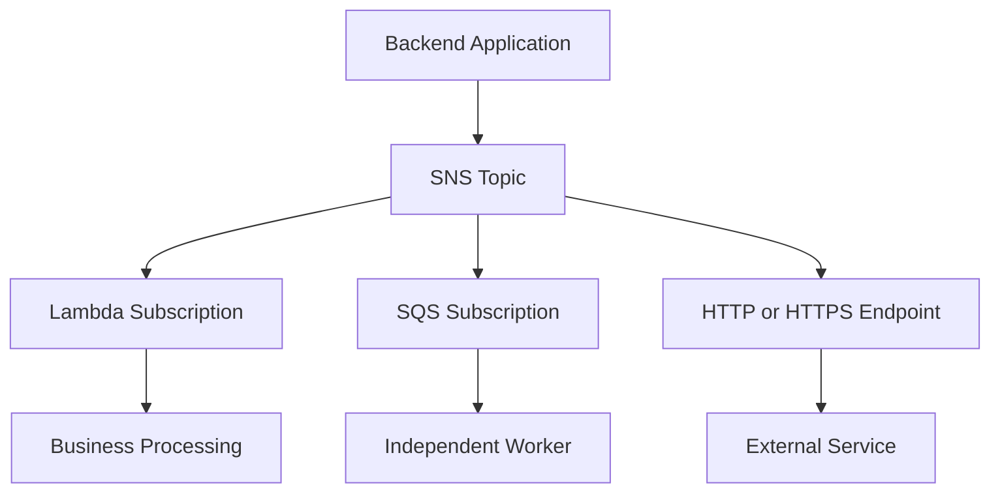
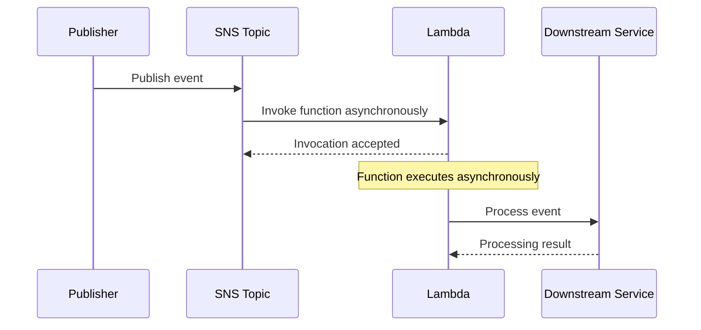
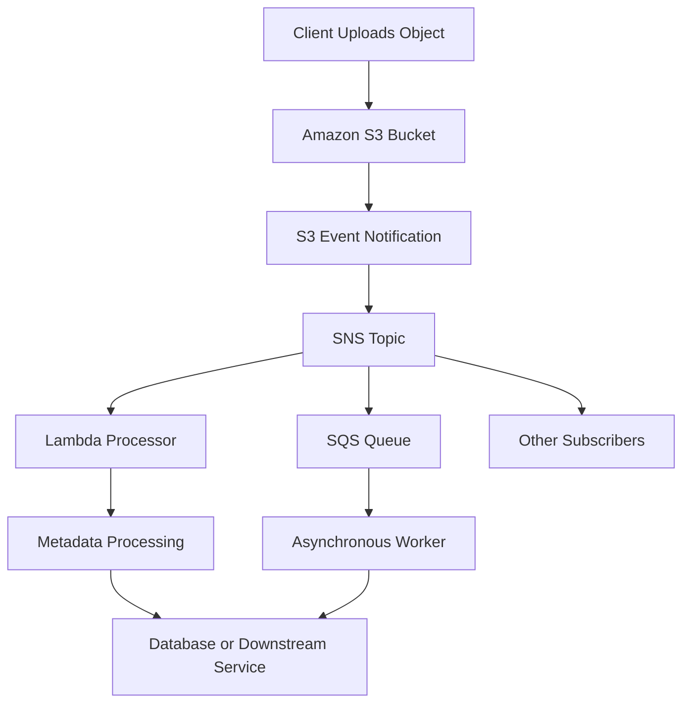
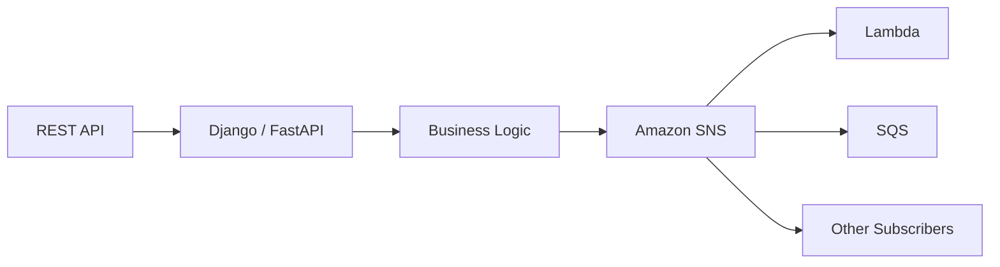
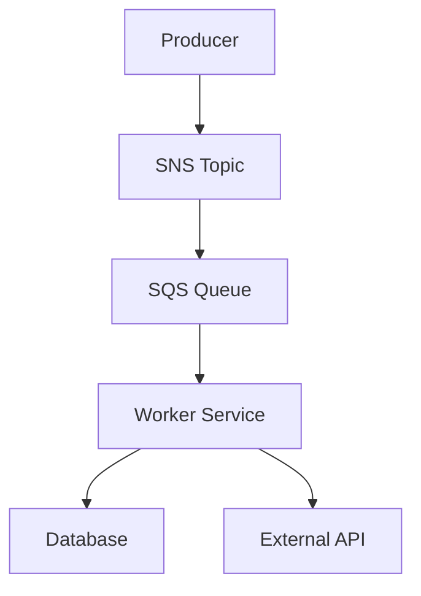

# README

## Overview

Amazon Simple Notification Service (SNS) is a fully managed publish-subscribe messaging service used to distribute events and notifications from producers to multiple consumers. It enables loosely coupled backend services to communicate without requiring direct knowledge of one another.

SNS is commonly used for event-driven architectures, asynchronous workflows, fan-out messaging, operational notifications, and integrations between AWS services.

This integration folder focuses on connecting SNS with backend applications and AWS services, particularly:

- AWS Lambda for event-driven processing.
- Amazon S3 for object-event notifications and event archival workflows.
- Other AWS services through SNS-supported subscription protocols.

SNS is particularly useful when a single business event must trigger multiple independent workflows without introducing direct dependencies between the producer and every consumer.

## Amazon SNS Integration Architecture

A typical SNS integration separates event production from event consumption.



The producer publishes a message to an SNS topic. SNS evaluates subscription configuration and delivers the message to eligible subscribers.

Each subscriber can process the event independently, allowing new consumers to be introduced without modifying the original producer.

## Core Integration Concepts

### SNS Topics

An SNS topic is the logical communication channel through which publishers distribute messages.

Topics provide:

- A stable publishing destination.
- Multiple independent subscriptions.
- Subscription-level message filtering.
- Access control through IAM and resource policies.
- Encryption through AWS Key Management Service (KMS), when configured.

Applications should generally publish to a topic rather than maintain direct integrations with every downstream service.

### Publishers

Publishers produce events and send them to SNS using the `Publish` API.

Common publishers include:

- Django and FastAPI applications.
- AWS Lambda functions.
- Amazon S3 event notifications.
- Amazon EventBridge integrations.
- Other AWS services supporting SNS publication.

A successful `Publish` response indicates that SNS accepted the message. It does not prove that subscribers successfully processed the event.

### Subscribers

Subscribers receive messages through supported protocols, including:

| Protocol | Typical integration | Use case |
|---|---|---|
| AWS Lambda | Lambda function | Serverless event processing |
| Amazon SQS | SQS queue | Durable asynchronous processing |
| HTTP/HTTPS | Webhook endpoint | External application integration |
| Email | Email endpoint | Operational notifications |
| SMS | Mobile endpoint | Text notifications |
| Application | Supported mobile push platforms | Application notifications |

For backend workloads requiring buffering, retry control, and independent consumer scaling, SNS-to-SQS is often preferable to direct synchronous HTTP delivery.

### Message Filtering

SNS subscription filters allow subscribers to receive only messages matching configured attributes or message-body conditions.

Filtering reduces unnecessary downstream processing and allows multiple consumers to share a topic while implementing different workflows.

For example, an order topic might distribute events to separate subscriptions:

- Payment processing receives payment-related events.
- Fulfillment receives confirmed orders.
- Analytics receives all relevant business events.

Filtering should be treated as a routing optimization, not as an authorization or business-validation mechanism.

### Delivery Reliability

SNS standard topics provide at-least-once delivery semantics for supported delivery protocols. Consumers must therefore tolerate duplicate messages.

Production consumers should implement:

- Idempotent processing.
- Appropriate retry handling.
- Dead-letter queues where supported.
- Structured logging and correlation identifiers.
- Monitoring of delivery and processing failures.

SNS delivery success and application-level processing success are separate concerns. Each boundary requires its own monitoring and recovery strategy.

## Integration Directory

The following documents cover practical SNS integration patterns.

| File | Integration | Description |
|---|---|---|
| [01- Integration Overview.md](./01-%20Integration%20Overview.md) | SNS Overview | SNS pub/sub model, topic architecture, subscriber protocols, message filtering, delivery reliability, and common backend use cases. |
| [02- Amazon SQS Integration.md](./02-%20Amazon%20SQS%20Integration.md) | SNS + SQS | Combining SNS with SQS queues for durable fan-out, independent consumer scaling, and buffered asynchronous processing. |
| [03- AWS Lambda Integration.md](./03-%20AWS%20Lambda%20Integration.md) | SNS + Lambda | Invoke Lambda functions asynchronously through SNS subscriptions, configure permissions, handle event envelopes, retries, and failure destinations. |
| [04- Amazon S3 Integration.md](./04-%20Amazon%20S3%20Integration.md) | SNS + S3 | Connect S3 object events to SNS, process notifications, archive event data, and implement reliable object-processing workflows. |
| [05- Amazon EventBridge Integration.md](./05-%20Amazon%20EventBridge%20Integration.md) | SNS + EventBridge | Combining SNS fan-out with EventBridge content-based routing, event transformation, cross-account routing, and event archive capabilities. |
| [06- Amazon EC2 and ECS Integration.md](./06-%20Amazon%20EC2%20and%20ECS%20Integration.md) | SNS + EC2/ECS | Delivering SNS notifications to long-running backend workers and microservices running on EC2 instances and ECS tasks. |
| [07- AWS Auto Scaling Integration.md](./07-%20AWS%20Auto%20Scaling%20Integration.md) | SNS + Auto Scaling | Distributing notifications about Auto Scaling group activities and lifecycle events through SNS. |
| [08- AWS Backup and AWS Config Integration.md](./08-%20AWS%20Backup%20and%20AWS%20Config%20Integration.md) | SNS + Backup/Config | Distributing operational notifications about backup activity, resource compliance, and configuration changes through SNS. |
| [09- AWS CodePipeline Integration.md](./09-%20AWS%20CodePipeline%20Integration.md) | SNS + CodePipeline | Distributing notifications about pipeline execution events, stage transitions, and action results through SNS. |
| [10- Amazon RDS and DynamoDB Integration.md](./10-%20Amazon%20RDS%20and%20DynamoDB%20Integration.md) | SNS + RDS/DynamoDB | Distributing database-related events from RDS and DynamoDB across backend services and event-driven workflows. |
| [11- AWS Step Functions Integration.md](./11-%20AWS%20Step%20Functions%20Integration.md) | SNS + Step Functions | Publishing notifications and business events to multiple subscribers from Step Functions state machine workflows. |
| [12- CloudWatch Integration.md](./12-%20CloudWatch%20Integration.md) | SNS + CloudWatch | Connecting CloudWatch alarms and metric notifications to SNS for operational alerting and incident response. |
| [13- CI-CD and Event-Driven Microservices Integration.md](./13-%20CI-CD%20and%20Event-Driven%20Microservices%20Integration.md) | SNS + CI/CD | Integrating SNS with CI/CD pipelines to deploy event producers, consumers, infrastructure, and event contracts reliably. |

## Integration Patterns

### SNS with AWS Lambda

<text></text>



This pattern is useful when an event should trigger serverless processing without requiring a continuously running worker.

Typical use cases:

- Sending order confirmation notifications.
- Processing application events.
- Triggering downstream AWS workflows.
- Performing lightweight transformations.
- Starting independent business operations.

Important production considerations:

- Configure Lambda resource-based permissions allowing SNS to invoke the function.
- Keep the Lambda execution role separate from the SNS invocation permission.
- Understand the distinction between SNS delivery failures and Lambda execution failures.
- Configure Lambda asynchronous invocation retry and failure handling.
- Implement idempotency because duplicate events and retries are possible.
- Monitor SNS delivery metrics and Lambda execution metrics independently.

Refer to `03- AWS Lambda Integration.md` for the implementation.

### SNS with Amazon S3

S3 supports event notifications to SNS standard topics for supported object-storage events. SNS can then distribute those notifications to multiple subscribers.



Typical use cases:

- Triggering document ingestion workflows.
- Processing uploaded files.
- Distributing object-created events.
- Starting independent file-processing pipelines.
- Archiving event notifications.

Important production considerations:

- SNS does not natively write published messages directly into S3; an intermediary such as Lambda is required for that workflow.
- S3 bucket notifications require an appropriate SNS topic policy.
- S3 event notifications can be duplicated and are not globally ordered.
- Decode URL-encoded object keys before accessing objects.
- Avoid recursive event processing by separating input and output prefixes or buckets.
- Preserve existing notification configuration when updating bucket notifications.
- Use object versioning and idempotent processing where appropriate.

Refer to `04- Amazon S3 Integration.md` for the implementation.

## Backend Application Integration

Python applications can publish business events to SNS using Boto3.

A typical architecture looks like this:



For example, an order service can publish an `OrderCreated` event after successfully committing its database transaction.

```python
import json
import boto3

sns = boto3.client("sns", region_name="ap-south-1")

def publish_order_created(
    topic_arn: str,
    order_id: str,
    customer_id: str,
) -> str:
    message = {
        "event_id": f"order-created:{order_id}",
        "event_type": "OrderCreated",
        "order_id": order_id,
        "customer_id": customer_id,
    }

    response = sns.publish(
        TopicArn=topic_arn,
        Message=json.dumps(message),
        MessageAttributes={
            "event_type": {
                "DataType": "String",
                "StringValue": "OrderCreated",
            }
        },
    )

    return response["MessageId"]
```

For production systems, avoid relying on a direct database-write-then-publish sequence without considering failure scenarios.

If the database transaction commits but SNS publication fails, the business event may never reach downstream consumers. The transactional outbox pattern can address this dual-write problem:

1. Commit the business change and an outbox event in the same database transaction.
2. A background publisher reads unpublished outbox records.
3. Publish each event to SNS.
4. Mark successfully published records.
5. Retry failures safely using stable event identifiers.

The outbox publisher must also tolerate duplicate publication. Downstream consumers should remain idempotent.

## Security and Access Control

SNS integrations involve multiple independent authorization boundaries.

| Integration | Required authorization |
|---|---|
| Application publishing to SNS | IAM permission such as `sns:Publish` |
| SNS invoking Lambda | Lambda resource-based permission |
| SNS delivering to SQS | SQS queue resource policy |
| S3 publishing to SNS | SNS topic policy allowing the S3 service principal |
| Encrypted message delivery | Appropriate KMS key permissions and key policy |
| Subscriber accessing downstream resources | Subscriber's execution role or application credentials |

Recommended practices:

- Grant permissions to specific topic ARNs rather than using unrestricted wildcards.
- Restrict service-principal access using source ARN and source account conditions where applicable.
- Use HTTPS for external HTTP-based subscriptions.
- Validate SNS message signatures when implementing HTTP/S endpoints.
- Enable server-side encryption when message confidentiality requirements justify it.
- Avoid embedding AWS credentials in application code.
- Use IAM roles for workloads running on AWS.
- Never treat SNS message attributes or filters as authorization controls.

## Monitoring and Operational Considerations

SNS monitoring should cover both message publication and subscriber delivery.

Important CloudWatch metrics include:

| Metric | Operational significance |
|---|---|
| `NumberOfMessagesPublished` | Messages accepted for publication |
| `NumberOfNotificationsDelivered` | Successful notification deliveries |
| `NumberOfNotificationsFailed` | Failed notification deliveries |
| `NumberOfNotificationsFilteredOut` | Messages excluded by subscription filters |
| `NumberOfNotificationsRedrivenToDlq` | Notifications moved to a subscription DLQ |
| `NumberOfNotificationsFailedToRedriveToDlq` | Failed delivery to the configured DLQ |

Metric availability and dimensions depend on the delivery protocol and configuration.

Monitor the downstream service independently. For example, SNS-to-Lambda requires observing Lambda errors, throttles, duration, and asynchronous event age in addition to SNS delivery metrics.

Operational recommendations:

- Include stable event identifiers in published messages.
- Log SNS message IDs and application correlation IDs.
- Track publication failures and subscriber processing failures separately.
- Configure alarms for sustained delivery failures.
- Use subscription DLQs for supported endpoint delivery failures.
- Configure Lambda asynchronous failure destinations or DLQs for function execution failures.
- Test recovery and redrive procedures before production incidents.
- Avoid using successful SNS publication as evidence of completed business processing.

## Reliability and Scalability

SNS provides managed message distribution, but end-to-end reliability depends on the complete event-processing architecture.

### Consumer Idempotency

Standard SNS delivery can produce duplicates. Consumers should record processed event identifiers or use idempotent business operations.

For database-backed consumers, a unique constraint on an event identifier can prevent duplicate application of the same business event.

### Decoupled Processing

SNS allows publishers and subscribers to scale independently. However, direct Lambda or HTTP subscribers may still experience throttling or downstream capacity constraints.

For workloads requiring durable buffering and controlled consumption rates, use SNS-to-SQS:



SQS provides independent buffering, visibility-timeout handling, and consumer-controlled processing.

### Dead-Letter Queues

Distinguish between failure boundaries:

- SNS subscription DLQ: captures supported notification delivery failures.
- SQS consumer DLQ: captures messages that exceed the configured receive-count threshold.
- Lambda asynchronous failure destination or DLQ: captures failures after Lambda accepts an asynchronous invocation.

These mechanisms solve different problems and should not be treated as interchangeable.

### Disaster Recovery

For critical event-driven systems:

- Define acceptable message-loss and recovery objectives.
- Document topic and subscription configuration.
- Manage infrastructure through Terraform or another IaC tool.
- Plan topic and KMS key recovery independently.
- Consider regional failure scenarios and cross-Region event distribution requirements.
- Retain source business events or outbox records when replay is necessary.
- Test recovery procedures, including DLQ redrive and subscriber restoration.

## Cost Considerations

SNS pricing is primarily based on message publication, delivery, and applicable data transfer or related service usage.

Total integration cost can also include:

- Lambda invocation and execution duration.
- SQS requests and message retention.
- KMS API requests.
- CloudWatch metrics, logs, and alarms.
- Data transfer across Regions.
- Downstream processing and storage.

Cost optimization practices:

- Use subscription filtering to avoid unnecessary downstream processing.
- Avoid publishing excessively large payloads.
- Store large objects in S3 and publish references when appropriate.
- Select delivery patterns based on durability and throughput requirements.
- Monitor message volume and downstream invocation rates.
- Apply retention policies to logs and archived event data.

## Common Integration Mistakes

| Mistake | Why it causes problems | Recommended approach |
|---|---|---|
| Assuming successful `Publish` means processing completed | SNS acceptance and subscriber processing are separate stages | Monitor downstream processing independently |
| Ignoring duplicate delivery | Business operations may execute more than once | Implement idempotent consumers |
| Confusing Lambda execution role with SNS invocation permission | The two permissions control different authorization boundaries | Configure Lambda resource-based permission separately |
| Treating SNS subscription DLQ as a Lambda failure destination | They capture failures at different stages | Configure failure handling for each boundary |
| Publishing large business payloads unnecessarily | Increases message size and distribution cost | Store large payloads in S3 and publish references |
| Using filters for business authorization | Filters are routing rules, not security controls | Validate authorization inside consumers |
| Ignoring S3 event ordering | Events may arrive out of order or more than once | Use versioning, sequencer-aware logic, and idempotency |
| Updating S3 notification configuration without preserving existing rules | Existing notification destinations can be removed | Manage the complete notification configuration |
| Ignoring KMS permissions | Encrypted delivery can fail despite correct service permissions | Verify KMS key policies and IAM permissions |
| Using direct HTTP delivery for slow processing | Endpoint timeouts and retries can increase delivery failures | Introduce SQS buffering where appropriate |

## Recommended Engineering Practices

- Use clearly defined event names and versioned event schemas.
- Include stable `event_id`, `event_type`, and event timestamps in business messages.
- Keep publishers independent of subscriber implementation details.
- Use SNS filtering for routing, not business validation.
- Prefer SNS-to-SQS for durable asynchronous workloads requiring consumer-controlled throughput.
- Implement idempotency at every consumer boundary.
- Configure least-privilege IAM and resource policies.
- Separate delivery-level failure handling from application-processing failure handling.
- Use infrastructure as code to manage topics, subscriptions, policies, encryption, and monitoring.
- Test duplicate events, transient failures, throttling, and recovery procedures.
- Define event retention and replay strategies independently of SNS delivery.

## Key Takeaways

- SNS provides managed publish-subscribe messaging that decouples producers from multiple downstream consumers.
- SNS-to-Lambda and SNS-to-S3 integrations support event-driven processing, but each has distinct permission, delivery, and failure-handling requirements.
- Standard SNS delivery can produce duplicates, so consumers must implement idempotent processing.
- Monitor message publication, subscriber delivery, and application execution as separate operational stages.
- Use SQS buffering, least-privilege policies, infrastructure as code, and tested recovery procedures for reliable production integrations.