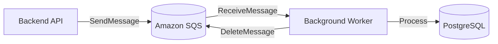
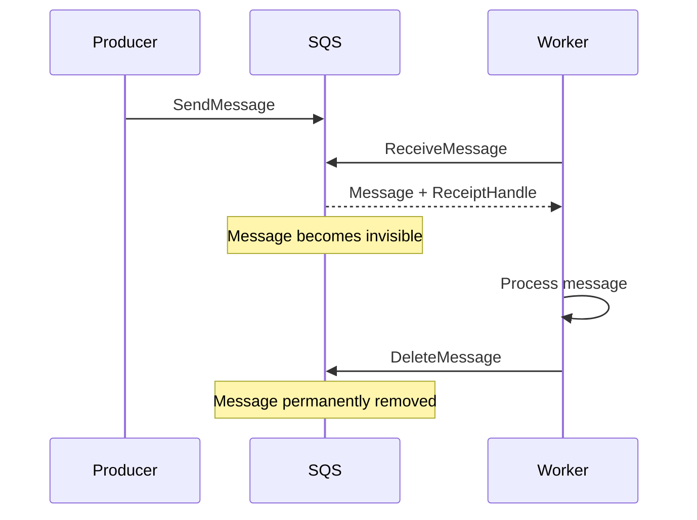
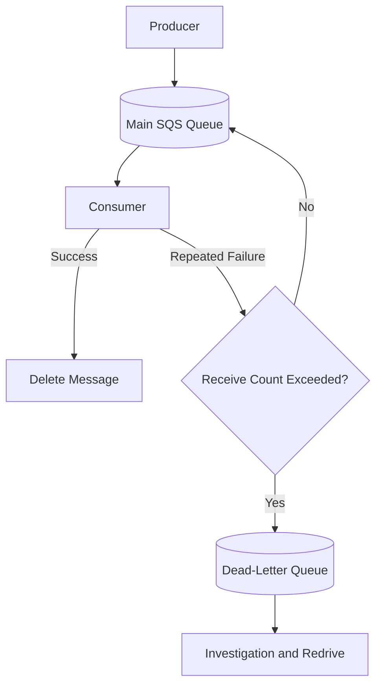
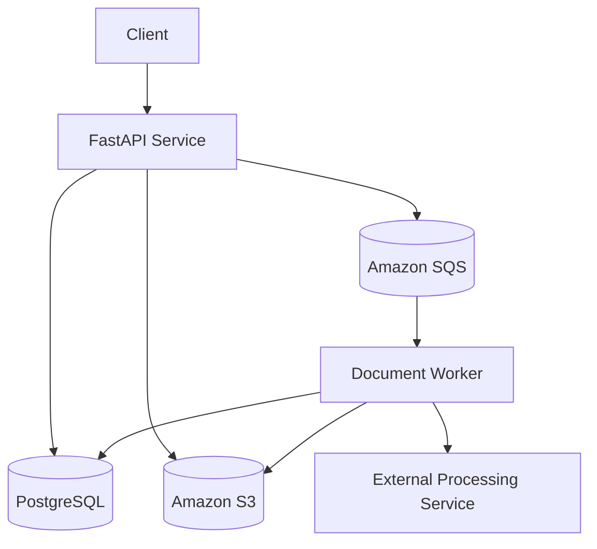
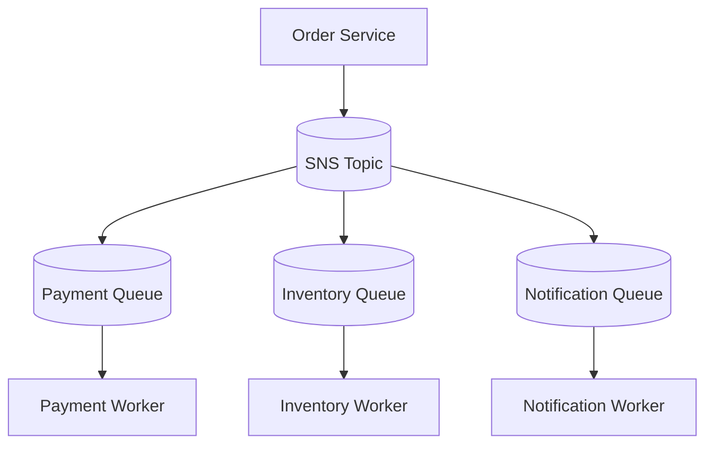
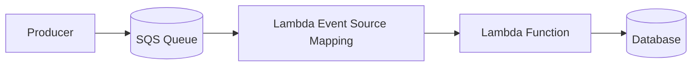
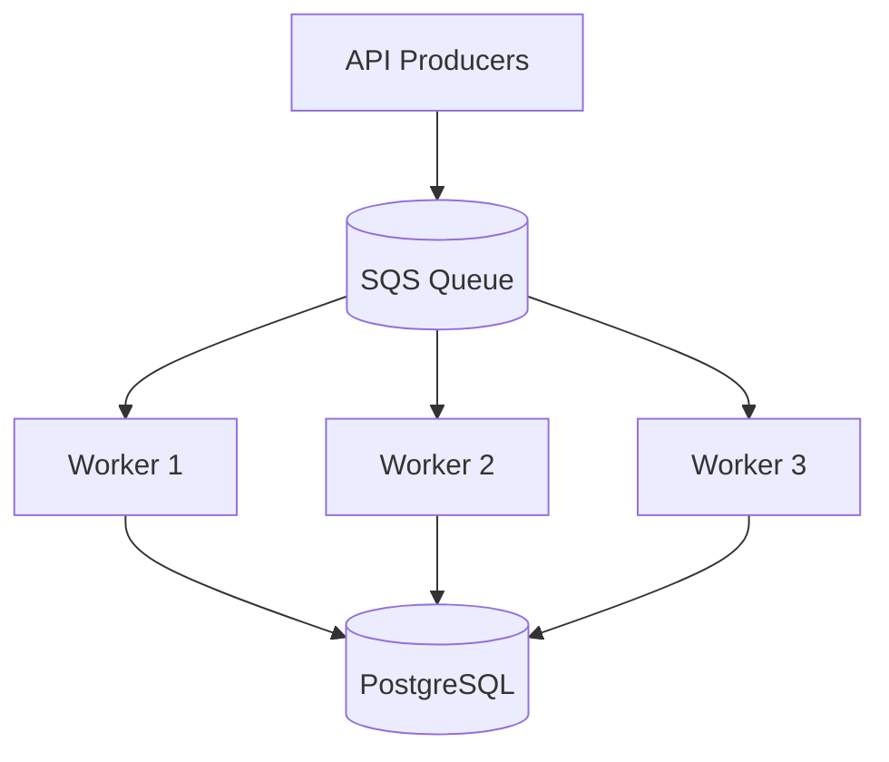

# 01- Integration Overview

## Overview

Amazon Simple Queue Service (Amazon SQS) is a fully managed message queuing service used to decouple application components and distribute work asynchronously. It enables backend services, microservices, background workers, and distributed applications to communicate without requiring the producer and consumer to be available simultaneously.

SQS acts as a durable intermediary between message producers and consumers. Producers publish messages to queues, while consumers retrieve and process them independently. This reduces direct service dependencies and allows individual components to scale, fail, and recover independently.

In a typical backend architecture, an API service accepts a request, persists the business operation, and publishes a message to SQS. Worker processes consume the message and perform tasks such as sending notifications, generating reports, processing documents, or synchronizing data with external systems.

SQS is particularly useful when an operation does not need to complete within the lifetime of an HTTP request.

### Why SQS Matters in Backend Systems

Consider an order-processing API that performs several operations:

- Validate an order.
- Persist order details in PostgreSQL.
- Charge a payment provider.
- Generate an invoice.
- Send an email notification.
- Update inventory.

Executing every operation synchronously increases response latency and couples the availability of the API to multiple downstream systems.

With SQS, the API can persist the order and enqueue work for asynchronous processing. Independent workers handle the remaining operations.

This provides several engineering benefits:

- **Decoupling:** Producers do not need direct knowledge of consumer implementations.
- **Resilience:** Messages remain available while consumers are temporarily unavailable.
- **Load leveling:** Queues absorb traffic spikes and allow consumers to process work at a controlled rate.
- **Independent scaling:** Producers and consumers can scale separately.
- **Fault isolation:** Consumer failures do not necessarily affect API availability.
- **Operational flexibility:** Workers can be deployed, restarted, and updated independently.

## SQS Architecture

SQS uses a queue-based messaging model.

The main components are:

| Component | Responsibility |
|---|---|
| Producer | Creates and sends messages to a queue. |
| Queue | Stores messages until consumers retrieve and delete them. |
| Consumer | Retrieves messages and performs business operations. |
| Visibility timeout | Temporarily hides a received message from other consumers. |
| Dead-letter queue (DLQ) | Stores messages that repeatedly fail processing. |
| Long polling | Allows consumers to wait for messages instead of continuously polling. |
| Message retention | Defines how long messages remain in a queue. |

### Basic Message Flow



The typical lifecycle is:

1. A producer sends a message to SQS.
2. SQS accepts and stores the message.
3. A consumer requests messages from the queue.
4. SQS returns available messages and temporarily hides them.
5. The consumer processes the message.
6. After successful processing, the consumer deletes the message.
7. If processing fails, the message becomes visible again after the visibility timeout expires.
8. After repeated unsuccessful processing attempts, the message can be moved to a DLQ.

A successful `SendMessage` operation means SQS accepted the message. It does not mean that a consumer processed the associated business operation.

Similarly, receiving a message does not permanently remove it from the queue. The consumer must explicitly delete it after successful processing.

## SQS Queue Types

SQS provides two queue types:

- Standard queues
- FIFO (First-In-First-Out) queues

Choosing the correct queue type depends on ordering, throughput, and deduplication requirements.

### Standard Queues

Standard queues provide high throughput and distributed message delivery.

They are appropriate when:

- Messages can be processed independently.
- Strict ordering is unnecessary.
- Consumers can tolerate duplicate delivery.
- High-throughput asynchronous processing is required.

Standard queues provide at-least-once delivery. A message can occasionally be delivered more than once, so consumers must be idempotent.

| Characteristic | Standard Queue |
|---|---|
| Throughput | High and scalable |
| Ordering | Best-effort ordering |
| Delivery | At-least-once |
| Duplicate messages | Possible |
| Deduplication | Application responsibility |
| Typical use cases | Notifications, background jobs, document processing |

Example:

An application receives 10,000 document-processing requests. Each document can be processed independently, so strict ordering is unnecessary.

A Standard queue allows multiple workers to process documents concurrently.

### FIFO Queues

FIFO queues preserve message ordering within a message group and provide deduplication capabilities.

They are appropriate when:

- Message ordering is important.
- Related operations must be processed sequentially.
- Duplicate message submission needs to be controlled.
- Business workflows depend on ordered events.

| Characteristic | FIFO Queue |
|---|---|
| Throughput | Lower than Standard queues unless high-throughput FIFO is configured |
| Ordering | Preserved within a message group |
| Delivery | Exactly-once processing claims are limited to SQS deduplication and delivery behavior |
| Deduplication | Supported through deduplication IDs or content-based deduplication |
| Message groups | Required |
| Typical use cases | Account transactions, ordered inventory updates, sequential workflows |

FIFO queues require a `MessageGroupId`. Messages belonging to the same group are processed in order, while different groups can be processed concurrently.

Example:

An account receives three balance updates:

```text
Account: ACC-1001

1. Deposit 100
2. Withdraw 40
3. Deposit 50
```

Processing these messages out of order could produce an incorrect business result.

Using the account identifier as the message group ID preserves ordering for that account.

```python
import boto3
import json

sqs = boto3.client("sqs", region_name="ap-south-1")

queue_url = "https://sqs.ap-south-1.amazonaws.com/123456789012/account-events.fifo"

event = {
    "event_id": "evt-1001",
    "account_id": "ACC-1001",
    "operation": "deposit",
    "amount": 100,
}

response = sqs.send_message(
    QueueUrl=queue_url,
    MessageBody=json.dumps(event),
    MessageGroupId=event["account_id"],
    MessageDeduplicationId=event["event_id"],
)

print(response["MessageId"])
```

FIFO deduplication uses a five-minute deduplication interval. It does not replace durable application-level idempotency.

A consumer can still encounter application failures, retries, and ambiguous processing outcomes. Business operations must remain safe against duplicate execution.

### Standard vs FIFO

| Feature | Standard | FIFO |
|---|---|---|
| Ordering | Best effort | Per message group |
| Delivery | At least once | Exactly-once processing is not guaranteed for arbitrary business operations |
| Deduplication | Not provided by SQS | Supported within the deduplication interval |
| Throughput | Very high | Configurable; lower by default |
| Message group ID | Not required | Required |
| Best suited for | Independent background tasks | Ordered business operations |

**Engineering recommendation:** Prefer Standard queues unless the business domain has a concrete ordering or deduplication requirement that justifies FIFO complexity.

## Core SQS Concepts

### Message

A message is the unit of data transferred through an SQS queue.

A message contains:

- Message body.
- Optional message attributes.
- System-generated message ID.
- Receipt handle generated when the message is received.

Example message:

```json
{
  "event_id": "evt-12345",
  "event_type": "document.uploaded",
  "event_version": 1,
  "document_id": "doc-1001",
  "uploaded_at": "2026-11-22T10:30:00Z",
  "metadata": {
    "content_type": "application/pdf",
    "source": "customer-portal"
  }
}
```

The message body should contain the information required by the consumer, or a reference to the authoritative data.

Avoid placing large documents, images, or binary content directly in SQS messages. Use Amazon S3 for large payloads and send an object reference through the queue.

### Message Attributes

Message attributes provide additional structured metadata outside the message body.

They are useful for:

- Message filtering.
- Routing decisions.
- Event classification.
- Correlation metadata.
- Consumer-specific processing.

Example:

```python
sqs.send_message(
    QueueUrl=queue_url,
    MessageBody=json.dumps(event),
    MessageAttributes={
        "event_type": {
            "DataType": "String",
            "StringValue": "document.uploaded",
        },
        "source": {
            "DataType": "String",
            "StringValue": "document-service",
        },
    },
)
```

Message attributes are useful for metadata, but they should not become a replacement for a well-defined event contract.

### Message ID and Receipt Handle

These two values have different responsibilities.

| Identifier | Purpose |
|---|---|
| Message ID | Identifies a message created by SQS. |
| Receipt handle | Identifies a particular receive operation for that message. |

The receipt handle is required for operations such as deleting a received message or changing its visibility timeout.

A message can receive a new receipt handle when it is received again. Consumers must use the latest receipt handle returned by SQS.

Do not persist a receipt handle as a permanent message identifier.

### Visibility Timeout

The visibility timeout controls how long a received message remains hidden from other consumers.

When a consumer receives a message, SQS makes it temporarily invisible to other consumers. This reduces concurrent processing of the same message.



If the worker does not delete the message before the visibility timeout expires, the message becomes visible again.

This allows another consumer to retry processing.

**Production considerations:**

- Set the visibility timeout longer than the expected processing duration.
- Extend visibility for long-running jobs using `ChangeMessageVisibility`.
- Ensure worker shutdown does not silently abandon in-flight messages.
- Avoid setting an excessively long timeout for short-running jobs.
- Remember that visibility timeout is not a distributed lock or an exactly-once processing mechanism.

### Message Retention Period

Message retention defines how long SQS keeps a message if it is not deleted.

The retention period can be configured from 1 minute to 14 days.

A queue should have a retention period appropriate for the business workflow.

For example:

- Short-lived notification jobs may need a few hours.
- Document-processing jobs may need several days.
- Financial or audit-related workflows may require a separate durable event-storage strategy.

SQS retention is not a substitute for long-term business data storage.

### Long Polling

Long polling allows a consumer to wait for messages rather than repeatedly checking the queue with short polling requests.

The `WaitTimeSeconds` parameter controls how long a receive request waits for messages, up to 20 seconds.

Example:

```python
response = sqs.receive_message(
    QueueUrl=queue_url,
    MaxNumberOfMessages=10,
    WaitTimeSeconds=20,
)
```

Long polling reduces empty responses and unnecessary API calls.

**Production recommendation:** Enable long polling for most worker-based applications. Configure the HTTP client read timeout to be greater than the long-polling wait time, with sufficient network overhead.

### Dead-Letter Queue

A dead-letter queue stores messages that cannot be successfully processed after a configured number of receives.

It helps isolate problematic messages from normal processing.



A redrive policy defines when messages move to the DLQ.

Example Terraform configuration:

```hcl
resource "aws_sqs_queue" "processing_dlq" {
  name                      = "document-processing-dlq"
  message_retention_seconds = 1209600
}

resource "aws_sqs_queue" "processing" {
  name                       = "document-processing"
  visibility_timeout_seconds = 300
  message_retention_seconds  = 345600

  redrive_policy = jsonencode({
    deadLetterTargetArn = aws_sqs_queue.processing_dlq.arn
    maxReceiveCount     = 5
  })
}
```

The `maxReceiveCount` setting controls how many receives are allowed before a message is moved to the DLQ.

A DLQ should have:

- Monitoring and alarms.
- A documented investigation process.
- A controlled redrive procedure.
- Appropriate retention.
- Access restrictions.
- Message inspection and failure classification.

Do not automatically redrive every DLQ message without investigating the failure. Reintroducing a poison message can create repeated failures.

## SQS in a Backend Architecture

SQS is commonly used as an asynchronous communication layer between APIs and background workers.

### REST API with Asynchronous Processing

Consider a FastAPI application that accepts document uploads.

The API validates the request, stores document metadata in PostgreSQL, and sends a message to SQS. A separate worker downloads the document from S3 and processes it.



The API does not wait for document processing to finish. It returns an accepted response with a job identifier.

Example API:

```python
from uuid import uuid4

import boto3
from fastapi import FastAPI, HTTPException
from pydantic import BaseModel

app = FastAPI()

sqs = boto3.client("sqs", region_name="ap-south-1")
QUEUE_URL = "https://sqs.ap-south-1.amazonaws.com/123456789012/document-processing"


class DocumentRequest(BaseModel):
    document_id: str
    s3_bucket: str
    s3_key: str


@app.post("/documents/process", status_code=202)
def process_document(request: DocumentRequest):
    event_id = str(uuid4())

    message = {
        "event_id": event_id,
        "event_type": "document.processing.requested",
        "document_id": request.document_id,
        "s3_bucket": request.s3_bucket,
        "s3_key": request.s3_key,
    }

    try:
        response = sqs.send_message(
            QueueUrl=QUEUE_URL,
            MessageBody=__import__("json").dumps(message),
        )
    except Exception as exc:
        raise HTTPException(
            status_code=503,
            detail="Unable to enqueue document processing request",
        ) from exc

    return {
        "event_id": event_id,
        "message_id": response["MessageId"],
        "status": "accepted",
    }
```

The example demonstrates the request flow. A production implementation should persist the job state and use a transactional outbox when the database update and message publication must not become inconsistent.

For example, if the API commits a document record but fails before publishing the SQS message, the document may remain unprocessed.

A transactional outbox addresses this dual-write problem by recording the event in the same database transaction as the business update. A separate publisher sends pending outbox records to SQS.

### Background Workers

Workers retrieve messages and execute business logic independently of the API process.

A worker should:

1. Receive messages using long polling.
2. Validate the message schema.
3. Check whether the event has already been processed.
4. Execute the business operation.
5. Commit business changes.
6. Delete the message only after successful processing.
7. Allow retry or route the message to a DLQ when processing fails.

Example:

```python
import json
import logging
import os

import boto3

logger = logging.getLogger(__name__)
logging.basicConfig(level=logging.INFO)

sqs = boto3.client("sqs", region_name=os.environ["AWS_REGION"])
QUEUE_URL = os.environ["SQS_QUEUE_URL"]


def process_event(event: dict) -> None:
    event_id = event["event_id"]
    document_id = event["document_id"]

    logger.info(
        "Processing document event",
        extra={
            "event_id": event_id,
            "document_id": document_id,
        },
    )

    # Perform idempotent business processing here.
    # Commit database changes before deleting the SQS message.


def consume_messages() -> None:
    while True:
        response = sqs.receive_message(
            QueueUrl=QUEUE_URL,
            MaxNumberOfMessages=10,
            WaitTimeSeconds=20,
            VisibilityTimeout=300,
        )

        for message in response.get("Messages", []):
            receipt_handle = message["ReceiptHandle"]

            try:
                event = json.loads(message["Body"])
                process_event(event)

                sqs.delete_message(
                    QueueUrl=QUEUE_URL,
                    ReceiptHandle=receipt_handle,
                )

            except Exception:
                logger.exception("Message processing failed")
                # Do not delete the message.
                # It becomes visible again after its visibility timeout.


if __name__ == "__main__":
    consume_messages()
```

This is a basic polling loop. A production worker also needs graceful shutdown, bounded concurrency, schema validation, durable idempotency, visibility management, structured metrics, and controlled exception handling.

### SQS and Celery

SQS can be used as a broker for Celery workers.

This can be useful when an existing Python application already uses Celery for task execution and scheduling.

However, Celery and SQS have different responsibilities:

- SQS provides managed message storage and delivery.
- Celery provides task execution abstractions, routing, retries, scheduling integrations, and worker management.

SQS does not provide all Celery broker features. For example, Celery's scheduling and result-backend capabilities require separate components or configurations.

Use Celery with SQS when the application benefits from Celery's task abstractions. Use the AWS SDK directly when the application needs explicit control over message contracts and queue behavior.

## SQS Integration with Other AWS Services

SQS commonly works alongside other AWS services.

| AWS Service | Integration Pattern | Typical Use Case |
|---|---|---|
| Amazon SNS | Fan-out messages to multiple SQS queues | Multiple independent consumers |
| AWS Lambda | Trigger Lambda functions from queues | Serverless background processing |
| Amazon S3 | Send object references through SQS | Document and file processing |
| Amazon EventBridge | Route events to SQS targets | Event-driven service integration |
| AWS Step Functions | Send messages and coordinate workflows | Long-running business processes |
| Amazon ECS | Run containerized queue consumers | Scalable background workers |
| Amazon EKS | Deploy Kubernetes-based consumers | Container orchestration |
| CloudWatch | Monitor queue metrics and worker health | Operational visibility |
| AWS KMS | Encrypt queue messages at rest | Data protection |

### SNS and SQS Fan-Out

SNS and SQS are frequently combined when multiple services need to receive the same event independently.

SNS distributes the event to multiple subscribed SQS queues. Each consumer processes its own copy.



This architecture prevents one consumer's processing speed or failure from directly blocking other consumers.

For example, an `order.created` event can trigger payment processing, inventory reservation, and customer notification independently.

SNS handles fan-out, while SQS provides durable buffering for each consumer.

### SQS and Lambda

Lambda can consume messages from SQS through an event source mapping.

AWS manages polling and invokes the function with batches of messages.



Important considerations:

- Configure batch size based on processing cost and latency.
- Configure visibility timeout to accommodate Lambda execution and retries.
- Use partial batch responses to avoid retrying successfully processed messages when only some messages fail.
- Configure a DLQ or redrive policy.
- Make function execution idempotent.

An event source mapping is not the same as a direct push notification from SQS. Lambda polls the queue on behalf of the function.

## Message Delivery and Processing Semantics

Understanding SQS delivery semantics is essential for designing reliable consumers.

### At-Least-Once Delivery

Standard queues provide at-least-once delivery.

This means a message is delivered one or more times until it is successfully deleted or expires.

Duplicate delivery can occur because of distributed processing and the interaction between message visibility and consumer execution.

A consumer must therefore be idempotent.

For example, processing a payment event twice must not charge the customer twice.

### Idempotent Processing

Idempotency ensures that repeated processing of the same event does not produce repeated business side effects.

A common implementation uses a unique event identifier and a database constraint.

Example PostgreSQL table:

```sql
CREATE TABLE processed_events (
    event_id UUID PRIMARY KEY,
    processed_at TIMESTAMPTZ NOT NULL DEFAULT NOW()
);
```

The consumer should record the event identifier and perform the business operation in the same database transaction.

Conceptually:

```sql
BEGIN;

INSERT INTO processed_events (event_id)
VALUES ('00000000-0000-0000-0000-000000000001')
ON CONFLICT DO NOTHING;

-- Execute the business operation only if the event was newly inserted.

COMMIT;
```

The application must check whether the insert actually inserted a row before performing the business operation.

The event record and business changes must commit atomically. Otherwise, a crash can leave an inconsistent idempotency record.

### Retry Behavior

SQS supports retry through message visibility.

When a consumer fails without deleting the message, the message becomes available again after its visibility timeout expires.

Retries should be designed around failure classification:

| Failure Type | Recommended Handling |
|---|---|
| Temporary network failure | Retry with bounded attempts |
| Database connection failure | Retry after recovery |
| External API rate limit | Retry with backoff |
| Invalid message schema | Route to DLQ or quarantine |
| Missing required business data | Investigate and classify |
| Permanent business rejection | Record outcome and handle explicitly |

Avoid retrying permanent failures indefinitely.

For external API calls, use bounded retries, exponential backoff, and jitter where appropriate.

### Ordering and Concurrency

Standard queues do not guarantee strict ordering.

FIFO queues preserve ordering within message groups, but messages in the same group are processed sequentially.

A high-throughput worker architecture should balance:

- Number of concurrent consumers.
- Queue backlog.
- Downstream service capacity.
- Database connection limits.
- External API rate limits.
- Visibility timeout.
- Message processing duration.

Increasing consumer concurrency without considering downstream capacity can move the bottleneck from SQS to PostgreSQL or an external service.

## Queue Configuration and Operational Settings

The following settings should be reviewed when creating a queue.

| Configuration | Purpose | Engineering Consideration |
|---|---|---|
| Visibility timeout | Controls temporary message invisibility | Must accommodate processing duration |
| Message retention | Controls message lifetime | Align with business recovery requirements |
| Receive message wait time | Enables long polling | Usually configure up to 20 seconds |
| Maximum message size | Limits message payload | Use S3 references for large objects |
| Delivery delay | Delays message availability | Useful for simple delayed processing |
| Redrive policy | Configures DLQ behavior | Define a suitable maximum receive count |
| Server-side encryption | Protects stored messages | Use SSE-SQS or SSE-KMS |
| Queue access policy | Controls resource-level access | Restrict principals and actions |
| FIFO deduplication | Reduces duplicate sends | Does not replace application idempotency |

### Queue Naming

Use names that communicate the business purpose and environment.

Examples:

```text
dev-document-processing
staging-document-processing
prod-document-processing
prod-payment-events.fifo
prod-notification-dlq
```

Avoid generic names such as `queue1` or `worker-queue`.

For FIFO queues, the queue name must end in `.fifo`.

### Queue URL and ARN

SQS exposes two important queue identifiers:

| Identifier | Purpose |
|---|---|
| Queue URL | Used by API operations such as `SendMessage` and `ReceiveMessage` |
| Queue ARN | Used in IAM policies, resource policies, and service integrations |

Example:

```text
Queue URL:
https://sqs.ap-south-1.amazonaws.com/123456789012/document-processing

Queue ARN:
arn:aws:sqs:ap-south-1:123456789012:document-processing
```

Do not confuse these identifiers when configuring IAM policies or application clients.

## Security Considerations

SQS security should be implemented using least privilege and defense in depth.

### IAM Permissions

Applications should receive only the permissions required for their role.

A producer generally needs:

- `sqs:SendMessage`
- `sqs:GetQueueUrl` if it resolves the queue URL dynamically.

A consumer generally needs:

- `sqs:ReceiveMessage`
- `sqs:DeleteMessage`
- `sqs:ChangeMessageVisibility`
- `sqs:GetQueueAttributes`

Example producer policy:

```json
{
  "Version": "2012-10-17",
  "Statement": [
    {
      "Effect": "Allow",
      "Action": [
        "sqs:SendMessage"
      ],
      "Resource": "arn:aws:sqs:ap-south-1:123456789012:document-processing"
    }
  ]
}
```

Example consumer policy:

```json
{
  "Version": "2012-10-17",
  "Statement": [
    {
      "Effect": "Allow",
      "Action": [
        "sqs:ReceiveMessage",
        "sqs:DeleteMessage",
        "sqs:ChangeMessageVisibility",
        "sqs:GetQueueAttributes"
      ],
      "Resource": "arn:aws:sqs:ap-south-1:123456789012:document-processing"
    }
  ]
}
```

Do not use `sqs:*` in application roles unless there is a specific administrative requirement.

### Server-Side Encryption

SQS supports server-side encryption using:

- Amazon SQS-managed encryption keys (SSE-SQS).
- AWS Key Management Service keys (SSE-KMS).

Use SSE-SQS when managed encryption is sufficient.

Use SSE-KMS when the application requires customer-managed key control, auditability, or custom key policies.

For SSE-KMS, ensure that the relevant producer and consumer principals have the necessary KMS permissions.

### Network and Access Control

SQS is a regional AWS service accessed through AWS service endpoints.

For private workloads, use an SQS interface VPC endpoint where appropriate. This allows private connectivity without requiring public internet routing for SQS traffic.

Also consider:

- Restricting queue resource policies.
- Using IAM roles instead of long-lived credentials.
- Enforcing TLS for requests.
- Avoiding sensitive information in message attributes and logs.
- Restricting DLQ access.
- Reviewing cross-account access explicitly.

## Scalability and Performance

SQS provides managed queue infrastructure, but consumer throughput and downstream dependencies still require engineering controls.

### Horizontal Scaling

Consumers can scale horizontally by running multiple worker instances.

For example:



Each worker competes for available messages.

This allows the system to increase processing capacity without changing the producer.

For containerized applications, workers can run on:

- Amazon ECS.
- Amazon EKS.
- Amazon EC2.
- AWS Lambda.

### Queue Backlog

A growing queue backlog can indicate that producers are generating messages faster than consumers can process them.

Important metrics include:

- `ApproximateNumberOfMessagesVisible`
- `ApproximateNumberOfMessagesNotVisible`
- `ApproximateNumberOfMessagesDelayed`
- `ApproximateAgeOfOldestMessage`

A useful scaling strategy is to increase worker capacity based on visible backlog and message age, while respecting downstream service limits.

Do not scale only on CPU utilization. A worker can be mostly idle while waiting for external API calls or database operations.

### Batch Processing

SQS supports receiving up to 10 messages in a single `ReceiveMessage` request.

Batching can reduce API request overhead.

However, batch size should account for:

- Message processing duration.
- Memory usage.
- Failure isolation.
- Visibility timeout.
- Downstream connection limits.

For FIFO queues, batch behavior must also respect message group ordering.

### Throughput Bottlenecks

Common bottlenecks include:

- Slow database transactions.
- External API rate limits.
- Excessive message payload sizes.
- Too many concurrent database connections.
- Long-running tasks with insufficient visibility management.
- Inefficient polling.
- Repeated retries of poison messages.

Scale consumers based on end-to-end processing capacity, not just queue throughput.

## High Availability and Disaster Recovery

SQS is a regional managed service designed for high availability within an AWS Region.

However, regional service availability does not automatically provide application-level disaster recovery.

Production systems should consider:

- Deploying consumers across multiple Availability Zones.
- Keeping application infrastructure independent of a single worker instance.
- Using durable business state outside the queue.
- Monitoring queue age and backlog.
- Documenting DLQ recovery procedures.
- Planning for regional outages.
- Maintaining infrastructure definitions in Terraform or another IaC system.

SQS queues are regional resources. Cross-Region disaster recovery requires an explicit architecture, such as application-level republishing, event replication, or a regional recovery workflow.

Do not assume that a queue automatically replicates its messages to another Region.

## Monitoring and Observability

CloudWatch provides SQS metrics that help operators understand queue health.

Important metrics include:

| Metric | Meaning | Operational Use |
|---|---|---|
| `ApproximateNumberOfMessagesVisible` | Messages available for retrieval | Detect backlog |
| `ApproximateNumberOfMessagesNotVisible` | Messages currently being processed or invisible | Understand in-flight workload |
| `ApproximateNumberOfMessagesDelayed` | Messages waiting for their delay period | Monitor delayed work |
| `ApproximateAgeOfOldestMessage` | Approximate age of the oldest message | Detect processing delays |
| `NumberOfMessagesSent` | Messages sent to the queue | Understand producer activity |
| `NumberOfMessagesReceived` | Messages received by consumers | Understand consumption activity |
| `NumberOfMessagesDeleted` | Messages deleted from the queue | Understand completed queue handling |
| `NumberOfEmptyReceives` | Receive requests that returned no messages | Identify inefficient polling |

Use CloudWatch alarms for:

- Sustained queue backlog.
- Increasing oldest-message age.
- DLQ message count greater than zero.
- Unusual receive or deletion patterns.
- Unexpected producer activity.

Queue metrics are approximate and should be interpreted as operational signals rather than exact transactional counts.

### Application-Level Metrics

CloudWatch queue metrics do not explain why a worker is slow or why a particular message failed.

Applications should also emit:

- Processing duration.
- Successful processing count.
- Failed processing count.
- Retry count.
- Idempotency duplicate count.
- External dependency latency.
- Database transaction failures.
- DLQ routing count.

Use structured logs with identifiers such as:

```json
{
  "event_id": "evt-12345",
  "message_id": "sqs-message-id",
  "correlation_id": "req-98765",
  "consumer": "document-worker",
  "event_type": "document.processing.requested",
  "status": "failed"
}
```

Avoid logging sensitive message contents or credentials.

## Cost Considerations

SQS pricing is primarily based on API requests, with additional charges for certain features and data transfer.

Cost drivers include:

- Number of API requests.
- Number of messages.
- Receive and delete operations.
- Empty polling requests.
- Message payload size and request billing units.
- FIFO queue usage.
- Data transfer.
- KMS requests when using SSE-KMS.

Practical cost optimization:

- Enable long polling to reduce empty receives.
- Use batching where appropriate.
- Avoid unnecessarily frequent polling.
- Keep message payloads small.
- Set retention periods based on actual recovery requirements.
- Monitor queue activity and request volume.
- Evaluate SSE-KMS costs against security requirements.

Do not optimize request cost by removing reliability controls such as idempotency or DLQ handling.

## Deployment and Infrastructure as Code

SQS queues should generally be provisioned through infrastructure as code.

Terraform makes queue configuration, policies, encryption, redrive behavior, and environment-specific deployment repeatable.

Example:

```hcl
resource "aws_sqs_queue" "document_dlq" {
  name                      = "prod-document-processing-dlq"
  message_retention_seconds = 1209600

  sqs_managed_sse_enabled = true

  tags = {
    Environment = "production"
    Service     = "document-processing"
  }
}

resource "aws_sqs_queue" "document_processing" {
  name                       = "prod-document-processing"
  visibility_timeout_seconds = 300
  message_retention_seconds  = 345600
  receive_wait_time_seconds  = 20

  sqs_managed_sse_enabled = true

  redrive_policy = jsonencode({
    deadLetterTargetArn = aws_sqs_queue.document_dlq.arn
    maxReceiveCount     = 5
  })

  tags = {
    Environment = "production"
    Service     = "document-processing"
  }
}

output "document_queue_url" {
  value = aws_sqs_queue.document_processing.url
}

output "document_queue_arn" {
  value = aws_sqs_queue.document_processing.arn
}
```

### AWS CLI

Create a Standard queue:

```bash
aws sqs create-queue \
  --queue-name document-processing \
  --region ap-south-1
```

Create a FIFO queue:

```bash
aws sqs create-queue \
  --queue-name account-events.fifo \
  --attributes FifoQueue=true,ContentBasedDeduplication=false \
  --region ap-south-1
```

Retrieve queue attributes:

```bash
aws sqs get-queue-attributes \
  --queue-url https://sqs.ap-south-1.amazonaws.com/123456789012/document-processing \
  --attribute-names All
```

Send a message:

```bash
aws sqs send-message \
  --queue-url https://sqs.ap-south-1.amazonaws.com/123456789012/document-processing \
  --message-body '{"event_id":"evt-1001","event_type":"document.uploaded"}'
```

Receive messages:

```bash
aws sqs receive-message \
  --queue-url https://sqs.ap-south-1.amazonaws.com/123456789012/document-processing \
  --max-number-of-messages 10 \
  --wait-time-seconds 20
```

Delete a message:

```bash
aws sqs delete-message \
  --queue-url https://sqs.ap-south-1.amazonaws.com/123456789012/document-processing \
  --receipt-handle "<RECEIPT_HANDLE>"
```

Never hardcode production account IDs, credentials, or queue URLs in application source code. Use deployment configuration and IAM roles.

## Testing SQS Integrations

Queue integrations require more than unit tests.

A practical testing strategy includes:

| Test Type | What to Verify |
|---|---|
| Unit tests | Event validation and business logic |
| Producer tests | Correct queue URL, message body, and attributes |
| Consumer tests | Successful processing and deletion |
| Retry tests | Failed processing does not delete messages |
| Idempotency tests | Duplicate events do not repeat side effects |
| DLQ tests | Repeated failures reach the DLQ |
| Integration tests | Real queue behavior and IAM permissions |
| Load tests | Consumer throughput and downstream capacity |
| Recovery tests | Safe redrive and replay procedures |

Use dependency injection to isolate the SQS client in unit tests.

For integration testing, use an isolated AWS test account or environment. Local emulators can be useful for development, but they should not replace tests against AWS for behavior that depends on IAM, service integrations, or actual queue semantics.

## Common Mistakes and Production Pitfalls

| Mistake | Why It Causes Problems | Recommended Approach |
|---|---|---|
| Deleting a message before processing completes | Failed work is permanently removed | Delete only after successful business processing |
| Assuming exactly-once business execution | Duplicate delivery can repeat side effects | Implement durable idempotency |
| Setting visibility timeout too low | Messages can be processed concurrently | Align timeout with processing duration |
| Using short polling continuously | Creates unnecessary API requests | Enable long polling |
| Ignoring DLQs | Poison messages remain difficult to diagnose | Monitor and investigate DLQs |
| Putting large files in messages | Increases payload size and processing overhead | Store files in S3 and send references |
| Scaling consumers without limits | Can overload databases and APIs | Apply concurrency controls |
| Treating receipt handles as permanent IDs | Old handles can become invalid | Use the latest handle from each receive operation |
| Assuming FIFO means exactly-once business processing | Application failures can still produce repeated side effects | Keep business operations idempotent |
| Using queue metrics as exact counters | SQS metrics are approximate | Combine queue metrics with application metrics |
| Treating SQS as permanent storage | Messages expire according to retention settings | Persist authoritative business data separately |
| Ignoring the database/message dual-write problem | Business records and queued events can diverge | Use a transactional outbox where atomicity is required |

## Engineering Best Practices

For production SQS integrations:

- Define explicit, versioned message contracts.
- Include a stable event ID and correlation ID.
- Keep messages small and avoid embedding large files.
- Use Standard queues unless ordering requirements justify FIFO.
- Implement durable consumer idempotency.
- Delete messages only after successful business processing.
- Configure visibility timeouts based on real processing duration.
- Enable long polling.
- Configure DLQs and define operational redrive procedures.
- Scale consumers based on queue backlog and oldest-message age.
- Protect downstream dependencies with bounded concurrency.
- Use IAM roles and least-privilege permissions.
- Enable server-side encryption.
- Manage queues and policies through infrastructure as code.
- Monitor both queue-level and application-level metrics.
- Test duplicate delivery, retries, poison messages, and recovery.
- Use a transactional outbox when database updates and message publication must remain consistent.

## Interview Questions

**What is Amazon SQS?**

Amazon SQS is a managed message queuing service that enables asynchronous communication between distributed application components.

**What is the difference between Standard and FIFO queues?**

Standard queues provide high throughput and at-least-once delivery without strict ordering. FIFO queues preserve ordering within message groups and support deduplication.

**What is a visibility timeout?**

It is the period during which a received message remains invisible to other consumers. If the message is not deleted before the timeout expires, it becomes available again.

**Why should consumers be idempotent?**

Because messages can be delivered more than once. Idempotency prevents duplicate delivery from repeating business side effects.

**What is a dead-letter queue?**

A DLQ stores messages that exceed the configured maximum receive count, allowing failed messages to be isolated and investigated.

**What is long polling?**

Long polling allows a receive request to wait for messages for a configured duration, reducing empty responses and unnecessary API calls.

**Does receiving a message remove it from SQS?**

No. Receiving makes the message temporarily invisible. The consumer must explicitly delete it using the receipt handle.

**What happens when a consumer crashes after receiving a message?**

If the message is not deleted, it becomes visible again after the visibility timeout expires and can be received by another consumer.

**How do you prevent duplicate payment processing with SQS?**

Use a stable event or transaction identifier and enforce idempotency through a durable database constraint and an atomic business transaction.

**How do SNS and SQS work together?**

SNS distributes an event to multiple subscribed SQS queues. Each queue independently buffers the event for its own consumer.

**How would you scale an SQS-based worker architecture?**

Scale consumers based on queue backlog, oldest-message age, processing duration, and downstream capacity. Use bounded concurrency to prevent database and external service overload.

**Does SQS provide cross-Region replication?**

No automatic cross-Region queue replication is provided. Regional disaster recovery requires an explicit replication or recovery architecture.

## Key Takeaways

- SQS decouples producers and consumers through durable asynchronous message queues, improving resilience and independent scalability.
- Standard queues provide high throughput with at-least-once delivery; FIFO queues provide ordering within message groups and deduplication support.
- Consumers must use idempotent processing, manage visibility timeouts, and delete messages only after successful business operations.
- Long polling, DLQs, CloudWatch monitoring, least-privilege IAM, and infrastructure as code are essential production practices.
- Use SNS for fan-out, S3 for large payloads, and a transactional outbox when database changes and message publication must remain consistent.