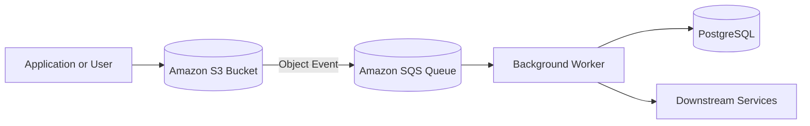
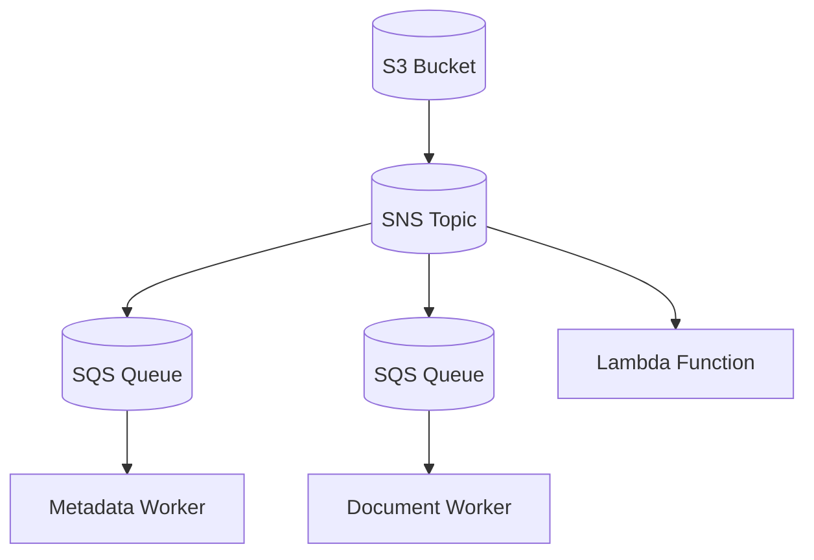
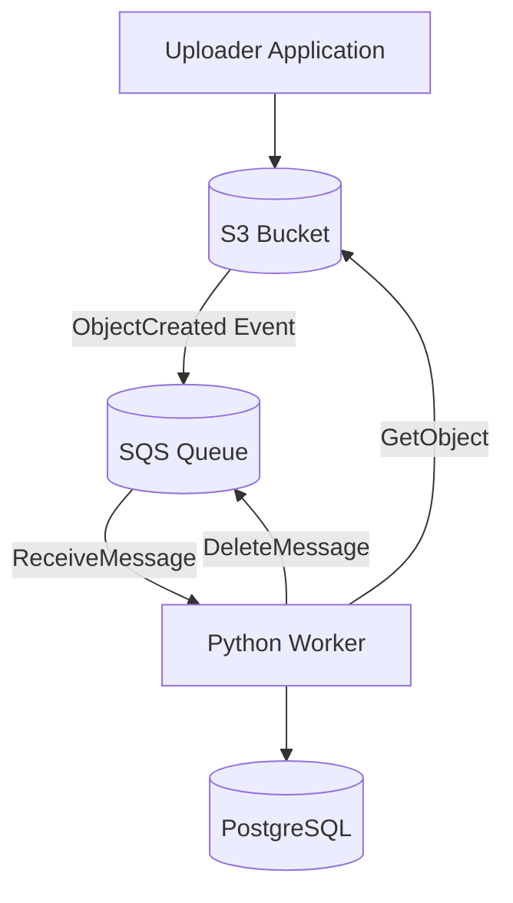
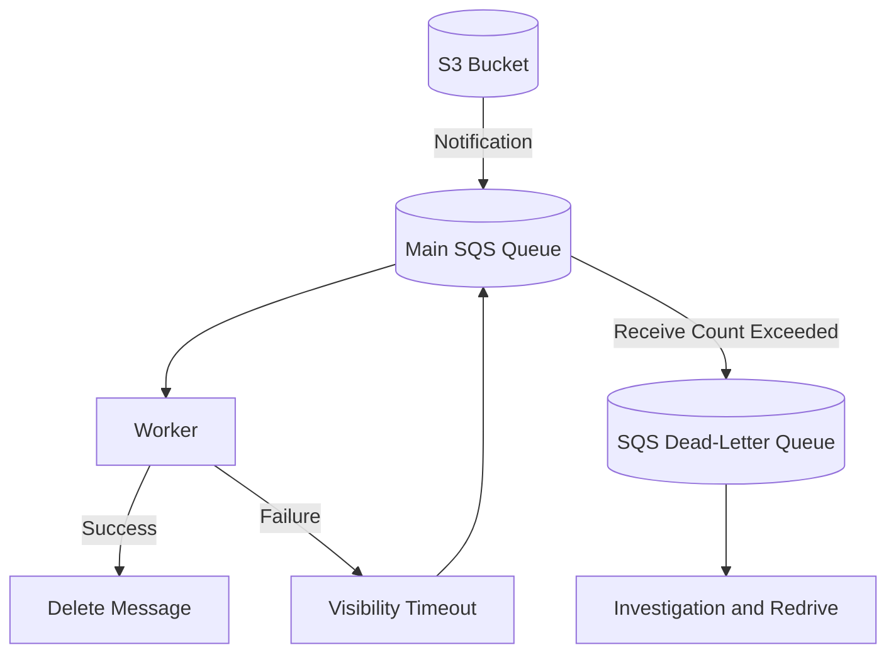
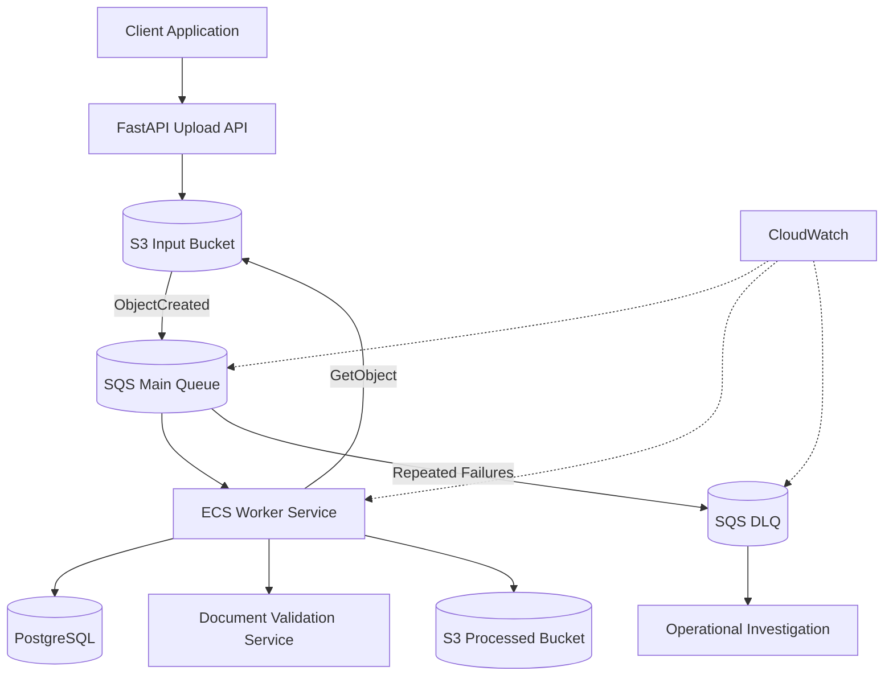

# 02- Amazon S3 Event Notifications

## Overview

Amazon S3 Event Notifications provide an event-driven mechanism for reacting to changes in Amazon S3 buckets. When supported operations occur on objects, S3 can publish notifications to destinations such as Amazon SQS, Amazon SNS, AWS Lambda, or Amazon EventBridge.

S3 Event Notifications are commonly used to trigger asynchronous backend workflows without requiring applications to continuously poll buckets for new objects.

Typical use cases include:

- Processing uploaded documents.
- Generating image thumbnails.
- Extracting metadata from files.
- Validating uploaded data.
- Starting ETL pipelines.
- Triggering antivirus or content-scanning workflows.
- Updating application databases after object creation or deletion.
- Initiating downstream microservice workflows.

S3 notifications integrate naturally with SQS when applications need durable buffering, controlled processing concurrency, independent worker deployment, and retry handling.

### Why S3 Event Notifications Matter

Consider a document management application where users upload PDF files to S3.

Without event notifications, a backend service might periodically list objects and compare them with previously processed files. This introduces unnecessary API requests, processing delays, and state-management complexity.

With S3 Event Notifications, an object creation event can be delivered to SQS. A background worker consumes the event and processes the corresponding document.

This architecture provides:

- Event-driven processing instead of continuous polling.
- Decoupling between file storage and processing services.
- Durable buffering through SQS.
- Independent scaling of document-processing workers.
- Better integration with serverless and containerized workloads.

## S3 Event Notification Architecture

S3 generates notifications when configured object operations occur.

The notification configuration determines which events are selected, which objects match optional filters, and where matching notifications are delivered.

### Basic Architecture



The processing flow is:

1. An application uploads an object to an S3 bucket.
2. S3 completes the relevant object operation.
3. S3 identifies matching event notification configurations.
4. S3 publishes a notification to the configured destination.
5. SQS stores the notification.
6. A consumer retrieves the message.
7. The consumer extracts the bucket and object information.
8. The worker retrieves the object from S3 and performs processing.
9. The worker commits its business changes and deletes the SQS message.

The S3 notification is an event describing an operation. It does not contain the complete object contents.

The consumer generally uses the bucket name and object key from the event to retrieve the object.

## Supported Notification Destinations

S3 supports several notification destinations.

| Destination | Integration Model | Typical Use Case |
|---|---|---|
| Amazon SQS | Sends event messages to a queue | Durable asynchronous processing |
| Amazon SNS | Publishes events to a topic | Fan-out to multiple subscribers |
| AWS Lambda | Invokes a function asynchronously | Serverless event processing |
| Amazon EventBridge | Sends events to an event bus | Advanced routing and event-driven architectures |

### S3 to SQS

This is a common integration for backend applications.

S3 sends object notifications to an SQS queue, and independent workers consume those messages.

Advantages:

- Durable message buffering.
- Independent producer and consumer lifecycles.
- Configurable visibility timeout and retention.
- Dead-letter queue support.
- Consumer-controlled processing concurrency.
- Integration with ECS, EKS, EC2, and Lambda.

Use this pattern when object processing may take significant time or requires controlled concurrency.

### S3 to SNS

S3 can publish notifications to an SNS topic.

SNS can distribute the event to multiple subscribers, including SQS queues and Lambda functions.



This is useful when multiple independent systems need to react to the same S3 event.

For example:

- A metadata service extracts file properties.
- A document service performs content processing.
- An audit service records the upload event.

Each SQS subscriber has its own queue and processing lifecycle.

### S3 to Lambda

S3 can directly invoke Lambda through an event notification configuration.

This is useful for short-running, event-driven processing tasks.

Example use cases:

- Generating thumbnails.
- Extracting lightweight metadata.
- Validating file extensions.
- Triggering a small transformation.

However, direct Lambda invocation provides less explicit queue-level control than an SQS-based architecture.

Use SQS when you need an independently managed backlog, consumer-controlled polling, or explicit queue-level retry and DLQ handling.

### S3 to EventBridge

S3 can publish events to Amazon EventBridge after EventBridge notifications are enabled for the bucket.

EventBridge provides advanced event routing based on event content.

It supports integration with targets such as:

- SQS.
- SNS.
- Lambda.
- Step Functions.
- Other AWS services.

Use EventBridge when routing requirements are more complex than basic S3 notification filters.

For example, an application might route object creation events differently based on bucket, object key, or other event attributes.

## S3 Event Types

S3 notifications can be configured for different object operations.

Common event types include:

| Event Type | Description | Example Use Case |
|---|---|---|
| `s3:ObjectCreated:Put` | Object created through a PUT operation | Process uploaded files |
| `s3:ObjectCreated:Post` | Object created through a POST operation | Process browser uploads |
| `s3:ObjectCreated:Copy` | Object created through a copy operation | Process copied documents |
| `s3:ObjectCreated:CompleteMultipartUpload` | Multipart upload completed | Process large uploaded files |
| `s3:ObjectCreated:*` | Any supported object creation operation | General upload processing |
| `s3:ObjectRemoved:Delete` | Object permanently deleted | Synchronize application metadata |
| `s3:ObjectRemoved:DeleteMarkerCreated` | Delete marker created in a versioned bucket | Track logical deletions |
| `s3:ObjectRestore:Completed` | Object restore operation completed | Process restored archived objects |
| `s3:Replication:*` | Replication-related event | Monitor replication workflows |

The exact event types available depend on the S3 notification configuration and the operation being performed.

### Object Creation Events

Object creation notifications are commonly used in document and media-processing pipelines.

For example, configuring `s3:ObjectCreated:*` captures supported object creation operations, including PUT, POST, COPY, and completed multipart uploads.

This is generally preferable to configuring only `s3:ObjectCreated:Put` when clients can upload through different S3 APIs.

### Object Removal Events

Object removal events are useful when applications need to synchronize their own metadata or trigger cleanup workflows.

For versioned buckets, deleting an object can create a delete marker rather than permanently removing the underlying object version.

The application should distinguish between logical deletion and permanent version deletion.

Do not assume every delete notification means the underlying object data has been permanently erased.

## Notification Configuration

S3 Event Notifications are configured on an S3 bucket.

A notification configuration defines:

- Destination type.
- Destination ARN.
- Event types.
- Optional object key filters.
- Optional notification identifier.

### Event Notification Configuration

A basic configuration sends all supported object creation events to an SQS queue.

Conceptually:

```json
{
  "QueueConfigurations": [
    {
      "Id": "document-upload-events",
      "QueueArn": "arn:aws:sqs:ap-south-1:123456789012:document-processing",
      "Events": [
        "s3:ObjectCreated:*"
      ]
    }
  ]
}
```

The queue ARN identifies the destination. The queue URL is not used in the bucket notification configuration.

### Prefix and Suffix Filters

S3 supports object key prefix and suffix filters.

Filters allow notifications to be generated only for objects matching specific key patterns.

Example:

```json
{
  "QueueConfigurations": [
    {
      "Id": "pdf-document-events",
      "QueueArn": "arn:aws:sqs:ap-south-1:123456789012:document-processing",
      "Events": [
        "s3:ObjectCreated:*"
      ],
      "Filter": {
        "Key": {
          "FilterRules": [
            {
              "Name": "prefix",
              "Value": "incoming/"
            },
            {
              "Name": "suffix",
              "Value": ".pdf"
            }
          ]
        }
      }
    }
  ]
}
```

This configuration matches objects such as:

```text
incoming/invoice-1001.pdf
incoming/contracts/agreement-2001.pdf
```

It does not match:

```text
processed/invoice-1001.pdf
incoming/image-1001.png
```

Prefix and suffix filters are useful for separating processing workflows within a shared bucket.

For example:

| Object Key | Matching Workflow |
|---|---|
| `incoming/documents/report.pdf` | PDF processing |
| `incoming/images/photo.jpg` | Image processing |
| `incoming/data/orders.csv` | CSV ingestion |
| `processed/report.pdf` | No incoming-file notification |

Avoid overlapping notification configurations that route the same object event to destinations unintentionally.

## S3 to SQS Integration

This section focuses on configuring S3 to publish notifications directly to an SQS queue.

### Architecture



The integration requires:

1. An S3 bucket.
2. An SQS queue.
3. An SQS queue resource policy allowing S3 to send messages.
4. An S3 notification configuration referencing the queue ARN.
5. A consumer with permissions to receive messages and access the objects.

### SQS Queue Policy

S3 must be authorized to publish messages to the destination queue.

This is configured through the SQS queue resource policy.

Example:

```json
{
  "Version": "2012-10-17",
  "Statement": [
    {
      "Sid": "AllowS3BucketNotifications",
      "Effect": "Allow",
      "Principal": {
        "Service": "s3.amazonaws.com"
      },
      "Action": "sqs:SendMessage",
      "Resource": "arn:aws:sqs:ap-south-1:123456789012:document-processing",
      "Condition": {
        "ArnEquals": {
          "aws:SourceArn": "arn:aws:s3:::production-document-bucket"
        },
        "StringEquals": {
          "aws:SourceAccount": "123456789012"
        }
      }
    }
  ]
}
```

The policy restricts SQS message publishing to the expected S3 bucket and AWS account.

Important considerations:

- Use the exact bucket ARN.
- Use the correct AWS account ID.
- Grant only `sqs:SendMessage`.
- Avoid wildcard principals.
- Ensure the queue and bucket are in the same AWS Region for direct S3-to-SQS notification delivery.

For cross-account architectures, both resource ownership and policy conditions must be reviewed carefully.

### S3 Notification Configuration

After configuring the queue policy, create the S3 notification configuration.

Example AWS CLI:

```bash
aws s3api put-bucket-notification-configuration \
  --bucket production-document-bucket \
  --notification-configuration '{
    "QueueConfigurations": [
      {
        "Id": "document-processing-events",
        "QueueArn": "arn:aws:sqs:ap-south-1:123456789012:document-processing",
        "Events": [
          "s3:ObjectCreated:*"
        ],
        "Filter": {
          "Key": {
            "FilterRules": [
              {
                "Name": "prefix",
                "Value": "incoming/"
              },
              {
                "Name": "suffix",
                "Value": ".pdf"
              }
            ]
          }
        }
      }
    ]
  }'
```

This command configures S3 to send matching object creation events to the SQS queue.

**Important:** `put-bucket-notification-configuration` replaces the bucket's existing notification configuration. It does not merge the supplied configuration with existing notifications.

Before applying changes in production, inspect existing configurations and preserve every notification that must remain active.

Retrieve the current configuration:

```bash
aws s3api get-bucket-notification-configuration \
  --bucket production-document-bucket
```

## S3 Event Message Structure

S3 sends a JSON notification containing information about the event.

A simplified notification looks like this:

```json
{
  "Records": [
    {
      "eventVersion": "2.1",
      "eventSource": "aws:s3",
      "awsRegion": "ap-south-1",
      "eventTime": "2026-11-22T10:30:00.000Z",
      "eventName": "ObjectCreated:Put",
      "s3": {
        "s3SchemaVersion": "1.0",
        "bucket": {
          "name": "production-document-bucket",
          "arn": "arn:aws:s3:::production-document-bucket"
        },
        "object": {
          "key": "incoming/invoice-1001.pdf",
          "size": 524288,
          "eTag": "example-etag",
          "sequencer": "0065A1B2C3D4E5F6"
        }
      }
    }
  ]
}
```

The actual event can contain additional fields.

Important fields:

| Field | Meaning |
|---|---|
| `eventVersion` | S3 event structure version |
| `eventSource` | Identifies S3 as the event source |
| `awsRegion` | Region where the event occurred |
| `eventTime` | Event timestamp |
| `eventName` | Operation that generated the event |
| `bucket.name` | Bucket containing the object |
| `bucket.arn` | Bucket ARN |
| `object.key` | Object key |
| `object.size` | Object size when supplied |
| `object.eTag` | Object ETag when supplied |
| `object.sequencer` | Sequencing information for supported object operations |

### Object Key Encoding

S3 event notification object keys are URL-encoded.

For example:

```text
incoming/monthly report.pdf
```

Can appear in the event as:

```text
incoming/monthly+report.pdf
```

Consumers must decode the key before using it in S3 API operations.

Python implementation:

```python
from urllib.parse import unquote_plus

encoded_key = "incoming/monthly+report.pdf"
object_key = unquote_plus(encoded_key)

print(object_key)
```

Output:

```text
incoming/monthly report.pdf
```

Failing to decode object keys can cause `GetObject` requests to reference the wrong object.

### Multiple Records

The S3 notification structure contains a `Records` array.

A message can contain multiple event records. Consumers should iterate through every record instead of assuming exactly one record per notification.

```python
def extract_s3_records(event: dict) -> list[dict]:
    records = event.get("Records")

    if not isinstance(records, list):
        raise ValueError("Invalid S3 notification: Records must be a list")

    return records
```

Do not assume that a single SQS message always corresponds to one S3 object.

## Python Consumer Implementation

A Python worker can consume S3 notifications from SQS and retrieve the corresponding objects.

The following implementation demonstrates:

- Long polling.
- SQS message parsing.
- S3 record extraction.
- Object key decoding.
- Object retrieval.
- Message deletion after successful processing.

```python
import json
import logging
import os
import signal
from urllib.parse import unquote_plus

import boto3
from botocore.config import Config

logging.basicConfig(level=logging.INFO)
logger = logging.getLogger(__name__)

AWS_REGION = os.environ["AWS_REGION"]
QUEUE_URL = os.environ["SQS_QUEUE_URL"]

aws_config = Config(
    retries={
        "mode": "standard",
        "max_attempts": 5,
    },
    connect_timeout=5,
    read_timeout=30,
)

sqs = boto3.client(
    "sqs",
    region_name=AWS_REGION,
    config=aws_config,
)

s3 = boto3.client(
    "s3",
    region_name=AWS_REGION,
    config=aws_config,
)

running = True


def shutdown_handler(signum, frame):
    global running
    running = False
    logger.info("Shutdown signal received")


signal.signal(signal.SIGTERM, shutdown_handler)
signal.signal(signal.SIGINT, shutdown_handler)


def process_s3_record(record: dict) -> None:
    event_source = record.get("eventSource")

    if event_source != "aws:s3":
        raise ValueError(f"Unsupported event source: {event_source}")

    event_name = record.get("eventName", "")

    if not event_name.startswith("ObjectCreated:"):
        logger.info("Ignoring event type: %s", event_name)
        return

    bucket = record["s3"]["bucket"]["name"]
    encoded_key = record["s3"]["object"]["key"]
    object_key = unquote_plus(encoded_key)

    logger.info(
        "Processing uploaded object",
        extra={
            "bucket": bucket,
            "object_key": object_key,
            "event_name": event_name,
        },
    )

    response = s3.get_object(
        Bucket=bucket,
        Key=object_key,
    )

    body = response["Body"]

    try:
        # Replace this with streaming document processing.
        content_length = response.get("ContentLength", 0)

        logger.info(
            "Retrieved object",
            extra={
                "bucket": bucket,
                "object_key": object_key,
                "content_length": content_length,
            },
        )
    finally:
        body.close()


def process_sqs_message(message: dict) -> None:
    notification = json.loads(message["Body"])

    if notification.get("Event") == "s3:TestEvent":
        logger.info("S3 notification configuration test event received")
        return

    records = notification.get("Records")

    if not isinstance(records, list):
        raise ValueError("Invalid S3 notification payload")

    for record in records:
        process_s3_record(record)


def consume_messages() -> None:
    while running:
        response = sqs.receive_message(
            QueueUrl=QUEUE_URL,
            MaxNumberOfMessages=10,
            WaitTimeSeconds=20,
            VisibilityTimeout=300,
        )

        for message in response.get("Messages", []):
            if not running:
                break

            try:
                process_sqs_message(message)

                sqs.delete_message(
                    QueueUrl=QUEUE_URL,
                    ReceiptHandle=message["ReceiptHandle"],
                )

            except Exception:
                logger.exception("S3 event processing failed")
                # Do not delete failed messages.
                # SQS makes them visible again after the visibility timeout.


if __name__ == "__main__":
    consume_messages()
```

This is a reference consumer, not a complete production worker. Production implementations should add durable idempotency, bounded concurrency, schema validation, processing timeouts, metrics, and visibility extension for long-running work.

### Processing Large Objects

Avoid reading large objects entirely into memory.

For large files, stream the object body or download it to controlled temporary storage.

Example:

```python
import tempfile
from pathlib import Path

import boto3

s3 = boto3.client("s3")


def download_object(bucket: str, key: str) -> Path:
    temporary_file = tempfile.NamedTemporaryFile(
        prefix="s3-document-",
        suffix=".pdf",
        delete=False,
    )

    path = Path(temporary_file.name)
    temporary_file.close()

    try:
        s3.download_file(
            bucket,
            key,
            str(path),
        )
    except Exception:
        path.unlink(missing_ok=True)
        raise

    return path
```

The caller should remove the temporary file after processing and ensure temporary storage has sufficient capacity.

For containerized workers, account for ephemeral storage limits and cleanup behavior.

## Event Reliability and Delivery Semantics

S3 Event Notifications are designed for at-least-once delivery.

This means notifications can be delivered more than once, and consumers must not assume that each object event arrives exactly once.

Notifications can also arrive out of order.

These characteristics have important consequences for backend design.

### Duplicate Notifications

A duplicate notification can cause the same object to be processed multiple times.

For example:

1. S3 generates an object creation event.
2. S3 delivers the notification.
3. A worker processes the object.
4. The worker completes its work but fails before deleting the SQS message.
5. SQS makes the message visible again.
6. Another worker processes the same event.

The application must make processing idempotent.

A useful idempotency key can include:

- Bucket name.
- Object key.
- Object version ID, when versioning is enabled.
- Event type.
- Application-level processing identifier.

For versioned buckets, object version ID is especially useful because the same key can refer to multiple object versions.

### Out-of-Order Events

S3 notifications are not guaranteed to arrive in the same order as the corresponding operations.

Consider:

```text
1. Object uploaded
2. Object overwritten
3. Object deleted
```

Notifications may be delivered in a different order.

Do not use notification arrival order as the authoritative object state.

For workloads that require ordering or stale-event detection, use the S3 event sequencer where applicable.

The sequencer can help compare events for the same object key. It should not be treated as a global ordering identifier across different objects.

### Idempotency with PostgreSQL

A processing table can prevent duplicate business operations.

Example schema:

```sql
CREATE TABLE s3_object_processing (
    id BIGSERIAL PRIMARY KEY,
    bucket_name TEXT NOT NULL,
    object_key TEXT NOT NULL,
    version_id TEXT NOT NULL DEFAULT '',
    event_name TEXT NOT NULL,
    status TEXT NOT NULL,
    processed_at TIMESTAMPTZ,
    created_at TIMESTAMPTZ NOT NULL DEFAULT NOW(),

    UNIQUE (
        bucket_name,
        object_key,
        version_id,
        event_name
    )
);
```

For production systems, the idempotency key must reflect the business operation.

For example, processing the same object version for two independent workflows may require separate workflow identifiers.

Use a database transaction to coordinate the idempotency record and business changes.

Do not mark an event as completed before its actual processing has committed successfully.

## Preventing Recursive Event Processing

A common S3 event-processing problem occurs when a worker writes its output back into the same bucket and triggers another notification.

Example:

```text
incoming/document.pdf
    |
    v
S3 ObjectCreated Event
    |
    v
SQS
    |
    v
Worker
    |
    v
processed/document.pdf
    |
    v
S3 ObjectCreated Event
```

This can create an infinite processing loop if the notification configuration matches both input and output objects.

### Recommended Solutions

**Use separate buckets:**

```text
document-input-bucket
document-output-bucket
```

This provides clear separation between source and generated objects.

**Use prefix filters:**

```text
incoming/
processed/
```

Configure notifications only for the `incoming/` prefix.

**Use explicit object metadata:**

Metadata can help the application distinguish generated objects, but notification filters do not provide arbitrary user-metadata filtering. Application-level validation is still required.

Separate input and output locations are generally easier to reason about and operate.

## S3 Object Versioning Considerations

S3 versioning allows multiple versions of an object to exist under the same key.

This matters when processing workflows need to identify the exact object state associated with an event.

Example:

```text
Bucket: production-document-bucket
Key: incoming/invoice.pdf

Version A: initial upload
Version B: overwritten document
Version C: latest upload
```

An event for Version A may be processed after Version C has already been uploaded.

If the worker retrieves the object only by bucket and key, it may retrieve Version C instead of the version that generated the event.

When versioning is enabled and the event provides a version ID, retrieve the specific version.

```python
def get_object_version(
    s3,
    bucket: str,
    key: str,
    version_id: str,
):
    return s3.get_object(
        Bucket=bucket,
        Key=key,
        VersionId=version_id,
    )
```

This is important for:

- Document audit trails.
- Compliance workflows.
- Historical data processing.
- Reproducible ETL pipelines.
- Workflows where every uploaded version must be processed.

## S3 Event Notifications and SQS Failure Handling

The S3-to-SQS integration has multiple independent failure boundaries.

Understanding them is important for designing recovery procedures.

### Notification Delivery Failure

S3 may fail to deliver a notification to the configured destination.

Possible causes include:

- Incorrect SQS queue policy.
- Missing `sqs:SendMessage` permission.
- Invalid destination ARN.
- Incorrect Region.
- Destination configuration problems.

S3 notification delivery has its own retry behavior. It should not be confused with SQS consumer retries.

An SQS DLQ does not automatically capture failures that occur before a message reaches the queue.

### Consumer Processing Failure

Once a message is accepted by SQS, consumer processing is controlled by SQS visibility and redrive configuration.



A DLQ protects the consumer-processing boundary.

It does not replace monitoring of S3 notification delivery.

### Recovery Strategy

A production recovery process should distinguish between:

| Failure | Recovery |
|---|---|
| S3 cannot publish to SQS | Fix destination permissions or configuration and investigate missing notifications |
| Worker crashes | Allow SQS visibility timeout and retry |
| Invalid event payload | Isolate in DLQ and investigate |
| Object no longer exists | Apply business-specific missing-object handling |
| Database unavailable | Retry processing after recovery |
| External API unavailable | Use bounded retries and controlled backoff |
| Duplicate notification | Apply idempotency |
| Out-of-order notification | Use version IDs or sequencer-aware processing where appropriate |

For critical ingestion systems, maintain an independent reconciliation process that compares expected object state with successfully processed records.

This provides a recovery mechanism for missed or permanently failed workflows.

## Security Considerations

S3 event-driven processing involves multiple service identities and permissions.

### Producer and Consumer Permissions

The S3 bucket notification configuration uses the SQS queue resource policy to authorize message delivery.

The worker uses its own IAM role to access SQS and S3.

A worker commonly requires:

- `sqs:ReceiveMessage`
- `sqs:DeleteMessage`
- `sqs:ChangeMessageVisibility`
- `sqs:GetQueueAttributes`
- `s3:GetObject`
- `s3:GetObjectVersion`, when processing specific versions

Avoid granting the worker broad bucket access when it only needs a specific prefix.

Example IAM policy:

```json
{
  "Version": "2012-10-17",
  "Statement": [
    {
      "Effect": "Allow",
      "Action": [
        "sqs:ReceiveMessage",
        "sqs:DeleteMessage",
        "sqs:ChangeMessageVisibility",
        "sqs:GetQueueAttributes"
      ],
      "Resource": "arn:aws:sqs:ap-south-1:123456789012:document-processing"
    },
    {
      "Effect": "Allow",
      "Action": [
        "s3:GetObject",
        "s3:GetObjectVersion"
      ],
      "Resource": "arn:aws:s3:::production-document-bucket/incoming/*"
    }
  ]
}
```

### Encryption

Consider encryption at each storage boundary:

- S3 objects can use SSE-S3 or SSE-KMS.
- SQS messages can use SSE-SQS or SSE-KMS.
- KMS key policies must allow the relevant service principals and application roles where required.

For SSE-KMS encrypted S3 objects, the consumer needs the appropriate KMS permissions to decrypt the object.

### Payload Validation

Treat notification messages as external input.

Consumers should:

- Validate the event source.
- Validate the expected event structure.
- Check bucket names against an allowlist.
- Validate object key prefixes.
- Reject unsupported event types.
- Avoid trusting arbitrary bucket or object references from unvalidated messages.

This prevents unintended object access and reduces the risk of processing unexpected data.

## Monitoring and Observability

Monitor both the SQS queue and the application processing pipeline.

### SQS Metrics

Important CloudWatch metrics include:

| Metric | Operational Purpose |
|---|---|
| `ApproximateNumberOfMessagesVisible` | Detect pending work |
| `ApproximateNumberOfMessagesNotVisible` | Understand in-flight messages |
| `ApproximateAgeOfOldestMessage` | Detect processing delays |
| `NumberOfMessagesSent` | Observe notification arrival volume |
| `NumberOfMessagesReceived` | Observe consumer activity |
| `NumberOfMessagesDeleted` | Observe successful queue completion |
| `NumberOfEmptyReceives` | Identify inefficient polling |

### Application Metrics

Queue metrics do not reveal whether the object was successfully processed.

Instrument the worker with:

- S3 objects processed.
- Processing failures.
- Processing duration.
- Duplicate events detected.
- Missing object errors.
- Invalid event payloads.
- Database transaction failures.
- DLQ message count.
- Processing latency from event time to completion.

Use structured logs with event identifiers and object metadata.

Example:

```json
{
  "event_id": "evt-12345",
  "bucket": "production-document-bucket",
  "object_key": "incoming/invoice-1001.pdf",
  "event_name": "ObjectCreated:Put",
  "worker": "document-processor",
  "status": "completed",
  "processing_duration_ms": 1820
}
```

Do not log sensitive document contents or presigned URLs.

### Alerting

Useful CloudWatch alarms include:

- Main queue backlog above an operational threshold.
- Oldest-message age exceeding the processing SLA.
- DLQ message count greater than zero.
- Consumer processing failures increasing.
- No successful processing activity during an expected ingestion period.

Use application-level metrics to distinguish a healthy idle queue from a broken notification pipeline.

## Terraform Implementation

Terraform can manage the S3 bucket, SQS queue, queue policy, and notification configuration.

The following example demonstrates a complete direct S3-to-SQS integration.

```hcl
variable "bucket_name" {
  type        = string
  description = "Name of the S3 document ingestion bucket"
}

variable "aws_region" {
  type    = string
  default = "ap-south-1"
}

resource "aws_s3_bucket" "documents" {
  bucket = var.bucket_name
}

resource "aws_sqs_queue" "document_dlq" {
  name                      = "document-processing-dlq"
  message_retention_seconds = 1209600

  sqs_managed_sse_enabled = true
}

resource "aws_sqs_queue" "document_processing" {
  name                       = "document-processing"
  visibility_timeout_seconds = 300
  message_retention_seconds  = 345600
  receive_wait_time_seconds  = 20

  sqs_managed_sse_enabled = true

  redrive_policy = jsonencode({
    deadLetterTargetArn = aws_sqs_queue.document_dlq.arn
    maxReceiveCount     = 5
  })
}

data "aws_iam_policy_document" "allow_s3_notification" {
  statement {
    sid    = "AllowS3BucketNotifications"
    effect = "Allow"

    principals {
      type        = "Service"
      identifiers = ["s3.amazonaws.com"]
    }

    actions = [
      "sqs:SendMessage"
    ]

    resources = [
      aws_sqs_queue.document_processing.arn
    ]

    condition {
      test     = "ArnEquals"
      variable = "aws:SourceArn"
      values   = [aws_s3_bucket.documents.arn]
    }

    condition {
      test     = "StringEquals"
      variable = "aws:SourceAccount"
      values   = [data.aws_caller_identity.current.account_id]
    }
  }
}

data "aws_caller_identity" "current" {}

resource "aws_sqs_queue_policy" "document_processing" {
  queue_url = aws_sqs_queue.document_processing.id
  policy    = data.aws_iam_policy_document.allow_s3_notification.json
}

resource "aws_s3_bucket_notification" "documents" {
  bucket = aws_s3_bucket.documents.id

  queue {
    id            = "document-upload-events"
    queue_arn     = aws_sqs_queue.document_processing.arn
    events        = ["s3:ObjectCreated:*"]
    filter_prefix = "incoming/"
    filter_suffix = ".pdf"
  }

  depends_on = [
    aws_sqs_queue_policy.document_processing
  ]
}

output "document_bucket_name" {
  value = aws_s3_bucket.documents.id
}

output "document_queue_url" {
  value = aws_sqs_queue.document_processing.url
}

output "document_queue_arn" {
  value = aws_sqs_queue.document_processing.arn
}
```

The dependency ensures that the queue policy is applied before Terraform configures the S3 notification.

The bucket and queue must be in the same Region for this direct notification integration.

The example uses SSE-SQS for queue encryption. If using SSE-KMS, configure the KMS key policy and permissions required for S3 notification delivery and consumer access.

### Terraform Deployment

Initialize Terraform:

```bash
terraform init
```

Validate configuration:

```bash
terraform validate
```

Review the deployment plan:

```bash
terraform plan
```

Apply the configuration:

```bash
terraform apply
```

Inspect the notification configuration:

```bash
aws s3api get-bucket-notification-configuration \
  --bucket production-document-bucket
```

Inspect queue attributes:

```bash
aws sqs get-queue-attributes \
  --queue-url "<QUEUE_URL>" \
  --attribute-names All
```

## Testing the Integration

Testing should cover both notification delivery and downstream processing.

### Upload a Test Object

Upload an object matching the configured prefix and suffix:

```bash
aws s3 cp invoice.pdf \
  s3://production-document-bucket/incoming/invoice.pdf
```

### Receive the Notification

```bash
aws sqs receive-message \
  --queue-url "<QUEUE_URL>" \
  --max-number-of-messages 10 \
  --wait-time-seconds 20
```

Verify:

- The message contains an S3 event notification.
- The bucket name is correct.
- The object key is correctly encoded.
- The event type matches the expected operation.
- The notification is delivered to the intended queue.

### Test Filtering

Upload objects that should match and should not match the notification configuration.

| Test Object | Expected Result |
|---|---|
| `incoming/report.pdf` | Notification generated |
| `incoming/archive/report.pdf` | Notification generated |
| `incoming/photo.jpg` | No matching notification |
| `processed/report.pdf` | No matching notification |

### Test Failure Handling

Test the following scenarios:

- Worker crashes after receiving a message.
- Object retrieval fails.
- Database transaction fails.
- Duplicate notification is delivered.
- Object is overwritten before processing.
- Message repeatedly fails and reaches the DLQ.
- Worker restarts while processing messages.

Verify that failed work is not silently deleted and that duplicate processing does not repeat business side effects.

## Production Architecture Recommendations

For a document ingestion pipeline, a production architecture can use S3, SQS, ECS, PostgreSQL, and CloudWatch.



Recommended design decisions:

**Separate input and output buckets**

This reduces recursive notification risks and simplifies access policies.

**Use SQS as a processing buffer**

The queue absorbs upload spikes and allows workers to process documents at a controlled rate.

**Use object versioning where required**

Version IDs allow workers to retrieve the exact object version associated with an event.

**Implement durable idempotency**

Use PostgreSQL constraints and transactions to prevent duplicate business processing.

**Use a DLQ**

Separate poison messages from normal work and establish a documented recovery process.

**Scale workers independently**

Use ECS service scaling based on queue backlog, oldest-message age, and processing capacity.

**Maintain reconciliation**

Periodically compare uploaded objects with application processing records to identify missing or incomplete workflows.

**Use infrastructure as code**

Manage notification configurations, queue policies, encryption, and alarms through Terraform.

## Common Mistakes and Pitfalls

| Mistake | Impact | Recommended Approach |
|---|---|---|
| Missing SQS queue policy | S3 cannot publish notifications | Grant `sqs:SendMessage` to the S3 service principal with source restrictions |
| Configuring the wrong Region | Direct notification delivery fails | Keep the bucket and SQS destination in the same Region |
| Using queue URL instead of ARN | Notification configuration is invalid | Use the SQS queue ARN |
| Ignoring URL-encoded object keys | Object retrieval references an incorrect key | Decode keys using `unquote_plus` |
| Assuming one record per message | Some event records may not be processed | Iterate through the complete `Records` array |
| Assuming exactly-once notification delivery | Duplicate processing occurs | Implement idempotency |
| Assuming notifications arrive in order | Stale events can overwrite newer state | Use version-aware processing and sequencer comparisons where appropriate |
| Writing output to the same matching prefix | Recursive event processing | Separate input/output buckets or use prefix filters |
| Replacing existing bucket notification configuration | Existing integrations can stop working | Retrieve and preserve existing configurations before updates |
| Ignoring version IDs | Worker may process a newer object version | Retrieve the exact version when required |
| Treating SQS DLQ as notification-delivery recovery | Failures before SQS acceptance are not captured there | Monitor notification delivery and maintain reconciliation |
| Processing large objects in memory | Worker memory exhaustion | Stream or download objects using controlled temporary storage |
| Deleting messages before committing business changes | Failed work can be permanently lost | Commit processing before deleting the SQS message |

## Key Takeaways

- S3 Event Notifications provide event-driven integration between object storage and backend processing systems through SQS, SNS, Lambda, and EventBridge.
- Direct S3-to-SQS integration requires a correctly configured queue resource policy, matching Region, and notification configuration using the queue ARN.
- S3 notifications are at-least-once and can arrive out of order; consumers must implement idempotency and version-aware processing where required.
- Decode object keys, handle multiple event records, and prevent recursive notifications when workers write generated objects back to S3.
- Production pipelines require DLQs, least-privilege IAM, CloudWatch monitoring, reconciliation, and infrastructure-as-code management.