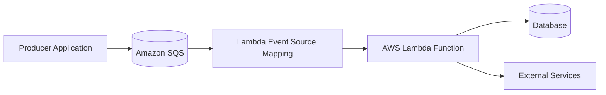
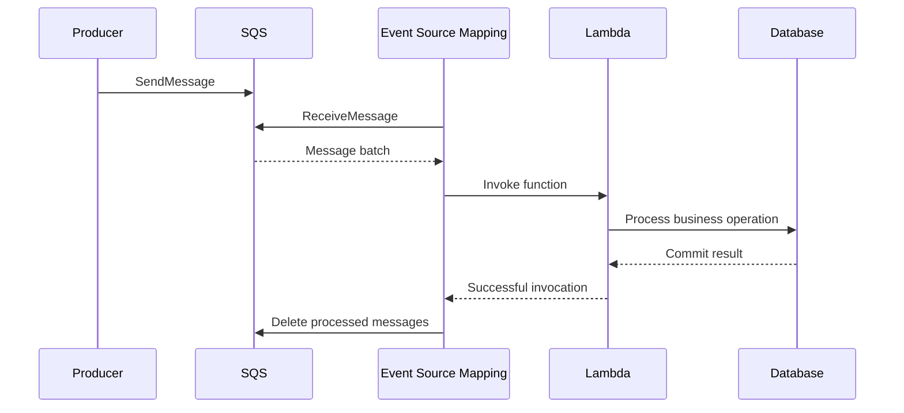
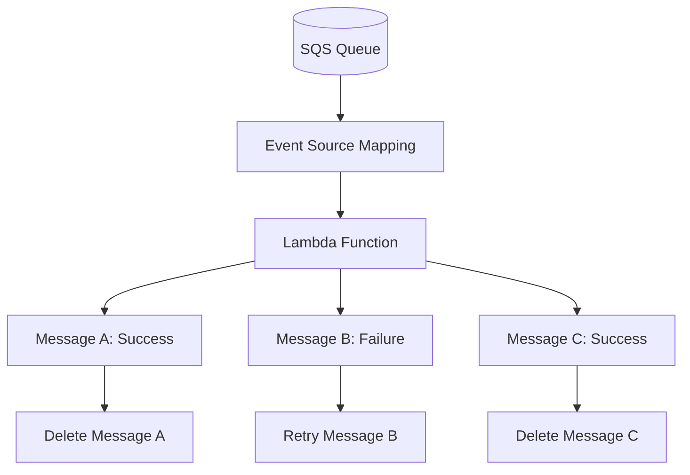
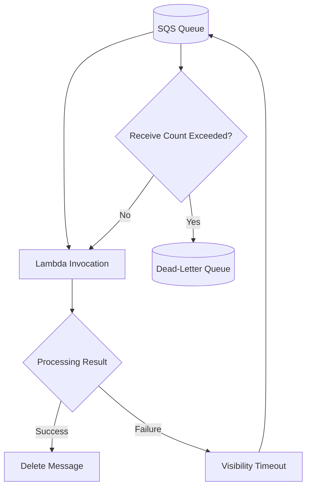

# 03- AWS Lambda Event Source Mapping

## Overview

AWS Lambda Event Source Mapping (ESM) connects an event source to a Lambda function. For Amazon SQS, the event source mapping continuously polls a queue, retrieves available messages, and invokes the configured Lambda function with batches of messages.

This integration allows applications to process queued work without managing dedicated polling workers.

SQS provides durable message buffering, while Lambda provides managed execution and automatic scaling. Together, they support asynchronous processing architectures for APIs, microservices, document pipelines, notifications, and background jobs.

Typical use cases include:

- Processing uploaded documents.
- Handling asynchronous API requests.
- Executing background business workflows.
- Processing order and payment events.
- Running scheduled or delayed business tasks.
- Consuming events from multiple independent queues.
- Scaling workloads based on queue activity.

### Why Event Source Mapping Matters

Without Lambda Event Source Mapping, an application must implement and operate its own SQS polling workers.

This introduces responsibilities such as:

- Maintaining polling processes.
- Managing worker availability.
- Handling message batches.
- Scaling consumer instances.
- Coordinating message visibility.
- Managing worker deployments and failures.

With Event Source Mapping, AWS manages the polling layer and invokes Lambda as messages become available.

The application focuses on message processing, idempotency, and business logic.

## Architecture

An SQS-triggered Lambda integration contains three primary components:

| Component | Responsibility |
|---|---|
| SQS Queue | Stores messages until they are processed and deleted |
| Event Source Mapping | Polls SQS and invokes Lambda with message batches |
| Lambda Function | Executes application processing logic |

### Basic Architecture



The processing lifecycle is:

1. A producer sends a message to SQS.
2. SQS stores the message.
3. Event Source Mapping polls the queue.
4. AWS retrieves a batch of available messages.
5. The messages are passed to the Lambda function.
6. Lambda executes the application logic.
7. If processing succeeds, the event source mapping deletes the messages from SQS.
8. If processing fails, messages remain available for retry after their visibility timeout expires.

The event source mapping is a managed polling mechanism. SQS does not directly push messages into the Lambda function.

### Detailed Processing Flow



The function does not normally call `DeleteMessage` itself when invoked through an SQS event source mapping. AWS manages deletion after successful batch processing.

This differs from applications that consume SQS directly using the AWS SDK.

## How Event Source Mapping Works

Event Source Mapping is a Lambda-managed integration that connects a supported event source to a Lambda function.

For SQS, AWS manages:

- Polling.
- Message retrieval.
- Batch construction.
- Lambda invocation.
- Message deletion after successful processing.
- Retry behavior after unsuccessful invocation.
- Scaling of polling activity.

### Polling Behavior

The event source mapping polls the SQS queue using receive operations.

When messages are available, AWS retrieves up to the configured batch size and invokes the Lambda function.

The polling behavior depends on queue type and event source mapping configuration.

For Standard queues, Lambda uses multiple concurrent polling processes as demand increases.

For FIFO queues, processing is constrained by message group ordering. Messages from the same message group are processed sequentially, while different groups can be processed concurrently.

### Batch Processing

Lambda receives a batch of SQS messages in a single invocation.

The batch size can be configured using `BatchSize`.

For SQS:

- Standard queues support batch sizes up to 10,000 messages.
- FIFO queues support batch sizes up to 10 messages.
- When the batch size exceeds 10, the maximum batching window must be at least one second.

The actual number of messages in an invocation can be lower than the configured batch size.

Batch construction is also affected by message availability, batching window, payload limits, and Lambda invocation constraints.

### Batch Size Example

Assume:

```text
Queue messages: 1,000
Batch size: 10
```

Lambda may process the messages in batches:

```text
Invocation 1: Messages 1-10
Invocation 2: Messages 11-20
Invocation 3: Messages 21-30
...
```

Multiple invocations can execute concurrently.

Increasing batch size can reduce invocation overhead, but it also increases the amount of work associated with one invocation and can increase retry impact when partial batch failure handling is not enabled.

## Configuring an SQS Event Source Mapping

An event source mapping requires:

- An SQS queue.
- A Lambda function.
- An IAM execution role with appropriate SQS permissions.
- An event source mapping configuration.

### IAM Permissions

The Lambda execution role needs permissions to consume messages from the queue.

Typical permissions include:

| Permission | Purpose |
|---|---|
| `sqs:ReceiveMessage` | Retrieve messages |
| `sqs:DeleteMessage` | Delete successfully processed messages |
| `sqs:GetQueueAttributes` | Read queue configuration and attributes |
| `sqs:ChangeMessageVisibility` | Modify message visibility |

AWS provides the managed policy `AWSLambdaSQSQueueExecutionRole`, which includes common SQS polling permissions and CloudWatch Logs permissions.

For production systems, review managed policy permissions and use a least-privilege policy where appropriate.

Example IAM policy:

```json
{
  "Version": "2012-10-17",
  "Statement": [
    {
      "Effect": "Allow",
      "Action": [
        "sqs:ReceiveMessage",
        "sqs:DeleteMessage",
        "sqs:GetQueueAttributes",
        "sqs:ChangeMessageVisibility"
      ],
      "Resource": "arn:aws:sqs:ap-south-1:123456789012:document-processing"
    }
  ]
}
```

If the queue uses a customer-managed KMS key, the execution role and KMS key policy must also permit the required decryption operations.

### AWS CLI Configuration

Create an event source mapping:

```bash
aws lambda create-event-source-mapping \
  --function-name document-processor \
  --event-source-arn arn:aws:sqs:ap-south-1:123456789012:document-processing \
  --batch-size 10 \
  --enabled
```

The command returns an event source mapping UUID.

Retrieve its configuration:

```bash
aws lambda get-event-source-mapping \
  --uuid "<EVENT_SOURCE_MAPPING_UUID>"
```

Disable the mapping:

```bash
aws lambda update-event-source-mapping \
  --uuid "<EVENT_SOURCE_MAPPING_UUID>" \
  --no-enabled
```

Enable it again:

```bash
aws lambda update-event-source-mapping \
  --uuid "<EVENT_SOURCE_MAPPING_UUID>" \
  --enabled
```

Delete the mapping:

```bash
aws lambda delete-event-source-mapping \
  --uuid "<EVENT_SOURCE_MAPPING_UUID>"
```

Deleting the event source mapping does not delete the SQS queue or Lambda function.

## Lambda SQS Event Payload

Lambda receives SQS messages through an event object containing a `Records` array.

Each record represents one SQS message.

Example event:

```json
{
  "Records": [
    {
      "messageId": "message-123",
      "receiptHandle": "example-receipt-handle",
      "body": "{\"event_id\":\"evt-1001\",\"event_type\":\"document.uploaded\",\"document_id\":\"doc-1001\"}",
      "attributes": {
        "ApproximateReceiveCount": "1",
        "SentTimestamp": "1795343400000",
        "SenderId": "123456789012",
        "ApproximateFirstReceiveTimestamp": "1795343401000"
      },
      "messageAttributes": {},
      "md5OfBody": "example-md5",
      "eventSource": "aws:sqs",
      "eventSourceARN": "arn:aws:sqs:ap-south-1:123456789012:document-processing",
      "awsRegion": "ap-south-1"
    }
  ]
}
```

Important fields:

| Field | Purpose |
|---|---|
| `Records` | Collection of messages in the batch |
| `messageId` | SQS message identifier |
| `receiptHandle` | Identifier associated with the receive operation |
| `body` | Message payload |
| `attributes` | SQS system attributes |
| `messageAttributes` | Application-defined message attributes |
| `eventSource` | Identifies SQS as the event source |
| `eventSourceARN` | ARN of the source queue |
| `awsRegion` | Source queue Region |

The message body is a string. If the producer sends JSON, the Lambda function must deserialize it before processing.

## Python Lambda Implementation

A Lambda function can process SQS messages using the standard Lambda event structure.

Example:

```python
import json
import logging

logger = logging.getLogger()
logger.setLevel(logging.INFO)


def process_document(event: dict) -> None:
    document_id = event["document_id"]

    logger.info(
        "Processing document",
        extra={"document_id": document_id},
    )

    # Execute idempotent business processing here.


def lambda_handler(event, context):
    records = event.get("Records", [])

    for record in records:
        try:
            message = json.loads(record["body"])

            process_document(message)

        except Exception:
            logger.exception(
                "Failed to process SQS message",
                extra={
                    "message_id": record.get("messageId"),
                },
            )
            raise

    return {
        "statusCode": 200,
        "processed_records": len(records),
    }
```

This implementation raises an exception when any message fails.

Without partial batch response configuration, the entire batch is treated as failed and can be retried.

For production workloads, partial batch responses are generally preferable when messages are independent.

## Partial Batch Responses

Partial batch response allows a Lambda function to report individual messages that failed processing.

Without partial batch response:

- One failed message causes the entire batch to be retried.
- Successfully processed messages can be delivered again.
- Processing overhead increases.
- Duplicate business operations become more likely.

With partial batch response:

- Successfully processed messages are acknowledged.
- Failed messages are returned for retry.
- Unrelated successful messages do not need to be reprocessed.

### Architecture



### Enabling Partial Batch Responses

Configure the event source mapping with:

```text
FunctionResponseTypes = ["ReportBatchItemFailures"]
```

The Lambda function must return a `batchItemFailures` response containing the message identifiers of failed records.

### Python Implementation

```python
import json
import logging

logger = logging.getLogger()
logger.setLevel(logging.INFO)


def process_event(event: dict) -> None:
    event_id = event["event_id"]
    document_id = event["document_id"]

    logger.info(
        "Processing event",
        extra={
            "event_id": event_id,
            "document_id": document_id,
        },
    )

    # Perform an idempotent business operation.


def lambda_handler(event, context):
    batch_item_failures = []

    for record in event.get("Records", []):
        message_id = record["messageId"]

        try:
            payload = json.loads(record["body"])
            process_event(payload)

        except Exception:
            logger.exception(
                "SQS message processing failed",
                extra={"message_id": message_id},
            )

            batch_item_failures.append({
                "itemIdentifier": message_id,
            })

    return {
        "batchItemFailures": batch_item_failures,
    }
```

Configure the event source mapping:

```bash
aws lambda update-event-source-mapping \
  --uuid "<EVENT_SOURCE_MAPPING_UUID>" \
  --function-response-types ReportBatchItemFailures
```

The response must use the SQS message ID as `itemIdentifier`.

Returning the receipt handle or another application identifier is incorrect.

### Important Partial Batch Behavior

Partial batch responses reduce unnecessary retries, but they do not provide exactly-once processing.

Consumers must still be idempotent because:

- A Lambda invocation can fail after a business operation commits.
- A response can be lost or rejected.
- Messages can be delivered more than once.
- A worker can encounter duplicate events independently.

For FIFO queues, AWS recommends stopping processing after the first failure in a batch and returning the failed and unprocessed messages as failures. This preserves ordering within the message group.

## Visibility Timeout

Visibility timeout determines how long a received SQS message remains invisible to other consumers.

For Lambda event source mappings, the visibility timeout must be configured carefully.

If Lambda takes longer than the visibility timeout to finish processing, the message can become visible again while the original invocation is still running.

This can result in concurrent processing of the same message.

### Recommended Configuration

AWS recommends setting the queue visibility timeout to at least six times the Lambda function timeout, plus the maximum batching window.

Conceptually:

```text
Visibility Timeout >= (6 × Lambda Timeout) + Maximum Batching Window
```

Example:

```text
Lambda timeout: 30 seconds
Maximum batching window: 5 seconds

Recommended minimum:
(6 × 30) + 5 = 185 seconds
```

This provides additional time for retries and throttling-related delays.

The visibility timeout should also remain within SQS service limits.

### Configuration Example

```bash
aws sqs set-queue-attributes \
  --queue-url "<QUEUE_URL>" \
  --attributes VisibilityTimeout=185
```

Do not set visibility timeout based only on average processing duration. Account for worst-case execution, throttling, retries, and operational delays.

## Batch Size and Maximum Batching Window

Two important event source mapping settings control batch construction.

| Setting | Description |
|---|---|
| `BatchSize` | Maximum number of messages included in one Lambda invocation |
| `MaximumBatchingWindowInSeconds` | Maximum time to wait while collecting messages into a batch |

### Batch Size

Batch size controls the number of messages delivered to Lambda in one invocation.

Examples:

```text
BatchSize = 1
```

Useful when messages are expensive to process or require isolated execution.

```text
BatchSize = 10
```

Useful for typical asynchronous processing workloads.

Larger batches can reduce invocation overhead but increase memory requirements and the potential impact of invocation-level failures.

For Standard queues, the maximum batch size is 10,000. For FIFO queues, it is 10.

The total event payload must also fit within Lambda's synchronous invocation payload quota. The actual batch can therefore be smaller than the configured batch size.

### Maximum Batching Window

The batching window allows Lambda to wait for additional messages before invoking the function.

This can improve processing efficiency when messages arrive at a low or moderate rate.

Example:

```bash
aws lambda create-event-source-mapping \
  --function-name document-processor \
  --event-source-arn "<QUEUE_ARN>" \
  --batch-size 100 \
  --maximum-batching-window-in-seconds 5 \
  --function-response-types ReportBatchItemFailures \
  --enabled
```

A batching window introduces additional processing latency.

Use it when throughput efficiency matters more than immediate message processing.

For low-latency workflows, use a smaller batching window.

## Concurrency and Scaling

Lambda automatically scales SQS event source mapping polling activity based on available messages and processing demand.

However, automatic scaling must be controlled to protect downstream dependencies.

### Concurrent Processing

Assume:

```text
Batch size: 10
Concurrent Lambda executions: 20
```

The system can process approximately:

```text
10 × 20 = 200 messages concurrently
```

This is an approximation. Actual throughput depends on processing duration, message availability, Lambda concurrency, and downstream performance.

### Maximum Concurrency

Maximum concurrency limits the number of concurrent Lambda invocations for a particular SQS event source mapping.

It is useful when:

- PostgreSQL has a limited connection pool.
- An external API has rate limits.
- Processing is CPU-intensive.
- Multiple queues share the same downstream dependency.
- A consumer must process messages at a controlled rate.

Example:

```bash
aws lambda update-event-source-mapping \
  --uuid "<EVENT_SOURCE_MAPPING_UUID>" \
  --scaling-config '{"MaximumConcurrency":20}'
```

Maximum concurrency is configured for Standard SQS event source mappings. FIFO concurrency is constrained by the number of active message groups and ordering requirements.

### Reserved Concurrency

Lambda reserved concurrency limits the total concurrent executions available to a function.

It also reserves that concurrency capacity for the function.

The distinction is important:

| Configuration | Scope | Purpose |
|---|---|---|
| Maximum concurrency | Individual SQS event source mapping | Limit consumption from one queue |
| Reserved concurrency | Lambda function | Limit or reserve total function concurrency |
| Account concurrency | AWS account and Region | Shared concurrency capacity |

When multiple queues trigger the same function, their combined event source concurrency must be considered alongside the function's reserved concurrency.

Setting event source maximum concurrency above the function's available concurrency can cause throttling and repeated message delivery.

### Scaling Considerations

Monitor:

- Queue backlog.
- Oldest message age.
- Lambda concurrent executions.
- Lambda throttles.
- Invocation duration.
- Downstream database connections.
- External service latency.

Do not increase concurrency without measuring downstream capacity.

## Standard and FIFO Queue Integration

Lambda supports event source mappings for both Standard and FIFO queues.

Their processing behavior differs.

| Feature | Standard Queue | FIFO Queue |
|---|---|---|
| Ordering | Best effort | Ordered within message groups |
| Duplicate delivery | Possible | Deduplication support at queue level |
| Batch size | Up to 10,000 | Up to 10 |
| Concurrency | Scales based on workload and limits | Constrained by active message groups |
| Processing | Independent messages can run concurrently | Messages within a group are processed sequentially |
| Typical workload | Independent background jobs | Ordered business operations |

### Standard Queue

Standard queues are suitable when messages can be processed independently.

For example, document processing jobs can be distributed across multiple Lambda invocations.

### FIFO Queue

FIFO queues preserve ordering within each message group.

Example:

```text
Message Group: ACCOUNT-1001

1. Deposit 100
2. Withdraw 50
3. Deposit 25
```

The messages must be processed in the correct order.

Different message groups can be processed concurrently.

A FIFO queue with only one active message group cannot achieve high parallelism for that group's messages.

Choose message group identifiers based on the business entity that requires ordering.

## Error Handling and Retry Behavior

SQS-triggered Lambda functions use queue visibility and event source mapping behavior to retry unsuccessful processing.

When a function invocation fails, the affected messages are not successfully acknowledged and can become visible again after the visibility timeout.

Repeated failures can result in messages being moved to a dead-letter queue when a redrive policy is configured.

### Retry Lifecycle



### Dead-Letter Queue

A DLQ isolates messages that repeatedly fail processing.

Example Terraform:

```hcl
resource "aws_sqs_queue" "document_dlq" {
  name                      = "document-processing-dlq"
  message_retention_seconds = 1209600
}

resource "aws_sqs_queue" "document_processing" {
  name                       = "document-processing"
  visibility_timeout_seconds = 180
  message_retention_seconds  = 345600

  redrive_policy = jsonencode({
    deadLetterTargetArn = aws_sqs_queue.document_dlq.arn
    maxReceiveCount     = 5
  })
}
```

The main queue's redrive policy determines when messages are moved to the DLQ.

The Lambda function does not need to implement manual DLQ routing for this mechanism.

### Failure Classification

| Failure | Recommended Handling |
|---|---|
| Temporary database outage | Retry |
| External API throttling | Retry with bounded backoff |
| Invalid JSON payload | Isolate in DLQ |
| Unsupported event version | Quarantine and investigate |
| Missing business record | Apply explicit business handling |
| Permanent validation failure | Record failure and avoid endless retries |

Do not treat every exception as transient.

Permanent failures should be classified and isolated rather than repeatedly consuming Lambda execution capacity.

## Idempotency

SQS and Lambda do not provide exactly-once business execution.

Even when an invocation succeeds, a message may be delivered again under failure conditions.

For example:

1. Lambda receives a message.
2. The function updates PostgreSQL successfully.
3. The function crashes before completing the invocation.
4. The message becomes visible again.
5. Lambda processes the same message again.

Without idempotency, the business operation may execute twice.

### Database-Based Idempotency

Use a stable event identifier and a database uniqueness constraint.

Example PostgreSQL table:

```sql
CREATE TABLE processed_events (
    event_id UUID PRIMARY KEY,
    processed_at TIMESTAMPTZ NOT NULL DEFAULT NOW()
);
```

A transaction should atomically record the event and apply the business operation.

Conceptually:

```sql
BEGIN;

INSERT INTO processed_events (event_id)
VALUES ('00000000-0000-0000-0000-000000000001')
ON CONFLICT DO NOTHING;

-- Execute the business operation only when the event was newly inserted.

COMMIT;
```

The application must check whether the insert created a row before applying the business operation.

Do not commit the idempotency record separately from the business changes.

### Idempotency Key Design

Good idempotency identifiers include:

- Producer-generated event IDs.
- Payment transaction IDs.
- Document processing job IDs.
- S3 bucket, key, and version identifiers.

Avoid relying only on SQS message IDs when the producer can publish the same logical event more than once using different SQS messages.

The idempotency key should identify the business operation, not merely one transport-level delivery.

## Lambda and SQS with AWS SDK

Applications can also consume SQS directly using the AWS SDK instead of Lambda Event Source Mapping.

This approach is useful for long-running workers deployed on ECS, EKS, or EC2.

The difference is operational responsibility.

| Capability | Lambda Event Source Mapping | Direct SQS Consumer |
|---|---|---|
| Polling | AWS managed | Application managed |
| Message deletion | Managed after successful processing | Application must delete |
| Scaling | Lambda event source scaling | Application or orchestrator |
| Worker lifecycle | Managed Lambda execution | Managed by ECS, EKS, or EC2 |
| Long-running processing | Subject to Lambda execution limit | Suitable for longer-running jobs |
| Infrastructure management | Lower operational overhead | More control over worker runtime |

Use Lambda for event-driven functions that fit its execution model.

Use containerized consumers when processing requires long-running execution, specialized runtime dependencies, sustained workloads, or more explicit control over worker lifecycle.

## Monitoring and Observability

Monitor both SQS and Lambda.

A healthy Lambda function does not necessarily indicate a healthy queue-processing pipeline.

### SQS Metrics

| Metric | Purpose |
|---|---|
| `ApproximateNumberOfMessagesVisible` | Measures available backlog |
| `ApproximateNumberOfMessagesNotVisible` | Measures in-flight messages |
| `ApproximateAgeOfOldestMessage` | Detects processing delays |
| `NumberOfMessagesSent` | Measures incoming workload |
| `NumberOfMessagesReceived` | Measures consumer retrieval |
| `NumberOfMessagesDeleted` | Indicates successful queue completion |

### Lambda Metrics

| Metric | Purpose |
|---|---|
| `Invocations` | Number of function invocations |
| `Errors` | Failed invocations |
| `Throttles` | Invocations rejected due to concurrency limits |
| `Duration` | Function execution time |
| `ConcurrentExecutions` | Active function executions |
| `IteratorAge` | Not applicable to SQS event source mappings |

`IteratorAge` is commonly associated with stream-based event sources such as Kinesis and DynamoDB Streams. It is not the appropriate SQS backlog-age metric.

For SQS, use `ApproximateAgeOfOldestMessage` to monitor queue processing delay.

### Application Metrics

Instrument the function with business-level metrics:

- Messages processed.
- Messages failed.
- Partial batch failures.
- Duplicate events.
- Processing duration.
- Database transaction failures.
- External dependency failures.
- Business operations completed.

Use structured logs with message IDs and event identifiers.

Example:

```json
{
  "message_id": "sqs-message-123",
  "event_id": "evt-1001",
  "function": "document-processor",
  "document_id": "doc-1001",
  "status": "completed",
  "processing_duration_ms": 1250
}
```

Avoid logging full message bodies when they contain sensitive data.

## Security Considerations

SQS-triggered Lambda integrations require permissions for both queue consumption and application processing.

### Lambda Execution Role

The execution role should include:

- SQS polling permissions.
- CloudWatch Logs permissions.
- Access to required application resources.
- KMS permissions when encrypted resources require them.

Do not use broad administrative policies for Lambda execution roles.

### Queue Resource Policies

The SQS queue resource policy controls which principals can access the queue.

For a typical Lambda consumer, the execution role must have identity-based permissions to consume messages.

For cross-account or restricted queue configurations, the queue resource policy must also permit the relevant role.

### Encryption

SQS supports:

- SSE-SQS.
- SSE-KMS.

For SSE-KMS queues, ensure the Lambda execution role and KMS key policy allow the required decrypt operations.

### Sensitive Data

Avoid placing unnecessary sensitive information in queue messages.

Prefer identifiers and references to authoritative records.

For example:

```json
{
  "event_id": "evt-1001",
  "document_id": "doc-1001",
  "storage_reference": {
    "bucket": "production-documents",
    "key": "incoming/doc-1001.pdf"
  }
}
```

The Lambda function can retrieve the object using its own IAM role.

Validate message content before using identifiers to access resources.

## Networking Considerations

Lambda functions accessing private resources may need VPC configuration.

For example, a function connecting to a private PostgreSQL database can run inside the VPC.

However, connecting Lambda to a VPC does not automatically provide network access to every AWS service.

Consider:

- NAT gateways for outbound internet access when required.
- SQS interface VPC endpoints for private SQS connectivity.
- S3 gateway VPC endpoints for private S3 access.
- Security groups and subnet routing.
- DNS resolution.
- Database connection limits.

The Lambda event source mapping is managed by AWS and polls SQS independently of the function's application networking configuration.

The function's VPC configuration primarily affects the network access available to the executing Lambda code.

## Performance and Cost Optimization

SQS-triggered Lambda cost and throughput depend on message volume, batch size, execution duration, memory allocation, and downstream service usage.

### Batch Optimization

Larger batches can reduce Lambda invocation overhead.

However, excessively large batches can:

- Increase memory consumption.
- Increase processing duration.
- Increase the number of messages affected by invocation-level failures.
- Make debugging more difficult.

Use realistic load tests to determine batch size.

### Concurrency Optimization

Set maximum concurrency based on downstream capacity.

For example, if PostgreSQL can safely handle 30 concurrent processing transactions, avoid allowing hundreds of Lambda executions to compete for database connections.

Consider RDS Proxy when Lambda workloads create connection pressure against supported relational database engines.

### Cost Optimization

Practical recommendations:

- Use batching for independent messages.
- Enable partial batch responses.
- Avoid unnecessary Lambda initialization work.
- Reuse SDK clients outside the handler.
- Set memory based on measured CPU and memory requirements.
- Limit concurrency to protect expensive downstream services.
- Avoid repeatedly processing poison messages.
- Monitor queue backlog and invocation duration.

A high batch size does not always reduce total cost if it causes longer execution times or repeated batch retries.

## Infrastructure as Code with Terraform

Terraform can manage the SQS queue, DLQ, Lambda function, IAM permissions, and event source mapping.

Example:

```hcl
resource "aws_sqs_queue" "document_dlq" {
  name                      = "document-processing-dlq"
  message_retention_seconds = 1209600

  sqs_managed_sse_enabled = true
}

resource "aws_sqs_queue" "document_processing" {
  name                       = "document-processing"
  visibility_timeout_seconds = 185
  message_retention_seconds  = 345600
  receive_wait_time_seconds  = 20

  sqs_managed_sse_enabled = true

  redrive_policy = jsonencode({
    deadLetterTargetArn = aws_sqs_queue.document_dlq.arn
    maxReceiveCount     = 5
  })
}

resource "aws_iam_role" "lambda_execution" {
  name = "document-processor-lambda-role"

  assume_role_policy = jsonencode({
    Version = "2012-10-17"

    Statement = [
      {
        Effect = "Allow"

        Principal = {
          Service = "lambda.amazonaws.com"
        }

        Action = "sts:AssumeRole"
      }
    ]
  })
}

resource "aws_iam_role_policy_attachment" "lambda_basic_execution" {
  role       = aws_iam_role.lambda_execution.name
  policy_arn = "arn:aws:iam::aws:policy/service-role/AWSLambdaBasicExecutionRole"
}

resource "aws_iam_role_policy_attachment" "lambda_sqs_execution" {
  role       = aws_iam_role.lambda_execution.name
  policy_arn = "arn:aws:iam::aws:policy/service-role/AWSLambdaSQSQueueExecutionRole"
}

resource "aws_lambda_function" "document_processor" {
  function_name = "document-processor"
  role          = aws_iam_role.lambda_execution.arn
  runtime       = "python3.12"
  handler       = "app.lambda_handler"

  filename         = "deployment.zip"
  source_code_hash = filebase64sha256("deployment.zip")

  timeout     = 30
  memory_size = 512

  depends_on = [
    aws_iam_role_policy_attachment.lambda_basic_execution,
    aws_iam_role_policy_attachment.lambda_sqs_execution
  ]
}

resource "aws_lambda_event_source_mapping" "document_processing" {
  event_source_arn = aws_sqs_queue.document_processing.arn
  function_name    = aws_lambda_function.document_processor.arn

  batch_size                         = 10
  maximum_batching_window_in_seconds = 5
  function_response_types            = ["ReportBatchItemFailures"]
  enabled                            = true

  scaling_config {
    maximum_concurrency = 20
  }

  depends_on = [
    aws_iam_role_policy_attachment.lambda_sqs_execution
  ]
}
```

The example uses a 30-second Lambda timeout, a five-second batching window, and a 185-second queue visibility timeout.

The visibility timeout follows the recommended minimum calculation:

```text
(6 × 30) + 5 = 185 seconds
```

The example assumes the deployment package already exists and contains `app.lambda_handler`.

For production environments:

- Pin runtime versions supported by AWS Lambda.
- Use immutable deployment artifacts.
- Separate application and infrastructure deployment pipelines.
- Manage IAM policies explicitly.
- Configure DLQ alarms.
- Add CloudWatch alarms for queue backlog and Lambda errors.
- Keep environment-specific values outside source code.

## Deployment and Operational Strategy

A safe deployment strategy should account for messages already in flight.

Recommended deployment sequence:

1. Deploy the Lambda function and its execution role.
2. Verify the function configuration and permissions.
3. Create or update the event source mapping.
4. Send test messages.
5. Verify successful processing and deletion.
6. Verify partial batch failure behavior.
7. Monitor queue backlog and Lambda errors.
8. Enable production traffic gradually where appropriate.

### Updating a Function

When deploying a new function version, consider using Lambda aliases and versioned deployments.

The event source mapping can reference a Lambda function ARN or an appropriate qualified function ARN.

Use deployment strategies that allow controlled rollout and rollback.

### Disabling Processing

Disabling an event source mapping stops the associated polling and invocation activity.

Messages remain in SQS until they are consumed, expire, or are otherwise removed.

This is useful during:

- Planned maintenance.
- Consumer deployments.
- Incident investigation.
- Downstream database outages.
- Controlled backlog recovery.

Monitor queue retention and message age while processing is disabled.

## Testing Lambda SQS Integrations

Testing should cover application logic, event mapping behavior, and actual AWS integration behavior.

| Test Type | What to Verify |
|---|---|
| Unit tests | Business logic and message validation |
| Handler tests | Correct processing of SQS event structures |
| Partial batch tests | Failed message identifiers are returned correctly |
| Idempotency tests | Duplicate events do not repeat business operations |
| Integration tests | Actual SQS-to-Lambda invocation |
| Retry tests | Failed messages become available again |
| DLQ tests | Repeated failures reach the configured DLQ |
| Load tests | Batch size and concurrency behavior |
| Deployment tests | IAM, event mapping, and function configuration |

### Unit Test Example

```python
import json

from app import lambda_handler


def test_lambda_handler_processes_sqs_message(monkeypatch):
    processed = []

    def fake_process_event(event):
        processed.append(event)

    monkeypatch.setattr(
        "app.process_event",
        fake_process_event,
    )

    event = {
        "Records": [
            {
                "messageId": "message-1",
                "body": json.dumps({
                    "event_id": "evt-1001",
                    "document_id": "doc-1001",
                }),
            }
        ]
    }

    result = lambda_handler(event, None)

    assert result == {"batchItemFailures": []}
    assert len(processed) == 1
```

For integration testing, use an isolated AWS environment to verify actual polling, IAM permissions, queue configuration, visibility behavior, and DLQ routing.

Local emulators can accelerate development, but they should not replace tests against AWS for service-specific behavior.

## Common Mistakes and Production Pitfalls

| Mistake | Impact | Recommended Approach |
|---|---|---|
| Assuming SQS directly pushes messages to Lambda | Incorrect understanding of the integration lifecycle | Understand that Event Source Mapping polls SQS |
| Not configuring SQS permissions | Lambda cannot consume messages | Grant required permissions to the execution role |
| Ignoring batch failures | Successful messages can be retried unnecessarily | Enable partial batch responses |
| Returning incorrect failure identifiers | Failed messages are not retried as intended | Return SQS `messageId` values |
| Setting visibility timeout too low | Concurrent duplicate processing can occur | Use the recommended timeout calculation |
| Using excessive batch sizes | Memory pressure and larger retry impact | Load-test realistic batch sizes |
| Allowing unlimited concurrency | Database and external API overload | Configure maximum concurrency |
| Assuming exactly-once execution | Duplicate business side effects | Implement durable idempotency |
| Ignoring FIFO message groups | Poor concurrency or ordering violations | Design message groups around business entities |
| Forgetting DLQ monitoring | Failed messages remain unnoticed | Alarm on DLQ message count |
| Using `IteratorAge` for SQS monitoring | Incorrect operational signal | Monitor SQS oldest-message age |
| Deleting messages manually in the handler | Incorrect handling of event source mapping acknowledgements | Let the event source mapping manage deletion |
| Ignoring function throttling | Messages repeatedly become available for retry | Align concurrency and visibility settings |
| Disabling mappings without monitoring backlog | Messages may approach retention expiry | Monitor queue age and retention during maintenance |

## Engineering Best Practices

For production SQS-triggered Lambda integrations:

- Use Event Source Mapping rather than implementing a custom polling loop for standard Lambda workloads.
- Keep message contracts versioned and backward compatible.
- Enable partial batch responses for independent messages.
- Use durable idempotency for all business side effects.
- Configure visibility timeout based on Lambda timeout and batching window.
- Set batch size according to processing cost and payload limits.
- Use maximum concurrency to protect downstream systems.
- Configure a DLQ and alert on failed messages.
- Use FIFO queues only when ordering requirements justify them.
- Keep Lambda execution roles least-privileged.
- Use SSE-SQS or SSE-KMS according to security requirements.
- Monitor queue backlog, oldest-message age, Lambda errors, throttles, and processing duration.
- Test duplicate delivery, partial failures, retries, and recovery.
- Use infrastructure as code for queue and event source mapping configuration.
- Use containerized SQS consumers when workloads exceed Lambda's execution model.

## Interview Questions

**What is AWS Lambda Event Source Mapping?**

It is a Lambda-managed integration that polls a supported event source, retrieves events, and invokes a Lambda function with those events.

**Does SQS directly invoke Lambda?**

No. Lambda Event Source Mapping polls the SQS queue and invokes the function with retrieved messages.

**What happens when Lambda successfully processes an SQS batch?**

The event source mapping deletes the successfully processed messages from the queue.

**What happens when a Lambda invocation fails?**

The messages are not successfully acknowledged and can become visible again after the SQS visibility timeout expires.

**What is partial batch response?**

It allows Lambda to identify individual failed messages so that successfully processed messages do not need to be retried with them.

**Why is visibility timeout important?**

It prevents messages from becoming available to other consumers while processing is expected to be in progress. An insufficient timeout can cause concurrent duplicate processing.

**How should visibility timeout be configured for SQS-triggered Lambda?**

AWS recommends at least six times the Lambda timeout plus the maximum batching window.

**What is the difference between maximum concurrency and reserved concurrency?**

Maximum concurrency limits one SQS event source mapping. Reserved concurrency limits or reserves concurrency for the Lambda function as a whole.

**Can SQS-triggered Lambda guarantee exactly-once business processing?**

No. Duplicate delivery and execution failures remain possible. Business operations must be idempotent.

**What is the purpose of a DLQ?**

It isolates messages that repeatedly fail processing so they can be investigated and safely redriven.

**How does FIFO queue processing affect Lambda concurrency?**

Messages in the same message group are processed sequentially. Different message groups can be processed concurrently.

**When would you choose ECS workers instead of Lambda with SQS?**

Choose ECS when processing requires long-running execution, specialized runtime control, sustained worker processes, or workloads that do not fit Lambda's execution limits.

## Key Takeaways

- Lambda Event Source Mapping polls SQS, retrieves message batches, and invokes Lambda without requiring application-managed polling workers.
- Partial batch responses prevent successful messages from being unnecessarily retried when individual records fail.
- Visibility timeout, batch size, batching window, and concurrency must be configured together to balance reliability, latency, and throughput.
- SQS delivery is not exactly-once at the business level; durable idempotency and DLQ handling are essential.
- Monitor SQS backlog and oldest-message age alongside Lambda errors, throttles, concurrency, and application-level processing metrics.