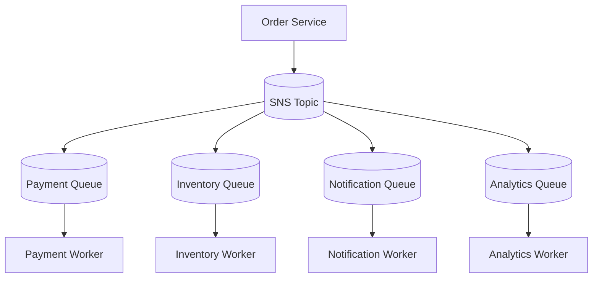
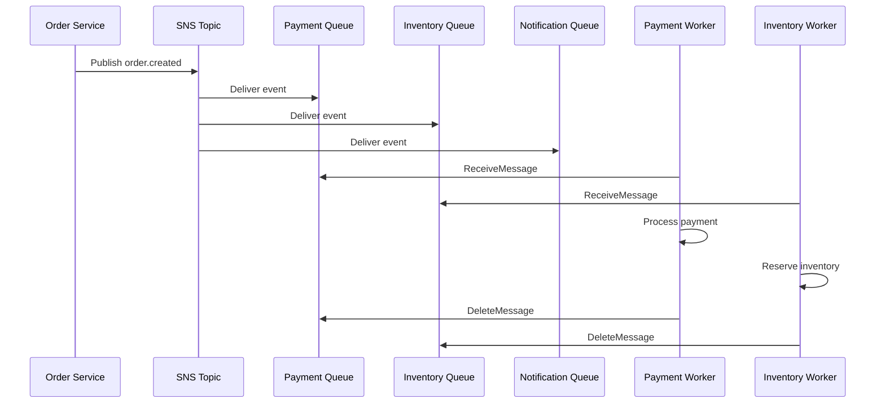
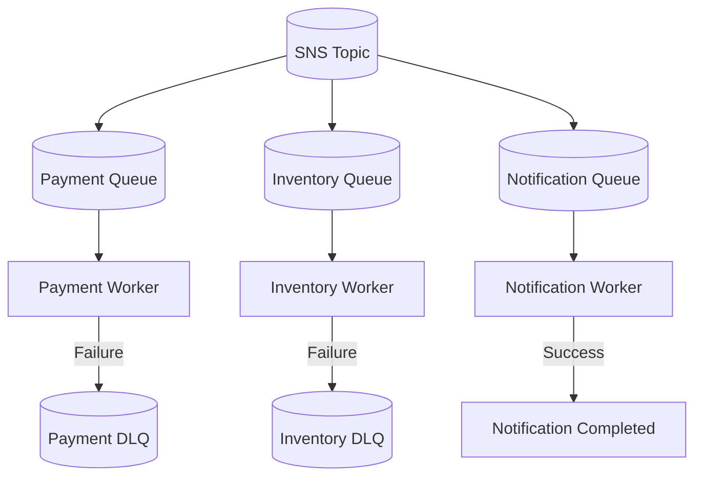
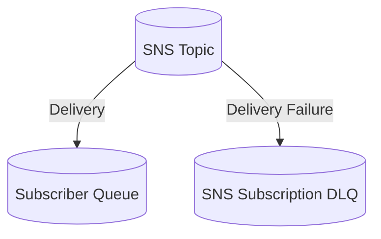
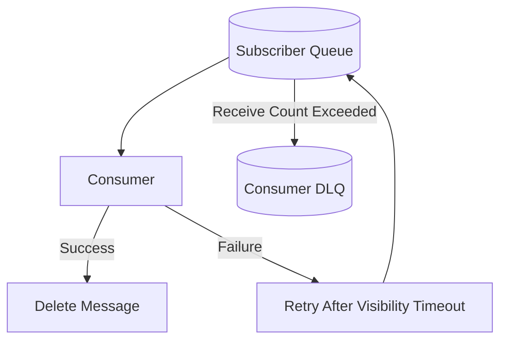
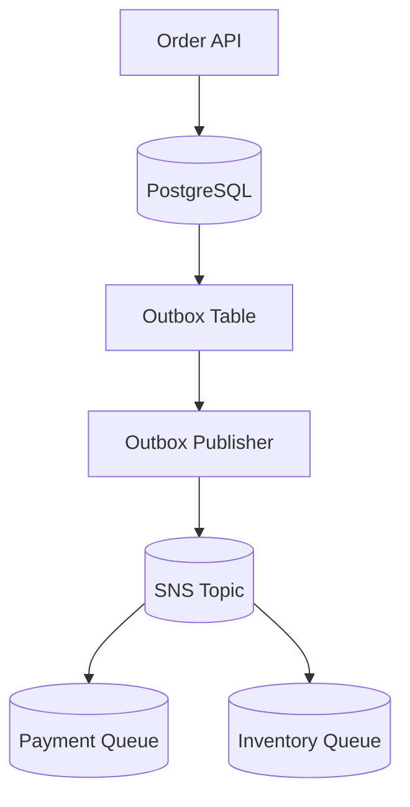

# 04- Amazon SNS Fan-Out Integration

## Overview

Amazon SNS and Amazon SQS are commonly combined to implement fan-out messaging architectures in distributed backend systems.

SNS provides publish-subscribe messaging. SQS provides durable message queues that independently buffer messages for consumers.

When a producer publishes an event to an SNS topic, SNS delivers a copy of that event to each subscribed SQS queue. Each consumer processes its own copy independently.

This architecture allows multiple services to react to the same business event without requiring the producer to know about individual consumers.

Typical use cases include:

- Order events distributed to payment, inventory, and notification services.
- Document upload events distributed to metadata extraction and content processing services.
- Customer registration events distributed to analytics and email services.
- Payment events distributed to accounting, reporting, and fraud detection systems.
- Application events distributed across independent microservices.

### Why SNS and SQS Are Used Together

Consider an e-commerce application that publishes an `order.created` event.

Multiple services need to react:

- Payment service initiates payment processing.
- Inventory service reserves stock.
- Notification service sends an order confirmation.
- Analytics service records the event.

Without fan-out messaging, the order service must communicate directly with each downstream service.

This introduces tight coupling and makes the producer dependent on the availability of every consumer.

With SNS and SQS:

- The producer publishes one event to SNS.
- SNS distributes the event to subscribed queues.
- Each service consumes its own queue independently.
- A slow consumer does not directly block other consumers.
- Each consumer can scale and recover independently.

## Architecture

### Basic SNS-to-SQS Fan-Out



The processing lifecycle is:

1. A producer publishes a business event to an SNS topic.
2. SNS accepts the event.
3. SNS identifies matching subscriptions.
4. SNS delivers a copy to each subscribed SQS queue.
5. Each queue stores its message independently.
6. Consumers retrieve messages from their respective queues.
7. Consumers process messages and delete them after successful completion.
8. Failed messages are retried according to queue visibility and redrive configuration.

SNS handles distribution. SQS handles buffering and independent consumer processing.

### Responsibilities of Each Service

| Responsibility | Amazon SNS | Amazon SQS |
|---|---|---|
| Messaging model | Publish-subscribe | Message queue |
| Message distribution | Fan-out | Single queue delivery among competing consumers |
| Message storage | Not a durable consumer backlog | Durable queue storage |
| Consumer isolation | Through independent subscriptions | Through separate queues |
| Retry handling | Delivery retry policies depend on endpoint protocol | Visibility timeout and redrive policy |
| Consumer scaling | Not responsible for worker execution | Supports independent consumer scaling |
| Dead-letter handling | Subscription delivery DLQ where supported | Queue redrive DLQ |

A key distinction is that SNS does not replace SQS.

SNS distributes events to subscribers, while SQS provides the durable processing boundary for each consumer.

## Fan-Out Message Flow

### Producer to Multiple Consumers



Each SQS queue receives its own copy of the published event.

Deleting a message from one queue does not delete the corresponding messages from other queues.

For example, if payment processing fails, the payment queue can retry independently while the notification service continues processing its own message.

### Independent Failure Boundaries



This architecture provides fault isolation between consumers.

A payment-processing failure does not automatically prevent inventory or notification processing.

However, independent processing does not imply that the overall business workflow has completed successfully. Cross-service business consistency still requires explicit workflow design.

## SNS Topic Configuration

An SNS topic is the central publishing endpoint for fan-out messaging.

A producer publishes messages to the topic ARN rather than publishing directly to every SQS queue.

### Standard and FIFO Topics

SNS supports Standard and FIFO topics.

The topic type must be compatible with the subscription endpoint.

| Feature | Standard SNS Topic | FIFO SNS Topic |
|---|---|---|
| Delivery model | At-least-once | FIFO-specific ordering and deduplication capabilities |
| Ordering | Best effort | Preserved within message groups |
| Deduplication | Not provided at topic level | Supported within the deduplication interval |
| Throughput | High | Depends on FIFO configuration and message groups |
| Typical use case | Independent event distribution | Ordered event distribution |

When using FIFO SNS topics with SQS subscriptions, use compatible FIFO SQS queues.

FIFO topic and queue configurations must be designed together. A Standard SQS queue cannot be used as a subscription endpoint for a FIFO SNS topic.

For most independent microservice event consumers, Standard topics and Standard queues are sufficient.

### Creating an SNS Topic

AWS CLI:

```bash
aws sns create-topic \
  --name order-events \
  --region ap-south-1
```

Retrieve topic attributes:

```bash
aws sns get-topic-attributes \
  --topic-arn "<TOPIC_ARN>"
```

The topic ARN is used by producers and subscription configurations.

## Creating SQS Queues for Subscribers

Each consumer should generally have its own queue.

Example:

```bash
aws sqs create-queue \
  --queue-name payment-events \
  --region ap-south-1

aws sqs create-queue \
  --queue-name inventory-events \
  --region ap-south-1

aws sqs create-queue \
  --queue-name notification-events \
  --region ap-south-1
```

Retrieve queue URLs and ARNs:

```bash
aws sqs get-queue-url \
  --queue-name payment-events
```

```bash
aws sqs get-queue-attributes \
  --queue-url "<QUEUE_URL>" \
  --attribute-names QueueArn
```

Use the queue ARN when creating SNS subscriptions and configuring queue policies.

## SQS Queue Policies for SNS

SNS must be authorized to send messages to each subscribed SQS queue.

This authorization is configured through the SQS queue resource policy.

### Example Queue Policy

```json
{
  "Version": "2012-10-17",
  "Statement": [
    {
      "Sid": "AllowSNSTopicDelivery",
      "Effect": "Allow",
      "Principal": {
        "Service": "sns.amazonaws.com"
      },
      "Action": "sqs:SendMessage",
      "Resource": "arn:aws:sqs:ap-south-1:123456789012:payment-events",
      "Condition": {
        "ArnEquals": {
          "aws:SourceArn": "arn:aws:sns:ap-south-1:123456789012:order-events"
        },
        "StringEquals": {
          "aws:SourceAccount": "123456789012"
        }
      }
    }
  ]
}
```

Important considerations:

- Use the SNS service principal.
- Grant only `sqs:SendMessage`.
- Restrict access to the expected SNS topic ARN.
- Include the expected AWS account condition.
- Apply an appropriate policy to every subscriber queue.
- Review existing queue policies before replacing them.

Without the correct queue policy, SNS cannot deliver messages to the queue.

For encrypted queues using customer-managed KMS keys, the key policy must also allow the required SNS encryption operations.

## Creating SNS-to-SQS Subscriptions

An SNS subscription connects a topic to an SQS queue.

The subscription identifies the destination queue and optionally defines message filtering and delivery behavior.

### CLI Subscription

Subscribe the payment queue:

```bash
aws sns subscribe \
  --topic-arn "<TOPIC_ARN>" \
  --protocol sqs \
  --notification-endpoint "<PAYMENT_QUEUE_ARN>"
```

Subscribe the inventory queue:

```bash
aws sns subscribe \
  --topic-arn "<TOPIC_ARN>" \
  --protocol sqs \
  --notification-endpoint "<INVENTORY_QUEUE_ARN>"
```

Subscribe the notification queue:

```bash
aws sns subscribe \
  --topic-arn "<TOPIC_ARN>" \
  --protocol sqs \
  --notification-endpoint "<NOTIFICATION_QUEUE_ARN>"
```

Retrieve subscriptions:

```bash
aws sns list-subscriptions-by-topic \
  --topic-arn "<TOPIC_ARN>"
```

The subscription endpoint must use the SQS queue ARN, not the queue URL.

### Subscription Confirmation

For SQS subscriptions, SNS can establish the subscription without the manual confirmation flow used by some endpoint protocols, provided the required permissions are available.

The queue policy must permit the topic to deliver messages.

Verify the subscription status and delivery configuration after deployment.

## Publishing Messages to SNS

Producers publish events to SNS using the topic ARN.

The producer does not need to know the queue URLs or consumer implementations.

### Python Producer with Boto3

```python
import json
import os
from datetime import datetime, timezone
from uuid import uuid4

import boto3

sns = boto3.client(
    "sns",
    region_name=os.environ["AWS_REGION"],
)

TOPIC_ARN = os.environ["ORDER_EVENTS_TOPIC_ARN"]


def publish_order_created(order_id: str, customer_id: str) -> str:
    event = {
        "event_id": str(uuid4()),
        "event_type": "order.created",
        "event_version": 1,
        "occurred_at": datetime.now(timezone.utc).isoformat(),
        "order_id": order_id,
        "customer_id": customer_id,
    }

    response = sns.publish(
        TopicArn=TOPIC_ARN,
        Message=json.dumps(event),
        MessageAttributes={
            "event_type": {
                "DataType": "String",
                "StringValue": "order.created",
            },
        },
    )

    return response["MessageId"]
```

The producer publishes one event to SNS. SNS handles delivery to all matching subscriptions.

A successful publish response means SNS accepted the message. It does not prove that every subscriber queue or downstream consumer completed processing.

### Message Contract

A production event should contain stable identifiers and explicit versioning.

Example:

```json
{
  "event_id": "evt-1001",
  "event_type": "order.created",
  "event_version": 1,
  "occurred_at": "2026-11-22T10:30:00Z",
  "producer": "order-service",
  "correlation_id": "req-5001",
  "data": {
    "order_id": "order-1001",
    "customer_id": "customer-2001",
    "total_amount": 2500.00,
    "currency": "INR"
  }
}
```

Recommended fields:

| Field | Purpose |
|---|---|
| `event_id` | Stable identifier for idempotency |
| `event_type` | Business event classification |
| `event_version` | Contract version |
| `occurred_at` | Event creation timestamp |
| `producer` | Originating service |
| `correlation_id` | Cross-service request tracing |
| `data` | Business event payload |

Avoid using transport-specific identifiers as the only business event identifier.

## SNS Message Envelope

By default, SNS wraps published messages in an SNS notification envelope when delivering to SQS.

The SQS message body contains metadata such as:

- `Type`
- `MessageId`
- `TopicArn`
- `Subject`
- `Message`
- `Timestamp`
- `Signature`
- `SigningCertURL`
- `UnsubscribeURL`
- `MessageAttributes`

Example:

```json
{
  "Type": "Notification",
  "MessageId": "sns-message-123",
  "TopicArn": "arn:aws:sns:ap-south-1:123456789012:order-events",
  "Message": "{\"event_id\":\"evt-1001\",\"event_type\":\"order.created\",\"event_version\":1}",
  "Timestamp": "2026-11-22T10:30:00.000Z",
  "MessageAttributes": {
    "event_type": {
      "Type": "String",
      "Value": "order.created"
    }
  }
}
```

The actual event payload is stored inside the `Message` field as a string.

Consumers must deserialize the outer SNS envelope and then deserialize the inner message when it contains JSON.

### Raw Message Delivery

SNS supports raw message delivery for SQS subscriptions.

When enabled, SNS removes its notification envelope and delivers the published message directly to SQS.

This can simplify consumer implementations.

However, raw delivery changes the message format and removes SNS envelope metadata from the SQS message body.

### Enabling Raw Message Delivery

```bash
aws sns set-subscription-attributes \
  --subscription-arn "<SUBSCRIPTION_ARN>" \
  --attribute-name RawMessageDelivery \
  --attribute-value true
```

Check the setting:

```bash
aws sns get-subscription-attributes \
  --subscription-arn "<SUBSCRIPTION_ARN>"
```

### Envelope vs Raw Delivery

| Characteristic | Default Delivery | Raw Message Delivery |
|---|---|---|
| SNS envelope | Present | Removed |
| Payload access | Parse SNS envelope, then message | Parse message directly |
| SNS metadata | Available in envelope | Not included in the body |
| Consumer complexity | Higher | Lower |
| Typical use case | Consumers needing SNS metadata | Consumers using a shared event contract |

Choose one message format deliberately and keep it consistent across consumers.

Do not change raw delivery settings without considering existing consumer implementations.

## Python SQS Consumer

A consumer retrieves messages from its dedicated queue and processes the event.

### Consumer with SNS Envelope Parsing

```python
import json
import logging
import os

import boto3

logger = logging.getLogger(__name__)
logging.basicConfig(level=logging.INFO)

sqs = boto3.client(
    "sqs",
    region_name=os.environ["AWS_REGION"],
)

QUEUE_URL = os.environ["PAYMENT_QUEUE_URL"]


def process_order_event(event: dict) -> None:
    if event["event_type"] != "order.created":
        raise ValueError("Unsupported event type")

    order_id = event["data"]["order_id"]

    logger.info(
        "Processing order event",
        extra={
            "event_id": event["event_id"],
            "order_id": order_id,
        },
    )

    # Execute an idempotent payment workflow.


def consume_message(message: dict) -> None:
    envelope = json.loads(message["Body"])

    if envelope.get("Type") != "Notification":
        raise ValueError("Unexpected SNS notification envelope")

    event = json.loads(envelope["Message"])
    process_order_event(event)


def consume_messages() -> None:
    while True:
        response = sqs.receive_message(
            QueueUrl=QUEUE_URL,
            MaxNumberOfMessages=10,
            WaitTimeSeconds=20,
            VisibilityTimeout=300,
        )

        for message in response.get("Messages", []):
            try:
                consume_message(message)

                sqs.delete_message(
                    QueueUrl=QUEUE_URL,
                    ReceiptHandle=message["ReceiptHandle"],
                )

            except Exception:
                logger.exception(
                    "Failed to process SNS message",
                    extra={
                        "message_id": message["MessageId"],
                    },
                )
                # Do not delete failed messages.


if __name__ == "__main__":
    consume_messages()
```

This is a basic polling implementation. Production workers should include durable idempotency, bounded concurrency, graceful shutdown, visibility extension for long-running tasks, and structured metrics.

### Consumer with Raw Message Delivery

When raw message delivery is enabled, the consumer can deserialize the message body directly.

```python
import json


def process_raw_sns_message(message: dict) -> None:
    event = json.loads(message["Body"])

    event_type = event["event_type"]

    if event_type == "order.created":
        process_order_event(event)
    else:
        raise ValueError(f"Unsupported event type: {event_type}")
```

Do not mix envelope parsing and raw message parsing without explicitly supporting both formats.

A consumer should know which subscription format it receives.

## Subscription Filter Policies

SNS filter policies allow subscribers to receive only messages matching specified attributes or message body fields.

This reduces unnecessary queue traffic and avoids implementing all routing logic inside consumers.

### Why Filtering Matters

Consider an SNS topic that receives multiple order events:

```text
order.created
order.cancelled
order.shipped
order.delivered
```

The payment service may only need `order.created` and `order.cancelled`.

The notification service may need all four event types.

SNS filter policies can route matching events to the appropriate queues.

### Filtering by Message Attributes

Example message attributes:

```python
sns.publish(
    TopicArn=TOPIC_ARN,
    Message=json.dumps(event),
    MessageAttributes={
        "event_type": {
            "DataType": "String",
            "StringValue": "order.created",
        },
        "environment": {
            "DataType": "String",
            "StringValue": "production",
        },
    },
)
```

Example subscription filter policy:

```json
{
  "event_type": [
    "order.created",
    "order.cancelled"
  ],
  "environment": [
    "production"
  ]
}
```

Apply the filter policy:

```bash
aws sns set-subscription-attributes \
  --subscription-arn "<SUBSCRIPTION_ARN>" \
  --attribute-name FilterPolicy \
  --attribute-value '{"event_type":["order.created","order.cancelled"],"environment":["production"]}'
```

By default, SNS filter policies evaluate message attributes.

### Filtering by Message Body

SNS also supports filtering based on JSON message body fields.

Set the subscription filter policy scope to `MessageBody`.

Example event:

```json
{
  "event_type": "order.created",
  "data": {
    "region": "east",
    "priority": "high"
  }
}
```

Example filter policy:

```json
{
  "data": {
    "priority": [
      "high"
    ]
  }
}
```

Configure the scope:

```bash
aws sns set-subscription-attributes \
  --subscription-arn "<SUBSCRIPTION_ARN>" \
  --attribute-name FilterPolicyScope \
  --attribute-value MessageBody
```

Message body filtering requires a valid JSON message body.

### Filter Policy Considerations

- Filter policies operate on message attributes or message body fields.
- Attribute names and message body paths must match the published contract.
- A missing attribute or field generally does not match a policy that requires it.
- Filtering is performed by SNS before delivery to the subscription endpoint.
- Filtered-out messages are not placed into the subscriber's SQS queue.
- Filter policy updates can take time to become fully effective.

Filtering is a routing mechanism, not a security boundary.

Do not rely on filter policies to prevent unauthorized access to sensitive data.

## Reliability and Delivery Semantics

SNS-to-SQS fan-out must be designed around distributed delivery semantics.

### At-Least-Once Delivery

SNS Standard topics and SQS Standard queues use at-least-once delivery behavior.

Duplicates can occur.

Consumers must therefore implement idempotent processing.

For example, if an order event is delivered twice to the payment queue, the payment service must not charge the customer twice.

### Independent Consumer Delivery

Each subscription is an independent delivery path.

A message successfully delivered to the payment queue does not imply successful delivery to the inventory queue.

Similarly, successful delivery to all queues does not mean that every consumer completed its business operation.

The producer should not interpret an SNS publish response as proof of downstream business completion.

### Message Ordering

Standard SNS topics and Standard SQS queues do not provide strict end-to-end ordering.

For workflows that require ordering:

- Use FIFO SNS topics and compatible FIFO SQS queues.
- Define message group IDs based on business entities.
- Preserve ordering within each group.
- Keep consumer processing idempotent.
- Avoid assuming ordering across different message groups.

FIFO transport ordering does not guarantee exactly-once execution of arbitrary downstream business operations.

## Dead-Letter Queues and Failure Boundaries

SNS and SQS have separate failure boundaries.

This distinction is important in production architectures.

### SNS Subscription Delivery DLQ

An SNS subscription delivery DLQ captures messages that SNS cannot successfully deliver to the subscribed endpoint after its delivery retry policy is exhausted.

For an SQS subscription, this protects the SNS-to-SQS delivery boundary.

Example:



### SQS Consumer DLQ

An SQS consumer DLQ captures messages that repeatedly fail after reaching the subscriber queue.



### Failure Boundary Comparison

| Failure | Appropriate Recovery Mechanism |
|---|---|
| SNS cannot deliver to SQS | SNS subscription delivery DLQ and delivery monitoring |
| SQS accepts message but worker fails | SQS redrive policy and consumer DLQ |
| Worker crashes after business commit | Idempotent processing |
| Downstream API is unavailable | Bounded retry and backoff |
| Message schema is invalid | Quarantine and investigation |

Do not assume that an SQS consumer DLQ captures failures that occur before SNS successfully delivers the message to the queue.

### Configuring an SQS Consumer DLQ

```hcl
resource "aws_sqs_queue" "payment_dlq" {
  name                      = "payment-events-dlq"
  message_retention_seconds = 1209600
}

resource "aws_sqs_queue" "payment_events" {
  name                       = "payment-events"
  visibility_timeout_seconds = 300
  message_retention_seconds  = 345600

  redrive_policy = jsonencode({
    deadLetterTargetArn = aws_sqs_queue.payment_dlq.arn
    maxReceiveCount     = 5
  })
}
```

### Configuring an SNS Subscription Delivery DLQ

SNS supports a subscription `RedrivePolicy` that identifies the SQS delivery DLQ.

The DLQ must have an appropriate resource policy allowing the SNS service to send messages.

Example subscription attribute:

```json
{
  "deadLetterTargetArn": "arn:aws:sqs:ap-south-1:123456789012:sns-delivery-dlq"
}
```

Apply it:

```bash
aws sns set-subscription-attributes \
  --subscription-arn "<SUBSCRIPTION_ARN>" \
  --attribute-name RedrivePolicy \
  --attribute-value '{"deadLetterTargetArn":"arn:aws:sqs:ap-south-1:123456789012:sns-delivery-dlq"}'
```

Configure delivery retry behavior and permissions according to the endpoint protocol and AWS service requirements.

## Idempotency and Consumer Consistency

Every subscriber should implement its own idempotency strategy.

The same event can be delivered to multiple independent queues, and each consumer can receive duplicates.

### Database-Based Idempotency

A consumer can use a durable event table.

Example PostgreSQL schema:

```sql
CREATE TABLE processed_events (
    event_id UUID PRIMARY KEY,
    consumer_name TEXT NOT NULL,
    processed_at TIMESTAMPTZ NOT NULL DEFAULT NOW(),

    UNIQUE (event_id, consumer_name)
);
```

The consumer should record the event and apply its business changes in the same transaction.

For example:

```sql
BEGIN;

INSERT INTO processed_events (
    event_id,
    consumer_name
)
VALUES (
    '00000000-0000-0000-0000-000000000001',
    'payment-service'
)
ON CONFLICT DO NOTHING;

-- Execute the payment operation only when the event was newly inserted.

COMMIT;
```

The application must check whether the insert created a row before executing the business operation.

The `consumer_name` allows independent services to track the same event without sharing processing state.

### Why Each Consumer Needs Its Own Idempotency State

Consider an `order.created` event.

```text
SNS Topic
    |
    +--> Payment Queue
    |
    +--> Inventory Queue
    |
    +--> Notification Queue
```

The payment service may successfully process the event while inventory processing fails.

A shared global processed-event record would incorrectly imply that all consumers completed processing.

Idempotency state should be scoped to the consumer or business operation.

## Transactional Outbox for Reliable Publishing

A producer often needs to update its database and publish an SNS event as part of the same business operation.

For example:

1. Create an order in PostgreSQL.
2. Publish `order.created` to SNS.

These operations cannot be made atomic through a normal database transaction because SNS is an external service.

This creates a dual-write problem.

Possible failure:

```text
Database transaction commits
        |
        v
SNS publish fails
        |
        v
Order exists but subscribers receive no event
```

A transactional outbox addresses this problem.

### Outbox Architecture



The API writes the order and outbox event in one database transaction.

A separate publisher reads pending outbox records and publishes them to SNS.

Example schema:

```sql
CREATE TABLE outbox_events (
    event_id UUID PRIMARY KEY,
    event_type TEXT NOT NULL,
    payload JSONB NOT NULL,
    created_at TIMESTAMPTZ NOT NULL DEFAULT NOW(),
    published_at TIMESTAMPTZ
);
```

The publisher should use leases or transactional row locking to prevent uncontrolled concurrent claims.

Even with an outbox, duplicate publication is possible if the publisher crashes after SNS accepts the event but before the database records it as published.

Therefore, downstream consumers still require idempotency.

## Security Considerations

SNS-to-SQS fan-out involves multiple service identities and resource policies.

Security should be enforced at the topic, subscription, queue, and consumer levels.

### Producer IAM Permissions

A producer generally needs:

```json
{
  "Version": "2012-10-17",
  "Statement": [
    {
      "Effect": "Allow",
      "Action": [
        "sns:Publish"
      ],
      "Resource": "arn:aws:sns:ap-south-1:123456789012:order-events"
    }
  ]
}
```

Do not grant producers access to unrelated topics.

### SQS Consumer Permissions

Each consumer should have access only to its own queue.

Example:

```json
{
  "Version": "2012-10-17",
  "Statement": [
    {
      "Effect": "Allow",
      "Action": [
        "sqs:ReceiveMessage",
        "sqs:DeleteMessage",
        "sqs:ChangeMessageVisibility",
        "sqs:GetQueueAttributes"
      ],
      "Resource": "arn:aws:sqs:ap-south-1:123456789012:payment-events"
    }
  ]
}
```

### Encryption

SNS topics and SQS queues support encryption at rest.

Consider:

- SNS server-side encryption.
- SQS SSE-SQS or SSE-KMS.
- KMS key policies.
- Producer permissions for encrypted topic publishing.
- SNS permissions for encrypted queue delivery.
- Consumer permissions for decrypting queue messages.

For customer-managed KMS keys, verify both identity-based IAM policies and key policies.

### Cross-Account Subscriptions

Cross-account fan-out requires explicit authorization.

Review:

- SNS topic resource policy.
- SQS queue resource policy.
- Producer IAM permissions.
- Subscription ownership and confirmation behavior.
- KMS key policies when encryption is enabled.

Avoid wildcard principals and unrestricted cross-account access.

### Message Content

Do not publish credentials, access tokens, passwords, or unnecessary personal information.

Prefer stable identifiers and references to authoritative data.

Consumers should validate message schemas and event types before processing.

## Monitoring and Observability

A fan-out architecture needs monitoring at multiple layers.

Monitoring only the SNS topic is insufficient because each subscription and consumer has an independent processing lifecycle.

### SNS Metrics

Important CloudWatch metrics include:

| Metric | Purpose |
|---|---|
| `NumberOfMessagesPublished` | Number of messages published to the topic |
| `NumberOfNotificationsDelivered` | Notifications successfully delivered |
| `NumberOfNotificationsFailed` | Notifications that failed delivery |
| `NumberOfNotificationsFilteredOut` | Notifications excluded by subscription filtering |

Metric availability and dimensions depend on the topic, protocol, and subscription configuration.

### SQS Metrics

Each subscriber queue should be monitored independently.

| Metric | Purpose |
|---|---|
| `ApproximateNumberOfMessagesVisible` | Pending messages |
| `ApproximateNumberOfMessagesNotVisible` | In-flight messages |
| `ApproximateAgeOfOldestMessage` | Processing delay |
| `NumberOfMessagesSent` | Incoming message volume |
| `NumberOfMessagesDeleted` | Queue processing completion signal |

### Application Metrics

Each consumer should expose:

- Events processed.
- Events failed.
- Duplicate events detected.
- Processing duration.
- Business operation failures.
- External dependency latency.
- DLQ message count.
- Event processing latency.

Use correlation IDs and event IDs to trace an event across services.

Example structured log:

```json
{
  "event_id": "evt-1001",
  "correlation_id": "req-5001",
  "event_type": "order.created",
  "consumer": "payment-service",
  "queue": "payment-events",
  "status": "completed"
}
```

### Alerting

Useful alarms include:

- SNS notification delivery failures.
- Subscriber queue backlog exceeding thresholds.
- Oldest-message age exceeding service-level objectives.
- DLQ message count greater than zero.
- Consumer error rates increasing.
- Missing expected processing activity.

A successful SNS publish does not prove that every downstream business operation succeeded.

For critical workflows, monitor end-to-end business completion separately.

## Scalability and Performance

SNS and SQS support independently scalable producer and consumer workloads.

However, downstream services remain the limiting factor in many systems.

### Independent Consumer Scaling

Each SQS queue can scale independently.

For example:

| Consumer | Queue | Scaling Consideration |
|---|---|---|
| Payment | `payment-events` | External payment API limits |
| Inventory | `inventory-events` | Database transaction capacity |
| Notification | `notification-events` | Email provider throughput |
| Analytics | `analytics-events` | Batch processing capacity |

A slow analytics consumer does not need to slow down payment processing.

### Backpressure

SQS absorbs bursts of messages and allows consumers to process them at a controlled rate.

If producers publish faster than a consumer can process, the queue backlog increases.

Monitor:

- Queue depth.
- Oldest-message age.
- Consumer concurrency.
- Processing duration.
- Downstream latency.
- DLQ volume.

Use queue-based autoscaling where appropriate.

### Fan-Out Amplification

A single SNS publish can create one delivered message for every matching subscription.

For example:

```text
1 SNS publication
    |
    +--> Payment Queue
    +--> Inventory Queue
    +--> Notification Queue
    +--> Analytics Queue
```

One published event creates four subscriber deliveries.

This affects:

- SNS request volume.
- SQS message volume.
- Consumer execution cost.
- Downstream API calls.
- Data transfer and encryption costs.

Account for the number of subscriptions when estimating processing and infrastructure costs.

### Message Size

SQS messages have a maximum message size of 256 KiB.

Keep event payloads small and avoid embedding large documents.

For large objects, store the data in S3 and publish an object reference.

Example:

```json
{
  "event_id": "evt-1001",
  "event_type": "document.uploaded",
  "bucket": "production-documents",
  "object_key": "incoming/document-1001.pdf"
}
```

Consumers retrieve the object using their own IAM permissions.

## Disaster Recovery Considerations

SNS topics and SQS queues are regional resources.

A fan-out architecture does not automatically replicate messages across Regions.

For critical systems, consider:

- Infrastructure deployment in a recovery Region.
- Replication of authoritative business data.
- Application-level event replication.
- Explicit cross-Region publishing strategies.
- Queue backlog monitoring.
- Recovery procedures for failed subscriptions.
- Consumer idempotency across replayed events.

Avoid assuming that recreating a topic and queues restores messages that were present in the original Region.

For critical event pipelines, define how messages are replayed or reconstructed from authoritative data.

## Terraform Implementation

Terraform can manage SNS topics, SQS queues, queue policies, subscriptions, DLQs, and consumer permissions.

The following example provisions a Standard SNS topic with payment and inventory queues.

```hcl
resource "aws_sns_topic" "order_events" {
  name = "order-events"

  tags = {
    Environment = "production"
    Service     = "order-service"
  }
}

resource "aws_sqs_queue" "payment_dlq" {
  name                      = "payment-events-dlq"
  message_retention_seconds = 1209600

  sqs_managed_sse_enabled = true
}

resource "aws_sqs_queue" "payment_events" {
  name                       = "payment-events"
  visibility_timeout_seconds = 300
  message_retention_seconds  = 345600
  receive_wait_time_seconds  = 20

  sqs_managed_sse_enabled = true

  redrive_policy = jsonencode({
    deadLetterTargetArn = aws_sqs_queue.payment_dlq.arn
    maxReceiveCount     = 5
  })
}

resource "aws_sqs_queue" "inventory_dlq" {
  name                      = "inventory-events-dlq"
  message_retention_seconds = 1209600

  sqs_managed_sse_enabled = true
}

resource "aws_sqs_queue" "inventory_events" {
  name                       = "inventory-events"
  visibility_timeout_seconds = 300
  message_retention_seconds  = 345600
  receive_wait_time_seconds  = 20

  sqs_managed_sse_enabled = true

  redrive_policy = jsonencode({
    deadLetterTargetArn = aws_sqs_queue.inventory_dlq.arn
    maxReceiveCount     = 5
  })
}

data "aws_caller_identity" "current" {}

data "aws_iam_policy_document" "payment_queue_policy" {
  statement {
    sid    = "AllowOrderEventsTopic"
    effect = "Allow"

    principals {
      type        = "Service"
      identifiers = ["sns.amazonaws.com"]
    }

    actions = [
      "sqs:SendMessage"
    ]

    resources = [
      aws_sqs_queue.payment_events.arn
    ]

    condition {
      test     = "ArnEquals"
      variable = "aws:SourceArn"
      values   = [aws_sns_topic.order_events.arn]
    }

    condition {
      test     = "StringEquals"
      variable = "aws:SourceAccount"
      values   = [data.aws_caller_identity.current.account_id]
    }
  }
}

data "aws_iam_policy_document" "inventory_queue_policy" {
  statement {
    sid    = "AllowOrderEventsTopic"
    effect = "Allow"

    principals {
      type        = "Service"
      identifiers = ["sns.amazonaws.com"]
    }

    actions = [
      "sqs:SendMessage"
    ]

    resources = [
      aws_sqs_queue.inventory_events.arn
    ]

    condition {
      test     = "ArnEquals"
      variable = "aws:SourceArn"
      values   = [aws_sns_topic.order_events.arn]
    }

    condition {
      test     = "StringEquals"
      variable = "aws:SourceAccount"
      values   = [data.aws_caller_identity.current.account_id]
    }
  }
}

resource "aws_sqs_queue_policy" "payment_events" {
  queue_url = aws_sqs_queue.payment_events.id
  policy    = data.aws_iam_policy_document.payment_queue_policy.json
}

resource "aws_sqs_queue_policy" "inventory_events" {
  queue_url = aws_sqs_queue.inventory_events.id
  policy    = data.aws_iam_policy_document.inventory_queue_policy.json
}

resource "aws_sns_topic_subscription" "payment_events" {
  topic_arn = aws_sns_topic.order_events.arn
  protocol  = "sqs"
  endpoint  = aws_sqs_queue.payment_events.arn

  raw_message_delivery = true

  depends_on = [
    aws_sqs_queue_policy.payment_events
  ]
}

resource "aws_sns_topic_subscription" "inventory_events" {
  topic_arn = aws_sns_topic.order_events.arn
  protocol  = "sqs"
  endpoint  = aws_sqs_queue.inventory_events.arn

  raw_message_delivery = true

  depends_on = [
    aws_sqs_queue_policy.inventory_events
  ]
}

output "order_events_topic_arn" {
  value = aws_sns_topic.order_events.arn
}

output "payment_queue_url" {
  value = aws_sqs_queue.payment_events.url
}

output "inventory_queue_url" {
  value = aws_sqs_queue.inventory_events.url
}
```

The example enables raw message delivery so consumers receive the original event body without the SNS envelope.

The example uses separate consumer DLQs. An SNS subscription delivery DLQ can be added separately when notification delivery failures require independent recovery.

### Deployment

Initialize Terraform:

```bash
terraform init
```

Validate the configuration:

```bash
terraform validate
```

Review the infrastructure plan:

```bash
terraform plan
```

Apply the configuration:

```bash
terraform apply
```

Inspect the topic subscriptions:

```bash
aws sns list-subscriptions-by-topic \
  --topic-arn "<TOPIC_ARN>"
```

Inspect the payment queue policy:

```bash
aws sqs get-queue-attributes \
  --queue-url "<PAYMENT_QUEUE_URL>" \
  --attribute-names Policy
```

## Testing the Fan-Out Architecture

Testing should verify the complete publishing and consumption lifecycle.

### Publish a Test Event

```bash
aws sns publish \
  --topic-arn "<TOPIC_ARN>" \
  --message '{
    "event_id": "evt-1001",
    "event_type": "order.created",
    "event_version": 1,
    "data": {
      "order_id": "order-1001",
      "customer_id": "customer-2001"
    }
  }'
```

### Receive from Each Queue

Payment queue:

```bash
aws sqs receive-message \
  --queue-url "<PAYMENT_QUEUE_URL>" \
  --max-number-of-messages 10 \
  --wait-time-seconds 20
```

Inventory queue:

```bash
aws sqs receive-message \
  --queue-url "<INVENTORY_QUEUE_URL>" \
  --max-number-of-messages 10 \
  --wait-time-seconds 20
```

Verify:

- The event reaches every expected queue.
- Each queue receives an independent message.
- Raw or envelope delivery matches consumer expectations.
- Message attributes are preserved when required.
- Filter policies route events correctly.
- Consumer failures do not block unrelated queues.
- DLQ behavior works as expected.
- Duplicate delivery does not repeat business side effects.

### Failure Testing

Test the following scenarios:

- One queue policy denies SNS delivery.
- A consumer is unavailable.
- A consumer repeatedly fails processing.
- One consumer is slower than others.
- A message is delivered more than once.
- A filter policy excludes an expected event.
- A consumer receives an unsupported event version.
- A DLQ contains messages that need investigation and redrive.

Testing should include end-to-end business outcomes, not only successful SNS publication.

## Common Mistakes and Production Pitfalls

| Mistake | Impact | Recommended Approach |
|---|---|---|
| Publishing directly to every consumer queue | Producer becomes tightly coupled to consumers | Publish once to SNS |
| Using one SQS queue for unrelated competing consumers | Consumers compete for messages instead of receiving independent copies | Create one queue per independent subscriber |
| Missing SQS queue resource policy | SNS cannot deliver to the queue | Allow `sns.amazonaws.com` with source restrictions |
| Using queue URL as subscription endpoint | Subscription configuration fails | Use the SQS queue ARN |
| Assuming SNS publish means processing completed | Downstream failures remain undetected | Monitor each subscriber queue and business workflow |
| Ignoring SNS envelope format | Consumers fail to parse messages | Parse the envelope or enable raw delivery consistently |
| Enabling raw delivery without updating consumers | Existing envelope parsers fail | Coordinate format changes across deployments |
| Ignoring filter policy configuration | Events reach unintended consumers or are excluded | Test subscription filters with representative payloads |
| Using one global DLQ | Failure boundaries become difficult to isolate | Configure consumer-specific DLQs |
| Treating consumer DLQ as SNS delivery recovery | Pre-queue delivery failures are not captured | Configure subscription delivery DLQs where required |
| Assuming FIFO means exactly-once business processing | Duplicate side effects remain possible | Implement durable idempotency |
| Sharing idempotency state across consumers | One consumer can incorrectly suppress another | Scope idempotency by consumer and operation |
| Ignoring fan-out amplification | Costs and downstream workload are underestimated | Include subscription count in capacity planning |
| Replacing resource policies without review | Existing integrations can lose access | Preserve required statements during policy changes |

## Engineering Best Practices

For production SNS-to-SQS fan-out architectures:

- Use one SQS queue for each independent consumer.
- Keep producers unaware of downstream queue implementations.
- Define versioned event contracts with stable event identifiers.
- Use raw message delivery only when consumers do not need the SNS envelope.
- Apply subscription filter policies to reduce unnecessary delivery.
- Implement durable idempotency independently in every consumer.
- Configure consumer-specific DLQs.
- Configure SNS subscription delivery DLQs when delivery failures require separate recovery.
- Use least-privilege topic and queue resource policies.
- Encrypt topics and queues according to security requirements.
- Scale each consumer independently.
- Monitor SNS delivery and each SQS queue separately.
- Use transactional outbox publishing when database updates and event publication must remain consistent.
- Test duplicate delivery, filtering, retries, and redrive procedures.
- Manage topics, queues, subscriptions, and policies through infrastructure as code.

## Interview Questions

**What is SNS-to-SQS fan-out?**

It is an architecture where SNS distributes a published event to multiple subscribed SQS queues, allowing independent consumers to process their own copies.

**Why use SNS and SQS together instead of only SQS?**

SNS provides publish-subscribe fan-out, while SQS provides independent durable buffering for each consumer.

**Does deleting a message from one SQS queue affect other subscribers?**

No. Each subscribed queue receives its own message copy, and deleting one queue's message does not affect other queues.

**What is the difference between raw message delivery and default SNS delivery?**

Default delivery wraps the original message in an SNS notification envelope. Raw delivery sends the original message body directly to SQS.

**What is an SNS subscription filter policy?**

It is a routing configuration that allows SNS to deliver messages only when message attributes or message body fields match specified conditions.

**What happens if one SQS subscriber is unavailable?**

That subscription's delivery can fail independently. Other subscriptions can continue receiving messages, subject to their own delivery status.

**What is the difference between an SNS subscription DLQ and an SQS consumer DLQ?**

An SNS subscription DLQ handles delivery failures before the message reaches the subscriber queue. An SQS consumer DLQ handles messages that repeatedly fail after reaching the queue.

**Why does every consumer need idempotency?**

Each consumer receives an independent message copy and may receive duplicates. Idempotency prevents repeated delivery from repeating business side effects.

**Can Standard SNS topics guarantee message ordering?**

No. Standard SNS topics provide best-effort ordering. Use compatible FIFO SNS and SQS resources when ordering within message groups is required.

**How does the transactional outbox improve reliability?**

It records business changes and event publication intent in the same database transaction. A separate publisher sends pending events to SNS, reducing the risk of lost events caused by dual writes.

**Does successful SNS publication mean every consumer completed processing?**

No. It means SNS accepted the publication. Delivery and business processing must be monitored independently.

## Key Takeaways

- SNS provides fan-out distribution, while each SQS subscriber queue provides independent durable buffering and consumer isolation.
- Every subscriber should have its own queue, permissions, retry configuration, and consumer-specific DLQ.
- Consumers must account for SNS envelope formats, filtering behavior, duplicate delivery, and independent processing failures.
- Durable idempotency and transactional outbox publishing are essential for reliable event-driven business workflows.
- Monitor SNS delivery metrics, individual queue backlogs, DLQs, and end-to-end business completion independently.